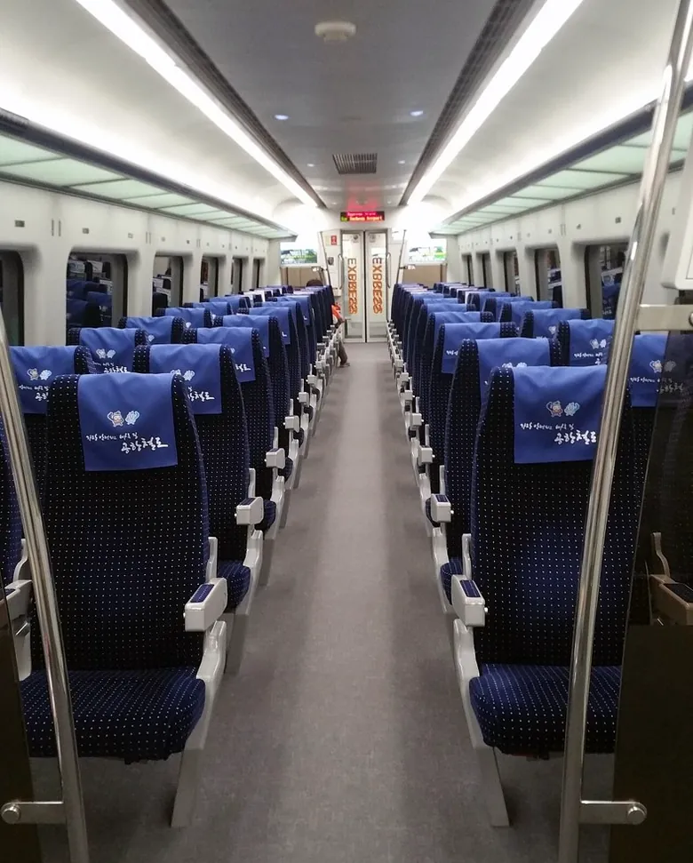
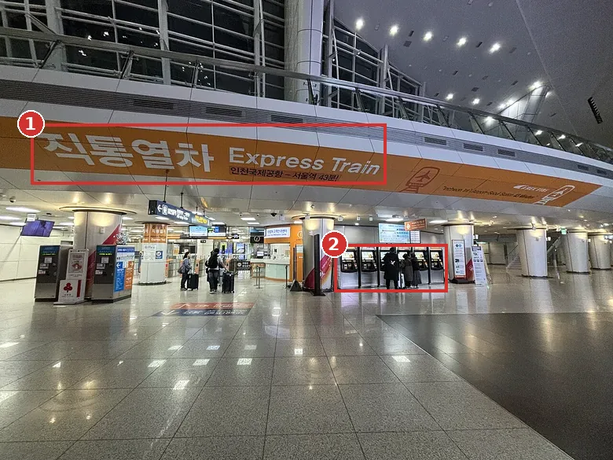

<a class="tr-btn go" href="#pick"><i class="ic ic-hotel" aria-hidden="true"></i>Which ride for my hotel?</a><a class="tr-btn" href="#late"><i class="ic ic-moon" aria-hidden="true"></i>Landing after 9 p.m.?</a>

<figure class="tr-hero"><figcaption><b>AREX platform, Terminal 1 station.</b> Trains into Seoul leave from here. Photo: <a href="https://commons.wikimedia.org/wiki/File:202403_AREX_Local_Platform_1,2_of_Incheon_International_Airport_Terminal_1_Station.jpg" rel="noopener" target="_blank">MNXANL</a>, <a href="https://creativecommons.org/licenses/by-sa/4.0" rel="noopener" target="_blank">CC BY-SA 4.0</a>, Wikimedia Commons</figcaption></figure>

<ul class="tr-facts"><li><i class="ic ic-clock" aria-hidden="true"></i>43–80 min<small>airport to central Seoul</small></li><li><i class="ic ic-wallet" aria-hidden="true"></i>₩4,650–18,000<small>train or bus, adult</small></li><li><i class="ic ic-map-pin" aria-hidden="true"></i>Trains: B1<small>Bus tickets: 1F (Terminal 1)</small></li><li><i class="ic ic-moon" aria-hidden="true"></i>Last Express 22:48<small>from Terminal 1</small></li></ul>

<h2 id="pick">Which ride for my hotel?</h2>

<ul class="ap-pick"><li class="x" id="express">
<small><i class="ic ic-hotel" aria-hidden="true"></i>Near Seoul Station</small><b><i class="ic ic-train-front" aria-hidden="true"></i>AREX Express</b>43 min · ₩13,000 · reserved seat
<ul class="pts"><li><i class="ic ic-clock" aria-hidden="true"></i>Nonstop to Seoul Station: 43 min from Terminal 1, 51 min from Terminal 2</li><li><i class="ic ic-wallet" aria-hidden="true"></i>₩13,000 adult</li><li><i class="ic ic-armchair" aria-hidden="true"></i>Every seat reserved, free Wi-Fi</li><li><i class="ic ic-ticket" aria-hidden="true"></i>Ticket from the Express ticket machines or counter in the Transportation Center (B1, Terminals 1 and 2), or on the <a href="https://www.airportrailroad.com/ticket/rsv" rel="noopener" target="_blank">official AREX booking site</a>. Foreign cards work. Booking ahead is not required. Which buttons to press: see the fold just below. Bought on Klook ahead? You must turn it into a train ticket before boarding: <a href="#express-klook">Klook ahead vs at the airport</a>.</li></ul>
Our call: choose it if your hotel is near Seoul Station. The Express only runs to Seoul Station, so anywhere else means one more transfer there.
</li><li class="x" id="allstop">
<small><i class="ic ic-hotel" aria-hidden="true"></i>Hongdae or Gongdeok</small><b><i class="ic ic-train-front" aria-hidden="true"></i>AREX all-stop</b>₩4,650 by card · no transfer
<ul class="pts"><li><i class="ic ic-clock" aria-hidden="true"></i>59 min from Terminal 1 to Seoul Station (66 from Terminal 2)</li><li><i class="ic ic-credit-card" aria-hidden="true"></i>By card: ₩4,750 to Seoul Station, ₩4,650 to Hongik Univ. or Gongdeok. From Terminal 2 add ₩600.</li><li><i class="ic ic-users" aria-hidden="true"></i>Unreserved seats, like the subway.</li></ul>
Hongdae and Gongdeok: same line, about a third of the price, no change of train.
</li><li><a href="#bus"><small><i class="ic ic-hotel" aria-hidden="true"></i>Myeongdong, Gangnam, Jamsil, most hotels away from the line</small><b><i class="ic ic-bus" aria-hidden="true"></i>Limousine bus</b>60–80 min · staff load your bags</a></li><li><a href="#taxi"><i class="ic ic-car-taxi-front" aria-hidden="true"></i><small><i class="ic ic-users" aria-hidden="true"></i>3 or 4 people with bags</small><b><i class="ic ic-car-taxi-front" aria-hidden="true"></i>International Taxi</b>fixed fare · ₩70,000–95,000</a></li><li><a href="#late"><i class="ic ic-moon" aria-hidden="true"></i><small><i class="ic ic-plane" aria-hidden="true"></i>Anywhere, landing after about 9 p.m.</small><b><i class="ic ic-triangle-alert" aria-hidden="true"></i>Read "Landing late" first</b>last Express from T1: 22:48</a></li></ul>

<i class="ic ic-ticket" aria-hidden="true"></i>Buying an Express ticket at the machine

1. **Getting there:** from the 1F arrivals hall, take the lift or escalator down to the Transportation Center on B1. At Terminal 1, facing the Transportation Center, the Express side is on the **right (west)**. At Terminal 2 we have not been able to confirm the direction yet: ask at the **Express customer service center** in the B1 Transportation Center.
2. **At the machine:** ① choose a language (Korean, English, Chinese, Japanese) ② choose your destination (Seoul Station) ③ choose a train (departure time) ④ choose the number of people (adult 13+, child 6–12), then confirm ⑤ pay by cash or card ⑥ take your ticket and receipt. Don't leave the ticket behind.
3. **Then:** scan the ticket's QR code at the gate and go down to the **B4** platform. More in ['After you buy: boarding the Express train'](#prep) below.

The machine screens shown in AREX's guide are from a Seoul Station machine. The airport machines may look a little different.

<i class="ic ic-route" aria-hidden="true"></i>See both trains on one line

{{fig:airport-to-seoul-2|Express and all-stop run on the same line}}

No hotel yet? [Where to stay in Seoul](/seoul-areas/) helps you pick the area first.

<i class="ic ic-info" aria-hidden="true"></i>All four side by side, and what we left out

| If you are staying near | Take | Why |
|---|---|---|
| Seoul Station | AREX Express | Nonstop, 43 minutes from Terminal 1, a reserved seat |
| Hongdae or Gongdeok | AREX all-stop train | It stops at both: ₩4,650 by card, no transfer |
| Myeongdong, Gangnam, Jamsil and most hotels away from the line | Airport limousine bus | Straight to the hotel districts; staff load your bags |
| Anywhere, landing after about 9 p.m. | Read "Landing late" first | The last Express leaves Terminal 1 at 22:48 |

{{fig:airport-to-seoul-1|Four ways from Terminal 1 into Seoul, adult fares}}

We picked three rides and one fallback for groups. What we left out: Gimpo Airport and car hire. Once you are in the city, [Getting around Seoul](/getting-around/) takes over.

## Your first hour, in pictures

Visit Seoul says to allow one to two hours from landing for immigration and bags. After that, this is the way to the train.

<h3 class="tr-step">1<i class="ic ic-signpost" aria-hidden="true"></i>Out of arrivals: follow the train signs</h3>

<figure class="tr-photo"><figcaption><b>Arrivals hall, Terminal 1,</b> seen from the floor above. Photo: <a href="https://commons.wikimedia.org/wiki/File:Incheon_International_Airport_Terminal_1_Arrival_3.jpg" rel="noopener" target="_blank">ノボホショコロトソ</a>, <a href="https://creativecommons.org/licenses/by/4.0" rel="noopener" target="_blank">CC BY 4.0</a>, Wikimedia Commons</figcaption></figure>

{{fig:airport-to-seoul-t1map|Terminal 1: from the 1F arrival halls down to the B1 Transportation Center. Redrawn by Nadri from the positions on Incheon International Airport Corporation's floor plan and facility list (checked 26 Nov 2026)}}

1. On the airport's plan, the Transportation Center is **in front of the middle of the terminal (around Exits 7 and 8)**. Whichever arrival hall you come out of (A–F), follow the signs for the Transportation Center and the Airport Railroad (AREX) towards the middle.
2. What you pass on the right way: info desks (near Exits 5 and 10, 24 hours), airport bus desks (near Exits 9 and 11), mobile carriers' roaming centres (near arrival hall A, 06:00–22:00, and F, 24 hours).
3. Go down to B1: that's the Transportation Center. If you see the **Travel Center** (07:00–21:30) in the middle, you're in the right place. Facing the Transportation Center, the regular train is on the left (east) and the express train on the right (west).

<i class="ic ic-map" aria-hidden="true"></i>Landed at Terminal 2?

{{fig:airport-to-seoul-t2map|Terminal 2: from the 1F arrival hall down to the B1 Transportation Center. Redrawn by Nadri from the positions on Incheon International Airport Corporation's floor plan}}

At Terminal 2, go down from the arrival hall (1F) to the B1 Transportation Center: trains and buses are in one place. Bus stop numbers: Seoul 11–35, Gyeonggi 36–45, other regions 01–10. The International Taxi stand is 3C on 1F.

<h3 class="tr-step">2<i class="ic ic-arrow-down" aria-hidden="true"></i>Go down to B1, the Transportation Center</h3>

<figure class="tr-photo"><figcaption><b>B1, Terminal 1 station: the Express side.</b> Photo: <a href="https://commons.wikimedia.org/wiki/File:202403_AREX_Express_Train_Concourse_at_Incheon_International_Airport_Terminal_1_Station.jpg" rel="noopener" target="_blank">MNXANL</a>, <a href="https://creativecommons.org/licenses/by-sa/4.0" rel="noopener" target="_blank">CC BY-SA 4.0</a>, Wikimedia Commons; numbers added by Nadri</figcaption></figure>

1. Sign: Express Train (직통열차).
2. Ticket machines.

The Express counter, card machines and a convenience store are all on B1.

<h3 class="tr-step">3<i class="ic ic-credit-card" aria-hidden="true"></i>Get a T-money card and load it</h3>

<figure><figcaption><b>T-money card.</b> One card for the train, subway and buses. Photo: <a href="https://commons.wikimedia.org/wiki/File:T-money_card.jpg" rel="noopener" target="_blank">zisk</a>, Public domain (PD-self: released by the author), Wikimedia Commons</figcaption></figure><figure><figcaption><b>Card machine</b> (Soraepogu Station, Incheon, a Korail station; machines in Seoul and at the airport can look different). Load money here. Photo: <a href="https://commons.wikimedia.org/wiki/File:Ticket_Vending_and_Card_Reload_Machine_-_Seoul_Metropolitan_Subway_20240713.jpg" rel="noopener" target="_blank">LandAndTree</a>, <a href="https://creativecommons.org/licenses/by/4.0" rel="noopener" target="_blank">CC BY 4.0</a>, Wikimedia Commons</figcaption></figure>

1. **Buy:** at the convenience store or a transit-card machine in the Transportation Center (B1). How to buy one at the counter: [convenience store guide](/convenience-store/#tmoney). If you pre-ordered a card, how to collect it is [below, under 'Want it ready'](#prep).
2. **No cash?** The T-money machines in the airport railroad stations at Terminals 1 and 2 sell a preloaded T-money card for a foreign credit card: ₩15,000 (₩5,000 card + ₩10,000 credit), on sale since 23 November 2026. AREX has not said whether you can reload it by card later. To get cash at Terminal 1, there is an ATM **on B1 next to the AREX all-stop ticket machines** (24 hours; on 1F near exits 4, 6, 9 and 11). We have not confirmed whether this ATM accepts foreign cards, or where the ATMs are at Terminal 2.
3. **Top up (cash only):** at the machine ① choose top-up and the amount on the screen, ② keep your card on the "Transit card here" tray, ③ put notes into "Insert bills here", ④ check the new balance on the screen, then take your card. The same steps with machine photos: [Seoul subway, step 2](/seoul-subway/)
4. No card? A single ticket costs ₩100 more, plus a ₩500 deposit you get back.

<h3 class="tr-step">4<i class="ic ic-log-in" aria-hidden="true"></i>Tap in at the AREX gate</h3>

<figure class="tr-photo"><figcaption><b>All-stop train concourse, Terminal 1 station (B1).</b> Photo: <a href="https://commons.wikimedia.org/wiki/File:202403_AREX_Local_Train_Concourse_at_Incheon_International_Airport_Terminal_1_Station.jpg" rel="noopener" target="_blank">MNXANL</a>, <a href="https://creativecommons.org/licenses/by-sa/4.0" rel="noopener" target="_blank">CC BY-SA 4.0</a>, Wikimedia Commons; numbers added by Nadri</figcaption></figure>

1. Machines marked **BUY HERE**: tickets and cards.
2. The gates. Hold your card on the reader: it shows your balance and the gate opens. If it stays shut, check the balance on the reader; if it is too low, top up at a machine as in step 3 and tap again.
3. The sign says "Opposite side for Express train". The Express has its own counter.

<h3 class="tr-step">5<i class="ic ic-train-front" aria-hidden="true"></i>Ride: watch the names change</h3>

<figure class="tr-photo"><figcaption><b>AREX platform, Terminal 1 station.</b> Photo: <a href="https://commons.wikimedia.org/wiki/File:202403_AREX_Local_Platform_1,2_of_Incheon_International_Airport_Terminal_1_Station.jpg" rel="noopener" target="_blank">MNXANL</a>, <a href="https://creativecommons.org/licenses/by-sa/4.0" rel="noopener" target="_blank">CC BY-SA 4.0</a>, Wikimedia Commons; numbers added by Nadri</figcaption></figure>

1. The sign: all-stop train, platform 2, toward Geomam, Gimpo Airport, Hongik Univ. and Seoul Station.

First come names you won't know yet. Then the names from your map:

<ul class="ap-stations"><li>Unseo</li><li>Yeongjong</li><li>Cheongna International City</li><li class="sep">→</li><li class="k">Gimpo Airport</li><li class="k">Hongik Univ.</li><li class="k">Gongdeok</li><li class="k">Seoul Station</li></ul>

<h3 class="tr-step">6<i class="ic ic-circle-check" aria-hidden="true"></i>Tap out where your bed is</h3>

<aside class="tr-note ok"><i class="ic ic-circle-check" aria-hidden="true"></i>Tap the same card at the exit gate. Our pick for the ending: step out at the station or bus stop nearest your bed, not the ride that looked fastest on paper.</aside>

<i class="ic ic-map" aria-hidden="true"></i>Map: where the bus and the train are at Terminal 1

{{fig:airport-to-seoul-3|Where to find the bus and the train at Terminal 1}}

<h2 id="bus">Airport limousine bus</h2>

For most hotels away from the AREX line, the bus means the fewest changes with luggage: one ticket, one seat, your bags under the bus.

<ul class="tr-facts"><li><i class="ic ic-clock" aria-hidden="true"></i>60–80 min<small>to Seoul</small></li><li><i class="ic ic-wallet" aria-hidden="true"></i>₩16,000–18,000<small>adult, cards accepted</small></li><li><i class="ic ic-ticket" aria-hidden="true"></i>Buy a ticket<small>ticket holders board first</small></li><li><i class="ic ic-luggage" aria-hidden="true"></i>2 bags each<small>28 inches or smaller</small></li></ul>

**Go to the stop printed on your ticket.** It also shows your destination, fare and boarding time.

{{fig:airport-to-seoul-5|What your airport bus ticket shows}}

Find your route number. Examples:

<ul class="ap-routes"><li><b>6001</b>Myeongdong, Dongdaemun</li><li><b>6002</b>Hongdae, Jongno</li><li><b>6020</b>Gangnam</li><li><b>6200</b>Jamsil</li><li><b>6701</b>Gwanghwamun, City Hall</li></ul>

1. **Buy a ticket** at the bus counter or a kiosk: Terminal 1 first floor (1F; airport bus info desks near Exit 9, 24 hours, and Exit 11, 06:00–22:00), Terminal 2 basement level. T-money works too, but people with tickets board first.
2. **Hand your bags to the staff** and keep the claim tag.
3. **Get off at the announced stop** and match the tag number to your bag.

<h2 id="taxi">Taxi: for three or four with bags</h2>

The International Taxi has fixed fares from Incheon to Seoul, tolls included, so there is no meter to worry about. Desks are in both terminals and foreign cards are accepted.

**Where to board the International Taxi: stand 4C at Terminal 1, stand 3C at Terminal 2.** International Taxi phone: 1644-2255. Don't follow anyone who approaches you inside the terminal; board at this official stand. The airport warns about vans pretending to be taxis ("call-vans") that pull in passengers and overcharge.

<figure class="tr-photo"><figcaption><b>This is a regular taxi.</b> Fixed fares only for the International Taxi booked at the desk inside the terminal. Photo: <a href="https://commons.wikimedia.org/wiki/File:Seoul_taxis_01.jpg" rel="noopener" target="_blank">Ilya Plekhanov</a>, <a href="https://creativecommons.org/licenses/by-sa/4.0" rel="noopener" target="_blank">CC BY-SA 4.0</a>, Wikimedia Commons</figcaption></figure>

Mid-size car, by the Seoul district you are going to:

<ul class="ap-fares"><li><b>₩70,000</b>Gangseo</li><li><b>₩75,000</b>Mapo (Hongdae), Yeongdeungpo, Eunpyeong and others</li><li><b>₩85,000</b>Jung (Myeongdong), Jongno, Yongsan and others</li><li><b>₩90,000</b>Gangnam, Seocho, Seongdong and others</li><li><b>₩95,000</b>Songpa (Jamsil), Gangdong, Gwangjin and others</li></ul>

Large and deluxe cars are ₩100,000–140,000. Split four ways, ₩85,000 is about ₩21,000 each, close to the bus fare.

<i class="ic ic-car-taxi-front" aria-hidden="true"></i>Fixed fares as a chart

{{fig:airport-to-seoul-6|International Taxi fixed fares from Incheon, mid-size}}

<h2 id="late">Landing late at night: how do I get to Seoul?</h2>

<aside class="tr-note"><i class="ic ic-moon" aria-hidden="true"></i><b>Last AREX Express: 22:48 from Terminal 1, 22:40 from Terminal 2.</b> Visit Seoul advises allowing one to two hours for immigration and bags, so a flight landing after about 9 p.m. can miss it. Decide before you fly.</aside>

**Choose by the time you come out of the arrivals hall.** The times below are when trains and buses leave, so allow extra time to buy a ticket and get to where you board.

| When you come out | How to go |
|---|---|
| Before the last Express (22:48 from Terminal 1, 22:40 from Terminal 2) | [AREX Express](#express). Transportation Center, B1 |
| After the last Express | [AREX all-stop train](#allstop). The last train to Seoul Station leaves Terminal 1 at 23:38 and Terminal 2 at 23:32 (same on weekdays and holidays). The trains after that, 23:56 from Terminal 1 and 23:50 from Terminal 2, only go as far as Digital Media City Station and do not stop at Hongik Univ. or Seoul Station. [AREX timetable by station](https://www.airportrailroad.com/train/normal/info/100) |
| From 23:40 at Terminal 1 or 23:20 at Terminal 2, into the 4 a.m. hour | [Late-night buses](#late-bus), 4 routes. Take the one that stops near where you sleep |
| Lots of bags, 3–4 people, or your stay is far from a bus stop | [Taxi](#late-taxi). From 10 p.m. to 4 a.m. a night surcharge is added to the meter fare |
| Your flight may be late, you have lots of bags, or you need a child car seat | [Book a private car ahead](#late-car). The companies we saw showed 90 minutes of free waiting |

{{fig:airport-to-seoul-7|What still runs from Terminal 1 late at night}}

<h3 id="late-bus">Late-night bus: where do I get on, and when does it come?</h3>

- **Ticket:** At Terminal 1, buy it at a bus ticket counter on 1F (inside or outside) or a ticket machine. At Terminal 2, buy it at the ticket counter in the bus terminal of the B1 Transportation Center (in the middle of the bus waiting area) or a ticket machine (east and west sides of the Transportation Center). For N6701 and N6703 you can also buy it in the Tmoney GO app.
- **Fare (adult):** N6000 and N6002 ₩17,000; N6701 and N6703 ₩18,000. Child ₩10,000 and ₩12,000, in the same order.
- **Where to board at Terminal 1:** Go out of the arrivals hall (1F) through Exits 3–7, and you reach the stops for buses to Seoul. There, look for **6A (N6000, N6002)** and **3B (N6701, N6703)**. [Incheon Airport stop map](https://www.airport.kr/ap_en/1507/subview.do)
- **Where to board at Terminal 2:** From the arrivals hall (1F), go down to the B1 Transportation Center and on to the bus terminal. Buses to Seoul use stops 11–35 in the middle. **Stop 28 (N6000), stop 19 (N6703)**. N6002 is stop 30 and N6701 is stop 18, but some places on the airport website show other numbers (N6002 stop 24, N6701 stop 20). Check the number on the front of the bus around there. [Incheon Airport stop map](https://www.airport.kr/ap_en/1510/subview.do)

<ul class="ap-routes late"><li><b>N6000</b>Gangnam</li><li><b>N6002</b>Hongdae, Cheongnyangni</li><li><b>N6701</b>Seoul Station, Dongdaemun</li><li><b>N6703</b>Jamsil, Gwangnaru</li></ul>

| Route | Stops (time from Terminal 1) | From Terminal 1 | From Terminal 2 |
|---|---|---|---|
| N6000 | Songjeong Station 40 min → Yeomchang Station 50 min → Gangnam Express Bus Terminal 70 min | 00:10 00:50 01:30 02:10 03:40 04:20 | 23:50 00:30 01:10 01:50 03:20 04:00 |
| N6002 | Hongdae 45 min → Four Seasons Hotel (Gwanghwamun) 60 min → Heunginjimun (Dongdaemun) 75 min → Cheongnyangni 90 min | 00:00 00:30 01:00 01:40 04:00 04:40 | 23:40 00:10 00:40 01:20 03:40 04:20 |
| N6701 | Mapo Station 50 min → Seoul Station 60 min → Euljiro 1-ga 65 min → Dongdaemun Design Plaza 70 min | 23:50 00:40 01:40 03:45 04:40 | 23:30 00:20 01:20 03:25 04:20 |
| N6703 | Seorae Village 50 min → COEX 65 min → Jamsil Lotte World 70 min → Gangbyeon Station (Techno Mart) 80 min → Gwangnaru Station 85 min | 23:40 00:20 01:05 01:45 03:50 04:50 | 23:20 00:00 00:45 01:25 03:30 04:30 |

From Terminal 2 the bus goes by way of Terminal 1, so the ride is about 20 minutes longer. There are no buses between 02:10 and 03:40 at Terminal 1, or between 01:50 and 03:20 at Terminal 2. Times follow Incheon Airport's "Seoul late-night bus" page; in a few places the route search screen is 1–2 minutes different.

<h3 id="late-taxi">Taxi: how much more at night?</h3>

- **Regular taxi (meter fare):** base fare ₩4,800. Seoul and Incheon taxis add **20% from 22:00 to 23:00, 40% from 23:00 to 02:00, and 20% from 02:00 to 04:00**. Gyeonggi taxis add 30% from 23:00 to 04:00. From the airport to Seoul, Incheon, Goyang, Gwangmyeong, Gimpo or Bucheon, there is no extra charge for crossing a city line.
- **Where to board:** Terminal 1 1F stands 5C, 6C and 6D; Terminal 2 Seoul taxi stand 7C.
- **Deluxe and large taxis (9 seats):** base fare ₩7,000, 20% extra from 22:00 to 04:00 (Gyeonggi taxis: 23:00 to 04:00). Terminal 1 stands 7C and 8C, Terminal 2 stand 7D.
- **International Taxi (foreign-language help, fixed fare to Seoul, tolls included):** Terminal 1 stand 4C, Terminal 2 stand 3C, phone 1644-2255. The [fixed fares](#taxi) are exactly as in Seoul's fare table. That table shows no separate night fare, so ask for the total before you get in.

<h3 id="late-car">Booking a private car ahead: when is it a good idea?</h3>

**It's good when you land late and your flight may be delayed, when you have lots of bags, when you need a child car seat, or when your stay is far from a late-night bus stop.** You book ahead a car that takes you from the airport to the door of your stay. See the price on each company's line in the search results and compare it with the [taxi fixed fares](#taxi).

1. On Klook's airport transfer screen (Airport transfers), choose **Airport pick-up**. Enter your arrival time or flight number, your hotel's name (address) and the number of people, then search.
2. Each car type shows the most people and bags it takes. Pick a car type with plenty of room for your people and bags.
3. Open that car type. Before you choose a company, check the waiting time, cancellation and luggage rules under "See details". They can differ by company.
4. Pay with **Book now**, and save the booking confirmation on your phone.

What we checked: one search on 28 November 2026 (Incheon Airport → Lotte Hotel Seoul, arriving 11:30 p.m., 2 people), the list of 3 companies for the 9-seater (Comfort 9 seater), and 1 detail screen among them.

**All 3 companies** listed free cancellation up to 24 hours before pickup, 90 minutes of free waiting, and tags for a meeting service (Meet & greet) and car seats.

**What we saw on that 1 detail screen:**

- The driver tracks your flight and waits for free up to 90 minutes after landing, even if the flight is late. After that, there is an extra charge.
- If you cancel later than 24 hours before, you get no refund.
- The 9-seater takes up to 5 people with 5 bags of 24 inches, or 3 of 26 inches, or 2 of 28 inches. Count children and babies as 1 person each. A wheelchair, stroller or golf bag counts as 1 bag of 28 inches. The screen says to ask the company for details.
- **If you have more people or bags than the limit, the driver may not take you, and then you get no refund.**
- Meet & greet is an option you pay extra for: the driver waits in the arrivals hall holding a name sign. A car seat is also an option you pay extra for (ages 1–4 or 9–18 kg).
- A booking confirmation comes within a few minutes of paying.

**Not checked:** where you meet the driver and how you contact them if you don't add Meet & greet. Follow your booking confirmation or the company's instructions.

{{aff:klook_transfer|Find an airport pickup car (enter your hotel and arrival time)}}

<i class="ic ic-calendar-days" aria-hidden="true"></i>Why the last Express time changed

The Express timetable changed on 23 October 2026, when daily Express runs rose from 52 to 56. 22:48 (Terminal 1) and 22:40 (Terminal 2) are on the current weekday and holiday timetables.

## Common mistakes

<ul class="tr-oops"><li><i class="ic ic-triangle-alert" aria-hidden="true"></i><b>Boarding with a Climate Card at the airport.</b> Since 1 October 2026 the Climate Card short-term pass lets you ride to the airport and get off at Terminal 1 or 2, but you cannot board with it at the airport stations. For the ride into Seoul, pay with T-money.</li><li><i class="ic ic-triangle-alert" aria-hidden="true"></i><b>Taking the Express when your hotel isn't near Seoul Station.</b> The Express only runs to Seoul Station, so you will need one more transfer there.</li><li><i class="ic ic-triangle-alert" aria-hidden="true"></i><b>Counting on the Express after a late landing.</b> The last one leaves Terminal 1 at 22:48.</li><li><i class="ic ic-triangle-alert" aria-hidden="true"></i><b>Waiting for the bus with only T-money.</b> People with tickets board first.</li></ul>

<h2 id="prep">Want it ready before you land?</h2>

<aside class="tr-note tip"><i class="ic ic-lightbulb" aria-hidden="true"></i><b>Not required.</b> The airport sells transport cards (card machines, convenience store) and Express tickets (B1 ticket machines and Express counter). Booking ahead only moves the purchase earlier.</aside>

{{fig:airport-to-seoul-4|T-money or WOWPASS: what each card does}}

<b>T-money card, picked up at the airport.</b> Tap for the all-stop train, subway and buses. Photo: <a href="https://commons.wikimedia.org/wiki/File:T-money_card.jpg" rel="noopener" target="_blank">zisk</a>, Public domain (PD-self: released by the author), Wikimedia Commons

**Before you buy:** check on the product page that you can collect it at your terminal (1 or 2) at your arrival time. We have not been able to confirm the pickup point ourselves (Klook's site blocks automated access, so we could not open it).

{{aff:klook_tmoney|Pre-order a T-money card to pick up at the airport}}

<i class="ic ic-list-checks" aria-hidden="true"></i>After you buy: collecting the T-money card

1. **Where and when:** go to the place and time written on your booking confirmation (voucher).
2. **What to show:** the confirmation also says what to show. Save it on your phone before you fly.
3. **Balance:** tap the card on a gate reader and the balance appears. If it is short, top up with cash at the machine, as in step 3 above.
4. **If you can't collect it:** contact the seller (Klook) with your booking number, and meanwhile buy a card at the B1 convenience store or the T-money machine in the airport railroad station.

<i class="ic ic-wallet" aria-hidden="true"></i>
<b>WOWPASS.</b> T-money inside for transport, plus money exchange and card payments on one card. The T-money balance for subway and bus is topped up separately.

{{aff:klook_wowpass|Or a WOWPASS: money exchange, card payments and T-money in one}}

<i class="ic ic-list-checks" aria-hidden="true"></i>After you buy: getting and using WOWPASS

1. **Get the card:** follow the method on your booking confirmation. If it is issued at a WOWPASS machine: on the machine select **'Get a new Card'**, then press **'Issue via Code'**, scan your passport, enter your code, and when the card comes out, insert it into the machine once to activate it.
2. **Register it in the app:** add the card to the WOWPASS app to see both balances. If you lose the card, freeze it in the app to protect your WOWPASS balance. But the **T-money balance on a lost card cannot be recovered, even if you get a new WOWPASS.**
3. **Load payment balance:** at a WOWPASS machine with cash in 16 currencies or a credit card, or in the app with a foreign card. Machines: [find a WOWPASS machine](https://www.wowpass.io/en/map/kiosk).
4. **Transport is separate:** subway and bus fares come from the card's **T-money balance**. Top it up with won cash at stations and convenience stores, or move WOWPASS balance into it in the app (NFC). Skip this and the gate says the balance is too low.
5. **Leftover money:** withdraw WOWPASS balance as won cash at a machine (up to ₩100,000 a time, ₩1,000 fee, no coins under ₩1,000). The T-money balance is refunded separately at T-money refund points such as convenience stores (₩500 fee; ₩50,000 or more only at T-money headquarters).

Source: [WOWPASS guide](https://www.wowpass.io/en/guide) (checked 27 November 2026).

<h3 id="express-klook">Express ticket: Klook in advance, or buy at the airport?</h3>

**Our call: buying at the airport is enough.** Buy at the B1 machines when you land and you board with that ticket. Buying on Klook ahead only moves the payment earlier, and adds one step before boarding: turning the voucher into a train ticket. Travelling with a child aged 6–12, or need a wheelchair seat? Buy at the airport.

| | Klook voucher bought ahead | B1 machines or counter at the airport |
|---|---|---|
| When you buy | Before you fly, in the Klook app or site | When you land, in the B1 Transportation Center |
| Price | Shown at Klook checkout. Compare it with the official fare (adult ₩13,000) before you buy | Adult ₩13,000 |
| Before boarding | Turn the voucher into a train ticket (activate it). You cannot board with an unactivated voucher | Nothing. Use the ticket's QR code at the gate |
| Seat | Activate in the Klook app: you pick a departure time slot, the train and seat are assigned for you. Activate on the AREX website or at a machine: you choose | You choose the train (departure time). Car and seat are printed on the ticket |
| Change or refund | If you activate in the Klook app: no refund after you pick a train, and changes are made at the counter (Klook app screen). For a voucher exchanged on the AREX website or at a machine, we have not confirmed the rules. For cancelling before that, see the rules on your Klook booking | We did not find how in the official guide for machine tickets. Ask at the Express customer service center next to the machines |
| Child aged 6–12 | Same price as an adult on Klook. Klook says to buy child tickets on-site | Choose 'Child' when you pick the number of people |
| Wheelchair seat | Official guide: on-site purchase only | On-site only. Ask at the Express customer service center |
| What you need | The Klook app, or the voucher's 13-digit number | A card (foreign cards work) or cash |

Children aged 0–5: Klook says they ride free if they do not take their own seat, one per paying adult, and each extra child needs a child ticket. The AREX official guide says: if one guardian brings more than one infant, or an infant needs a seat, buy a child ticket.

<b>Buy an AREX Express voucher on Klook.</b> Only worth it if your hotel is near Seoul Station. Before boarding, turn it into a train ticket in one of the three ways below. Photo: <a href="https://commons.wikimedia.org/wiki/File:Nearly_empty_Incheon_Airport_Railroad_Express_during_the_coronavirus_outbreak_20200306_104401.jpg" rel="noopener" target="_blank">Bonnielou2013</a>, <a href="https://creativecommons.org/licenses/by-sa/4.0" rel="noopener" target="_blank">CC BY-SA 4.0</a>, Wikimedia Commons

{{aff:klook_airport|Buy an AREX Express voucher on Klook (exchange it for a ticket before boarding)}}

<i class="ic ic-ticket" aria-hidden="true"></i>Bought on Klook: 3 ways to turn the voucher into a train ticket

You cannot board with an unactivated voucher. Easiest first for someone who has just landed (our call: ① if your phone has internet, ② if not). Screen words are quoted exactly as they appear on the Klook and AREX screens.

**① In the Klook app (shortest)**

1. In the Klook app, tap **Account** at the bottom → **Bookings** → your AREX booking.
2. If you see **Status:Awaiting activation**, tap **Go to activate**.
3. On the **Select ticket** screen, choose the **Date** and a **Departure Time**. The earliest train in that slot and a seat are assigned automatically, and the ticket is valid that day only. The note at the top: "Tickets cannot be refunded after selecting the train number, changes need to be made at the counter".
4. Under **Status:Activated** you get a QR code, **Train no.** and **Car no.** (car and seat). Hold this QR code to the gate.

**② At the airport's Express ticket machine (paper ticket)**

1. In your Klook booking, tap **See voucher** and find the 13-digit **Voucher no.** Our call: write it down before you land and you will not need internet on your phone.
2. Go to the **Express Train Ticket Vending Machine** (Korean sign: 직통열차 승차권발매기) in the B1 Transportation Center. How to get there: [step 1 of 'Buying an Express ticket at the machine' above](#express-buy).
3. Enter the 13-digit number, choose the departure date, time and seat, and a paper ticket comes out. We have not confirmed the name of the menu where you enter the number. If you cannot find it, show the voucher number at the Express customer service center next to the machines.
4. Hold the paper ticket's QR code to the gate.

**③ On the AREX official website (if you want to pick your seat ahead)**

1. In your Klook booking, tap **See voucher** and find the 13-digit number.
2. Open [AREX official booking](https://www.airportrailroad.com/ticket/rsv) and choose your language at the top right (for example ENGLISH - KRW). On the **Express Train** tab, fill in **Departure Station**, **Arrival Station** and **Train Time** (date and time).
3. In the **Ticket Reservation** list, tap **Reserve** next to your train.
4. Choose **Member Reservation** or **Non-member Reservation**. Non-members only need an email address. Enter the 6-digit **Verification Code** sent to your email, then a 6-digit number in **Ticket Confirmation Number** and the same number in **Re-enter** (write it down).
5. To change your seat, tap **Change Seat** and pick one.
6. Tap **Discount**, enter the 13-digit number under **Exchange Code** and tap **Verify**. When **Total Amount** shows **0 KRW**, tap **Pay**. You get a QR ticket.
7. Hold this QR code to the gate.

Also on the Klook product page (not confirmed on AREX's official pages): 1 standard piece of luggage and 1 handbag per person; no eating or drinking on board; there is a luggage area on the train; strollers and wheelchairs can board.

Source: Klook product page 'AREX Incheon Airport Express' (screens opened in a browser by the site operator, 27 November 2026); AREX [Express train guide](https://www.airportrailroad.com/train/express/guide) (Korean page; language menu at the top), checked 27 November 2026.

<i class="ic ic-list-checks" aria-hidden="true"></i>After you buy: boarding the Express train

1. **Your ticket:** an official AREX ticket (machine or official booking) has a QR code. A Klook voucher alone will not get you on: first turn it into a train ticket [in one of the 3 ways above](#express-klook-how) (AREX lists Klook among its partner travel agencies).
2. **Where:** on B1, go to the Express side of the Transportation Center. At Terminal 1, facing the Transportation Center, it is on the **right (west)**. At Terminal 2 we have not confirmed the direction yet (ask at the Express customer service center). Through the gates, take the lift or escalator down to the **B4** platform.
3. **Gate:** hold the ticket's QR code to the gate's QR scanner and the gate opens.
4. **Time:** be on the platform at least 3 minutes before departure. Your car and seat are on the ticket.
5. **Change or cancel:** official tickets under 'Change/refund ticket' (Korean screen: 승차권 변경/반환, our translation) on the AREX website or app (up to 3 changes; a fee if you change twice or more on the day of travel). A ticket activated in the Klook app: no refund after you pick the train, and changes are made at the counter (Klook app screen). For a voucher exchanged on the AREX website or at a machine we have not confirmed the rules; ask at the Express customer service center.

Source: AREX [Express train guide](https://www.airportrailroad.com/train/express/guide) and [partners](https://www.airportrailroad.com/train/express/partners) (Korean page; language menu at the top), checked 27 November 2026; Klook product page (screens opened in a browser by the site operator, 27 November 2026).

## The night before you fly

Settle three things.

1. **Find your hotel's district** and pick the ride at [the top of this page](#pick).
2. **Bus?** Note the route number. **Taxi?** Note your district's fixed fare.
3. **Landing after about 9 p.m.?** Note the late-night bus for your area too.

<ul class="tr-next"><li><a href="/e-arrival-card/"><i class="ic ic-id-card" aria-hidden="true"></i>Before you land: the e-Arrival Card<i class="ic ic-arrow-right" aria-hidden="true"></i></a></li><li><a href="/getting-around/"><i class="ic ic-route" aria-hidden="true"></i>In the city: getting around Seoul<i class="ic ic-arrow-right" aria-hidden="true"></i></a></li><li><a href="/seoul-subway/"><i class="ic ic-train-front" aria-hidden="true"></i>Your first subway ride<i class="ic ic-arrow-right" aria-hidden="true"></i></a></li></ul>

<i class="ic ic-list-checks" aria-hidden="true"></i>Sources and photo credits

Opened 26 November 2026 (KST): AREX, <a href="https://www.airportrailroad.com/train/express/introduce" rel="noopener" target="_blank">Express train</a> (times, fare, seats) and <a href="https://www.airportrailroad.com/train/express/info" rel="noopener" target="_blank">Express timetable</a>; AREX, <a href="https://www.airportrailroad.com/train/normal/introduce" rel="noopener" target="_blank">all-stop train</a> and <a href="https://www.airportrailroad.com/train/normal/fare" rel="noopener" target="_blank">all-stop fares</a>; Visit Seoul, <a href="https://english.visitseoul.net/airport-to-seoul" rel="noopener" target="_blank">Airport to Seoul</a> (fares and times as of June 2026; bus routes, luggage, ticket purchase); Incheon Airport, <a href="https://www.airport.kr/" rel="noopener" target="_blank">Airport Railroad guide</a> (airport.kr: ap_en/1512/subview.do), <a href="https://www.airport.kr/" rel="noopener" target="_blank">late-night buses</a> (airport.kr: ap_en/1507/subview.do) and <a href="https://www.airport.kr/" rel="noopener" target="_blank">limousine bus booking guide</a> (airport.kr: bbs/ap_en/937/138233/artclView.do); Seoul Metropolitan Government, <a href="https://news.seoul.go.kr/traffic/archives/1659" rel="noopener" target="_blank">taxi fares incl. International Taxi fixed fares</a> (updated 14 October 2026) and <a href="https://news.seoul.go.kr/traffic/archives/category/public-news_c1/climate-accompany-card_c1/card-climate_accompany_card" rel="noopener" target="_blank">Climate Card short-term pass</a> (updated 12 October 2026). Not reopened this time: Wikitree, <a href="https://www.wikitree.co.kr/articles/1168084" rel="noopener" target="_blank">AREX Express runs rise from 52 to 56 a day from 23 October 2026</a>. Incheon International Airport Corporation (Korean pages, opened 26 Nov 2026 12:00 KST): <a href="https://www.airport.kr/ap_ko/986/subview.do" rel="noopener" target="_blank">Taxi guide</a> (stand numbers, call-van warning), <a href="https://www.airport.kr/ap_ko/1008/subview.do" rel="noopener" target="_blank">Facilities</a> (airport bus info desks), <a href="https://www.airport.kr/ap_ko/974/subview.do" rel="noopener" target="_blank">Bus</a> (tickets). <a href="https://www.airport.kr/ap_en/1512/subview.do" rel="noopener" target="_blank">Airport Railroad guide floor plans</a> (T1/T2 Transportation Center, bus stop numbers)

Checked 27 November 2026: AREX <a href="https://www.airportrailroad.com/train/express/guide" rel="noopener" target="_blank">Express train guide</a> (ticket machines on B1 at T1/T2 and B2 at Seoul Station, machine steps 01–06, foreign cards, QR gates, B4 platform, 3 minutes before departure, changes and fees, a child ticket when one adult brings more than one infant or the infant needs a seat, wheelchair seats sold on-site only), <a href="https://www.airportrailroad.com/train/express/partners" rel="noopener" target="_blank">partners</a> (KLOOK listed as a travel agency), <a href="https://www.airportrailroad.com/train/express/introduce" rel="noopener" target="_blank">Express introduction</a> (Express customer service centers in the B1 Transportation Centers at T1/T2; facility and machine-step names translated from the Korean page); WOWPASS <a href="https://www.wowpass.io/en/guide" rel="noopener" target="_blank">guide</a> (loading, withdrawal, T-money top-up and refund, the 'Get a new Card' → 'Issue via Code' steps, T-money balance lost with the card); Incheon International Airport Corporation <a href="https://www.airport.kr/ap_ko/1008/subview.do" rel="noopener" target="_blank">facilities</a> (ATMs: B1 next to the AREX all-stop ticket machines, 1F near exits 4, 6, 9 and 11, 24 hours); Korea Herald <a href="https://www.koreaherald.com/article/10947683" rel="noopener" target="_blank">AREX preloaded T-money card</a> (₩15,000, foreign cards, reloading not announced). Not checked: the direction to the Express side on B1 at Terminal 2 (AREX and airport guides do not give it in text); whether the shared ATM accepts foreign cards, and Terminal 2 ATM locations (the airport facility list we opened covers Terminal 1 only); the Klook product pages (where to collect the T-money card and WOWPASS, and how to use them) — Klook's site blocks automated access, so we could not open them. That is why we point you to your booking confirmation. Also not confirmed: how to change or refund an Express ticket bought at the machine, and the name of the machine menu for entering a Klook voucher number. Klook product page 'AREX Incheon Airport Express' (screens opened in a browser by the site operator, 27 November 2026): the 3 ways to turn the voucher into a train ticket (Klook app, AREX official website, the station's Express ticket machine) and the words on each screen; an unactivated voucher cannot be used to board; app activation assigns the train and seat after you pick a time slot, valid that day only; no refund after picking the train, changes at the counter; child fare (6–12) on-site only, same price as adults on Klook; ages 0–5; luggage, eating and drinking. Prices and dates on those screens are examples, so we did not use them.

Checked 28 November 2026 (late arrival): Incheon International Airport Corporation, Seoul late-night buses <a href="https://www.airport.kr/ap_en/1507/subview.do" rel="noopener" target="_blank">Terminal 1</a> and <a href="https://www.airport.kr/ap_en/1510/subview.do" rel="noopener" target="_blank">Terminal 2</a> (fares, stops, departure times, stop maps), <a href="https://www.airport.kr/ap_en/1504/subview.do" rel="noopener" target="_blank">Bus Search</a> (where each route boards), <a href="https://www.airport.kr/ap_en/1502/subview.do" rel="noopener" target="_blank">Terminal 1 bus stops</a> and <a href="https://www.airport.kr/ap_en/1503/subview.do" rel="noopener" target="_blank">Terminal 2 bus stops</a> (ticket counter and machine locations, 1–2 hours for arrival), <a href="https://www.airport.kr/ap_ko/986/subview.do" rel="noopener" target="_blank">taxi guide</a> (stand numbers, night surcharge, city-line surcharge; Korean page); AREX timetables by station <a href="https://www.airportrailroad.com/train/normal/info/100" rel="noopener" target="_blank">Incheon Airport Terminal 1</a> and <a href="https://www.airportrailroad.com/train/normal/info/110" rel="noopener" target="_blank">Incheon Airport Terminal 2</a> (weekdays and holidays, toward Seoul Station); Seoul Metropolitan Government <a href="https://news.seoul.go.kr/traffic/archives/1659" rel="noopener" target="_blank">Seoul taxi fares</a> (International Taxi zone fares). Private car: Klook airport pick-up search screens (opened in a browser by the site operator, 28 November 2026, Incheon Airport → Lotte Hotel Seoul, arriving 11:30 p.m., 2 people) — the list of 3 companies for the 9-seater (free cancellation, free waiting, optional services) and 1 detail screen (waiting, cancellation, people, bags, meeting, car seat, confirmation). Prices and dates on those screens were not used.

<b>Photos used on this page</b>
<ul class="ap-credits"><li><a href="https://commons.wikimedia.org/wiki/File:202403_AREX_Local_Platform_1,2_of_Incheon_International_Airport_Terminal_1_Station.jpg" rel="noopener" target="_blank">File:202403 AREX Local Platform 1,2 of Incheon International Airport Terminal 1 Station.jpg</a>: MNXANL, <a href="https://creativecommons.org/licenses/by-sa/4.0" rel="noopener" target="_blank">CC BY-SA 4.0</a>. Changes: cropped, resized to 780x492, light auto-contrast.</li><li><a href="https://commons.wikimedia.org/wiki/File:Nearly_empty_Incheon_Airport_Railroad_Express_during_the_coronavirus_outbreak_20200306_104401.jpg" rel="noopener" target="_blank">File:Nearly empty Incheon Airport Railroad Express during the coronavirus outbreak 20200306 104401.jpg</a>: Bonnielou2013, <a href="https://creativecommons.org/licenses/by-sa/4.0" rel="noopener" target="_blank">CC BY-SA 4.0</a>. Changes: cropped, resized to 780x971, light auto-contrast.</li><li><a href="https://commons.wikimedia.org/wiki/File:202403_AREX_Local_Train_Concourse_at_Incheon_International_Airport_Terminal_1_Station.jpg" rel="noopener" target="_blank">File:202403 AREX Local Train Concourse at Incheon International Airport Terminal 1 Station.jpg</a>: MNXANL, <a href="https://creativecommons.org/licenses/by-sa/4.0" rel="noopener" target="_blank">CC BY-SA 4.0</a>. Changes: resized to 780x585, light auto-contrast, 1 detected face(s) blurred.</li><li><a href="https://commons.wikimedia.org/wiki/File:Incheon_Airport_Limousine_6010.JPG" rel="noopener" target="_blank">File:Incheon Airport Limousine 6010.JPG</a>: hyolee2, <a href="https://creativecommons.org/licenses/by-sa/3.0" rel="noopener" target="_blank">CC BY-SA 3.0</a>. Changes: resized to 780x585, light auto-contrast, 1 detected face(s) blurred, 1 area(s) blurred (faces/plates, manual).</li><li><a href="https://commons.wikimedia.org/wiki/File:Incheon_International_Airport_Terminal_1_Arrival_3.jpg" rel="noopener" target="_blank">File:Incheon International Airport Terminal 1 Arrival 3.jpg</a>: ノボホショコロトソ, <a href="https://creativecommons.org/licenses/by/4.0" rel="noopener" target="_blank">CC BY 4.0</a>. Changes: resized to 780x585, light auto-contrast, 1 detected face(s) blurred.</li><li><a href="https://commons.wikimedia.org/wiki/File:202403_AREX_Express_Train_Concourse_at_Incheon_International_Airport_Terminal_1_Station.jpg" rel="noopener" target="_blank">File:202403 AREX Express Train Concourse at Incheon International Airport Terminal 1 Station.jpg</a>: MNXANL, <a href="https://creativecommons.org/licenses/by-sa/4.0" rel="noopener" target="_blank">CC BY-SA 4.0</a>. Changes: resized, light auto-contrast, numbered red boxes added.</li><li><a href="https://commons.wikimedia.org/wiki/File:T-money_card.jpg" rel="noopener" target="_blank">File:T-money card.jpg</a>: zisk, Public domain (PD-self: released by the author). Changes: kept at 499x316, light auto-contrast.</li><li><a href="https://commons.wikimedia.org/wiki/File:Ticket_Vending_and_Card_Reload_Machine_-_Seoul_Metropolitan_Subway_20240713.jpg" rel="noopener" target="_blank">File:Ticket Vending and Card Reload Machine - Seoul Metropolitan Subway 20240713.jpg</a>: LandAndTree, <a href="https://creativecommons.org/licenses/by/4.0" rel="noopener" target="_blank">CC BY 4.0</a>. Changes: resized to 780x585, light auto-contrast.</li><li><a href="https://commons.wikimedia.org/wiki/File:202403_AREX_Local_Train_Concourse_at_Incheon_International_Airport_Terminal_1_Station.jpg" rel="noopener" target="_blank">File:202403 AREX Local Train Concourse at Incheon International Airport Terminal 1 Station.jpg</a>: MNXANL, <a href="https://creativecommons.org/licenses/by-sa/4.0" rel="noopener" target="_blank">CC BY-SA 4.0</a>. Changes: cropped, resized to 780x344, light auto-contrast, 1 area blurred (face, manual), numbered red boxes added.</li><li><a href="https://commons.wikimedia.org/wiki/File:202403_AREX_Local_Platform_1,2_of_Incheon_International_Airport_Terminal_1_Station.jpg" rel="noopener" target="_blank">File:202403 AREX Local Platform 1,2 of Incheon International Airport Terminal 1 Station.jpg</a>: MNXANL, <a href="https://creativecommons.org/licenses/by-sa/4.0" rel="noopener" target="_blank">CC BY-SA 4.0</a>. Changes: cropped to the platform sign (from the full-size original), resized to 780x269, light auto-contrast, numbered red box added.</li><li><a href="https://commons.wikimedia.org/wiki/File:Seoul_taxis_01.jpg" rel="noopener" target="_blank">File:Seoul taxis 01.jpg</a>: Ilya Plekhanov, <a href="https://creativecommons.org/licenses/by-sa/4.0" rel="noopener" target="_blank">CC BY-SA 4.0</a>. Changes: resized to 780x520, light auto-contrast, 1 area(s) blurred (faces/plates, manual).</li></ul>

