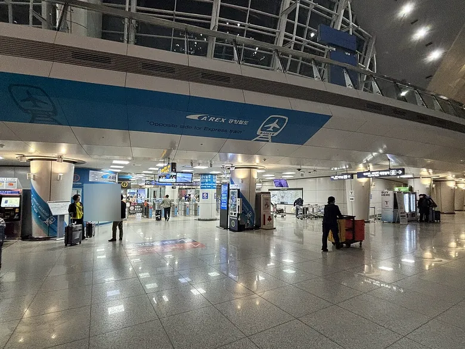
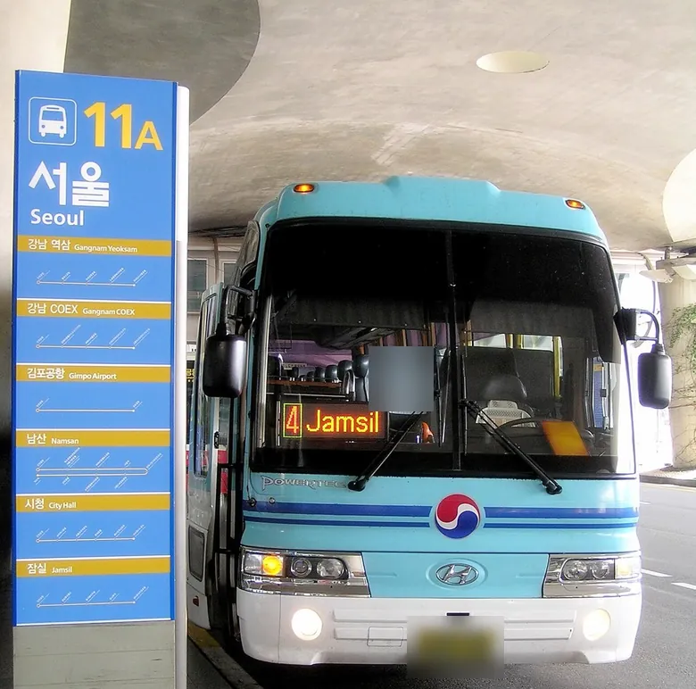
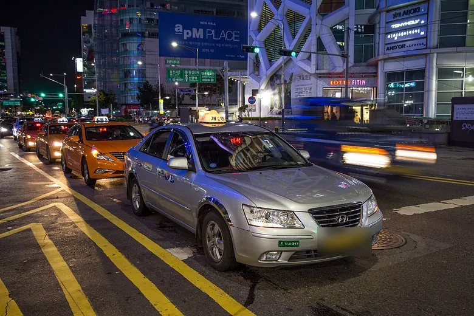
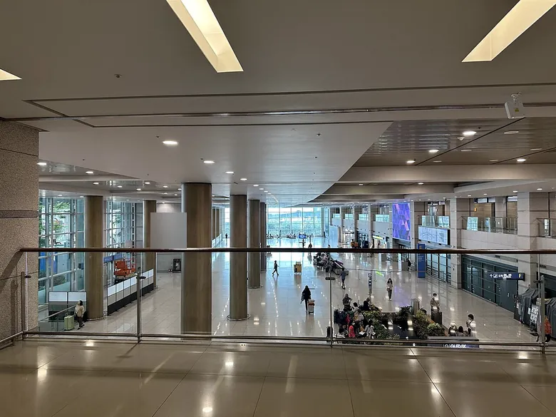
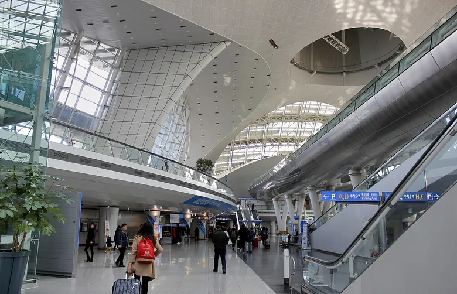
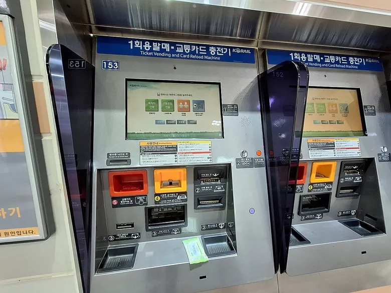
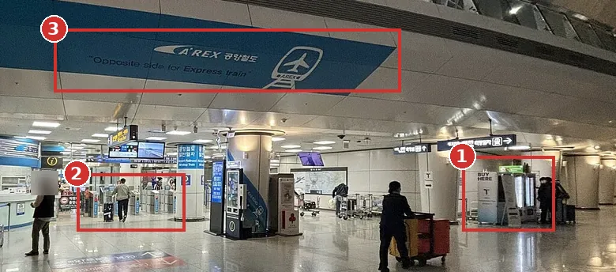
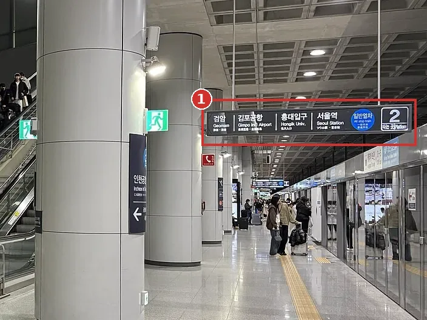
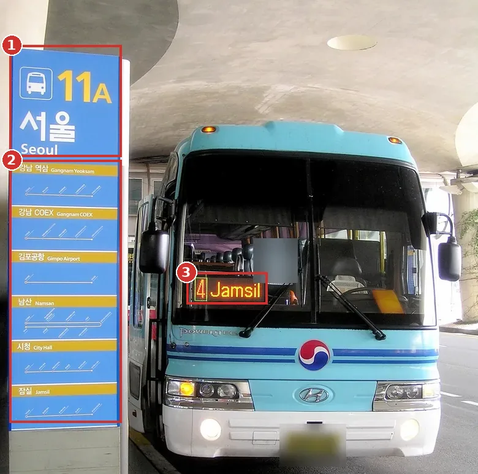

<a class="tr-btn go" href="#pick"><i class="ic ic-hotel" aria-hidden="true"></i>Which ride for my hotel?</a><a class="tr-btn" href="#late"><i class="ic ic-moon" aria-hidden="true"></i>Landing after 9 p.m.?</a>

<figure class="tr-hero"><figcaption><b>The train to Seoul starts here:</b> Transportation Center, B1, Terminal 1. Photo: <a href="https://commons.wikimedia.org/wiki/File:202403_AREX_Express_Train_Concourse_at_Incheon_International_Airport_Terminal_1_Station.jpg" rel="noopener" target="_blank">MNXANL</a>, <a href="https://creativecommons.org/licenses/by-sa/4.0" rel="noopener" target="_blank">CC BY-SA 4.0</a>, Wikimedia Commons</figcaption></figure>

<ul class="tr-facts"><li><i class="ic ic-clock" aria-hidden="true"></i>43–80 min<small>airport to central Seoul</small></li><li><i class="ic ic-wallet" aria-hidden="true"></i>₩4,650–18,000<small>train or bus, adult</small></li><li><i class="ic ic-map-pin" aria-hidden="true"></i>Trains: B1<small>Bus tickets: 1F (Terminal 1)</small></li><li><i class="ic ic-moon" aria-hidden="true"></i>Last Express 22:48<small>from Terminal 1</small></li></ul>

<h2 id="pick">Which ride for my hotel?</h2>

<ul class="ap-pick"><li><a href="#express"><small><i class="ic ic-hotel" aria-hidden="true"></i>Near Seoul Station</small><b><i class="ic ic-train-front" aria-hidden="true"></i>AREX Express</b>43 min · ₩13,000 · reserved seat</a></li><li><a href="#express"><small><i class="ic ic-hotel" aria-hidden="true"></i>Hongdae or Gongdeok</small><b><i class="ic ic-train-front" aria-hidden="true"></i>AREX all-stop</b>₩4,650 by card · no transfer</a></li><li><a href="#bus"><small><i class="ic ic-hotel" aria-hidden="true"></i>Myeongdong, Gangnam, Jamsil, most hotels away from the line</small><b><i class="ic ic-bus" aria-hidden="true"></i>Limousine bus</b>60–80 min · staff load your bags</a></li><li><a href="#taxi"><small><i class="ic ic-users" aria-hidden="true"></i>3 or 4 people with bags</small><b><i class="ic ic-car-taxi-front" aria-hidden="true"></i>International Taxi</b>fixed fare · ₩70,000–95,000</a></li><li><a href="#late"><i class="ic ic-moon" aria-hidden="true"></i><small><i class="ic ic-plane" aria-hidden="true"></i>Anywhere, landing after about 9 p.m.</small><b><i class="ic ic-triangle-alert" aria-hidden="true"></i>Read "Landing late" first</b>last Express from T1: 22:48</a></li></ul>

No hotel yet? [Where to stay in Seoul](/seoul-areas/) helps you pick the area first.

<i class="ic ic-info" aria-hidden="true"></i>All four side by side, and what we left out

| If you are staying near | Take | Why |
|---|---|---|
| Seoul Station | AREX Express | Nonstop, 43 minutes from Terminal 1, a reserved seat |
| Hongdae or Gongdeok | AREX all-stop train | It stops at both: ₩4,650 by card, no transfer |
| Myeongdong, Gangnam, Jamsil and most hotels away from the line | Airport limousine bus | Straight to the hotel districts; staff load your bags |
| Anywhere, landing after about 9 p.m. | Read "Landing late" first | The last Express leaves Terminal 1 at 22:48 |

{{fig:airport-to-seoul-1|Four ways from Terminal 1 into Seoul, adult fares}}

We picked three rides and one fallback for groups. What we left out: Gimpo Airport and car hire. Once you are in the city, [Getting around Seoul](/getting-around/) takes over.

## Your first hour, in pictures

Visit Seoul says to allow one to two hours from landing for immigration and bags. After that, this is the way to the train.

<h3 class="tr-step">1<i class="ic ic-signpost" aria-hidden="true"></i>Out of arrivals: follow the train signs</h3>

<figure class="tr-photo"><figcaption><b>Arrivals hall, Terminal 1.</b> Look up for the signs to the Transportation Center and the Airport Railroad. Photo: <a href="https://commons.wikimedia.org/wiki/File:Incheon_International_Airport_Terminal_1_Arrival_3.jpg" rel="noopener" target="_blank">ノボホショコロトソ</a>, <a href="https://creativecommons.org/licenses/by/4.0" rel="noopener" target="_blank">CC BY 4.0</a>, Wikimedia Commons</figcaption></figure>

<h3 class="tr-step">2<i class="ic ic-arrow-down" aria-hidden="true"></i>Go down to B1, the Transportation Center</h3>

<figure class="tr-photo"><figcaption><b>Transportation Center, Terminal 1.</b> Train ticket machines, the Express counter and a convenience store are on B1. Photo: <a href="https://commons.wikimedia.org/wiki/File:Incheon_Airport_Transportation_Center_Main_Hall.jpg" rel="noopener" target="_blank">Minseong Kim</a>, <a href="https://creativecommons.org/licenses/by-sa/4.0" rel="noopener" target="_blank">CC BY-SA 4.0</a>, Wikimedia Commons</figcaption></figure>

<h3 class="tr-step">3<i class="ic ic-credit-card" aria-hidden="true"></i>Get a T-money card and load it</h3>

<figure><figcaption><b>T-money card.</b> One card for the train, subway and buses. Photo: <a href="https://commons.wikimedia.org/wiki/File:T-money_card.jpg" rel="noopener" target="_blank">zisk</a>, Public domain, Wikimedia Commons</figcaption></figure><figure><figcaption><b>Card machine</b> (this one is in the subway). Load money here. Photo: <a href="https://commons.wikimedia.org/wiki/File:Ticket_Vending_and_Card_Reload_Machine_-_Seoul_Metropolitan_Subway_20240713.jpg" rel="noopener" target="_blank">LandAndTree</a>, <a href="https://creativecommons.org/licenses/by/4.0" rel="noopener" target="_blank">CC BY 4.0</a>, Wikimedia Commons</figcaption></figure>

1. Buy it at a card machine or the convenience store in the Transportation Center.
2. Load money on it.
3. No card? A single ticket costs ₩100 more, plus a ₩500 deposit you get back.

<h3 class="tr-step">4<i class="ic ic-log-in" aria-hidden="true"></i>Tap in at the AREX gate</h3>

<figure class="tr-photo"><figcaption><b>All-stop train concourse, Terminal 1 station (B1).</b> Photo: <a href="https://commons.wikimedia.org/wiki/File:202403_AREX_Local_Train_Concourse_at_Incheon_International_Airport_Terminal_1_Station.jpg" rel="noopener" target="_blank">MNXANL</a>, <a href="https://creativecommons.org/licenses/by-sa/4.0" rel="noopener" target="_blank">CC BY-SA 4.0</a>, Wikimedia Commons; numbers added by Nadri</figcaption></figure>

1. Machines marked **BUY HERE**: tickets and cards.
2. The gates. Hold your card on the reader: it shows your balance and the gate opens.
3. The sign says "Opposite side for Express train". The Express has its own counter.

<h3 class="tr-step">5<i class="ic ic-train-front" aria-hidden="true"></i>Ride: watch the names change</h3>

<figure class="tr-photo"><figcaption><b>AREX platform, Terminal 1 station.</b> Photo: <a href="https://commons.wikimedia.org/wiki/File:202403_AREX_Local_Platform_1,2_of_Incheon_International_Airport_Terminal_1_Station.jpg" rel="noopener" target="_blank">MNXANL</a>, <a href="https://creativecommons.org/licenses/by-sa/4.0" rel="noopener" target="_blank">CC BY-SA 4.0</a>, Wikimedia Commons; numbers added by Nadri</figcaption></figure>

1. The sign: all-stop train, platform 2, toward Geomam, Gimpo Airport, Hongik Univ. and Seoul Station.

First come names you won't know yet. Then the names from your map:

<ul class="ap-stations"><li>Unseo</li><li>Yeongjong</li><li>Cheongna International City</li><li class="sep">→</li><li class="k">Gimpo Airport</li><li class="k">Hongik Univ.</li><li class="k">Gongdeok</li><li class="k">Seoul Station</li></ul>

<h3 class="tr-step">6<i class="ic ic-circle-check" aria-hidden="true"></i>Tap out where your bed is</h3>

<aside class="tr-note ok"><i class="ic ic-circle-check" aria-hidden="true"></i>Tap the same card at the exit gate. Our pick for the ending: step out at the station or bus stop nearest your bed, not the ride that looked fastest on paper.</aside>

<i class="ic ic-map" aria-hidden="true"></i>Map: where the bus and the train are at Terminal 1

{{fig:airport-to-seoul-3|Where to find the bus and the train at Terminal 1}}

<h2 id="express">Train: Express or all-stop?</h2>

Same line, same station. Pick by where you get off.

<h3><i class="ic ic-train-front" aria-hidden="true"></i>AREX Express</h3><ul><li><i class="ic ic-clock" aria-hidden="true"></i>Nonstop to Seoul Station: 43 min from Terminal 1, 51 min from Terminal 2</li><li><i class="ic ic-wallet" aria-hidden="true"></i>₩13,000 adult</li><li><i class="ic ic-armchair" aria-hidden="true"></i>Every seat reserved, free Wi-Fi</li><li><i class="ic ic-ticket" aria-hidden="true"></i>Ticket at the Express counter (B1, Terminal 1) or online. Booking ahead is not required.</li></ul>
Only if your hotel is near Seoul Station. Otherwise the time it saves goes into a second transfer.
Photo: <a href="https://commons.wikimedia.org/wiki/File:202403_AREX_Express_Train_Concourse_at_Incheon_International_Airport_Terminal_1_Station.jpg" rel="noopener" target="_blank">MNXANL</a>, <a href="https://creativecommons.org/licenses/by-sa/4.0" rel="noopener" target="_blank">CC BY-SA 4.0</a>, Wikimedia Commons

<h3><i class="ic ic-train-front" aria-hidden="true"></i>AREX all-stop</h3><ul><li><i class="ic ic-clock" aria-hidden="true"></i>59 min from Terminal 1 to Seoul Station (66 from Terminal 2)</li><li><i class="ic ic-credit-card" aria-hidden="true"></i>By card: ₩4,750 to Seoul Station, ₩4,650 to Hongik Univ. or Gongdeok. From Terminal 2 add ₩600.</li><li><i class="ic ic-users" aria-hidden="true"></i>Unreserved seats, like the subway. Fills with commuters at rush hour, so a big suitcase is harder.</li></ul>
Hongdae and Gongdeok: same line, about a third of the price, no change of train.
Photo: <a href="https://commons.wikimedia.org/wiki/File:202403_AREX_Local_Train_Concourse_at_Incheon_International_Airport_Terminal_1_Station.jpg" rel="noopener" target="_blank">MNXANL</a>, <a href="https://creativecommons.org/licenses/by-sa/4.0" rel="noopener" target="_blank">CC BY-SA 4.0</a>, Wikimedia Commons

The Express skips the commuter crowd, which after a long flight matters more than the minutes saved.

<i class="ic ic-route" aria-hidden="true"></i>See both trains on one line

{{fig:airport-to-seoul-2|Express and all-stop run on the same line}}

<h2 id="bus">Airport limousine bus</h2>

For most hotels away from the AREX line, the bus means the fewest changes with luggage: one ticket, one seat, your bags under the bus.

<figure class="tr-photo"><figcaption><b>Limousine bus stop at Incheon Airport</b> (2008 photo: go by the stop number on your ticket, not this one). Photo: <a href="https://commons.wikimedia.org/wiki/File:Bus_Station_Incheon_Airport.JPG" rel="noopener" target="_blank">Yerbol Nisanbayev</a>, <a href="https://creativecommons.org/licenses/by/3.0" rel="noopener" target="_blank">CC BY 3.0</a>, Wikimedia Commons; numbers added by Nadri</figcaption></figure>

1. The stop number. Your ticket shows which one is yours.
2. The areas this stop serves.
3. The bus shows where it is going.

<ul class="tr-facts"><li><i class="ic ic-clock" aria-hidden="true"></i>60–80 min<small>to Seoul</small></li><li><i class="ic ic-wallet" aria-hidden="true"></i>₩16,000–18,000<small>adult, cards accepted</small></li><li><i class="ic ic-ticket" aria-hidden="true"></i>Buy a ticket<small>ticket holders board first</small></li><li><i class="ic ic-luggage" aria-hidden="true"></i>2 bags each<small>28 inches or smaller</small></li></ul>

Find your route number. Examples:

<ul class="ap-routes"><li><b>6001</b>Myeongdong, Dongdaemun</li><li><b>6002</b>Hongdae, Jongno</li><li><b>6020</b>Gangnam</li><li><b>6200</b>Jamsil</li><li><b>6701</b>Gwanghwamun, City Hall</li></ul>

1. **Buy a ticket** at the bus counter or a kiosk: Terminal 1 first floor (1F), Terminal 2 basement level. T-money works too, but people with tickets board first.
2. **Go to the stop printed on your ticket.** The ticket also shows your destination, fare and boarding time.
3. **Hand your bags to the staff** and keep the claim tag.
4. **Get off at the announced stop** and match the tag number to your bag.

<i class="ic ic-ticket" aria-hidden="true"></i>What your bus ticket shows

{{fig:airport-to-seoul-5|What your airport bus ticket shows}}

<h2 id="taxi">Taxi: for three or four with bags</h2>

The International Taxi has fixed fares from Incheon to Seoul, tolls included, so there is no meter to worry about. Desks are in both terminals and foreign cards are accepted.

<figure class="tr-photo"><figcaption><b>Seoul taxis.</b> For the fixed fare, go to the International Taxi desk in the terminal. Photo: <a href="https://commons.wikimedia.org/wiki/File:Seoul_taxis_01.jpg" rel="noopener" target="_blank">Ilya Plekhanov</a>, <a href="https://creativecommons.org/licenses/by-sa/4.0" rel="noopener" target="_blank">CC BY-SA 4.0</a>, Wikimedia Commons</figcaption></figure>

Mid-size car, by the Seoul district you are going to:

<ul class="ap-fares"><li><b>₩70,000</b>Gangseo</li><li><b>₩75,000</b>Mapo (Hongdae), Yeongdeungpo, Eunpyeong and others</li><li><b>₩85,000</b>Jung (Myeongdong), Jongno, Yongsan and others</li><li><b>₩90,000</b>Gangnam, Seocho, Seongdong and others</li><li><b>₩95,000</b>Songpa (Jamsil), Gangdong, Gwangjin and others</li></ul>

Large and deluxe cars are ₩100,000–140,000. Split four ways, ₩85,000 is about ₩21,000 each, close to the bus fare.

<i class="ic ic-car-taxi-front" aria-hidden="true"></i>Fixed fares as a chart

{{fig:airport-to-seoul-6|International Taxi fixed fares from Incheon, mid-size}}

<h2 id="late">Landing late</h2>

<aside class="tr-note"><i class="ic ic-moon" aria-hidden="true"></i><b>Last AREX Express: 22:48 from Terminal 1, 22:40 from Terminal 2.</b> With one to two hours for immigration and bags, a flight landing after about 9 p.m. can miss it. Decide before you fly.</aside>

{{fig:airport-to-seoul-7|What still runs from Terminal 1 late at night}}

- **All-stop train:** runs later. Check its last train for your date on the [AREX train times](https://www.airportrailroad.com/train/normal/info).
- **After the trains:** late-night buses, ₩17,000–18,000. First departures from Terminal 1 between 23:40 and 00:10. Buy the ticket at the bus counter or a machine.

<ul class="ap-routes late"><li><b>N6000</b>Gangnam</li><li><b>N6002</b>Hongdae, Cheongnyangni</li><li><b>N6701</b>Seoul Station, Dongdaemun</li><li><b>N6703</b>Jamsil, Gwangnaru</li></ul>

<i class="ic ic-calendar-days" aria-hidden="true"></i>Why the last Express time changed

The Express timetable changed on 23 October 2026, when daily Express runs rose from 52 to 56. 22:48 (Terminal 1) and 22:40 (Terminal 2) are on the current weekday and holiday timetables.

## Common mistakes

<ul class="tr-oops"><li><i class="ic ic-triangle-alert" aria-hidden="true"></i><b>Boarding with a Climate Card at the airport.</b> Since 1 October 2026 the Climate Card short-term pass lets you ride to the airport and get off at Terminal 1 or 2, but you cannot board with it at the airport stations. For the ride into Seoul, pay with T-money.</li><li><i class="ic ic-triangle-alert" aria-hidden="true"></i><b>Taking the Express when your hotel isn't near Seoul Station.</b> The time it saves goes into a second transfer.</li><li><i class="ic ic-triangle-alert" aria-hidden="true"></i><b>Counting on the Express after a late landing.</b> The last one leaves Terminal 1 at 22:48.</li><li><i class="ic ic-triangle-alert" aria-hidden="true"></i><b>Waiting for the bus with only T-money.</b> People with tickets board first.</li></ul>

## Want it ready before you land?

<aside class="tr-note tip"><i class="ic ic-lightbulb" aria-hidden="true"></i><b>Not required.</b> The airport sells transport cards (card machines, convenience store) and Express tickets (Express counter). Booking ahead only moves the purchase earlier.</aside>

{{fig:airport-to-seoul-4|T-money or WOWPASS: what each card does}}

<b>T-money card, picked up at the airport.</b> Tap for the all-stop train, subway and buses. Photo: <a href="https://commons.wikimedia.org/wiki/File:T-money_card.jpg" rel="noopener" target="_blank">zisk</a>, Public domain, Wikimedia Commons

{{aff:klook_tmoney|Pre-order a T-money card to pick up at the airport}}

<i class="ic ic-wallet" aria-hidden="true"></i>
<b>WOWPASS.</b> T-money inside for transport, plus money exchange and card payments on one card.

{{aff:klook_wowpass|Or a WOWPASS: money exchange, card payments and T-money in one}}

<b>AREX Express ticket on your phone.</b> Only worth it if your hotel is near Seoul Station. Photo: <a href="https://commons.wikimedia.org/wiki/File:202403_AREX_Express_Train_Concourse_at_Incheon_International_Airport_Terminal_1_Station.jpg" rel="noopener" target="_blank">MNXANL</a>, <a href="https://creativecommons.org/licenses/by-sa/4.0" rel="noopener" target="_blank">CC BY-SA 4.0</a>, Wikimedia Commons

{{aff:klook_airport|Book an AREX Express ticket in advance}}

## The night before you fly

Ten minutes of planning makes the first hour easy.

1. **Find your hotel's district** and pick the ride at [the top of this page](#pick).
2. **Bus?** Note the route number. **Taxi?** Note your district's fixed fare.
3. **Landing after about 9 p.m.?** Note the late-night bus for your area too.

<ul class="tr-next"><li><a href="/e-arrival-card/"><i class="ic ic-id-card" aria-hidden="true"></i>Before you land: the e-Arrival Card<i class="ic ic-arrow-right" aria-hidden="true"></i></a></li><li><a href="/getting-around/"><i class="ic ic-route" aria-hidden="true"></i>In the city: getting around Seoul<i class="ic ic-arrow-right" aria-hidden="true"></i></a></li><li><a href="/seoul-subway/"><i class="ic ic-train-front" aria-hidden="true"></i>Your first subway ride<i class="ic ic-arrow-right" aria-hidden="true"></i></a></li></ul>

<i class="ic ic-list-checks" aria-hidden="true"></i>Sources and photo credits

Opened 26 November 2026 (KST): AREX, <a href="https://www.airportrailroad.com/train/express/introduce" rel="noopener" target="_blank">Express train</a> (times, fare, seats) and <a href="https://www.airportrailroad.com/train/express/info" rel="noopener" target="_blank">Express timetable</a>; AREX, <a href="https://www.airportrailroad.com/train/normal/introduce" rel="noopener" target="_blank">all-stop train</a> and <a href="https://www.airportrailroad.com/train/normal/fare" rel="noopener" target="_blank">all-stop fares</a>; Visit Seoul, <a href="https://english.visitseoul.net/airport-to-seoul" rel="noopener" target="_blank">Airport to Seoul</a> (fares and times as of June 2026; bus routes, luggage, ticket purchase); Incheon Airport, <a href="https://www.airport.kr/" rel="noopener" target="_blank">Airport Railroad guide</a> (airport.kr: ap_en/1512/subview.do), <a href="https://www.airport.kr/" rel="noopener" target="_blank">late-night buses</a> (airport.kr: ap_en/1507/subview.do) and <a href="https://www.airport.kr/" rel="noopener" target="_blank">limousine bus booking guide</a> (airport.kr: bbs/ap_en/937/138233/artclView.do); Seoul Metropolitan Government, <a href="https://news.seoul.go.kr/traffic/archives/1659" rel="noopener" target="_blank">taxi fares incl. International Taxi fixed fares</a> (updated 14 October 2026) and <a href="https://news.seoul.go.kr/traffic/archives/category/public-news_c1/climate-accompany-card_c1/card-climate_accompany_card" rel="noopener" target="_blank">Climate Card short-term pass</a> (updated 12 October 2026). Not reopened this time: Wikitree, <a href="https://www.wikitree.co.kr/articles/1168084" rel="noopener" target="_blank">AREX Express runs rise from 52 to 56 a day from 23 October 2026</a>.

<b>Photos used on this page</b>
<ul class="ap-credits"><li><a href="https://commons.wikimedia.org/wiki/File:202403_AREX_Express_Train_Concourse_at_Incheon_International_Airport_Terminal_1_Station.jpg" rel="noopener" target="_blank">File:202403 AREX Express Train Concourse at Incheon International Airport Terminal 1 Station.jpg</a>: MNXANL, <a href="https://creativecommons.org/licenses/by-sa/4.0" rel="noopener" target="_blank">CC BY-SA 4.0</a>. Changes: resized to 780x585, light auto-contrast.</li><li><a href="https://commons.wikimedia.org/wiki/File:202403_AREX_Local_Train_Concourse_at_Incheon_International_Airport_Terminal_1_Station.jpg" rel="noopener" target="_blank">File:202403 AREX Local Train Concourse at Incheon International Airport Terminal 1 Station.jpg</a>: MNXANL, <a href="https://creativecommons.org/licenses/by-sa/4.0" rel="noopener" target="_blank">CC BY-SA 4.0</a>. Changes: resized to 780x585, light auto-contrast, 1 detected face(s) blurred.</li><li><a href="https://commons.wikimedia.org/wiki/File:Bus_Station_Incheon_Airport.JPG" rel="noopener" target="_blank">File:Bus Station Incheon Airport.JPG</a>: Yerbol Nisanbayev, <a href="https://creativecommons.org/licenses/by/3.0" rel="noopener" target="_blank">CC BY 3.0</a>. Changes: cropped, resized to 780x772, light auto-contrast, 1 detected face(s) blurred, 1 area(s) blurred (faces/plates, manual).</li><li><a href="https://commons.wikimedia.org/wiki/File:Seoul_taxis_01.jpg" rel="noopener" target="_blank">File:Seoul taxis 01.jpg</a>: Ilya Plekhanov, <a href="https://creativecommons.org/licenses/by-sa/4.0" rel="noopener" target="_blank">CC BY-SA 4.0</a>. Changes: resized to 780x520, light auto-contrast, 1 area(s) blurred (faces/plates, manual).</li><li><a href="https://commons.wikimedia.org/wiki/File:Incheon_International_Airport_Terminal_1_Arrival_3.jpg" rel="noopener" target="_blank">File:Incheon International Airport Terminal 1 Arrival 3.jpg</a>: ノボホショコロトソ, <a href="https://creativecommons.org/licenses/by/4.0" rel="noopener" target="_blank">CC BY 4.0</a>. Changes: resized to 780x585, light auto-contrast, 1 detected face(s) blurred.</li><li><a href="https://commons.wikimedia.org/wiki/File:Incheon_Airport_Transportation_Center_Main_Hall.jpg" rel="noopener" target="_blank">File:Incheon Airport Transportation Center Main Hall.jpg</a>: Minseong Kim, <a href="https://creativecommons.org/licenses/by-sa/4.0" rel="noopener" target="_blank">CC BY-SA 4.0</a>. Changes: resized to 780x502, light auto-contrast.</li><li><a href="https://commons.wikimedia.org/wiki/File:T-money_card.jpg" rel="noopener" target="_blank">File:T-money card.jpg</a>: zisk, Public domain. Changes: kept at 499x316, light auto-contrast.</li><li><a href="https://commons.wikimedia.org/wiki/File:Ticket_Vending_and_Card_Reload_Machine_-_Seoul_Metropolitan_Subway_20240713.jpg" rel="noopener" target="_blank">File:Ticket Vending and Card Reload Machine - Seoul Metropolitan Subway 20240713.jpg</a>: LandAndTree, <a href="https://creativecommons.org/licenses/by/4.0" rel="noopener" target="_blank">CC BY 4.0</a>. Changes: resized to 780x585, light auto-contrast.</li><li><a href="https://commons.wikimedia.org/wiki/File:202403_AREX_Local_Train_Concourse_at_Incheon_International_Airport_Terminal_1_Station.jpg" rel="noopener" target="_blank">File:202403 AREX Local Train Concourse at Incheon International Airport Terminal 1 Station.jpg</a>: MNXANL, <a href="https://creativecommons.org/licenses/by-sa/4.0" rel="noopener" target="_blank">CC BY-SA 4.0</a>. Changes: cropped, resized to 780x344, light auto-contrast, 1 area blurred (face, manual), numbered red boxes added.</li><li><a href="https://commons.wikimedia.org/wiki/File:202403_AREX_Local_Platform_1,2_of_Incheon_International_Airport_Terminal_1_Station.jpg" rel="noopener" target="_blank">File:202403 AREX Local Platform 1,2 of Incheon International Airport Terminal 1 Station.jpg</a>: MNXANL, <a href="https://creativecommons.org/licenses/by-sa/4.0" rel="noopener" target="_blank">CC BY-SA 4.0</a>. Changes: cropped, kept at 704x528, light auto-contrast, numbered red box added.</li><li><a href="https://commons.wikimedia.org/wiki/File:Bus_Station_Incheon_Airport.JPG" rel="noopener" target="_blank">File:Bus Station Incheon Airport.JPG</a>: Yerbol Nisanbayev, <a href="https://creativecommons.org/licenses/by/3.0" rel="noopener" target="_blank">CC BY 3.0</a>. Changes: cropped, resized to 780x772, light auto-contrast, 1 detected face(s) blurred, 1 area(s) blurred (faces/plates, manual), numbered red boxes added.</li></ul>

