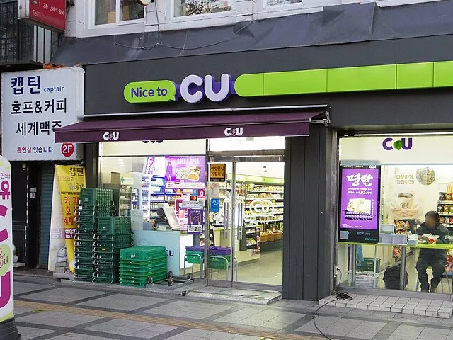
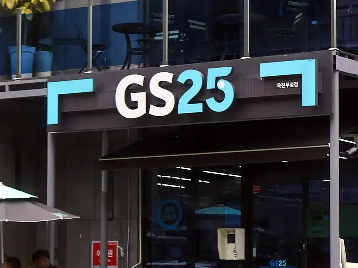
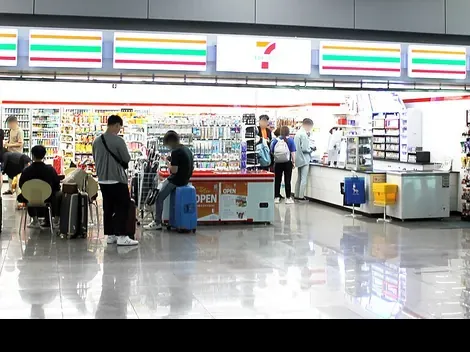
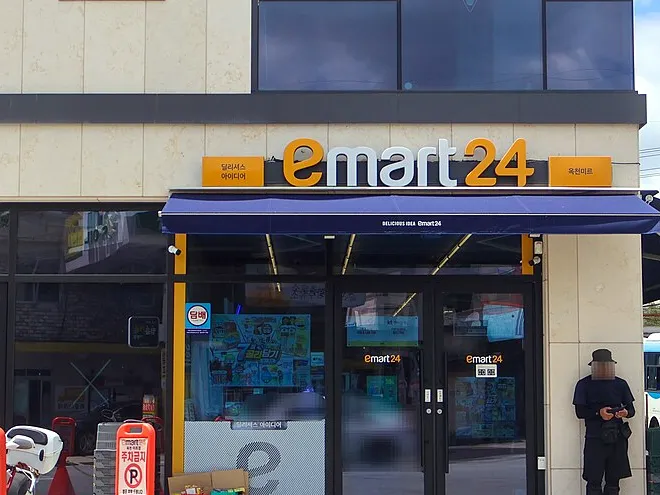
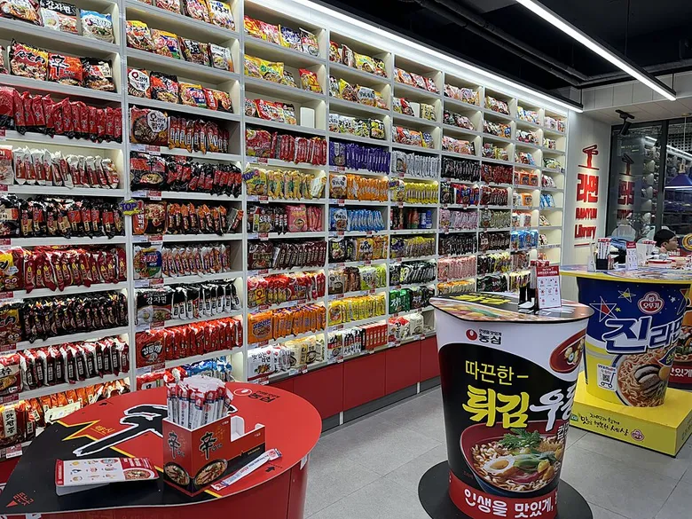

<a class="tr-btn go" href="#tmoney"><i class="ic ic-credit-card" aria-hidden="true"></i>Buy and load T-money</a><a class="tr-btn" href="#find"><i class="ic ic-moon" aria-hidden="true"></i>Find one open 24 hours</a>

<ul class="tr-colours"><li><b>CU</b>Purple letters, lime-green band.<a href="https://commons.wikimedia.org/wiki/File:CU_Namdaemun-ro-5ga_branch_20181122_072838.jpg" rel="noopener" target="_blank">LERK</a>, <a href="https://creativecommons.org/licenses/by-sa/4.0/" rel="noopener" target="_blank">CC BY-SA 4.0</a> (cropped)</li><li><b>GS25</b>White "GS", sky-blue "25".<a href="https://commons.wikimedia.org/wiki/File:GS25_Okcheon_Museong_Branch_20240730.jpg" rel="noopener" target="_blank">LandAndTree</a>, <a href="https://creativecommons.org/publicdomain/zero/1.0/" rel="noopener" target="_blank">CC0</a> (cropped)</li><li><b>7-Eleven</b>Orange, green and red stripes and a 7.<a href="https://commons.wikimedia.org/wiki/File:7-Eleven_Muan-international-airport_store_20190520_181056.jpg" rel="noopener" target="_blank">LERK</a>, <a href="https://creativecommons.org/licenses/by-sa/4.0/" rel="noopener" target="_blank">CC BY-SA 4.0</a> (cropped)</li><li><b>emart24</b>Yellow "emart24" letters.<a href="https://commons.wikimedia.org/wiki/File:E-mart_24_Okcheon_Mir_Branch_20240731.jpg" rel="noopener" target="_blank">LandAndTree</a>, <a href="https://creativecommons.org/publicdomain/zero/1.0/" rel="noopener" target="_blank">CC0</a> (cropped)</li></ul>

<ul class="tr-facts"><li><i class="ic ic-store" aria-hidden="true"></i>Four big chains<small>53,266 at end of 2025 (as reported)</small></li><li><i class="ic ic-moon" aria-hidden="true"></i>Only ~78% open 24 h<small>check hours late at night</small></li><li><i class="ic ic-banknote" aria-hidden="true"></i>Load T-money with cash<small>at the counter, in won</small></li><li><i class="ic ic-id-card" aria-hidden="true"></i>Alcohol and tobacco<small>2026: born 2007 or earlier</small></li></ul>

## What you'll use it for

<ul class="tr-choose"><li><i class="ic ic-credit-card" aria-hidden="true"></i><b>Buying and loading a transport card</b>Buy T-money and load it with cash. <a href="#tmoney">How</a></li><li><i class="ic ic-sun" aria-hidden="true"></i><b>Cold, or a cold coming on</b>Hot packs, masks, warm drinks. Stores open 24 hours also sell household medicines such as cold and pain tablets.</li><li><i class="ic ic-coins" aria-hidden="true"></i><b>A cheap meal</b>Cup ramyeon, and at some CU stores a machine that cooks packet ramyeon. <a href="#ramyeon">How</a></li><li><i class="ic ic-banknote" aria-hidden="true"></i><b>Getting cash</b>At stores with an ATM. CU stores with one can be found in its <a href="#find">store finder</a>. Check the fee on the machine's screen: <a href="/money/">Money page</a></li></ul>

<ul class="tr-choose"><li><i class="ic ic-user-x" aria-hidden="true"></i><b>Not the best place for</b>A big skincare haul (go to <a href="/olive-young/">Olive Young</a>), or ramyeon and snacks to take home in bulk (compare prices at a big supermarket first).</li></ul>

<h2 id="find">1. Find a store, and check it's open 24 hours</h2>

The big four are **CU, GS25, 7-Eleven and emart24** (photos above), with 53,266 stores between them at the end of 2025, according to an April 2026 report (CEO Score Daily; we could not reopen it today, so this is from our 25 November 2026 check). That fell by about 3% in a year as chains closed weaker stores, but in a city you're rarely more than a short walk from one.

Not all of them are open 24 hours. According to a December 2025 report (Money Today; we could not reopen it today), 42,791 stores ran around the clock in June 2025, about 78% of the total. Today's figure may differ. The other one in five closes at night, and some become unstaffed after hours. So find one like this:

1. **Search:** in a map app (e.g. Naver Map or KakaoMap) search for 편의점 (convenience store), CU or GS25. Installing and using a map app: [Open the map app](/seoul-subway/#map-app)
2. **Hours:** tap a nearby store and check its opening hours. Late at night, make sure it's 24 hours.
3. **Route:** open the walking route and go. When you arrive, check the hours on the **door** too.
4. For CU, use the [CU store finder](https://cu.bgfretail.com/store/list.do?category=store) (Korean): search by area or store name, and under 매장 유형 및 서비스 tick **24시간** (24 hours) or **현금지급기** (ATM).

### Inside: pick, then go to the counter

1. Take what you need to the **counter**. Prices are on the shelf tags (deal tags such as 1+1 are there too).
2. Services such as loading T-money or CU's tax refund are also done at the counter: just ask. CU loads transport cards on the store's integrated terminal.
3. Pay by card or cash. Payment options are below in [Choosing and paying](#pay).

<h2 id="tmoney">2. Buy T-money and load it with cash</h2>

T-money is the rechargeable card for subways and buses. Convenience stores across the country, including GS25, CU and 7-Eleven, sell and load it. The card costs ₩3,000–5,000.

<figure class="tr-photo"><figcaption><b>A T-money card</b> (older design). There are many designs.Photo: <a href="https://commons.wikimedia.org/wiki/File:T-money_card.jpg" rel="noopener" target="_blank">zisk</a>, public domain, Wikimedia Commons (auto-contrast)</figcaption></figure>

<h3 class="tr-step">1<i class="ic ic-shopping-basket" aria-hidden="true"></i>Buy the card at the counter</h3>

1. Tell the cashier "**T-money card, please**" (in Korean: 티머니 카드 주세요, *timeoni kadeu juseyo*).
2. Pay for the card. The TMONEY TRAVEL CARD for foreign visitors costs ₩4,000.

<h3 class="tr-step">2<i class="ic ic-banknote" aria-hidden="true"></i>Load it with won cash</h3>

1. Hand over the card and **won cash** together.
2. Say how much. For example "**₩10,000, please**" (만 원 충전해 주세요, *man won chungjeonhae juseyo*).
3. The cashier loads it. Every CU store does T-money top-ups.

<aside class="tr-note"><i class="ic ic-triangle-alert" aria-hidden="true"></i>Foreign-issued cards generally can't be used to top up. T-money top-ups have taken only cash, Korean-issued cards or Korean phone billing, and the Seoul city government says foreign visitors have had to buy and load transport cards with cash. We found no chain saying it accepts foreign cards for top-ups at the counter. Bring some won cash.</aside>

<h3 class="tr-step">3<i class="ic ic-circle-check" aria-hidden="true"></i>Check it at the gate</h3>

Tap the card at a subway gate and the reader shows your balance. After that you can also top up at subway ticket machines (up to ₩500,000 on the card). The machine step by step, with photos: [Riding the Seoul subway](/seoul-subway/)

<i class="ic ic-credit-card" aria-hidden="true"></i>If you have no cash

- **iPhone:** in the MobileTmoney app, tap "Foreigner" under the start button to top up with a foreign card, T-money says in its App Store replies. Supported cards: Mastercard, Amex, UnionPay and JCB; Visa is not on the list.
- **Android:** the Seoul city government says T-money's "Korea Tour Card" app can be topped up with a foreign card.
- **Just landed at Incheon:** since 23 November 2026, T-money machines at the airport railroad stations sell a ₩15,000 T-money (₩5,000 card + ₩10,000 credit) that you can pay for with a foreign credit card. The announcement didn't say whether it can be reloaded by credit card later.
- **Seoul subway stations:** since 17 March 2026, new machines (440 of them) at 273 stations on Lines 1–8 take foreign cards for the **Climate Card and single-journey tickets** (average 3.7% fee). They don't load T-money. Details: [Riding the Seoul subway](/seoul-subway/).
- **To get cash:** a convenience-store ATM, or see the [Money page](/money/).

{{fig:convenience-store-1|Topping up at the counter, and what to do without cash}}

<aside class="tr-note tip"><i class="ic ic-lightbulb" aria-hidden="true"></i><b>Before you fly home, get your balance back:</b> convenience stores refund T-money balances. Over ₩50,000, you need to go to T-money Town near Seoul Station Exit 10.</aside>

<h2 id="pay">3. Choosing and paying</h2>

### Reading 1+1 and 2+1

Deal tags are on the shelf price tags. **1+1** means buy one, get one free; **2+1** means buy two, get a third free. Deals change every month, and CU warns that some deal items run out early, so ask the store before you go. This month's CU deals: [CU deal items](https://cu.bgfretail.com/event/plus.do) (Korean).

{{fig:convenience-store-2|What the deal tags mean, and one sum worth doing}}

Work out the price per item. One report found 1+1 drinks that still cost more per bottle than at a supermarket. It's only a saving if you wanted two anyway.

### Paying

<ul class="tr-choose"><li><i class="ic ic-credit-card" aria-hidden="true"></i><b>Cards: almost everywhere</b>Japan's Mitsubishi UFJ Nicos Korea guide lists convenience stores as places that take cards, naming Visa, Mastercard, Amex, JCB and UnionPay.</li><li><i class="ic ic-smartphone" aria-hidden="true"></i><b>Mobile wallets</b>In 2025 Alipay and WeChat Pay made up 97.7% of foreign visitors' payments at GS25. PayPay lists CU, emart24, GS25 and 7-Eleven as Korean merchants, though some branches may not accept it.</li></ul>

### Instant tax refund at CU

Convenience-store baskets are usually too small, but CU gives an instant refund 24 hours a day at participating stores (up to 7% off the payment).

1. Look for the **Tax-Refund store sticker**. More than 600 CU stores offered it as of a September 2025 report.
2. At the counter, ask for a **tax refund payment** (택스리펀 결제).
3. Show your **physical passport** (or mobile passport). One payment must be ₩15,000–999,999.

<aside class="tr-note"><i class="ic ic-triangle-alert" aria-hidden="true"></i>Not included: alcohol, tobacco, tax-exempt goods (white milk, fruit, vegetables, sanitary pads and so on), food cooked in the store, and service products. Who qualifies and the rules: <a href="/tax-refund/">Tax refund</a></aside>

### Alcohol and tobacco go by birth year

The Juvenile Protection Act counts the **year you were born**, not your birthday. You can buy from 1 January of the year you turn 19, so in 2026 anyone born in 2007 or earlier can buy, and anyone born in 2008 or later can't. People born in 2008 can buy from 1 January 2027. Staff may check ID, so carry your passport.

<h2 id="ramyeon">4. Eating ramyeon in the store</h2>

A bowl of ramyeon at the window counter is part of the fun. Cup ramyeon works in any store; for packet ramyeon, find a CU with a cooking machine. CU has been installing them since 2016.

<figure class="tr-photo"><figcaption>Shelves in a ramyeon-themed convenience store. Pick a packet and cook it in the machine.Photo: lazy fri13th, <a href="https://creativecommons.org/licenses/by/2.0/" rel="noopener" target="_blank">CC BY 2.0</a>, <a href="https://commons.wikimedia.org/wiki/File:24_hours_Ramyeon_Ramen_convenience_store_(South_Korea).jpg" rel="noopener" target="_blank">Wikimedia Commons</a> (auto-contrast)</figcaption></figure>

<h3 class="tr-step">1<i class="ic ic-shopping-basket" aria-hidden="true"></i>Buy the ramyeon and a disposable bowl separately</h3>

Pick a packet of ramyeon and buy the **disposable cooking bowl** at the till with it. At the Hongdae Sangsang store the cooking fee, bowl included, was ₩900 when reported. Check the current price in store.

<h3 class="tr-step">2<i class="ic ic-scan-line" aria-hidden="true"></i>Bowl, barcode, start</h3>

1. Put the noodles and soup packet into the bowl.
2. Scan the bowl's **barcode** on the cooker.
3. Press **start**. At Hongdae's Ramyun Library the machine instructions are also in English, Chinese and Japanese.

{{fig:convenience-store-3|How to use the ramyeon machine}}

<ul class="tr-choose"><li><i class="ic ic-map-pin" aria-hidden="true"></i><b>CU Hongdae Sangsang "Ramyun Library"</b>Seogyo-dong, Mapo-gu, Seoul. About 230 kinds of packet ramyeon and three cookers. As of March 2024, buying more than five packets of any brand got 50% off (this store only).</li><li><i class="ic ic-store" aria-hidden="true"></i><b>Other ramyeon stores</b>CU runs more than 40 ramyeon-themed stores nationwide, including at Incheon Airport and Myeongdong Station. Its Han River stores are famous for "Hangang ramyeon" eaten outside. A regular store may not have a cooker.</li></ul>

## 5. Winter, and feeling unwell

- **Hot packs, masks, warm drinks:** in the cold snap of January 2026, hot-pack sales at all three big chains were 22–43% higher than a year earlier, and thermal-underwear sales at GS25 nearly doubled. If you left gloves or a layer at home, try the convenience store first.
- **Cold and pain tablets:** under the Pharmaceutical Affairs Act only stores **open 24 hours, every day of the year** can register to sell household medicines (up to 20 products). At night, go to a 24-hour store. Finding a pharmacy: [If you get sick](/health/)

## Common mistakes

<ul class="tr-oops"><li><i class="ic ic-triangle-alert" aria-hidden="true"></i>Going to load T-money with only a foreign card. Bring won cash.</li><li><i class="ic ic-triangle-alert" aria-hidden="true"></i>Assuming every store is open 24 hours. One in five isn't.</li><li><i class="ic ic-triangle-alert" aria-hidden="true"></i>Grabbing anything marked 1+1. Compare the per-item price with a supermarket.</li><li><i class="ic ic-triangle-alert" aria-hidden="true"></i>Expecting the CU tax refund on beer or cigarettes. They're excluded.</li><li><i class="ic ic-triangle-alert" aria-hidden="true"></i>Flying home with money left on T-money. A convenience store can refund it.</li></ul>

<i class="ic ic-list-checks" aria-hidden="true"></i>Our call, as a table

| Situation | Do this | Why |
|---|---|---|
| You need a transport card on day one | Buy T-money at the first convenience store you see, and bring won cash to load it | Stores across the country sell and load it. Foreign cards generally can't be used to top it up |
| It's freezing, or you need cold medicine at 1 a.m. | Go to a convenience store open 24 hours | Only stores open 24 hours, every day of the year can sell household medicines |
| You want a cheap late-night meal | Ramyeon at the store | Some branches have cooking machines for packet noodles |
| You're shopping for skincare or a big haul | Go to [Olive Young](/olive-young/) or a department store | Wider range, and the tax refund is set up for bigger baskets |
| You're buying ramyeon and snacks to take home | Compare prices at a big supermarket before you load up on 1+1 deals | A 1+1 deal can still cost more per item than a supermarket |

<i class="ic ic-calendar-check" aria-hidden="true"></i>Three visits on a first trip

Day one: you hand the cashier a T-money card and some won cash, say how much, and you're ready for the subway. A cold evening: a hot pack for tomorrow's palace walk and a cup of ramyeon. Our pick for the last visit: the morning you fly home, for whatever you forgot and to get your T-money balance back.

**Before you go:** bring some won cash for top-ups, and carry your passport if you plan to buy beer. On a package tour with meals included and a transport card already loaded, you can skip everything here except the age rule.

<i class="ic ic-info" aria-hidden="true"></i>Also available, and what we left out

- **Currency exchange:** GS25 has kiosks that change 15 foreign currencies into won. 7-Eleven is adding unstaffed exchange machines, mainly in tourist areas.
- **Interpretation:** about 70 CU stores offer AI interpretation in 38 languages.
- **Power bank rental:** borrow one at a CU with a station and return it at any station. It uses the "완충이" app; 30 minutes cost ₩800 (may change with the partner's policy).

Left out: parcels and luggage delivery. CU works with DHL on international parcels, but we could not confirm that visitors without a Korean phone number can book. ATM fees vary by machine; check the screen before you withdraw.

<i class="ic ic-info" aria-hidden="true"></i>Sources

Opened and checked on 26 November 2026 (cu.bgfretail.com opened after access was allowed in the afternoon): CU <a href="https://cu.bgfretail.com/service/tax_info.do?category=service&amp;depth3=19" rel="noopener" target="_blank">Tax-Refund (instant refund)</a> (participating-store sticker, up to 7%, ₩15,000–999,999, excluded goods, physical or mobile passport), <a href="https://cu.bgfretail.com/service/traffic_info.do?category=service&amp;depth3=3" rel="noopener" target="_blank">transport cards</a> (T-money top-up in every store), <a href="https://cu.bgfretail.com/service/ticket_info.do?category=service&amp;depth3=2" rel="noopener" target="_blank">ATMs</a>, <a href="https://cu.bgfretail.com/service/frugal_info.do?category=service&amp;depth3=9" rel="noopener" target="_blank">power bank rental</a>, <a href="https://cu.bgfretail.com/store/list.do?category=store" rel="noopener" target="_blank">store finder</a> (24-hour and ATM filters) and <a href="https://cu.bgfretail.com/event/plus.do" rel="noopener" target="_blank">deal items</a> (1+1, 2+1, early sell-out); Korean Law Information Center: <a href="https://www.law.go.kr/%EB%B2%95%EB%A0%B9/%EC%95%BD%EC%82%AC%EB%B2%95" rel="noopener" target="_blank">Pharmaceutical Affairs Act</a> Art. 44-2 (in force 12 November 2026: up to 20 products, stores open 24 hours year-round) and <a href="https://www.law.go.kr/%EB%B2%95%EB%A0%B9/%EC%B2%AD%EC%86%8C%EB%85%84%EB%B3%B4%ED%98%B8%EB%B2%95" rel="noopener" target="_blank">Juvenile Protection Act</a> Art. 2 (1 January of the year one turns 19); VISITKOREA <a href="https://english.visitkorea.or.kr/svc/contents/contentsView.do?vcontsId=140663" rel="noopener" target="_blank">Transportation Cards</a> (updated August 2026: sold and loaded at convenience stores, ₩3,000–5,000, machines up to ₩500,000, convenience-store refunds and T-money Town over ₩50,000); T-money <a href="https://www.tmoney.co.kr/aeb/biz/bridge/foreignTravel.dev" rel="noopener" target="_blank">cards for foreign visitors</a> (TMONEY TRAVEL CARD ₩4,000 at convenience stores); App Store <a href="https://apps.apple.com/us/app/-/id1470361790" rel="noopener" target="_blank">MobileTmoney</a> developer replies (Foreigner button; Mastercard, Amex, UnionPay, JCB); Seoul Metropolitan Government <a href="https://news.seoul.go.kr/traffic/archives/515573" rel="noopener" target="_blank">2025 plan for foreign visitors' transit payments</a> (cash purchase and top-up; Korea Tour Card app on Android) and <a href="https://news.seoul.go.kr/traffic/archives/516544" rel="noopener" target="_blank">16 March 2026 announcement</a> (440 machines at 273 stations, Climate Card and single tickets, 3.7%); The Korea Herald <a href="https://www.koreaherald.com/article/10947683" rel="noopener" target="_blank">AREX preloaded T-money</a> (24 November 2026) and <a href="https://www.koreaherald.com/article/3279412" rel="noopener" target="_blank">CU Hongdae Sangsang ramyeon store</a> (11 December 2023, updated 23 December 2024: ₩900, three cookers, machines since 2016); Korea.net <a href="https://www.korea.net/NewsFocus/FoodTravel/view?articleId=249125" rel="noopener" target="_blank">Ramyun Library</a> (20 March 2024: about 230 kinds; bowl, barcode, start button; English, Chinese and Japanese instructions; 50% off over five packets).

Not re-opened this time (blocked from our checker); kept from the 25 November 2026 check: CEO Score Daily (store count, 7 April 2026); Money Today (24-hour store count, 21 December 2025); Aju Business Daily (winter sales, 22 January 2026); Asia Economy (CU ramyeon stores, 22 April 2025; monthly deals, 12 January 2025); sidae.com (1+1 unit prices, 26 March 2025); SBS Biz (T-money top-up methods, 19 March 2026); Korea Times (T-money and won top-ups, 23 April 2025); <a href="https://www.cr.mufg.jp/mycard/beginner/22103/index.html" rel="noopener" target="_blank">MUFG Card Korea guide</a> (updated 9 December 2025); Segye Ilbo (payments, 26 June 2026; exchange kiosks and interpretation, 1 July 2026); <a href="https://paypay.ne.jp/overseas/korea/" rel="noopener" target="_blank">PayPay Korea store list</a>; The Fact (600+ CU tax-refund stores and 7-Eleven exchange machines, 23 September 2025). The GS25 official site would not open again this time.

## Next

<ul class="tr-next"><li><a href="/seoul-subway/"><i class="ic ic-train-front" aria-hidden="true"></i>Riding the Seoul subway with T-money<i class="ic ic-arrow-right" aria-hidden="true"></i></a></li><li><a href="/money/"><i class="ic ic-wallet" aria-hidden="true"></i>Money: cash, cards, ATMs<i class="ic ic-arrow-right" aria-hidden="true"></i></a></li><li><a href="/tax-refund/"><i class="ic ic-receipt" aria-hidden="true"></i>Tax refund: just show your passport<i class="ic ic-arrow-right" aria-hidden="true"></i></a></li></ul>
