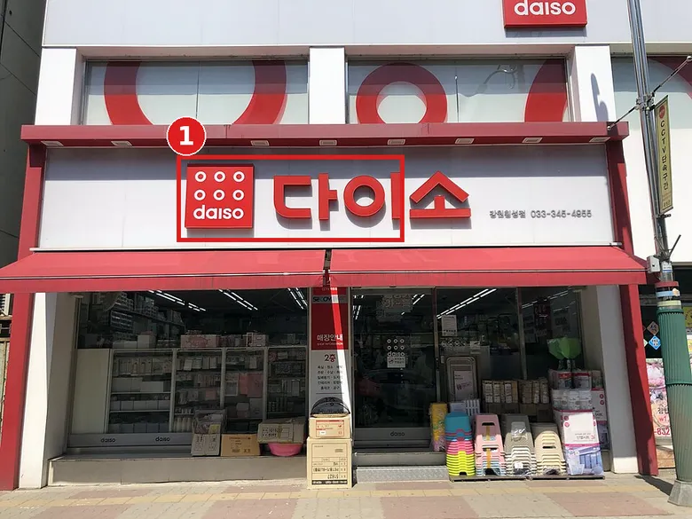
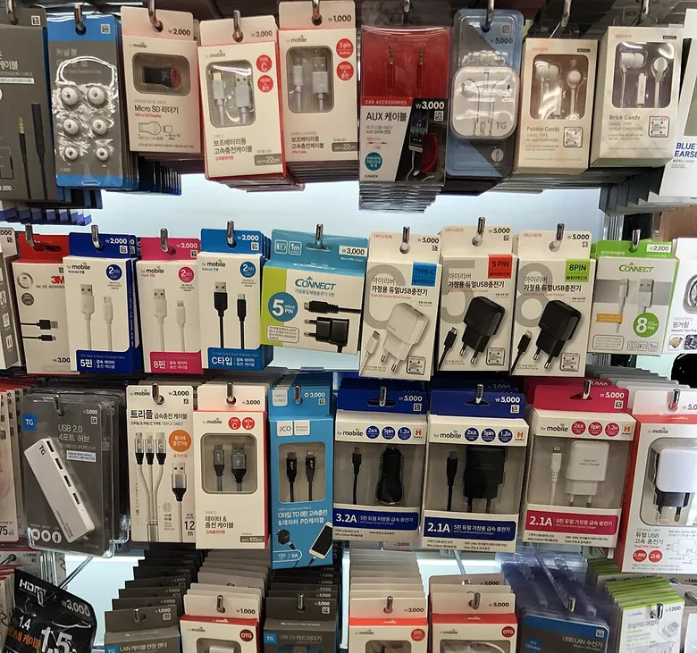
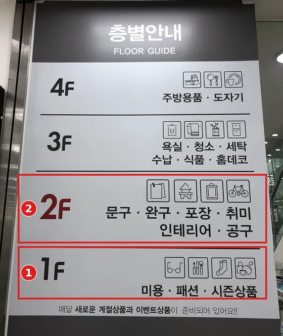
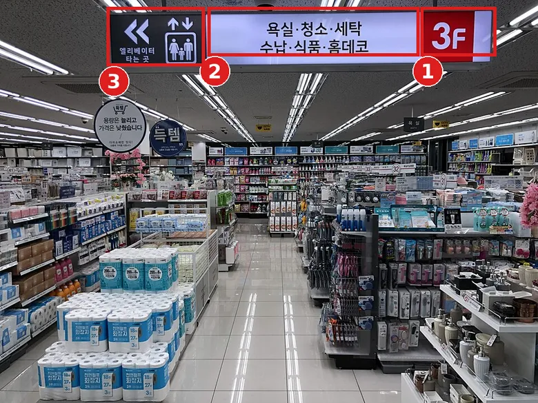
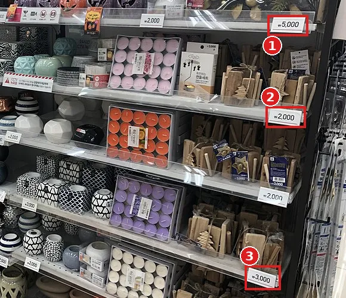

<a class="tr-btn go" href="#find"><i class="ic ic-map-pin" aria-hidden="true"></i>Find a Daiso near you</a><a class="tr-btn" href="#pay"><i class="ic ic-credit-card" aria-hidden="true"></i>Paying and tax refund</a>

<figure class="tr-hero acc-hero"><figcaption><b>Look for this sign.</b> <b>1</b> the red square "daiso" logo and the Korean letters 다이소. There are about 1,500 stores across Korea.Photo: Choi Kwang-mo (Daiso Hoengseong, 2020), <a href="https://creativecommons.org/publicdomain/zero/1.0/" rel="noopener" target="_blank">CC0</a>, <a href="https://commons.wikimedia.org/wiki/File:2020-04-06_12.55.48_%EB%8B%A4%EC%9D%B4%EC%86%8C_%EA%B0%95%EC%9B%90%ED%9A%A1%EC%84%B1%EC%A0%90_%EC%99%B8%EB%B6%80_%EC%A0%84%EA%B2%BD.jpg" rel="noopener" target="_blank">Wikimedia Commons</a> (auto-contrast, box and number added)</figcaption></figure>

<ul class="tr-facts"><li><i class="ic ic-tag" aria-hidden="true"></i>₩500–5,000<small>only six price points</small></li><li><i class="ic ic-clock" aria-hidden="true"></i>10:00–22:00<small>Myeongdong Station store; hours vary</small></li><li><i class="ic ic-id-card" aria-hidden="true"></i>Passport + ₩15,000<small>tax refund stores, one receipt</small></li><li><i class="ic ic-receipt" aria-hidden="true"></i>Receipt: 2 weeks<small>to exchange or refund</small></li></ul>

## What Daiso is good for

<ul class="tr-choose"><li><i class="ic ic-luggage" aria-hidden="true"></i><b>Travel fixes</b>A multi-adapter, portable luggage scale or phone charger you lost or forgot.</li><li><i class="ic ic-shopping-basket" aria-hidden="true"></i><b>Snacks and small souvenirs</b>Snacks mostly ₩1,000–2,000. Character goods, photocard accessories, phone accessories, Korean snacks.</li><li><i class="ic ic-sparkles" aria-hidden="true"></i><b>Trying skincare cheaply</b>Many small sizes and Daiso-only lines. Before you buy: <a href="/kbeauty-how-to-choose/">read the back of the box in 30 seconds</a>.</li></ul>

<figure class="tr-photo"><figcaption>Chargers, cables and earphones (Hoengseong store). In a big store, find the right floor on the floor guide first.Photo: Choi Kwang-mo (Daiso Hoengseong, 2020), <a href="https://creativecommons.org/publicdomain/zero/1.0/" rel="noopener" target="_blank">CC0</a>, <a href="https://commons.wikimedia.org/wiki/File:2020-04-06_12.54.12_%EB%8B%A4%EC%9D%B4%EC%86%8C_%EA%B0%95%EC%9B%90%ED%9A%A1%EC%84%B1%EC%A0%90_%EC%B6%A9%EC%A0%84%EA%B8%B0.jpg" rel="noopener" target="_blank">Wikimedia Commons</a> (cropped, auto-contrast)</figcaption></figure>

<ul class="tr-choose"><li><i class="ic ic-user-x" aria-hidden="true"></i><b>Who doesn't need Daiso</b>If you only want full-size products from one brand, or you're waiting for a big sale, <a href="/olive-young/">Olive Young</a> is the better shop. Current sales are on <a href="/deals/">Deals</a>.</li></ul>

<h2 id="find">1. Find a Daiso near you</h2>

<h3 class="tr-step">1<i class="ic ic-globe" aria-hidden="true"></i>Open Daiso's store search</h3>

1. Open [Daiso store search](https://www.daiso.co.kr/cs/shop) (Korean site).
2. Type an area name in Korean under 매장명 검색 (e.g. 명동 Myeongdong, 홍대 Hongdae) or pick an area under 지역 검색, then press 검색 (search).
3. Tap a store name to see its **address, opening hours and services**. If the services include 택스리펀드, you can get tax back there with your passport. Under 매장옵션 (store options) you can filter for 택스리펀드 only.
4. Copy the address into your map app and follow the route.

<aside class="tr-note tip"><i class="ic ic-lightbulb" aria-hidden="true"></i>Opening hours differ by store (e.g. Myeongdong Station 10:00–22:00, Sinchon Main 09:30–22:00). The Korea Tourism Organization lists Myeongdong Station as closed over the Seollal and Chuseok holidays, and Daiso posts a separate notice of stores that open on the holiday itself.</aside>

<h3 class="tr-step">2<i class="ic ic-signpost" aria-hidden="true"></i>If you want a big store in central Seoul</h3>

<ul class="tr-choose"><li><i class="ic ic-map-pin" aria-hidden="true"></i><b>Myeongdong Station: basement 1 to floor 12</b>On the street between Myeongdong Station Exits 1 and 4. Address 134-1 Toegye-ro, Jung-gu (서울 중구 퇴계로 134-1). 10:00–22:00, tax refund store. English, Japanese and Chinese floor guide and self-checkouts. Daiso calls it Seoul's second-largest store after Gangnam Express Bus Terminal (reopened on 1 March 2023 over floors 1–12, about 500 pyeong or 1,650 m²).</li><li><i class="ic ic-bus" aria-hidden="true"></i><b>Gangnam Express Bus Terminal: the largest store</b>Inside the terminal building, 194 Sinbanpo-ro, Seocho-gu. 08:30–22:00. Multilingual self-checkouts and tax refund. Handy while you wait for a bus, but the aisles are a maze, so watch the time.</li></ul>

Nearby shopping streets: [Where to shop in Seoul](/shopping-streets/).

## 2. Finding your way inside

In a big store each floor sells different things. As you walk in, check the **floor guide** and pick just two or three floors.

<figure class="tr-photo"><figcaption>The <b>층별안내 (FLOOR GUIDE)</b> board inside the store. <b>1</b> 1F 미용·패션·시즌상품 (beauty, fashion, seasonal), <b>2</b> 2F 문구·완구·포장·취미 (stationery, toys, wrapping, hobby). Layouts differ by store.Photo: MatthieuRicard (Daiso Wonju Dangu, 2020), <a href="https://creativecommons.org/publicdomain/zero/1.0/" rel="noopener" target="_blank">CC0</a>, <a href="https://commons.wikimedia.org/wiki/File:2020-03-17_21.40.56_%EB%8B%A4%EC%9D%B4%EC%86%8C_%EC%9B%90%EC%A3%BC%EB%8B%A8%EA%B5%AC%EC%A0%90.jpg" rel="noopener" target="_blank">Wikimedia Commons</a> (cropped, auto-contrast, boxes and numbers added)</figcaption></figure>

<figure class="tr-photo"><figcaption>Every floor has a ceiling sign like this (Wonju Dangu store). <b>1</b> the floor you're on, <b>2</b> what this floor sells, <b>3</b> the way to the lift (엘리베이터 타는 곳).Photo: MatthieuRicard (Daiso Wonju Dangu, 2020), <a href="https://creativecommons.org/publicdomain/zero/1.0/" rel="noopener" target="_blank">CC0</a>, <a href="https://commons.wikimedia.org/wiki/File:2020-03-17_21.39.49_%EB%8B%A4%EC%9D%B4%EC%86%8C_%EC%9B%90%EC%A3%BC%EB%8B%A8%EA%B5%AC%EC%A0%90.jpg" rel="noopener" target="_blank">Wikimedia Commons</a> (auto-contrast, boxes and numbers added)</figcaption></figure>

**Words to find on the signs:** 미용 beauty · 식품 food and snacks · 문구 stationery · 완구 toys · 주방 kitchen · 욕실 bathroom · 시즌상품 seasonal.

<i class="ic ic-layers" aria-hidden="true"></i>Myeongdong Station store floors (at the 2023 reopening)

This is the layout Daiso announced when it reopened in 2023. It may have changed, so check the floor guide by the entrance.

- **1F:** checkouts, seasonal goods
- **2F:** beauty. A September 2026 report still described it as crowded with overseas shoppers.
- **3F–4F:** stationery, fancy goods
- **5F:** food, kitchen
- **6F–7F:** kitchen
- **8F:** bathroom
- **9F:** home decor
- **10F:** gardening
- **11F–12F:** hobby

The checkouts are on 1F, so carry what you pick upstairs back down to pay.

## 3. Reading the price tags

<figure class="tr-photo"><figcaption>The price is printed large on the tag on the shelf edge. <b>1</b> ₩5,000, <b>2</b> ₩2,000, <b>3</b> ₩3,000. Even on one shelf, each section can have a different price.Photo: Choi Kwang-mo (Daiso Wonju Dangu, 2020), <a href="https://creativecommons.org/publicdomain/zero/1.0/" rel="noopener" target="_blank">CC0</a>, <a href="https://commons.wikimedia.org/wiki/File:2020-04-02_20.18.01_%EB%8B%A4%EC%9D%B4%EC%86%8C_%EC%9B%90%EC%A3%BC%EB%8B%A8%EA%B5%AC%EC%A0%90.jpg" rel="noopener" target="_blank">Wikimedia Commons</a> (cropped, auto-contrast, boxes and numbers added)</figcaption></figure>

- There are **six price points from ₩500 to ₩5,000**. Daiso says it has kept this system since its first store in 1997. Many items cost ₩1,000–3,000.
- Not everything is ₩1,000. Check the tag for each section before you pay.
- To stay within ₩5,000, cosmetics often come in smaller sizes (the Korea Tourism Organization notes they "may lack in terms of volume") or as Daiso-only lines with their own price and formula.

<h2 id="pay">4. Paying</h2>

<ul class="tr-choose"><li><i class="ic ic-credit-card" aria-hidden="true"></i><b>Cards are accepted</b>Foreign cards are widely used. If a store's services in the store search show 현금없는매장 (cashless store), it doesn't take cash. Cards, cash and WOWPASS: <a href="/money/">Money page</a>.</li></ul>

<h3 class="tr-step">1<i class="ic ic-id-card" aria-hidden="true"></i>For a tax refund, use a staffed till</h3>

1. Check for a "Tax Free" or "Tax Refund" sign in the store, or 택스리펀드 in the store search services. For example: Myeongdong Station, Myeongdong Main, Sinchon Main, Seoul Station, Seoul City Hall Plaza, Jongno Main.
2. Put everything in **one basket and pay once**. One receipt must reach ₩15,000. Since the top price is ₩5,000, that means at least three items.
3. Show your **physical passport** to the cashier as you pay. The tax comes off on the spot.

We could not confirm whether the self-checkouts handle tax refunds, so use a staffed till for that. Who qualifies, the limits and how much you actually get back are on our [tax refund page](/tax-refund/). By that page's estimate a ₩50,000 receipt returns about ₩2,500, so it's not worth changing plans for a Daiso refund.

<h3 class="tr-step">2<i class="ic ic-scan-line" aria-hidden="true"></i>Self-checkout: scan the QR code, not the barcode</h3>

1. Scan each item's **QR code** (not the barcode).
2. Only if an item has no QR code, scan its barcode; if that doesn't work, call a staff member.
3. Pay on the screen and take your receipt.

<h3 class="tr-step">3<i class="ic ic-receipt" aria-hidden="true"></i>Keep the receipt for two weeks</h3>

- **Exchange:** within 2 weeks of purchase, with the receipt, at the store where you bought it or a nearby company-run store.
- **Refund:** within 2 weeks, with the receipt, **only at the store where you bought it**.
- If you paid by card, bring that card. Items damaged by you or with damaged packaging can't be exchanged or refunded. If an item is faulty, show it to staff at the store where you bought it.

## If you can't find what you want

Stock differs by store, so not every store has every item.

1. Search the item on Daiso's [stock check by store](https://prdm.daisomall.co.kr/ms/msb/SCR_MSB_0011?tab=tab2) (Korean).
2. Or call Daiso customer service on **1522-4400** (weekdays 09:00–18:00) with the item number and name, and they'll tell you a nearby store that has it. We could not confirm which languages they speak.
3. If Korean is a problem, ask the **1330** Korea Travel Helpline (+82-2-1330; English, Japanese, Chinese and more) for help.

## Common mistakes

<ul class="tr-oops"><li><i class="ic ic-triangle-alert" aria-hidden="true"></i>Thinking everything is ₩1,000. Prices run from ₩500 to ₩5,000.</li><li><i class="ic ic-triangle-alert" aria-hidden="true"></i>Splitting purchases across three stores. For tax refund, each receipt must reach ₩15,000.</li><li><i class="ic ic-triangle-alert" aria-hidden="true"></i>Scanning only barcodes at the self-checkout. Scan the QR code.</li><li><i class="ic ic-triangle-alert" aria-hidden="true"></i>Throwing away the receipt. Exchanges and refunds need it, within 2 weeks.</li><li><i class="ic ic-triangle-alert" aria-hidden="true"></i>Assuming every store is the same. Hours, floor layout, tax refund and stock differ by branch.</li></ul>

<i class="ic ic-list-checks" aria-hidden="true"></i>Our call, as a table

| Situation | Do this | Why |
|---|---|---|
| You need cheap souvenirs and snacks, or a travel fix (multi-adapter, portable scale, charger) | Daiso | Prices are ₩500–5,000, and the Korea Tourism Organization's Daiso guide lists these travel items |
| You want to try budget skincare | Start at the beauty section | About 170 beauty brands in 2026, many Daiso-only lines; viral items sell out |
| You want the widest range in central Seoul | Myeongdong Station store (12 floors) | Daiso calls it Seoul's second-largest store, with an English, Japanese and Chinese floor guide |
| You want full-size K-beauty or a big seasonal sale | [Olive Young](/olive-young/) | Daiso skincare is mostly Daiso-only lines or small sizes. Current sales on [Deals](/deals/) |

<i class="ic ic-sparkles" aria-hidden="true"></i>More on Daiso skincare

- According to The Korea Herald, beauty brands at Daiso grew from 7 in 2022 to about 170 in 2026, and beauty products from about 120 to more than 1,900.
- Amorepacific, LG Household & Health Care and Aekyung sell Daiso-only lines under sub-brands. Many Daiso-only lines are planned from the start with their own price, formula and target customer.
- The Korea Tourism Organization named VT Reedle Shot as Daiso's top seller in March 2024, and The Korea Herald (September 2026) reported that Daiso skincare has repeatedly sold out after going viral. We could not confirm current prices and line-ups on an official page, so check the shelf tag.
- Before you buy, [read the back of the box in 30 seconds](/kbeauty-how-to-choose/) for the functional-cosmetic mark and the expiry.

<i class="ic ic-pencil" aria-hidden="true"></i>Before you go: a list per person

Writing the list is half of a good Daiso trip, and it helps you keep to one receipt.

1. **Write one line per person,** yourself included. Skincare for you, snacks to share, photocard accessories for the K-pop fan, travel fixes for you mid-trip (our call).
2. **For a tax refund, carry your physical passport** and plan one receipt of ₩15,000 or more.

The ending we picked is not a full bag at the door but a week later: the thing that fixed a problem on your trip (a portable luggage scale or a multi-adapter) and the snacks you handed out back home.

<i class="ic ic-info" aria-hidden="true"></i>About the company, and sources

Daiso in Korea is run by the Korean company Asung Daiso. In 2023 it bought out its Japanese shareholder and became fully Korean-owned. It has designed and made its own products since 2014.

Opened and checked on 26 November 2026: Daiso <a href="https://www.daiso.co.kr/cs/shop" rel="noopener" target="_blank">store search</a> (Myeongdong Station address, B1–12F, 10:00–22:00, tax refund; service options tax refund and cashless store; tax refund shown for Myeongdong Main, Seoul City Hall Plaza, Jongno Main, Seoul Station) and <a href="https://www.daiso.co.kr/cs/faq" rel="noopener" target="_blank">FAQ</a> (finding stores, stock by store, 1522-4400 weekdays 9–18, 2-week exchange and refund with receipt and card, faulty items, holiday opening notice); Asung Daiso press releases <a href="https://www.daiso.co.kr/brand/daiso_news/26502?btype=company" rel="noopener" target="_blank">Myeongdong Station reopening</a> (14 March 2023: reopened on the 1st, floors 1–12, about 500 pyeong, second-largest in Seoul, floor layout) and <a href="https://www.daiso.co.kr/brand/daiso_news/125585?btype=company" rel="noopener" target="_blank">six price points from ₩500 to ₩5,000</a> (11 November 2026); Korea Tourism Organization VISITKOREA <a href="https://english.visitkorea.or.kr/svc/contents/contentsView.do?menuSn=&amp;vcontsId=194390" rel="noopener" target="_blank">"Find Everything at Daiso Korea!"</a> (about 1,500 stores, travel items, snacks ₩1,000–2,000, most items ₩1,000–3,000, Reedle Shot, QR at self-checkout, Myeongdong Station between Exits 1 and 4 with multilingual floor guide, Gangnam Express Bus Terminal 08:30–22:00 and largest, 1330) and tax refund shop pages for <a href="https://english.visitkorea.or.kr/svc/contents/contentsView.do?menuSn=459&amp;vcontsId=146975" rel="noopener" target="_blank">Myeongdong Station</a> (10:00–22:00, closed Seollal and Chuseok holidays, cards accepted), <a href="https://english.visitkorea.or.kr/svc/contents/contentsView.do?menuSn=459&amp;vcontsId=146952" rel="noopener" target="_blank">Myeongdong Main</a>, <a href="https://english.visitkorea.or.kr/svc/contents/contentsView.do?menuSn=459&amp;vcontsId=146026" rel="noopener" target="_blank">Sinchon Main</a> (09:30–22:00) and <a href="https://english.visitkorea.or.kr/svc/contents/contentsView.do?menuSn=459&amp;vcontsId=1573799" rel="noopener" target="_blank">Seoul Station</a>; The Korea Herald <a href="https://www.koreaherald.com/article/3281373" rel="noopener" target="_blank">Daiso becomes fully Korean-owned</a> (13 December 2023), <a href="https://www.koreaherald.com/article/10589279" rel="noopener" target="_blank">beauty brands and sub-brands</a> (3 October 2025), <a href="https://www.koreaherald.com/article/10649917" rel="noopener" target="_blank">Daiso-only beauty lines</a> (6 January 2026), <a href="https://www.koreaherald.com/article/10872741" rel="noopener" target="_blank">viral sell-outs and Reedle Shot</a> (14 September 2026), <a href="https://www.koreaherald.com/article/10877187" rel="noopener" target="_blank">₩500–5,000, 170 beauty brands and 1,900 products, second-floor beauty at Myeongdong Station, foreign-card spending</a> (17 September 2026). Tax refund rules: our <a href="/tax-refund/">tax refund page</a>.

## Next

<ul class="tr-next"><li><a href="/kbeauty-how-to-choose/"><i class="ic ic-scan-line" aria-hidden="true"></i>Choosing skincare: 30 seconds with the box<i class="ic ic-arrow-right" aria-hidden="true"></i></a></li><li><a href="/tax-refund/"><i class="ic ic-receipt" aria-hidden="true"></i>Tax refund: just show your passport<i class="ic ic-arrow-right" aria-hidden="true"></i></a></li><li><a href="/olive-young/"><i class="ic ic-shopping-basket" aria-hidden="true"></i>Olive Young: sale dates and the basics<i class="ic ic-arrow-right" aria-hidden="true"></i></a></li></ul>
