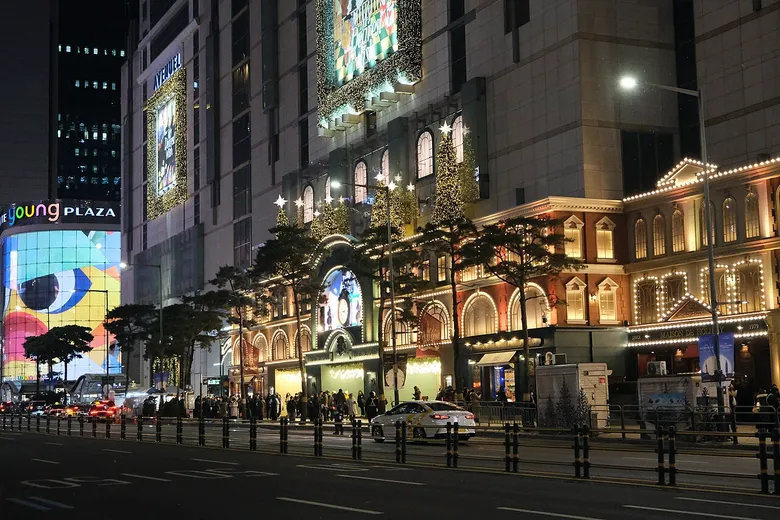
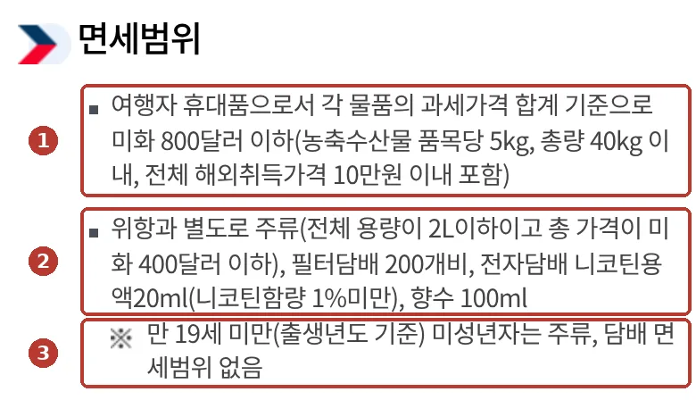

<a class="tr-btn go" href="#pickup"><i class="ic ic-map-pin" aria-hidden="true"></i>Pickup counter</a><a class="tr-btn" href="#limit"><i class="ic ic-luggage" aria-hidden="true"></i>Allowance</a>

<figure class="tr-hero acc-hero"><figcaption><b>You collect duty-free goods beyond this door.</b> Departure Hall entrance, Incheon Terminal 1. <b>1</b> Departure Hall number, <b>2</b> gate map. After security and passport control you are in the duty-free area, and the pickup counters are in there.Photo: Sgroey (2024), <a href="https://creativecommons.org/licenses/by-sa/4.0/" rel="noopener" target="_blank">CC BY-SA 4.0</a>, <a href="https://commons.wikimedia.org/wiki/File:Incheon_airport_departure_gate_access.jpg" rel="noopener" target="_blank">Wikimedia Commons</a> (cropped, auto-contrast, boxes and numbers added)</figcaption></figure>

<ul class="tr-facts"><li><i class="ic ic-id-card" aria-hidden="true"></i>Real passport + flight<small>No copies or photos</small></li><li><i class="ic ic-clock" aria-hidden="true"></i>Online: usually 19:30 the day before<small>Depends on departure time and counter</small></li><li><i class="ic ic-map-pin" aria-hidden="true"></i>Pickup: after passport control<small>Not possible on arrival</small></li><li><i class="ic ic-luggage" aria-hidden="true"></i>Into Korea: $800 per person<small>Alcohol 2 L / $400 on top</small></li></ul>

## Where to buy

All three sell the same duty-free goods. One question decides it: **how sure are you of what you want?**

<ul class="tr-choose"><li><i class="ic ic-smartphone" aria-hidden="true"></i><b>You know what you want: online duty-free (app)</b>Perfume, imported cosmetics, liquor you already know. Order by the evening before you fly, no store visit, collect at the airport. <a href="#online">How to order</a></li><li><i class="ic ic-store" aria-hidden="true"></i><b>You want to see and compare: a downtown store</b>Bring your passport and flight details to a Seoul store. You pay downtown; the goods wait for you at the airport pickup counter. <a href="#downtown">Stores and how to get there</a></li><li><i class="ic ic-plane" aria-hidden="true"></i><b>Something small, last minute: the airport shop</b>Buy after security and passport control and carry it straight on. No pickup counter to find.</li></ul>

<aside class="tr-note tip"><i class="ic ic-lightbulb" aria-hidden="true"></i>If you mostly want Korean skincare, <a href="/olive-young/">Olive Young</a> with the <a href="/tax-refund/">instant tax refund at the till</a> (for people visiting Korea) is simpler than duty-free.</aside>

<i class="ic ic-info" aria-hidden="true"></i>Duty-free is not the same as tax refund

Know which one you are in before you pay. You collect the goods in different places.

{{fig:duty-free-4|Duty-free shop or tax-refund store: where you get the goods}}

- **Duty-free shop:** a bonded store that sells only to people leaving Korea. What you buy downtown or online can't be taken away on the spot; you collect it after passport control on departure day.
- **Tax refund (Tax Free):** ordinary stores such as Olive Young and department stores give foreign visitors part of the 10% VAT back. See [tax refund](/tax-refund/).

Each purchase gets one or the other, not both.

<h2 id="online">Buying from an online duty-free shop</h2>

{{fig:duty-free-1|From order to pickup on departure day}}

This is the order Hyundai Duty Free describes; the other shops use the same steps.

<h3 class="tr-step">1<i class="ic ic-log-in" aria-hidden="true"></i>Open the duty-free website or app</h3>

Anyone with a confirmed departure from Korea can buy, Korean or not. You can buy as a member or a guest; members get extra discounts. Orders open 90 days before departure.

<ul class="tr-next"><li><a href="https://en.hddfs.com/" rel="noopener" target="_blank"><i class="ic ic-globe" aria-hidden="true"></i>Hyundai Duty Free online<i class="ic ic-external-link" aria-hidden="true"></i></a></li><li><a href="https://www.shilladfs.com/estore/kr/en/" rel="noopener" target="_blank"><i class="ic ic-globe" aria-hidden="true"></i>Shilla Duty Free online<i class="ic ic-external-link" aria-hidden="true"></i></a></li></ul>

Lotte's and Shinsegae's sites are linked under 'View Website' on their Visit Seoul store pages ([Lotte](https://english.visitseoul.net/shopping/Lotte-Duty-Free-Shop-Main-Store/ENP009641), [Shinsegae](https://english.visitseoul.net/area/Shinsegae-Duty-Free-en/ENP024463)).

<h3 class="tr-step">2<i class="ic ic-shopping-basket" aria-hidden="true"></i>Put items in the cart</h3>

Search by product or brand, choose quantity and options, add to cart.

<h3 class="tr-step">3<i class="ic ic-id-card" aria-hidden="true"></i>Enter your departure details and pay</h3>

1. **Passport number and name in English** exactly as in the passport you will carry. If they don't match, you can't collect at the airport.
2. **Departure date, airport, flight number, departure time** exactly as on your e-ticket.
3. **Pay:** charged in won at that day's exchange rate. Hyundai takes credit cards, bank transfer, Kakao Pay, Naver Pay, Toss Pay, Alipay+, WeChat Pay, UnionPay and more.

<aside class="tr-note"><i class="ic ic-triangle-alert" aria-hidden="true"></i><b>Order before the cut-off.</b> It is usually the evening before you fly, but for a flight just after midnight the cut-off is 14:30 the day before. See the table below.</aside>

<h3 class="tr-step">4<i class="ic ic-ticket" aria-hidden="true"></i>Keep the voucher</h3>

After paying, print the voucher (exchange ticket) from your order history. If you can't print, note the voucher number or get it by text (SMS) and show it at the airport with your passport and ticket. **Check the pickup counter named on the voucher** (for example T1 West). That is where you go on departure day.

<i class="ic ic-clock" aria-hidden="true"></i>Order cut-off times (Hyundai, Incheon)

They vary by shop, by counter and by departure time. Hyundai's current times for the Incheon Terminal 1 West counter:

| Departure time | Order by |
|---|---|
| 00:00–02:59 | 14:30 the day before |
| 03:00–16:59 | 19:30 the day before |
| 17:00–19:59 | 11:30 the same day |
| 20:00–23:59 | 14:30 the same day |

At the Terminal 1 Concourse and Terminal 2 counters the bands are one hour later (03:00–17:59, 18:00–20:59, 21:00–23:59). Register your flight to see your exact cut-off. If your flight is very soon, Hyundai asks you to call customer service.

<h2 id="downtown">Buying at a downtown duty-free store</h2>

<figure class="tr-photo"><figcaption><b>Lotte Duty Free main store (Myeongdong)</b>, on floors 9–12 of Lotte Department Store.Photo: Leeinm (2023), <a href="https://creativecommons.org/licenses/by/4.0/" rel="noopener" target="_blank">CC BY 4.0</a>, <a href="https://commons.wikimedia.org/wiki/File:Night_view_of_Lotte_Duty_Free_Shop.jpg" rel="noopener" target="_blank">Wikimedia Commons</a> (resized, auto-contrast)</figcaption></figure>

<h3 class="tr-step">1<i class="ic ic-id-card" aria-hidden="true"></i>Bring your real passport and your ticket</h3>

You need a ticket (e-ticket; a phone screen works) that shows your departure date, time and flight number. Passport copies or photos are not accepted.

<h3 class="tr-step">2<i class="ic ic-map-pin" aria-hidden="true"></i>Go to a store</h3>

<ul class="tr-choose"><li><i class="ic ic-store" aria-hidden="true"></i><b>Lotte Duty Free main store (Myeongdong)</b>Floors 9–12 of Lotte Department Store. 50 m from Euljiro 1-ga Station (Line 2), exits 7 and 8. Daily 09:30–20:00.</li><li><i class="ic ic-store" aria-hidden="true"></i><b>Shinsegae Duty Free Myeongdong</b>Floors 8–12 of Shinsegae Department Store main branch. 145 m from Hoehyeon Station (Line 4), exit 5. Mon–Thu 10:30–20:00, Fri–Sun 10:30–20:30.</li><li><i class="ic ic-store" aria-hidden="true"></i><b>Shilla Duty Free Seoul</b>Next to The Shilla hotel. 278 m from Dongguk Univ. Station (Line 3), exit 5. Daily 09:00–20:00. Runs free shuttle buses linking Seoul's main shopping districts.</li><li><i class="ic ic-store" aria-hidden="true"></i><b>Hyundai Duty Free Trade Center</b>Mon–Thu 10:30–20:00, Fri–Sun 10:30–20:30.</li></ul>

How to find the right exit: [Seoul subway](/seoul-subway/). Hours change, so check the links above before you go.

<h3 class="tr-step">3<i class="ic ic-credit-card" aria-hidden="true"></i>Choose, then show passport and ticket at the till</h3>

After you pay, the goods stay at the store and wait for you at the airport pickup counter. Check the counter named on your receipt or voucher.

<aside class="tr-note ok"><i class="ic ic-circle-check" aria-hidden="true"></i><b>Korean products can sometimes go home with you right away.</b> Hyundai says foreigners can buy Korean products in store and take them on the spot from 60 days before departure. Since July 2026, foreign travelers can also collect K-beauty and K-food bought from online duty-free shops at downtown stores (Segye Ilbo report).</aside>

<h2 id="pickup">Departure day: the walk to the pickup counter</h2>

Wherever you bought, you collect **only at a pickup counter inside the departure area**, after security and passport control. You can't collect on arrival. Arriving at the airport 3 hours early leaves time ([departure day](/departure-day/)). Hyundai asks you to reach the counter **at least 1 hour before departure**, because it can be busy.

<h3 class="tr-step">1<i class="ic ic-ticket" aria-hidden="true"></i>Read the counter name on your voucher</h3>

{{fig:duty-free-2|The four Incheon pickup counters}}

<h3 class="tr-step">2<i class="ic ic-door-open" aria-hidden="true"></i>Check in, then enter the departure area</h3>

Check in and drop your bags at the airline counter, then go through an entrance marked 'Departure Hall' with a number, as in the photo above, for security and passport control. The airport steps are in [departure day](/departure-day/).

<h3 class="tr-step">3<i class="ic ic-signpost" aria-hidden="true"></i>Follow the gate-number signs to the counter</h3>

{{fig:duty-free-t1map|Terminal 1: from the 3F duty-free area after passport control to the 4F pickup counter opposite gate 43. Redrawn by Nadri from the Hyundai and Shilla pickup guides and the Incheon Airport facility list (checked 26 November 2026)}}

<ul class="tr-choose"><li><i class="ic ic-map-pin" aria-hidden="true"></i><b>Terminal 1 West (4F)</b>After passport control you are in the 3F duty-free area. Walk the way gate numbers go up (west). Near gate 29 you pass a <strong>24-hour information desk</strong> and the Korean Traditional Culture Center (West). At gate 43 the counter is <strong>on the upper floor (4F), opposite the gate</strong>. Matina Lounge (West) is on 4F near gate 43. Open 04:00 until the last flight, ☎ +82-32-743-2711.</li><li><i class="ic ic-train-front" aria-hidden="true"></i><b>Terminal 1 Concourse (4F)</b>If your gate is 101–132, take the shuttle train to the Concourse. Get off and take the <strong>escalator next to gate 119</strong> up to 4F. Open from 03:00, ☎ +82-32-743-2715.</li><li><i class="ic ic-map-pin" aria-hidden="true"></i><b>Terminal 2 West (2F)</b>Near gate 225, take the escalator opposite the Korean Traditional Culture Center (West) down to 2F. Open from 05:00, ☎ +82-32-743-6503.</li><li><i class="ic ic-map-pin" aria-hidden="true"></i><b>Terminal 2 East (2F)</b>Towards gate 274, take the escalator opposite the Korean Traditional Culture Center (East) down to the lower floor (2F). Open from 05:00.</li></ul>

<i class="ic ic-map" aria-hidden="true"></i>Terminal 2 as a picture

{{fig:duty-free-t2map|Terminal 2: from the 3F duty-free area down to the 2F counters. Redrawn by Nadri from the Hyundai and Shilla pickup guides}}

Opening hours and phone numbers are from Shilla Duty Free's pickup guide (all counters stay open until the last flight leaves).

<i class="ic ic-plane" aria-hidden="true"></i>Leaving from another airport (Gimpo, Gimhae, Jeju, Cheongju, Daegu)

Same order: the counter is after passport control. Check the counter name on your voucher (Hyundai and Shilla guides).

- **Gimpo:** escalator or elevator opposite gate 34, up to 4F. ☎ +82-2-2666-2730
- **Gimhae:** opposite gate 13, after passport control on 2F. ☎ +82-51-941-9356
- **Jeju:** after departure immigration on 3F, on the left, opposite gates 19 and 20. ☎ +82-64-747-0163
- **Cheongju:** straight ahead after immigration (2F). ☎ +82-43-212-8270
- **Daegu:** to the left of the immigration checkpoint on 2F. ☎ +82-53-981-8277

<aside class="tr-note tip"><i class="ic ic-circle-help" aria-hidden="true"></i>Lost? Show your voucher at an information desk in the duty-free area (Terminal 1, 3F near gates 25 and 29, open 24 hours).</aside>

<h3 class="tr-step">4<i class="ic ic-scan-line" aria-hidden="true"></i>Hand over voucher, passport and boarding pass; check and sign</h3>

1. The buyer in person shows the voucher, passport and boarding pass.
2. Check the item names, quantities and condition, then sign. Report any problem to the staff right there; the shop takes no responsibility after you leave the country.
3. Liquids come in a sealed bag. Don't open it before your final destination ([below](#liquids)).

<aside class="tr-note ok"><i class="ic ic-circle-check" aria-hidden="true"></i>That's it. If what you bought is within the allowance of the country you fly into, there is nothing to declare when you land.</aside>

<i class="ic ic-triangle-alert" aria-hidden="true"></i>When you can't collect, and what to do

- **You can't collect when:** the buyer and the traveler are different people; the passport number on the order differs from the passport you show; the registered departure details (airport, date and time, flight) differ from your real ones.
- **Fix it early:** Shilla asks you to contact customer service at least 3 days before departure to correct a passport number.
- **Missed it?** Contact the shop. Hyundai lets you change departure details up to 180 days from the order date; after that you cancel and buy again. Hyundai customer center 1811-6688 (09:30–18:30, Korean); English pickup inquiries +82-2-2163-6215 (daily 10:00–19:00). Lotte +82-1688-3000, Shilla +82-1688-1110, Shinsegae +82-2-1661-8778 (from their Visit Seoul store pages).
- Duty-free goods are not shipped to your home address.

<h2 id="limit">How much can you buy?</h2>

When you leave Korea there is **no limit** on duty-free purchases. Hyundai says anyone departing, Korean or foreign, can buy without limit. The limit that matters is **the allowance of the country you enter next**, and duty-free purchases count towards it.

### Entering Korea (Korea Customs Service)

<figure class="tr-photo"><figcaption><b>1</b> Goods up to US$800 in total, <b>2</b> on top of that alcohol up to 2 L and US$400, 200 filter cigarettes, 20 ml e-cigarette nicotine liquid, 100 ml perfume, <b>3</b> no alcohol or tobacco allowance under 19.Screen: Korea Customs Service, <a href="https://www.customs.go.kr/kcs/cm/cntnts/cntntsView.do?mi=2837&amp;cntntsId=829" rel="noopener" target="_blank">traveler's personal goods</a> (Korean), captured 26 November 2026 (cropped, boxes and numbers added)</figcaption></figure>

| | Allowance per person |
|---|---|
| Goods | **US$800**. Farm, livestock and fishery products (5 kg per item, 40 kg in total, purchase price abroad up to ₩100,000 in total) are counted within it |
| Alcohol | On top: **2 L in total, up to US$400** |
| Tobacco | On top: **200** filter cigarettes; 20 ml e-cigarette nicotine liquid |
| Perfume | On top: **100 ml** |

<ul class="tr-choose"><li><i class="ic ic-circle-check" aria-hidden="true"></i><b>Nothing to declare</b>No form; walk through the 'Nothing to declare' channel. You may still be inspected.</li><li><i class="ic ic-pencil" aria-hidden="true"></i><b>Over the allowance</b>After baggage claim and before the customs exit, submit a declaration on paper or on mobile (<a href="https://www.customs.go.kr/kcs/cm/cntnts/cntntsView.do?mi=2837&amp;cntntsId=829" rel="noopener" target="_blank">Korea Customs guide</a>, Korean). If you self-declare on mobile you can also get the bill and pay on mobile. Self-declaring cuts the duty by 30%; if you don't declare and are caught, you pay a 40% penalty on the tax (60% if it happens twice or more within 2 years).</li></ul>

Since July 2026, goods within the allowance can be exchanged by post or courier after you return, for the same model in another color or size only (Segye Ilbo report).

### Entering another country

That country's customs rules set the limit. Three people ask about often:

<i class="ic ic-globe" aria-hidden="true"></i>Japan, Taiwan and US allowances

| Country | Goods | Alcohol | Tobacco and more |
|---|---|---|---|
| Japan | Overseas market value up to **¥200,000** in total. An item over ¥200,000 is taxed in full. Items of one kind totalling ¥10,000 or less are, as a rule, duty-free | **3 bottles** (760 ml each) | Cigarettes only: 200; heated tobacco only: 10 packs; cigars only: 50. Perfume on top: 2 oz (1 oz is about 28 ml; eau de cologne and eau de toilette not included) |
| Taiwan | Duty-paid value up to **NT$35,000** in total. Not for people clearly trading for profit, or frequent travelers (twice or more in 30 days, or 6 times in 6 months) with a violation record | The customs traveler notice says 1 L (age 20+); the amended rule in force from 1 February 2026 says 1.5 L and age 18. They disagree: plan on the stricter 1 L and check before you fly | 200 cigarettes, or 25 cigars, or 1 lb of tobacco (age 20+) |
| United States | **US$800** (abroad at least 48 hours, not used in the last 31 days) | **1 L** (age 21+, personal use) | 200 cigarettes and 100 cigars (age 21+) |

- Japan: no alcohol or tobacco allowance under 20.
- US Customs says plainly that duty-free shop purchases are not automatically duty-free when you return; state alcohol laws can be stricter.

<h2 id="liquids">Alcohol and liquids</h2>

{{fig:duty-free-5|The sealed duty-free bag: when not to open it}}

- **Direct flight:** liquids packed in the shared duty-free tamper-evident bag (with the receipt attached) can be carried on board whatever the volume or number. Downtown and online liquor is handed over after security, so the liquids limit doesn't apply when you board in Korea.
- **Don't open it before your final destination.** If it has been opened or damaged, it can't be carried on.
- **Transferring?** Liquids can be confiscated under the transit country's security rules. Via the US, liquids in opaque or metal containers are restricted; if your final destination after a transfer is a US territory, Australia (or its territories), Canada or the Virgin Islands, you can't buy liquids. Ask your airline first. More in [departure day](/departure-day/).

## Common mistakes

<ul class="tr-oops"><li><i class="ic ic-triangle-alert" aria-hidden="true"></i>Typing the passport number or flight wrong. You can't collect.</li><li><i class="ic ic-triangle-alert" aria-hidden="true"></i>Ordering the evening before a just-after-midnight flight. The cut-off was 14:30.</li><li><i class="ic ic-triangle-alert" aria-hidden="true"></i>Looking for the counter just before boarding. Go at least 1 hour before.</li><li><i class="ic ic-triangle-alert" aria-hidden="true"></i>Opening the sealed bag before the transfer airport.</li><li><i class="ic ic-triangle-alert" aria-hidden="true"></i>Thinking "bought duty-free, so duty-free at home". It counts towards the allowance where you land.</li></ul>

<i class="ic ic-list-checks" aria-hidden="true"></i>The quick decision as a table

| If | Do | Why |
|---|---|---|
| You know what you want (perfume, imported cosmetics, liquor) | Order online or in the app by the day before, collect at the airport | Same goods, no store visit; collected after passport control |
| You want to try and compare | Go to a downtown store with passport and flight details | Pay downtown, goods wait at the airport |
| Something small, last minute | Airport duty-free after security | No counter to find. Since 2026 the core cosmetics, liquor and tobacco zones at Incheon are run by Lotte and Hyundai |

Left out: brand price comparisons and membership-tier tips, because prices change daily.

<i class="ic ic-store" aria-hidden="true"></i>Korea's duty-free landscape in 2026

- **Incheon Airport:** Shilla and Shinsegae gave back the core zones (DF1, DF2: cosmetics, perfume, liquor, tobacco) amid weak sales, and Lotte (DF1) and Hyundai (DF2) took over in 2026, with contracts to June 2033. Shinsegae still runs zone DF4, and Shilla and Shinsegae keep their fashion and boutique zones.
- **Downtown:** all four have stores in Seoul. A June 2026 report said Hyundai is shrinking its Dongdaemun and Trade Center stores while Shilla and Shinsegae focus on downtown and online. Check hours before you go.
- **Sales:** Shilla Duty Free's Black Friday is on the [deals board](/deals/) with its end date and source.

<i class="ic ic-calendar-check" aria-hidden="true"></i>A duty-free departure day, start to finish

Order ahead and the end of your trip goes like this. Check in, pass security and passport control, and walk to the counter named on your voucher. Show your passport and boarding pass, check the items and quantities, sign. Liquids come out in a sealed bag that stays shut until you are home. The final scene we suggest is the customs hall on arrival: what you bought is within the allowance and there is nothing to declare.

<i class="ic ic-info" aria-hidden="true"></i>Sources

Checked 26 November 2026: Hyundai Duty Free <a href="https://www.hddfs.com/shop/om/consmGuide/useNotice.do" rel="noopener" target="_blank">usage notice</a> (order cut-offs by counter, no purchase limit when leaving, orders from 90 days ahead, real passport and e-ticket), <a href="https://www.hddfs.com/shop/om/consmCont/bcaInfo.do" rel="noopener" target="_blank">pickup counters and collection</a> (locations, documents, at least 1 hour before, when you can't collect, 180-day change window, customer center), <a href="https://www.hddfs.com/shop/om/consmCont/shopProc.do" rel="noopener" target="_blank">shopping steps</a> (member or guest, payment methods, voucher), <a href="https://www.hddfs.com/shop/om/consmCont/cariProhInfo.do" rel="noopener" target="_blank">carry-on restrictions</a> (sealed bag, transfer limits), <a href="https://www.hddfs.com/store/en/dm/stShop/shoppingGuide.do" rel="noopener" target="_blank">English shopping guide</a> (Trade Center hours, Korean products taken on site by foreigners from 60 days before, English pickup line); Shilla Duty Free <a href="https://www.shilladfs.com/estore/kr/en/shilladfscustomercenter/deliverypointinfo" rel="noopener" target="_blank">pickup guide</a> (opening hours and phone of each counter, Gimpo/Gimhae/Jeju/Cheongju/Daegu counters, the four Incheon counters, escalator next to gate 119, passport number corrections 3 days ahead, no pickup on arrival); Incheon International Airport <a href="https://www.airport.kr/ap_ko/1008/subview.do" rel="noopener" target="_blank">facility list</a> (Korean; T1 3F airside 24-hour information desks near gates 25 and 29, central gate 28, Korean Traditional Culture Center (West), Matina Lounge (West) on 4F near gate 43); Visit Seoul <a href="https://english.visitseoul.net/shopping/Lotte-Duty-Free-Shop-Main-Store/ENP009641" rel="noopener" target="_blank">Lotte Duty Free main store</a> (edited 23 November 2026), <a href="https://english.visitseoul.net/area/Shinsegae-Duty-Free-en/ENP024463" rel="noopener" target="_blank">Shinsegae Duty Free</a> (25 November), <a href="https://english.visitseoul.net/area/Shilla-Duty-Free-Shop/ENP000521" rel="noopener" target="_blank">Shilla Duty Free</a> (6 August); Korea Customs Service <a href="https://www.customs.go.kr/kcs/cm/cntnts/cntntsView.do?mi=2837&amp;cntntsId=829" rel="noopener" target="_blank">traveler's personal goods</a> (allowance, declaration steps, self-declaration reduction and penalty); Japan Customs <a href="https://www.customs.go.jp/kaigairyoko/menzei.htm" rel="noopener" target="_blank">duty-free allowance for travelers</a>; The Korea Times / Yonhap <a href="https://www.koreatimes.co.kr/business/companies/20260226/lotte-hyundai-win-approval-to-operate-new-duty-free-zones-at-incheon-airport" rel="noopener" target="_blank">Lotte, Hyundai win approval to operate new duty-free zones at Incheon airport</a> and The Korea Herald <a href="https://www.koreaherald.com/article/10683421" rel="noopener" target="_blank">same report</a> (26 February 2026). Not reopened today: Lotte and Shinsegae duty-free sites (blocked from our checker); US CBP (refused our checker; checked 25 November 2026: Customs Duty Information, last modified 14 May 2024, and 19 CFR 148.33); Taiwan Customs Administration, Regulations Governing Baggage of Inbound Passengers, art. 11 (amended 30 January 2026; blocked; checked 25 November). Press checked 25 November 2026: Newsis (opening dates, 8 April 2026); The Fact (10 June 2026); BizWatch (18 November 2026); Segye Ilbo (online duty-free pickup downtown and post-return exchange, 1 July 2026); TaxWatch (traveler allowance, 1 September 2026).

## Next

<ul class="tr-next"><li><a href="/departure-day/"><i class="ic ic-plane" aria-hidden="true"></i>Departure day: the airport in order<i class="ic ic-arrow-right" aria-hidden="true"></i></a></li><li><a href="/tax-refund/"><i class="ic ic-receipt" aria-hidden="true"></i>Tax refund at ordinary stores<i class="ic ic-arrow-right" aria-hidden="true"></i></a></li><li><a href="/olive-young/"><i class="ic ic-shopping-basket" aria-hidden="true"></i>Olive Young: sale weeks and three basics<i class="ic ic-arrow-right" aria-hidden="true"></i></a></li></ul>
