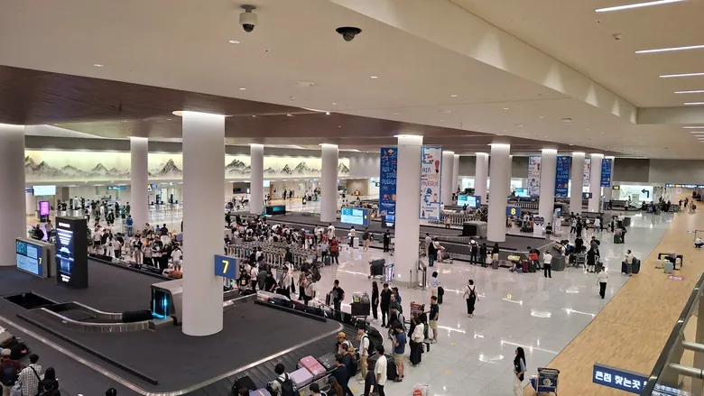

<a class="eac-btn" href="#do-i-need-it"><i class="ic ic-circle-help" aria-hidden="true"></i>Do I need it?</a><a class="eac-btn go" href="https://www.e-arrivalcard.go.kr" rel="noopener" target="_blank">Fill it in <i class="ic ic-arrow-right" aria-hidden="true"></i></a>

<ul class="eac-facts"><li><i class="ic ic-wallet" aria-hidden="true"></i>Free</li><li><i class="ic ic-clock" aria-hidden="true"></i>About 10 minutes</li><li><i class="ic ic-calendar-days" aria-hidden="true"></i>3 days before you land</li><li><i class="ic ic-smartphone" aria-hidden="true"></i>Phone or computer, no app</li></ul>

{{fig:e-arrival-card-shot-1|The real site warns you first: ① the only official address is www.e-arrivalcard.go.kr, and any site asking for payment is not official. ② Confirm closes the warning. Screen: e-arrivalcard.go.kr (Ministry of Justice), captured 26 Nov 2026}}

<ul class="eac-facts eac-wide"><li><i class="ic ic-circle-check" aria-hidden="true"></i>Forgot? You can still file after landing, before the immigration desk.</li><li><i class="ic ic-pencil" aria-hidden="true"></i>The site shows 7 languages, but you type in English or Korean only.</li></ul>

## Do I need it?

<ul class="eac-who"><li class="yes"><i class="ic ic-user-check" aria-hidden="true"></i><b>Yes: you come without a K-ETA</b>For example on a US, Japanese or Taiwanese passport (22 places are K-ETA-exempt until the end of 2027). It is the arrival card foreigners give immigration, done online.</li><li class="no"><i class="ic ic-user-x" aria-hidden="true"></i><b>No: Korean citizens</b>Dual nationals entering on a Korean passport too.</li><li class="no"><i class="ic ic-user-x" aria-hidden="true"></i><b>No: you have a valid K-ETA</b>The official FAQ says you don't file. Update your purpose of visit and where you stay on <a href="https://www.k-eta.go.kr" rel="noopener" target="_blank">k-eta.go.kr</a>.</li><li class="no"><i class="ic ic-user-x" aria-hidden="true"></i><b>No: you live in Korea</b>Registered residents with a valid residence card. Nothing to do.</li><li class="fam"><i class="ic ic-users" aria-hidden="true"></i><b>Family: one adult fills it in for everyone</b>Up to 9 people at once on a phone. Children under 14 cannot do it alone.</li></ul>

<i class="ic ic-info" aria-hidden="true"></i>More detail: the full check, and what we left out

{{fig:e-arrival-card-1|Do you need the e-Arrival Card? Start at the top.}}

Who does **not** need this page: Korean citizens (dual nationals enter on their Korean passport), registered residents, valid K-ETA holders, holders of group visas, and people changing planes within 24 hours who never leave the transit area.

What we left out: paid services that file the card for you (the official form is free and takes minutes), and the K-ETA application itself, which exempt travellers don't need before the end of 2027.

## Do this

Have these ready:

<ul class="eac-facts eac-need"><li><i class="ic ic-id-card" aria-hidden="true"></i>Passport</li><li><i class="ic ic-plane" aria-hidden="true"></i>Flight number</li><li><i class="ic ic-hotel" aria-hidden="true"></i>Hotel address in English, and its phone number</li><li><i class="ic ic-mail" aria-hidden="true"></i>Email</li></ul>

The pictures show made-up sample values (HONG GILDONG, passport M00000000). Type your own.

<h3 class="eac-step">STEP 1<i class="ic ic-shield-check" aria-hidden="true"></i>Open the real site</h3>

Type **e-arrivalcard.go.kr** yourself. Don't click a search ad. Tap **Confirm** on the warning (first picture on this page).

<aside class="note eac-warn"><i class="ic ic-triangle-alert" aria-hidden="true"></i>Fake sites charge money. The real one is free. If a page asks for card details, close it.</aside>

<h3 class="eac-step">STEP 2<i class="ic ic-arrow-right" aria-hidden="true"></i>Tap Submit</h3>

{{fig:e-arrival-card-shot-2|The start page. Screen: e-arrivalcard.go.kr (Ministry of Justice), captured 26 Nov 2026}}

1. A government banner. Fakes can copy it, so trust the address only.
2. The days you can file today. If your landing day is not there yet, wait.
3. Tap **Submit** under "e-Arrival card, Individual" (1 to 9 people).

<h3 class="eac-step">STEP 3<i class="ic ic-mail" aria-hidden="true"></i>Agree and add your email</h3>

{{fig:e-arrival-card-shot-4|Terms and email (long terms text cut out). Screen: e-arrivalcard.go.kr (Ministry of Justice), captured 26 Nov 2026}}

Tick, type your email twice, tap **Confirm**. The person filling in for the group must be 14 or older.

<h3 class="eac-step">STEP 4<i class="ic ic-id-card" aria-hidden="true"></i>Scan your passport</h3>

{{fig:e-arrival-card-shot-5|Passport scan, with the site's own guide picture. Screen: e-arrivalcard.go.kr (Ministry of Justice), captured 26 Nov 2026}}

1. Take a photo of your passport photo page.
2. Or upload a photo you already have.
3. Scan not working? Close this and type it in.

<h3 class="eac-step">STEP 5<i class="ic ic-pencil" aria-hidden="true"></i>Check your passport details</h3>

{{fig:e-arrival-card-shot-6|The fields people get wrong, with sample values. Screen: e-arrivalcard.go.kr (Ministry of Justice), captured 26 Nov 2026}}

1. Surname = your family name.
2. Given name = your first (and middle) names.
3. "unknown": tick only if your passport has no surname (or no given name).
4. "For USFK – DoD ID number" is only for US Forces Korea. Everyone else types the passport number.

Birthday shown as XX on your passport? Pick 00, the site's help says. Your passport must still be valid on your arrival date.

<aside class="note eac-warn"><i class="ic ic-triangle-alert" aria-hidden="true"></i>Check every letter against your passport. The official FAQ warns that wrong details can delay your entry check or even get you refused.</aside>

<h3 class="eac-step">STEP 6<i class="ic ic-plane" aria-hidden="true"></i>Your flights</h3>

{{fig:e-arrival-card-shot-7|Arrival and departure. Screen: e-arrivalcard.go.kr (Ministry of Justice), captured 26 Nov 2026}}

Departure date: required. Departure flight number (6): you can leave it empty. No return date yet? See "More detail" below.

<h3 class="eac-step">STEP 7<i class="ic ic-hotel" aria-hidden="true"></i>Why you come, where you stay</h3>

{{fig:e-arrival-card-shot-8|Purpose, stay and job. Screen: e-arrivalcard.go.kr (Ministry of Justice), captured 26 Nov 2026}}

1. Purpose, for example **Tourism (individual)**.
2. Visa box: only if you have a visa. Otherwise skip it.
3. **Hotel**, Residential, or Same-day Transit.
4. Tap **KOR** or **ENG** to look up the address (pictures 8 to 10).
5. Hotel name, room or building.
6. Contact: the phone number of the place you stay. The site's help asks for the address and contact of where you will stay.
7. Your job.

{{fig:e-arrival-card-shot-9|The address lookup, with the site's own example (zip code 08013). Screen: e-arrivalcard.go.kr (Ministry of Justice), captured 26 Nov 2026}}

<ol class="steps" style="counter-reset:st 7"><li>Type the street name or the 5-digit zip code.</li><li>Tap your address in the list.</li><li>Can't find it? Use <b>Enter directly</b>.</li></ol>

<h3 class="eac-step">STEP 8<i class="ic ic-circle-check" aria-hidden="true"></i>Submit and save the PDF</h3>

{{fig:e-arrival-card-shot-10|The last part of the form. We stopped here and did not submit. Screen: e-arrivalcard.go.kr (Ministry of Justice), captured 26 Nov 2026}}

1. Check your email.
2. Tap **Submit**. Fix anything that does not match your passport first.

The site announced a verification-code step at submission from 6 May 2026. Our pictures don't show it, because we did not submit.

<aside class="note eac-done"><i class="ic ic-file-down" aria-hidden="true"></i>Done! Save the PDF with your issue number on your phone. You don't have to show it (the officer sees your details on screen), but keep it in case you are asked.</aside>

<aside class="note eac-warn"><i class="ic ic-triangle-alert" aria-hidden="true"></i>The site warns that Gmail, Outlook.com, Hotmail and QQ emails can arrive late or not at all. Save the PDF, don't wait for the email.</aside>

## Common mistakes

<ul class="eac-oops"><li><i class="ic ic-triangle-alert" aria-hidden="true"></i>Paying a look-alike site. The real one ends in <b>go.kr</b> and is free.</li><li><i class="ic ic-triangle-alert" aria-hidden="true"></i>Filing too early. It opens 3 days before you land, in Korea time.</li><li><i class="ic ic-triangle-alert" aria-hidden="true"></i>Forgetting it runs out: a card is valid 72 hours after you submit, for one entry. Flight moved a day after you filed? File again.</li><li><i class="ic ic-triangle-alert" aria-hidden="true"></i>Reusing last trip's card. File again on every trip.</li><li><i class="ic ic-triangle-alert" aria-hidden="true"></i>A name that doesn't match the passport letter for letter.</li></ul>

## More detail

<i class="ic ic-shield-check" aria-hidden="true"></i>Fake sites: what the government says

The one real way to lose money here is a look-alike website. Korea's immigration service has warned about look-alike sites that charge a fee, and the official site warns that sites with similar names may ask for your details or a fee. The official site never charges.

Type the address yourself: `e-arrivalcard.go.kr`, ending in **go.kr**. Don't click a search ad.

> If a page asks for card details, you are in the wrong place. Close it.

<i class="ic ic-calendar-days" aria-hidden="true"></i>The 3-day window, the 72 hours, forgetting

Filing opens 3 days before your arrival, counted in Korea time. Land on the 31st, and you can file on the 29th, 30th or 31st. The start page shows the days you can file today (picture in step 2).

A submitted card expires 72 hours after you submit it, or once you pass immigration, whichever comes first. If your flight slips by a day after you filed early, submit again. Each card covers one entry, so file again on every trip.

> Forgot? The official FAQ says you can still file after landing, any time before you reach the immigration desk. Doing it on airport wifi in a queue is no fun, so do it the night before.

<i class="ic ic-hotel" aria-hidden="true"></i>Several hotels, or changing your details

Enter where you will mainly stay; if there is no main stay, the first place you sleep. You can change the address, purpose and other details until immigration, using your issue number or email. The FAQ adds that the arrival date can only be changed within 3 days of first submitting.

{{fig:e-arrival-card-shot-12|Check/Edit on the start page: issue number or email. Screen: e-arrivalcard.go.kr (Ministry of Justice), captured 26 Nov 2026}}

<i class="ic ic-plane" aria-hidden="true"></i>No return date yet

Enter an approximate date and leave the flight number blank. The FAQ warns that an undecided departure can count against you at immigration, depending on your purpose of entry, so enter an onward ticket if you have one.

<i class="ic ic-users" aria-hidden="true"></i>Travelling with children or a group

Everyone entering is declared, children included; a parent or guardian enters the child's details. A phone submission covers up to 9 people; a computer, up to 1,000 with the same arrival date and flight. The site's help adds that everyone on one form needs the same arrival date and flight number. The PDF and emails show the others it is done.

{{fig:e-arrival-card-shot-11|Add declarant adds the next person. Screen: e-arrivalcard.go.kr (Ministry of Justice), captured 26 Nov 2026}}

<i class="ic ic-plane" aria-hidden="true"></i>Transit

Connecting within 24 hours without leaving the transit area: no card. Going through immigration to collect bags or check in for a separate ticket: file one. Same-day in and out: enter the same arrival and departure date and skip the address (the form has a "Same-day Transit" choice, step 7).

<i class="ic ic-file-down" aria-hidden="true"></i>Paper cards in 2026

The e-Arrival Card launched on 24 February 2025, and Korea's tourism organisation said then that paper would run alongside only until December 2025. Incheon Airport describes the arrival card as required, in principle, for all foreigners who are not exempt. The official FAQ, re-read on 26 November 2026, still says you can fill in an electronic or paper card before immigration if you did not file in advance. Our call: do not plan on paper. Filing online beforehand is what the system is built around.

<i class="ic ic-id-card" aria-hidden="true"></i>How it relates to K-ETA

K-ETA is a travel authorisation for visa-free nationals, costs ₩10,000 and is applied for before you fly. The e-Arrival Card is the free online version of the paper arrival card.

{{fig:e-arrival-card-5|K-ETA and the e-Arrival Card side by side}}

- Most short-stay visitors from 22 countries and regions, including the US, are exempt from K-ETA until **31 December 2027**: the Ministry of Justice extended the exemption by a year in a [K-ETA notice of 23 November 2026](https://www.k-eta.go.kr/portal/board/viewboarddetail.do?bbsSn=332883). They file the e-Arrival Card instead. During a K-ETA application, scanning an exempt passport's photo page shows a "K-ETA exempt" notice.
- You can still apply for a K-ETA voluntarily; the only gain is skipping the arrival card, and the fee applies. For a short trip, the free card is the better deal. A K-ETA you already hold stays valid until it expires, and its fee is not refunded.

The card does not sign you up for the automated immigration gates, and it does not replace a customs or quarantine declaration.

<i class="ic ic-list-checks" aria-hidden="true"></i>Sources

Official e-Arrival Card site, opened 26 November 2026: <a href="https://www.e-arrivalcard.go.kr/portal/board/boardList.do?eacBbsKndCd=2" rel="noopener" target="_blank">FAQ</a> (all 34 questions: timing, 9 and 1,000 people, transit, address changes, paper cards, K-ETA holders, children), <a href="https://www.e-arrivalcard.go.kr/portal/guide/eacReportProcessGuide.do" rel="noopener" target="_blank">filing steps</a>, notices <a href="https://www.e-arrivalcard.go.kr/portal/board/viewBoardDetail.do?bbsId=0000000001&amp;eacBbsKndCd=1&amp;pageIndex=1&amp;flId=" rel="noopener" target="_blank">who must file</a>, <a href="https://www.e-arrivalcard.go.kr/portal/board/viewBoardDetail.do?bbsId=0000000002&amp;eacBbsKndCd=1&amp;pageIndex=1&amp;flId=" rel="noopener" target="_blank">the card is free</a>, <a href="https://www.e-arrivalcard.go.kr/portal/board/viewBoardDetail.do?bbsId=0000012530&amp;eacBbsKndCd=1&amp;pageIndex=1&amp;flId=" rel="noopener" target="_blank">email delays</a> (13 March 2026) and <a href="https://www.e-arrivalcard.go.kr/portal/board/viewBoardDetail.do?bbsId=0000012630&amp;eacBbsKndCd=1&amp;pageIndex=1&amp;flId=" rel="noopener" target="_blank">verification code from 6 May 2026</a> (29 April 2026); <a href="https://www.k-eta.go.kr/portal/board/viewboarddetail.do?bbsSn=332883" rel="noopener" target="_blank">K-ETA exemption extended to 31 December 2027</a> (23 November 2026, opened 26 November 2026), replacing the <a href="https://www.k-eta.go.kr/portal/board/viewboarddetail.do?bbsSn=299706" rel="noopener" target="_blank">23 December 2025 notice</a>; <a href="https://www.airport.kr/ap_ko/921/subview.do" rel="noopener" target="_blank">Incheon Airport arrival procedures</a> (opened 26 November 2026); Korea Immigration Service, <a href="https://mojhome.moj.go.kr/bbs/immigration_eng/229/593239/artclView.do" rel="noopener" target="_blank">Beware of Fake e-Arrival Card Websites</a> (21 March 2025, checked for the previous edition); Korea Tourism Organization, VISITKOREA launch notice (20 February 2025, checked for the previous edition); e-Arrival Card <a href="https://www.e-arrivalcard.go.kr/portal/guide/eacGuide.do" rel="noopener" target="_blank">guide</a> and <a href="https://www.e-arrivalcard.go.kr/portal/guide/navigator.do" rel="noopener" target="_blank">navigator</a> (read 25 November 2026, not re-opened); Ministry of Justice answer on who must file, Government Call Center 110 (15 January 2026, checked for the previous edition). Screens: the official form and its help (?) texts, opened on a phone-size screen on 26 November 2026, filled with made-up sample values and never submitted; cropped, with unrelated parts blurred.

## Your arrival, done right

**The night before you fly.** Passport, flight number and your hotel's address in English in front of you. About ten minutes on the official site, and the PDF with your issue number is saved on your phone. The arrival card is done before you pack.

**At the immigration desk.** No pen, no paper card to fill in on your knee. You hand over your passport; the officer already has your details on screen. Once you are through, the card has done its job and expires.

Built from the official rules, not from a story.

## What's next

<a class="eac-nextcard" href="/airport-to-seoul/"><b><i class="ic ic-plane" aria-hidden="true"></i>Landed? Incheon Airport to Seoul</b>The next decision after immigration: which ride drops you closest to your bed.<small>Photo: AirportTerminalGuy, CC BY 4.0, via Wikimedia Commons (modified: light auto-contrast)</small></a>

<ul class="eac-next"><li><a href="/essentials/"><i class="ic ic-list-checks" aria-hidden="true"></i>Korea trip essentials: everything else to sort out before you fly<i class="ic ic-arrow-right" aria-hidden="true"></i></a></li></ul>
