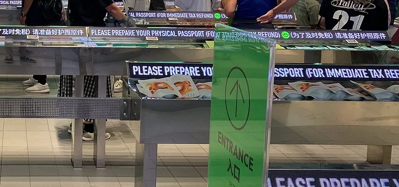
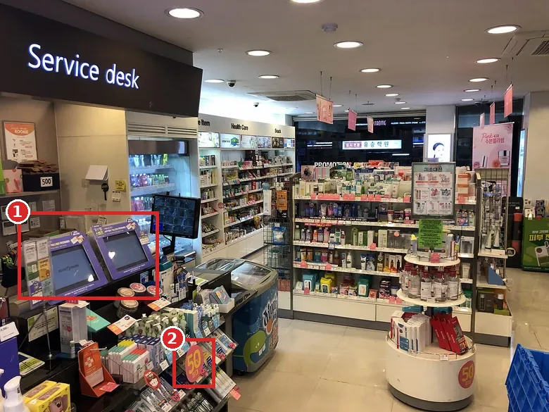
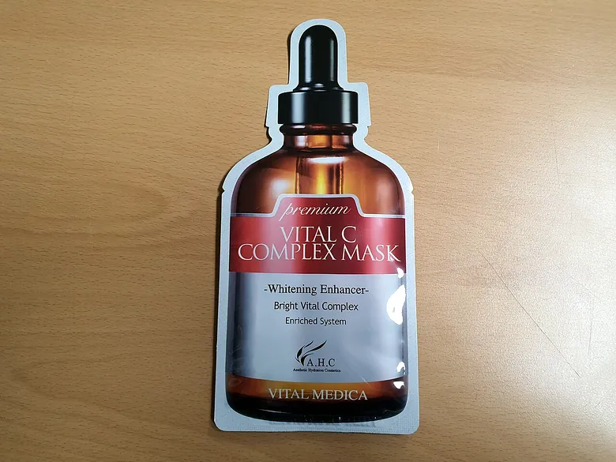

<a class="tr-btn go" href="#pay"><i class="ic ic-credit-card" aria-hidden="true"></i>How to pay</a><a class="tr-btn" href="#find"><i class="ic ic-map-pin" aria-hidden="true"></i>Find the nearest store</a><a class="tr-btn" href="/deals/"><i class="ic ic-calendar-days" aria-hidden="true"></i>Next sale</a>

<figure class="tr-hero acc-hero"><figcaption><b>Olive Young</b>, Korea's biggest health and beauty chain. When you see this sign, follow this page in order.Photo: Pkccccj, <a href="https://creativecommons.org/licenses/by-sa/4.0/" rel="noopener" target="_blank">CC BY-SA 4.0</a>, via <a href="https://commons.wikimedia.org/wiki/File:OliveYoung_store.png" rel="noopener" target="_blank">Wikimedia Commons</a> (light auto-contrast). The photo description does not say which branch.</figcaption></figure>

<ul class="tr-facts"><li><i class="ic ic-id-card" aria-hidden="true"></i>Real passport<small>tax off at the till, if you qualify</small></li><li><i class="ic ic-receipt" aria-hidden="true"></i>₩15,000+<small>per receipt, one store</small></li><li><i class="ic ic-shopping-basket" aria-hidden="true"></i>Bags cost extra<small>paper bag ₩100 (Myeongdong Town)</small></li><li><i class="ic ic-calendar-check" aria-hidden="true"></i>Next sale: around Sun 29 Nov–Sat 5 Dec (estimate)<small>not announced yet; estimated from the last three sales</small></li></ul>

<aside class="tr-note"><i class="ic ic-user-check" aria-hidden="true"></i><b>Who gets the tax refund:</b> foreign visitors staying in Korea under 6 months, and Korean nationals who have lived abroad for over 2 years and are visiting for 3 months or less (Visit Seoul, VISITKOREA). On this page "if you qualify" means these people. More: <a href="/tax-refund/#do-i-qualify">Do I qualify?</a></aside>

<h2 id="stores">Four kinds of store</h2>

In every store you pick and pay in the same order. What changes is the size and the help in other languages.

<ul class="tr-choose"><li><i class="ic ic-store" aria-hidden="true"></i><b>Neighbourhood stores: most of them</b>For a quick buy. Fewer products, and some cannot take the tax off at the till. Ask at the till first (see <a href="#pay">Paying</a>).</li><li><i class="ic ic-globe" aria-hidden="true"></i><b>Global tourist-area stores: 151 nationwide (August 2026)</b>Where visitors gather: Myeongdong, Hongdae, Gangnam, Busan, Jeju. Staff who speak other languages come first, notices are in several languages, and product names and offers are also written in English. Items visitors buy most sit near the entrance.</li><li><i class="ic ic-layers" aria-hidden="true"></i><b>Town stores: the big ones</b>Over 200 pyeong (about 660 m²) on average. For example Myeongdong Town (1F–2F), Central Myeongdong Town (three floors, about 950 pyeong, 22 tills), Central Gangnam Town (a 45-minute personal shopper for visitors, booked ahead on a travel booking platform).</li><li><i class="ic ic-sparkles" aria-hidden="true"></i><b>Special stores: worth a visit in themselves</b>Olive Young N Seongsu (about 1,400 pyeong, the biggest, with hands-on and bookable services) or Gyeongju Hwangnam (hanok design): things you can only do there.</li></ul>

<h2 id="find">Find the nearest store</h2>

<h3 class="tr-step">1<i class="ic ic-smartphone" aria-hidden="true"></i>Search "Olive Young" in a map app</h3>

<ol class="steps"><li>Open Naver Map or KakaoMap. Naver Map works in English, Japanese and Chinese; KakaoMap in English. New to them? Start with <a href="/seoul-subway/#map-app">Seoul subway, step 1: using the map apps</a>.</li><li>Type <b>Olive Young</b> (or 올리브영) in the search box. Stores near you appear as pins on the map.</li><li>Look at the end of the store name. Names with <b>Town</b> (e.g. Myeongdong Town, Hongdae Town) are the big stores.</li></ol>

<h3 class="tr-step">2<i class="ic ic-clock" aria-hidden="true"></i>Check the opening hours</h3>

<ol class="steps"><li>Tap the store name on the pin or in the list to open its details.</li><li>Read the opening hours. They differ by store. For example, Myeongdong Town is open daily 10:00–22:30 and Olive Young N Seongsu daily 10:00–22:00. Myeongdong Town notes that hours "can change depending on the store's situation".</li><li>Going late? Plan to arrive at least 30 minutes before closing (our judgment: the till queue can be long).</li></ol>

<h3 class="tr-step">3<i class="ic ic-route" aria-hidden="true"></i>Start directions</h3>

<ol class="steps"><li>In the store details, tap directions and set the store as your destination. The start is your location.</li><li>By subway, the app shows the station to get off at and the <b>exit number</b>. Leaving by that exit is half the job. How to read exit numbers: <a href="/seoul-subway/">Seoul subway, step 6</a>.</li><li>Out of the station, switch to walking and follow the arrow.</li></ol>

<h2 id="go">Getting to the big stores: Myeongdong and Seongsu</h2>

<ul class="tr-choose"><li><i class="ic ic-map-pin" aria-hidden="true"></i><b>Olive Young Myeongdong Town</b><strong>Line 4 Myeongdong Station, exit 8</strong> (356 m) or <strong>Line 2 Euljiro 1(il)-ga Station, exit 5</strong>. Address <strong>53 Myeongdong-gil, Jung-gu, Seoul</strong> (서울 중구 명동길 53), 1F–2F, daily 10:00–22:30. Close by when you are on the right track: the <strong>Myeong-dong Tourist Information Center</strong> (1F, annex of the Hana Financial Group Myeongdong office, 66 Euljiro; 211 m from Euljiro 1-ga exit 5, 70 m from the store), the gomtang restaurant <strong>Hadonggwan</strong> (50 m from the store) and <strong>Royal Hotel Seoul</strong> (70 m). Lost? Walk into the tourist information center and ask.</li><li><i class="ic ic-map-pin" aria-hidden="true"></i><b>Olive Young N Seongsu</b><strong>Line 2 Seongsu Station, exit 4</strong>, then 118 m (about a minute on foot). Address <strong>13 Yeonmujang 7-gil, Seongdong-gu, Seoul</strong> (서울 성동구 연무장7길 13), in the Factoryal Seongsu building, daily 10:00–22:00. You came out right if: <strong>Yeonmujang-gil</strong> starts at exit 4, and there is often a queue for a pop-up store outside the exit (Visit Seoul).</li><li><i class="ic ic-store" aria-hidden="true"></i><b>Central Myeongdong Town</b>A three-floor store that opened in Myeongdong on 26 March 2026, with the most products of any Olive Young (about 1,000 brands, 15,000 products). We could not confirm its address in an official source today, so search "Olive Young Central Myeongdong Town" in your map app.</li></ul>

<figure class="tr-photo"><figcaption><b>Yeonmujang-gil</b> starts at Seongsu Station exit 4. Olive Young N Seongsu is 118 m along this way.Photo: Dr. Thomas Liptak, <a href="https://creativecommons.org/licenses/by-sa/4.0/" rel="noopener" target="_blank">CC BY-SA 4.0</a>, via <a href="https://commons.wikimedia.org/wiki/File:Seoul,_Seongdong_District,_Seongsu_(Yeonmujang-gil).jpg" rel="noopener" target="_blank">Wikimedia Commons</a> (cropped, light auto-contrast)</figcaption></figure>

<aside class="tr-note tip"><i class="ic ic-lightbulb" aria-hidden="true"></i>The big stores have the widest range and staff who speak other languages.</aside>

<h2 id="inside">Inside: entrance → sections → try → till</h2>

<h3 class="tr-step">1<i class="ic ic-door-open" aria-hidden="true"></i>Entrance: take a basket, keep your bags with you</h3>

Global tourist-area stores put the items visitors buy most near the entrance. Stores do not look after suitcases, umbrellas or other belongings (Myeongdong Town). Some stores have no toilet: Myeongdong Town asks you to use the one at the nearest subway station.

<h3 class="tr-step">2<i class="ic ic-layers" aria-hidden="true"></i>Sections: products are grouped by type</h3>

Here is Myeongdong Town's floor guide as an example. Other stores group products by type the same way; only the size differs.

<ul class="tr-choose"><li><i class="ic ic-droplets" aria-hidden="true"></i><b>1F</b>Skin care (creams, essences, cleansing), sun care and spot patches, masks (sheets, pads, wash-off), seasonal promotions, <strong>tills</strong></li><li><i class="ic ic-sparkles" aria-hidden="true"></i><b>2F</b>Make-up, Luxe Edit (premium brands), fragrance, hair, bath and body, men's, health care, food and drinks, cotton pads and brushes, <strong>tills</strong>, <strong>Global Service Lounge</strong> (free Wi-Fi, seats, membership gifts), <strong>GTF tax refund desk</strong></li></ul>

<h3 class="tr-step">3<i class="ic ic-tag" aria-hidden="true"></i>Read the tag, try, then choose</h3>

<figure class="tr-photo"><figcaption><b>1</b> A pink promotion tag, <b>2</b> a regular price tag. Each tag sits right under its product. During sales, 1+1 (buy one, get one) and 2+1 (buy two, get one) are everywhere: check which item or set the tag covers.Photo: Choi Kwang-mo (Olive Young Wonju Dangu branch, 2020, a different branch), <a href="https://creativecommons.org/publicdomain/zero/1.0/" rel="noopener" target="_blank">CC0</a>, via <a href="https://commons.wikimedia.org/wiki/File:2020-04-17_22.18.09_%EC%98%AC%EB%A6%AC%EB%B8%8C%EC%98%81_%EC%9B%90%EC%A3%BC%EB%8B%A8%EA%B5%AC%EC%A0%90.jpg" rel="noopener" target="_blank">Wikimedia Commons</a> (cropped, boxes and numbers added)</figcaption></figure>

{{fig:olive-young-3|What to check on a 1+1 shelf tag}}

You can try products in the store before you choose (Visit Seoul). Check the texture and smell first, then buy the sealed one. How to use testers and read labels: [How to choose K-beauty](/kbeauty-how-to-choose/).

<h3 class="tr-step">4<i class="ic ic-circle-help" aria-hidden="true"></i>Can't find it? Ask</h3>

Global tourist-area stores have staff who speak other languages. At Central Myeongdong Town, staff who help in English, Chinese or Japanese wear a **flag badge**. Some Seoul stores also have an AI shopping assistant you can talk to in 8 languages (introduced June 2026). Showing a photo of the product on your phone is fastest.

<h2 id="pay">Paying</h2>

<figure class="tr-photo"><figcaption>The sign over the tills at an Olive Young in Myeongdong: “Please prepare your physical passport (for immediate tax refund)”.Photo: Sgroey, <a href="https://creativecommons.org/licenses/by-sa/4.0/" rel="noopener" target="_blank">CC BY-SA 4.0</a>, via <a href="https://commons.wikimedia.org/wiki/File:Olive_Young_Myeongdong.jpg" rel="noopener" target="_blank">Wikimedia Commons</a> (cropped, light auto-contrast). The photo description does not say which Myeongdong branch.</figcaption></figure>

<h3 class="tr-step">1<i class="ic ic-id-card" aria-hidden="true"></i>Hand over your real passport first</h3>

Put your basket on the counter and hand over your **real passport** with your card (if you qualify). A photo or a copy will not do. Your passport is how they check that you qualify. The tax comes off at the till in the main stores; just ask "Tax refund?".

<h3 class="tr-step">2<i class="ic ic-receipt" aria-hidden="true"></i>Pay the price with the tax taken off</h3>

<figure class="tr-photo"><figcaption><b>1</b> The till: hand over your passport with your card, if you qualify. <b>2</b> A round sale sticker: read the tag next to it to see which product it covers.Photo: Choi Kwang-mo (Olive Young Wonju Dangu branch, 2020, a different branch), <a href="https://creativecommons.org/publicdomain/zero/1.0/" rel="noopener" target="_blank">CC0</a>, via <a href="https://commons.wikimedia.org/wiki/File:2020-04-17_22.17.43_%EC%98%AC%EB%A6%AC%EB%B8%8C%EC%98%81_%EC%9B%90%EC%A3%BC%EB%8B%A8%EA%B5%AC%EC%A0%90.jpg" rel="noopener" target="_blank">Wikimedia Commons</a> (boxes and numbers added)</figcaption></figure>

On a receipt of ₩15,000 to under ₩1,000,000 you pay the price with the tax taken off, sale prices included. What comes off is 5–8% of what you spend, worked out in steps of ₩1,000.

{{fig:olive-young-2|Immediate tax refund at the till, per receipt}}

<h3 class="tr-step">3<i class="ic ic-circle-check" aria-hidden="true"></i>Take the receipt and check it</h3>

If what you paid is less than the shelf prices added up, the tax came off. Keep the receipt until you leave Korea; you also need it for exchanges and refunds.

<aside class="tr-note"><i class="ic ic-triangle-alert" aria-hidden="true"></i>Receipts from different stores do not add up. Each receipt has to reach ₩15,000 on its own, so shop in one store rather than three.</aside>

<ul class="tr-choose"><li><i class="ic ic-credit-card" aria-hidden="true"></i><b>Card declined</b>Pay with another card or cash. Myeongdong Town also takes simple payment such as WeChat Pay and Alipay. Olive Young has run discounts for paying with UnionPay, Alipay, WeChat Pay and WOWPASS. Getting cards and cash ready: <a href="/money/">Money and paying</a>.</li><li><i class="ic ic-receipt" aria-hidden="true"></i><b>₩1,000,000 or more on one receipt</b>The till will not take the tax off. Pay full price, take a <strong>refund slip</strong>, and claim it at a downtown refund counter or the airport. <a href="/tax-refund/">How tax refunds work</a></li><li><i class="ic ic-ban" aria-hidden="true"></i><b>Over ₩5,000,000 in total this trip</b>Tax off at the till goes up to ₩5,000,000 in total per entry to Korea. After that, take refund slips and claim at the airport.</li><li><i class="ic ic-id-card" aria-hidden="true"></i><b>Passport left at the hotel</b>No tax off at the till. As Myeongdong Town explains, take a refund slip and claim at the airport refund counter. The same applies if you are not registered with Korea Customs, or have stayed over 6 months (Myeongdong Town FAQ).</li><li><i class="ic ic-circle-x" aria-hidden="true"></i><b>Items the tax never comes off</b>Sanitary goods, shopping bags and dried fruit products are excluded (Myeongdong Town).</li></ul>

<h3 class="tr-step">4<i class="ic ic-shopping-basket" aria-hidden="true"></i>Bags and gift wrapping</h3>

Bags cost extra. At Myeongdong Town a paper bag is ₩100 and a reusable bag ₩500. Gift wrapping comes in a gift box for ₩1,000–2,500 depending on size. Bring your own bag and you pay nothing for one.

<h3 class="tr-step">5<i class="ic ic-hand-coins" aria-hidden="true"></i>GTF slips from other shops, here too</h3>

If another shop gave you a refund slip from GTF, the same refund company Olive Young uses, take it and your real passport to the **GTF desk** in the Global Service Lounge on Myeongdong Town's 2nd floor.

<h2 id="exchange">Exchanges and refunds</h2>

<ul class="tr-facts"><li><i class="ic ic-calendar-days" aria-hidden="true"></i>Within 15 days<small>from the payment date</small></li><li><i class="ic ic-package" aria-hidden="true"></i>Unopened, resaleable<small>regular products only</small></li><li><i class="ic ic-receipt" aria-hidden="true"></i>Receipt + the card you paid with<small>bring both to the store</small></li><li><i class="ic ic-store" aria-hidden="true"></i>Refund: same store only<small>exchange: any store, same or higher value</small></li></ul>

This is from the Olive Young Myeongdong Town FAQ. Check at other stores whether they work the same way.

<h2 id="sale">When to go: sales</h2>

Only one of Olive Young's two kinds of sale is worth planning a trip around.

{{fig:olive-young-1|The Olive Young year: four big sales, one small monthly event}}

<ul class="tr-choose"><li><i class="ic ic-calendar-check" aria-hidden="true"></i><b>Olive Young Sale: plan around this</b>Four times a year, in March, June, September and December, for about seven days. The year's widest discounts, in stores and online. 2026: 1–7 March, 31 May–6 June, 30 August–5 September. December: not announced yet, so the dates are our estimate: around Sunday 29 November–Saturday 5 December. Why: the last three sales (<a href="https://cjnews.cj.net/올영세일로-본-k뷰티-트렌드-집에서도-전문가처럼/" rel="noopener" target="_blank">December 2025: 30 November–6 December</a>; June 2026: 31 May–6 June; September 2026: 30 August–5 September, all from the CJ Newsroom) each started on a Sunday and ran 7 days. We post the confirmed dates on the <a href="/deals/">deals board</a> when Olive Young announces them.</li><li><i class="ic ic-tag" aria-hidden="true"></i><b>Olive Young Day (Olive Day): nice if it happens</b>The 25th to 27th of every month. Extra coupons go to Olive Young member accounts (Olive Members). Joining needs residence in Korea and a Korean phone number in your own name.</li></ul>

<aside class="tr-note tip"><i class="ic ic-lightbulb" aria-hidden="true"></i>The waiting is part of it: put the sale week in your calendar and write a three-item list before you fly.</aside>

<h2 id="buy">What to buy: three things to start</h2>

We pick three because a short list is the one you finish. Not a brand list: these are the kinds of product, chosen because you will still be using them a week after you fly home.

{{fig:olive-young-4|A starter basket of three, and why each one}}

<i class="ic ic-droplets" aria-hidden="true"></i><b>Toner pads:</b> one container, easy to pack, quick to use.

What two of them look like (examples, not recommendations):

<ul class="acc-picks">
<li><b><i class="ic ic-sun" aria-hidden="true"></i>Sunscreen</b>You use it every day, so you finish it. Read <strong>1</strong> SPF and <strong>2</strong> PA on the label and pick them for the days you actually have. (Label example only: this pack is a Japanese brand, not a recommendation.)Photo: Yiting, <a href="https://creativecommons.org/licenses/by-sa/4.0/" rel="noopener" target="_blank">CC BY-SA 4.0</a>, via <a href="https://commons.wikimedia.org/wiki/File:Japanese_sunscreen.jpg" rel="noopener" target="_blank">Wikimedia Commons</a> (cropped, boxes and numbers added)</li>
<li><b><i class="ic ic-package" aria-hidden="true"></i>Sheet masks</b>Cheap, flat, and one use each. One mask comes in one flat pouch like this. Example, not a recommendation.Photo: 김인겸 (Kim In-gyeom), <a href="https://creativecommons.org/licenses/by-sa/4.0/" rel="noopener" target="_blank">CC BY-SA 4.0</a>, via <a href="https://commons.wikimedia.org/wiki/File:PX%EB%A7%88%EC%8A%A4%ED%81%AC%ED%8C%A9.jpg" rel="noopener" target="_blank">Wikimedia Commons</a> (light auto-contrast)</li>
</ul>

<ul class="tr-choose"><li><i class="ic ic-sparkles" aria-hidden="true"></i><b>Shopping in December?</b>Last year (2025) the December sale ran with the Olive Young Awards, which pick the year's most-bought products, and award winners came as limited editions with a bigger size, 1+1 or a free gift, so the same money often got you more (<a href="https://cjnews.cj.net/모두가-사랑한-제품을-모두가-사랑할-혜택으로-cj/" rel="noopener" target="_blank">CJ Newsroom, 28 Nov 2025</a>). We expect the same this year, but it is not announced yet.</li><li><i class="ic ic-user-x" aria-hidden="true"></i><b>Who doesn't need this list</b>Anyone with a routine already: buy your refills during the sale.</li></ul>

What we left out: trending products and rankings. A ranking tells you what sells, not what suits you.

<h2 id="members">Membership and coupons</h2>

<ul class="tr-choose"><li><i class="ic ic-user-check" aria-hidden="true"></i><b>Korean membership (Olive Members)</b>You need to live in Korea and have a phone number in your own name to join and use points. Member prices are for Korean-account members only.</li><li><i class="ic ic-globe" aria-hidden="true"></i><b>Visitors: Global Mall membership</b>Olive Young points foreign customers to Olive Young Global Mall membership. The Global Service Lounge on Myeongdong Town's 2nd floor gives new-member gifts.</li><li><i class="ic ic-tag" aria-hidden="true"></i><b>Offers for visitors: limited time</b>For example, February–March 2026 discounts for paying with UnionPay, Alipay and WeChat Pay, and 5% off with WOWPASS (15–22 February). Check current offers on the <a href="/deals/">deals board</a>. Olive Young mobile gift cards for use in Korea have also been sold on travel platforms such as Klook since 2025.</li></ul>

## Common mistakes

<ul class="tr-oops"><li><i class="ic ic-triangle-alert" aria-hidden="true"></i>A photo of your passport. The tax only comes off with the real one.</li><li><i class="ic ic-triangle-alert" aria-hidden="true"></i>Splitting the basket across three stores. Receipts don't add up.</li><li><i class="ic ic-triangle-alert" aria-hidden="true"></i>Grabbing a 1+1 without reading which item or set the tag covers.</li><li><i class="ic ic-triangle-alert" aria-hidden="true"></i>Planning the trip around Olive Young Day. It is smaller, and the extra coupons go to Korean members.</li><li><i class="ic ic-triangle-alert" aria-hidden="true"></i>Going to another branch for a refund. Refunds are at the store you bought from, within 15 days.</li><li><i class="ic ic-triangle-alert" aria-hidden="true"></i>Asking the store to keep your suitcase. Stores do not look after belongings.</li></ul>

<h2 id="home">Buying again from home</h2>

<ul class="tr-choose"><li><i class="ic ic-globe" aria-hidden="true"></i><b>Most countries: Olive Young Global</b>Ships to many countries. Check delivery to yours at checkout.</li><li><i class="ic ic-truck" aria-hidden="true"></i><b>United States: Olive Young US</b>A US-only online store opened on 29 May 2026, and since then Olive Young Global no longer serves customers in the US.</li></ul>

<ul class="tr-next"><li><a href="https://global.oliveyoung.com" rel="noopener" target="_blank"><i class="ic ic-globe" aria-hidden="true"></i>Olive Young Global<i class="ic ic-external-link" aria-hidden="true"></i></a></li><li><a href="https://us.oliveyoung.com" rel="noopener" target="_blank"><i class="ic ic-truck" aria-hidden="true"></i>Olive Young US (United States)<i class="ic ic-external-link" aria-hidden="true"></i></a></li></ul>

To compare shipping, returns and the tax in your country: [K-beauty delivered to your door](/buy-from-home/)

{{fig:olive-young-5|Where to reorder from home}}

<i class="ic ic-list-checks" aria-hidden="true"></i>The one-line judgment, as a table

| Situation | Do this | Why |
|---|---|---|
| Your trip overlaps an Olive Young Sale (March, June, September, December; about 7 days) | Shop during the Olive Young Sale | The year's widest discounts, in stores and online |
| Any other week | Shop anyway, with your passport, if you qualify | The tax comes off at the till on receipts of ₩15,000 to under ₩1,000,000 |
| New to K-beauty | Start with three things | Sunscreen, toner pads, sheet masks: low price, easy to pack, easy to use up |
| Already home | Olive Young Global, or Olive Young US in the US | Global stopped serving US customers on 29 May 2026 |

<i class="ic ic-info" aria-hidden="true"></i>Sources

Opened 26 November 2026 (KST). Olive Young <a href="https://myeongdongtown.oliveyoung.com/en/" rel="noopener" target="_blank">Myeongdong Town site</a> (Korean, English, Japanese and Chinese editions: floor guide; FAQ on immediate and later refunds, excluded items, ₩15,000–₩1,000,000 per receipt, ₩5,000,000 limit, 5–8%, ₩1,000 steps, GTF desk; exchanges and refunds within 15 days; bags ₩100 and ₩500; gift wrap ₩1,000–2,500; no storage of belongings; membership; no toilet; address, hours, exits, simple payment). Visit Seoul: <a href="https://english.visitseoul.net/shopping/Olive-Young-Lifestyle-Experience-Center/ENP012015" rel="noopener" target="_blank">Olive Young (Myeongdong Flagship Store)</a> (exit 8, 356 m; nearby Hadonggwan 50 m, Myeong-dong Tourist Information Center 70 m, Royal Hotel Seoul 70 m; try before you choose; edited 24 November 2026), <a href="https://english.visitseoul.net/attractions/Myeong-dong-Tourist-Information-Center/ENP011469" rel="noopener" target="_blank">Myeong-dong Tourist Information Center</a> (66 Euljiro, Euljiro 1-ga exit 5, 211 m), <a href="https://english.visitseoul.net/editorspicks/2025SeoulTrendReportSeongsu-dong/ENNvepwqx" rel="noopener" target="_blank">2025 Seoul Trend Dispatch: Seongsu-dong</a> (Olive Young N Seongsu address, hours, exit 4, 118 m, 1,400 pyeong, floors, bookings; Yeonmujang-gil and exit 4), <a href="https://english.visitseoul.net/Tax-Refund" rel="noopener" target="_blank">Tax Refund</a> (who qualifies). CJ Newsroom: <a href="https://cjnews.cj.net/cj올리브영-글로벌관광상권-전략-성과오프라인/" rel="noopener" target="_blank">how the 110-odd global tourist-area stores work, tax off at main stores, Central Gangnam Town personal shopper, Gyeongju Hwangnam</a> (22 July 2025), <a href="https://cjnews.cj.net/?p=79498" rel="noopener" target="_blank">151 global tourist-area stores, Town stores over 200 pyeong, AI shopping assistant in 8 languages</a> (31 August 2026), <a href="https://cjnews.cj.net/cj올리브영-k뷰티-쇼핑-심장부에-글로벌-고객-겨냥-센/" rel="noopener" target="_blank">Central Myeongdong Town opening</a> (26 March 2026), <a href="https://cjnews.cj.net/cj올리브영-외국인-관광객-대상-제휴·할인-혜택-확대/" rel="noopener" target="_blank">offers for visitors, Klook mobile gift cards</a> (2 February 2026), <a href="https://cjnews.cj.net/cj올리브영-25일부터-3일간-멤버십-회원-위한-올리브/" rel="noopener" target="_blank">Olive Day, 25th–27th monthly, for members</a> (24 March 2025), <a href="https://cjnews.cj.net/?p=71722" rel="noopener" target="_blank">Olive Young Awards with the December sale; bigger sizes, 1+1, gifts</a> (28 November 2025), <a href="https://cjnews.cj.net/cj올리브영-올해-첫-올영세일-봄맞이-뷰티·웰니/" rel="noopener" target="_blank">March sale, 1–7 March 2026</a> (27 February 2026), <a href="https://cjnews.cj.net/선파우더·픽서·데오드란트-산다6월-올영세일-대/" rel="noopener" target="_blank">June sale, 31 May–6 June</a> (4 June 2026), <a href="https://cjnews.cj.net/cj올리브영-9월-올영세일서-취향-소비-두드러져/" rel="noopener" target="_blank">September sale, 30 August–5 September</a> (6 September 2026), <a href="https://cjnews.cj.net/cj올리브영-올영세일-외국인-재방문-3년-새-11배-증가/" rel="noopener" target="_blank">four sales a year (March, June, September, December)</a> (22 June 2026). The Korea Times, <a href="https://www.koreatimes.co.kr/business/companies/20260622/foreign-repeat-visits-to-olive-young-sale-surge-11-fold-in-3-years" rel="noopener" target="_blank">same report in English</a> (22 June 2026). The Korea Herald, <a href="https://www.koreaherald.com/article/10742777" rel="noopener" target="_blank">US online store on 29 May</a> (21 May 2026). VISITKOREA <a href="https://english.visitkorea.or.kr/svc/contents/infoHtmlView.do?vcontsId=248765" rel="noopener" target="_blank">tax refund guide</a> (passport check, then pay with tax deducted; ₩5,000,000 total). No December 2026 sale announcement on the CJ Newsroom as of 26 November 2026. Not reopened today: the Olive Young Global help notice on the US platform change (our checker was refused; May 2026, checked in an earlier edition), Olive Young's own shop and store finder (refused). The 30-minute margin before closing is our judgment.

## Next

<ul class="tr-next"><li><a href="/tax-refund/"><i class="ic ic-receipt" aria-hidden="true"></i>Tax refund: who qualifies, big purchases, the airport<i class="ic ic-arrow-right" aria-hidden="true"></i></a></li><li><a href="/kbeauty-how-to-choose/"><i class="ic ic-droplets" aria-hidden="true"></i>How to read K-beauty labels and choose<i class="ic ic-arrow-right" aria-hidden="true"></i></a></li><li><a href="/deals/"><i class="ic ic-tag" aria-hidden="true"></i>Deals board: sale dates as they are announced<i class="ic ic-arrow-right" aria-hidden="true"></i></a></li></ul>
