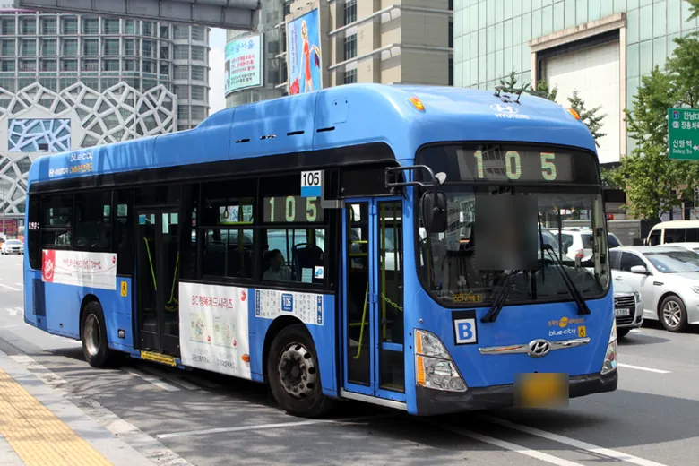
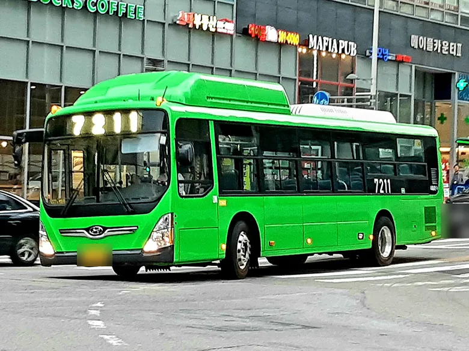
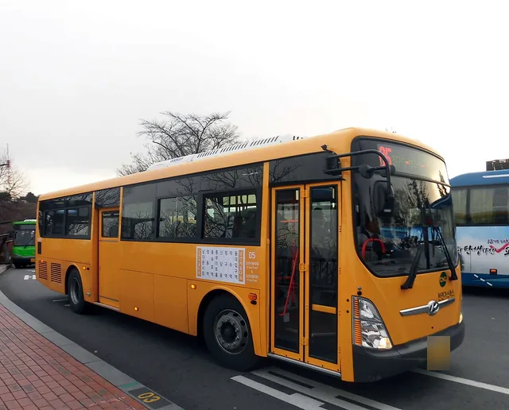
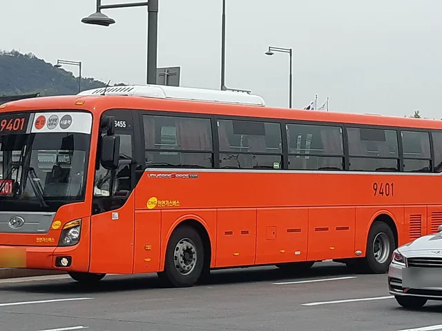
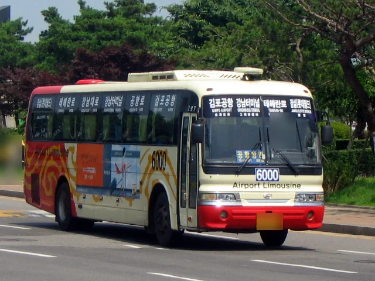

<a class="tr-btn go" href="#do-this"><i class="ic ic-bus" aria-hidden="true"></i>Show me the 5 steps</a><a class="tr-btn" href="#read-the-colour-first"><i class="ic ic-info" aria-hidden="true"></i>What the colours mean</a>

<figure class="tr-hero"><figcaption>A blue (trunk) bus. The route number is on the front and the side. Photo: Ki hoon, <a href="https://creativecommons.org/licenses/by-sa/4.0/" rel="noopener" target="_blank">CC BY-SA 4.0</a>, <a href="https://commons.wikimedia.org/wiki/File:Seoul_105_Blue_City_Front_side.png" rel="noopener" target="_blank">Wikimedia Commons</a> (light auto-contrast, driver and plate blurred)</figcaption></figure>

<ul class="tr-facts"><li><i class="ic ic-coins" aria-hidden="true"></i>₩1,500<small>blue and green, by card</small></li><li><i class="ic ic-credit-card" aria-hidden="true"></i>Tap twice<small>on and off</small></li><li><i class="ic ic-timer" aria-hidden="true"></i>30 minutes<small>to transfer (60 at night)</small></li><li><i class="ic ic-banknote" aria-hidden="true"></i>No cash<small>on 183 routes</small></li></ul>

## Do this

<h3 class="tr-step">1<i class="ic ic-credit-card" aria-hidden="true"></i>Load your card before you go</h3>

183 of Seoul's 396 city bus routes take no cash at all (Seoul's January 2026 list). Our call: board every bus with a loaded T-money card or another Korean transport card. Which card and where to top up: [Seoul subway](/seoul-subway/#which-card) and [Essentials](/essentials/).

<h3 class="tr-step">2<i class="ic ic-map-pin" aria-hidden="true"></i>Find your bus</h3>

Open the route in **Naver Map** (it switches to English, Japanese or Chinese) and save the route number and stop name. At the stop, many stops have a screen with real-time bus information:

{{fig:seoul-bus-stop-display|A Seoul bus stop screen. Photo: Wikiwater2020, [CC BY-SA 3.0](https://creativecommons.org/licenses/by-sa/3.0/), [Wikimedia Commons](https://commons.wikimedia.org/wiki/File:Bus_Info_in_the_Bus_Stop.jpg) (cropped, number added)}}

1. Route **7025** arrives in **3 minutes** (분 = minutes).

{{fig:seoul-bus-front|Match the number. Photo: Ki hoon, [CC BY-SA 4.0](https://creativecommons.org/licenses/by-sa/4.0/), [Wikimedia Commons](https://commons.wikimedia.org/wiki/File:Seoul_105_Blue_City_Front_side.png) (light auto-contrast, driver and plate blurred, numbers added)}}

1. The route number on the front. Match it with your map.
2. The front door. Get on here.

<h3 class="tr-step">3<i class="ic ic-log-in" aria-hidden="true"></i>Get on at the front and tap</h3>

{{fig:seoul-bus-reader-front|A card reader by the front door (2012 photo). Photo: Wnstlr93, [CC BY 3.0](https://creativecommons.org/licenses/by/3.0/), [Wikimedia Commons](https://commons.wikimedia.org/wiki/File:%EC%8A%B9%EC%B0%A8%EC%9A%A9_%EB%8B%A8%EB%A7%90%EA%B8%B0.jpg) (cropped, brightened, number added)}}

1. Touch your card here as you step in.

<h3 class="tr-step">4<i class="ic ic-bell" aria-hidden="true"></i>Watch your stop, press the bell</h3>

Take a window seat if there is one: Korea's tourism organisation counts the streets passing outside as part of the joy of a bus trip. Watch your stop come up on the map, and press the bell by the window when it's next.

<h3 class="tr-step">5<i class="ic ic-log-out" aria-hidden="true"></i>Tap again at the rear door, then get off</h3>

{{fig:seoul-bus-reader-rear|A reader by the rear door (2012 photo). Photo: Wnstlr93, [CC BY 3.0](https://creativecommons.org/licenses/by/3.0/), [Wikimedia Commons](https://commons.wikimedia.org/wiki/File:%ED%99%98%EC%8A%B9_%EB%8B%A8%EB%A7%90%EA%B8%B0.jpg) (cropped, numbers added)}}

1. The sticker says: "Be sure to tap when you get off."
2. Touch your card here.
3. Your remaining balance (잔액).

<aside class="tr-note"><i class="ic ic-triangle-alert" aria-hidden="true"></i>Seoul says that if you don't tap off, the transfer chain breaks there, and the base fare you skipped is charged when you board the next bus or subway.</aside>

<aside class="tr-note ok"><i class="ic ic-circle-check" aria-hidden="true"></i><b>Done.</b> Our pick for the ending: you get off somewhere the subway doesn't reach, card tapped twice, and your next ride within 30 minutes costs no second base fare.</aside>

## Read the colour first

The colour of a Seoul bus tells you what kind of route it is, so you can tell at a glance if it is the right kind of bus. All fares are adult fares paid with a transport card.

<ul class="tr-colours"><li><b><i class="sw" style="background:#1f6fd1"></i>Blue · ₩1,500</b>Trunk: long routes from outer districts to the centre.<a href="https://commons.wikimedia.org/wiki/File:Seoul_105_Blue_City_Front_side.png" rel="noopener" target="_blank">Ki hoon</a>, <a href="https://creativecommons.org/licenses/by-sa/4.0/" rel="noopener" target="_blank">CC BY-SA 4.0</a></li><li><b><i class="sw" style="background:#3cb043"></i>Green · ₩1,500</b>Branch: neighbourhoods to trunk buses and the subway. Green village buses: ₩1,200.<a href="https://commons.wikimedia.org/wiki/File:Seoul_Bus_7211.jpg" rel="noopener" target="_blank">Wikiwater2020</a>, <a href="https://creativecommons.org/licenses/by-sa/3.0/" rel="noopener" target="_blank">CC BY-SA 3.0</a></li><li><b><i class="sw" style="background:#f2b21b"></i>Yellow · ₩1,400</b>Circular: loops around the centre.<a href="https://commons.wikimedia.org/wiki/File:Seoul_Bus_05.JPG" rel="noopener" target="_blank">hyolee2</a>, <a href="https://creativecommons.org/licenses/by-sa/4.0/" rel="noopener" target="_blank">CC BY-SA 4.0</a> (plate blurred)</li><li><b><i class="sw" style="background:#e2462b"></i>Red · ₩3,000</b>Wide-area: the wider metro area to central Seoul. <b>Not</b> on the Climate Card pass.<a href="https://commons.wikimedia.org/wiki/File:Seoul_Bus_9401.jpg" rel="noopener" target="_blank">Wikiwater2020</a>, <a href="https://creativecommons.org/licenses/by-sa/3.0/" rel="noopener" target="_blank">CC BY-SA 3.0</a> (plates blurred)</li></ul>

<aside class="tr-note tip"><i class="ic ic-moon" aria-hidden="true"></i><b>Route numbers starting with N</b> are night buses, ₩2,500.</aside>

## Transfers: the 30-minute window

A transfer is not a new fare as long as you tapped off and board the next ride within the window.

{{fig:seoul-bus-3|How long you have to transfer after tapping off (drawn by Nadri: a time rule no photo can show)}}

1. **Tap off** when you leave the first bus.
2. **Board the next bus or subway within 30 minutes** (60 minutes if you board the next ride between 9 p.m. and 7 a.m.).
3. **You pay one base fare for the first 10 km** (the higher base fare of the vehicles you used), plus ₩100 for every 5 km after that. Up to four transfers, five rides in all, count.

## Common mistakes

These come from Seoul's rules above, not from traveller stories we collected.

<ul class="tr-oops"><li><i class="ic ic-triangle-alert" aria-hidden="true"></i><b>Getting off without tapping.</b> The transfer breaks and the next ride charges the base fare again.</li><li><i class="ic ic-triangle-alert" aria-hidden="true"></i><b>Boarding with no card or an empty one.</b> Some routes take no cash.</li><li><i class="ic ic-triangle-alert" aria-hidden="true"></i><b>Taking a red bus on a Climate Card pass.</b> It isn't covered.</li><li><i class="ic ic-triangle-alert" aria-hidden="true"></i><b>Waiting too long between rides.</b> After 30 minutes (60 at night) the transfer is gone.</li><li><i class="ic ic-triangle-alert" aria-hidden="true"></i><b>Mixing up airport N buses and city N buses.</b> The fares are about seven times apart.</li></ul>

## Airport buses are a different thing

<figure class="tr-photo"><figcaption>An airport limousine bus: a separate service with its own ticket. Route 6000, 2009 photo. Photo: Baek Seung Woon, <a href="https://creativecommons.org/licenses/by-sa/2.0/kr/" rel="noopener" target="_blank">CC BY-SA 2.0 KR</a>, <a href="https://commons.wikimedia.org/wiki/File:Seoul_Airport_Bus_6000.jpg" rel="noopener" target="_blank">Wikimedia Commons</a> (light auto-contrast, people and plate blurred)</figcaption></figure>

City buses and airport limousine buses look like they belong together, but they are separate services.

| | City bus | Airport limousine bus |
|---|---|---|
| Fare (adult) | ₩1,200–3,000 | ₩16,000–18,000 into Seoul |
| Ticket | Tap your card | Ticket from an airport kiosk or bus ticket counter; T-money accepted, but ticket holders board first |
| Climate Card pass | Yes (not red buses) | No |
| Big suitcases | Not what it is for | Staff load up to 2 bags per person (28 in or smaller) |

<aside class="tr-note"><i class="ic ic-triangle-alert" aria-hidden="true"></i>Watch out for night numbers: the late-night airport buses (N6000, N6002, N6701, N6703) also start with N, but cost ₩17,000–18,000 and you buy a ticket. They are not the ₩2,500 city N buses.</aside>

Details on [Incheon Airport to Seoul](/airport-to-seoul/).

## Night buses

After the subway stops, Seoul runs 14 night routes whose numbers start with N, between 11 p.m. and 6 a.m., at ₩2,500 for adults by card ([Seoul, updated 20 March 2026](https://news.seoul.go.kr/traffic/archives/27974)). First and last buses and gaps differ by route, so look up your route and the next bus in Naver Map before you leave, not at the stop.

<i class="ic ic-moon" aria-hidden="true"></i>Two kinds of N bus in one picture

{{fig:seoul-bus-5|Two kinds of N bus: city night bus and airport late-night bus (drawn by Nadri)}}

## Next

<ul class="tr-next"><li><a href="/seoul-subway/"><i class="ic ic-train-front" aria-hidden="true"></i>Seoul subway in 7 steps<i class="ic ic-arrow-right" aria-hidden="true"></i></a></li><li><a href="/airport-to-seoul/"><i class="ic ic-plane" aria-hidden="true"></i>Incheon Airport to Seoul<i class="ic ic-arrow-right" aria-hidden="true"></i></a></li><li><a href="/getting-around/"><i class="ic ic-route" aria-hidden="true"></i>Getting around Seoul: taxis, last trains, which card<i class="ic ic-arrow-right" aria-hidden="true"></i></a></li><li><a href="/emergency/"><i class="ic ic-triangle-alert" aria-hidden="true"></i>Left something on a bus? Lost items<i class="ic ic-arrow-right" aria-hidden="true"></i></a></li></ul>

Made a mistake that isn't here? Tell us through the update box at the end of this page.

## More detail

<i class="ic ic-list-checks" aria-hidden="true"></i>The one-line judgment table

| Situation | Do this | Why |
|---|---|---|
| Your stop is far from a subway station | Take the bus, with a loaded card | Seoul lists 183 bus routes that take no cash |
| Getting off any bus | Tap your card on the reader again | Without that tap the transfer chain breaks |
| Unsure where to get off | Follow the route in Naver Map | It works in English, Japanese and Chinese |
| Out after the last train | An N bus, ₩2,500 | 14 night routes, 11 p.m.–6 a.m. |

This page is only about Seoul's city buses. The subway is on [Seoul subway](/seoul-subway/); taxis, last trains and which card to buy are on [Getting around Seoul](/getting-around/). Airport to hotel is on [Incheon Airport to Seoul](/airport-to-seoul/). Who does not need this page: if your hotel and sights are all near subway stations, the subway alone is simpler.

How we chose: one question decides bus or subway, is your stop far from a station? Left out on purpose: bus-only apps and the full list of cashless routes. One map app and a loaded card cover both.

<i class="ic ic-route" aria-hidden="true"></i>Before you go: the checklist

Our call: sort these at the hotel, not at the stop.

1. **Load your card.** 183 of Seoul's city bus routes take no cash.
2. **Install Naver Map** and switch it to English, Japanese or Chinese.
3. **Save your first route number and stop name,** and look at the route once on the map.
4. **Out late?** Find the N bus that passes nearest your hotel.

Korea's tourism organisation puts the routine in one line: on through the front door, off through the rear. In big cities many stops have screens with real-time bus information.

<i class="ic ic-coins" aria-hidden="true"></i>Bus types and fares in one card

{{fig:seoul-bus-1|Seoul bus types and adult card fares (drawn by Nadri)}}

- **Blue (trunk)** buses link outer districts with the centre on long routes, ₩1,500.
- **Green (branch)** buses connect neighbourhoods with trunk buses and the subway, ₩1,500. Village buses are green too and charge ₩1,200.
- **Yellow (circular)** buses loop around the centre, ₩1,400.
- **Red (wide-area)** buses link the wider metro area with central Seoul, ₩3,000. The Climate Card short-term pass does **not** cover them.
- **Route numbers starting with N** are night buses, ₩2,500.

<i class="ic ic-arrow-right-left" aria-hidden="true"></i>Transfer rules in full

Re-boarding the same route or the same bus does not count as a transfer. If a red bus is part of the trip, the base distance is 30 km instead of 10. The wider fare picture is on [Getting around Seoul](/getting-around/).

<i class="ic ic-info" aria-hidden="true"></i>Sources and pictures

Seoul Metropolitan Government: <a href="https://news.seoul.go.kr/traffic/archives/1706" rel="noopener" target="_blank">Seoul city bus system and how to ride</a> (page updated 9 March 2026; fares, colours, transfer rules), <a href="https://news.seoul.go.kr/traffic/transfer_discount" rel="noopener" target="_blank">integrated transfer discount</a> (updated 2 February 2026), <a href="https://news.seoul.go.kr/traffic/traffic_price" rel="noopener" target="_blank">transport fares</a> (updated 11 July 2025), <a href="https://news.seoul.go.kr/traffic/archives/508898" rel="noopener" target="_blank">cashless bus routes, January 2026</a> (updated 6 March 2026), <a href="https://news.seoul.go.kr/traffic/archives/category/public-news_c1/climate-accompany-card_c1/card-climate_accompany_card" rel="noopener" target="_blank">Climate Card short-term pass</a> (updated 12 October 2026); Incheon Airport: <a href="https://www.airport.kr/" rel="noopener" target="_blank">bus route search</a> (airport.kr: ap_ko/976/subview.do) and <a href="https://www.airport.kr/" rel="noopener" target="_blank">Seoul late-night buses</a> (airport.kr: ap_ko/979/subview.do); Visit Seoul: <a href="https://english.visitseoul.net/airport-to-seoul/1078" rel="noopener" target="_blank">Airport to Seoul</a> (fares as of June 2026); The Korea Herald, <a href="https://www.koreaherald.com/article/10608612" rel="noopener" target="_blank">Tips on using public transportation in Korea</a> (6 November 2025). All opened 26 November 2026. Also opened 26 November 2026: Seoul, <a href="https://news.seoul.go.kr/traffic/archives/27974" rel="noopener" target="_blank">late-night city buses</a> (updated 20 March 2026); Korea Tourism Organization, <a href="https://english.visitkorea.or.kr/svc/contents/contentsView.do?vcontsId=140659" rel="noopener" target="_blank">City Bus</a> (updated 8 October 2026; front and rear doors, bell, real-time stops).

Pictures: photos from Wikimedia Commons under the licences named in each caption. The transfer-window, N-bus and bus-type drawings are ours.

