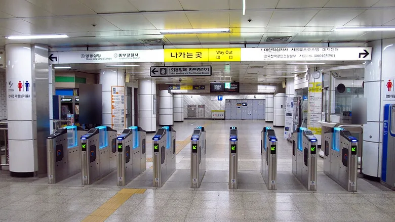
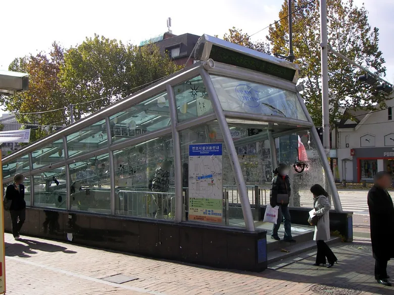
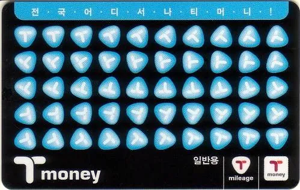
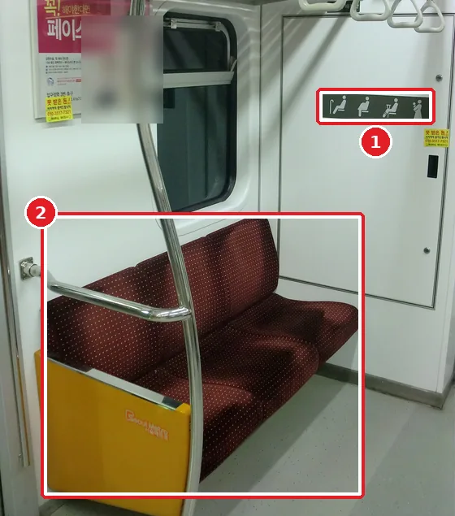
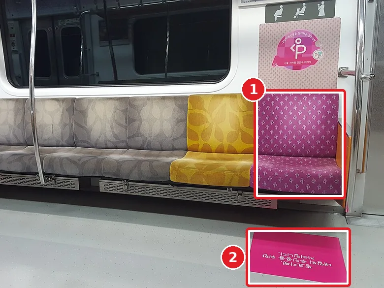

<a class="tr-btn go" href="#do-this"><i class="ic ic-train-front" aria-hidden="true"></i>Show me the 7 steps</a><a class="tr-btn" href="#which-card"><i class="ic ic-credit-card" aria-hidden="true"></i>Which card?</a>

<figure class="tr-hero"><figcaption>This is what you walk up to: gates with card readers, and a yellow <b>Way Out</b> sign. Myeongdong Station. Photo: LERK, <a href="https://creativecommons.org/licenses/by-sa/4.0/" rel="noopener" target="_blank">CC BY-SA 4.0</a>, <a href="https://commons.wikimedia.org/wiki/File:Seoul-metro-424-Myeongdong-station-gate-20181124-081950.jpg" rel="noopener" target="_blank">Wikimedia Commons</a> (light auto-contrast, people blurred)</figcaption></figure>

<ul class="tr-facts"><li><i class="ic ic-coins" aria-hidden="true"></i>₩1,550<small>a ride by card (10 km)</small></li><li><i class="ic ic-banknote" aria-hidden="true"></i>Cash<small>to top up T-money</small></li><li><i class="ic ic-arrow-right-left" aria-hidden="true"></i>Change inside<small>no second gate</small></li><li><i class="ic ic-moon" aria-hidden="true"></i>Last train<small>check it before dinner</small></li></ul>

## Do this

<h3 class="tr-step" id="map-app">1<i class="ic ic-map" aria-hidden="true"></i>The night before: open the route</h3>

<ul class="tr-facts"><li><i class="ic ic-smartphone" aria-hidden="true"></i>Naver Map or Kakao Map<small>Naver: English, Japanese, Chinese. Kakao: English</small></li><li><i class="ic ic-map-pin" aria-hidden="true"></i>Save station + exit<small>like "Myeongdong Station, Exit 8"</small></li></ul>

Open tomorrow's first route and look at it: line numbers, transfers, the exit. The app also shows where you are as you ride. Our call: do this at the hotel, not at the gate. You will have seen the ride before you take it.

<h3 class="tr-step">2<i class="ic ic-credit-card" aria-hidden="true"></i>Load your card at the machine</h3>

{{fig:seoul-subway-machine-yongsan|Ticket and top-up machines at Yongsan Station, Seoul (Line 1, Korail). Machines differ by station. Photo: YKJJ, [CC BY-SA 4.0](https://creativecommons.org/licenses/by-sa/4.0/), [Wikimedia Commons](https://commons.wikimedia.org/wiki/File:Ticket_vending_machines.jpg) (cropped, numbers added)}}

1. Look for this blue sign: 전철승차권자동발매기 / Tickets.
2. The machine. Choose top-up and the amount on the screen.

{{fig:seoul-subway-machine-closeup|Close-up of the same kind of machine at Soraepogu Station, Incheon (Korail). Seoul Metro's machines look different. Photo: LandAndTree, [CC BY 4.0](https://creativecommons.org/licenses/by/4.0/), [Wikimedia Commons](https://commons.wikimedia.org/wiki/File:Ticket_Vending_and_Card_Reload_Machine_-_Seoul_Metropolitan_Subway_20240713.jpg) (cropped, numbers added)}}

1. "Transit card here": put your card on this tray.
2. "Insert bills here": notes in. **T-money top-ups are cash only.**
3. A single ticket comes out here.

<aside class="tr-note"><i class="ic ic-banknote" aria-hidden="true"></i>Keep ₩10,000–20,000 in notes for T-money, even if you pay for everything else by card. Check the new balance before you leave.</aside>

<h3 class="tr-step">3<i class="ic ic-log-in" aria-hidden="true"></i>Tap in at the gate</h3>

{{fig:seoul-subway-gate|Gates at Konkuk Univ. Station. Photo: revi, [CC BY 2.0 KR](https://creativecommons.org/licenses/by/2.0/kr/), [Wikimedia Commons](https://commons.wikimedia.org/wiki/File:%EA%B1%B4%EB%8C%80%EC%9E%85%EA%B5%AC_%EA%B0%9C%EC%B0%B0%EA%B5%AC.jpeg) (cropped, people blurred, numbers added)}}

1. Touch your card to the reader on top. It shows your balance.
2. Green arrow: enter the lane it points to. A red ✕ means you can't enter from this side (our reading of the photo).

<aside class="tr-note"><i class="ic ic-users" aria-hidden="true"></i>One card per person. Sharing a card loses the transfer discount.</aside>

<h3 class="tr-step">4<i class="ic ic-signpost" aria-hidden="true"></i>Find your platform by number</h3>

{{fig:seoul-subway-platform-sign|A platform sign at Jamsil (Line 2). Photo: 阿貴, [CC BY-SA 3.0](https://creativecommons.org/licenses/by-sa/3.0/), [Wikimedia Commons](https://commons.wikimedia.org/wiki/File:Seoul_Subway_Jamsil_Station_Line_2_Platform_Direction_Info.jpg) (cropped, numbers added)}}

1. Where you are: the station, with its number in the line colour.
2. The next station. If it is in your direction, this is your platform. Line 2 is a loop, so its signs show the next station; on other lines the end station is shown too (our reading of the photo).

Our call: read the line **number** and its end station, not just the colour. Pick the platform by the end station in your direction.

<aside class="tr-note tip"><i class="ic ic-lightbulb" aria-hidden="true"></i><b>Line 9 has express trains</b> that stop only at marked stations. If one skips your stop, switch to a local at the express stop before it.</aside>

<h3 class="tr-step">5<i class="ic ic-arrow-right-left" aria-hidden="true"></i>Change lines inside</h3>

No extra gate. Follow the signs with the next line's number. Up to 4 transfers (5 rides) count on one card.

<h3 class="tr-step">6<i class="ic ic-log-out" aria-hidden="true"></i>Tap out, then take your exit number</h3>

{{fig:seoul-subway-exit-sign|Signs past the gates at Myeongdong Station. Photo: LERK, [CC BY-SA 4.0](https://creativecommons.org/licenses/by-sa/4.0/), [Wikimedia Commons](https://commons.wikimedia.org/wiki/File:Seoul-metro-424-Myeongdong-station-gate-20181124-081950.jpg) (cropped, numbers added)}}

1. Yellow **Way Out** signs lead you out.
2. Exit numbers in circles, with an arrow. Follow the one you saved.
3. This arrow points to the ticket and top-up machine.

{{fig:seoul-subway-exit-zoom|Zoomed in: exit ⑨ Myeong-dong Cathedral and exit ⑩ Jungbu Police Station, this way ←. Photo: LERK, [CC BY-SA 4.0](https://creativecommons.org/licenses/by-sa/4.0/), [Wikimedia Commons](https://commons.wikimedia.org/wiki/File:Seoul-metro-424-Myeongdong-station-gate-20181124-081950.jpg) (cropped, enlarged)}}

<aside class="tr-note"><i class="ic ic-triangle-alert" aria-hidden="true"></i><b>Always tap out.</b> The fare depends on distance. A missed exit tap breaks your transfer and costs extra.</aside>

<figure class="tr-photo"><figcaption>Up on the street: an exit entrance (Hyehwa Station Exit 1). Our pick for the ending: come up that exact exit, so your first steps outside already point where you are going. Hyehwa Station Exit 1, 2006 photo. Photo: Jolly6656 (Korean Wikipedia), public domain, <a href="https://commons.wikimedia.org/wiki/File:Seoul_subway_Hyehwa_Station_Exit_01.jpg" rel="noopener" target="_blank">Wikimedia Commons</a></figcaption></figure>

<h3 class="tr-step">7<i class="ic ic-ticket" aria-hidden="true"></i>Single ticket? Get your ₩500 back</h3>

{{fig:seoul-subway-refund|A deposit refund machine. Photo: Sgroey, [CC BY-SA 4.0](https://creativecommons.org/licenses/by-sa/4.0/), [Wikimedia Commons](https://commons.wikimedia.org/wiki/File:Seoul_subway_single_use_card_deposit_refund_machine.jpg) (cropped, numbers added)}}

1. Look for **Deposit Refund Device** near the gates.
2. Put the single ticket in here.
3. Your ₩500 comes out here.

<aside class="tr-note ok"><i class="ic ic-circle-check" aria-hidden="true"></i><b>Bus next?</b> Board within 30 minutes (60 minutes, 9 p.m.–7 a.m.) with the same card and it counts as a transfer. How the bus works: <a href="/seoul-bus/">Seoul buses</a>.</aside>

## Which card?

Our call: a stored-value card suits almost everyone. One question sorts the three: how many rides a day, and do you stay inside Seoul?

<ul class="tr-choose"><li><i class="ic ic-credit-card" aria-hidden="true"></i><b>T-money, or WOWPASS (T-money inside)</b>a normal 3–7 day trip₩100 cheaper per ride than a single ticket, plus bus transfers. WOWPASS's T-money balance is topped up separately from its card balance (WOWPASS guide).</li><li><i class="ic ic-calendar-days" aria-hidden="true"></i><b>Climate Card short-term pass</b>3+ rides a day, 3+ days, all in Seoul3 days: ₩10,000 + ₩3,000 card, about eight fares. Not for one or two rides a day, or a day trip to Suwon or Pangyo.</li><li><i class="ic ic-ticket" aria-hidden="true"></i><b>Single ticket</b>no card yetFare plus ₩100, plus a ₩500 deposit. Rail only, so no bus.</li></ul>

<aside class="tr-note tip"><i class="ic ic-info" aria-hidden="true"></i>No card and no cash? The new machines take overseas credit and debit cards for the Climate Card and single tickets (since 17 March 2026).</aside>

**Getting your first card:** in town, buy one at a convenience store counter or a station machine ([how to buy at a convenience store](/convenience-store/#tmoney)). Top it up with cash at a machine, as in step 2 above. No cash? The T-money machines in the airport railroad stations at Incheon Terminals 1 and 2 sell a preloaded T-money card (₩15,000) for a foreign credit card.

Not required: the airport shops sell transport cards, so pre-ordering is optional. If you want one waiting for you when you land:

<b>A T-money card</b>, ready to pick up at the airport. You still top it up with cash at a station. Photo: <a href="https://commons.wikimedia.org/wiki/File:T-money_card.jpg" rel="noopener" target="_blank">zisk</a>, Public domain (PD-self: released by the author), Wikimedia Commons

{{aff:klook_tmoney|Pre-order a T-money card to pick up at the airport}}

<i class="ic ic-wallet" aria-hidden="true"></i>
<b>A WOWPASS</b>: money exchange, card payments and T-money in one card. The T-money balance for transport is topped up separately (cash at stations and convenience stores, or move WOWPASS balance into it in the app).

{{aff:klook_wowpass|Or a WOWPASS: money exchange, card payments and T-money in one}}

Where to collect a pre-ordered card, how to load WOWPASS and get leftover money back: [airport guide, 'Want it ready'](/airport-to-seoul/#prep).

## Common first-day mistakes

<ul class="tr-oops"><li><i class="ic ic-triangle-alert" aria-hidden="true"></i><b>Skipping the exit tap.</b> You lose the transfer and pay extra.</li><li><i class="ic ic-triangle-alert" aria-hidden="true"></i><b>Throwing away the single ticket.</b> That's ₩500.</li><li><i class="ic ic-triangle-alert" aria-hidden="true"></i><b>Topping up T-money by credit card.</b> It's cash.</li><li><i class="ic ic-triangle-alert" aria-hidden="true"></i><b>Taking the Climate Card out of Seoul.</b> You pay at the exit.</li><li><i class="ic ic-triangle-alert" aria-hidden="true"></i><b>Boarding a Line 9 express that skips your stop.</b></li><li><i class="ic ic-triangle-alert" aria-hidden="true"></i><b>Assuming a fixed last-train time.</b></li></ul>

## Airport train (AREX)

<figure class="tr-photo"><figcaption>The orange <b>Express Train</b> area at Incheon Airport T1 Station is for the separate-ticket Express. Photo: MNXANL, <a href="https://creativecommons.org/licenses/by-sa/4.0/" rel="noopener" target="_blank">CC BY-SA 4.0</a>, <a href="https://commons.wikimedia.org/wiki/File:202403_AREX_Express_Train_Concourse_at_Incheon_International_Airport_Terminal_1_Station.jpg" rel="noopener" target="_blank">Wikimedia Commons</a> (light auto-contrast)</figcaption></figure>

Our call: the **all-stop** AREX is just another subway line; the **Express** is a separate ticket.

- **All-stop:** every station (Hongik Univ., Gongdeok…), tap your card, transfers apply.
- **Express:** non-stop Seoul Station–Incheon Airport, reserved seats, ₩13,000 adult.

Optional, if you want the Express ticket on your phone before you land:

{{aff:klook_airport|Book an AREX Express ticket in advance}}

After you buy: an official AREX ticket's QR code goes on the QR scanner at the Express gate. A Klook ticket follows the instructions on your confirmation. Where to board, changes and refunds: [airport guide, 'Want it ready'](/airport-to-seoul/#prep).

More: [Incheon Airport to Seoul](/airport-to-seoul/).

<i class="ic ic-route" aria-hidden="true"></i>All-stop vs Express in one picture

{{fig:seoul-subway-8|Same line, two trains: all-stop and Express (drawn by Nadri: no photo can show which stations a train skips)}}

## Next

<ul class="tr-next"><li><a href="/seoul-bus/"><i class="ic ic-bus" aria-hidden="true"></i>Seoul buses: tap on, tap off<i class="ic ic-arrow-right" aria-hidden="true"></i></a></li><li><a href="/airport-to-seoul/"><i class="ic ic-plane" aria-hidden="true"></i>Incheon Airport to Seoul<i class="ic ic-arrow-right" aria-hidden="true"></i></a></li><li><a href="/getting-around/"><i class="ic ic-route" aria-hidden="true"></i>Getting around Seoul: taxis, missed last train<i class="ic ic-arrow-right" aria-hidden="true"></i></a></li><li><a href="/emergency/"><i class="ic ic-triangle-alert" aria-hidden="true"></i>Left something on a train? Lost-and-found centres<i class="ic ic-arrow-right" aria-hidden="true"></i></a></li></ul>

Made a mistake that isn't here? Tell us through the update box at the end of this page.

## More detail

<i class="ic ic-list-checks" aria-hidden="true"></i>The one-line judgment table

| Situation | Do this | Why |
|---|---|---|
| A normal 3–7 day trip | T-money, or WOWPASS (T-money inside) | ₩100 cheaper per ride than a single ticket, plus bus transfers |
| 3+ rides a day for 3+ days, all in Seoul | Climate Card short-term pass | 3 days: ₩10,000 + ₩3,000 card, about eight fares |
| No card, no cash | Climate Card or single ticket at a new machine | Overseas credit and debit cards accepted since 17 March 2026 |
| It's late evening | Check your last train now | As of 2022, weekends stop earlier than weekdays. If the 2025 plan (not confirmed) took effect, we expect last trains about 30 minutes earlier |

Subway only here. City buses: [Seoul buses](/seoul-bus/). Taxis: [Getting around Seoul](/getting-around/). Airport: [Incheon Airport to Seoul](/airport-to-seoul/).

How we chose: one question sorts the three ways to pay, how many rides a day and whether you stay inside Seoul. Left out on purpose: the commuter pass sold at the same machines (made for daily commuting, not a short trip) and trips outside Seoul such as Suwon or Incheon.

<i class="ic ic-calendar-days" aria-hidden="true"></i>Climate Card short-term pass: prices and limits

- The pass starts on the day you load it; you can't load it in advance (Seoul's Climate Card page).
- 1, 2, 3, 5 or 7 days for ₩5,000 / 8,000 / 10,000 / 15,000 / 20,000, plus ₩3,000 for the card. It covers Seoul's subway and buses until the last train of the final day (a 1-day pass ends that night).
- Not covered: the Shinbundang Line, GTX, express (gwangyeok) and airport buses, and stations outside Seoul. Get off outside Seoul (Seoul's example: Jongno 3-ga to Indeogwon) and staff charge the fare. Exception: you may get off at Incheon Airport T1/T2.
- Who does NOT need it: anyone riding once or twice a day, or leaving Seoul (Suwon, Pangyo) that day.

<i class="ic ic-coins" aria-hidden="true"></i>Fares: card vs single ticket

{{fig:seoul-subway-3|Card vs single ticket, adult fares (drawn by Nadri from Seoul's fare table)}}

Our call: let the map app do the maths.

- Adult base fare (10 km): **₩1,550** by card, **₩1,650** by single ticket, since 28 June 2025. Then ₩100 per 5 km to 50 km, ₩100 per 8 km beyond.
- Up to 4 transfers (5 rides) per card. Re-boarding the same route doesn't count.

<i class="ic ic-banknote" aria-hidden="true"></i>Machines and foreign cards

- New kiosks take cards for tickets and passes, but T-money top-ups are cash only.
- The 440 new machines (273 stations, Lines 1–8) take foreign cards only for the Climate Card and single tickets, with a fee of about 3.7%.
- WOWPASS holders can move WOWPASS balance to T-money in the app.

<i class="ic ic-armchair" aria-hidden="true"></i>Rush hour and seats to leave free

Our call: with suitcases, avoid roughly 7–9 a.m. on weekdays.

<figure class="tr-photo"><figcaption><b>1</b> sign, <b>2</b> priority seats at the end of the car. Photo: hyolee2, <a href="https://creativecommons.org/licenses/by-sa/3.0/" rel="noopener" target="_blank">CC BY-SA 3.0</a>, <a href="https://commons.wikimedia.org/wiki/File:Priority_seats_Seoul_Metro_3000.JPG" rel="noopener" target="_blank">Commons</a> (cropped, ad blurred, numbers added)</figcaption></figure>

<figure class="tr-photo"><figcaption><b>1</b> pink seat, <b>2</b> pink floor sign. Seoul Metro, 2018. Photo: Garam. Attribution licence: “allows anyone to use it for any purpose, provided that the copyright holder is properly attributed”, <a href="https://commons.wikimedia.org/wiki/File:Designated_seats_for_pregnant_women_of_Seoul_Metro_Line_1_in_2018.jpg" rel="noopener" target="_blank">Commons</a> (cropped, numbers added)</figcaption></figure>

- **Priority seats** at each end of the car are for older, disabled and injured passengers and pregnant women. Our advice: don't sit there.
- **Pink seats** (two per car) are for pregnant women; leave them empty. Early pregnancy doesn't show, so some women wear a pink badge.
- Seoul's 2014 transit-card data: 7–9 a.m. carried 20.2% of daily riders; 8:10–8:19 was the busiest ten minutes.
- Line 9's morning express peaked at 192.5% of capacity before Seoul added express trains on 16 November 2026. Metro9 asks commuters to take the local.

<i class="ic ic-moon" aria-hidden="true"></i>Last trains

Our call: decide how you get home before dinner.

- In 2022 Seoul set weekday last trains to reach the end of the line around 1 a.m.; weekends and holidays were excluded (as of before the 2025 announcement).
- In May 2025 Seoul announced moving Lines 1–8 first and last trains 30 minutes earlier, from as early as August 2025 (Seoul Metropolitan Government, 27 May 2025; The Korea Herald, 22 May 2025; see sources). We could not confirm whether this has taken effect. If it has, we expect last trains about 30 minutes earlier than the 1 a.m. figure.
- So check your station's last train in Naver Map or Kakao Map. Korail sections of Lines 1, 3 and 4 differ.

Missed it? [Getting around](/getting-around/).

<i class="ic ic-info" aria-hidden="true"></i>Sources and pictures

Opened 26 November 2026 (KST). Seoul transport site: <a href="https://news.seoul.go.kr/traffic/traffic_price" rel="noopener" target="_blank">fare table</a> (fares from 28 Jun 2025); <a href="https://news.seoul.go.kr/traffic/transfer_discount" rel="noopener" target="_blank">transfer discount</a> (updated 2 Feb 2026); <a href="https://news.seoul.go.kr/traffic/archives/1763" rel="noopener" target="_blank">one-time card</a>; <a href="https://news.seoul.go.kr/traffic/archives/510651" rel="noopener" target="_blank">Climate Card short-term pass</a> (updated 12 Oct 2026) and its <a href="https://news.seoul.go.kr/traffic/public/climatecard-faq/faq-short" rel="noopener" target="_blank">FAQ</a>; <a href="https://news.seoul.go.kr/traffic/archives/516544" rel="noopener" target="_blank">foreign cards at machines</a> (16 Mar 2026); <a href="https://news.seoul.go.kr/traffic/archives/27958" rel="noopener" target="_blank">pregnant women’s seats</a>. Seoul Media Hub: <a href="https://mediahub.seoul.go.kr/archives/2015499" rel="noopener" target="_blank">new kiosks, prepaid cash only</a> (2 Sep 2025); <a href="https://mediahub.seoul.go.kr/archives/2016718" rel="noopener" target="_blank">foreign-card fact check</a> (7 Jan 2026); <a href="https://mediahub.seoul.go.kr/archives/2004711" rel="noopener" target="_blank">late-night subway</a> (30 May 2022); <a href="https://mediahub.seoul.go.kr/archives/864021" rel="noopener" target="_blank">2014 transit-card data</a> (29 Apr 2015); <a href="https://mediahub.seoul.go.kr/archives/2019693" rel="noopener" target="_blank">Line 9 express</a> (14 Oct 2026). Seoul English site: <a href="https://english.seoul.go.kr/climate-cards-and-single-journey-transit-tickets-now-accepting-international-credit-cards-no-cash-needed/" rel="noopener" target="_blank">foreign cards</a> (17 Mar 2026); <a href="https://english.seoul.go.kr/autonomous-bus-and-earlier-subway-service-for-early-morning-commuters/" rel="noopener" target="_blank">earlier train hours plan</a> (27 May 2025). <a href="https://www.metro9.co.kr/kor/sub01_03.do" rel="noopener" target="_blank">Metro9 morning train guide</a>. AREX <a href="https://www.airportrailroad.com/train/normal/introduce" rel="noopener" target="_blank">all-stop</a> and <a href="https://www.airportrailroad.com/train/express/introduce" rel="noopener" target="_blank">Express</a> train pages. <a href="https://wowpass.io/en/guide" rel="noopener" target="_blank">WOWPASS guide</a>. Korea Herald: <a href="https://www.koreaherald.com/article/10493311" rel="noopener" target="_blank">earlier first and last trains</a> (22 May 2025), <a href="https://www.koreaherald.com/article/3154442" rel="noopener" target="_blank">pink seats and badge</a> (27 Jun 2023). Korea Times: <a href="https://www.koreatimes.co.kr/southkorea/health/20171206/priority-seats-for-pregnant-women-complaint-rich-territory-on-subway" rel="noopener" target="_blank">priority seats for pregnant women</a> (6 Dec 2017). Also opened 26 November 2026: Korea Herald, <a href="https://www.koreaherald.com/article/10694586" rel="noopener" target="_blank">subway machines accept overseas-issued cards</a> (16 Mar 2026) and <a href="https://www.koreaherald.com/article/10608612" rel="noopener" target="_blank">tips on using public transportation</a> (6 Nov 2025; map apps).

Checked 27 November 2026: AREX <a href="https://www.airportrailroad.com/train/express/guide" rel="noopener" target="_blank">Express train guide</a> (QR gates); WOWPASS <a href="https://www.wowpass.io/en/guide" rel="noopener" target="_blank">guide</a> (T-money balance topped up separately with cash or in the app by NFC); Korea Herald <a href="https://www.koreaherald.com/article/10947683" rel="noopener" target="_blank">AREX preloaded T-money card</a> (₩15,000, foreign cards). Not checked: the Klook product pages (automated access blocked).

Pictures: photos from Wikimedia Commons under the licences named in each caption; the fare and all-stop vs Express drawings are ours.

