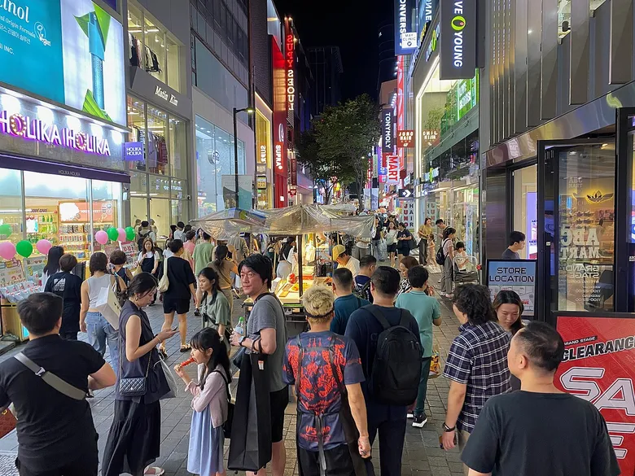
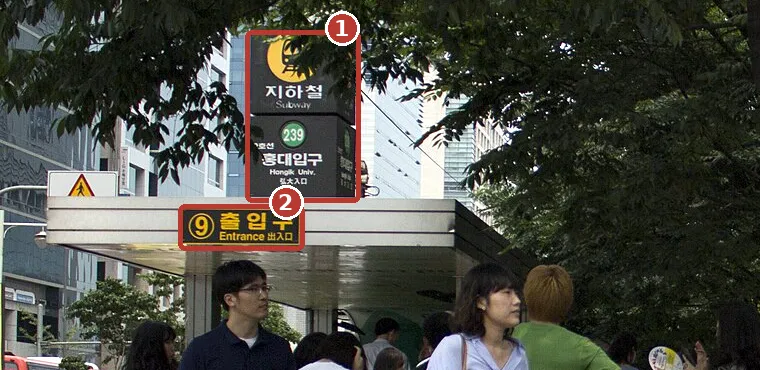
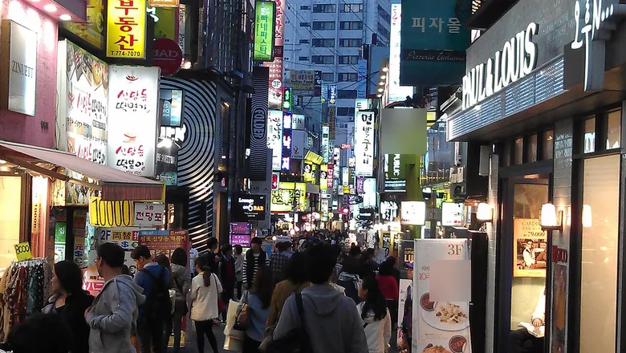
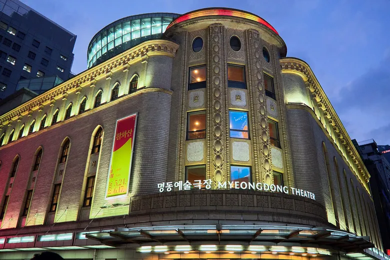
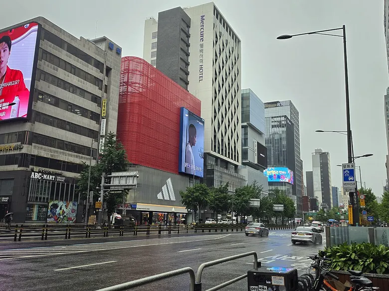
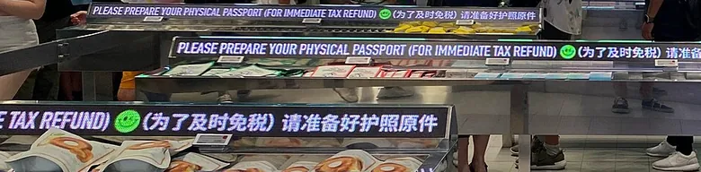

<a class="tr-btn go" href="#pick"><i class="ic ic-map-pin" aria-hidden="true"></i>Where to go</a><a class="tr-btn" href="#pay"><i class="ic ic-receipt" aria-hidden="true"></i>Paying, tax-free</a>

<figure class="tr-hero acc-hero"><figcaption><b>Myeongdong at night.</b> Cosmetics shops line both sides of the main street, food stalls run down the middle.Photo: Sgroey (2024), <a href="https://creativecommons.org/licenses/by-sa/4.0/" rel="noopener" target="_blank">CC BY-SA 4.0</a>, <a href="https://commons.wikimedia.org/wiki/File:Myeongdong_night_market_seoul_1.jpg" rel="noopener" target="_blank">Wikimedia Commons</a> (resized, auto-contrast)</figcaption></figure>

<ul class="tr-facts"><li><i class="ic ic-train-front" aria-hidden="true"></i>All on Line 2<small>Euljiro 1-ga, Seongsu, Hongik Univ.</small></li><li><i class="ic ic-signpost" aria-hidden="true"></i>The exit number gets you there<small>Myeongdong 5, Seongsu 4, Hongdae 9</small></li><li><i class="ic ic-id-card" aria-hidden="true"></i>Real passport<small>Tax taken off at the till (tax-free stores)</small></li><li><i class="ic ic-receipt" aria-hidden="true"></i>One receipt ₩15,000–1,000,000<small>Refunded on the spot</small></li></ul>

<h2 id="pick">Where to go</h2>

This page is about where to **shop**. For where to **stay**, see [Seoul neighborhoods](/seoul-areas/).

<ul class="tr-choose"><li><i class="ic ic-sparkles" aria-hidden="true"></i><b>K-beauty, first time in Seoul: Myeongdong</b>Euljiro 1-ga Station (Line 2) exit 5 or Myeongdong Station (Line 4) exit 8. Visit Seoul calls it the no. 1 place for shopping. Our call: go right after opening. <a href="#myeongdong">Myeongdong</a></li><li><i class="ic ic-store" aria-hidden="true"></i><b>New Korean brands, pop-ups: Seongsu</b>Seongsu Station (Line 2) exit 4. Olive Young N Seongsu and Musinsa Mega Store around Yeonmujang-gil. Weekends are busy, so our call is a weekday. <a href="#seongsu">Seongsu</a></li><li><i class="ic ic-shopping-basket" aria-hidden="true"></i><b>Young fashion, K-pop goods: Hongdae</b>R3 fashion street, 350 m from Hongik Univ. Station (Line 2) exit 9. Our call: late afternoon into evening. <a href="#hongdae">Hongdae</a></li></ul>

{{fig:shopping-streets-1|Our call: what each street suits and when to go}}

## Getting there by exit number

There is one skill for finding any shopping street in Seoul: **station name + exit number**. Learn it once and it works in every neighborhood.

<figure class="tr-photo"><figcaption><b>1</b> Subway sign: station name (Hongik Univ.) and station number (239). <b>2</b> Exit number (exit 9). At street level, this sign tells you whether you came out of the right exit.Photo: Jonathan Kramer (Hongik University Station exit 9), <a href="https://creativecommons.org/licenses/by-sa/3.0/" rel="noopener" target="_blank">CC BY-SA 3.0</a>, <a href="https://commons.wikimedia.org/wiki/File:Hongik_University_Station_exit_9.jpg" rel="noopener" target="_blank">Wikimedia Commons</a> (cropped, auto-contrast, boxes and numbers added)</figcaption></figure>

1. **Find the shop in a map app.** Type the shop name into Naver Map or KakaoMap; it shows the nearest station and exit number. You can also use the exit numbers on this page.
2. **Tap out and follow the exit-number signs.** The number in a circle is the exit, the arrow is the direction ([Seoul subway, step 6](/seoul-subway/), with photos of the real signs).
3. **At street level, check the exit number** as in the photo above. In big stations the wrong exit can mean a long walk.
4. **From the exit to the shop, choose walking directions in your map app and follow them.** For each street below we note the landmark you can see from the exit (a building or street name). Still unsure? Show the shop name from this page at a tourist information center (in Hongdae, the Mapo center near exit 7) or to store staff.

How to ride, read the line map and top up your card: [Seoul subway](/seoul-subway/).

{{fig:shopping-streets-2|Concept map: the shopping areas north of the Han River (not to scale)}}

Line 2 is Seoul's circle line (The Korea Herald), and all three areas have a Line 2 station.

<h2 id="myeongdong">Myeongdong: beauty, and a first trip</h2>

<figure class="tr-photo"><figcaption><b>Myeongdong shopping street</b> (2012 photo).Photo: Christian Bolz, <a href="https://creativecommons.org/licenses/by-sa/4.0/" rel="noopener" target="_blank">CC BY-SA 4.0</a>, Wikimedia Commons</figcaption></figure>

{{fig:shopping-streets-4|Myeongdong: which exit for which store}}

- **Getting there:** Euljiro 1-ga Station (Line 2) exit 5 or Myeongdong Station (Line 4) exit 8, the exits Olive Young's Myeongdong Global store gives.
- **What's there:** two large department stores, shopping centers, brand shops and street vendors, with food stalls along both sides of the main street. Myeongdong Underground Shopping Center has K-pop items and souvenirs. Visit Seoul notes it is especially busy with foreign visitors these days.
- **Landmark:** the **Myeongdong Theater crossroads** in the middle of Myeongdong; follow the alleys and you reach it. Myeongdong Cathedral is at the end of UNESCO-gil (Visit Seoul).

<figure class="tr-photo"><figcaption><b>Myeongdong Theater.</b> When you see this building you are at the central crossroads.Photo: lumoplank, <a href="https://creativecommons.org/publicdomain/zero/1.0/" rel="noopener" target="_blank">CC0</a>, <a href="https://commons.wikimedia.org/wiki/File:Myeongdong,_Seoul_-_Myeongdong3165.jpg" rel="noopener" target="_blank">Wikimedia Commons</a> (resized, auto-contrast)</figcaption></figure>

- **Olive Young Myeongdong Global:** 53 Myeongdong-gil. Daily 10:00–22:30 (may change). Two floors, instant tax refund at the till, simple payment such as WeChat Pay and Alipay, gift wrapping, foreign-language help. The store has no restroom and points you to the nearest subway station.
- **Best time:** right after opening. That is our guess, not crowd data.
- **Nearby:** the 12-floor [Daiso](/daiso/) next to Myeongdong Station. Duty-free: Lotte main store (Euljiro 1-ga exits 7 and 8) and Shinsegae (Hoehyeon exit 5) are close ([duty-free](/duty-free/)).
- **Skip it if:** you want streets where locals shop.

<h2 id="seongsu">Seongsu: new brands and pop-ups</h2>

<figure class="tr-photo"><figcaption><b>Yeonmujang-gil</b>, which starts at Seongsu Station exit 4.Photo: Dr. Thomas Liptak, <a href="https://creativecommons.org/licenses/by-sa/4.0/" rel="noopener" target="_blank">CC BY-SA 4.0</a>, <a href="https://commons.wikimedia.org/wiki/File:Seoul,_Seongdong_District,_Seongsu_(Yeonmujang-gil).jpg" rel="noopener" target="_blank">Wikimedia Commons</a> (cropped, auto-contrast)</figcaption></figure>

{{fig:shopping-streets-5|Seongsu Station: exit 4 or exit 3}}

- **Getting there:** Seongsu Station (Line 2) exit 4, where Yeonmujang-gil starts. Musinsa Mega Store is 475 m from exit 3.
- **What it is:** small factories arrived from the late 1950s, handmade-shoe makers gathered here after 1967, and the area is now full of fashion, beauty, pop-ups and flagship stores (Visit Seoul).
- **Olive Young N Seongsu:** Factoryal Seongsu building, 13 Yeonmujang 7-gil, 118 m from exit 4 (about a minute on foot). Opened in late November 2024. 1F is a plaza with changing brand pop-ups and free four-cut photos for the first 300 visitors each day; 2F Beauty & Culture, 3F Skin & Wellness, 4F VIP lounge. Free services such as makeup sessions need a reservation; slots for the following week open every Friday at noon.
- **Musinsa Mega Store Seongsu:** opened 24 April 2026, about 6,600 m². 2F is Musinsa's first offline beauty floor. Daily 11:00–22:00.
- **Best time:** a weekday. The Korea Herald's Seongsu shopping guide (July 2026) says Musinsa Mega Store gets crowded on weekends and some stores usually have a wait then.
- **Tax-free:** we could not confirm each store's rules. Bring your passport and ask before paying.
- **Skip it if:** you hate queues, or you only want one pop-up you saw online. Pop-ups run for fixed dates (for example, the Jojotown pop-up at Musinsa Store Seongsu ran 16–31 October 2026). Check it is still on.

<h2 id="hongdae">Hongdae: young fashion and K-pop goods</h2>

<figure class="tr-photo"><figcaption><b>Hongdae street</b> (2026).Photo: Qhairy, <a href="https://creativecommons.org/licenses/by/4.0/" rel="noopener" target="_blank">CC BY 4.0</a>, <a href="https://commons.wikimedia.org/wiki/File:Hongdae_Street_02.jpg" rel="noopener" target="_blank">Wikimedia Commons</a> (resized, auto-contrast)</figcaption></figure>

{{fig:shopping-streets-6|Hongik Univ. Station: exit 9 or exit 1}}

- **Getting there:** R3 fashion street is 350 m from exit 9 of Hongik Univ. Station (Line 2, AREX airport railroad, Gyeongui–Jungang Line). Because AREX stops here, it is easy to fit in on an airport day.
- **What's there:** the area around Hongik University. R3 is packed with clothing and cosmetics shops. The former LINE Friends flagship near exit 1 is now K-Pop Square (daily 11:00–22:00). The Kakao Friends flagship is at exit 8.
- **Covernat Hongdae flagship:** about a 10-minute walk from exit 9 (24 Jandari-ro), near the KT&G Sangsangmadang cultural space. Daily 12:00–21:00; foreign tourists can get a tax refund at the counter; Alipay accepted.
- **Help nearby:** Mapo Tourist Information Center, a 3-minute walk from exit 7.
- **Best time:** late afternoon into evening. That is our call from opening hours, not crowd data: some flagships only open at noon.
- **Skip it if:** you want to browse quietly.

<h2 id="pay">Paying: cards and tax-free</h2>

Big stores take cards, and some, such as Olive Young Myeongdong Global and Covernat Hongdae, take Alipay or WeChat Pay. Cash and cards: [money in Korea](/money/).

{{fig:shopping-streets-7|Instant refund range for one receipt}}

<h3 class="tr-step">1<i class="ic ic-id-card" aria-hidden="true"></i>Bring your real passport</h3>

<figure class="tr-photo"><figcaption>Look for a sign like this ('Tax Free', 'Tax Refund', or a passport notice) at the till. If there isn't one, ask before you pay.Photo: Sgroey, <a href="https://creativecommons.org/licenses/by-sa/4.0/" rel="noopener" target="_blank">CC BY-SA 4.0</a>, <a href="https://commons.wikimedia.org/wiki/File:Olive_Young_Myeongdong.jpg" rel="noopener" target="_blank">Wikimedia Commons</a> (cropped, auto-contrast)</figcaption></figure>

The instant refund at the till needs your physical passport; a photo won't do. It is for people visiting Korea ([who qualifies](/tax-refund/)).

<h3 class="tr-step">2<i class="ic ic-receipt" aria-hidden="true"></i>Keep one receipt at one store between ₩15,000 and ₩1,000,000</h3>

Receipts from different stores don't add up. Instant refunds are capped at ₩5,000,000 in total per entry to Korea.

<h3 class="tr-step">3<i class="ic ic-credit-card" aria-hidden="true"></i>Hand over your passport when you pay</h3>

The tax comes off on the spot. Per Olive Young Myeongdong Global's FAQ, the refund is 5–8% of the purchase, calculated in ₩1,000 units. Sanitary goods, shopping bags and dried fruit products are excluded.

<h3 class="tr-step">4<i class="ic ic-plane" aria-hidden="true"></i>Over ₩1,000,000, or no passport with you</h3>

No instant refund at the till. Take the refund slip and claim at the airport refund counter; steps in [tax refund](/tax-refund/). Slips from other stores of the same operator (GTF) can also be refunded at the GTF desk in the Global Service Lounge on 2F of Olive Young Myeongdong Global (real passport needed).

## Common mistakes

<ul class="tr-oops"><li><i class="ic ic-triangle-alert" aria-hidden="true"></i>Leaving a big station without checking the exit number. You come out on the wrong side and walk a long way.</li><li><i class="ic ic-triangle-alert" aria-hidden="true"></i>Bringing only a photo of your passport. The till refund needs the real one.</li><li><i class="ic ic-triangle-alert" aria-hidden="true"></i>Splitting purchases across three stores. Each receipt must pass ₩15,000.</li><li><i class="ic ic-triangle-alert" aria-hidden="true"></i>Going to Seongsu for a pop-up that has ended. Check the dates first.</li></ul>

<i class="ic ic-route" aria-hidden="true"></i>An afternoon on Line 2 (sample route)

{{fig:shopping-streets-3|A half-day shopping route on Line 2}}

Picture the afternoon as a route, not a list of shops. You come up exit 4 at Seongsu Station, where Yeonmujang-gil starts, and Olive Young N Seongsu is about a minute's walk away. Then one ride on Line 2 to Hongik Univ., up exit 9, and 350 m to R3. We end in Hongdae on purpose, because shops there stay open into the evening (Covernat until 21:00, per Visit Seoul). The ending we really aim for is a week later: one thing you are wearing or using at home because it suits you, not because there was a line for it. That is why pop-ups stay optional. If beauty comes first, swap Seongsu for Myeongdong; Euljiro 1-ga is on Line 2 too.

<i class="ic ic-list-checks" aria-hidden="true"></i>A short list before you go, and gifts

Making the list is part of the shopping you can enjoy at home, and a short list is one you will finish.

1. **Write what you want by type:** beauty, clothes, K-pop goods. 'Where to go' above turns that into a street.
2. **Check the dates of any pop-up you saw online.** Pop-ups run for fixed dates.
3. **Save the exit in your map app**, and bring your real passport for tax-free at the till.

**Buying for someone else?** Our call, from the facts on this page:

- **K-pop fan:** Hongdae, K-Pop Square by exit 1.
- **Skincare user:** Myeongdong or Olive Young N Seongsu. Read [how to read the labels](/kbeauty-how-to-choose/) first.

<i class="ic ic-info" aria-hidden="true"></i>What we left out, and who doesn't need this page

We left out Dongdaemun. The facts: per Visit Seoul, Doota Mall is open 10:30 to midnight and is 207 m from exit 8 of Dongdaemun Station (Lines 1 and 4). The rest is our call: late-night clothes shopping is Dongdaemun's strength, and on a short trip Seongsu and Hongdae cover fashion. If you want to keep shopping for clothes after Musinsa Mega Store closes at 22:00, add Dongdaemun. We also left out Garosu-gil in Sinsa-dong, Hannam-dong and the Gangnam department stores, because we have not yet checked them item by item. We don't cover store rankings or prices, because they change.

Only buying cosmetics? Go straight to the [Olive Young guide](/olive-young/). Buying something expensive? Read [duty-free](/duty-free/) first. Current sales are on the [deals board](/deals/).

<i class="ic ic-info" aria-hidden="true"></i>Sources

Checked 26 November 2026 (KST). Visit Seoul: <a href="https://english.visitseoul.net/editorspicks/myeongdong-dasi-seoul-yeohaengyi-jungsimi-doeda/ENNlwcnrh" rel="noopener" target="_blank">Myeongdong feature</a> (no. 1 for shopping, department stores and vendors, underground shopping center, Myeongdong Theater crossroads, cathedral at the end of UNESCO-gil; edited 18 November 2025), <a href="https://english.visitseoul.net/editorspicks/2025SeoulTrendReportSeongsu-dong/ENNvepwqx" rel="noopener" target="_blank">'2025 Seoul Trend Dispatch: Seongsu-dong'</a> (Yeonmujang-gil and exit 4, shoe-street history, Olive Young N Seongsu floors, reservations and 118 m; edited 15 June 2026), <a href="https://english.visitseoul.net/shopping/MUSINSA-MEGA-STORE-SEONGSU/ENPxwxy2m" rel="noopener" target="_blank">Musinsa Mega Store Seongsu</a> (6,600 m², exit 3 475 m, 11:00–22:00; edited 20 July 2026), <a href="https://english.visitseoul.net/attractions/HONGDAE-R3/ENPc8w958" rel="noopener" target="_blank">HONGDAE R3</a> (exit 9 350 m, Mapo Tourist Information Center 3 minutes from exit 7; edited 31 August 2026), <a href="https://english.visitseoul.net/shopping/COVERNAT/ENP77xns8" rel="noopener" target="_blank">COVERNAT</a> (12:00–21:00, tax refund, Alipay, 10 minutes from exit 9, 24 Jandari-ro, near KT&G Sangsangmadang; edited 8 August 2026), <a href="https://english.visitseoul.net/editorspicks/Fan-life-starts-in-Hongdae/ENN033076" rel="noopener" target="_blank">'Fan life starts in Hongdae'</a> (K-Pop Square exit 1, 11:00–22:00; Kakao Friends exit 8; edited 24 October 2026), <a href="https://english.visitseoul.net/shopping/Doota-Dongdaemun/ENP000416" rel="noopener" target="_blank">Doota Mall</a> (10:30–24:00, Dongdaemun exit 8; edited 20 November 2026). Olive Young <a href="https://myeongdongtown.oliveyoung.com/en/" rel="noopener" target="_blank">Myeongdong Global Town site</a> (address, hours, exits, services, tax-refund FAQ, no restroom). The Korea Herald: <a href="https://www.koreaherald.com/article/10011387" rel="noopener" target="_blank">Olive Young N Seongsu</a> (21 November 2024), <a href="https://www.koreaherald.com/article/10654319" rel="noopener" target="_blank">Seoul bus strike and Line 2</a> (13 January 2026), <a href="https://www.koreaherald.com/article/10725111" rel="noopener" target="_blank">Musinsa Mega Store Seongsu opens</a> (25 April 2026), <a href="https://www.koreaherald.com/article/10795872" rel="noopener" target="_blank">Seongsu shopping guide</a> (4 July 2026), <a href="https://www.koreaherald.com/article/10894150" rel="noopener" target="_blank">Musinsa Jojotown pop-up</a> (6 October 2026); the Korea Herald articles were checked for the previous edition (morning of 26 November 2026) and not reopened.

## Next

<ul class="tr-next"><li><a href="/olive-young/"><i class="ic ic-shopping-basket" aria-hidden="true"></i>Olive Young: sale weeks and basics<i class="ic ic-arrow-right" aria-hidden="true"></i></a></li><li><a href="/tax-refund/"><i class="ic ic-receipt" aria-hidden="true"></i>Tax refund: who qualifies, big purchases<i class="ic ic-arrow-right" aria-hidden="true"></i></a></li><li><a href="/seoul-subway/"><i class="ic ic-train-front" aria-hidden="true"></i>How to ride the Seoul subway<i class="ic ic-arrow-right" aria-hidden="true"></i></a></li></ul>
