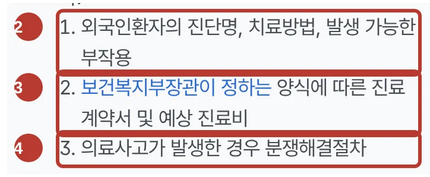
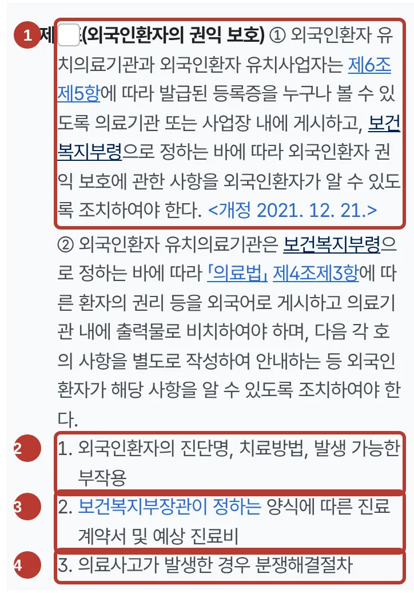

<a class="tr-btn go" href="#check"><i class="ic ic-shield-check" aria-hidden="true"></i>4 checks before booking</a><a class="tr-btn" href="#help"><i class="ic ic-circle-help" aria-hidden="true"></i>If something goes wrong</a>

<aside class="tr-note"><i class="ic ic-info" aria-hidden="true"></i><b>This is a how-to, not medical information.</b> We list no clinic names or prices and promise nothing about results or safety. Decide on any procedure with the doctor who examines you.</aside>

<figure class="tr-hero acc-hero"><figcaption><b>What a clinic that takes foreign patients must give you separately, by law.</b> <b>2</b> diagnosis, treatment method and possible side effects, <b>3</b> treatment contract and estimated cost, <b>4</b> the dispute procedure if there is a medical accident. Get these three in writing before you pay.Screen: National Law Information Center, <a href="https://www.law.go.kr/%EB%B2%95%EB%A0%B9/%EC%9D%98%EB%A3%8C%ED%95%B4%EC%99%B8%EC%A7%84%EC%B6%9C%EB%B0%8F%EC%99%B8%EA%B5%AD%EC%9D%B8%ED%99%98%EC%9E%90%EC%9C%A0%EC%B9%98%EC%A7%80%EC%9B%90%EC%97%90%EA%B4%80%ED%95%9C%EB%B2%95%EB%A5%A0" rel="noopener" target="_blank">Act on Support for Overseas Expansion of Medical Services and Attraction of Foreign Patients, Art. 8</a> (Korean; Ministry of Government Legislation), captured 26 November 2026 (cropped, boxes and numbers added)</figcaption></figure>

<ul class="tr-facts"><li><i class="ic ic-shield-check" aria-hidden="true"></i>Check the government registration<small>Clinics and agencies must register</small></li><li><i class="ic ic-receipt" aria-hidden="true"></i>Estimated cost in writing<small>No charging above the posted price</small></li><li><i class="ic ic-ban" aria-hidden="true"></i>No VAT refund<small>Ended 31 December 2025</small></li><li><i class="ic ic-smartphone" aria-hidden="true"></i>1577-7129<small>24 hours, 6 languages</small></li></ul>

## Your situation

<ul class="tr-choose"><li><i class="ic ic-scan-line" aria-hidden="true"></i><b>You found a clinic on social media or in an ad</b>Look it up in the government registry before contacting it. Clinics and agencies that attract foreign patients must register. <a href="#check-1">How to look it up</a></li><li><i class="ic ic-users" aria-hidden="true"></i><b>You booked through an agency or app</b>Look up the agency the same way, not just the clinic. Registration applies to agencies too.</li><li><i class="ic ic-receipt" aria-hidden="true"></i><b>Your quote includes a VAT refund</b>Recalculate without it. The VAT refund for foreign tourists' cosmetic procedures ended on 31 December 2025. <a href="#vat">Details</a></li><li><i class="ic ic-plane" aria-hidden="true"></i><b>Your flight home is right after the procedure</b>Before paying, ask the doctor for the follow-up date and when you can fly, and get it in writing. Only the doctor who examined you can answer.</li><li><i class="ic ic-triangle-alert" aria-hidden="true"></i><b>Something went wrong</b>1577-7129 (24 hours, foreign languages), a public line that also takes foreign patients' complaints and medical disputes. In an emergency, 119. <a href="#help">Where to get help</a></li></ul>

Only buying cosmetics? See the [Olive Young page](/olive-young/). This page is about procedures at medical institutions.

<h2 id="check">Four checks before booking</h2>

<h3 class="tr-step" id="check-1">1<i class="ic ic-scan-line" aria-hidden="true"></i>Look up the clinic and agency in the government registry</h3>

A medical institution in Korea that wants to attract foreign patients must register with its city or province, have at least one specialist for each department, and carry medical malpractice insurance that covers foreign patients (at least ₩100 million for clinics and hospitals, ₩200 million for general hospitals). Agencies need guarantee insurance of at least ₩100 million, capital of at least ₩100 million and an office in Korea. Registration is renewed every 3 years. Attracting foreign patients without registering can bring up to 3 years in prison or a fine of up to ₩30 million.

**How to look it up** (Foreign Patient Attraction Information System, Korean site; 4,577 registered medical institutions and 3,002 agencies as of 26 November 2026):

1. Open [medicalkorea.or.kr/korp](https://www.medicalkorea.or.kr/korp/main.do). Your phone browser's translate option (Korean to your language) works on it.
2. In the **'유치기관 조회'** (registered institution search) box near the bottom, type the clinic's or agency's **Korean name** (or registration number) and press **'조회하기'** (search). Copy the Korean name from the clinic's website, receipt or sign. An empty search lists everyone.
3. Read the result table like this:

| Column | What to check |
|---|---|
| 상태 (status) | **유지** (maintained) means the registration is active |
| 상호 (name) | Same name as where you booked, including the branch |
| 대표자명·연락처 (head, phone) | Same phone number the clinic gave you |
| 기관구분·지역 (type, region) | Clinic or hospital type; city or province |

<aside class="tr-note"><i class="ic ic-triangle-alert" aria-hidden="true"></i><b>Not in the results, or the status is not '유지'?</b> Before booking, ask the clinic or agency to show its registration certificate, or ask 1577-7129.</aside>

<aside class="tr-note tip"><i class="ic ic-lightbulb" aria-hidden="true"></i><b>You can also check at the clinic.</b> Registered clinics and agencies must post the registration certificate where anyone can see it (Art. 8, photo 1 in step 3 below). Look around the reception desk.</aside>

<i class="ic ic-info" aria-hidden="true"></i>Registration, certification and the Justice Ministry list mean different things

- **Registration:** not a quality rating or a recommendation; it means the legal requirements for attracting foreign patients are met.
- **Certification (Ministry of Health and Welfare):** registered institutions that apply are surveyed on site by the Korea Institute for Healthcare Accreditation. It looks at the foreign-patient system, specialists, respect for patient rights and dispute prevention, patient safety, treatment, medicines, infection control and facilities. Valid 4 years. Using the certification mark without certification is punishable. See '평가인증기관현황' (certified institutions) on the same site.
- **Justice Ministry 'outstanding facilitator' list:** about visa procedures. 112 institutions (89 medical institutions, 23 agencies) from 1 October 2026 to 30 September 2027. It is not a government recommendation of any treatment or doctor.
- **Foreign-language ads:** registered institutions may not run foreign-language medical ads that could deceive or mislead foreign patients, such as before-and-after photos or videos (Art. 15).
- To go one step further, HIRA's [hospital and pharmacy search](https://www.hira.or.kr/ra/hosp/getHealthMap.do?pgmid=HIRAA030002010000) (Korean) shows departments and numbers of doctors and specialists.

<h3 class="tr-step">2<i class="ic ic-receipt" aria-hidden="true"></i>Check the price</h3>

1. **Get the quote in writing.** Registered clinics must give you a treatment contract in the Health Ministry's format and the estimated cost (Art. 8, photo 3 at the top).
2. **Compare with the posted price.** Medical institutions must make the cost of non-covered care (not covered by national health insurance) easy for patients to see, and may not charge more than the amount they posted (Medical Service Act, Art. 45).
3. **Look up published prices.** HIRA's [non-covered treatment cost information](https://www.hira.or.kr/npay/index.do?pgmid=HIRAA030009000000) (Korean) can be searched by clinic name or address, region and item. We could not confirm that every cosmetic procedure is listed.
4. **Leave out any VAT refund** ([below](#vat)).

<h3 class="tr-step">3<i class="ic ic-pencil" aria-hidden="true"></i>Get the explanation in writing at the consultation</h3>

<figure class="tr-photo"><figcaption><b>Article 8 in full</b> (Korean). <b>1</b> post the registration certificate where anyone can see it; paragraph ② post patient rights in foreign languages; <b>2–4</b> what must be written up and given to you separately.Screen: National Law Information Center, <a href="https://www.law.go.kr/%EB%B2%95%EB%A0%B9/%EC%9D%98%EB%A3%8C%ED%95%B4%EC%99%B8%EC%A7%84%EC%B6%9C%EB%B0%8F%EC%99%B8%EA%B5%AD%EC%9D%B8%ED%99%98%EC%9E%90%EC%9C%A0%EC%B9%98%EC%A7%80%EC%9B%90%EC%97%90%EA%B4%80%ED%95%9C%EB%B2%95%EB%A5%A0" rel="noopener" target="_blank">Art. 8</a>, captured 26 November 2026 (cropped, boxes and numbers added)</figcaption></figure>

Registered clinics must write up and give foreign patients the diagnosis, treatment method and possible side effects, the treatment contract and estimated cost, and the dispute procedure in case of a medical accident. They must also post patient rights in foreign languages and keep printed copies (Art. 8). Ask for them **in a language you can read** before you sign.

For surgery, blood transfusion or general anesthesia that could seriously harm life or body, the doctor must explain the diagnosis, the need, method and content, **the names of the explaining doctor and the main doctors taking part**, the typical after-effects and side effects, and what you must do before and after, and get your written consent. You can ask for **a copy of the consent form**, and if the method or the main doctor changes you must be told in writing (Medical Service Act, Art. 24-2).

**Ask the doctor, not the coordinator:**

1. Who will do the procedure?
2. What is the expected total, and what is not included?
3. When is the follow-up, and do I need to come in person?
4. When can I fly? What happens if there is a problem after I go home?

<h3 class="tr-step">4<i class="ic ic-file-down" aria-hidden="true"></i>Prepaid package? Read the refund terms</h3>

In July 2026 the Korea Fair Trade Commission had 15 skin and cosmetic clinics fix their terms. Clauses refusing any refund of prepaid fees were deleted, cancellation penalties of 20–30% became 10%, and clinics can no longer swap the doctor at will. Before paying, read the refund and cancellation clauses and take a photo of them.

<aside class="tr-note ok"><i class="ic ic-circle-check" aria-hidden="true"></i><b>The ending to aim for:</b> you leave with the written explanation, treatment contract and estimated cost, and 1577-7129 saved in your phone. Decide whether to go ahead after that.</aside>

<h2 id="vat">What changed in 2026: no VAT refund</h2>

The special rule that refunded VAT (10%, VAT Act Art. 30) to foreign tourists for cosmetic and plastic-surgery services at registered institutions (started April 2016) applied only to services received **by 31 December 2025** (Restriction of Special Taxation Act, Art. 107-3). From 1 January 2026, skin and cosmetic procedures are not part of tax refund (shopping refunds: [tax refund](/tax-refund/)).

Will it come back? Two bills to revive it are in the National Assembly: one filed in April 2026 extending it to the end of 2027, and one filed on 13 August 2026 reintroducing it to the end of 2029 (for registered foreign-patient institutions). As of 20 November 2026 neither had passed. On 24 November 2026 [The Korea Herald](https://www.koreaherald.com/article/10947687) also reported that the refund has ended and plastic surgeons are asking the Assembly to bring it back. Until a law actually passes, budget without the refund. We will update this page if it changes.

<h2 id="help">If something goes wrong: help in your language</h2>

<aside class="tr-note"><i class="ic ic-triangle-alert" aria-hidden="true"></i><b>In an emergency, call 119.</b> What to do is on the <a href="/emergency/">emergency page</a>.</aside>

<ul class="tr-choose"><li><i class="ic ic-smartphone" aria-hidden="true"></i><b>Medical Korea call center 1577-7129</b>From abroad +82-1577-7129. Run by the Korea Health Industry Development Institute, 24 hours, in Korean, English, Japanese, Chinese, Russian and Arabic. Information on healthcare providers and treatment, complaints from foreign patients and basic advice after medical accidents, registering medical disputes, help in disasters and other emergencies.</li><li><i class="ic ic-map-pin" aria-hidden="true"></i><b>Korea Medical Tourism Business Center (Korea Tourism Organization)</b>1F, East Wing, HiKR Ground, 40 Cheonggyecheon-ro, Jung-gu, Seoul. Weekdays 9:00–18:00 (closed weekends and public holidays). English, Chinese, Japanese and Russian, online and in person; medical-tourism information and connections to verified hospitals and agencies. Email k-medi@knto.or.kr. To get there, search 'HiKR Ground' in your map app and choose walking directions.</li><li><i class="ic ic-stamp" aria-hidden="true"></i><b>Korea Medical Dispute Mediation and Arbitration Agency (K-medi)</b>Free advice +82-2-1670-2545 (weekdays 9:00–12:00 and 13:00–18:00). Online consultation can be requested 24 hours and is answered by the next business day. In person: 8F, T Tower, 30 Sowol-ro 2-gil, Jung-gu, Seoul (call first for a faster consultation). It has an English site, but the consultation languages are not stated, so if you need another language, getting 1577-7129 to help you file is the surer route.</li></ul>

{{fig:skin-clinic-3|Help lines in your language: hours and languages}}

<i class="ic ic-file-down" aria-hidden="true"></i>Requesting dispute mediation by email (K-medi), step by step

1. Download the forms from K-medi's [request by email page](https://www.k-medi.or.kr/eng/lay1/S239T385C455/contents.do).
2. Required: mediation application form, annexed paper to the application, consent to collect and use sensitive and personal information, a copy of your ID. Fill them in and sign yourself. If you are not the patient, add a power of attorney and proof of your relationship.
3. Write the documents in Korean. If you write them in English, add Korean translations.
4. Make PDFs and email them to forcc@k-medi.or.kr (or fax +82-2-6210-0099).
5. After review, staff text you the account for the application fee. A Korean bank account is advised for refunds (losses from international transfers or exchange rates are not covered).

<i class="ic ic-info" aria-hidden="true"></i>What about the 1330 travel helpline?

1330 is for general travel interpretation and information. Its page does not list medical support, so for medical questions 1577-7129 is the right number.

## Recovery time and your flight home

We found no official rule on how many days after a procedure you can fly, so we give no number; it depends on the procedure and the person. Your departure date is something to tell the doctor first, at the consultation. If the answer doesn't fit your trip, change the trip or the plan. Airport steps: [departure day](/departure-day/).

## Visas

Korea Tourism Organization guidance says treatment of 90 days or less may be possible on a tourist or other visitor visa, but a medical schedule does not let you stay beyond your permitted period. Longer treatment needs a medical visa: C-3-3 for treatment or recuperation of 90 days or less, G-1-10 for 91 days or more (up to a year) (The Korea Herald, 7 November 2026). Before applying, check with the Korean embassy or consulate for your nationality or the Korea Visa Portal (www.visa.go.kr); inside Korea, the Immigration Contact Center is 1345.

## Common mistakes

<ul class="tr-oops"><li><i class="ic ic-triangle-alert" aria-hidden="true"></i>Booking on social-media reviews alone. Check the registry first.</li><li><i class="ic ic-triangle-alert" aria-hidden="true"></i>Budgeting with a VAT refund. It has been gone since 2026.</li><li><i class="ic ic-triangle-alert" aria-hidden="true"></i>Signing after a verbal explanation only. Diagnosis, side effects and cost in writing, in a language you read.</li><li><i class="ic ic-triangle-alert" aria-hidden="true"></i>Having a procedure without telling the doctor your flight date.</li></ul>

<i class="ic ic-list-checks" aria-hidden="true"></i>The quick decision as a table

| If | Do | Why |
|---|---|---|
| You found a clinic on social media | Look it up in the official registry before contacting it | Clinics and agencies that attract foreign patients must register with the government |
| You booked through an agency or app | Check the agency's registration too | Registration applies to agencies as well |
| Your quote includes a VAT refund | Recalculate without it | The cosmetic-procedure VAT refund for foreign tourists ended on 31 December 2025 |
| Your flight is right after the procedure | Before paying, ask the doctor for the follow-up date and when you can fly, in writing | Only the doctor who examined you can answer |
| Something went wrong | 1577-7129 (24 hours, foreign languages) | A public line that also takes foreign patients' complaints |

<i class="ic ic-calendar-check" aria-hidden="true"></i>From booking to consultation, in order

This describes the order of things; it promises no outcome.

**Weeks before, at home.** Put the clinic's Korean name into the official registry and check it shows '유지'. Recalculate the cost without a tax refund and note your flight date.

**At reception.** Registered clinics must post the registration certificate where anyone can see it.

**At the consultation.** Get the diagnosis, treatment method, possible side effects, treatment contract and estimated cost, and dispute procedure in writing, in a language you can read. Tell the doctor your flight date before paying.

**The ending:** you leave with those papers and 1577-7129 saved in your phone. Decide after that.

<i class="ic ic-ban" aria-hidden="true"></i>What we leave out

Clinic names, prices, before-and-after photos and procedure comparisons. We can't verify them, and choosing a procedure is a medical decision. The Korea Health Industry Development Institute also publishes the registered list as open data (July 2026 data, 6,921 entries, updated yearly).

<i class="ic ic-info" aria-hidden="true"></i>Sources

Checked 26 November 2026 (official): National Law Information Center, <a href="https://www.law.go.kr/%EB%B2%95%EB%A0%B9/%EC%9D%98%EB%A3%8C%ED%95%B4%EC%99%B8%EC%A7%84%EC%B6%9C%EB%B0%8F%EC%99%B8%EA%B5%AD%EC%9D%B8%ED%99%98%EC%9E%90%EC%9C%A0%EC%B9%98%EC%A7%80%EC%9B%90%EC%97%90%EA%B4%80%ED%95%9C%EB%B2%95%EB%A5%A0" rel="noopener" target="_blank">Act on Support for Overseas Expansion of Medical Services and Attraction of Foreign Patients</a> (in force 12 May 2026: Art. 6 registration requirements and 3 years, Art. 7, Art. 8 certificate posting and written information, Art. 14 certification 4 years, Art. 15 foreign-language ads, Art. 28 penalties), <a href="https://www.law.go.kr/%EB%B2%95%EB%A0%B9/%EC%9D%98%EB%A3%8C%EB%B2%95" rel="noopener" target="_blank">Medical Service Act</a> (in force 12 November 2026: Art. 24-2 explanation and written consent, Art. 45 notice of non-covered costs), <a href="https://www.law.go.kr/%EB%B2%95%EB%A0%B9/%EC%A1%B0%EC%84%B8%ED%8A%B9%EB%A1%80%EC%A0%9C%ED%95%9C%EB%B2%95" rel="noopener" target="_blank">Restriction of Special Taxation Act</a> Art. 107-3 (cosmetic medical services VAT refund, until 31 December 2025), <a href="https://www.law.go.kr/%EB%B2%95%EB%A0%B9/%EB%B6%80%EA%B0%80%EA%B0%80%EC%B9%98%EC%84%B8%EB%B2%95" rel="noopener" target="_blank">Value-Added Tax Act</a> Art. 30 (rate 10%); Korea Health Industry Development Institute <a href="https://www.medicalkorea.or.kr/korp/main.do" rel="noopener" target="_blank">Foreign Patient Attraction Information System</a> (registry search, counts, result columns), <a href="https://www.medicalkorea.or.kr/korp/intro/registration.do" rel="noopener" target="_blank">registration system</a> (insurance minimums, agency requirements, 3 years), <a href="https://www.medicalkorea.or.kr/korp/intro/evaluation.do" rel="noopener" target="_blank">certification system</a> (criteria, 4 years), <a href="https://www.khidi.or.kr/board?menuId=MENU00807" rel="noopener" target="_blank">Medical Korea Information Center</a> (1577-7129, 24 hours, 6 languages, services); Seoul Metropolitan Government <a href="https://news.seoul.go.kr/welfare/archives/541972" rel="noopener" target="_blank">registered foreign-patient institutions</a> (edited 13 March 2026); HIRA <a href="https://www.hira.or.kr/main.do" rel="noopener" target="_blank">home page</a>, <a href="https://www.hira.or.kr/npay/index.do?pgmid=HIRAA030009000000" rel="noopener" target="_blank">non-covered treatment costs</a> and hospital search; K-medi <a href="https://www.k-medi.or.kr/eng/" rel="noopener" target="_blank">English home page</a> (free advice line), <a href="https://www.k-medi.or.kr/eng/lay1/S239T269C270/contents.do" rel="noopener" target="_blank">counseling methods</a> (phone hours, online 24 hours, visits) and <a href="https://www.k-medi.or.kr/eng/lay1/S239T385C455/contents.do" rel="noopener" target="_blank">mediation by email</a>; Korea Tourism Organization <a href="https://english.visitkorea.or.kr/svc/contents/contentsView.do?vcontsId=247707" rel="noopener" target="_blank">Korea Medical Tourism Business Center</a> (address, hours, languages, email; posted 24 September 2025). Press checked 26 November 2026: The Korea Herald <a href="https://www.koreaherald.com/article/10926943" rel="noopener" target="_blank">Planning a medical trip to Korea</a> (7 November 2026: KTO 90-day guidance, C-3-3 and G-1-10, 112 designated institutions, 1345, visa portal), <a href="https://www.koreaherald.com/article/10947687" rel="noopener" target="_blank">calls to revive the refund</a> (24 November 2026), <a href="https://www.koreaherald.com/article/10633779" rel="noopener" target="_blank">cosmetic-procedure VAT refund ends</a> (10 December 2025). Checked for the previous edition and not reopened today: Fair Trade Commission terms correction (News Tomato, 19 July 2026; ftc.go.kr blocked from our checker); Newsis on the 2025 tax revision (start April 2016; 31 July 2025); Korea Economic Daily on the extension bill (31 July 2026); MTN and Dailymedi on the reintroduction bill (14 and 16 August 2026); IB Tomato on bills not passed (20 November 2026); data.go.kr registered-institution data (July 2026; blocked); VisitKorea 1330 page; Policy Briefing on HIRA hospital search (26 September 2023: departments, doctors and specialists).

## Next

<ul class="tr-next"><li><a href="/health/"><i class="ic ic-shield-check" aria-hidden="true"></i>Getting sick on your trip: clinics and pharmacies<i class="ic ic-arrow-right" aria-hidden="true"></i></a></li><li><a href="/emergency/"><i class="ic ic-triangle-alert" aria-hidden="true"></i>What to do in an emergency<i class="ic ic-arrow-right" aria-hidden="true"></i></a></li><li><a href="/tax-refund/"><i class="ic ic-receipt" aria-hidden="true"></i>Tax refund on shopping<i class="ic ic-arrow-right" aria-hidden="true"></i></a></li></ul>
