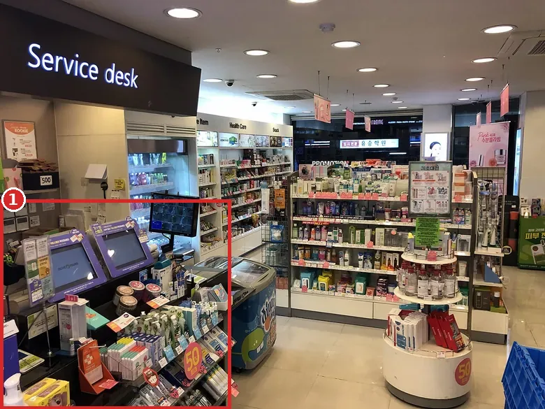

<a class="tr-btn" href="#do-i-qualify"><i class="ic ic-circle-help" aria-hidden="true"></i>Do I qualify?</a><a class="tr-btn go" href="#at-the-till-the-usual-way"><i class="ic ic-receipt" aria-hidden="true"></i>How it works</a>

<figure class="tr-hero acc-hero"><figcaption><b>This is the whole trick:</b> the sign at an Olive Young till in Myeongdong says “Please prepare your physical passport (for immediate tax refund)”.Photo: Sgroey, <a href="https://creativecommons.org/licenses/by-sa/4.0/" rel="noopener" target="_blank">CC BY-SA 4.0</a>, via <a href="https://commons.wikimedia.org/wiki/File:Olive_Young_Myeongdong.jpg" rel="noopener" target="_blank">Wikimedia Commons</a> (cropped, light auto-contrast)</figcaption></figure>

<ul class="tr-facts"><li><i class="ic ic-id-card" aria-hidden="true"></i>Real passport<small>not a photo of it</small></li><li><i class="ic ic-receipt" aria-hidden="true"></i>₩15,000+<small>per receipt, one shop</small></li><li><i class="ic ic-percent" aria-hidden="true"></i>About 5–8% back<small>after the operator's fee</small></li><li><i class="ic ic-clock" aria-hidden="true"></i>Instant at the till<small>under ₩1,000,000</small></li></ul>

## Do I qualify?

<ul class="tr-choose"><li><i class="ic ic-user-check" aria-hidden="true"></i><b>Yes: you are visiting for less than 6 months</b>Foreign visitors who don't live in Korea.</li><li><i class="ic ic-user-check" aria-hidden="true"></i><b>Yes: Korean citizen living abroad for over 2 years</b>Visiting Korea for no longer than 3 months (Global Blue's Korea rules).</li><li><i class="ic ic-user-x" aria-hidden="true"></i><b>No: you work or live in Korea</b>Also not diplomats or troops stationed here, and not purchases for a company.</li><li><i class="ic ic-ban" aria-hidden="true"></i><b>No: skin clinic or cosmetic procedures</b>That refund ended on 31 December 2025.</li></ul>

## Which way does my receipt go?

One receipt, one shop. Receipts from different shops are never added together.

<ul class="tr-choose"><li><i class="ic ic-circle-x" aria-hidden="true"></i><b>Under ₩15,000</b>No refund. Buy more in the same shop so one receipt reaches ₩15,000.</li><li><i class="ic ic-circle-check" aria-hidden="true"></i><b>₩15,000 to under ₩1,000,000</b>Most shopping. Tax off at the till: show your passport, done. Up to ₩5,000,000 in total per visit.</li><li><i class="ic ic-plane" aria-hidden="true"></i><b>₩1,000,000 or more</b>Pay full price, take the refund slip, get it checked by customs at the airport.</li><li><i class="ic ic-store" aria-hidden="true"></i><b>No “Tax Free” sign at the till</b>Same as a big purchase: refund slip, then the airport or a downtown kiosk.</li></ul>

## At the till (the usual way)

<h3 class="tr-step">1<i class="ic ic-store" aria-hidden="true"></i>Look for “Tax Free” or “Tax Refund”</h3>

<figure class="tr-photo"><figcaption>Most big chains offer it, including Olive Young and department stores. Look for the sign at the counter.Photo: Pkccccj, <a href="https://creativecommons.org/licenses/by-sa/4.0/" rel="noopener" target="_blank">CC BY-SA 4.0</a>, via <a href="https://commons.wikimedia.org/wiki/File:OliveYoung_store.png" rel="noopener" target="_blank">Wikimedia Commons</a> (light auto-contrast)</figcaption></figure>

<h3 class="tr-step">2<i class="ic ic-id-card" aria-hidden="true"></i>Hand over your passport when you pay</h3>

<figure class="tr-photo"><figcaption><b>1</b> The till. Hand over your real passport with your card: the shop scans it, and the price drops by the tax right there, sale prices too.Photo: Choi Kwang-mo (Olive Young Wonju Dangu branch, 2020), <a href="https://creativecommons.org/publicdomain/zero/1.0/" rel="noopener" target="_blank">CC0</a>, via <a href="https://commons.wikimedia.org/wiki/File:2020-04-17_22.17.43_%EC%98%AC%EB%A6%AC%EB%B8%8C%EC%98%81_%EC%9B%90%EC%A3%BC%EB%8B%A8%EA%B5%AC%EC%A0%90.jpg" rel="noopener" target="_blank">Wikimedia Commons</a> (box and number added)</figcaption></figure>

<h3 class="tr-step">3<i class="ic ic-receipt" aria-hidden="true"></i>Check the receipt</h3>

{{fig:tax-refund-1|The three numbers on one receipt}}

<h3 class="tr-step">4<i class="ic ic-circle-check" aria-hidden="true"></i>Done</h3>

<aside class="tr-note ok"><i class="ic ic-circle-check" aria-hidden="true"></i>Nothing to do at the airport. Just take the goods out of Korea within 3 months.</aside>

## Big purchase: ₩1,000,000 or more on one receipt

Also for shops without the instant system.

{{fig:tax-refund-4|The order that matters at the airport}}

<h3 class="tr-step">1<i class="ic ic-receipt" aria-hidden="true"></i>Pay full price, ask for the refund slip</h3>

It is called a Tax Free Form. Check your details on it: customs rejects forms with missing or wrong fields.

<h3 class="tr-step">2<i class="ic ic-banknote" aria-hidden="true"></i>Optional: take the cash early downtown</h3>

At a downtown refund office or kiosk. You still need the customs check when you leave, within 21 days of that refund (15 days with UnionPay).

<h3 class="tr-step">3<i class="ic ic-stamp" aria-hidden="true"></i>At the airport: customs first, then check in your bags</h3>

At a customs office or a self-validation kiosk. Customs may want to see the goods. With a Global Blue slip you can also do it on your phone, on the airport Wi-Fi, at korea.mobilevalidation.globalblue.com.

<aside class="tr-note"><i class="ic ic-luggage" aria-hidden="true"></i>Keep the big purchase in your hand luggage until customs has checked the slip. In a checked suitcase you can't show it.</aside>

<h3 class="tr-step">4<i class="ic ic-hand-coins" aria-hidden="true"></i>Get the money</h3>

At a refund office or kiosk, or to the card you chose. No customs check, no refund.

<ul class="tr-next"><li><a href="https://www.globalblue.com/en/refund-points-map?country=South-Korea" rel="noopener" target="_blank"><i class="ic ic-map-pin" aria-hidden="true"></i>Global Blue slip? Map of customs and refund points<i class="ic ic-external-link" aria-hidden="true"></i></a></li></ul>

## How much comes back

About **5–8%** of the price. VAT is 10%, already inside the price; the refund company keeps a fee, which the law allows. Bigger purchases get a higher percentage. The slip or receipt shows the exact amount.

{{fig:tax-refund-3|Roughly what comes back, after fees}}

<i class="ic ic-coins" aria-hidden="true"></i>Who takes the fee, as a table

Refund operators such as Global Blue, Global Tax Free, Easy Tax Refund and CubeRefund keep a fee, which the law allows. In practice you get back about 5–8% of the price, with the percentage rising on bigger purchases.

| You spend | You get back (approx.) |
|---|---|
| ₩50,000 | ₩2,500 |
| ₩300,000 | ₩15,000–₩24,000 |
| ₩1,000,000 | ₩60,000–₩80,000 |

## Common mistakes

<ul class="tr-oops"><li><i class="ic ic-triangle-alert" aria-hidden="true"></i>A photo of your passport. Shops scan the real one.</li><li><i class="ic ic-triangle-alert" aria-hidden="true"></i>Small buys in three shops. Receipts don't add up; each must reach ₩15,000 on its own.</li><li><i class="ic ic-triangle-alert" aria-hidden="true"></i>Checking in the big purchase before customs has seen the slip.</li><li><i class="ic ic-triangle-alert" aria-hidden="true"></i>Pricing a skin clinic treatment with the refund. It ended on 31 December 2025.</li></ul>

<i class="ic ic-list-checks" aria-hidden="true"></i>The three numbers, and what changed in 2024

- **₩15,000:** the minimum for one purchase at one shop, tax included.
- **Under ₩1,000,000:** one purchase below this gets the instant refund at the till.
- **₩5,000,000:** the most you can buy with instant refunds on one visit to Korea.

The ₩1,000,000 and ₩5,000,000 limits were doubled on 1 January 2024 and are still in the law in 2026. The ₩15,000 minimum was also cut from ₩30,000 for 2024.

<i class="ic ic-ban" aria-hidden="true"></i>What does not qualify

- Tobacco, guns and blades, designated cultural heritage items, addictive medicines, and other goods whose sale is restricted by law.
- Goods with 0% VAT, such as books and raw food, and anything already used: refundable items must be unused.
- Cosmetic surgery and aesthetic procedures, since 1 January 2026.

> A bill to bring the procedure refund back was introduced in April 2026, but as of 24 November 2026 it had not been restored. Price any treatment without it.

<i class="ic ic-calendar-check" aria-hidden="true"></i>A shopping day, start to finish

Built from the rules on this page, not from a story.

**Before you fly.** Put your actual passport where you can reach it while shopping, not just a photo of it. Plan the big shops (Olive Young, a department store) so each receipt clears ₩15,000 on its own.

**At the till.** You spot the "Tax Free" sign, hand over your passport with your card, and the price drops by the tax there and then. Sale prices still count: at Olive Young the tax refund applies during the big seasonal sales too.

**Departure day.** For instant-refund buys there is nothing left to do at the airport. That is the ending to plan for.

<i class="ic ic-info" aria-hidden="true"></i>What we left out, and sources

What we left out: operator-by-operator fee tables (Global Blue's Korea page publishes none, and we could not confirm the others), and airport and downtown duty-free shops, which are a separate system from tax refunds.

Korean law (National Law Information Center, opened 26 November 2026): <a href="https://www.law.go.kr/%EB%B2%95%EB%A0%B9/%EC%99%B8%EA%B5%AD%EC%9D%B8%EA%B4%80%EA%B4%91%EA%B0%9D%EB%93%B1%EC%97%90%EB%8C%80%ED%95%9C%EB%B6%80%EA%B0%80%EA%B0%80%EC%B9%98%EC%84%B8%EB%B0%8F%EA%B0%9C%EB%B3%84%EC%86%8C%EB%B9%84%EC%84%B8%ED%8A%B9%EB%A1%80%EA%B7%9C%EC%A0%95" rel="noopener" target="_blank">Special rules on VAT for foreign tourists</a> (in force 2 January 2026: who qualifies, excluded goods, instant refund under ₩1,000,000 per purchase and ₩5,000,000 per entry, three-month rule, operator fees) and its <a href="https://www.law.go.kr/%EB%B2%95%EB%A0%B9/%EC%99%B8%EA%B5%AD%EC%9D%B8%EA%B4%80%EA%B4%91%EA%B0%9D%EB%93%B1%EC%97%90%EB%8C%80%ED%95%9C%EB%B6%80%EA%B0%80%EA%B0%80%EC%B9%98%EC%84%B8%EB%B0%8F%EA%B0%9C%EB%B3%84%EC%86%8C%EB%B9%84%EC%84%B8%ED%8A%B9%EB%A1%80%EA%B7%9C%EC%A0%95%EC%8B%9C%ED%96%89%EA%B7%9C%EC%B9%99" rel="noopener" target="_blank">enforcement rules</a> (₩15,000 minimum, tobacco); Korea.net, <a href="https://www.korea.net/NewsFocus/policies/view?articleId=242726" rel="noopener" target="_blank">immediate tax refund limit doubled in 2024</a> (28 November 2023); Global Blue, <a href="https://www.globalblue.com/en/shoppers/how-to-shop-tax-free/destinations/south-korea" rel="noopener" target="_blank">Tax Free Shopping in South Korea</a> (opened 26 November 2026: who is eligible, including Korean nationals living abroad for over 2 years and visiting for up to 3 months; unused goods, 0% VAT goods, customs validation, mobile self validation on airport Wi-Fi, 21-day rule after a downtown refund, 3-month validation limit); Incheon International Airport tax refund information (checked for the previous edition, not re-opened); The Korea Herald on the end of the procedure refund (<a href="https://www.koreaherald.com/article/10633779" rel="noopener" target="_blank">10 December 2025</a>, <a href="https://www.koreaherald.com/article/10947687" rel="noopener" target="_blank">24 November 2026</a>), opened 26 November 2026. Refund percentages and the amounts table come from tax-free operator guidance published for 2026, checked for the previous edition. Global Blue's Korea page, opened 26 November 2026, publishes no rate table, so these stay approximate.

## Next

<ul class="tr-next"><li><a href="/olive-young/"><i class="ic ic-shopping-basket" aria-hidden="true"></i>Shopping at Olive Young: sale dates and three basics<i class="ic ic-arrow-right" aria-hidden="true"></i></a></li><li><a href="/deals/"><i class="ic ic-tag" aria-hidden="true"></i>This week's deals board<i class="ic ic-arrow-right" aria-hidden="true"></i></a></li></ul>
