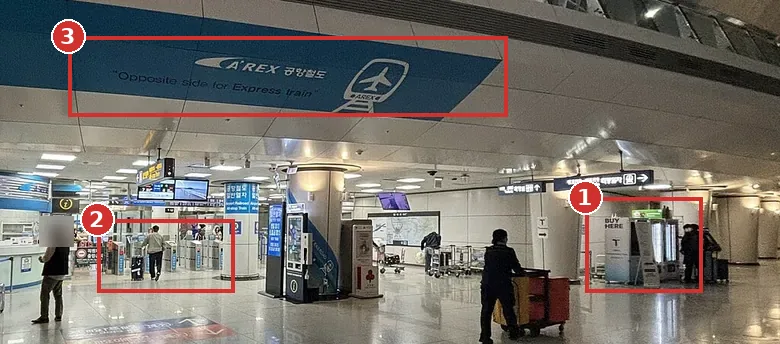

<a class="tr-btn go" href="#pick"><i class="ic ic-hotel" aria-hidden="true"></i>私のホテルには何で?</a><a class="tr-btn" href="#late"><i class="ic ic-moon" aria-hidden="true"></i>夜9時以降に着く?</a>

<figure class="tr-hero"><figcaption><b>第1ターミナル駅のAREXホーム。</b> ソウル行きの列車はここから出ます。 写真: <a href="https://commons.wikimedia.org/wiki/File:202403_AREX_Local_Platform_1,2_of_Incheon_International_Airport_Terminal_1_Station.jpg" rel="noopener" target="_blank">MNXANL</a>, <a href="https://creativecommons.org/licenses/by-sa/4.0" rel="noopener" target="_blank">CC BY-SA 4.0</a>, ウィキメディア・コモンズ</figcaption></figure>

<ul class="tr-facts"><li><i class="ic ic-clock" aria-hidden="true"></i>43〜80分<small>空港からソウル中心部まで</small></li><li><i class="ic ic-wallet" aria-hidden="true"></i>4,650〜18,000ウォン<small>列車・バス、大人</small></li><li><i class="ic ic-map-pin" aria-hidden="true"></i>列車:地下1階<small>バスの切符:1階(第1ターミナル)</small></li><li><i class="ic ic-moon" aria-hidden="true"></i>直通の最終 22:48<small>第1ターミナル発</small></li></ul>

<h2 id="pick">私のホテルには何で行く?</h2>

<ul class="ap-pick"><li class="x" id="express">
<small><i class="ic ic-hotel" aria-hidden="true"></i>ソウル駅の近く</small><b><i class="ic ic-train-front" aria-hidden="true"></i>AREX直通列車</b>43分 · 13,000ウォン · 全席指定
<ul class="pts"><li><i class="ic ic-clock" aria-hidden="true"></i>ソウル駅までノンストップ、第1ターミナルから43分、第2ターミナルから51分</li><li><i class="ic ic-wallet" aria-hidden="true"></i>大人13,000ウォン</li><li><i class="ic ic-armchair" aria-hidden="true"></i>全席指定、無料Wi-Fi</li><li><i class="ic ic-ticket" aria-hidden="true"></i>切符は第1・第2ターミナル地下1階の交通センターにある直通列車の自動券売機かカウンター、または<a href="https://www.airportrailroad.com/ticket/rsv" rel="noopener" target="_blank">空港鉄道の公式予約</a>で。海外のカードも使えます。事前予約は必須ではありません。券売機の操作はすぐ下の折りたたみに。</li></ul>
私たちの判断:ホテルがソウル駅の近くなら。直通列車はソウル駅までなので、ほかの場所ならソウル駅でもう一度乗り換えます。
</li><li class="x" id="allstop">
<small><i class="ic ic-hotel" aria-hidden="true"></i>弘大・孔徳</small><b><i class="ic ic-train-front" aria-hidden="true"></i>AREX一般列車</b>交通カード4,650ウォン · 乗り換えなし
<ul class="pts"><li><i class="ic ic-clock" aria-hidden="true"></i>第1ターミナルからソウル駅まで59分(第2ターミナルからは66分)</li><li><i class="ic ic-credit-card" aria-hidden="true"></i>交通カードでソウル駅まで4,750ウォン、弘大入口・孔徳まで4,650ウォン。第2ターミナルからは600ウォン高くなります。</li><li><i class="ic ic-users" aria-hidden="true"></i>地下鉄と同じ自由席。</li></ul>
弘大・孔徳ならこちら。同じ路線で運賃は約3分の1、乗り換えもありません。
</li><li><a href="#bus"><small><i class="ic ic-hotel" aria-hidden="true"></i>明洞・江南・蚕室など路線から離れたホテル</small><b><i class="ic ic-bus" aria-hidden="true"></i>空港リムジンバス</b>60〜80分 · 荷物は係員が積んでくれる</a></li><li><a href="#taxi"><i class="ic ic-car-taxi-front" aria-hidden="true"></i><small><i class="ic ic-users" aria-hidden="true"></i>荷物の多い3〜4人</small><b><i class="ic ic-car-taxi-front" aria-hidden="true"></i>インターナショナルタクシー</b>定額 · 70,000〜95,000ウォン</a></li><li><a href="#late"><i class="ic ic-moon" aria-hidden="true"></i><small><i class="ic ic-plane" aria-hidden="true"></i>どこでも、夜9時以降に着く便</small><b><i class="ic ic-triangle-alert" aria-hidden="true"></i>先に「夜遅く着いたら」を</b>第1ターミナル発の直通の最終 22:48</a></li></ul>

<i class="ic ic-ticket" aria-hidden="true"></i>直通列車の切符、券売機での買い方

1. **行き方:** 1階の到着ロビーからエレベーターかエスカレーターで地下1階の交通センターへ。第1ターミナルは、交通センターに向かって**右(西)**が直通列車側です。第2ターミナルは方向をまだ確認できていません。地下1階交通センターの**直通列車カスタマーセンター**で聞いてください。
2. **券売機の操作:** ① 言語を選ぶ(韓国語・英語・中国語・日本語) ② 到着駅を選ぶ(ソウル駅) ③ 列車(出発時刻)を選ぶ ④ 人数を選ぶ(大人は満13歳以上、子どもは満6〜12歳)→確認 ⑤ 現金かカードで支払う ⑥ 乗車券と領収書を受け取る。乗車券は必ず持っていきます。
3. **そのあと:** 乗車券のQRコードを改札にかざして入り、**地下4階**の乗り場へ。詳しくは[下の「買ったあと:直通列車に乗る」](#prep)。

空港鉄道の案内にある券売機の画面例はソウル駅の機械です。空港の機械の画面は少し違うかもしれません。

<i class="ic ic-route" aria-hidden="true"></i>2つの列車を1本の路線で見る

{{fig:airport-to-seoul-2|直通列車と一般列車は同じ線路}}

ホテルがまだなら、先に[ソウルのエリアの選び方](/ja/seoul-areas/)を。

<i class="ic ic-info" aria-hidden="true"></i>4つを表で比べる、省いたもの

| 泊まる場所 | 乗るもの | 理由 |
|---|---|---|
| ソウル駅の近く | AREX直通列車 | 第1ターミナルからノンストップ43分、全席指定 |
| 弘大・孔徳 | AREX一般列車 | どちらにも停車。交通カードで4,650ウォン、乗り換えなし |
| 明洞・江南・蚕室など路線から離れたホテル | 空港リムジンバス | ホテルの多いエリアへ直行、荷物は係員が積んでくれる |
| どこでも、夜9時以降に着く便 | 先に「夜遅く着いたら」を | 第1ターミナル発の直通の最終は22:48 |

{{fig:airport-to-seoul-1|第1ターミナルからソウルへ、4つの方法(大人運賃)}}

選んだのは3つの乗り物と、グループ向けの代わりの1つ。省いたもの:金浦空港、レンタカー。市内に入ってからは[ソウルの地下鉄・バス・タクシー](/ja/getting-around/)へ。

## 最初の1時間を写真で

Visit Seoulは、着陸後の入国審査と荷物の受け取りに1〜2時間みておくよう案内しています。そのあと列車までは、こう進みます。

<h3 class="tr-step">1<i class="ic ic-signpost" aria-hidden="true"></i>到着ロビーを出て、列車の案内に従う</h3>

<figure class="tr-photo"><figcaption><b>第1ターミナルの到着ロビー、</b>上の階から見たところ。 写真: <a href="https://commons.wikimedia.org/wiki/File:Incheon_International_Airport_Terminal_1_Arrival_3.jpg" rel="noopener" target="_blank">ノボホショコロトソ</a>, <a href="https://creativecommons.org/licenses/by/4.0" rel="noopener" target="_blank">CC BY 4.0</a>, ウィキメディア・コモンズ</figcaption></figure>

{{fig:airport-to-seoul-t1map|第1ターミナル:1階の到着ロビーから地下1階の交通センターへ。仁川国際空港公社の案内図と施設案内(2026年11月26日確認)の位置をもとにNadriが描き直しました}}

1. 交通センターは案内図で**ターミナルの真ん中(7・8番出入口のほう)の前**にあります。到着ロビーA〜Fのどこから出ても、交通センター・空港鉄道(AREX)の案内に従って真ん中のほうへ進みます。
2. 正しく進んでいれば見えるもの:案内デスク(5番・10番出入口付近、24時間)、空港バス案内デスク(9番・11番出入口付近)、通信会社のローミングセンター(到着ロビーA付近 06:00〜22:00、F付近 24時間)。
3. 地下1階へ下りると交通センターです。真ん中に**Travel Center**(07:00〜21:30)が見えたら正解です。交通センターに向かって左(東)が一般列車、右(西)が直通列車です。

<i class="ic ic-map" aria-hidden="true"></i>第2ターミナルに着いたら

{{fig:airport-to-seoul-t2map|第2ターミナル:1階の到着ロビーから地下1階の交通センターへ。仁川国際空港公社の案内図の位置をもとにNadriが描き直しました}}

第2ターミナルは、到着ロビー(1階)から地下1階の交通センターへ下りると、列車とバスが一か所にあります。バス乗り場の番号:ソウル11〜35、京畿36〜45、地方01〜10。インターナショナルタクシーは1階の3C乗り場です。

<h3 class="tr-step">2<i class="ic ic-arrow-down" aria-hidden="true"></i>地下1階の交通センターへ下りる</h3>

<figure class="tr-photo"><figcaption><b>第1ターミナル駅の地下1階、直通列車側。</b> 写真: <a href="https://commons.wikimedia.org/wiki/File:202403_AREX_Express_Train_Concourse_at_Incheon_International_Airport_Terminal_1_Station.jpg" rel="noopener" target="_blank">MNXANL</a>, <a href="https://creativecommons.org/licenses/by-sa/4.0" rel="noopener" target="_blank">CC BY-SA 4.0</a>, ウィキメディア・コモンズ; 番号はNadriが追加</figcaption></figure>

1. 表示:直通列車 Express Train。
2. 乗車券の券売機。

直通列車カウンター、交通カードの販売機、コンビニはどれも地下1階です。

<h3 class="tr-step">3<i class="ic ic-credit-card" aria-hidden="true"></i>T-moneyを買ってチャージ</h3>

<figure><figcaption><b>T-moneyカード。</b> 列車・地下鉄・バスがこれ1枚。 写真: <a href="https://commons.wikimedia.org/wiki/File:T-money_card.jpg" rel="noopener" target="_blank">zisk</a>, Public domain (PD-self: released by the author), ウィキメディア・コモンズ</figcaption></figure><figure><figcaption><b>交通カードの販売・チャージ機</b>(仁川の蘇莱浦口駅、KORAILの駅。ソウルや空港の機械は見た目が違うことがあります)。ここでチャージ。 写真: <a href="https://commons.wikimedia.org/wiki/File:Ticket_Vending_and_Card_Reload_Machine_-_Seoul_Metropolitan_Subway_20240713.jpg" rel="noopener" target="_blank">LandAndTree</a>, <a href="https://creativecommons.org/licenses/by/4.0" rel="noopener" target="_blank">CC BY 4.0</a>, ウィキメディア・コモンズ</figcaption></figure>

1. **買う:** 地下1階の交通センターのコンビニか交通カード販売機で。コンビニでの買い方:[コンビニのページ](/ja/convenience-store/#tmoney)。予約したカードの受け取り方は[下の「着く前に用意」](#prep)にあります。
2. **現金がないとき:** 第1・第2ターミナルの空港鉄道駅にあるT-money自販機で、交通費が入ったT-moneyを海外のクレジットカードで買えます。15,000ウォン(カード代5,000ウォン+交通費10,000ウォン)、2026年11月23日発売。使い切った後にカードで再チャージできるかは、空港鉄道は発表していません。現金を下ろすなら、第1ターミナルは**地下1階の空港鉄道一般列車の券売機のそば**に共用ATMがあります(24時間。1階は4・6・9・11番出入口付近)。このATMで海外のカードが使えるか、第2ターミナルのATMがどこにあるかは確認できていません。
3. **チャージ(現金のみ):** 機械で ① 画面でチャージと金額を選び ② カードを「交通カードを置くところ」に置いたまま ③「紙幣を入れるところ」にお札を入れ ④ 画面の新しい残高を確かめてからカードを取ります。機械の写真で見る手順:[ソウルの地下鉄 ステップ2](/ja/seoul-subway/)
4. カードなしなら1回用乗車券:100ウォン高く、保証金500ウォンは戻ってきます。

<h3 class="tr-step">4<i class="ic ic-log-in" aria-hidden="true"></i>AREXの改札でタッチ</h3>

<figure class="tr-photo"><figcaption><b>第1ターミナル駅、一般列車の乗り場(地下1階)。</b> 写真: <a href="https://commons.wikimedia.org/wiki/File:202403_AREX_Local_Train_Concourse_at_Incheon_International_Airport_Terminal_1_Station.jpg" rel="noopener" target="_blank">MNXANL</a>, <a href="https://creativecommons.org/licenses/by-sa/4.0" rel="noopener" target="_blank">CC BY-SA 4.0</a>, ウィキメディア・コモンズ; 番号はNadriが追加</figcaption></figure>

1. **BUY HERE**と書かれた機械:乗車券・交通カード。
2. 改札。カードをかざすと画面に残高が出て、ゲートが開きます。開かないときは読み取り機に出た残高を見て、足りなければ上の3番のように券売機でチャージして、もう一度かざします。
3. 「Opposite side for Express train」(直通列車は反対側)の案内。直通列車は専用カウンターがあります。

<h3 class="tr-step">5<i class="ic ic-train-front" aria-hidden="true"></i>乗ったら駅名を見ていく</h3>

<figure class="tr-photo"><figcaption><b>第1ターミナル駅のAREXホーム。</b> 写真: <a href="https://commons.wikimedia.org/wiki/File:202403_AREX_Local_Platform_1,2_of_Incheon_International_Airport_Terminal_1_Station.jpg" rel="noopener" target="_blank">MNXANL</a>, <a href="https://creativecommons.org/licenses/by-sa/4.0" rel="noopener" target="_blank">CC BY-SA 4.0</a>, ウィキメディア・コモンズ; 番号はNadriが追加</figcaption></figure>

1. 表示:一般列車2番のりば、黔岩・金浦空港・弘大入口・ソウル駅方面。

最初はまだ知らない名前、そこから地図で見た名前が続きます。

<ul class="ap-stations"><li>雲西</li><li>永宗</li><li>青羅国際都市</li><li class="sep">→</li><li class="k">金浦空港</li><li class="k">弘大入口</li><li class="k">孔徳</li><li class="k">ソウル駅</li></ul>

<h3 class="tr-step">6<i class="ic ic-circle-check" aria-hidden="true"></i>ホテルに近い駅でタッチして出る</h3>

<aside class="tr-note ok"><i class="ic ic-circle-check" aria-hidden="true"></i>出るときも同じカードをタッチ。終わりの場面は、表でいちばん速そうなものではなく、ホテルにいちばん近い駅か停留所で降りること。それが私たちのおすすめです。</aside>

<i class="ic ic-map" aria-hidden="true"></i>第1ターミナルのバス・列車乗り場の図

{{fig:airport-to-seoul-3|第1ターミナルでバスと列車に乗る場所}}

<h2 id="bus">空港リムジンバス</h2>

AREXの路線から離れたホテルなら、荷物を持って乗り換える回数がいちばん少ない方法です。切符1枚、座席ひとつ、荷物はバスの下。

<ul class="tr-facts"><li><i class="ic ic-clock" aria-hidden="true"></i>約60〜80分<small>ソウル市内まで</small></li><li><i class="ic ic-wallet" aria-hidden="true"></i>16,000〜18,000ウォン<small>大人、カード可</small></li><li><i class="ic ic-ticket" aria-hidden="true"></i>切符を買う<small>乗車券を持つ人が先に乗る</small></li><li><i class="ic ic-luggage" aria-hidden="true"></i>荷物は1人2個<small>28インチ以下</small></li></ul>

**切符に書かれた乗り場へ。** 行き先・運賃・乗車時刻も書いてあります。

{{fig:airport-to-seoul-5|空港バスの乗車券に書いてあること}}

路線番号を調べます。例:

<ul class="ap-routes"><li><b>6001</b>明洞・東大門</li><li><b>6002</b>弘大・鍾路</li><li><b>6020</b>江南</li><li><b>6200</b>蚕室</li><li><b>6701</b>光化門・市庁</li></ul>

1. **切符を買う。** バスのチケット売り場か券売機で。第1ターミナルは1階(空港バス案内デスク:9番出入口付近は24時間、11番出入口付近は06:00〜22:00)、第2ターミナルは地下階。T-moneyも使えますが、乗車券を持つ人が先に乗ります。
2. **荷物は係員に預けて**荷物札を受け取ります。
3. **案内放送を聞いて降り**、札の番号を確かめて荷物を受け取ります。

<h2 id="taxi">タクシー:荷物の多い3〜4人なら</h2>

外国人観光タクシー(インターナショナルタクシー)には仁川空港⇔ソウルの定額運賃があり、メーターを気にしなくて済みます。高速道路料金込み。第1・第2ターミナルに案内デスクがあり、海外のカードも使えます。

**インターナショナルタクシーの乗り場:第1ターミナルは4C、第2ターミナルは3C。** インターナショナルタクシーの電話 1644-2255。ターミナル内で声をかけてくる人にはついて行かず、この指定乗り場で乗ってください。仁川国際空港公社が、タクシーのふりをして客を集めるワゴン車(コールバン)の不当料金に注意を呼びかけています。

<figure class="tr-photo"><figcaption><b>これは一般のタクシーです。</b> 定額はターミナル内のデスクで手配するインターナショナルタクシーだけです。 写真: <a href="https://commons.wikimedia.org/wiki/File:Seoul_taxis_01.jpg" rel="noopener" target="_blank">Ilya Plekhanov</a>, <a href="https://creativecommons.org/licenses/by-sa/4.0" rel="noopener" target="_blank">CC BY-SA 4.0</a>, ウィキメディア・コモンズ</figcaption></figure>

中型、行き先の区ごとの料金:

<ul class="ap-fares"><li><b>70,000ウォン</b>江西区</li><li><b>75,000ウォン</b>麻浦区(弘大)・永登浦区・恩平区など</li><li><b>85,000ウォン</b>中区(明洞)・鍾路区・龍山区など</li><li><b>90,000ウォン</b>江南区・瑞草区・城東区など</li><li><b>95,000ウォン</b>松坡区(蚕室)・江東区・広津区など</li></ul>

大型・模範は100,000〜140,000ウォン。4人で割れば85,000ウォンは1人約21,000ウォンで、バスとほぼ同じです。

<i class="ic ic-car-taxi-front" aria-hidden="true"></i>定額を図で見る

{{fig:airport-to-seoul-6|仁川空港発・外国人観光タクシーの定額(中型)}}

<h2 id="late">仁川空港に夜遅く着いたら、ソウルへどう行く?</h2>

<aside class="tr-note"><i class="ic ic-moon" aria-hidden="true"></i><b>AREX直通の最終:第1ターミナル22:48、第2ターミナル22:40。</b> Visit Seoulは入国審査と荷物の受け取りに1〜2時間みておくよう案内しているので、夜9時以降に着く便だと間に合わないことがあります。出発前に決めておきましょう。</aside>

{{fig:airport-to-seoul-7|夜遅く、第1ターミナルから乗れるもの}}

- **一般列車:** もう少し遅くまで走ります。最終は日付ごとに[AREXの列車時刻](https://www.airportrailroad.com/train/normal/info)で確認を。
- **列車が終わったら:** 深夜の空港バス、17,000〜18,000ウォン。第1ターミナルの始発は23:40〜00:10の間。切符は売り場か券売機で。

<ul class="ap-routes late"><li><b>N6000</b>江南</li><li><b>N6002</b>弘大・清凉里</li><li><b>N6701</b>ソウル駅・東大門</li><li><b>N6703</b>蚕室・広渡口</li></ul>

<i class="ic ic-calendar-days" aria-hidden="true"></i>直通の最終時刻が変わった理由

2026年10月23日に直通列車が1日52本から56本に増便され、ダイヤが変わりました。第1ターミナル22:48、第2ターミナル22:40は、現在の時刻表では平日・休日とも同じです。

## よくある失敗

<ul class="tr-oops"><li><i class="ic ic-triangle-alert" aria-hidden="true"></i><b>空港でClimate Card(気候同行カード)で乗ろうとする。</b> 2026年10月1日から、短期券で空港まで乗って第1・第2ターミナル駅で降りることはできますが、空港の駅から乗ることはできません。ソウルへ向かうときはT-moneyで払いましょう。</li><li><i class="ic ic-triangle-alert" aria-hidden="true"></i><b>ソウル駅の近くでないのに直通列車に乗る。</b> 直通列車はソウル駅までなので、ソウル駅でもう一度乗り換えることになります。</li><li><i class="ic ic-triangle-alert" aria-hidden="true"></i><b>遅い便なのに直通列車を当てにする。</b> 第1ターミナルの最終は22:48です。</li><li><i class="ic ic-triangle-alert" aria-hidden="true"></i><b>T-moneyだけでバスの列に並ぶ。</b> 乗車券を持つ人が先に乗ります。</li></ul>

<h2 id="prep">着く前に用意しておきたいなら</h2>

<aside class="tr-note tip"><i class="ic ic-lightbulb" aria-hidden="true"></i><b>必須ではありません。</b> 交通カードは空港(販売機・コンビニ)で、直通列車の切符は地下1階の券売機・カウンターで買えます。事前に買うのは、買うタイミングが早まるだけです。</aside>

{{fig:airport-to-seoul-4|T-moneyとWOWPASS、それぞれできること}}

<b>T-moneyカード、空港で受け取り。</b> 一般列車・地下鉄・バスにタッチするだけ。 写真: <a href="https://commons.wikimedia.org/wiki/File:T-money_card.jpg" rel="noopener" target="_blank">zisk</a>, Public domain (PD-self: released by the author), ウィキメディア・コモンズ

**買う前に:** 商品の案内で、自分が着くターミナル(第1・第2)と到着時刻に受け取れるかを確かめてください。受け取り場所は私たちもまだ確認できていません(Klookのサイトが自動アクセスを止めていて開けませんでした)。

{{aff:klook_tmoney|T-moneyカードを予約して空港で受け取る}}

<i class="ic ic-list-checks" aria-hidden="true"></i>買ったあと:T-moneyの受け取り

1. **場所と時間:** 予約確認書(バウチャー)に書かれた場所と時間に行きます。
2. **見せるもの:** 何を見せるかも予約確認書に書かれています。出発前にスマホに保存しておきましょう。
3. **残高:** 改札の読み取り機にカードをかざすと残高が出ます。足りなければ上のステップ3のように券売機で現金チャージします。
4. **受け取れないとき:** 販売元(Klook)のサポートに予約番号で問い合わせ、その間は地下1階のコンビニか空港鉄道駅のT-money自販機ですぐ買います。

<i class="ic ic-wallet" aria-hidden="true"></i>
<b>WOWPASS。</b> 交通用のT-moneyに、両替とカード払いまで1枚に。ただし地下鉄・バスに使うT-money残高は別にチャージします。

{{aff:klook_wowpass|両替・カード払い・T-moneyが1枚になったWOWPASS}}

<i class="ic ic-list-checks" aria-hidden="true"></i>買ったあと:WOWPASSの受け取りと使い方

1. **受け取る:** 予約確認書に書かれた方法で受け取ります。WOWPASSの機械で受け取る方式なら:機械で**「カード発行」**を選び、**「引き換えコード発行」**を選ぶ→パスポートをスキャン→もらったコードを入力→カードが出てきたら一度機械に差し込んで有効化。
2. **アプリに登録:** WOWPASSアプリにカードを登録します。残高とT-money残高が見られ、なくしたらアプリでカードを止めてWOWPASS残高を守れます。ただし、カードの**T-money残高は、カードをなくすと再発行しても戻りません。**
3. **支払い残高を入れる:** WOWPASSの機械で16種類の通貨の現金かクレジットカードで、またはアプリで海外カードでチャージします。機械の場所:[WOWPASSの機械を探す](https://www.wowpass.io/ja/map/kiosk)。
4. **交通費は別:** 地下鉄・バスはカードの中の**T-money残高**で払います。駅やコンビニでウォン現金で、またはアプリ(NFC)でWOWPASS残高を移してチャージします。これをしないと改札で残高不足になります。
5. **残ったお金:** WOWPASS残高は機械でウォン現金で引き出します(1回10万ウォンまで、手数料1,000ウォン、1,000ウォン未満の硬貨は出ません)。T-money残高はコンビニなどのT-money払い戻し所で別に払い戻します(手数料500ウォン、5万ウォン以上はT-money本社のみ)。

出典:[WOWPASS 使い方ガイド](https://www.wowpass.io/ja/guide)(2026年11月27日確認)。

<b>直通列車の切符を事前予約。</b> ホテルがソウル駅の近くのときだけ意味があります。 写真: <a href="https://commons.wikimedia.org/wiki/File:Nearly_empty_Incheon_Airport_Railroad_Express_during_the_coronavirus_outbreak_20200306_104401.jpg" rel="noopener" target="_blank">Bonnielou2013</a>, <a href="https://creativecommons.org/licenses/by-sa/4.0" rel="noopener" target="_blank">CC BY-SA 4.0</a>, ウィキメディア・コモンズ

{{aff:klook_airport|AREX直通列車のチケットを事前予約}}

<i class="ic ic-list-checks" aria-hidden="true"></i>買ったあと:直通列車に乗る

1. **切符の確認:** 空港鉄道の公式の乗車券は、決済するとQRコードができます。Klookで買った場合は確認書に書かれた使い方に従ってください(空港鉄道はKlookを提携旅行会社にしています)。
2. **乗り場:** 地下1階交通センターの直通列車側へ。第1ターミナルは交通センターに向かって**右(西)**。第2ターミナルは方向をまだ確認できていません(直通列車カスタマーセンターで聞いてください)。改札を通り、エレベーターかエスカレーターで**地下4階**の乗り場へ。
3. **改札:** 乗車券のQRコードを改札のQRスキャナーにかざすと開きます。
4. **時間:** 発車3分前までにホームへ。号車と座席は乗車券に書いてあります。
5. **変更・取り消し:** 公式予約の切符は空港鉄道のサイト・アプリの「乗車券の変更/払い戻し」(韓国語画面:승차권 변경/반환、私たちの訳)で(変更は3回まで、出発当日に2回以上変えると手数料)。Klookで買った切符はKlookの規定に従います。

出典:空港鉄道 [直通列車のご利用案内](https://www.airportrailroad.com/train/express/guide)・[提携会社](https://www.airportrailroad.com/train/express/partners)(韓国語ページ、上の言語メニューで切り替え)、2026年11月27日確認。

## 出発の前の夜に

3つだけ決めておきましょう。

1. **ホテルのある区を確かめ**、[このページのいちばん上](#pick)で乗り物を選びます。
2. **バスなら**路線番号、**タクシーなら**その区の定額をメモ。
3. **夜9時以降に着く便なら**、そのエリアの深夜バスの番号もメモ。

<ul class="tr-next"><li><a href="/ja/e-arrival-card/"><i class="ic ic-id-card" aria-hidden="true"></i>着く前に:電子入国申告書<i class="ic ic-arrow-right" aria-hidden="true"></i></a></li><li><a href="/ja/getting-around/"><i class="ic ic-route" aria-hidden="true"></i>市内で:ソウルの地下鉄・バス・タクシー<i class="ic ic-arrow-right" aria-hidden="true"></i></a></li><li><a href="/ja/seoul-subway/"><i class="ic ic-train-front" aria-hidden="true"></i>はじめての地下鉄<i class="ic ic-arrow-right" aria-hidden="true"></i></a></li></ul>

<i class="ic ic-list-checks" aria-hidden="true"></i>出典と写真について

2026年11月26日確認:AREX <a href="https://www.airportrailroad.com/train/express/introduce" rel="noopener" target="_blank">直通列車の紹介</a>(所要時間・運賃・座席)、<a href="https://www.airportrailroad.com/train/express/info" rel="noopener" target="_blank">直通列車の時刻表</a>、<a href="https://www.airportrailroad.com/train/normal/introduce" rel="noopener" target="_blank">一般列車の紹介</a>、<a href="https://www.airportrailroad.com/train/normal/fare" rel="noopener" target="_blank">一般列車の運賃</a>;Visit Seoul <a href="https://english.visitseoul.net/airport-to-seoul" rel="noopener" target="_blank">Airport to Seoul</a>(2026年6月時点の運賃・時間、バス路線、荷物、切符);仁川国際空港 <a href="https://www.airport.kr/" rel="noopener" target="_blank">空港鉄道の案内</a> (airport.kr: ap_en/1512/subview.do)、<a href="https://www.airport.kr/" rel="noopener" target="_blank">深夜バス</a> (airport.kr: ap_en/1507/subview.do)、<a href="https://www.airport.kr/" rel="noopener" target="_blank">リムジンバスの予約案内</a> (airport.kr: bbs/ap_en/937/138233/artclView.do);ソウル市 <a href="https://news.seoul.go.kr/traffic/archives/1659" rel="noopener" target="_blank">タクシー運賃(外国人観光タクシーの区間定額を含む)</a>(2026年10月14日更新)、<a href="https://news.seoul.go.kr/traffic/archives/category/public-news_c1/climate-accompany-card_c1/card-climate_accompany_card" rel="noopener" target="_blank">気候同行カード短期券</a>(2026年10月12日更新)。今回は開き直せなかったもの:Wikitree <a href="https://www.wikitree.co.kr/articles/1168084" rel="noopener" target="_blank">AREX直通列車が2026年10月23日から1日52本→56本に</a>。 仁川国際空港公社(韓国語ページ、2026年11月26日12時確認):<a href="https://www.airport.kr/ap_ko/986/subview.do" rel="noopener" target="_blank">タクシー利用案内</a>(乗り場番号・コールバン注意)、<a href="https://www.airport.kr/ap_ko/1008/subview.do" rel="noopener" target="_blank">便宜・公共施設</a>(空港バス案内デスクの位置)、<a href="https://www.airport.kr/ap_ko/974/subview.do" rel="noopener" target="_blank">バス</a>(乗車券)。<a href="https://www.airport.kr/ap_en/1512/subview.do" rel="noopener" target="_blank">空港鉄道案内の案内図</a>(第1・第2交通センターの位置、バス乗り場番号)

2026年11月27日確認:空港鉄道 <a href="https://www.airportrailroad.com/train/express/guide" rel="noopener" target="_blank">直通列車のご利用案内</a>(自動券売機は第1・第2の地下1階交通センターとソウル駅地下2階、券売機の手順01〜06、海外カード、QR改札、地下4階の乗り場、発車3分前、変更と手数料)、<a href="https://www.airportrailroad.com/train/express/partners" rel="noopener" target="_blank">提携会社</a>(旅行会社にKLOOK)、<a href="https://www.airportrailroad.com/train/express/introduce" rel="noopener" target="_blank">直通列車のご紹介</a>(第1・第2の地下1階交通センターに直通列車カスタマーセンター。施設名と券売機の手順名は韓国語ページからの訳);WOWPASS <a href="https://www.wowpass.io/ja/guide" rel="noopener" target="_blank">使い方ガイド</a>(チャージ・引き出し・T-moneyチャージと払い戻し・「カード発行」→「引き換えコード発行」の手順・カード紛失時のT-money残高);仁川国際空港公社 <a href="https://www.airport.kr/ap_ko/1008/subview.do" rel="noopener" target="_blank">便宜・公共施設</a>(共用ATM:地下1階の空港鉄道一般列車券売機のそば、1階4・6・9・11番出入口付近、24時間);コリア・ヘラルド <a href="https://www.koreaherald.com/article/10947683" rel="noopener" target="_blank">空港鉄道のT-moneyカード</a>(交通費入り15,000ウォン、海外カード、再チャージ方法は未発表)。確認できなかったもの:第2ターミナル地下1階での直通列車側の方向(空港鉄道・仁川空港の案内文に方向の記載なし)、共用ATMで海外カードが使えるかと第2ターミナルのATMの場所(開いた空港の施設一覧は第1ターミナルのみ);Klookの商品ページ(T-moneyの空港受け取り・WOWPASS・直通列車の受け取り場所と使い方)。Klookのサイトが自動アクセスを止めているため開けませんでした。そのため受け取り場所は予約確認書に従うよう書いています。

<b>このページの写真</b>
<ul class="ap-credits"><li><a href="https://commons.wikimedia.org/wiki/File:202403_AREX_Local_Platform_1,2_of_Incheon_International_Airport_Terminal_1_Station.jpg" rel="noopener" target="_blank">File:202403 AREX Local Platform 1,2 of Incheon International Airport Terminal 1 Station.jpg</a>: MNXANL, <a href="https://creativecommons.org/licenses/by-sa/4.0" rel="noopener" target="_blank">CC BY-SA 4.0</a>. 加工: cropped, resized to 780x492, light auto-contrast.</li><li><a href="https://commons.wikimedia.org/wiki/File:Nearly_empty_Incheon_Airport_Railroad_Express_during_the_coronavirus_outbreak_20200306_104401.jpg" rel="noopener" target="_blank">File:Nearly empty Incheon Airport Railroad Express during the coronavirus outbreak 20200306 104401.jpg</a>: Bonnielou2013, <a href="https://creativecommons.org/licenses/by-sa/4.0" rel="noopener" target="_blank">CC BY-SA 4.0</a>. 加工: cropped, resized to 780x971, light auto-contrast.</li><li><a href="https://commons.wikimedia.org/wiki/File:202403_AREX_Local_Train_Concourse_at_Incheon_International_Airport_Terminal_1_Station.jpg" rel="noopener" target="_blank">File:202403 AREX Local Train Concourse at Incheon International Airport Terminal 1 Station.jpg</a>: MNXANL, <a href="https://creativecommons.org/licenses/by-sa/4.0" rel="noopener" target="_blank">CC BY-SA 4.0</a>. 加工: resized to 780x585, light auto-contrast, 1 detected face(s) blurred.</li><li><a href="https://commons.wikimedia.org/wiki/File:Incheon_Airport_Limousine_6010.JPG" rel="noopener" target="_blank">File:Incheon Airport Limousine 6010.JPG</a>: hyolee2, <a href="https://creativecommons.org/licenses/by-sa/3.0" rel="noopener" target="_blank">CC BY-SA 3.0</a>. 加工: resized to 780x585, light auto-contrast, 1 detected face(s) blurred, 1 area(s) blurred (faces/plates, manual).</li><li><a href="https://commons.wikimedia.org/wiki/File:Incheon_International_Airport_Terminal_1_Arrival_3.jpg" rel="noopener" target="_blank">File:Incheon International Airport Terminal 1 Arrival 3.jpg</a>: ノボホショコロトソ, <a href="https://creativecommons.org/licenses/by/4.0" rel="noopener" target="_blank">CC BY 4.0</a>. 加工: resized to 780x585, light auto-contrast, 1 detected face(s) blurred.</li><li><a href="https://commons.wikimedia.org/wiki/File:202403_AREX_Express_Train_Concourse_at_Incheon_International_Airport_Terminal_1_Station.jpg" rel="noopener" target="_blank">File:202403 AREX Express Train Concourse at Incheon International Airport Terminal 1 Station.jpg</a>: MNXANL, <a href="https://creativecommons.org/licenses/by-sa/4.0" rel="noopener" target="_blank">CC BY-SA 4.0</a>. 加工: resized, light auto-contrast, numbered red boxes added.</li><li><a href="https://commons.wikimedia.org/wiki/File:T-money_card.jpg" rel="noopener" target="_blank">File:T-money card.jpg</a>: zisk, Public domain (PD-self: released by the author). 加工: kept at 499x316, light auto-contrast.</li><li><a href="https://commons.wikimedia.org/wiki/File:Ticket_Vending_and_Card_Reload_Machine_-_Seoul_Metropolitan_Subway_20240713.jpg" rel="noopener" target="_blank">File:Ticket Vending and Card Reload Machine - Seoul Metropolitan Subway 20240713.jpg</a>: LandAndTree, <a href="https://creativecommons.org/licenses/by/4.0" rel="noopener" target="_blank">CC BY 4.0</a>. 加工: resized to 780x585, light auto-contrast.</li><li><a href="https://commons.wikimedia.org/wiki/File:202403_AREX_Local_Train_Concourse_at_Incheon_International_Airport_Terminal_1_Station.jpg" rel="noopener" target="_blank">File:202403 AREX Local Train Concourse at Incheon International Airport Terminal 1 Station.jpg</a>: MNXANL, <a href="https://creativecommons.org/licenses/by-sa/4.0" rel="noopener" target="_blank">CC BY-SA 4.0</a>. 加工: cropped, resized to 780x344, light auto-contrast, 1 area blurred (face, manual), numbered red boxes added.</li><li><a href="https://commons.wikimedia.org/wiki/File:202403_AREX_Local_Platform_1,2_of_Incheon_International_Airport_Terminal_1_Station.jpg" rel="noopener" target="_blank">File:202403 AREX Local Platform 1,2 of Incheon International Airport Terminal 1 Station.jpg</a>: MNXANL, <a href="https://creativecommons.org/licenses/by-sa/4.0" rel="noopener" target="_blank">CC BY-SA 4.0</a>. 加工: cropped to the platform sign (from the full-size original), resized to 780x269, light auto-contrast, numbered red box added.</li><li><a href="https://commons.wikimedia.org/wiki/File:Seoul_taxis_01.jpg" rel="noopener" target="_blank">File:Seoul taxis 01.jpg</a>: Ilya Plekhanov, <a href="https://creativecommons.org/licenses/by-sa/4.0" rel="noopener" target="_blank">CC BY-SA 4.0</a>. 加工: resized to 780x520, light auto-contrast, 1 area(s) blurred (faces/plates, manual).</li></ul>

