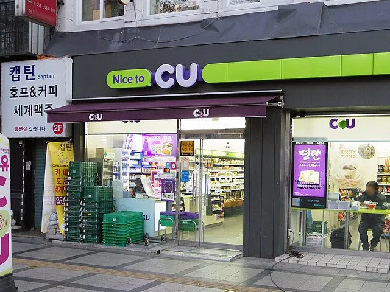
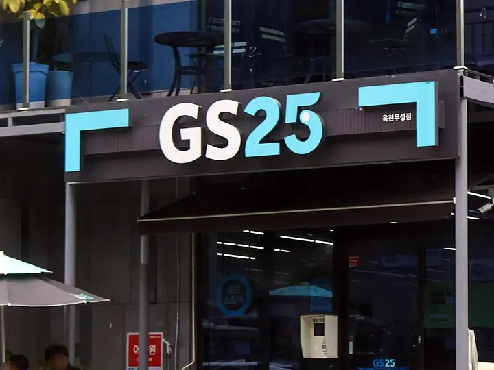
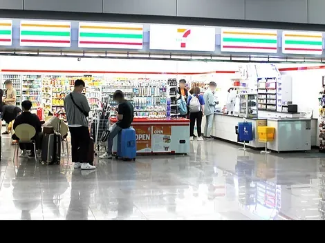
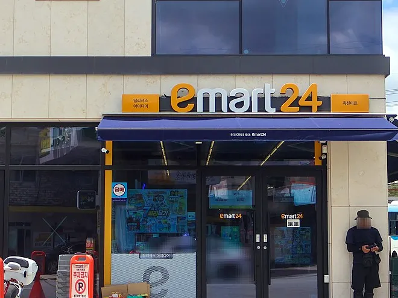
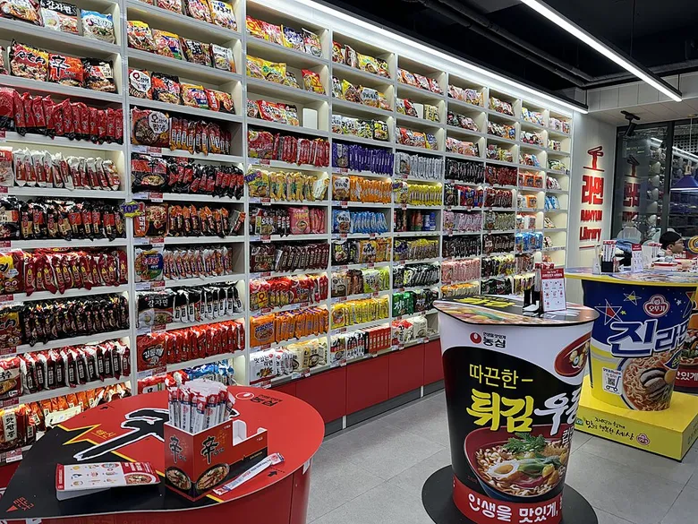

<a class="tr-btn go" href="#tmoney"><i class="ic ic-credit-card" aria-hidden="true"></i>T-moneyを買ってチャージ</a><a class="tr-btn" href="#find"><i class="ic ic-moon" aria-hidden="true"></i>24時間の店を探す</a>

<ul class="tr-colours"><li><b>CU</b>紫の文字、黄緑の帯。<a href="https://commons.wikimedia.org/wiki/File:CU_Namdaemun-ro-5ga_branch_20181122_072838.jpg" rel="noopener" target="_blank">LERK</a>、<a href="https://creativecommons.org/licenses/by-sa/4.0/deed.ja" rel="noopener" target="_blank">CC BY-SA 4.0</a>(切り抜き)</li><li><b>GS25</b>白い「GS」と水色の「25」。<a href="https://commons.wikimedia.org/wiki/File:GS25_Okcheon_Museong_Branch_20240730.jpg" rel="noopener" target="_blank">LandAndTree</a>、<a href="https://creativecommons.org/publicdomain/zero/1.0/deed.ja" rel="noopener" target="_blank">CC0</a>(切り抜き)</li><li><b>セブン-イレブン</b>オレンジ・緑・赤のストライプと7。<a href="https://commons.wikimedia.org/wiki/File:7-Eleven_Muan-international-airport_store_20190520_181056.jpg" rel="noopener" target="_blank">LERK</a>、<a href="https://creativecommons.org/licenses/by-sa/4.0/deed.ja" rel="noopener" target="_blank">CC BY-SA 4.0</a>(切り抜き)</li><li><b>emart24</b>黄色い「emart24」の文字。<a href="https://commons.wikimedia.org/wiki/File:E-mart_24_Okcheon_Mir_Branch_20240731.jpg" rel="noopener" target="_blank">LandAndTree</a>、<a href="https://creativecommons.org/publicdomain/zero/1.0/deed.ja" rel="noopener" target="_blank">CC0</a>(切り抜き)</li></ul>

<ul class="tr-facts"><li><i class="ic ic-store" aria-hidden="true"></i>大手4チェーン<small>2025年末で53,266店(報道ベース)</small></li><li><i class="ic ic-moon" aria-hidden="true"></i>24時間は約78%<small>深夜は営業時間を確認</small></li><li><i class="ic ic-banknote" aria-hidden="true"></i>T-moneyは現金でチャージ<small>レジで、ウォンで</small></li><li><i class="ic ic-id-card" aria-hidden="true"></i>お酒・たばこ<small>2026年は2007年以前生まれ</small></li></ul>

## コンビニでできること

<ul class="tr-choose"><li><i class="ic ic-credit-card" aria-hidden="true"></i><b>交通カードを買ってチャージ</b>T-moneyを買い、現金でチャージ。<a href="#tmoney">方法</a></li><li><i class="ic ic-sun" aria-hidden="true"></i><b>寒さ・風邪のとき</b>カイロ、マスク、温かい飲み物。24時間営業の店には風邪薬・鎮痛剤などの常備薬も。</li><li><i class="ic ic-coins" aria-hidden="true"></i><b>安く一食</b>カップラーメン、一部のCUには袋ラーメンを作る機械も。<a href="#ramyeon">使い方</a></li><li><i class="ic ic-banknote" aria-hidden="true"></i><b>現金を引き出す</b>ATMのある店で。CUは<a href="#find">店舗検索</a>で絞り込めます。手数料は機械の画面で確認:<a href="/ja/money/">お金のページ</a></li></ul>

<ul class="tr-choose"><li><i class="ic ic-user-x" aria-hidden="true"></i><b>コンビニ向きでないもの</b>コスメをたくさん買うなら<a href="/ja/olive-young/">オリーブヤング</a>、ラーメンやお菓子をお土産に大量に買うなら先に大型スーパーと値段を比べて。</li></ul>

<h2 id="find">1. 近くのコンビニを探し、24時間か確かめる</h2>

大手は**CU、GS25、セブン-イレブン、emart24**の4つ(上の写真)。2026年4月の報道(CEOスコアデイリー)によると、2025年末で4社合わせて53,266店でした(この出典は今日再確認できず、2026年11月25日の確認内容です)。不採算店の整理で1年に3%近く減りましたが、都市なら少し歩けば必ず1軒あります。

ただし全部が24時間ではありません。2025年12月の報道(マネートゥデイ、今日は再確認できず)によると、2025年6月時点で24時間営業は42,791店、全体の約78%でした。今の数字は違うかもしれません。残りの5軒に1軒は夜に閉まるか無人になります。探し方はこうです。

1. **検索:** 地図アプリ(例:NAVER Map・カカオマップ)で「편의점」(コンビニ)や「CU」「GS25」を検索します。地図アプリの入れ方・使い方:[地図アプリを開く](/ja/seoul-subway/#map-app)
2. **営業時間:** 近くの店を押して営業時間を確認します。深夜なら24時間か必ず見ます。
3. **道順:** その店までの経路を開いて歩きます。着いたら**入口のドア**の営業時間ももう一度見ます。
4. CUなら[CU店舗検索](https://cu.bgfretail.com/store/list.do?category=store)(韓国語)で地域か店名で検索し、「매장 유형 및 서비스」で**24시간**(24時間)や**현금지급기**(ATM)を選べます。

### 店の中で:選んで、レジへ

1. 必要な物を選んで**レジ**へ持って行きます。値段は棚の値札に(1+1などの表示もここ)。
2. T-moneyのチャージやCUの免税などのサービスもレジでスタッフに頼みます。CUは店の統合端末で交通カードをチャージします。
3. カードか現金で払います。支払い方法は下の[選んで支払う](#pay)へ。

<h2 id="tmoney">2. T-moneyを買って、現金でチャージ</h2>

T-moneyは地下鉄・バスに乗るチャージ式交通カード。GS25、CU、セブン-イレブンなど全国のコンビニで販売・チャージしています。カード代は3,000〜5,000ウォンです。

<figure class="tr-photo"><figcaption><b>T-moneyカード</b>(旧デザイン)。デザインはいろいろあります。写真:<a href="https://commons.wikimedia.org/wiki/File:T-money_card.jpg" rel="noopener" target="_blank">zisk</a>、パブリックドメイン、ウィキメディア・コモンズ(明るさ自動補正)</figcaption></figure>

<h3 class="tr-step">1<i class="ic ic-shopping-basket" aria-hidden="true"></i>レジでカードを買う</h3>

1. レジで「**ティモニ カドゥ チュセヨ**」(티머니 카드 주세요/T-moneyカードください)と言います。
2. カード代を払います。外国人旅行者向けの「TMONEY TRAVEL CARD」は4,000ウォンです。

<h3 class="tr-step">2<i class="ic ic-banknote" aria-hidden="true"></i>ウォンの現金でチャージ</h3>

1. カードと**ウォンの現金**を一緒に出します。
2. 金額を言います。例:「**マノン チュンジョネ チュセヨ**」(만 원 충전해 주세요/1万ウォンチャージしてください)。
3. スタッフがチャージしてくれます。CUは全店でT-moneyのチャージができます。

<aside class="tr-note"><i class="ic ic-triangle-alert" aria-hidden="true"></i>海外発行のカードでは基本的にチャージできません。T-moneyのチャージはこれまで現金、韓国発行のカード、韓国の携帯電話決済だけで、ソウル市も外国人は交通カードを現金で買ってチャージするしかなかったと説明しています。レジで海外カードでチャージできると案内しているコンビニは見つかりませんでした。ウォンの現金を少し持っておきましょう。</aside>

<h3 class="tr-step">3<i class="ic ic-circle-check" aria-hidden="true"></i>改札で確かめる</h3>

地下鉄の改札にカードをかざすと、端末に残高が出ます。その後は駅の券売機でもチャージできます(カード残高は最大50万ウォン)。写真付きの手順:[ソウル地下鉄の乗り方](/ja/seoul-subway/)

<i class="ic ic-credit-card" aria-hidden="true"></i>現金がないときのほかの方法

- **iPhone:** モバイルT-moneyアプリで、開始ボタンの下の「Foreigner」を押すと海外カードで残高をチャージできると、T-moneyがApp Storeの返信で案内しています。対応カードはMastercard・アメックス・銀聯・JCBで、Visaはリストにありません。
- **Android:** T-moneyの「コリアツアーカード」アプリで海外カードでチャージできるとソウル市が説明しています。
- **仁川空港に着いたばかりなら:** 2026年11月23日から、空港鉄道駅のT-money自販機で15,000ウォンのT-money(カード代5,000ウォン+交通費10,000ウォン)を海外のクレジットカードで買えます。購入後にクレジットカードで再チャージできるかは発表にありませんでした。
- **ソウルの地下鉄駅:** 2026年3月17日から、1〜8号線273駅の新型券売機(440台)で海外カードで**気候同行カードと1回用乗車券**が買えます(平均3.7%の利用料)。T-moneyのチャージ用ではありません。詳しくは[ソウル地下鉄の乗り方](/ja/seoul-subway/)。
- **現金を引き出すなら:** コンビニのATM、または[お金のページ](/ja/money/)。

{{fig:convenience-store-1|レジでのチャージ方法、現金がないとき}}

<aside class="tr-note tip"><i class="ic ic-lightbulb" aria-hidden="true"></i><b>帰る前に残高を戻す:</b> T-moneyの残高はコンビニで払い戻せます。5万ウォンを超える場合はソウル駅10番出口近くのT-money Townへ。</aside>

<h2 id="pay">3. 選んで支払う</h2>

### 1+1、2+1の読み方

表示は棚の値札に付いています。**1+1**は1つ買うともう1つ、**2+1**は2つ買うともう1つ無料。対象商品は毎月変わり、CUは一部の対象商品が早く売り切れることがあるので行く前に店に問い合わせるよう案内しています。今月のCUの対象商品:[CUイベント商品](https://cu.bgfretail.com/event/plus.do)(韓国語)。

{{fig:convenience-store-2|表示の意味と、やってみたい計算}}

1個あたりの値段を計算しましょう。1+1の飲み物でも1本あたりではスーパーより高い例があったと報じられています。もともと2つ買うつもりのときだけお得です。

### 支払い:JCBもPayPayも

<ul class="tr-choose"><li><i class="ic ic-credit-card" aria-hidden="true"></i><b>カード:ほぼどこでも</b>三菱UFJニコスのMUFGカード韓国ガイド(2025年12月9日更新)はコンビニをカードが使える場所に挙げ、Visa、Mastercard、アメックス、JCB、銀聯を挙げています。</li><li><i class="ic ic-smartphone" aria-hidden="true"></i><b>スマホ決済</b>日本のPayPayは<a href="https://paypay.ne.jp/overseas/korea/" rel="noopener" target="_blank">公式ページ</a>で韓国の対応店としてCU、emart24、GS25、セブン-イレブンを挙げていますが、使えない店舗もあるそうです。2025年、GS25の外国人決済額の97.7%はアリペイとウィーチャットペイでした。</li></ul>

### CUで免税(即時還付)

コンビニは金額が小さくて対象になりにくいのですが、CUは対象店で24時間、即時還付をしています(支払額の最大7%)。

1. 店に貼られた**Tax-Refund運営店ステッカー**を確認します。2025年9月の報道時点で600店以上のCUで受けられます。
2. レジで**택스리펀 결제**(タックスリファンドで支払い)を頼みます。
3. **パスポート原本**(またはモバイルパスポート)を見せます。1回15,000〜999,999ウォンが対象です。

<aside class="tr-note"><i class="ic ic-triangle-alert" aria-hidden="true"></i>対象外:お酒、たばこ、非課税商品(白い牛乳、果物、野菜、生理用品など)、店内調理品、サービス商品。対象者とルール:<a href="/ja/tax-refund/">タックスリファンド</a></aside>

### お酒・たばこは「生まれた年」で判断

青少年保護法は誕生日ではなく**生まれた年**で数えます。19歳になる年の1月1日から買えるので、2026年は2007年以前生まれは買え、2008年以降生まれは買えません。2008年生まれは2027年1月1日から。身分証の確認があるのでパスポートを持ち歩きましょう。

<h2 id="ramyeon">4. 店内でラーメンを食べる</h2>

窓際の席でラーメンを食べるのもコンビニの楽しみ方です。カップラーメンはどの店でも、袋ラーメンは調理機のあるCUで作ります。CUは2016年からこの機械を置いています。

<figure class="tr-photo"><figcaption>ラーメン特化コンビニの棚。袋ラーメンを選んで機械で作ります。写真:lazy fri13th、<a href="https://creativecommons.org/licenses/by/2.0/deed.ja" rel="noopener" target="_blank">CC BY 2.0</a>、<a href="https://commons.wikimedia.org/wiki/File:24_hours_Ramyeon_Ramen_convenience_store_(South_Korea).jpg" rel="noopener" target="_blank">ウィキメディア・コモンズ</a>(明るさ自動補正)</figcaption></figure>

<h3 class="tr-step">1<i class="ic ic-shopping-basket" aria-hidden="true"></i>ラーメンと使い捨て容器を別々に買う</h3>

袋ラーメンを選び、会計のときに調理用の**使い捨て容器**も一緒に買います。弘大サンサン店では報道当時、容器込みの調理料が900ウォンでした。今の値段は店で確認してください。

<h3 class="tr-step">2<i class="ic ic-scan-line" aria-hidden="true"></i>容器に入れ、バーコード、スタート</h3>

1. 麺とスープを容器に入れます。
2. 容器の**バーコード**を調理機にかざします。
3. **スタートボタン**を押します。弘大「ラーメン図書館」の機械の案内は英語・中国語・日本語にもなっています。

{{fig:convenience-store-3|ラーメン調理機の使い方}}

<ul class="tr-choose"><li><i class="ic ic-map-pin" aria-hidden="true"></i><b>CU弘大サンサン店「ラーメン図書館」</b>ソウル麻浦区西橋洞。袋ラーメン約230種、調理機3台。2024年3月時点で、ブランドを問わず5袋を超えて買うと50%引き(この店のみ)。</li><li><i class="ic ic-store" aria-hidden="true"></i><b>ほかのラーメン特化店</b>CUはラーメン特化店を全国40店以上運営し、仁川空港と明洞駅にもあります。漢江の店は外で食べる「漢江ラーメン」で有名。一般の店には調理機がないこともあります。</li></ul>

## 5. 冬と体調が悪いとき

- **カイロ・マスク・温かい飲み物:** 寒波が来た2026年1月、大手3社ともカイロの売上が前年より22〜43%増え、GS25では肌着の売上が2倍近くになりました。手袋や上着を忘れたら、まずコンビニへ。
- **風邪薬・鎮痛剤:** 薬事法で、コンビニは**24時間年中無休の店だけ**が安全常備医薬品(20品目以内)を販売できます。夜に薬が必要なら24時間の店へ。薬局の探し方:[旅行中に具合が悪くなったら](/ja/health/)

## よくある失敗

<ul class="tr-oops"><li><i class="ic ic-triangle-alert" aria-hidden="true"></i>海外カードだけ持ってT-moneyのチャージに行く。ウォンの現金を。</li><li><i class="ic ic-triangle-alert" aria-hidden="true"></i>どのコンビニも24時間だと思う。5軒に1軒は違います。</li><li><i class="ic ic-triangle-alert" aria-hidden="true"></i>1+1だからと何でも入れる。1個あたりの値段をスーパーと比べて。</li><li><i class="ic ic-triangle-alert" aria-hidden="true"></i>CUの免税でお酒・たばこも払う。対象外です。</li><li><i class="ic ic-triangle-alert" aria-hidden="true"></i>帰る日にT-moneyの残高をそのままにする。コンビニで払い戻せます。</li></ul>

<i class="ic ic-list-checks" aria-hidden="true"></i>ひとことで判断、表で見る

| こんなとき | こうする | 理由 |
|---|---|---|
| 着いてすぐ交通カードが要る | 最初に見つけたコンビニでT-moneyを買い、ウォン現金でチャージ | 全国のコンビニで販売・チャージ。海外カードでは基本的にチャージできません |
| とても寒い、深夜に風邪薬が要る | 24時間のコンビニへ | 常備薬は年中無休24時間の店だけが売れます |
| 安く夜食を食べたい | 店内でラーメン | 袋ラーメンを作る機械がある店も |
| コスメをたくさん買う | [オリーブヤング](/ja/olive-young/)か百貨店へ | 品ぞろえが多く、免税も大きな金額向け |
| ラーメン・お菓子をお土産に大量に買う | 1+1から入れず、大型スーパーと値段を比べる | 1+1でも1個あたりはスーパーより高いことがあります |

<i class="ic ic-calendar-check" aria-hidden="true"></i>初めての旅で立ち寄る3回

初日:レジにT-moneyカードとウォンの現金を出して金額を言えば、地下鉄に乗る準備は完了。寒い夜:明日の古宮散歩用のカイロとカップラーメン。最後の一回として私たちが選んだのは、帰国の日の朝、忘れ物を買い、T-moneyの残高を払い戻しに寄る場面です。

**出発前に:** チャージ用のウォン現金を少し、ビールを買うならパスポートも。食事付きのパッケージツアーで交通カードもチャージ済みなら、お酒の年齢以外は飛ばしてかまいません。

<i class="ic ic-info" aria-hidden="true"></i>こんなことも、載せなかったもの

- **両替:** GS25には外貨15種類をウォンに替えるキオスクがあります。セブン-イレブンも観光地の店を中心に無人両替機を増やしています。
- **通訳:** CUは約70店で38言語のAI通訳を提供しています。
- **モバイルバッテリーのレンタル:** 機械のあるCUで借り、機械のある場所ならどこでも返せます。「완충이」アプリを使い、30分800ウォン(提携会社の方針で変わることがあります)。

載せなかったもの:宅配と荷物配送。CUはDHLと組んで海外宅配を受け付けていますが、韓国の携帯番号がない旅行者が予約できるかは確認できませんでした。ATMの手数料は機械ごとに違うので、引き出す前に画面で確認してください。

<i class="ic ic-info" aria-hidden="true"></i>出典

2026年11月26日に開いて確認(cu.bgfretail.comは午後に接続が許可されてから開きました):CU<a href="https://cu.bgfretail.com/service/tax_info.do?category=service&amp;depth3=19" rel="noopener" target="_blank">Tax-Refund(即時還付)案内</a>(運営店ステッカー、最大7%、15,000〜999,999ウォン、対象外商品、パスポート原本・モバイルパスポート)・<a href="https://cu.bgfretail.com/service/traffic_info.do?category=service&amp;depth3=3" rel="noopener" target="_blank">交通カード案内</a>(全店でT-moneyチャージ)・<a href="https://cu.bgfretail.com/service/ticket_info.do?category=service&amp;depth3=2" rel="noopener" target="_blank">ATM</a>・<a href="https://cu.bgfretail.com/service/frugal_info.do?category=service&amp;depth3=9" rel="noopener" target="_blank">モバイルバッテリーレンタル</a>・<a href="https://cu.bgfretail.com/store/list.do?category=store" rel="noopener" target="_blank">店舗検索</a>(24時間・ATMの絞り込み)・<a href="https://cu.bgfretail.com/event/plus.do" rel="noopener" target="_blank">イベント商品</a>(1+1・2+1、早期売り切れ);国家法令情報センター<a href="https://www.law.go.kr/%EB%B2%95%EB%A0%B9/%EC%95%BD%EC%82%AC%EB%B2%95" rel="noopener" target="_blank">薬事法</a>第44条の2(2026年11月12日施行:20品目以内、24時間年中無休の店)・<a href="https://www.law.go.kr/%EB%B2%95%EB%A0%B9/%EC%B2%AD%EC%86%8C%EB%85%84%EB%B3%B4%ED%98%B8%EB%B2%95" rel="noopener" target="_blank">青少年保護法</a>第2条(19歳になる年の1月1日);VISITKOREA<a href="https://english.visitkorea.or.kr/svc/contents/contentsView.do?vcontsId=140663" rel="noopener" target="_blank">Transportation Cards</a>(2026年8月更新:コンビニで販売・チャージ、3,000〜5,000ウォン、券売機で最大50万ウォン、コンビニでの払い戻しと5万ウォン超はT-money Town);T-money<a href="https://www.tmoney.co.kr/aeb/biz/bridge/foreignTravel.dev" rel="noopener" target="_blank">外国人専用カード</a>(TMONEY TRAVEL CARD 4,000ウォン、コンビニ);App Store<a href="https://apps.apple.com/us/app/-/id1470361790" rel="noopener" target="_blank">モバイルT-money</a>の開発者返信(Foreignerボタン、Mastercard・アメックス・銀聯・JCB);ソウル市<a href="https://news.seoul.go.kr/traffic/archives/515573" rel="noopener" target="_blank">2025年 外国人の交通決済改善</a>(現金での購入・チャージ、Androidのコリアツアーカードアプリ)・<a href="https://news.seoul.go.kr/traffic/archives/516544" rel="noopener" target="_blank">2026年3月16日発表</a>(273駅440台、気候同行カード・1回券、3.7%);コリア・ヘラルド<a href="https://www.koreaherald.com/article/10947683" rel="noopener" target="_blank">空港鉄道のチャージ済みT-money</a>(2026年11月24日)・<a href="https://www.koreaherald.com/article/3279412" rel="noopener" target="_blank">CU弘大サンサン店のラーメン店</a>(2023年12月11日、2024年12月23日更新:900ウォン、調理機3台、2016年から);コリアネット<a href="https://www.korea.net/NewsFocus/FoodTravel/view?articleId=249125" rel="noopener" target="_blank">ラーメン図書館</a>(2024年3月20日:約230種、容器・バーコード・スタートボタン、英中日の案内、5袋超で50%引き)。

今回は再確認できず(確認ツールから接続がブロック)、2026年11月25日の確認内容を維持:CEOスコアデイリー(店舗数、2026年4月7日);マネートゥデイ(24時間営業店数、2025年12月21日);亜洲経済(冬の売上、2026年1月22日);アジア経済(CUのラーメン特化店、2025年4月22日;月替わりの行事、2025年1月12日);sidae.com(1+1の単価、2025年3月26日);SBS Biz(T-moneyのチャージ方法、2026年3月19日);コリア・タイムズ(T-moneyはウォンでチャージ、2025年4月23日);<a href="https://www.cr.mufg.jp/mycard/beginner/22103/index.html" rel="noopener" target="_blank">MUFGカード韓国ガイド</a>(2025年12月9日更新);世界日報(決済、2026年6月26日;両替機と通訳、2026年7月1日);<a href="https://paypay.ne.jp/overseas/korea/" rel="noopener" target="_blank">PayPay韓国の対応店</a>;The Fact(CUの免税600店以上とセブン-イレブンの両替機、2025年9月23日)。GS25の公式サイトは今回も開けませんでした。

## 次へ

<ul class="tr-next"><li><a href="/ja/seoul-subway/"><i class="ic ic-train-front" aria-hidden="true"></i>ソウル地下鉄:T-moneyで乗る<i class="ic ic-arrow-right" aria-hidden="true"></i></a></li><li><a href="/ja/money/"><i class="ic ic-wallet" aria-hidden="true"></i>お金:現金、カード、ATM<i class="ic ic-arrow-right" aria-hidden="true"></i></a></li><li><a href="/ja/tax-refund/"><i class="ic ic-receipt" aria-hidden="true"></i>タックスリファンド:パスポートを見せるだけ<i class="ic ic-arrow-right" aria-hidden="true"></i></a></li></ul>
