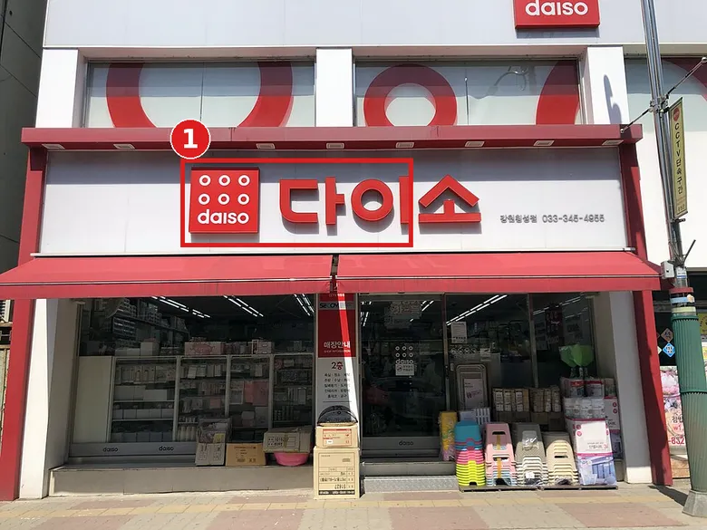
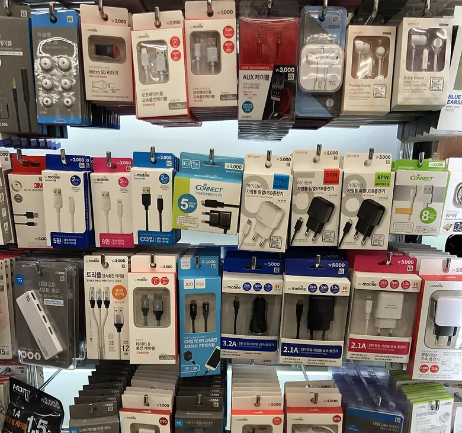
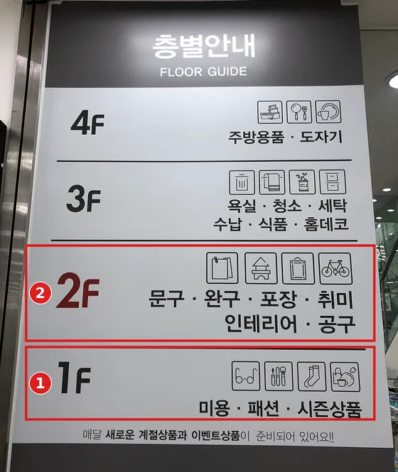
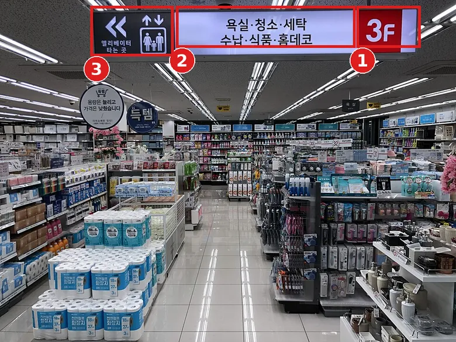
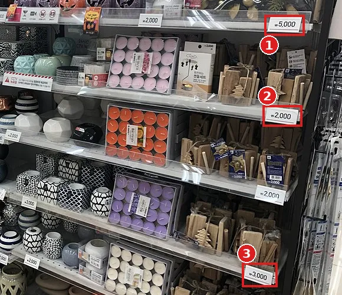

<a class="tr-btn go" href="#find"><i class="ic ic-map-pin" aria-hidden="true"></i>近くのダイソーを探す</a><a class="tr-btn" href="#pay"><i class="ic ic-credit-card" aria-hidden="true"></i>会計・免税</a>

<figure class="tr-hero acc-hero"><figcaption><b>この看板を探しましょう。</b> <b>1</b> 赤い四角の「daiso」ロゴとハングルの「다이소」。韓国全国に約1,500店あります。写真:Choi Kwang-mo(ダイソー江原横城店、2020年)、<a href="https://creativecommons.org/publicdomain/zero/1.0/deed.ja" rel="noopener" target="_blank">CC0</a>、<a href="https://commons.wikimedia.org/wiki/File:2020-04-06_12.55.48_%EB%8B%A4%EC%9D%B4%EC%86%8C_%EA%B0%95%EC%9B%90%ED%9A%A1%EC%84%B1%EC%A0%90_%EC%99%B8%EB%B6%80_%EC%A0%84%EA%B2%BD.jpg" rel="noopener" target="_blank">ウィキメディア・コモンズ</a>(明るさ自動補正、枠と番号を追加)</figcaption></figure>

<ul class="tr-facts"><li><i class="ic ic-tag" aria-hidden="true"></i>500〜5,000ウォン<small>価格は6種類だけ</small></li><li><i class="ic ic-clock" aria-hidden="true"></i>10:00〜22:00<small>明洞駅店。店ごとに違います</small></li><li><i class="ic ic-id-card" aria-hidden="true"></i>パスポート+15,000ウォン<small>免税店舗、レシート1枚</small></li><li><i class="ic ic-receipt" aria-hidden="true"></i>レシートは2週間<small>交換・返品の期限</small></li></ul>

## ダイソーで買うと良いもの

<ul class="tr-choose"><li><i class="ic ic-luggage" aria-hidden="true"></i><b>旅行中の困りごと</b>なくした・忘れたマルチ変換プラグ、携帯用ラゲッジスケール、スマホの充電器。</li><li><i class="ic ic-shopping-basket" aria-hidden="true"></i><b>お菓子と小さなお土産</b>お菓子はだいたい1,000〜2,000ウォン。キャラクターグッズ、トレカ用品、スマホアクセサリー、韓国のお菓子。</li><li><i class="ic ic-sparkles" aria-hidden="true"></i><b>コスメを安く試す</b>小容量やダイソー専用ラインが多め。買う前に<a href="/ja/kbeauty-how-to-choose/">箱の裏を30秒</a>。</li></ul>

<figure class="tr-photo"><figcaption>充電器・ケーブル・イヤホンの売り場(横城店)。大きな店ではまずフロアガイドで階を探します。写真:Choi Kwang-mo(ダイソー江原横城店、2020年)、<a href="https://creativecommons.org/publicdomain/zero/1.0/deed.ja" rel="noopener" target="_blank">CC0</a>、<a href="https://commons.wikimedia.org/wiki/File:2020-04-06_12.54.12_%EB%8B%A4%EC%9D%B4%EC%86%8C_%EA%B0%95%EC%9B%90%ED%9A%A1%EC%84%B1%EC%A0%90_%EC%B6%A9%EC%A0%84%EA%B8%B0.jpg" rel="noopener" target="_blank">ウィキメディア・コモンズ</a>(切り抜き、明るさ自動補正)</figcaption></figure>

<ul class="tr-choose"><li><i class="ic ic-user-x" aria-hidden="true"></i><b>ダイソーが要らない人</b>1ブランドの正規サイズだけ買いたい、大きなセールを待つなら<a href="/ja/olive-young/">オリーブヤング</a>のほうが向いています。今のセールは<a href="/ja/deals/">お得情報</a>へ。</li></ul>

<h2 id="find">1. 近くのダイソーを探す</h2>

<h3 class="tr-step">1<i class="ic ic-globe" aria-hidden="true"></i>ダイソーの店舗検索を開く</h3>

1. [ダイソー店舗検索](https://www.daiso.co.kr/cs/shop)を開きます(韓国語のサイト)。
2. 「매장명 검색」(店名検索)に地名をハングルで入れる(例:명동 明洞、홍대 弘大)か、「지역 검색」(地域検索)で選び、「검색」(検索)を押します。
3. 店名を押すと**住所、営業時間、サービス**が出ます。サービスに「택스리펀드」があれば、パスポートで免税を受けられる店です。「매장옵션」(店舗オプション)で택스리펀드だけに絞ることもできます。
4. 住所をコピーして地図アプリに貼り付け、道を調べます。

<aside class="tr-note tip"><i class="ic ic-lightbulb" aria-hidden="true"></i>営業時間は店ごとに違います(例:明洞駅店10:00〜22:00、新村本店9:30〜22:00)。韓国観光公社の情報では明洞駅店は旧正月(ソルラル)・秋夕(チュソク)の連休が休みで、ダイソーは祝日当日に営業する店をお知らせで別に案内しています。</aside>

<h3 class="tr-step">2<i class="ic ic-signpost" aria-hidden="true"></i>ソウル都心で大きな店に行くなら</h3>

<ul class="tr-choose"><li><i class="ic ic-map-pin" aria-hidden="true"></i><b>明洞駅店:地下1階〜12階</b>明洞駅1番出口と4番出口の間の通り沿い。住所 서울 중구 퇴계로 134-1(ソウル中区退渓路134-1)。10:00〜22:00、免税店舗。英語・日本語・中国語のフロアガイドとセルフレジあり。ダイソーによると江南高速バスターミナル店に次ぐソウルで2番目に大きい店です(2023年3月1日の再オープン時は1〜12階、約500坪・1,650㎡)。</li><li><i class="ic ic-bus" aria-hidden="true"></i><b>江南高速バスターミナル店:いちばん大きい店</b>ターミナルの建物内、서울 서초구 신반포로 194。8:30〜22:00。多言語セルフレジ、免税あり。バスの待ち時間に寄れますが、通路が迷路のようなので時間に注意。</li></ul>

周辺の買い物エリアは[ソウルの買い物はどこで?](/ja/shopping-streets/)へ。

## 2. 店の中で迷わない

大きな店は階ごとに売っている物が違います。入ったらまず**フロアガイド**を見て、行く階を2〜3つに決めます。

<figure class="tr-photo"><figcaption>店内の<b>층별안내(FLOOR GUIDE)</b>。<b>1</b> 1F 미용・패션・시즌상품(美容・ファッション・季節商品)、<b>2</b> 2F 문구・완구・포장・취미(文具・おもちゃ・包装・趣味)。階の構成は店ごとに違います。写真:MatthieuRicard(ダイソー原州丹邱店、2020年)、<a href="https://creativecommons.org/publicdomain/zero/1.0/deed.ja" rel="noopener" target="_blank">CC0</a>、<a href="https://commons.wikimedia.org/wiki/File:2020-03-17_21.40.56_%EB%8B%A4%EC%9D%B4%EC%86%8C_%EC%9B%90%EC%A3%BC%EB%8B%A8%EA%B5%AC%EC%A0%90.jpg" rel="noopener" target="_blank">ウィキメディア・コモンズ</a>(切り抜き、明るさ自動補正、枠と番号を追加)</figcaption></figure>

<figure class="tr-photo"><figcaption>各階の天井にこんな案内板があります(原州丹邱店)。<b>1</b> 今いる階、<b>2</b> この階で売っている物、<b>3</b> エレベーター乗り場(엘리베이터 타는 곳)の方向。写真:MatthieuRicard(ダイソー原州丹邱店、2020年)、<a href="https://creativecommons.org/publicdomain/zero/1.0/deed.ja" rel="noopener" target="_blank">CC0</a>、<a href="https://commons.wikimedia.org/wiki/File:2020-03-17_21.39.49_%EB%8B%A4%EC%9D%B4%EC%86%8C_%EC%9B%90%EC%A3%BC%EB%8B%A8%EA%B5%AC%EC%A0%90.jpg" rel="noopener" target="_blank">ウィキメディア・コモンズ</a>(明るさ自動補正、枠と番号を追加)</figcaption></figure>

**案内板で探す言葉:** 미용 美容(コスメ)・식품 食品(お菓子)・문구 文具・완구 おもちゃ・주방 キッチン・욕실 浴室・시즌상품 季節商品。

<i class="ic ic-layers" aria-hidden="true"></i>明洞駅店の階構成(2023年の再オープン時)

ダイソーが2023年の再オープン時に発表した構成です。変わっている可能性があるので、入口のフロアガイドで確かめてください。

- **1階:** レジ、季節用品
- **2階:** 美容用品(コスメ)。2026年9月にも海外の客で混んでいるという報道がありました。
- **3〜4階:** 文具・ファンシー
- **5階:** 食品、キッチン用品
- **6〜7階:** キッチン用品
- **8階:** 浴室用品
- **9階:** ホームデコ
- **10階:** 園芸
- **11〜12階:** 趣味用品

レジは1階なので、上の階で選んだ物は持って1階に下りて会計します。

## 3. 値札を読む

<figure class="tr-photo"><figcaption>価格は棚の端の値札に大きく書いてあります。<b>1</b> ₩5,000、<b>2</b> ₩2,000、<b>3</b> ₩3,000。同じ棚でも区画ごとに値段が違います。写真:Choi Kwang-mo(ダイソー原州丹邱店、2020年)、<a href="https://creativecommons.org/publicdomain/zero/1.0/deed.ja" rel="noopener" target="_blank">CC0</a>、<a href="https://commons.wikimedia.org/wiki/File:2020-04-02_20.18.01_%EB%8B%A4%EC%9D%B4%EC%86%8C_%EC%9B%90%EC%A3%BC%EB%8B%A8%EA%B5%AC%EC%A0%90.jpg" rel="noopener" target="_blank">ウィキメディア・コモンズ</a>(切り抜き、明るさ自動補正、枠と番号を追加)</figcaption></figure>

- 価格は**500ウォンから5,000ウォンまでの6種類**。1997年の1号店からこの体系を守ってきたとダイソーは発表しています。多くの商品は1,000〜3,000ウォンです。
- すべて1,000ウォンではありません。会計前に区画ごとの値札を確認しましょう。
- 5,000ウォンに収めるため、コスメは容量が小さかったり(韓国観光公社:「容量は少ないかもしれない」)、価格・成分を別に決めたダイソー専用ラインだったりします。

<h2 id="pay">4. 会計する</h2>

<ul class="tr-choose"><li><i class="ic ic-credit-card" aria-hidden="true"></i><b>カードが使えます</b>海外カードでの支払いも多いです。店舗検索のサービスに「현금없는매장」(キャッシュレス店舗)があれば現金は使えません。カード・現金・WOWPASSは<a href="/ja/money/">お金のページ</a>へ。</li></ul>

<h3 class="tr-step">1<i class="ic ic-id-card" aria-hidden="true"></i>免税を受けるなら:有人レジへ</h3>

1. 店に「Tax Free」「Tax Refund」の表示があるか、店舗検索のサービスに「택스리펀드」があるか確認します。例:明洞駅店、明洞本店、新村本店、ソウル駅店、ソウル市庁広場店、鍾路本店。
2. 対象の物を**1つのカゴにまとめて1回で**会計します。レシート1枚で15,000ウォン以上が必要。最高5,000ウォンなので最低3点です。
3. 支払いのときに**パスポート原本**をスタッフに見せます。その場で税金分が引かれます。

セルフレジで免税ができるかは確認できませんでした。免税を受けるときは有人レジへ。対象者、上限、実際に戻る金額は[タックスリファンドのページ](/ja/tax-refund/)に。そのページの試算では50,000ウォンのレシートで約2,500ウォンなので、ダイソーの免税のために予定を変える必要はありません。

<h3 class="tr-step">2<i class="ic ic-scan-line" aria-hidden="true"></i>セルフレジ:バーコードではなくQRコード</h3>

1. 商品ごとに**QRコード**をスキャナーにかざします(バーコードではありません)。
2. QRコードがない商品だけバーコードを読み取り、それでもだめならスタッフを呼びます。
3. 画面で支払い、レシートを受け取ります。

<h3 class="tr-step">3<i class="ic ic-receipt" aria-hidden="true"></i>レシートは2週間保管</h3>

- **交換:** 購入日から2週間以内、レシートを持って購入店か近くの直営店で。
- **返品(返金):** 購入日から2週間以内、レシートを持って**購入した店だけ**で。
- カードで買ったならそのカードも持って行きます。自分の不注意による破損や包装の破損は不可。不良品は購入店のスタッフに見せて交換・返金を受けます。

## 探している物がないとき

店ごとに在庫が違うので、すべての店にすべての商品があるわけではありません。

1. ダイソーの[店舗別在庫照会](https://prdm.daisomall.co.kr/ms/msb/SCR_MSB_0011?tab=tab2)で商品を検索します(韓国語)。
2. またはダイソー顧客満足室 **1522-4400**(平日9:00〜18:00)に商品番号と名前を伝えると、在庫のある近くの店を教えてくれます。対応言語は確認できませんでした。
3. 韓国語が難しければ観光通訳案内 **1330**(+82-2-1330、英語・日本語・中国語など)に助けを求めましょう。

## よくある失敗

<ul class="tr-oops"><li><i class="ic ic-triangle-alert" aria-hidden="true"></i>全部1,000ウォンだと思う。500〜5,000ウォンです。</li><li><i class="ic ic-triangle-alert" aria-hidden="true"></i>3つの店で少しずつ買う。免税はレシート1枚ごとに15,000ウォン以上が必要。</li><li><i class="ic ic-triangle-alert" aria-hidden="true"></i>セルフレジでバーコードだけ読む。QRコードをかざします。</li><li><i class="ic ic-triangle-alert" aria-hidden="true"></i>レシートを捨てる。交換・返品は2週間以内、レシートが必要です。</li><li><i class="ic ic-triangle-alert" aria-hidden="true"></i>どの店も同じだと思う。営業時間、階の構成、免税、在庫は店ごとに違います。</li></ul>

<i class="ic ic-list-checks" aria-hidden="true"></i>ひとことで判断、表で見る

| こんなとき | こうする | 理由 |
|---|---|---|
| 安いお土産・お菓子、旅行中に必要な物(マルチ変換プラグ、携帯用スケール、充電器) | ダイソー | 価格は500〜5,000ウォン。韓国観光公社のダイソー紹介にもこうした旅行用品が出てきます |
| プチプラコスメを試したい | コスメ売り場から | 2026年のコスメブランドは約170。ダイソー専用ラインが多く、話題の商品は品切れします |
| ソウル都心で一番品ぞろえの多い店 | 明洞駅店(12フロア) | ダイソーによるとソウルで2番目の規模、英語・日本語・中国語のフロアガイドあり |
| 正規サイズのKビューティーや大型セール | [オリーブヤング](/ja/olive-young/) | ダイソーのコスメは専用ラインや小容量が中心。今のセールは[お得情報](/ja/deals/)へ |

<i class="ic ic-sparkles" aria-hidden="true"></i>ダイソーのコスメ、もう少し

- コリアヘラルドによると、ダイソーのコスメブランドは2022年の7から2026年は約170に、商品は約120から1,900以上に増えました。
- アモーレパシフィック・LG生活健康・愛敬はサブブランドでダイソー専用ラインを出しています。最初から価格・成分・対象を別に決めたダイソー専用ラインが多いです。
- 韓国観光公社は2024年3月にVTのリードルショットをダイソーの一番人気に挙げ、コリアヘラルド(2026年9月)はダイソーのコスメが口コミで何度も品切れになったと報じました。今の価格と内容は公式ページで確認できなかったので、店の値札を見てください。
- 買う前に[箱の裏を30秒](/ja/kbeauty-how-to-choose/)で、機能性化粧品の表示と使用期限を確認しましょう。

<i class="ic ic-pencil" aria-hidden="true"></i>出発前に:人ごとにリストを書く

リスト作りがダイソーの買い物の半分で、レシートを1枚にまとめるのにも役立ちます。

1. **渡す相手ごとに一行ずつ書きます。** 自分も含めて。スキンケアは自分用、お菓子は配る用、トレカ用品はK-POPファンに、旅行中に必要な物は旅行中の自分に(私たちの判断)。
2. **免税を受けるならパスポート原本を持ち**、レシート1枚を15,000ウォン以上にする計画を。

私たちが選んだ最後の場面は、店を出るときの満杯の袋ではなく一週間後です。旅行中の困りごとを解決してくれた物(携帯用ラゲッジスケールやマルチ変換プラグ)と、帰って配ったお菓子。

<i class="ic ic-info" aria-hidden="true"></i>どんな会社か、そして出典

韓国のダイソーは韓国企業のアソン・ダイソーが運営し、2023年に日本側の持ち株を買い取って完全な韓国企業になりました。2014年から自社商品を企画・生産しています。

2026年11月26日に開いて確認:ダイソー<a href="https://www.daiso.co.kr/cs/shop" rel="noopener" target="_blank">店舗検索</a>(明洞駅店の住所・B1〜12階・10:00〜22:00・免税、サービスの免税・キャッシュレス店舗、明洞本店・ソウル市庁広場店・鍾路本店・ソウル駅店の免税表示)・<a href="https://www.daiso.co.kr/cs/faq" rel="noopener" target="_blank">よくある質問</a>(店舗検索、店舗別在庫、1522-4400 平日9〜18時、交換・返品2週間とレシート・決済カード、不良品、祝日当日営業店のお知らせ);アソン・ダイソー報道資料<a href="https://www.daiso.co.kr/brand/daiso_news/26502?btype=company" rel="noopener" target="_blank">明洞駅店リニューアルオープン</a>(2023年3月14日:1日に再オープン、1〜12階約500坪、ソウル2番目の規模、階構成)・<a href="https://www.daiso.co.kr/brand/daiso_news/125585?btype=company" rel="noopener" target="_blank">500〜5,000ウォンの6種類の価格体系</a>(2026年11月11日);韓国観光公社VISITKOREA<a href="https://english.visitkorea.or.kr/svc/contents/contentsView.do?menuSn=&amp;vcontsId=194390" rel="noopener" target="_blank">"Find Everything at Daiso Korea!"</a>(約1,500店、旅行用品、お菓子1,000〜2,000ウォン、多くは1,000〜3,000ウォン、リードルショット、セルフレジのQR、明洞駅店は1番・4番出口の間で多言語フロアガイド、江南高速バスターミナル店8:30〜22:00・最大、1330)と免税店舗情報<a href="https://english.visitkorea.or.kr/svc/contents/contentsView.do?menuSn=459&amp;vcontsId=146975" rel="noopener" target="_blank">明洞駅店</a>(10:00〜22:00、旧正月・秋夕連休休み、カード可)・<a href="https://english.visitkorea.or.kr/svc/contents/contentsView.do?menuSn=459&amp;vcontsId=146952" rel="noopener" target="_blank">明洞本店</a>・<a href="https://english.visitkorea.or.kr/svc/contents/contentsView.do?menuSn=459&amp;vcontsId=146026" rel="noopener" target="_blank">新村本店</a>(9:30〜22:00)・<a href="https://english.visitkorea.or.kr/svc/contents/contentsView.do?menuSn=459&amp;vcontsId=1573799" rel="noopener" target="_blank">ソウル駅店</a>;コリアヘラルド<a href="https://www.koreaherald.com/article/3281373" rel="noopener" target="_blank">完全な韓国企業に</a>(2023年12月13日)、<a href="https://www.koreaherald.com/article/10589279" rel="noopener" target="_blank">コスメブランドとサブブランド</a>(2025年10月3日)、<a href="https://www.koreaherald.com/article/10649917" rel="noopener" target="_blank">ダイソー専用コスメライン</a>(2026年1月6日)、<a href="https://www.koreaherald.com/article/10872741" rel="noopener" target="_blank">口コミでの品切れとリードルショット</a>(2026年9月14日)、<a href="https://www.koreaherald.com/article/10877187" rel="noopener" target="_blank">500〜5,000ウォン、コスメ170ブランド・1,900商品、明洞駅店2階のコスメ、海外カード決済</a>(2026年9月17日)。免税の規定:<a href="/ja/tax-refund/">タックスリファンドのページ</a>。

## 次へ

<ul class="tr-next"><li><a href="/ja/kbeauty-how-to-choose/"><i class="ic ic-scan-line" aria-hidden="true"></i>コスメの選び方:箱の裏を30秒<i class="ic ic-arrow-right" aria-hidden="true"></i></a></li><li><a href="/ja/tax-refund/"><i class="ic ic-receipt" aria-hidden="true"></i>タックスリファンド:パスポートを見せるだけ<i class="ic ic-arrow-right" aria-hidden="true"></i></a></li><li><a href="/ja/olive-young/"><i class="ic ic-shopping-basket" aria-hidden="true"></i>オリーブヤング:セール時期と基本<i class="ic ic-arrow-right" aria-hidden="true"></i></a></li></ul>
