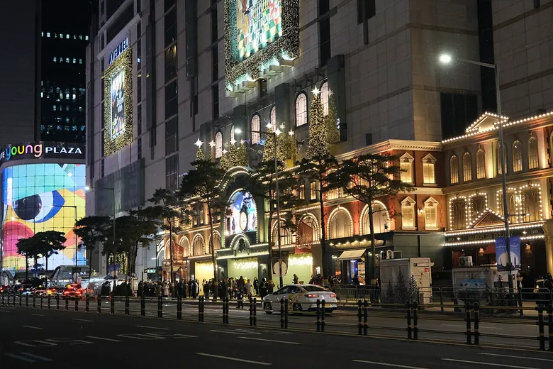
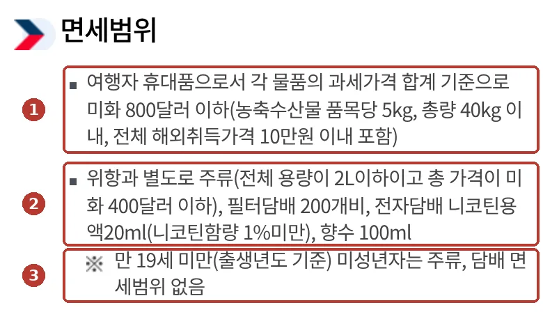

<a class="tr-btn go" href="#pickup"><i class="ic ic-map-pin" aria-hidden="true"></i>引き渡し場への道</a><a class="tr-btn" href="#limit"><i class="ic ic-luggage" aria-hidden="true"></i>いくらまで免税?</a>

<figure class="tr-hero acc-hero"><figcaption><b>免税品はこの扉の向こうで受け取ります。</b> 仁川空港第1ターミナルの出国場入口。<b>1</b> 出国場の番号、<b>2</b> 搭乗口の地図。保安検査と出国審査を通ると免税エリアで、引き渡し場もその中にあります。写真: Sgroey(2024)、<a href="https://creativecommons.org/licenses/by-sa/4.0/deed.ja" rel="noopener" target="_blank">CC BY-SA 4.0</a>、<a href="https://commons.wikimedia.org/wiki/File:Incheon_airport_departure_gate_access.jpg" rel="noopener" target="_blank">ウィキメディア・コモンズ</a>(切り抜き、明るさ自動補正、枠・番号を追加)</figcaption></figure>

<ul class="tr-facts"><li><i class="ic ic-id-card" aria-hidden="true"></i>パスポート原本+便<small>コピー・写真では買えません</small></li><li><i class="ic ic-clock" aria-hidden="true"></i>オンライン: 多くは前日19:30<small>出発時刻・引き渡し場で違います</small></li><li><i class="ic ic-map-pin" aria-hidden="true"></i>引き渡し: 出国審査のあと<small>入国時は受け取れません</small></li><li><i class="ic ic-luggage" aria-hidden="true"></i>韓国入国 1人800ドル<small>お酒2L・400ドルは別枠</small></li></ul>

## どこで買う?

3つとも同じ免税品です。決め手はひとつ、**買う物がどれだけ決まっているか**。

<ul class="tr-choose"><li><i class="ic ic-smartphone" aria-hidden="true"></i><b>買う物が決まっている: オンライン免税店(アプリ)</b>香水、輸入化粧品、お酒など、もう知っている物。お店に行かず、出国前日の夕方までに注文して空港で受け取ります。<a href="#online">買う順番</a></li><li><i class="ic ic-store" aria-hidden="true"></i><b>実物を見て比べたい: 市内免税店</b>パスポートと便の情報を持ってソウルの店へ。支払いは市内で、品物は空港の引き渡し場で待っています。<a href="#downtown">店と行き方</a></li><li><i class="ic ic-plane" aria-hidden="true"></i><b>少しだけ急いで: 空港の免税店</b>保安検査・出国審査のあとの店で買ってそのまま搭乗。引き渡し場を探す必要はありません。</li></ul>

<aside class="tr-note tip"><i class="ic ic-lightbulb" aria-hidden="true"></i>韓国コスメが中心なら、免税店より<a href="/ja/olive-young/">オリーブヤング</a>で<a href="/ja/tax-refund/">レジでの即時還付</a>(韓国を訪問中の人が対象)のほうが簡単です。</aside>

<i class="ic ic-info" aria-hidden="true"></i>免税店とタックスリファンドは別物

支払う前にどちらか確かめましょう。品物を受け取る場所が違います。

{{fig:duty-free-4|免税店とタックスフリーのお店、品物を受け取る場所}}

- **免税店(면세점):** 韓国を出国する人だけに売る保税店です。市内やオンラインで買った物はその場で持ち帰れず、出国当日に出国審査を通ってから受け取ります。
- **タックスリファンド(Tax Free):** オリーブヤングや百貨店など普通のお店で、10%の付加価値税の一部が戻る仕組み。詳しくは[韓国のタックスリファンド](/ja/tax-refund/)へ。

1回の買い物で使えるのはどちらか一方です。

<h2 id="online">オンライン免税店で買う</h2>

{{fig:duty-free-1|注文から出国日の受け取りまで}}

現代免税店が案内する順番です。ほかの免税店も手順は同じです。

<h3 class="tr-step">1<i class="ic ic-log-in" aria-hidden="true"></i>免税店のサイトかアプリを開く</h3>

出国が決まっている人なら韓国人・外国人とも買えます。会員でも非会員でも買え、会員は追加割引があります。出国日の90日前から注文できます。

<ul class="tr-next"><li><a href="https://en.hddfs.com/" rel="noopener" target="_blank"><i class="ic ic-globe" aria-hidden="true"></i>現代免税店オンライン(英語)<i class="ic ic-external-link" aria-hidden="true"></i></a></li><li><a href="https://www.shilladfs.com/estore/kr/en/" rel="noopener" target="_blank"><i class="ic ic-globe" aria-hidden="true"></i>新羅免税店オンライン(英語)<i class="ic ic-external-link" aria-hidden="true"></i></a></li></ul>

ロッテ・新世界のサイトは、ビジットソウルの店舗紹介にある「View Website」から開けます([ロッテ](https://english.visitseoul.net/shopping/Lotte-Duty-Free-Shop-Main-Store/ENP009641)、[新世界](https://english.visitseoul.net/area/Shinsegae-Duty-Free-en/ENP024463))。

<h3 class="tr-step">2<i class="ic ic-shopping-basket" aria-hidden="true"></i>商品をカートに入れる</h3>

商品別・ブランド別に探し、数量とオプションを選んでカートへ。

<h3 class="tr-step">3<i class="ic ic-id-card" aria-hidden="true"></i>出国情報を入れて支払う</h3>

1. **パスポート番号と英字氏名**: 実際に持って行くパスポートのとおりに。違うと空港で受け取れません。
2. **出国日、空港、便名、出発時刻**: 航空券(e-ticket)のとおりに。
3. **支払い**: 支払い当日の為替レートでウォン計算。現代はクレジットカード、銀行振込、カカオペイ・ネイバーペイ・トスペイ、アリペイプラス・WeChat Pay・銀聯などを受け付けます。

<aside class="tr-note"><i class="ic ic-triangle-alert" aria-hidden="true"></i><b>締め切り前に注文を。</b> 基本は出国前日の夕方ですが、深夜0時すぎに出る便は前日14:30が締め切りです。下の表を見てください。</aside>

<h3 class="tr-step">4<i class="ic ic-ticket" aria-hidden="true"></i>引換券を保存する</h3>

支払いが終わったら注文履歴から引換券を印刷します。印刷できなければ引換券番号をメモするかSMSで受け取り、空港でパスポート・航空券と一緒に見せます。**引換券に書かれた引き渡し場の名前**(例: T1西側)を確認しておきましょう。出国日に行く場所です。

<i class="ic ic-clock" aria-hidden="true"></i>注文締め切り表(現代免税店、仁川)

免税店ごと、引き渡し場と出発時刻ごとに違います。現代免税店が公開している仁川第1ターミナル西側の引き渡し場の場合:

| 出発時刻 | 注文締め切り |
|---|---|
| 00:00〜02:59 | 前日14:30 |
| 03:00〜16:59 | 前日19:30 |
| 17:00〜19:59 | 当日11:30 |
| 20:00〜23:59 | 当日14:30 |

第1ターミナル搭乗棟と第2ターミナルの引き渡し場は区切りが1時間ずつ遅くなります(03:00〜17:59、18:00〜20:59、21:00〜23:59)。便を登録すると実際の締め切りが表示されます。出発が迫っているときはカスタマーセンターへ、と案内しています。

<h2 id="downtown">市内免税店で買う</h2>

<figure class="tr-photo"><figcaption><b>ロッテ免税店本店(明洞)</b>。ロッテ百貨店の9〜12階です。写真: Leeinm(2023)、<a href="https://creativecommons.org/licenses/by/4.0/deed.ja" rel="noopener" target="_blank">CC BY 4.0</a>、<a href="https://commons.wikimedia.org/wiki/File:Night_view_of_Lotte_Duty_Free_Shop.jpg" rel="noopener" target="_blank">ウィキメディア・コモンズ</a>(縮小、明るさ自動補正)</figcaption></figure>

<h3 class="tr-step">1<i class="ic ic-id-card" aria-hidden="true"></i>パスポート原本と航空券を持つ</h3>

出国日時と便名がわかる航空券(e-ticket、スマホ画面でも可)が必要です。パスポートのコピーや写真では買えません。

<h3 class="tr-step">2<i class="ic ic-map-pin" aria-hidden="true"></i>お店へ行く</h3>

<ul class="tr-choose"><li><i class="ic ic-store" aria-hidden="true"></i><b>ロッテ免税店本店(明洞)</b>ロッテ百貨店9〜12階。2号線乙支路入口駅7・8番出口から50m。毎日09:30〜20:00。</li><li><i class="ic ic-store" aria-hidden="true"></i><b>新世界免税店明洞店</b>新世界百貨店本店8〜12階。4号線会賢駅5番出口から145m。月〜木10:30〜20:00、金〜日10:30〜20:30。</li><li><i class="ic ic-store" aria-hidden="true"></i><b>新羅免税店ソウル店</b>新羅ホテルの隣。3号線東大入口駅5番出口から278m。毎日09:00〜20:00。主なショッピング地区を結ぶ無料シャトルバスを運行。</li><li><i class="ic ic-store" aria-hidden="true"></i><b>現代免税店貿易センター店</b>月〜木10:30〜20:00、金〜日10:30〜20:30。</li></ul>

出口の見つけ方は[ソウルの地下鉄](/ja/seoul-subway/)に。営業時間は変わるので、行く前に上のリンクで確かめてください。

<h3 class="tr-step">3<i class="ic ic-credit-card" aria-hidden="true"></i>選んで、レジでパスポートと航空券を見せる</h3>

支払うと品物はお店に残り、出国日に空港の引き渡し場で受け取ります。レシート・引換券に書かれた引き渡し場を確認しましょう。

<aside class="tr-note ok"><i class="ic ic-circle-check" aria-hidden="true"></i><b>韓国製品はその場で持ち帰れることも。</b> 現代免税店は、外国人は出国日の60日前から韓国製品を店で買ってその場で受け取れると案内しています。2026年7月からは、外国人旅行者がオンライン免税店で買ったKビューティー・Kフード商品を市内免税店で受け取れるようになりました(世界日報の報道)。</aside>

<h2 id="pickup">出国日: 引き渡し場までの道</h2>

どこで買っても、受け取れるのは**出国エリア内の引き渡し場**だけです。保安検査と出国審査のあとにあり、入国時には受け取れません。空港には3時間前に着けば余裕があります([出国の日](/ja/departure-day/))。現代は、引き渡し場が混むことがあるので**出発の少なくとも1時間前**に来るよう案内しています。

<h3 class="tr-step">1<i class="ic ic-ticket" aria-hidden="true"></i>引換券で引き渡し場の名前を確認</h3>

{{fig:duty-free-2|仁川空港の引き渡し場4か所}}

<h3 class="tr-step">2<i class="ic ic-door-open" aria-hidden="true"></i>チェックインして出国エリアへ</h3>

航空会社カウンターでチェックインして荷物を預けたら、上の写真のように「出国場 Departure Hall」と番号のある入口から入り、保安検査と出国審査を受けます。空港での順番は[出国の日](/ja/departure-day/)に。

<h3 class="tr-step">3<i class="ic ic-signpost" aria-hidden="true"></i>ゲート番号の表示に沿って引き渡し場へ</h3>

{{fig:duty-free-t1map|第1ターミナル: 出国審査後の3階免税エリアから4階の引き渡し場(43番ゲートの向かい)まで。現代・新羅免税店の引き渡し案内と仁川国際空港の施設案内(2026年11月26日確認)の位置をもとにNadriが描き直しました}}

<ul class="tr-choose"><li><i class="ic ic-map-pin" aria-hidden="true"></i><b>第1ターミナル西側(4階)</b>出国審査を通ると3階の免税エリア。今どこにいるかは、いちばん近いゲート番号の表示でわかります。3階の真ん中が28番ゲートで、近くに薬局(Hello Pharmacy)、25番ゲート付近に24時間の案内デスクと国民銀行の両替所があります。ゲート番号が大きくなる方(西側)へ歩きます。途中の29番ゲート付近に<strong>24時間の案内デスク</strong>と韓国伝統文化センター西館があります。43番ゲートまで来たら、<strong>向かいの上の階(4階)</strong>が引き渡し場。4階の43番ゲート付近にはマティナラウンジ(西側)があります。04:00から最終便まで、☎ +82-32-743-2711。</li><li><i class="ic ic-train-front" aria-hidden="true"></i><b>第1ターミナル搭乗棟(4階)</b>搭乗口が101〜132番なら、シャトルトレインで搭乗棟へ。降りたら<strong>119番ゲート横のエスカレーター</strong>で4階へ上がると引き渡し場です。03:00から、☎ +82-32-743-2715。</li><li><i class="ic ic-map-pin" aria-hidden="true"></i><b>第2ターミナル西側(2階)</b>225番ゲート近く、韓国伝統文化センター(西館)向かいのエスカレーターで2階へ下ります。05:00から、☎ +82-32-743-6503。</li><li><i class="ic ic-map-pin" aria-hidden="true"></i><b>第2ターミナル東側(2階)</b>274番ゲート方面、韓国伝統文化センター(東館)向かいのエスカレーターで下の階(2階)へ。05:00から。</li></ul>

<i class="ic ic-map" aria-hidden="true"></i>第2ターミナルを図で見る

{{fig:duty-free-t2map|第2ターミナル: 3階免税エリアから2階の引き渡し場へ。現代・新羅免税店の引き渡し案内をもとにNadriが描き直しました}}

営業時間と電話番号は新羅免税店の引き渡し案内によります(どこも最終便の出発まで)。

<i class="ic ic-plane" aria-hidden="true"></i>ほかの空港から出国するなら(金浦・金海・済州・清州・大邱)

順番は同じで、出国審査のあとに引き渡し場があります。場所は引換券の引き渡し場名で確認を(現代・新羅の案内)。

- **金浦:** 34番ゲート向かいのエスカレーター・エレベーターで4階へ。☎ +82-2-2666-2730
- **金海:** 2階の出国審査のあと、13番ゲートの向かい。☎ +82-51-941-9356
- **済州:** 3階の出国審査を通って左、19・20番ゲートの向かい。☎ +82-64-747-0163
- **清州:** 出国審査台を通って正面(2階)。☎ +82-43-212-8270
- **大邱:** 2階の出国審査台の左。☎ +82-53-981-8277

<aside class="tr-note tip"><i class="ic ic-circle-help" aria-hidden="true"></i>迷ったら、免税エリアの案内デスク(第1ターミナル3階25番・29番ゲート付近、24時間)で引換券を見せましょう。</aside>

<h3 class="tr-step">4<i class="ic ic-scan-line" aria-hidden="true"></i>引換券・パスポート・搭乗券を出し、確認してサイン</h3>

1. 買った本人が引換券、パスポート、搭乗券を見せます。
2. 品名・数量・状態を確かめて受領欄にサイン。問題があればその場で係員に伝えます。出国後の品物について免税店は責任を負いません。
3. 液体類は密封袋に入って出てきます。最終目的地まで開けないで([下へ](#liquids))。

<aside class="tr-note ok"><i class="ic ic-circle-check" aria-hidden="true"></i>これで完了。買った物が入国する国の免税範囲内なら、着いてから申告する物もありません。</aside>

<i class="ic ic-triangle-alert" aria-hidden="true"></i>受け取れない場合とそのときにすること

- **受け取れない場合:** 注文した人と出国する人が違う、注文書のパスポート番号と見せたパスポートの番号が違う、登録した出国情報(空港・日時・便名)が実際と違う。
- **早めに直す:** 新羅は、パスポート番号の修正は出国の少なくとも3日前にカスタマーセンターへ連絡するよう案内しています。
- **受け取れなかったら:** 免税店に連絡を。現代は注文日から180日まで出国情報を変更でき、過ぎるとキャンセルして買い直しです。現代カスタマーセンター1811-6688(09:30〜18:30、韓国語)、英語の引き渡し場問い合わせ+82-2-2163-6215(毎日10:00〜19:00)。ロッテ+82-1688-3000、新羅+82-1688-1110、新世界+82-2-1661-8778(ビジットソウルの店舗紹介より)。
- 免税品は自宅住所へは配送されません。

<h2 id="limit">いくらまで買っていい?</h2>

韓国を出るときの免税店での買い物に**上限はありません**。現代免税店は、出国するお客様なら韓国人・外国人を問わず無制限に購入できると案内しています。効いてくるのは**次に入国する国の免税範囲**で、免税店で買った物もそこに含まれます。

### 韓国に入国するとき(関税庁)

<figure class="tr-photo"><figcaption><b>1</b> 品物の合計800ドル以下、<b>2</b> それとは別にお酒2L・400ドル以下、紙巻きたばこ200本、電子たばこニコチン液20ml、香水100ml、<b>3</b> 19歳未満はお酒・たばこの免税なし。画面: 韓国関税庁<a href="https://www.customs.go.kr/kcs/cm/cntnts/cntntsView.do?mi=2837&amp;cntntsId=829" rel="noopener" target="_blank">旅行者携帯品通関</a>(韓国語)、2026年11月26日キャプチャー(一部を切り抜き、枠・番号を追加)</figcaption></figure>

| | 免税範囲(1人) |
|---|---|
| 品物 | **800ドル**以下。農畜水産物は品目ごと5kg、合計40kg、海外での取得価格合計10万ウォン以内で、この中に含む |
| お酒 | 別枠で合計**2L以下、400ドル以下** |
| たばこ | 別枠で紙巻き**200本**、電子たばこニコチン液20ml |
| 香水 | 別枠で**100ml** |

<ul class="tr-choose"><li><i class="ic ic-circle-check" aria-hidden="true"></i><b>申告する物がないとき</b>申告書を出さず「申告なし」の通路へ。場合によっては税関検査があります。</li><li><i class="ic ic-pencil" aria-hidden="true"></i><b>免税範囲を超えたとき</b>荷物を受け取ったあと、税関を出る前に申告書を紙かモバイルで出します(<a href="https://www.customs.go.kr/kcs/cm/cntnts/cntntsView.do?mi=2837&amp;cntntsId=829" rel="noopener" target="_blank">関税庁の案内</a>、韓国語)。モバイルで自主申告すると告知書の発行と納付もモバイルでできます。自主申告すると関税が30%減り、申告せずに見つかると税額の40%(2年以内に2回以上なら60%)を加算税として払います。</li></ul>

2026年7月からは、免税範囲内の品物を帰国後に同じモデルの色・サイズ交換に限って郵便・宅配で交換できるようになりました(世界日報の報道)。

### ほかの国に入国するとき

その国の税関の基準が上限です。よく聞かれる3か国:

<i class="ic ic-globe" aria-hidden="true"></i>日本・台湾・米国の免税範囲

| 国 | 品物 | お酒 | たばこなど |
|---|---|---|---|
| 日本 | 海外市価の合計**20万円**。1個で20万円を超える品物は全額課税。同じ品目の合計が1万円以下の物は原則免税 | **3本**(1本760ml) | 紙巻きのみ200本、加熱式のみ個装等10個、葉巻のみ50本。香水は別に2オンス(1オンスは約28ml、オーデコロン・オードトワレは含まない) |
| 台湾 | 完税価格の合計**NT$35,000**。明らかに営利目的の人、出入国が多く(30日以内に2回以上か6か月以内に6回以上)違反記録がある人は対象外 | 関務署の旅客案内は1L(20歳以上)、2026年2月1日施行の改正規定は1.5L・18歳と書いてあり食い違います。厳しいほう(1L)で準備し、出発前に確認を | 紙巻き200本、または葉巻25本、またはたばこ葉1ポンド(20歳以上) |
| 米国 | **800ドル**(国外に48時間以上、31日以内に未使用) | **1L**(21歳以上、個人用) | 紙巻き200本と葉巻100本(21歳以上) |

- 日本は20歳未満にお酒・たばこの免税範囲がありません。
- 米国税関は、免税店で買った物も帰国時に自動的に免税にはならないと明記しています。州のお酒の規定がより厳しいこともあります。

<h2 id="liquids">お酒と液体類</h2>

{{fig:duty-free-5|免税の密封袋、開けてはいけないとき}}

- **直行便なら:** 免税店共通の透明な封印袋(レシート付き)に入っていれば、量・数に関係なく機内に持ち込めます。市内・オンラインで買ったお酒も保安検査のあとで受け取るので、韓国で搭乗するときは液体制限にかかりません。
- **最終目的地まで開けないで。** それより前に開けたり破損したりすると持ち込めません。
- **乗り継ぐなら:** 経由国の保安規定で没収されることがあります。米国経由は不透明・金属容器の液体が制限され、乗り継ぎ後の到着地が米国領・オーストラリア領・カナダ・バージン諸島なら液体類は買えません。先に航空会社へ確認を。詳しくは[出国の日](/ja/departure-day/)に。

## よくある失敗

<ul class="tr-oops"><li><i class="ic ic-triangle-alert" aria-hidden="true"></i>パスポート番号や便名の入力ミス。引き渡し場で受け取れません。</li><li><i class="ic ic-triangle-alert" aria-hidden="true"></i>深夜0時すぎの便なのに前日夕方に注文。締め切りは前日14:30です。</li><li><i class="ic ic-triangle-alert" aria-hidden="true"></i>搭乗直前に引き渡し場を探す。少なくとも1時間前に。</li><li><i class="ic ic-triangle-alert" aria-hidden="true"></i>乗り継ぎ空港の前に密封袋を開ける。</li><li><i class="ic ic-triangle-alert" aria-hidden="true"></i>「免税店で買ったから帰国時も免税」と思う。入国する国の免税範囲に含まれます。</li></ul>

<i class="ic ic-list-checks" aria-hidden="true"></i>ひとことで判断、表で見る

| こんなとき | すること | 理由 |
|---|---|---|
| 買う物が決まっている(香水、輸入化粧品、お酒) | 前日までにオンライン・アプリで注文して空港の引き渡し場で受け取り | 同じ品物で店に行く必要なし。出国審査のあとで受け取り |
| 試して比べたい | パスポートと便の情報を持って市内免税店へ | 支払いは市内、品物は空港で待っています |
| 少しだけ急いで | 保安検査のあとの空港免税店で | 引き渡し場を探す必要なし。仁川の化粧品・お酒・たばこの主要区域は2026年からロッテと現代が運営 |

省いたもの: ブランド別の価格比較、会員ランクのコツ。価格が毎日変わるからです。

<i class="ic ic-store" aria-hidden="true"></i>2026年の免税店の状況

- **仁川空港:** 新羅・新世界が売上不振のなかで化粧品・香水・お酒・たばこ中心の主要区域(DF1・DF2)を返上し、2026年にロッテ(DF1)と現代(DF2)が引き継ぎました。契約は2033年6月まで。新世界はDF4区域を引き続き運営し、新羅・新世界はファッション・ブティック区域も運営を続けます。
- **市内:** 4社ともソウルに店があります。2026年6月の報道では、現代が東大門店・貿易センター店を縮小し、新羅・新世界は市内店とオンラインに力を入れています。行く前に営業時間を確認しましょう。
- **セール:** 新羅免税店のブラックフライデーは終了日と出典つきで[セール情報](/ja/deals/)に載せています。

<i class="ic ic-info" aria-hidden="true"></i>出典

2026年11月26日確認: 現代免税店<a href="https://www.hddfs.com/shop/om/consmGuide/useNotice.do" rel="noopener" target="_blank">利用案内</a>(引き渡し場別の注文締め切り、出国時の購入上限なし、90日前から注文、パスポート原本・e-ticket)、<a href="https://www.hddfs.com/shop/om/consmCont/bcaInfo.do" rel="noopener" target="_blank">引き渡し場と受け取り案内</a>(位置、持ち物、少なくとも1時間前、受け取れない場合、180日の変更期間、カスタマーセンター)、<a href="https://www.hddfs.com/shop/om/consmCont/shopProc.do" rel="noopener" target="_blank">ショッピング手順</a>(会員・非会員、支払い方法、引換券)、<a href="https://www.hddfs.com/shop/om/consmCont/cariProhInfo.do" rel="noopener" target="_blank">機内持ち込み制限</a>(封印袋、乗り継ぎ制限)、<a href="https://www.hddfs.com/store/en/dm/stShop/shoppingGuide.do" rel="noopener" target="_blank">英語ショッピングガイド</a>(貿易センター店の営業時間、外国人の韓国製品60日前からの店頭受け取り、英語の問い合わせ番号); 新羅免税店<a href="https://www.shilladfs.com/estore/kr/en/shilladfscustomercenter/deliverypointinfo" rel="noopener" target="_blank">引き渡し案内</a>(引き渡し場ごとの営業時間・電話、金浦・金海・済州・清州・大邱の引き渡し場、仁川の4か所、119番ゲート横のエスカレーター、パスポート番号修正は3日前まで、入国時の受け取り不可); 仁川国際空港<a href="https://www.airport.kr/ap_ko/1008/subview.do" rel="noopener" target="_blank">施設案内</a>(韓国語。第1ターミナル3階免税エリア25・29番ゲート付近の24時間案内デスク、中央28番ゲート、韓国伝統文化センター西館、4階43番ゲート付近のマティナラウンジ(西側)、<a href="https://www.airport.kr/ap_en/1536/subview.do" rel="noopener" target="_blank">英語の施設案内</a>(3階28番ゲート付近のHello Pharmacy)、3階25番ゲート付近の国民銀行両替所); ビジットソウル<a href="https://english.visitseoul.net/shopping/Lotte-Duty-Free-Shop-Main-Store/ENP009641" rel="noopener" target="_blank">ロッテ免税店本店</a>(2026年11月23日更新)、<a href="https://english.visitseoul.net/area/Shinsegae-Duty-Free-en/ENP024463" rel="noopener" target="_blank">新世界免税店</a>(11月25日更新)、<a href="https://english.visitseoul.net/area/Shilla-Duty-Free-Shop/ENP000521" rel="noopener" target="_blank">新羅免税店</a>(8月6日更新); 韓国関税庁<a href="https://www.customs.go.kr/kcs/cm/cntnts/cntntsView.do?mi=2837&amp;cntntsId=829" rel="noopener" target="_blank">旅行者携帯品通関</a>(免税範囲、申告手順、自主申告の減免・加算税); 日本の税関<a href="https://www.customs.go.jp/kaigairyoko/menzei.htm" rel="noopener" target="_blank">海外旅行者の免税範囲</a>; コリアタイムズ・聯合ニュース<a href="https://www.koreatimes.co.kr/business/companies/20260226/lotte-hyundai-win-approval-to-operate-new-duty-free-zones-at-incheon-airport" rel="noopener" target="_blank">ロッテ・現代、仁川空港の免税区域運営を承認</a>、コリアヘラルド<a href="https://www.koreaherald.com/article/10683421" rel="noopener" target="_blank">同じ報道</a>(2026年2月26日)。今日は開けなかったもの: ロッテ・新世界免税店のサイト(接続不可)、米国CBP(確認ツールを拒否。11月25日確認分: Customs Duty Information 2024年5月14日更新、19 CFR 148.33)、台湾財政部関務署「入境旅客携帯行李物品報験税放辦法」第11条(2026年1月30日改正、接続不可。11月25日確認分)。報道(11月25日確認): ニューシス(開業日、2026年4月8日); ザ・ファクト(2026年6月10日); ビズウォッチ(2026年11月18日); 世界日報(オンライン免税品の市内店受け取り・帰国後の交換、2026年7月1日); タックスウォッチ(旅行者の免税範囲、2026年9月1日)。

## 次へ

<ul class="tr-next"><li><a href="/ja/departure-day/"><i class="ic ic-plane" aria-hidden="true"></i>出国の日: 空港での順番<i class="ic ic-arrow-right" aria-hidden="true"></i></a></li><li><a href="/ja/tax-refund/"><i class="ic ic-receipt" aria-hidden="true"></i>タックスリファンド: 普通のお店で税金を戻す<i class="ic ic-arrow-right" aria-hidden="true"></i></a></li><li><a href="/ja/olive-young/"><i class="ic ic-shopping-basket" aria-hidden="true"></i>オリーブヤング: セール時期と基本の3品<i class="ic ic-arrow-right" aria-hidden="true"></i></a></li></ul>
