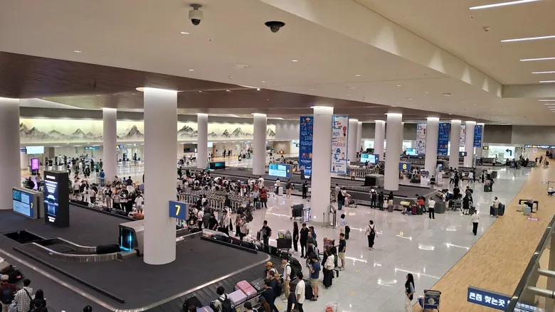

<a class="eac-btn" href="#必要ですか"><i class="ic ic-circle-help" aria-hidden="true"></i>必要ですか?</a><a class="eac-btn go" href="https://www.e-arrivalcard.go.kr" rel="noopener" target="_blank">入力しに行く <i class="ic ic-arrow-right" aria-hidden="true"></i></a>

<ul class="eac-facts"><li><i class="ic ic-wallet" aria-hidden="true"></i>無料</li><li><i class="ic ic-calendar-days" aria-hidden="true"></i>到着の3日前から</li><li><i class="ic ic-smartphone" aria-hidden="true"></i>スマホ・パソコン、アプリ不要</li></ul>

{{fig:e-arrival-card-shot-1|本物のサイトは最初にこう警告します。① 公式サイトは www.e-arrivalcard.go.kr だけ、支払い情報を求めるサイトには絶対にアクセスしないで、という案内。② 「確認」で閉じます。画面:e-arrivalcard.go.kr(韓国法務部)、2026年11月26日撮影}}

<ul class="eac-facts eac-wide"><li><i class="ic ic-circle-check" aria-hidden="true"></i>出し忘れても、到着後、入国審査の前までなら提出できます。</li><li><i class="ic ic-pencil" aria-hidden="true"></i>画面は日本語で見られますが、入力は英語か韓国語だけです。</li></ul>

## 必要ですか?

<ul class="eac-who"><li class="yes"><i class="ic ic-user-check" aria-hidden="true"></i><b>必要:日本のパスポートで短期旅行、K-ETAなし</b>日本はK-ETA免除期間中(22の国・地域、2027年末まで)なので、入国申告はこちらで行います。</li><li class="no"><i class="ic ic-user-x" aria-hidden="true"></i><b>不要:韓国籍の方</b>二重国籍で韓国のパスポートで入国する方も不要です。</li><li class="no"><i class="ic ic-user-x" aria-hidden="true"></i><b>不要:有効なK-ETAを持っている</b>公式FAQで「有効なK-ETA保持者は提出不要」。<a href="https://www.k-eta.go.kr" rel="noopener" target="_blank">k-eta.go.kr</a>で入国目的と滞在先を更新します。</li><li class="no"><i class="ic ic-user-x" aria-hidden="true"></i><b>不要:韓国の外国人登録証を持っている</b>登録外国人は対象外。何もしなくてOKです。</li><li class="fam"><i class="ic ic-users" aria-hidden="true"></i><b>家族・友人と一緒:代表者1人がまとめて</b>スマホなら1回に最大9人。14歳未満は自分で申請できません。</li></ul>

<i class="ic ic-info" aria-hidden="true"></i>くわしく:判断の流れと、このページで扱わないもの

{{fig:e-arrival-card-1|電子入国申告書が必要か、上から順にたどってください}}

このページが不要な人:韓国籍の方(二重国籍の方は韓国のパスポートで入国)、外国人登録者、有効なK-ETA保持者、団体ビザで入国する方、24時間以内の乗り継ぎで空港の外に出ない方。

このページで扱わないもの:代わりに申請する有料代行(公式の申告書は無料です)、K-ETAの申請手順(免除対象の方は2027年末まで不要です)。

## やること

手元に用意するもの:

<ul class="eac-facts eac-need"><li><i class="ic ic-id-card" aria-hidden="true"></i>パスポート</li><li><i class="ic ic-plane" aria-hidden="true"></i>便名</li><li><i class="ic ic-hotel" aria-hidden="true"></i>ホテルの英語住所(予約確認メール)と電話番号</li><li><i class="ic ic-mail" aria-hidden="true"></i>メールアドレス</li></ul>

写真の値(HONG GILDONG、パスポート番号 M00000000)は架空の例です。ご自分の情報を入れてください。

<h3 class="eac-step">STEP 1<i class="ic ic-shield-check" aria-hidden="true"></i>本物のサイトを開く</h3>

検索で探さず、**e-arrivalcard.go.kr**(末尾が go.kr)を直接入力。警告(このページ最初の写真)で**確認**を押します。

<aside class="note eac-warn"><i class="ic ic-triangle-alert" aria-hidden="true"></i>偽サイトはお金を取ります。本物は無料。カード番号を聞かれたら、すぐに閉じましょう。</aside>

<h3 class="eac-step">STEP 2<i class="ic ic-arrow-right" aria-hidden="true"></i>「申告する」を押す</h3>

{{fig:e-arrival-card-shot-2|トップ画面。画面:e-arrivalcard.go.kr(韓国法務部)、2026年11月26日撮影}}

1. 政府サイトの表示。偽サイトもまねできるので、信じるのはアドレスだけ。
2. 今日申告できる入国日。到着日がまだ出ていなければ待ちます。
3. 「電子入国申告・個人申告」(1-9名)の**申告する**。

<h3 class="eac-step">STEP 3<i class="ic ic-mail" aria-hidden="true"></i>同意してメールを入れる</h3>

{{fig:e-arrival-card-shot-4|規約同意とメール(長い規約文は省略)。画面:e-arrivalcard.go.kr(韓国法務部)、2026年11月26日撮影}}

**全体同意**にチェック、メールを2回、**確認**。代表で入力する人は14歳以上である必要があります。

<h3 class="eac-step">STEP 4<i class="ic ic-id-card" aria-hidden="true"></i>パスポートを読み取る</h3>

{{fig:e-arrival-card-shot-5|パスポートの読み取り。サイトの案内図そのまま。画面:e-arrivalcard.go.kr(韓国法務部)、2026年11月26日撮影}}

1. 顔写真のページを撮影。
2. または撮っておいた画像をアップロード。
3. 読み取れないときは閉じて手入力。

<h3 class="eac-step">STEP 5<i class="ic ic-pencil" aria-hidden="true"></i>パスポート情報を確かめる</h3>

{{fig:e-arrival-card-shot-6|間違えやすい欄(架空の値)。画面:e-arrivalcard.go.kr(韓国法務部)、2026年11月26日撮影}}

1. 姓 = パスポートの Surname(ローマ字)。
2. 名 = パスポートの Given name(ローマ字)。
3. 「unknown」:名前の横のチェック欄。パスポートに姓や名が本当にない場合以外は触らないでください(画面を見た私たちの判断で、公式FAQには説明がありません)。
4. 「For USFK – DoD ID number」は在韓米軍の方向け。それ以外の方はパスポート番号を入れます。

生年月日がXXと書かれたパスポートは00を選ぶよう、サイトのヘルプが案内しています。パスポートの有効期限は入国予定日より後である必要があります。

<aside class="note eac-warn"><i class="ic ic-triangle-alert" aria-hidden="true"></i>ローマ字のつづりを1字ずつ確認してください。公式FAQは、誤った情報は入国審査の遅れや入国拒否につながることがあると案内しています。</aside>

<h3 class="eac-step">STEP 6<i class="ic ic-plane" aria-hidden="true"></i>飛行機の情報</h3>

{{fig:e-arrival-card-shot-7|入国・出国情報。画面:e-arrivalcard.go.kr(韓国法務部)、2026年11月26日撮影}}

出国予定日は必須。出国便名(6)は空欄でかまいません。帰国日が未定なら、下の「くわしく」を見てください。

<h3 class="eac-step">STEP 7<i class="ic ic-hotel" aria-hidden="true"></i>入国目的と泊まる場所</h3>

{{fig:e-arrival-card-shot-8|入国目的、滞在予定地、職業。画面:e-arrivalcard.go.kr(韓国法務部)、2026年11月26日撮影}}

1. 入国目的。例:**観光(個別)**。
2. ビザ番号の欄:ビザがある方だけ。なければ飛ばします。
3. **ホテル**、居住先、当日乗り継ぎのどれか。
4. **KOR**か**ENG**を押して住所を探します(写真8~10)。
5. ホテル名、部屋番号など。
6. 連絡先:泊まる場所の電話番号。サイトのヘルプが「滞在先の住所と連絡先」を書くよう案内しています。
7. 職業。

{{fig:e-arrival-card-shot-9|住所照会。サイトの例(郵便番号08013)で検索した画面。2つ目のタブ名はサイト上で「職業入力」と表示されていますが、直接入力のタブです。画面:e-arrivalcard.go.kr(韓国法務部)、2026年11月26日撮影}}

<ol class="steps" style="counter-reset:st 7"><li>道路名か郵便番号5桁を入力。</li><li>一覧から住所をタップ。</li><li>見つからなければ2つ目のタブで直接入力。</li></ol>

<h3 class="eac-step">STEP 8<i class="ic ic-circle-check" aria-hidden="true"></i>提出してPDFを保存</h3>

{{fig:e-arrival-card-shot-10|フォームの最後。ここで止め、提出していません。画面:e-arrivalcard.go.kr(韓国法務部)、2026年11月26日撮影}}

1. メールアドレスを確認。
2. **提出**。押す前に、パスポートと食い違いがないか見直します。

公式サイトは、2026年5月6日から提出時に認証番号を入力する手順を導入すると告知しています。私たちは提出していないので、その画面の写真はありません。

<aside class="note eac-done"><i class="ic ic-file-down" aria-hidden="true"></i>完了!発行番号入りのPDFをスマホに保存しましょう。見せる義務はありません(係官が画面で確認します)が、聞かれたときのために手元に。</aside>

<aside class="note eac-warn"><i class="ic ic-triangle-alert" aria-hidden="true"></i>PDFはメールにも届きますが、公式サイトはGmail・Outlook.com・Hotmail・QQのアドレスでは遅れたり届かなかったりすることがあると案内しています。メールを待たずにPDFを保存しましょう。</aside>

## よくある間違い

<ul class="eac-oops"><li><i class="ic ic-triangle-alert" aria-hidden="true"></i>似た偽サイトでお金を払う。本物は<b>go.kr</b>で終わり、無料です。</li><li><i class="ic ic-triangle-alert" aria-hidden="true"></i>早すぎる提出。韓国時間で到着の3日前から受付です。</li><li><i class="ic ic-triangle-alert" aria-hidden="true"></i>期限切れに気づかない:提出から72時間、入国1回限り。出したあと便が1日遅れたら出し直し。</li><li><i class="ic ic-triangle-alert" aria-hidden="true"></i>前回の申告書を使い回す。入国のたびに新しく提出します。</li><li><i class="ic ic-triangle-alert" aria-hidden="true"></i>パスポートと1字でも違う名前。</li></ul>

## くわしく

<i class="ic ic-shield-check" aria-hidden="true"></i>偽サイト:政府の案内

ここで実際にお金を失うのは、偽サイトに入ってしまった時だけです。法務部出入国・外国人政策本部が手数料を取る偽サイトへの注意を呼びかけており、公式サイトも、名前の似たサイトが個人情報や手数料を求めることがあると案内しています。公式サイトは一切お金を取りません。

検索で探さず、アドレス `e-arrivalcard.go.kr`(末尾が **go.kr**)を直接入力してください。

> カード番号を聞かれたら、そこは公式ではありません。すぐに閉じましょう。

<i class="ic ic-calendar-days" aria-hidden="true"></i>3日前の受付、72時間、出し忘れ

受付は韓国時間で到着日の3日前から始まります。31日到着なら29・30・31日です。トップ画面に今日申告できる入国日が出ます(STEP 2の写真)。

提出した申告書は、提出から72時間たつか、入国審査を通った時点で使えなくなります。早めに出したあと便が1日遅れたら、出し直しましょう。1回の入国に1回限りなので、以前に紙で書いたことがあるリピーターの方も、入国のたびに新しく提出が必要です。

> 出し忘れても、公式FAQによれば到着後、入国審査の前までなら提出できます。とはいえ空港の列で入力するのは大変なので、前日の夜に済ませておくのがおすすめです。

<i class="ic ic-hotel" aria-hidden="true"></i>ホテルが複数・内容を直したいとき

いちばん長く泊まる場所を入力します。はっきりしたメインの宿がない場合は、到着後に最初に泊まる場所を。住所・入国目的・職業などは、入国審査の前までなら発行番号かメール認証で修正できます。公式FAQによると、入国日の修正は最初の提出日から3日以内に限られます。

{{fig:e-arrival-card-shot-12|トップ画面の照会・修正:発行番号かメール認証。画面:e-arrivalcard.go.kr(韓国法務部)、2026年11月26日撮影}}

<i class="ic ic-plane" aria-hidden="true"></i>帰国日がまだ決まっていないとき

おおよその出国日を入れ、便名は空欄でかまいません。ただし公式FAQは、入国目的によっては出国予定が決まっていないことが審査で不利になる場合がある、とも書いています。帰りの航空券があるなら入力しておきましょう。

<i class="ic ic-users" aria-hidden="true"></i>子ども連れ・グループ

入国する人は子どもも含めて全員が申告の対象です。スマホでは1回に最大9人、パソコンなら到着日と便名が同じ人を最大1,000人までまとめて提出できます。サイトのヘルプによると、1つの申告書に入れる人は入国日と入国便名がすべて同じである必要があります。子どものパスポート情報は親や保護者が入力します。同行者には、PDFや届いたメールを見せれば提出済みだと伝えられます。

{{fig:e-arrival-card-shot-11|「申告者を追加」で次の人を加えます。画面:e-arrivalcard.go.kr(韓国法務部)、2026年11月26日撮影}}

<i class="ic ic-plane" aria-hidden="true"></i>乗り継ぎ

24時間以内の乗り継ぎで空港の外に出ないなら提出不要です。預けた荷物を受け取る、別の航空券で搭乗手続きをするなどで入国審査を通る場合は必要です。同じ日に出入国するなら、到着日と出国日に同じ日付を入れ、滞在先は省略できます(フォームの「当日乗り継ぎ」、STEP 7)。

<i class="ic ic-file-down" aria-hidden="true"></i>紙の入国カードは?

2025年2月24日に電子入国申告書が始まるまでは、紙の入国カードに記入するのが一般的でした。韓国観光公社は導入時、紙との併用は2025年12月までと案内しており、仁川空港も「原則としてすべての外国人が入国申告書の作成対象」と説明しています。一方、2026年11月26日に改めて確認した公式FAQには「事前に出していなくても、入国審査の前に電子または紙で提出できる」とも書かれています。私たちの判断は「紙はあてにしない」。事前のオンライン提出が今の前提です。

<i class="ic ic-id-card" aria-hidden="true"></i>K-ETAとの関係

別の制度です。K-ETAはビザ免除国の人が渡航前に申請する電子渡航認証で、手数料は1万ウォン。電子入国申告書は紙の入国カードの代わりで、無料です。

{{fig:e-arrival-card-5|K-ETAと電子入国申告書の違い}}

- 日本はK-ETAの一時免除の対象です。法務部が[2026年11月23日のK-ETAお知らせ](https://www.k-eta.go.kr/portal/board/viewboarddetail.do?bbsSn=332883)で免除を1年延長し、免除期間は**2027年12月31日まで**です。免除期間中の方は電子入国申告書を出します。K-ETAの申請中に免除対象のパスポートの顔写真ページをスキャンすると、「K-ETA免除対象」の案内が表示されます。
- 免除対象でもK-ETAを任意で申請できますが、得られるのは入国申告書が不要になることだけで、手数料がかかります。短い旅行なら無料の申告書で十分です。すでに取得したK-ETAは有効期限まで使え、手数料は返金されません。

電子入国申告書を出しても自動化ゲートは使えるようになりません。また、税関申告の代わりにもなりません。

<i class="ic ic-list-checks" aria-hidden="true"></i>出典

電子入国申告書公式サイト(2026年11月26日確認):<a href="https://www.e-arrivalcard.go.kr/portal/board/boardList.do?eacBbsKndCd=2" rel="noopener" target="_blank">よくある質問</a>(全34問:提出時期、9人・1,000人、乗り継ぎ、修正、紙の申告書、K-ETA保持者、子ども)、<a href="https://www.e-arrivalcard.go.kr/portal/guide/eacReportProcessGuide.do" rel="noopener" target="_blank">申告の手順</a>、お知らせ<a href="https://www.e-arrivalcard.go.kr/portal/board/viewBoardDetail.do?bbsId=0000000001&amp;eacBbsKndCd=1&amp;pageIndex=1&amp;flId=" rel="noopener" target="_blank">制度案内(提出対象)</a>、<a href="https://www.e-arrivalcard.go.kr/portal/board/viewBoardDetail.do?bbsId=0000000002&amp;eacBbsKndCd=1&amp;pageIndex=1&amp;flId=" rel="noopener" target="_blank">電子入国申告は無料です</a>、<a href="https://www.e-arrivalcard.go.kr/portal/board/viewBoardDetail.do?bbsId=0000012530&amp;eacBbsKndCd=1&amp;pageIndex=1&amp;flId=" rel="noopener" target="_blank">メール受信の遅延</a>(2026年3月13日)、<a href="https://www.e-arrivalcard.go.kr/portal/board/viewBoardDetail.do?bbsId=0000012630&amp;eacBbsKndCd=1&amp;pageIndex=1&amp;flId=" rel="noopener" target="_blank">認証番号の導入(2026年5月6日から)</a>(2026年4月29日);<a href="https://www.k-eta.go.kr/portal/board/viewboarddetail.do?bbsSn=332883" rel="noopener" target="_blank">K-ETA一時免除の2027年12月31日までの延長</a>(2026年11月23日、2026年11月26日確認。<a href="https://www.k-eta.go.kr/portal/board/viewboarddetail.do?bbsSn=299706" rel="noopener" target="_blank">2025年12月23日のお知らせ</a>に代わるもの);<a href="https://www.airport.kr/" rel="noopener" target="_blank">仁川国際空港 入国手続き案内</a> (airport.kr: ap_ko/921/subview.do)(2026年11月26日確認);出入国・外国人政策本部「<a href="https://mojhome.moj.go.kr/bbs/immigration_eng/229/593239/artclView.do" rel="noopener" target="_blank">偽の電子入国申告書サイトに注意</a>」(2025年3月21日、前の版で確認);韓国観光公社VISITKOREAの導入案内(2025年2月20日、前の版で確認);電子入国申告書の<a href="https://www.e-arrivalcard.go.kr/portal/guide/eacGuide.do" rel="noopener" target="_blank">案内</a>と<a href="https://www.e-arrivalcard.go.kr/portal/guide/navigator.do" rel="noopener" target="_blank">ナビゲーター</a>(2026年11月25日確認、今回は開き直していません);法務部による政府民願案内センター110の回答(2026年1月15日、前の版で確認)。画面写真:2026年11月26日、スマホ幅の画面で開いた公式フォーム(日本語表示)とヘルプ(?)の文言。架空の値だけを入れ、提出していません。必要な部分だけ切り取り、ほかはぼかしています。

## うまくいった入国はこんな流れ

**出発前の夜。** パスポート、便名、ホテルの英語住所を手元に置いて、公式サイトで提出。発行番号入りのPDFをスマホに保存します。荷造りの前に入国申告は終わりです。

**入国審査のカウンター。** ペンも、ひざの上で書く紙のカードもありません。パスポートを渡すと、係官の画面にはもう情報が出ています。審査を通れば、申告書は役目を終えて失効します。

## 次にすること

<a class="eac-nextcard" href="/ja/airport-to-seoul/"><b><i class="ic ic-plane" aria-hidden="true"></i>着いたら:仁川空港からソウルへ</b>入国審査の次に決めるのは、泊まる場所のいちばん近くまで行ける交通手段です。<small>Photo: AirportTerminalGuy, CC BY 4.0, via Wikimedia Commons (modified: light auto-contrast)</small></a>

<ul class="eac-next"><li><a href="/ja/essentials/"><i class="ic ic-list-checks" aria-hidden="true"></i>韓国旅行の準備リスト:出発前の準備全体<i class="ic ic-arrow-right" aria-hidden="true"></i></a></li></ul>
