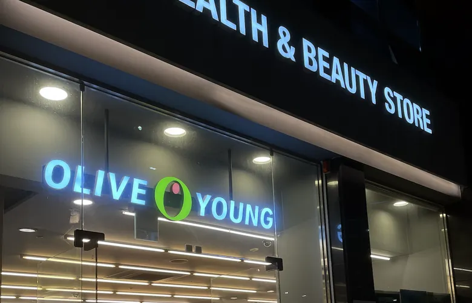
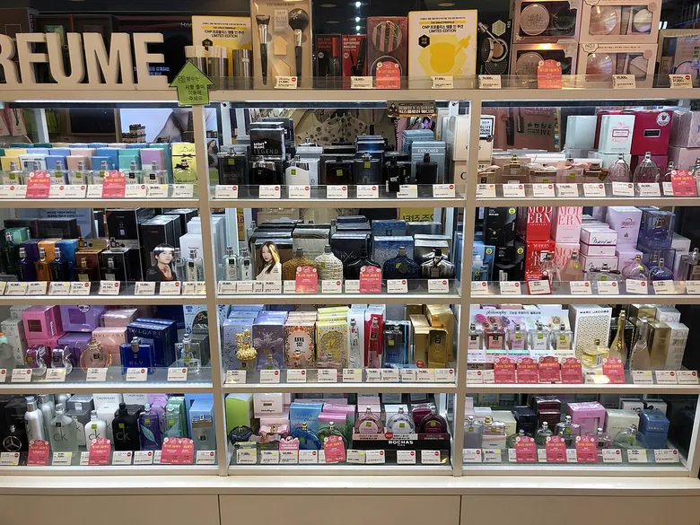
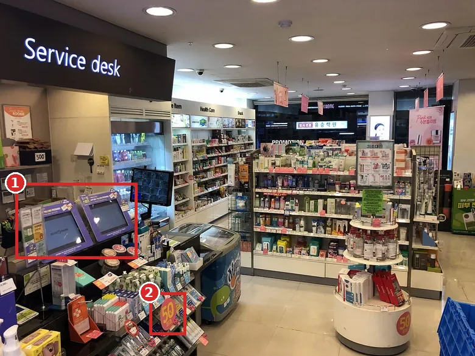
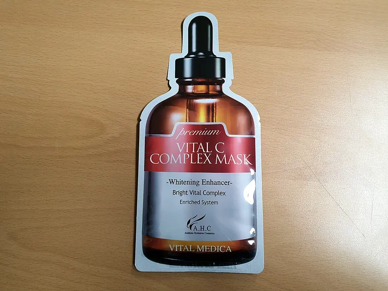

<a class="tr-btn" href="#いつ行く"><i class="ic ic-calendar-days" aria-hidden="true"></i>次のセール</a><a class="tr-btn go" href="#何を買うか-基本の3つ"><i class="ic ic-shopping-basket" aria-hidden="true"></i>何を買う?</a>

<figure class="tr-hero acc-hero"><figcaption><b>オリーブヤング</b>、韓国最大のヘルス&ビューティーチェーンです。写真:Pkccccj、<a href="https://creativecommons.org/licenses/by-sa/4.0/deed.ja" rel="noopener" target="_blank">CC BY-SA 4.0</a>、<a href="https://commons.wikimedia.org/wiki/File:OliveYoung_store.png" rel="noopener" target="_blank">ウィキメディア・コモンズ</a>(明るさ自動補正)</figcaption></figure>

<ul class="tr-facts"><li><i class="ic ic-calendar-check" aria-hidden="true"></i>大型セール<small>3・6・9・12月の第1週</small></li><li><i class="ic ic-id-card" aria-hidden="true"></i>パスポート<small>対象者ならレジで税金分が引かれる</small></li><li><i class="ic ic-receipt" aria-hidden="true"></i>15,000ウォン以上<small>1店舗・1レシート</small></li><li><i class="ic ic-shopping-basket" aria-hidden="true"></i>基本の3つ<small>日焼け止め、トナーパッド、シートマスク</small></li></ul>

## いつ行く?

オリーブヤングのセールは2種類。旅行日程を合わせる価値があるのは片方だけです。

{{fig:olive-young-1|オリーブヤングの1年:大きなセールが4回、毎月の小さなイベントが1回}}

<ul class="tr-choose"><li><i class="ic ic-calendar-check" aria-hidden="true"></i><b>オリーブヤングセール:これに合わせる</b>年4回、3・6・9・12月に約7日間。1年で最も割引の幅が広く、店舗とオンラインの両方。2026年は3月1〜7日、5月31日〜6月6日、8月30日〜9月5日に開催。12月は第1週で、公式発表が出たらセール情報に確定日を載せます。</li><li><i class="ic ic-tag" aria-hidden="true"></i><b>オリーブヤングデー:重なればうれしい程度</b>毎月25〜27日。店頭の小規模な割引で、追加クーポンは主に韓国のアプリ会員向けです。</li></ul>

<aside class="tr-note tip"><i class="ic ic-lightbulb" aria-hidden="true"></i>待つ時間も楽しみのうち。セール週をカレンダーに書き込み、出発前に買うものを3つだけメモしておきましょう。</aside>

{{deals:2}}

## 店舗で

<h3 class="tr-step">1<i class="ic ic-id-card" aria-hidden="true"></i>パスポートの実物を持参</h3>

<figure class="tr-photo"><figcaption>明洞のレジの上の表示:「即時免税のためパスポートの実物をご用意ください」。写真:Sgroey、<a href="https://creativecommons.org/licenses/by-sa/4.0/deed.ja" rel="noopener" target="_blank">CC BY-SA 4.0</a>、<a href="https://commons.wikimedia.org/wiki/File:Olive_Young_Myeongdong.jpg" rel="noopener" target="_blank">ウィキメディア・コモンズ</a>(切り抜き、明るさ自動補正)</figcaption></figure>

お店でスキャンするので、写真では不可です。レジで値段を変えるのはパスポートだけ。財布と同じくらい大事に持っていきましょう。

<h3 class="tr-step">2<i class="ic ic-tag" aria-hidden="true"></i>値札を読む</h3>

<figure class="tr-photo"><figcaption>商品ごとに下に値札があります。セール中は1+1(1つ買うともう1つ)、2+1(2つ買うと1つ)がどこにでもあるので、どの商品・セットが対象か確かめましょう。写真:Choi Kwang-mo(オリーブヤング原州丹邱店、2020年)、<a href="https://creativecommons.org/publicdomain/zero/1.0/deed.ja" rel="noopener" target="_blank">CC0</a>、<a href="https://commons.wikimedia.org/wiki/File:2020-04-17_22.18.09_%EC%98%AC%EB%A6%AC%EB%B8%8C%EC%98%81_%EC%9B%90%EC%A3%BC%EB%8B%A8%EA%B5%AC%EC%A0%90.jpg" rel="noopener" target="_blank">ウィキメディア・コモンズ</a>(明るさ自動補正)</figcaption></figure>

{{fig:olive-young-3|1+1の値札で確かめること}}

<h3 class="tr-step">3<i class="ic ic-credit-card" aria-hidden="true"></i>パスポートを出して支払う</h3>

<figure class="tr-photo"><figcaption><b>1</b> レジ:カードと一緒にパスポートを出します。<b>2</b> 丸いセールのシール:横の値札で、どの商品が対象か確かめましょう。写真:Choi Kwang-mo(オリーブヤング原州丹邱店、2020年)、<a href="https://creativecommons.org/publicdomain/zero/1.0/deed.ja" rel="noopener" target="_blank">CC0</a>、<a href="https://commons.wikimedia.org/wiki/File:2020-04-17_22.17.43_%EC%98%AC%EB%A6%AC%EB%B8%8C%EC%98%81_%EC%9B%90%EC%A3%BC%EB%8B%A8%EA%B5%AC%EC%A0%90.jpg" rel="noopener" target="_blank">ウィキメディア・コモンズ</a>(枠と番号を追加)</figcaption></figure>

1レシート15,000〜1,000,000ウォンなら、セール価格でもその場で税金分が引かれます。対象になる人は[こちらで確認](/ja/tax-refund/#自分は対象)。

{{fig:olive-young-2|レジでの即時還付、1レシートごと}}

<h3 class="tr-step">4<i class="ic ic-receipt" aria-hidden="true"></i>1レシートで1,000,000ウォンを超えたら?</h3>

全額を払い、キオスクか空港で還付を受けます。[免税の仕組み](/ja/tax-refund/)

<aside class="tr-note"><i class="ic ic-triangle-alert" aria-hidden="true"></i>別のお店のレシートは合算できません。1枚ずつ15,000ウォン以上が必要なので、3店で少しずつより1店でまとめて買いましょう。</aside>

<ul class="tr-choose"><li><i class="ic ic-map-pin" aria-hidden="true"></i><b>どの店に行く?</b>明洞や聖水の大型店は品ぞろえが多く、旅行者対応にも慣れています。セール週は小さな支店のほうが落ち着いて選べることも。</li></ul>

## 何を買うか:基本の3つ

使い切れるのは短いリスト。だから3つだけ選びました。ブランドではなく種類のリストです。帰国して1週間後も使っているものを選びました。

<ul class="acc-picks">
<li><b><i class="ic ic-sun" aria-hidden="true"></i>日焼け止め</b>毎日使うので最後まで使い切れます。ラベルの<strong>1</strong> SPFと<strong>2</strong> PAを見て、実際の予定に合わせて選びましょう。(ラベルの読み方の例です。写真は日本のブランドで、おすすめではありません。)写真:Yiting、<a href="https://creativecommons.org/licenses/by-sa/4.0/deed.ja" rel="noopener" target="_blank">CC BY-SA 4.0</a>、<a href="https://commons.wikimedia.org/wiki/File:Japanese_sunscreen.jpg" rel="noopener" target="_blank">ウィキメディア・コモンズ</a>(切り抜き、枠と番号を追加)</li>
<li><i class="ic ic-layers" aria-hidden="true"></i><b><i class="ic ic-droplets" aria-hidden="true"></i>トナーパッド</b>容器ひとつで持ち帰りやすく、すぐ使えます。</li>
<li><b><i class="ic ic-package" aria-hidden="true"></i>シートマスク</b>手頃で薄く、1回1枚。このような薄い袋に1枚ずつ入っています。写真:김인겸(Kim In-gyeom)、<a href="https://creativecommons.org/licenses/by-sa/4.0/deed.ja" rel="noopener" target="_blank">CC BY-SA 4.0</a>、<a href="https://commons.wikimedia.org/wiki/File:PX%EB%A7%88%EC%8A%A4%ED%81%AC%ED%8C%A9.jpg" rel="noopener" target="_blank">ウィキメディア・コモンズ</a>(明るさ自動補正)</li>
</ul>

{{fig:olive-young-4|最初のかごに入れる3つと、その理由}}

<ul class="tr-choose"><li><i class="ic ic-sparkles" aria-hidden="true"></i><b>12月に行くなら</b>その年のヒット商品を中心に組まれるため、オリーブヤングアワード受賞品やセール限定セットがお得になりやすい時期です。</li><li><i class="ic ic-user-x" aria-hidden="true"></i><b>このリストが要らない人</b>使い慣れたものがあるなら、セールで詰め替え・買い足しを。</li></ul>

省いたもの:話題の商品とランキング。ランキングは売れているものを教えてくれても、自分に合うものは教えてくれません。

## よくある失敗

<ul class="tr-oops"><li><i class="ic ic-triangle-alert" aria-hidden="true"></i>パスポートの写真だけ持っていく。お店は実物をスキャンします。</li><li><i class="ic ic-triangle-alert" aria-hidden="true"></i>3つの店に分けて買う。レシートは合算できません。</li><li><i class="ic ic-triangle-alert" aria-hidden="true"></i>どの商品・セットが対象か読まずに1+1を取る。</li><li><i class="ic ic-triangle-alert" aria-hidden="true"></i>オリーブヤングデーに日程を合わせる。規模が小さく、追加クーポンは主に韓国のアプリ会員向けです。</li></ul>

## 帰国後に買うなら

<ul class="tr-choose"><li><i class="ic ic-globe" aria-hidden="true"></i><b>オリーブヤンググローバル</b>多くの国に配送しています。日本への配送や条件は、注文時に公式サイトで確認してください。</li></ul>

{{fig:olive-young-5|家から買い足すなら、どこで}}

<i class="ic ic-list-checks" aria-hidden="true"></i>先に結論:表で見る

| こんなとき | こうする | 理由 |
|---|---|---|
| 旅行が3・6・9・12月の第1週と重なる | オリーブヤングセール中に買う | 1年で最も割引の幅が広い。店舗とオンラインの両方 |
| それ以外の週 | パスポートを持ってそのまま買う | 1レシート15,000〜1,000,000ウォンならレジで税金分が引かれる |
| 韓国コスメが初めて | 基本の3つから | 日焼け止め、トナーパッド、シートマスク:手頃で、持ち帰りやすく、使い切りやすい |
| もう帰国した | オリーブヤンググローバル | 配送先は公式サイトで確認 |

<i class="ic ic-calendar-check" aria-hidden="true"></i>セール週のオリーブヤング、最初から最後まで

お得になる瞬間はレジにあります。かごを置いてパスポートを渡すと、店員がスキャンし、支払いの前にレシートから税金分が引かれます。オリーブヤングセールの期間なら、セール価格からさらに引かれるということ。終わりの場面は、いっぱいの紙袋ではなく1週間後にしたいところ。実際に使っている日焼け止めと、1枚ずつ使っているシートマスクの箱。だから最初のリストは短くしました。

<i class="ic ic-info" aria-hidden="true"></i>出典

2026年11月26日確認:CJニュースルーム <a href="https://cjnews.cj.net/cj올리브영-올해-첫-올영세일-봄맞이-뷰티·웰니/" rel="noopener" target="_blank">3月のセール 3月1〜7日</a>(2026年2月27日)、<a href="https://cjnews.cj.net/선파우더·픽서·데오드란트-산다6월-올영세일-대/" rel="noopener" target="_blank">6月のセール 5月31日〜6月6日</a>(2026年6月4日)、<a href="https://cjnews.cj.net/cj올리브영-9월-올영세일서-취향-소비-두드러져/" rel="noopener" target="_blank">9月のセール 8月30日〜9月5日</a>(2026年9月6日)、<a href="https://cjnews.cj.net/cj올리브영-올영세일-외국인-재방문-3년-새-11배-증가/" rel="noopener" target="_blank">年4回(3・6・9・12月)</a>(2026年6月22日);The Korea Times <a href="https://www.koreatimes.co.kr/business/companies/20260622/foreign-repeat-visits-to-olive-young-sale-surge-11-fold-in-3-years" rel="noopener" target="_blank">同じ内容の英語記事</a>(2026年6月22日);当サイトの<a href="/ja/tax-refund/">免税のページ</a>(還付の上限、パスポートの実物、対象者)。2026年12月のセールの発表は11月26日時点でCJニュースルームにありません。開き直せなかったもの(オリーブヤンググローバルのサイトが確認ツールを拒否):日本への配送条件;オリーブヤングデーのクーポン(セール情報の出典、2026年11月18日)。

## 次に読む

<ul class="tr-next"><li><a href="/ja/tax-refund/"><i class="ic ic-receipt" aria-hidden="true"></i>免税:対象者と大きな買い物<i class="ic ic-arrow-right" aria-hidden="true"></i></a></li><li><a href="/ja/deals/"><i class="ic ic-tag" aria-hidden="true"></i>セール情報:日程が出しだい掲載<i class="ic ic-arrow-right" aria-hidden="true"></i></a></li></ul>
