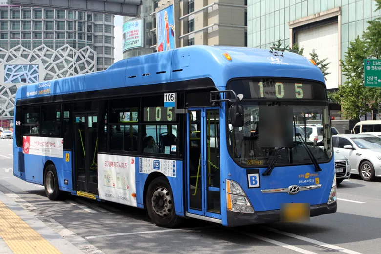
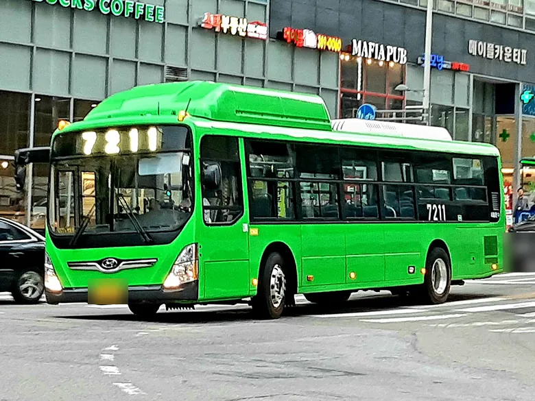
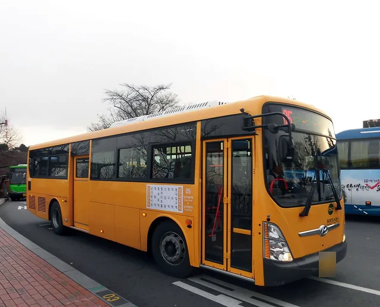
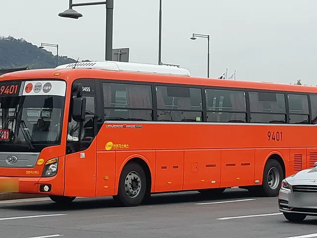
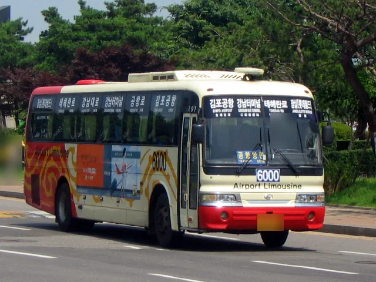

<a class="tr-btn go" href="#手順"><i class="ic ic-bus" aria-hidden="true"></i>5ステップを見る</a><a class="tr-btn" href="#まず色を見る"><i class="ic ic-info" aria-hidden="true"></i>バスの色の意味</a>

<figure class="tr-hero"><figcaption>青い幹線バス。路線番号は正面と側面にあります。 写真:Ki hoon、<a href="https://creativecommons.org/licenses/by-sa/4.0/" rel="noopener" target="_blank">CC BY-SA 4.0</a>、<a href="https://commons.wikimedia.org/wiki/File:Seoul_105_Blue_City_Front_side.png" rel="noopener" target="_blank">ウィキメディア・コモンズ</a>(自動コントラスト補正、運転手・ナンバーぼかし)</figcaption></figure>

<ul class="tr-facts"><li><i class="ic ic-coins" aria-hidden="true"></i>1,500ウォン<small>青・緑、交通カード</small></li><li><i class="ic ic-credit-card" aria-hidden="true"></i>2回タッチ<small>乗るときと降りるとき</small></li><li><i class="ic ic-timer" aria-hidden="true"></i>30分<small>乗り換え(夜は60分)</small></li><li><i class="ic ic-banknote" aria-hidden="true"></i>現金不可<small>183路線</small></li></ul>

## 手順

<h3 class="tr-step">1<i class="ic ic-credit-card" aria-hidden="true"></i>出発前にカードをチャージ</h3>

ソウル市の2026年1月時点の一覧では、「現金のないバス」が183路線(市内バス全396路線のうち)。これらの路線では現金が一切使えません。私たちのおすすめ:一覧を路線ごとに確かめるより、どのバスにもT-moneyなど韓国の交通カードをチャージして乗ること。どのカードをどこで買ってチャージするかは[ソウル地下鉄](/ja/seoul-subway/#どのカードで乗る)と[出発前の準備](/ja/essentials/)に。

<h3 class="tr-step">2<i class="ic ic-map-pin" aria-hidden="true"></i>乗るバスを見つける</h3>

**NAVERマップ**で経路を開き(日本語表示に切り替えられます)、路線番号と停留所名を保存します。停留所には、バスの情報をリアルタイムで表示する画面が多くあります。

{{fig:seoul-bus-stop-display|ソウルのバス停の案内画面。写真:Wikiwater2020、[CC BY-SA 3.0](https://creativecommons.org/licenses/by-sa/3.0/)、[ウィキメディア・コモンズ](https://commons.wikimedia.org/wiki/File:Bus_Info_in_the_Bus_Stop.jpg)(トリミング、番号追加)}}

1. **7025**番が**3分**後に来ます(분=分)。

{{fig:seoul-bus-front|番号を照らし合わせる。写真:Ki hoon、[CC BY-SA 4.0](https://creativecommons.org/licenses/by-sa/4.0/)、[ウィキメディア・コモンズ](https://commons.wikimedia.org/wiki/File:Seoul_105_Blue_City_Front_side.png)(自動コントラスト補正、運転手・ナンバーぼかし、番号追加)}}

1. 正面の路線番号。地図アプリの番号と照らし合わせます。
2. 前のドア。ここから乗ります。

<h3 class="tr-step">3<i class="ic ic-log-in" aria-hidden="true"></i>前のドアから乗ってタッチ</h3>

{{fig:seoul-bus-reader-front|前のドア横の読み取り機(2012年の写真)。写真:Wnstlr93、[CC BY 3.0](https://creativecommons.org/licenses/by/3.0/)、[ウィキメディア・コモンズ](https://commons.wikimedia.org/wiki/File:%EC%8A%B9%EC%B0%A8%EC%9A%A9_%EB%8B%A8%EB%A7%90%EA%B8%B0.jpg)(トリミング、明るさ補正、番号追加)}}

1. 乗りながらここにカードをかざします。

<h3 class="tr-step">4<i class="ic ic-bell" aria-hidden="true"></i>停留所を確認、降車ボタン</h3>

空いていれば窓側へ。韓国観光公社も、窓の外を流れる街の景色を市内バスの楽しみに挙げています。地図で停留所を確認し、次が降りる停留所になったら窓際の降車ボタンを押します。

<h3 class="tr-step">5<i class="ic ic-log-out" aria-hidden="true"></i>後ろのドア横でもう一度タッチして降りる</h3>

{{fig:seoul-bus-reader-rear|後ろのドア横の読み取り機(2012年の写真)。写真:Wnstlr93、[CC BY 3.0](https://creativecommons.org/licenses/by/3.0/)、[ウィキメディア・コモンズ](https://commons.wikimedia.org/wiki/File:%ED%99%98%EC%8A%B9_%EB%8B%A8%EB%A7%90%EA%B8%B0.jpg)(トリミング、番号追加)}}

1. ステッカー:「降りるときは必ずタッチしてください」。
2. ここにカードをかざします。
3. 残高(잔액)。

<aside class="tr-note"><i class="ic ic-triangle-alert" aria-hidden="true"></i>ソウル市の案内では、降車タッチをしないとその時点で乗り換えが切れ、次のバスや地下鉄に乗るときに払っていなかった基本運賃が加算されます。</aside>

<aside class="tr-note ok"><i class="ic ic-circle-check" aria-hidden="true"></i><b>完了。</b>私たちが選ぶ最後の場面:地下鉄では行けない場所で、2回タッチして降りること。30分以内に次に乗れば、基本運賃はもう一度かかりません。</aside>

## まず色を見る

ソウルのバスは色で路線の役割が分かるので、ひと目で「乗るべき種類か」が判断できます。いずれも大人が交通カードで払う運賃です。

<ul class="tr-colours"><li><b><i class="sw" style="background:#1f6fd1"></i>青・1,500ウォン</b>幹線:郊外と中心部を長く結びます。<a href="https://commons.wikimedia.org/wiki/File:Seoul_105_Blue_City_Front_side.png" rel="noopener" target="_blank">Ki hoon</a>、<a href="https://creativecommons.org/licenses/by-sa/4.0/" rel="noopener" target="_blank">CC BY-SA 4.0</a></li><li><b><i class="sw" style="background:#3cb043"></i>緑・1,500ウォン</b>支線:地域と幹線バス・地下鉄をつなぎます。緑のマウルバスは1,200ウォン。<a href="https://commons.wikimedia.org/wiki/File:Seoul_Bus_7211.jpg" rel="noopener" target="_blank">Wikiwater2020</a>、<a href="https://creativecommons.org/licenses/by-sa/3.0/" rel="noopener" target="_blank">CC BY-SA 3.0</a></li><li><b><i class="sw" style="background:#f2b21b"></i>黄・1,400ウォン</b>循環:中心部を回ります。<a href="https://commons.wikimedia.org/wiki/File:Seoul_Bus_05.JPG" rel="noopener" target="_blank">hyolee2</a>、<a href="https://creativecommons.org/licenses/by-sa/4.0/" rel="noopener" target="_blank">CC BY-SA 4.0</a>(ナンバーぼかし)</li><li><b><i class="sw" style="background:#e2462b"></i>赤・3,000ウォン</b>広域:首都圏と中心部を結びます。Climate Card(気候同行カード)短期券では<b>乗れません</b>。<a href="https://commons.wikimedia.org/wiki/File:Seoul_Bus_9401.jpg" rel="noopener" target="_blank">Wikiwater2020</a>、<a href="https://creativecommons.org/licenses/by-sa/3.0/" rel="noopener" target="_blank">CC BY-SA 3.0</a>(ナンバーぼかし)</li></ul>

<aside class="tr-note tip"><i class="ic ic-moon" aria-hidden="true"></i><b>番号がNで始まる</b>のは深夜バス。2,500ウォン。</aside>

## 乗り換え:降りてから30分

降車タッチをして、時間内に次に乗れば新しい運賃ではなく乗り換えになります。

{{fig:seoul-bus-3|降車タッチ後の乗り換え可能時間(Nadri作図:時間のルールは写真では示せません)}}

1. **最初のバスを降りるときにタッチ。**
2. **30分以内に次のバスか地下鉄に乗る**(次に乗るのが21時〜翌7時なら60分)。
3. **最初の10kmは基本運賃1回分**(乗った中で高いほうの基本運賃)、その後5kmごとに100ウォン。乗り換えは4回(乗車5回)まで。

## よくある失敗

旅行者の体験談を集めたものではなく、上のソウル市のルールから起こりやすい失敗を挙げたものです。

<ul class="tr-oops"><li><i class="ic ic-triangle-alert" aria-hidden="true"></i><b>降車タッチをせずに降りる。</b>乗り換えが切れ、次の乗車で基本運賃がまたかかります。</li><li><i class="ic ic-triangle-alert" aria-hidden="true"></i><b>カードなし・残高不足で乗る。</b>現金を受け付けない路線があります。</li><li><i class="ic ic-triangle-alert" aria-hidden="true"></i><b>Climate Card短期券で赤いバスに乗る。</b>対象外です。</li><li><i class="ic ic-triangle-alert" aria-hidden="true"></i><b>乗り換えまでに時間をかけすぎる。</b>30分(夜は60分)を過ぎると乗り換えになりません。</li><li><i class="ic ic-triangle-alert" aria-hidden="true"></i><b>空港のN番と市内のN番を混同する。</b>運賃が7倍近く違います。</li></ul>

## 空港バスは別物です

<figure class="tr-photo"><figcaption>空港リムジン:乗車券を別に買う、別のサービスです。 6000番、2009年の写真。写真:Baek Seung Woon、<a href="https://creativecommons.org/licenses/by-sa/2.0/kr/" rel="noopener" target="_blank">CC BY-SA 2.0 KR</a>、<a href="https://commons.wikimedia.org/wiki/File:Seoul_Airport_Bus_6000.jpg" rel="noopener" target="_blank">ウィキメディア・コモンズ</a>(自動コントラスト補正、人物・ナンバーぼかし)</figcaption></figure>

市内バスと空港リムジンバスは、同じ「バス」でも別のサービスです。

| | 市内バス | 空港リムジンバス |
|---|---|---|
| 運賃(大人) | 1,200〜3,000ウォン | ソウルまで16,000〜18,000ウォン |
| 乗り方 | カードをタッチ | 空港の券売機・切符売り場で乗車券を購入。T-moneyも使えますが、乗車券を持つ人が先に乗ります |
| Climate Card短期券 | 使える(赤いバスを除く) | 使えない |
| 大きな荷物 | 向いていません | 係員が積み込み(1人2個、28インチ以下) |

<aside class="tr-note"><i class="ic ic-triangle-alert" aria-hidden="true"></i>番号に注意: 深夜の空港バス(N6000、N6002、N6701、N6703)もNで始まりますが、運賃は17,000〜18,000ウォンで、乗車券を買って乗ります。2,500ウォンの市内深夜バスとは違います。</aside>

詳しくは[仁川空港からソウルへ](/ja/airport-to-seoul/)。

## 深夜バス

地下鉄が終わった後、ソウル市は番号がNで始まる深夜バスを14路線、23時から翌6時まで走らせています。大人・交通カードで2,500ウォン([ソウル市、2026年3月20日更新](https://news.seoul.go.kr/traffic/archives/27974))。始発・終発や間隔は路線ごとに違うので、停留所に出る前にNAVERマップで路線と次のバスを確認しておきましょう。

<i class="ic ic-moon" aria-hidden="true"></i>2種類のNバスを1枚の図で

{{fig:seoul-bus-5|2種類のNバス:市内の深夜バスと空港の深夜バス(Nadri作図)}}

## 次に読む

<ul class="tr-next"><li><a href="/ja/seoul-subway/"><i class="ic ic-train-front" aria-hidden="true"></i>ソウル地下鉄 7ステップ<i class="ic ic-arrow-right" aria-hidden="true"></i></a></li><li><a href="/ja/airport-to-seoul/"><i class="ic ic-plane" aria-hidden="true"></i>仁川空港からソウルへ<i class="ic ic-arrow-right" aria-hidden="true"></i></a></li><li><a href="/ja/getting-around/"><i class="ic ic-route" aria-hidden="true"></i>ソウルの地下鉄・バス・タクシー<i class="ic ic-arrow-right" aria-hidden="true"></i></a></li><li><a href="/ja/emergency/"><i class="ic ic-triangle-alert" aria-hidden="true"></i>バスに忘れ物をしたら<i class="ic ic-arrow-right" aria-hidden="true"></i></a></li></ul>

ここにない失敗をしたら、このページ最後の更新リクエスト欄から教えてください。

## もっと詳しく

<i class="ic ic-list-checks" aria-hidden="true"></i>先に結論:早見表

| こんなとき | こうする | 理由 |
|---|---|---|
| 目的地が駅から遠い | チャージ済みカードでバス | ソウル市の一覧で現金不可の路線が183あります |
| バスを降りるとき | 読み取り機にもう一度タッチ | 忘れるとそこで乗り換えが切れます |
| どこで降りるか不安 | NAVERマップで経路をたどる | 日本語表示に切り替えられます |
| 終電を逃した | N番の深夜バス、2,500ウォン | 14路線、23時〜翌6時 |

このページはソウルの市内バスだけを扱います。地下鉄は[ソウル地下鉄の乗り方](/ja/seoul-subway/)、タクシー・終電・どのカードを買うかは[ソウルの地下鉄・バス・タクシー](/ja/getting-around/)、空港からホテルまでは[仁川空港からソウルへ](/ja/airport-to-seoul/)へ。ホテルも行き先もすべて駅の近くなら、地下鉄だけのほうが簡単です。

選び方:バスか地下鉄かは「目的地が駅から遠いか」のひとつで決めます。あえて外したもの:バス専用アプリと、現金不可路線の全リスト。地図アプリひとつとチャージ済みカードで両方まかなえます。

<i class="ic ic-route" aria-hidden="true"></i>乗る前にしておくこと

私たちの判断:停留所ではなく、ホテルで済ませておきましょう。

1. **カードをチャージ。** ソウルの市内バスのうち183路線は現金不可です。
2. **NAVERマップを入れて**日本語表示に。
3. **最初の路線番号と停留所名を保存**し、地図で経路を一度眺めておく。
4. **夜遅くまで出かけるなら**、ホテル近くを通るNバスを探しておく。

韓国観光公社の案内はひと言です。前のドアから乗り、後ろのドアから降りる。大都市には、バスの情報をリアルタイムで表示する停留所も多くあります。乗る前にNAVERマップで経路を開いておくと、乗っている間は経路上のいまの位置が出ます。

<i class="ic ic-coins" aria-hidden="true"></i>バスの種類と運賃を1枚で

{{fig:seoul-bus-1|ソウルのバスの種類と大人の交通カード運賃(Nadri作図)}}

- **青(幹線)** は郊外と中心部を長く結びます。1,500ウォン。
- **緑(支線)** は地域と幹線バス・地下鉄をつなぎます。1,500ウォン。マウルバスも緑色で1,200ウォン。
- **黄(循環)** は中心部を回ります。1,400ウォン。
- **赤(広域)** は首都圏と中心部を結びます。3,000ウォン。Climate Card(気候同行カード)短期券では**乗れません**。
- **番号がNで始まる**のは深夜バス。2,500ウォン。

<i class="ic ic-arrow-right-left" aria-hidden="true"></i>乗り換えルールの全部

ルールはひとつ。乗るときにタッチ、降りるときにもう一度タッチ。忘れやすいのは2回目です。同じ路線・同じ車両に乗り直すのは乗り換えになりません。赤い広域バスが入ると基本距離は10kmではなく30kmです。運賃の全体像は[ソウルの地下鉄・バス・タクシー](/ja/getting-around/)に。

<i class="ic ic-info" aria-hidden="true"></i>出典と写真

ソウル市:<a href="https://news.seoul.go.kr/traffic/archives/1706" rel="noopener" target="_blank">ソウル市内バスの体系と利用方法</a>(2026年3月9日更新、運賃・色・乗り換えルール)、<a href="https://news.seoul.go.kr/traffic/transfer_discount" rel="noopener" target="_blank">統合乗り換え割引制度</a>(2026年2月2日更新)、<a href="https://news.seoul.go.kr/traffic/traffic_price" rel="noopener" target="_blank">交通運賃案内</a>(2025年7月11日更新)、<a href="https://news.seoul.go.kr/traffic/archives/508898" rel="noopener" target="_blank">現金のないバス運行路線一覧(2026年1月)</a>(2026年3月6日更新)、<a href="https://news.seoul.go.kr/traffic/archives/category/public-news_c1/climate-accompany-card_c1/card-climate_accompany_card" rel="noopener" target="_blank">気候同行カード(短期券)紹介</a>(2026年10月12日更新);仁川空港:<a href="https://www.airport.kr/ap_ko/976/subview.do" rel="noopener" target="_blank">バス検索</a>、<a href="https://www.airport.kr/ap_ko/979/subview.do" rel="noopener" target="_blank">ソウル深夜バス</a>;Visit Seoul:<a href="https://english.visitseoul.net/airport-to-seoul/1078" rel="noopener" target="_blank">Airport to Seoul</a>(2026年6月時点の運賃);The Korea Herald「<a href="https://www.koreaherald.com/article/10608612" rel="noopener" target="_blank">Tips on using public transportation in Korea</a>」(2025年11月6日)。いずれも2026年11月26日確認。 2026年11月26日にあわせて確認:ソウル市 <a href="https://news.seoul.go.kr/traffic/archives/27974" rel="noopener" target="_blank">深夜専用市内バス</a>(2026年3月20日更新)、韓国観光公社 <a href="https://english.visitkorea.or.kr/svc/contents/contentsView.do?vcontsId=140659" rel="noopener" target="_blank">City Bus(英語)</a>(2026年10月8日更新、前後のドア、降車ボタン、リアルタイム停留所)。

写真:ウィキメディア・コモンズの写真を、各キャプションに記したライセンスで使っています。乗り換え時間、Nバス、バスの種類の図はNadriが作成しました。

