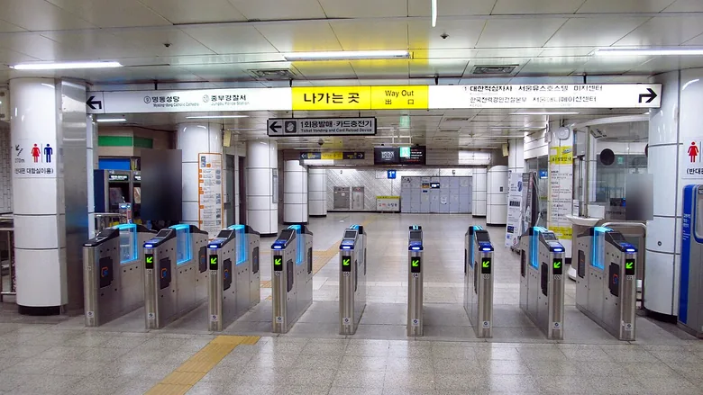
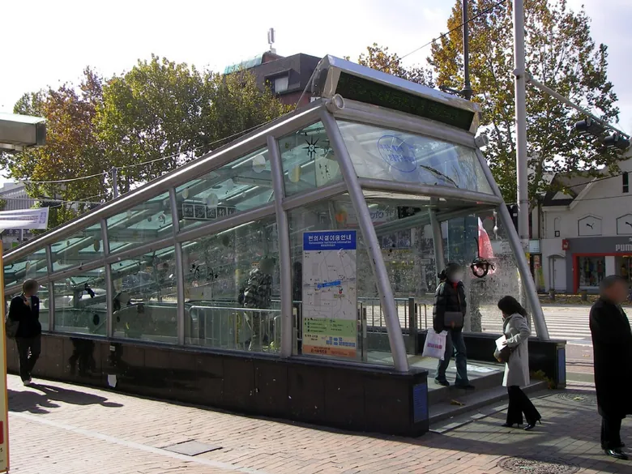
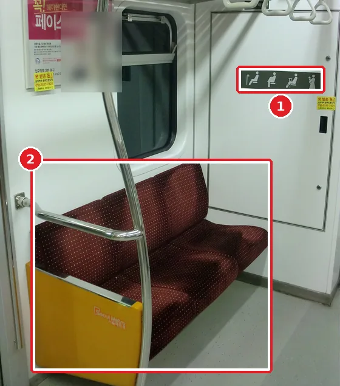
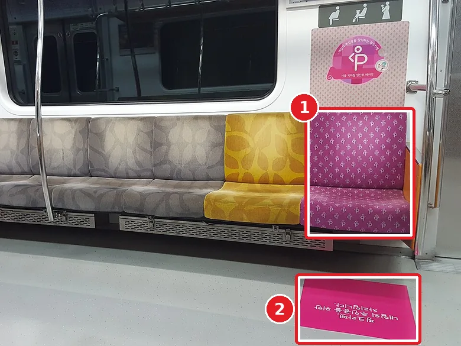

<a class="tr-btn go" href="#手順"><i class="ic ic-train-front" aria-hidden="true"></i>7ステップを見る</a><a class="tr-btn" href="#どのカードで乗る"><i class="ic ic-credit-card" aria-hidden="true"></i>どのカード?</a>

<figure class="tr-hero"><figcaption>駅で目にするのはこの景色:カード読み取り機つきの改札と、黄色い<b>나가는 곳(出口)</b>の案内。 明洞駅。写真:LERK、<a href="https://creativecommons.org/licenses/by-sa/4.0/" rel="noopener" target="_blank">CC BY-SA 4.0</a>、<a href="https://commons.wikimedia.org/wiki/File:Seoul-metro-424-Myeongdong-station-gate-20181124-081950.jpg" rel="noopener" target="_blank">ウィキメディア・コモンズ</a>(自動コントラスト補正、人物ぼかし)</figcaption></figure>

<ul class="tr-facts"><li><i class="ic ic-coins" aria-hidden="true"></i>1,550ウォン<small>交通カードで1回(10kmまで)</small></li><li><i class="ic ic-banknote" aria-hidden="true"></i>現金<small>T-moneyのチャージ</small></li><li><i class="ic ic-arrow-right-left" aria-hidden="true"></i>駅の中で乗り換え<small>改札は出ない</small></li><li><i class="ic ic-moon" aria-hidden="true"></i>終電<small>夕食の前に確認</small></li></ul>

## 手順

<h3 class="tr-step" id="map-app">1<i class="ic ic-map" aria-hidden="true"></i>前の晩:経路を開いておく</h3>

<ul class="tr-facts"><li><i class="ic ic-smartphone" aria-hidden="true"></i>NAVERマップかカカオマップ<small>NAVERは日本語表示、カカオは英語</small></li><li><i class="ic ic-map-pin" aria-hidden="true"></i>駅と出口番号を保存<small>「明洞駅8番出口」のように</small></li></ul>

明日の最初の経路を開いて、路線番号、乗り換え、出る出口を眺めておきます。地図アプリには乗っている間、いまどこにいるかも表示されます。私たちの判断:改札の前ではなく、ホテルで済ませておきましょう。乗る前に一度、頭の中で乗っておけます。

<h3 class="tr-step">2<i class="ic ic-credit-card" aria-hidden="true"></i>券売機でカードをチャージ</h3>

{{fig:seoul-subway-machine-yongsan|ソウル・龍山駅(1号線、KORAIL)の券売・チャージ機。駅によって機械が違います。写真:YKJJ、[CC BY-SA 4.0](https://creativecommons.org/licenses/by-sa/4.0/)、[ウィキメディア・コモンズ](https://commons.wikimedia.org/wiki/File:Ticket_vending_machines.jpg)(トリミング、番号追加)}}

1. この青い案内(Tickets / 自動券売機)を探します。
2. 機械の画面でチャージと金額を選びます。

{{fig:seoul-subway-machine-closeup|同じ種類の機械のアップ:仁川・ソレポグ駅(KORAIL)。ソウル交通公社の機械は形が違います。写真:LandAndTree、[CC BY 4.0](https://creativecommons.org/licenses/by/4.0/)、[ウィキメディア・コモンズ](https://commons.wikimedia.org/wiki/File:Ticket_Vending_and_Card_Reload_Machine_-_Seoul_Metropolitan_Subway_20240713.jpg)(トリミング、番号追加)}}

1. 「Transit card here」:カードをここに置きます。
2. 「Insert bills here」:紙幣を入れます。**T-moneyのチャージは現金のみ。**
3. 1回用乗車券はここから出てきます。

<aside class="tr-note"><i class="ic ic-banknote" aria-hidden="true"></i>ほかはカード払いでも、T-money用に1万〜2万ウォンほどは紙幣で持っておくと安心です。画面で新しい残高を確かめてからカードを取ります。</aside>

<h3 class="tr-step">3<i class="ic ic-log-in" aria-hidden="true"></i>改札でタッチ</h3>

{{fig:seoul-subway-gate|建大入口駅の改札。写真:revi、[CC BY 2.0 KR](https://creativecommons.org/licenses/by/2.0/kr/)、[ウィキメディア・コモンズ](https://commons.wikimedia.org/wiki/File:%EA%B1%B4%EB%8C%80%EC%9E%85%EA%B5%AC_%EA%B0%9C%EC%B0%B0%EA%B5%AC.jpeg)(トリミング、人物ぼかし、番号追加)}}

1. 上の読み取り機にカードをかざします。残高が表示されます。
2. 緑の矢印:矢印が指す通路から入ります。赤い✕はこちら側から入れないという意味です(写真から読み取った内容)。

<aside class="tr-note"><i class="ic ic-users" aria-hidden="true"></i>カードは1人1枚。乗り換えルールが「1人1枚」なので、2人で1枚を共有すると割引がつきません。</aside>

<h3 class="tr-step">4<i class="ic ic-signpost" aria-hidden="true"></i>路線番号でホームを探す</h3>

{{fig:seoul-subway-platform-sign|蚕室駅2号線ホームの駅名標。写真:阿貴、[CC BY-SA 3.0](https://creativecommons.org/licenses/by-sa/3.0/)、[ウィキメディア・コモンズ](https://commons.wikimedia.org/wiki/File:Seoul_Subway_Jamsil_Station_Line_2_Platform_Direction_Info.jpg)(トリミング、番号追加)}}

1. いまいる駅。路線色の丸の中に駅番号。
2. 次の駅。行きたい方向なら、このホームです。2号線は環状線なので標識には次の駅が出て、ほかの路線では終点も表示されます(写真から読み取った内容)。

私たちの判断:色だけでなく**路線番号**と行き先方向(どちらの終点に向かうか)を見るのがコツです。ホームに下りる前に、どちらの終点方向かを確かめます。

<aside class="tr-note tip"><i class="ic ic-lightbulb" aria-hidden="true"></i><b>9号線には急行があります。</b>急行は決まった駅にだけ止まります。降りたい駅に止まらないときは、手前の急行停車駅で各駅停車に乗り換えます。</aside>

<h3 class="tr-step">5<i class="ic ic-arrow-right-left" aria-hidden="true"></i>乗り換えは駅の中で</h3>

改札は出ません。乗り換える路線番号の案内をたどります。1枚のカードで最大4回(5回乗車)まで乗り換えになります。

<h3 class="tr-step">6<i class="ic ic-log-out" aria-hidden="true"></i>出るときもタッチ、保存した出口へ</h3>

{{fig:seoul-subway-exit-sign|明洞駅の改札前の案内。写真:LERK、[CC BY-SA 4.0](https://creativecommons.org/licenses/by-sa/4.0/)、[ウィキメディア・コモンズ](https://commons.wikimedia.org/wiki/File:Seoul-metro-424-Myeongdong-station-gate-20181124-081950.jpg)(トリミング、番号追加)}}

1. 黄色い**나가는 곳 / Way Out / 出口**の案内をたどります。
2. 丸の中の数字が出口番号、矢印が方向。保存した番号へ。
3. この矢印は1回用乗車券・チャージ機の方向です。

{{fig:seoul-subway-exit-zoom|拡大:⑨番出口 明洞聖堂、⑩番出口 中部警察署はこちら←。写真:LERK、[CC BY-SA 4.0](https://creativecommons.org/licenses/by-sa/4.0/)、[ウィキメディア・コモンズ](https://commons.wikimedia.org/wiki/File:Seoul-metro-424-Myeongdong-station-gate-20181124-081950.jpg)(トリミング、拡大)}}

<aside class="tr-note"><i class="ic ic-triangle-alert" aria-hidden="true"></i><b>出るときも必ずタッチ。</b>距離で運賃が決まり、降車タッチを忘れると乗り換えが切れて追加料金がかかります。</aside>

<figure class="tr-photo"><figcaption>地上から見た出口(恵化駅1番出口)。私たちが選ぶ最後の場面:まさにその出口から地上に出て、最初の一歩から行き先の方向を向いていること。 恵化駅1番出口、2006年の写真。写真:Jolly6656(韓国語版ウィキペディア)、パブリックドメイン、<a href="https://commons.wikimedia.org/wiki/File:Seoul_subway_Hyehwa_Station_Exit_01.jpg" rel="noopener" target="_blank">ウィキメディア・コモンズ</a></figcaption></figure>

<h3 class="tr-step">7<i class="ic ic-ticket" aria-hidden="true"></i>1回用乗車券なら500ウォンを受け取る</h3>

{{fig:seoul-subway-refund|保証金払い戻し機。写真:Sgroey、[CC BY-SA 4.0](https://creativecommons.org/licenses/by-sa/4.0/)、[ウィキメディア・コモンズ](https://commons.wikimedia.org/wiki/File:Seoul_subway_single_use_card_deposit_refund_machine.jpg)(トリミング、番号追加)}}

1. 改札近くの**保証金払い戻し機**(日本語表示あり)。
2. 1回用乗車券をここに入れます。
3. 保証金500ウォンがここから出てきます。

<aside class="tr-note ok"><i class="ic ic-circle-check" aria-hidden="true"></i><b>バスに乗り継ぐなら</b>、同じカードで降車後30分以内(夜9時〜翌朝7時は60分以内)に乗ると乗り換え割引になります。バスの乗り方:<a href="/ja/seoul-bus/">ソウルのバス</a>。</aside>

<h2 id="どのカードで乗る">T-moneyとWOWPASS、どっち?</h2>

**私たちの判断:交通だけならT-money。両替やお店での支払いまでカード1枚で済ませたいならWOWPASS。** 地下鉄・バスの運賃は、どちらも同じようにT-money残高から引かれます。WOWPASSはその残高が決済残高とは別です。

| | T-money | WOWPASS |
|---|---|---|
| カード代 | 空港鉄道駅の自販機:15,000ウォン(カード5,000ウォン+交通費10,000ウォン)。市内:販売店の表示価格 | 5,500ウォン(機械で事前予約、定価6,000ウォン) |
| 買える場所 | コンビニのレジ、駅の機械([買い方](/ja/convenience-store/#tmoney)) | 地下鉄駅・ホテル・コンビニなどにあるWOWPASS機械 |
| チャージ | 駅の券売機・コンビニでウォン現金 | 決済残高:WOWPASS機械(16種の通貨の現金かクレジットカード)またはアプリ |
| 交通の残高は別? | いいえ。残高はひとつです | はい。T-money残高はウォン現金でチャージするか、アプリ(NFC)でWOWPASS残高から移します |
| 残ったお金を戻す | 残った金額で場所が変わります。2万ウォン以下:GS25・セブン-イレブンなどのコンビニ。3万ウォン以下:CU・emart24などのコンビニ。それより多ければ首都圏の地下鉄駅の顧客案内所。50,000ウォン以上はTmoneyタウンのみ(ソウル駅10番出口、平日9〜18時)。手数料500ウォン | 決済残高:WOWPASS機械でウォン現金に(手数料1,000ウォン、1回10万ウォンまで)。T-money残高:T-moneyと同じ |
| 空港で受け取る | 第1・第2ターミナルの空港鉄道駅にあるT-money自販機で15,000ウォンのカード。海外のクレジットカード可 | 空港のSKテレコム ローミングセンター:WOWPASS+T-money+SIMのセット |

**3つの支払い方法の全体。** 私たちの判断:ほとんどの方はチャージ式カードで十分。1回用乗車券は「予備」と考えてください。3つは「1日に何回乗るか、ソウルの外へ出るか」というひとつの問いで分けます。

<ul class="tr-choose"><li><i class="ic ic-credit-card" aria-hidden="true"></i><b>T-money、またはT-money機能付きのWOWPASS</b>3〜7日のふつうのソウル旅行T-moneyは日本のSuicaのような交通カード。1回用より1回100ウォン安く、バスとの乗り換え割引も使えます。WOWPASSのT-money残高は、WOWPASS残高とは別にチャージします(WOWPASS公式ガイド)。</li><li><i class="ic ic-calendar-days" aria-hidden="true"></i><b>Climate Card(気候同行カード)短期券</b>ソウル市内だけ、1日3回以上、3日以上3日券10,000ウォン+カード3,000ウォン、交通カード運賃約8回分。1日1〜2回しか乗らない方、同じ日に水原や板橋へ出る方には不要です。</li><li><i class="ic ic-ticket" aria-hidden="true"></i><b>1回用乗車券</b>まだカードがないとき運賃に100ウォン上乗せ、さらに保証金500ウォン。首都圏の鉄道専用なので、バスには使えません。</li></ul>

<aside class="tr-note tip"><i class="ic ic-info" aria-hidden="true"></i>着いたばかりでカードも現金もないときは、新しい券売機でClimate Cardか1回用乗車券を。2026年3月17日から海外発行のクレジット・デビットカードが使えます。</aside>

**最初のカードを買う:** 市内ではコンビニのレジか駅の機械で買えます([コンビニでの買い方](/ja/convenience-store/#tmoney))。チャージは上のステップ2のように券売機で現金で。現金がなければ、仁川空港第1・第2ターミナルの空港鉄道駅のT-money自販機で、交通費が入ったT-money(15,000ウォン)を海外のクレジットカードで買えます。

必須ではありません。交通カードは空港でも買えるので、事前予約はしなくても大丈夫です。着いてすぐ受け取りたい方は:

<b>T-moneyカード</b>を空港で受け取り。チャージは駅で現金です。 写真: <a href="https://commons.wikimedia.org/wiki/File:T-money_card.jpg" rel="noopener" target="_blank">zisk</a>, Public domain (PD-self: released by the author), ウィキメディア・コモンズ

{{aff:klook_tmoney|T-moneyカードを予約して空港で受け取る}}

<i class="ic ic-wallet" aria-hidden="true"></i>
<b>WOWPASS</b>:両替・カード払い・T-moneyが1枚に。交通に使うT-money残高は別にチャージします(駅・コンビニで現金、またはアプリでWOWPASS残高を移して)。

{{aff:klook_wowpass|両替・カード払い・T-moneyが1枚になったWOWPASS}}

予約したカードの受け取り場所、WOWPASSのチャージと残ったお金の戻し方:[空港のページ「着く前に用意」](/ja/airport-to-seoul/#prep)。

## 初日によくある失敗

<ul class="tr-oops"><li><i class="ic ic-triangle-alert" aria-hidden="true"></i><b>降車タッチを忘れる。</b>乗り換えが切れ、追加料金がかかります。</li><li><i class="ic ic-triangle-alert" aria-hidden="true"></i><b>1回用乗車券を捨てる。</b>保証金500ウォンが戻りません。</li><li><i class="ic ic-triangle-alert" aria-hidden="true"></i><b>クレジットカードでT-moneyをチャージしようとする。</b>駅のチャージは現金です。</li><li><i class="ic ic-triangle-alert" aria-hidden="true"></i><b>Climate Cardでソウルの外や新盆唐線へ行く。</b>降りるときに運賃を払います。</li><li><i class="ic ic-triangle-alert" aria-hidden="true"></i><b>降りたい駅を通過する9号線の急行に乗る。</b></li><li><i class="ic ic-triangle-alert" aria-hidden="true"></i><b>終電の時刻を決めつける。</b>その日ごとに確認を。</li></ul>

## 空港鉄道:一般列車と直通列車

<figure class="tr-photo"><figcaption>仁川空港第1ターミナル駅のオレンジ色の<b>直通列車(Express Train)</b>エリアは、別にきっぷを買う直通列車用です。 写真:MNXANL、<a href="https://creativecommons.org/licenses/by-sa/4.0/" rel="noopener" target="_blank">CC BY-SA 4.0</a>、<a href="https://commons.wikimedia.org/wiki/File:202403_AREX_Express_Train_Concourse_at_Incheon_International_Airport_Terminal_1_Station.jpg" rel="noopener" target="_blank">ウィキメディア・コモンズ</a>(自動コントラスト補正)</figcaption></figure>

私たちの判断:空港鉄道の**一般列車**は交通カードで乗る地下鉄の1路線、**直通列車**は別にきっぷを買う列車と考えてください。

- **一般列車:** 全駅(弘大入口・孔徳を含む)に停車。交通カードをタッチして乗り、首都圏の乗り換え割引の対象です。
- **直通列車:** ソウル駅〜仁川空港をノンストップ、座席指定、乗車前に乗車券を購入。大人13,000ウォン。

必須ではありませんが、直通列車のチケットを着く前に予約しておきたい方は:

{{aff:klook_airport|KlookでAREX直通列車のバウチャーを事前購入(乗る前に乗車券に交換)}}

買ったあと:空港鉄道の公式の乗車券は、QRコードを直通列車の改札のQRスキャナーにかざすと開きます。Klookで買ったバウチャーは、乗る前に乗車券に引き換えが必要です:[引き換え方3つ](/ja/airport-to-seoul/#express-klook-how)。乗り場と変更・払い戻し:[空港のページ「着く前に用意」](/ja/airport-to-seoul/#prep)。

詳しい比較は[仁川空港からソウルへ](/ja/airport-to-seoul/)にあります。

<i class="ic ic-route" aria-hidden="true"></i>一般列車と直通列車を1枚の図で

{{fig:seoul-subway-8|同じ路線に2種類:一般列車と直通列車(Nadri作図:どの駅を通過するかは写真では示せません)}}

## 次に読む

<ul class="tr-next"><li><a href="/ja/seoul-bus/"><i class="ic ic-bus" aria-hidden="true"></i>ソウルのバス:乗るときと降りるときにタッチ<i class="ic ic-arrow-right" aria-hidden="true"></i></a></li><li><a href="/ja/airport-to-seoul/"><i class="ic ic-plane" aria-hidden="true"></i>仁川空港からソウルへ<i class="ic ic-arrow-right" aria-hidden="true"></i></a></li><li><a href="/ja/getting-around/"><i class="ic ic-route" aria-hidden="true"></i>ソウルの交通:タクシー、終電に乗り遅れたら<i class="ic ic-arrow-right" aria-hidden="true"></i></a></li><li><a href="/ja/emergency/"><i class="ic ic-triangle-alert" aria-hidden="true"></i>車内に忘れ物をしたら:ソウルの遺失物センター<i class="ic ic-arrow-right" aria-hidden="true"></i></a></li></ul>

ここにない失敗をしたら、このページ最後の更新リクエスト欄から教えてください。

## もっと詳しく

<i class="ic ic-list-checks" aria-hidden="true"></i>先に結論:早見表

| こんなとき | こうする | 理由 |
|---|---|---|
| 3〜7日のふつうのソウル旅行 | T-money、またはT-money機能付きのWOWPASS | 1回用より1回100ウォン安く、バスとの乗り換え割引も使えます |
| ソウル市内だけで、1日3回以上別々に乗る日が3日以上 | Climate Card(気候同行カード)短期券 | 3日券10,000ウォン+カード3,000ウォン、交通カード運賃約8回分 |
| 着いたばかりでカードも現金もない | 新しい券売機でClimate Cardか1回用乗車券 | 2026年3月17日から海外発行のクレジット・デビットカードが使えます |
| 夜遅くに移動する | その駅の終電をすぐ確認 | 2022年時点で週末は平日より早く終わります。2025年の発表(実施未確認)どおりなら、終電はさらに30分ほど早いと予想しています |

このページは地下鉄だけを扱います。市内バスは[ソウルのバス](/ja/seoul-bus/)、タクシーは[ソウルの交通](/ja/getting-around/)、空港からの移動は[仁川空港からソウルへ](/ja/airport-to-seoul/)へ。

選び方:支払い方法の3つは「1日に何回乗るか、ソウルの外へ出るか」というひとつの問いで分けました。あえて外したもの:同じ券売機で売っている定期券(毎日の通勤向けで、短い旅行には合いません)と、水原・仁川などソウルの外への移動です。

<i class="ic ic-calendar-days" aria-hidden="true"></i>Climate Card短期券:料金と使える範囲

- **Climate Card短期券**は1・2・3・5・7日で5,000/8,000/10,000/15,000/20,000ウォン、実物カードは別に3,000ウォン。ソウル市内の地下鉄とソウル市のバスに使え、使用開始日の始発から最終日の終電までが有効です。1日券は24時間ではなく、その日の終電までです。
- チャージした日が使用開始日で、前もってチャージしておくことはできません(ソウル市のClimate Card案内)。
- 新盆唐線、GTX、広域バス・空港バス、ソウルの外の地下鉄は**対象外**。ソウルで乗ってソウルの外の駅で降りると、駅員に運賃を別に払います。ソウル市の例は鍾路3街で乗って仁徳院(インドグォン)で降りるケース。例外として、仁川空港第1・第2ターミナル駅で降りることはできます(そこから乗るのは不可)。
- 不要な方:1日1〜2回しか乗らない方、同じ日に水原や板橋などソウルの外へ出る方。

<i class="ic ic-coins" aria-hidden="true"></i>運賃:交通カードと1回用乗車券

{{fig:seoul-subway-3|交通カードと1回用乗車券の比較(大人、ソウル市の運賃表からNadri作図)}}

私たちの判断:運賃計算は地図アプリに任せて、カードが安い理由だけ覚えておけば大丈夫です。

- 大人の基本運賃(10kmまで、2025年6月28日から):交通カード**1,550ウォン**、1回用**1,650ウォン**。以前の1,400ウォン(1回用1,500ウォン)から上がっているので、リピーターの方はご注意を。50kmまでは5kmごとに100ウォン、その先は8kmごとに100ウォン加算。
- 乗り換えは1枚のカードで最大4回(5回乗車)まで。同じ路線への乗り直しは乗り換えになりません。

<i class="ic ic-banknote" aria-hidden="true"></i>券売機と海外発行カード

- ソウル交通公社の新しいキオスクは1回券・定期券・Climate Cardならクレジットカードで払えますが、T-moneyなどプリペイドカードのチャージは現金のみです。
- 1〜8号線273駅の新しい券売機440台は海外発行カードに対応(手数料は平均約3.7%)。ただしClimate Cardと1回用乗車券用です。ソウル市の発表で名前が出ているのはVisaとMastercardで、JCBが使えるかは確認できていません。
- WOWPASSならアプリでWOWPASS残高からT-moneyにチャージできます。

<i class="ic ic-armchair" aria-hidden="true"></i>ラッシュと空けておく席

私たちの判断:スーツケースがあるなら、平日の朝7〜9時は避けるのがおすすめです。

<figure class="tr-photo"><figcaption><b>1</b> 表示、<b>2</b> 車両の端の優先席。 写真:hyolee2、<a href="https://creativecommons.org/licenses/by-sa/3.0/" rel="noopener" target="_blank">CC BY-SA 3.0</a>、<a href="https://commons.wikimedia.org/wiki/File:Priority_seats_Seoul_Metro_3000.JPG" rel="noopener" target="_blank">ウィキメディア・コモンズ</a>(トリミング、広告ぼかし、番号追加)</figcaption></figure>

<figure class="tr-photo"><figcaption><b>1</b> ピンクの座席、<b>2</b> 床のピンクの表示。 ソウル地下鉄、2018年。写真:Garam。Attribution licence: “allows anyone to use it for any purpose, provided that the copyright holder is properly attributed”、<a href="https://commons.wikimedia.org/wiki/File:Designated_seats_for_pregnant_women_of_Seoul_Metro_Line_1_in_2018.jpg" rel="noopener" target="_blank">ウィキメディア・コモンズ</a>(トリミング、番号追加)</figcaption></figure>

- **優先席**(車両の両端)は高齢の方、体の不自由な方、けがをした方、妊婦さんのための席です。私たちのおすすめ:座らないでおきましょう。
- **ピンクの座席**(1両に2席)は妊婦さんのための席。空けておきます。妊娠初期は外見でわからないため、ピンクのバッジをつけている方もいます。
- ソウル市の2014年交通カード分析では、朝7〜9時に1日の利用者の20.2%が集中し、最も混んだ10分間は8時10〜19分でした。
- 9号線の朝の急行は最高混雑度192.5%。ソウル市は2026年11月16日から朝の急行を増やし、9号線の運営会社も通勤時間は各駅停車の利用を呼びかけています。

<i class="ic ic-moon" aria-hidden="true"></i>終電

私たちの判断:帰り方は夕食の前に決めておきましょう。

- ソウル市は2022年、平日の終電が**終点に深夜1時ごろ**着くよう運行を延長しました。土・日・祝日は対象外でした(2025年の発表前の基準)。
- 2025年5月、ソウル市は1〜8号線の始発と終電をそれぞれ30分早める計画(早ければ2025年8月から)を発表しました(ソウル市 2025年5月27日、コリア・ヘラルド 2025年5月22日、下の出典)。実施されたかは確認できていません。発表どおり実施されていれば、終電は深夜1時ごろより30分ほど早いと予想しています。
- 時刻を覚えるより、その駅の終電をNAVERマップやカカオマップで確認してください。KORAILが運行する区間(1・3・4号線の一部)は異なることがあります。

乗り遅れたときは[ソウルの交通](/ja/getting-around/)へ。

<i class="ic ic-info" aria-hidden="true"></i>出典と写真

2026年11月26日(韓国時間)に開いて確認。ソウル市交通サイト:<a href="https://news.seoul.go.kr/traffic/traffic_price" rel="noopener" target="_blank">交通運賃案内</a>(2025年6月28日改定)、<a href="https://news.seoul.go.kr/traffic/transfer_discount" rel="noopener" target="_blank">統合乗り換え割引</a>(2026年2月2日更新)、<a href="https://news.seoul.go.kr/traffic/archives/1763" rel="noopener" target="_blank">1回用交通カード</a>、<a href="https://news.seoul.go.kr/traffic/archives/510651" rel="noopener" target="_blank">Climate Card短期券の紹介</a>(2026年10月12日更新)と<a href="https://news.seoul.go.kr/traffic/public/climatecard-faq/faq-short" rel="noopener" target="_blank">FAQ</a>、<a href="https://news.seoul.go.kr/traffic/archives/516544" rel="noopener" target="_blank">海外クレジットカード対応の報道資料</a>(2026年3月16日)、<a href="https://news.seoul.go.kr/traffic/archives/27958" rel="noopener" target="_blank">妊婦配慮席の案内</a>。ソウル市メディアハブ:<a href="https://mediahub.seoul.go.kr/archives/2015499" rel="noopener" target="_blank">新型キオスクとプリペイドカードの現金チャージ</a>(2025年9月2日)、<a href="https://mediahub.seoul.go.kr/archives/2016718" rel="noopener" target="_blank">海外カードに関するファクトブリーフィング</a>(2026年1月7日)、<a href="https://mediahub.seoul.go.kr/archives/2004711" rel="noopener" target="_blank">深夜運行の再開</a>(2022年5月30日)、<a href="https://mediahub.seoul.go.kr/archives/864021" rel="noopener" target="_blank">2014年交通カード分析</a>(2015年4月29日)、<a href="https://mediahub.seoul.go.kr/archives/2019693" rel="noopener" target="_blank">9号線急行の拡大</a>(2026年10月14日)。ソウル市英語サイト:<a href="https://english.seoul.go.kr/climate-cards-and-single-journey-transit-tickets-now-accepting-international-credit-cards-no-cash-needed/" rel="noopener" target="_blank">海外カード対応</a>(2026年3月17日)、<a href="https://english.seoul.go.kr/autonomous-bus-and-earlier-subway-service-for-early-morning-commuters/" rel="noopener" target="_blank">始発・終電30分繰り上げ計画</a>(2025年5月27日)。<a href="https://www.metro9.co.kr/kor/sub01_03.do" rel="noopener" target="_blank">ソウル市メトロ9号線 朝の列車利用案内</a>。空港鉄道 <a href="https://www.airportrailroad.com/train/normal/introduce" rel="noopener" target="_blank">一般列車</a>・<a href="https://www.airportrailroad.com/train/express/introduce" rel="noopener" target="_blank">直通列車</a>の案内。<a href="https://wowpass.io/ja/guide" rel="noopener" target="_blank">WOWPASS公式ガイド</a>。コリアヘラルド:<a href="https://www.koreaherald.com/article/10493311" rel="noopener" target="_blank">始発・終電の繰り上げ</a>(2025年5月22日)、<a href="https://www.koreaherald.com/article/3154442" rel="noopener" target="_blank">妊婦席とバッジ</a>(2023年6月27日)。コリアタイムズ:<a href="https://www.koreatimes.co.kr/southkorea/health/20171206/priority-seats-for-pregnant-women-complaint-rich-territory-on-subway" rel="noopener" target="_blank">妊婦配慮席</a>(2017年12月6日)。 2026年11月26日にあわせて確認:Korea Herald <a href="https://www.koreaherald.com/article/10694586" rel="noopener" target="_blank">地下鉄券売機が海外発行カードに対応</a>(2026年3月16日)、<a href="https://www.koreaherald.com/article/10608612" rel="noopener" target="_blank">公共交通の使い方</a>(2025年11月6日、地図アプリ)。

2026年11月27日確認:空港鉄道 <a href="https://www.airportrailroad.com/train/express/guide" rel="noopener" target="_blank">直通列車のご利用案内</a>(QR改札);WOWPASS <a href="https://www.wowpass.io/ja/guide" rel="noopener" target="_blank">使い方ガイド</a>(T-money残高は駅・コンビニの現金かアプリのNFCで別にチャージ);コリア・ヘラルド <a href="https://www.koreaherald.com/article/10947683" rel="noopener" target="_blank">空港鉄道のT-moneyカード</a>(交通費入り15,000ウォン、海外カード)。確認できなかったもの:Klookの商品ページ(自動アクセスを遮断)。

2026年11月27日22:25〜22:28(韓国時間)に開いて確認(T-moneyとWOWPASSの表):WOWPASS <a href="https://www.wowpass.io/ja/guide" rel="noopener" target="_blank">使い方ガイド</a>(T-money残高は地下鉄・コンビニでウォン現金かアプリのNFCでチャージ、WOWPASS決済残高は機械で1回10万ウォンまで出金・手数料1,000ウォン、Tmoney払い戻しはコンビニ・首都圏の地下鉄駅の顧客案内所・Tmoneyタウン、手数料500ウォン、50,000ウォン以上はTmoney本社のみ、ソウル駅10番出口・平日9〜18時、16種類の通貨かクレジットカードでチャージ)と<a href="https://www.wowpass.io/ja/product" rel="noopener" target="_blank">カードの受け取り方</a>(6,000ウォン、地下鉄・ホテル・コンビニの機械で予約5,500ウォン、SKTローミングセンターのWOWPASS+Tmoney+SIMセット)。空港鉄道のT-money 15,000ウォンは上のコリア・ヘラルド。使わなかったもの:T-moneyのサイト(www.tmoney.co.krは開けたが、カード代・払い戻しのページが見つからず、eng.tmoney.co.krは接続できず)。 金額別の払い戻し場所(2万・3万・5万ウォン)は同じWOWPASS案内画面の文言(ページのスクリプト、2026年11月27日確認)です。

写真:ウィキメディア・コモンズの写真を、各キャプションに記したライセンスで使っています。運賃比較と一般・直通列車の図はNadriが作成しました。

