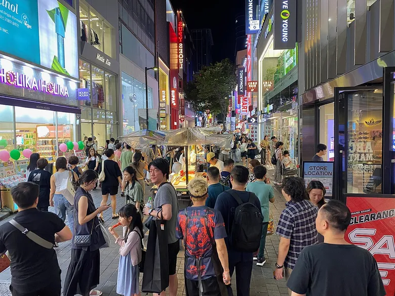
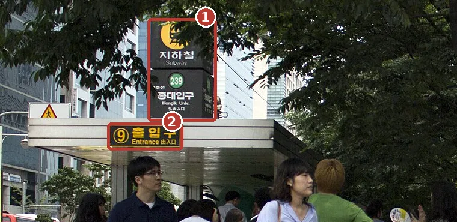
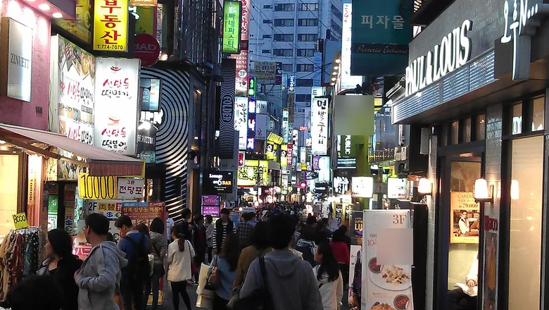
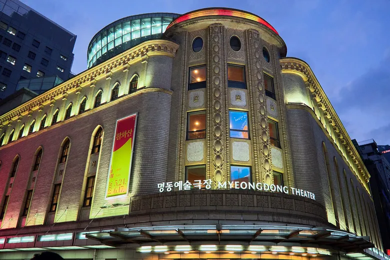
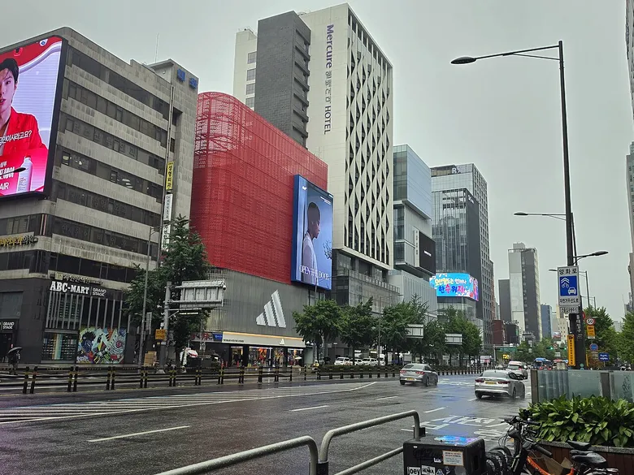

<a class="tr-btn go" href="#pick"><i class="ic ic-map-pin" aria-hidden="true"></i>どこへ行く?</a><a class="tr-btn" href="#pay"><i class="ic ic-receipt" aria-hidden="true"></i>支払い・免税</a>

<figure class="tr-hero acc-hero"><figcaption><b>夜の明洞。</b> 大通りの両側にコスメ店、真ん中に屋台が並びます。写真: Sgroey(2024)、<a href="https://creativecommons.org/licenses/by-sa/4.0/deed.ja" rel="noopener" target="_blank">CC BY-SA 4.0</a>、<a href="https://commons.wikimedia.org/wiki/File:Myeongdong_night_market_seoul_1.jpg" rel="noopener" target="_blank">ウィキメディア・コモンズ</a>(縮小、明るさ自動補正)</figcaption></figure>

<ul class="tr-facts"><li><i class="ic ic-train-front" aria-hidden="true"></i>3つとも2号線<small>乙支路入口・聖水・弘大入口駅</small></li><li><i class="ic ic-signpost" aria-hidden="true"></i>出口番号が道しるべ<small>明洞5番、聖水4番、弘大9番</small></li><li><i class="ic ic-id-card" aria-hidden="true"></i>パスポート原本<small>レジで税金が引かれる(免税店舗)</small></li><li><i class="ic ic-receipt" aria-hidden="true"></i>レシート1枚1.5万〜100万ウォン<small>その場で即時還付</small></li></ul>

<h2 id="pick">どこへ行く?</h2>

このページは**買う**場所の話です。**泊まる**場所は[ソウルの宿エリアの選び方](/ja/seoul-areas/)へ。

<ul class="tr-choose"><li><i class="ic ic-sparkles" aria-hidden="true"></i><b>Kビューティー、初めてのソウル: 明洞</b>2号線乙支路入口駅5番か4号線明洞駅8番出口。ビジットソウルが「ショッピングの1番地」と紹介する街。開店直後がいいと私たちは考えます。<a href="#myeongdong">明洞へ</a></li><li><i class="ic ic-store" aria-hidden="true"></i><b>韓国の新ブランド、ポップアップ: 聖水</b>2号線聖水駅4番出口。延武場キルにオリーブヤングN聖水、ムシンサ・メガストア。週末は混むので平日がいいと考えます。<a href="#seongsu">聖水へ</a></li><li><i class="ic ic-shopping-basket" aria-hidden="true"></i><b>若いファッション、K-POPグッズ: 弘大</b>2号線弘大入口駅9番出口から350mのR3ファッション通り。夕方〜夜がいいと考えます。<a href="#hongdae">弘大へ</a></li></ul>

{{fig:shopping-streets-1|私たちの判断: 街ごとに合う物と行くのにいい時間}}

## 出口番号で行く

ソウルでショッピング街を見つける技はひとつ。**駅名+出口番号**。これを覚えればどの街にも同じやり方で行けます。

<figure class="tr-photo"><figcaption><b>1</b> 地下鉄の表示: 駅名(弘大入口)と駅番号(239)。<b>2</b> 出口番号(9番出入口)。地上ではこの表示で正しい出口か確かめます。写真: Jonathan Kramer(弘大入口駅9番出口)、<a href="https://creativecommons.org/licenses/by-sa/3.0/deed.ja" rel="noopener" target="_blank">CC BY-SA 3.0</a>、<a href="https://commons.wikimedia.org/wiki/File:Hongik_University_Station_exit_9.jpg" rel="noopener" target="_blank">ウィキメディア・コモンズ</a>(切り抜き、明るさ自動補正、枠・番号を追加)</figcaption></figure>

1. **地図アプリでお店を探す。** NAVERマップやカカオマップに店名を入れると、近い駅と出口番号が出ます。このページの出口番号をそのまま使っても大丈夫。
2. **改札でタッチして出たら、出口番号の案内板に沿って歩く。** 丸の中の数字が出口番号、矢印が方向です([ソウルの地下鉄 ステップ6](/ja/seoul-subway/)に実際の表示の写真)。
3. **地上に出たら上の写真のように出口番号を確認。** 大きな駅は出口を間違えるとかなり歩きます。
4. **出口からお店までは、地図アプリのルート検索で「徒歩」を選んでたどります。** 下の街ごとに、出口から見える目印(建物・通りの名前)を書いておきました。それでも迷ったら、観光案内所(弘大なら7番出口近くの麻浦観光案内所)かお店のスタッフにこのページの店名を見せましょう。

地下鉄の乗り方、路線図の読み方、交通カードのチャージは[ソウルの地下鉄](/ja/seoul-subway/)に写真付きでまとめています。

{{fig:shopping-streets-2|概念図: 漢江の北側のショッピングエリア(距離・縮尺は実際と違います)}}

2号線はソウルをぐるりと回る環状線で(コリアヘラルド)、3つのエリアすべてに2号線の駅があります。

<h2 id="myeongdong">明洞: コスメ、そして初めてのソウル</h2>

<figure class="tr-photo"><figcaption><b>明洞のショッピング街</b>(2012年の写真)。写真: Christian Bolz、<a href="https://creativecommons.org/licenses/by-sa/4.0/deed.ja" rel="noopener" target="_blank">CC BY-SA 4.0</a>、ウィキメディア・コモンズ</figcaption></figure>

{{fig:shopping-streets-4|明洞: どの出口からどのお店へ}}

- **行き方:** 2号線乙支路入口駅5番出口か4号線明洞駅8番出口。オリーブヤング明洞グローバル店が案内している出口です。
- **あるもの:** 大型百貨店2つ、ショッピングセンター、ブランド店、露店。大通りの両側に屋台。明洞地下ショッピングセンターにはK-POPグッズやお土産があります。ビジットソウルは、最近は特に外国人客で混むと書いています。
- **道しるべ:** 明洞の真ん中の**明洞芸術劇場の交差点**。路地を歩くとこの交差点に出ます。明洞聖堂はユネスコ通りの突き当たりです(ビジットソウル)。

<figure class="tr-photo"><figcaption><b>明洞芸術劇場</b>。この建物が見えたら明洞の真ん中の交差点です。写真: lumoplank、<a href="https://creativecommons.org/publicdomain/zero/1.0/deed.ja" rel="noopener" target="_blank">CC0</a>、<a href="https://commons.wikimedia.org/wiki/File:Myeongdong,_Seoul_-_Myeongdong3165.jpg" rel="noopener" target="_blank">ウィキメディア・コモンズ</a>(縮小、明るさ自動補正)</figcaption></figure>

- **オリーブヤング明洞グローバル店:** 明洞キル53。毎日10:00〜22:30(店の都合で変わることあり)。1〜2階、レジで即時タックスリファンド、WeChat Pay・アリペイなどの簡単決済、ギフト包装、外国語対応。店内にトイレはなく、近くの地下鉄駅のトイレを使うよう案内しています。
- **行くのにいい時間:** 開店直後。混雑データではなく私たちの推測です。
- **近く:** 明洞駅そばの12階建ての[ダイソー](/ja/daiso/)。免税店はロッテ免税店本店(乙支路入口駅7・8番出口)、新世界免税店(会賢駅5番出口)が近いです([免税店](/ja/duty-free/))。
- **向かない人:** 地元の人が歩く街を見たい人。

<h2 id="seongsu">聖水: 新しいブランドとポップアップ</h2>

<figure class="tr-photo"><figcaption><b>延武場キル</b>。聖水駅4番出口から始まります。写真: Dr. Thomas Liptak、<a href="https://creativecommons.org/licenses/by-sa/4.0/deed.ja" rel="noopener" target="_blank">CC BY-SA 4.0</a>、<a href="https://commons.wikimedia.org/wiki/File:Seoul,_Seongdong_District,_Seongsu_(Yeonmujang-gil).jpg" rel="noopener" target="_blank">ウィキメディア・コモンズ</a>(切り抜き、明るさ自動補正)</figcaption></figure>

{{fig:shopping-streets-5|聖水駅: 4番出口か3番出口}}

- **行き方:** 2号線聖水駅4番出口。延武場キルはここから始まります。ムシンサ・メガストアは3番出口から475m。
- **どんな街:** 1950年代末から小さな工場が集まり、1967年以降に手作り靴の業者が集まって手作り靴通りに。今はファッション・コスメ・ポップアップ・旗艦店が集まる街です(ビジットソウル)。
- **オリーブヤングN聖水:** 延武場7キル13のファクトリアル聖水の建物、4番出口から118m(徒歩約1分)。2024年11月末に開店。1階はブランドのポップアップが変わる広場で、毎日先着300人に無料の4カット写真。2階ビューティー&カルチャー、3階スキン&ウェルネス、4階VIPラウンジ。メイクなどの無料サービスは事前予約制で、毎週金曜の正午に翌週分の予約が開きます。
- **ムシンサ・メガストア聖水:** 2026年4月24日開店、地上4階と地下、約6,600㎡。2階はムシンサ初のオフラインのビューティーフロア。毎日11:00〜22:00。
- **行くのにいい時間:** 平日。コリアヘラルドの聖水ショッピングガイド(2026年7月)は、ムシンサ・メガストアは週末に混み、一部の店は週末はたいてい待つと書いています。
- **免税:** お店ごとのルールは確認できていません。パスポートを持って、会計の前に聞いてください。
- **向かない人:** 並ぶのが嫌な人、ネットで見たポップアップひとつだけを見に行く人。ポップアップは期間限定です(例: ムシンサストア聖水のジョジョタウン・ポップアップは2026年10月16〜31日)。まだやっているか先に確認を。

<h2 id="hongdae">弘大: 若いファッションとK-POPグッズ</h2>

<figure class="tr-photo"><figcaption><b>弘大の通り</b>(2026年)。写真: Qhairy、<a href="https://creativecommons.org/licenses/by/4.0/deed.ja" rel="noopener" target="_blank">CC BY 4.0</a>、<a href="https://commons.wikimedia.org/wiki/File:Hongdae_Street_02.jpg" rel="noopener" target="_blank">ウィキメディア・コモンズ</a>(縮小、明るさ自動補正)</figcaption></figure>

{{fig:shopping-streets-6|弘大入口駅: 9番出口か1番出口}}

- **行き方:** 弘大入口駅(2号線、空港鉄道、京義・中央線)9番出口から350mがR3ファッション通り。空港鉄道の駅なので、空港に行き来する日にも寄りやすいです。
- **あるもの:** 弘益大学の周り。R3一帯は服とコスメのお店がぎっしり。1番出口側の旧LINE FRIENDS旗艦店はK-Pop Squareに変わりました(毎日11:00〜22:00)。カカオフレンズ旗艦店は8番出口。
- **COVERNAT弘大旗艦店:** 9番出口から徒歩約10分(チャンダリ路24)。近くに複合文化空間KT&Gサンサンマダン。毎日12:00〜21:00、外国人観光客はレジでタックスリファンド、アリペイ可。
- **困ったら:** 麻浦観光案内所、7番出口から徒歩3分。
- **行くのにいい時間:** 夕方〜夜。混雑データではなく営業時間からの判断です。正午に開く旗艦店もあります。
- **向かない人:** 静かに見て回りたい人。

<h2 id="pay">払う: カードとタックスフリー</h2>

大きなお店はカードが使え、オリーブヤング明洞グローバル店やCOVERNAT弘大のようにアリペイ・WeChat Payが使えるお店もあります。現金・カードの準備は[両替と支払い](/ja/money/)に。

{{fig:shopping-streets-7|レシート1枚の即時還付の範囲}}

<h3 class="tr-step">1<i class="ic ic-id-card" aria-hidden="true"></i>パスポート原本を持つ</h3>

<figure class="tr-photo"><figcaption>レジの上にこういう表示(「Tax Free」「Tax Refund」、パスポート準備の案内)があるお店ならOK。なければ会計前に聞きましょう。写真: Sgroey、<a href="https://creativecommons.org/licenses/by-sa/4.0/deed.ja" rel="noopener" target="_blank">CC BY-SA 4.0</a>、<a href="https://commons.wikimedia.org/wiki/File:Olive_Young_Myeongdong.jpg" rel="noopener" target="_blank">ウィキメディア・コモンズ</a>(切り抜き、明るさ自動補正)</figcaption></figure>

レジでの即時還付にはパスポート原本が必要です。写真ではだめ。韓国を訪問中の人が対象です([対象かどうか](/ja/tax-refund/))。

<h3 class="tr-step">2<i class="ic ic-receipt" aria-hidden="true"></i>1店舗でレシート1枚を1万5千〜100万ウォンに</h3>

別の店のレシートは合算できません。1回の入国で即時還付の合計は500万ウォンまで。

<h3 class="tr-step">3<i class="ic ic-credit-card" aria-hidden="true"></i>支払いのときパスポートを一緒に出す</h3>

その場で税金分が引かれます。オリーブヤング明洞グローバル店のFAQでは、還付は購入額の5〜8%、1,000ウォン単位で計算。衛生用品、ショッピングバッグ、ドライフルーツなどは対象外です。

<h3 class="tr-step">4<i class="ic ic-plane" aria-hidden="true"></i>100万ウォンを超える、またはパスポートがないとき</h3>

レジでの即時還付はできません。還付伝票をもらって空港の還付カウンターで受け取ります。手順は[タックスリファンド](/ja/tax-refund/)に。同じGTF社の別のお店の伝票なら、オリーブヤング明洞グローバル店2階グローバルサービスラウンジのGTFデスクでも受け取れます(パスポート原本が必要)。

## よくある失敗

<ul class="tr-oops"><li><i class="ic ic-triangle-alert" aria-hidden="true"></i>大きな駅で出口番号を見ずに出る。反対側に出てかなり歩きます。</li><li><i class="ic ic-triangle-alert" aria-hidden="true"></i>パスポートの写真だけ持っていく。レジの還付は原本です。</li><li><i class="ic ic-triangle-alert" aria-hidden="true"></i>3つのお店に分けて買う。レシートごとに1万5千ウォンを超える必要があります。</li><li><i class="ic ic-triangle-alert" aria-hidden="true"></i>終わったポップアップを見に聖水へ。日付を先に確認。</li></ul>

<i class="ic ic-route" aria-hidden="true"></i>2号線で半日のルート例

{{fig:shopping-streets-3|2号線で半日ショッピングのルート}}

1. 聖水駅4番出口 → 延武場キル、オリーブヤングN聖水(118m)。
2. 聖水駅から2号線 → 弘大入口駅。
3. 弘大入口駅9番出口 → R3ファッション通り(350m)。COVERNATは21:00までなので最後でも大丈夫。

コスメが先なら聖水の代わりに明洞(乙支路入口駅、2号線)を。ポップアップは選択です。

<i class="ic ic-list-checks" aria-hidden="true"></i>行く前の短いリスト、プレゼント選び

1. **欲しい物を種類別に書く:** コスメ、服、K-POPグッズ。上の「どこへ行く?」がそれを街に変えてくれます。
2. **ネットで見たポップアップは日付を確認。** 期間限定です。
3. **地図アプリに出口を保存し**、レジでの免税のためにパスポート原本を持つ。

**誰かへのプレゼント?** このページの事実から選んだ私たちの判断です。

- **K-POPファン:** 弘大、1番出口側のK-Pop Square。
- **スキンケアを使う人:** 明洞かオリーブヤングN聖水。先に[ラベルの見方](/ja/kbeauty-how-to-choose/)を。

<i class="ic ic-info" aria-hidden="true"></i>省いたもの、このページがいらない人

東大門は省きました。事実はこれです。ビジットソウルによると斗山タワー(DOOTA MALL)は10:30〜深夜0時営業で、1・4号線東大門駅8番出口から207m。ほかは私たちの判断です。夜遅くに服を買えるのが東大門の強みで、短い旅ならファッションは聖水と弘大で足りると考えました。ムシンサ・メガストアが閉まる22:00以降も服を見たいなら東大門を加えてください。新沙洞カロスキル、漢南洞、江南の百貨店も省きました。品目ごとにまだ確認できていないからです。店のランキングや価格は変わるので扱いません。

コスメだけなら[オリーブヤングのガイド](/ja/olive-young/)へ、高い物を買うなら先に[免税店](/ja/duty-free/)を。今のセールは[セール情報](/ja/deals/)に。

<i class="ic ic-info" aria-hidden="true"></i>出典

2026年11月26日(韓国時間)確認。ビジットソウル(英語): <a href="https://english.visitseoul.net/editorspicks/myeongdong-dasi-seoul-yeohaengyi-jungsimi-doeda/ENNlwcnrh" rel="noopener" target="_blank">明洞特集</a>(ショッピングの1番地、百貨店・露店、地下ショッピングセンター、明洞芸術劇場の交差点、ユネスコ通りの先の明洞聖堂、2025年11月18日更新)、<a href="https://english.visitseoul.net/editorspicks/2025SeoulTrendReportSeongsu-dong/ENNvepwqx" rel="noopener" target="_blank">「2025 Seoul Trend Dispatch: Seongsu-dong」</a>(延武場キルと4番出口、手作り靴通りの歴史、オリーブヤングN聖水の各階・予約・118m、2026年6月15日更新)、<a href="https://english.visitseoul.net/shopping/MUSINSA-MEGA-STORE-SEONGSU/ENPxwxy2m" rel="noopener" target="_blank">ムシンサ・メガストア聖水</a>(6,600㎡、3番出口475m、11:00〜22:00、2026年7月20日更新)、<a href="https://english.visitseoul.net/attractions/HONGDAE-R3/ENPc8w958" rel="noopener" target="_blank">HONGDAE R3</a>(9番出口350m、麻浦観光案内所は7番出口から3分、2026年8月31日更新)、<a href="https://english.visitseoul.net/shopping/COVERNAT/ENP77xns8" rel="noopener" target="_blank">COVERNAT</a>(12:00〜21:00、タックスリファンド、アリペイ、9番出口から10分、チャンダリ路24、KT&Gサンサンマダンの近く、2026年8月8日更新)、<a href="https://english.visitseoul.net/editorspicks/Fan-life-starts-in-Hongdae/ENN033076" rel="noopener" target="_blank">「Fan life starts in Hongdae」</a>(K-Pop Square 1番出口 11:00〜22:00、カカオフレンズ8番出口、2026年10月24日更新)、<a href="https://english.visitseoul.net/shopping/Doota-Dongdaemun/ENP000416" rel="noopener" target="_blank">DOOTA MALL</a>(10:30〜24:00、東大門駅8番出口、2026年11月20日更新)。オリーブヤング<a href="https://myeongdongtown.oliveyoung.com/en/" rel="noopener" target="_blank">明洞グローバルタウンのサイト</a>(住所・営業時間・出口・サービス、タックスリファンドFAQ、トイレなし)。コリアヘラルド: <a href="https://www.koreaherald.com/article/10011387" rel="noopener" target="_blank">オリーブヤングN聖水</a>(2024年11月21日)、<a href="https://www.koreaherald.com/article/10654319" rel="noopener" target="_blank">ソウルのバスストと2号線</a>(2026年1月13日)、<a href="https://www.koreaherald.com/article/10725111" rel="noopener" target="_blank">ムシンサ・メガストア聖水開店</a>(2026年4月25日)、<a href="https://www.koreaherald.com/article/10795872" rel="noopener" target="_blank">聖水ショッピングガイド</a>(2026年7月4日)、<a href="https://www.koreaherald.com/article/10894150" rel="noopener" target="_blank">ムシンサのジョジョタウン・ポップアップ</a>(2026年10月6日)。コリアヘラルドの記事は前の版(2026年11月26日午前)で確認し、今回は開き直していません。ただしムシンサ・メガストア開店の記事(地上4階・地下)は11月26日午後に開き直して確認しました。

## 次へ

<ul class="tr-next"><li><a href="/ja/olive-young/"><i class="ic ic-shopping-basket" aria-hidden="true"></i>オリーブヤング: セール時期と基本の3品<i class="ic ic-arrow-right" aria-hidden="true"></i></a></li><li><a href="/ja/tax-refund/"><i class="ic ic-receipt" aria-hidden="true"></i>タックスリファンド: 対象者、大きな買い物<i class="ic ic-arrow-right" aria-hidden="true"></i></a></li><li><a href="/ja/seoul-subway/"><i class="ic ic-train-front" aria-hidden="true"></i>ソウルの地下鉄の乗り方<i class="ic ic-arrow-right" aria-hidden="true"></i></a></li></ul>
