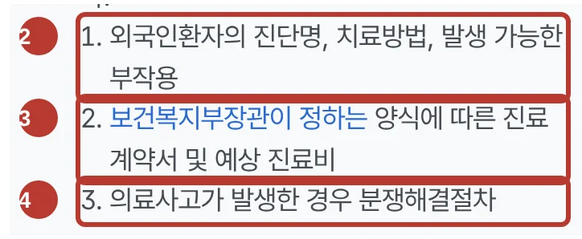
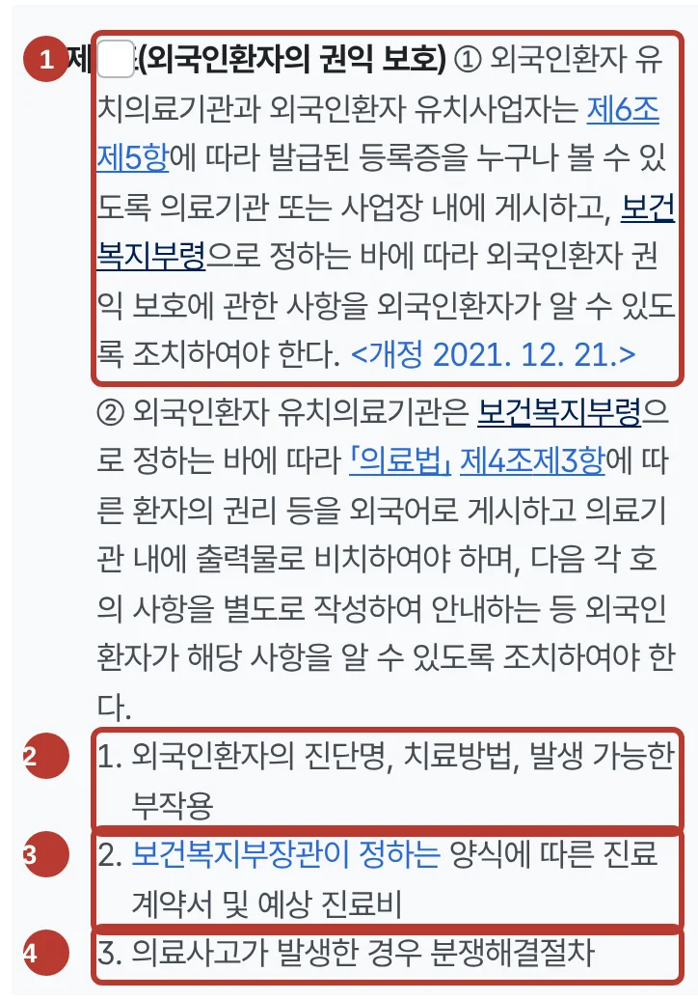

<a class="tr-btn go" href="#check"><i class="ic ic-shield-check" aria-hidden="true"></i>予約前の確認4つ</a><a class="tr-btn" href="#help"><i class="ic ic-circle-help" aria-hidden="true"></i>困ったとき</a>

<aside class="tr-note"><i class="ic ic-info" aria-hidden="true"></i><b>手続きの案内で、医療情報ではありません。</b> 病院名や価格は載せず、効果や安全も約束しません。施術するかどうかは、診察した医師と相談して決めてください。</aside>

<figure class="tr-hero acc-hero"><figcaption><b>外国人患者を受け入れる病院が、法律で別に書いて伝えなければならないもの。</b> <b>2</b> 診断名・治療方法・起こりうる副作用、<b>3</b> 診療契約書と予想診療費、<b>4</b> 医療事故のときの紛争解決手続き。支払う前にこの3つを書面でもらいましょう。画面: 国家法令情報センター<a href="https://www.law.go.kr/%EB%B2%95%EB%A0%B9/%EC%9D%98%EB%A3%8C%ED%95%B4%EC%99%B8%EC%A7%84%EC%B6%9C%EB%B0%8F%EC%99%B8%EA%B5%AD%EC%9D%B8%ED%99%98%EC%9E%90%EC%9C%A0%EC%B9%98%EC%A7%80%EC%9B%90%EC%97%90%EA%B4%80%ED%95%9C%EB%B2%95%EB%A5%A0" rel="noopener" target="_blank">医療海外進出及び外国人患者誘致支援に関する法律 第8条</a>(韓国語、法制処)、2026年11月26日キャプチャー(一部を切り抜き、枠・番号を追加)</figcaption></figure>

<ul class="tr-facts"><li><i class="ic ic-shield-check" aria-hidden="true"></i>まず政府登録を照会<small>病院もエージェンシーも登録義務</small></li><li><i class="ic ic-receipt" aria-hidden="true"></i>予想費用は書面で<small>告知した価格より高くは取れません</small></li><li><i class="ic ic-ban" aria-hidden="true"></i>付加価値税の還付なし<small>2025年12月31日で終了</small></li><li><i class="ic ic-smartphone" aria-hidden="true"></i>1577-7129<small>24時間、6言語で相談</small></li></ul>

## あなたの状況は?

<ul class="tr-choose"><li><i class="ic ic-scan-line" aria-hidden="true"></i><b>SNSや広告で病院を見つけた</b>連絡する前に政府の登録名簿で照会を。外国人患者を誘致する医療機関と誘致業者は登録が義務です。<a href="#check-1">照会のしかた</a></li><li><i class="ic ic-users" aria-hidden="true"></i><b>エージェンシーや予約アプリで予約した</b>病院だけでなくエージェンシーも同じ方法で照会します。登録制度は誘致業者にも適用されます。</li><li><i class="ic ic-receipt" aria-hidden="true"></i><b>見積もりに付加価値税の還付が入っている</b>還付なしで計算し直してください。外国人観光客の美容施術の付加価値税還付特例は2025年12月31日で終わりました。<a href="#vat">詳しく</a></li><li><i class="ic ic-plane" aria-hidden="true"></i><b>施術のすぐあとに帰りの飛行機</b>支払う前に、再診日と飛行機に乗れる時期を医師に聞き、書面でもらいます。答えられるのは診察した医師だけです。</li><li><i class="ic ic-triangle-alert" aria-hidden="true"></i><b>困ったことが起きた</b>1577-7129(24時間、外国語相談)。外国人患者の苦情や医療紛争も受け付ける公的窓口です。緊急なら119。<a href="#help">相談先</a></li></ul>

化粧品を買うだけなら[オリーブヤングのページ](/ja/olive-young/)へ。このページは医療機関で受ける施術についてです。

<h2 id="check">予約前に確認する4つのこと</h2>

<h3 class="tr-step" id="check-1">1<i class="ic ic-scan-line" aria-hidden="true"></i>政府の登録名簿で病院・エージェンシーを照会する</h3>

韓国で外国人患者を誘致したい医療機関は市・道に登録し、診療科ごとに専門医を1人以上置き、外国人患者もカバーする医療事故賠償責任保険(医院・病院1億ウォン以上、総合病院2億ウォン以上)などに加入しなければなりません。エージェンシー(誘致業者)は保証保険1億ウォン以上、資本金1億ウォン以上、韓国内の事務所が要件です。登録は3年ごとに更新。登録せずに外国人患者を誘致すると、3年以下の懲役または3千万ウォン以下の罰金の対象です。

**照会のしかた**(外国人患者誘致情報システム、韓国語サイト。2026年11月26日時点で誘致医療機関4,577、誘致業者3,002):

1. [medicalkorea.or.kr/korp](https://www.medicalkorea.or.kr/korp/main.do)を開きます。スマホのブラウザの翻訳機能(韓国語→日本語)も使えます。
2. 下のほうの**「유치기관 조회」**(誘致機関照会)欄に、病院かエージェンシーの**韓国語の名前**(または登録番号)を入れて**「조회하기」**(照会する)を押します。韓国語の名前は病院のサイト・領収書・看板からコピー。空欄で照会すると全体の名簿が出ます。
3. 結果の表はこう読みます:

| 欄 | 見るところ |
|---|---|
| 상태(状態) | **유지**(維持)なら登録は有効 |
| 상호(名称) | 予約した所と同じ名前か(支店名まで) |
| 대표자명·연락처(代表者・連絡先) | 病院から聞いた番号と同じか |
| 기관구분·지역(区分・地域) | 医院・病院などの種類、市・道 |

<aside class="tr-note"><i class="ic ic-triangle-alert" aria-hidden="true"></i><b>結果に出ない、または状態が「유지」でないときは、</b>予約前にその病院・エージェンシーに登録証を見せてもらうか、1577-7129に聞きましょう。</aside>

<aside class="tr-note tip"><i class="ic ic-lightbulb" aria-hidden="true"></i><b>病院でも確かめられます。</b> 登録医療機関と誘致業者は、登録証を誰でも見える所に掲示しなければなりません(第8条、下のステップ3の写真1)。受付のまわりを見てみましょう。</aside>

<i class="ic ic-info" aria-hidden="true"></i>登録・認証・法務部の指定は意味が違います

- **登録:** 品質評価や推薦ではなく、外国人患者を誘致する法的要件を満たしているという意味です。
- **評価認証(保健福祉部):** 登録機関のうち申請した所を医療機関評価認証院が現地調査して認証します。外国人患者の受け入れ体制、専門医、患者の権利尊重と医療紛争の予防、患者安全、診療、医薬品、感染、施設管理を見ます。有効期間4年。認証を受けずに認証マークを使うと処罰の対象です。認証の状況は同じサイトの「평가인증기관현황」で照会できます。
- **法務部「優秀誘致機関」指定:** ビザ手続きの支援に関するものです。2026年10月1日から112か所(医療機関89、エージェンシー23)、2027年9月30日まで。特定の治療や医師を政府がすすめるという意味ではありません。
- **外国語の広告:** 外国人患者誘致医療機関の外国語の医療広告で、治療前後の比較写真・映像のように外国人患者をだましたり誤解させたりするおそれのある広告は禁止されています(第15条)。
- さらに見たいなら、健康保険審査評価院の[病院・薬局検索](https://www.hira.or.kr/ra/hosp/getHealthMap.do?pgmid=HIRAA030002010000)(韓国語)で診療科と医師・専門医の数が見られます。

<h3 class="tr-step">2<i class="ic ic-receipt" aria-hidden="true"></i>価格を確かめる</h3>

1. **見積もりは書面で。** 登録医療機関は保健福祉部の様式の診療契約書と予想診療費を別に伝えなければなりません(第8条、いちばん上の写真3)。
2. **告知価格と比べる。** 医療機関は健康保険がきかない診療(非給付)の費用を患者がすぐわかるように告知しなければならず、告知した金額より多くは受け取れません(医療法第45条)。
3. **公開価格を調べる。** 健康保険審査評価院の[非給付診療費用情報](https://www.hira.or.kr/npay/index.do?pgmid=HIRAA030009000000)(韓国語)で、病院名や住所、地域、項目で照会できます。美容施術の項目がすべて載っているかは確認できていません。
4. **付加価値税の還付は除いて計算**([下へ](#vat))。

<h3 class="tr-step">3<i class="ic ic-pencil" aria-hidden="true"></i>カウンセリングで説明を書面でもらう</h3>

<figure class="tr-photo"><figcaption><b>第8条の全文</b>(韓国語)。<b>1</b> 登録証を誰でも見える所に掲示、第2項 患者の権利を外国語で掲示、<b>2〜4</b> 別に作成して伝える事項。画面: 国家法令情報センター<a href="https://www.law.go.kr/%EB%B2%95%EB%A0%B9/%EC%9D%98%EB%A3%8C%ED%95%B4%EC%99%B8%EC%A7%84%EC%B6%9C%EB%B0%8F%EC%99%B8%EA%B5%AD%EC%9D%B8%ED%99%98%EC%9E%90%EC%9C%A0%EC%B9%98%EC%A7%80%EC%9B%90%EC%97%90%EA%B4%80%ED%95%9C%EB%B2%95%EB%A5%A0" rel="noopener" target="_blank">第8条</a>、2026年11月26日キャプチャー(切り抜き、枠・番号を追加)</figcaption></figure>

登録医療機関は外国人患者に、診断名、治療方法と起こりうる副作用、診療契約書と予想診療費、医療事故のときの紛争解決手続きを別に作成して伝えなければなりません。患者の権利も外国語で掲示し、印刷物を備えておく必要があります(第8条)。署名する前に**読める言語で**もらいましょう。

手術、輸血、全身麻酔のように生命や体に重大な害が生じうる場合、医師は診断名、必要性・方法・内容、**説明する医師と参加する主な医師の名前**、予想される後遺症・副作用、前後に守ることを説明し、書面で同意を得なければなりません。患者は**同意書の写し**を求めることができ、方法や主な医師が変わったら書面で知らせなければなりません(医療法第24条の2)。

**コーディネーターではなく医師に聞くこと:**

1. 施術するのは誰ですか?
2. 予想総額はいくらで、含まれないものは何ですか?
3. 再診はいつで、直接来る必要がありますか?
4. 飛行機はいつから乗れますか?帰国後に問題が起きたらどうしますか?

<h3 class="tr-step">4<i class="ic ic-file-down" aria-hidden="true"></i>前払いパッケージなら返金条件を読む</h3>

2026年7月、公正取引委員会が皮膚・美容医院15か所の約款を是正させました。前払いの診療費を一切返金しないという条項は削除、途中解約の違約金20〜30%は10%に変わり、病院が医師を勝手に替えることもできなくなりました。支払う前に約款の返金・解約条項を読み、写真に残しておきましょう。

<aside class="tr-note ok"><i class="ic ic-circle-check" aria-hidden="true"></i><b>最後の場面:</b> 書面の説明・診療契約書・予想診療費を受け取り、1577-7129を保存したスマホを持って出る。進めるかどうかはそれから決めます。</aside>

<h2 id="vat">2026年に変わったこと: 付加価値税の還付なし</h2>

外国人観光客が登録医療機関で受けた美容・整形の医療サービスの付加価値税(税率10%、付加価値税法第30条)を還付する特例(2016年4月開始)は、**2025年12月31日まで**に受けた施術だけが対象でした(租税特例制限法第107条の3)。2026年1月1日から、皮膚科・美容施術はタックスリファンドの対象外です(買い物の還付は[タックスリファンド](/ja/tax-refund/))。

また始まる?還付を復活させる法案が国会に2つあります。2026年4月に出された2027年末までの延長案と、2026年8月13日に出された2029年末までの再導入案(外国人患者誘致の登録医療機関が対象)。2026年11月20日時点でどちらも成立していません。2026年11月24日の[コリアヘラルド](https://www.koreaherald.com/article/10947687)も、還付は終わっていて形成外科医が国会に復活を求めていると報じています。法律が実際に通るまでは還付なしで予算を立てるのが正解です。変わったらこのページを直します。

<h2 id="help">困ったとき: 外国語で相談できる所</h2>

<aside class="tr-note"><i class="ic ic-triangle-alert" aria-hidden="true"></i><b>緊急なら119。</b> 対応は<a href="/ja/emergency/">緊急時のページ</a>に。</aside>

<ul class="tr-choose"><li><i class="ic ic-smartphone" aria-hidden="true"></i><b>メディカルコリア相談センター 1577-7129</b>海外からは+82-1577-7129。韓国保健産業振興院が運営、24時間、韓国語・英語・日本語・中国語・ロシア語・アラビア語。医療機関・診療の情報、外国人患者の苦情受付と医療事故の基本相談、医療紛争の受付、災害などの緊急時の支援。</li><li><i class="ic ic-map-pin" aria-hidden="true"></i><b>医療観光ビジネスセンター(韓国観光公社)</b>ソウル中区清渓川路40、HiKR Ground東館1階。平日9:00〜18:00(週末・祝日休み)。英語・中国語・日本語・ロシア語(オンライン・来訪)、医療観光の情報と検証済みの病院・エージェンシーへの案内。メール k-medi@knto.or.kr。行き方は地図アプリで「HiKR Ground」を徒歩ルート検索。</li><li><i class="ic ic-stamp" aria-hidden="true"></i><b>韓国医療紛争調停仲裁院(K-medi)</b>無料相談 +82-2-1670-2545(平日9:00〜12:00、13:00〜18:00)。オンライン相談は24時間申し込めて、翌営業日までに回答。来訪相談はソウル中区素月路2キル30 Tタワー8階(事前に連絡すると早い)。英語サイトはありますが相談言語は書かれていないので、外国語が必要なら1577-7129で受付を手伝ってもらうほうが確実です。</li></ul>

{{fig:skin-clinic-3|外国語の相談窓口、時間と言語}}

<i class="ic ic-file-down" aria-hidden="true"></i>医療紛争の調停をメールで申し込む手順(K-medi)

1. K-mediの[メール申請の案内](https://www.k-medi.or.kr/eng/lay1/S239T385C455/contents.do)から申請書類をダウンロード。
2. 必須書類: 調停申請書、申請書の付属書類、機微情報・個人情報の収集同意書、身分証の写し。本人が記入して署名。患者本人でない人が申し込むときは委任状と関係を証明する書類も。
3. 書類は韓国語で作成。英語で書いた場合は韓国語訳も提出。
4. PDFにしてforcc@k-medi.or.krへ送信(だめならファクス+82-2-6210-0099)。
5. 担当者が確認後、申請手数料の振込口座をメッセージで知らせます。返金口座は韓国の銀行口座がすすめられています(海外送金・為替の損失は補償されません)。

<i class="ic ic-info" aria-hidden="true"></i>1330観光通訳案内電話は?

1330は一般の旅行の通訳・案内です。案内ページに医療支援は書かれていないので、医療の問い合わせは1577-7129です。

## 回復期間と帰りの飛行機

施術後何日で飛行機に乗ってよいかの公式な基準は見つかりませんでした。だから日数は書きません。施術内容と人によって違います。出国日はカウンセリングで先に医師に伝える情報です。答えが日程に合わなければ、日程か計画を変えましょう。空港の手続きは[出国の日](/ja/departure-day/)へ。

## ビザ

韓国観光公社の案内では、90日以下の治療は観光など訪問ビザで可能な場合があります。ただし診療の予定があっても、許可された滞在期間を超えることはできません。もっと長い治療には医療ビザが必要です。医療ビザは90日以下の治療・療養用のC-3-3、91日以上(最長1年)のG-1-10があります(2026年11月7日コリアヘラルド報道)。申請前に自国の韓国大使館・領事館か韓国ビザポータル(www.visa.go.kr)で確認し、韓国内では出入国コールセンター1345に問い合わせできます。

## よくある失敗

<ul class="tr-oops"><li><i class="ic ic-triangle-alert" aria-hidden="true"></i>SNSの口コミだけで予約する。先に登録を照会しましょう。</li><li><i class="ic ic-triangle-alert" aria-hidden="true"></i>付加価値税の還付を入れて予算を組む。2026年からありません。</li><li><i class="ic ic-triangle-alert" aria-hidden="true"></i>口頭の説明だけで署名する。診断・副作用・費用は書面で、読める言語で。</li><li><i class="ic ic-triangle-alert" aria-hidden="true"></i>帰りの飛行機の日を伝えずに施術を受ける。</li></ul>

<i class="ic ic-list-checks" aria-hidden="true"></i>ひとことで判断、表で見る

| こんなとき | すること | 理由 |
|---|---|---|
| SNSで病院を見つけた | 連絡する前に公式の登録名簿を照会 | 外国人患者を誘致する医療機関と誘致業者は政府への登録が義務 |
| エージェンシーやアプリで予約した | 病院だけでなくエージェンシーの登録も確認 | 登録制度は誘致業者にも適用 |
| 見積もりに付加価値税の還付が入っている | 還付なしで計算し直す | 外国人観光客の美容施術の還付特例は2025年12月31日で終了 |
| 施術のすぐあとに飛行機 | 支払う前に再診日と搭乗できる時期を医師に聞き、書面でもらう | 答えられるのは診察した医師だけ |
| 困ったことが起きた | 1577-7129(24時間、外国語相談) | 外国人患者の苦情も受け付ける公的窓口 |

<i class="ic ic-calendar-check" aria-hidden="true"></i>予約から相談まで、こんな順番です

進む順番の説明で、結果を約束するものではありません。

**数週間前、家で。** 予約したい医療機関の韓国語の名前を公式の登録名簿に入れて「유지」か確かめます。費用は税の還付なしで計算し直し、飛行機の日付もメモ。

**受付で。** 登録医療機関は登録証を誰でも見える所に掲示しなければなりません。

**カウンセリングで。** 診断名、治療方法、起こりうる副作用、診療契約書と予想診療費、紛争解決手続きを、読める言語で、書面でもらいます。支払う前に医師に飛行機の日付を伝えます。

**最後の場面:** その書類と、1577-7129を保存したスマホを持って出る。進めるかはそれから決めます。

<i class="ic ic-ban" aria-hidden="true"></i>載せていないもの

病院名、価格、ビフォーアフター写真、施術の比較。私たちが確認できる内容ではなく、施術の選択は医療の判断だからです。韓国保健産業振興院は登録機関の名簿を公共データでも公開しています(2026年7月のデータ6,921件、毎年更新)。

<i class="ic ic-info" aria-hidden="true"></i>出典

2026年11月26日確認(公式): 国家法令情報センター<a href="https://www.law.go.kr/%EB%B2%95%EB%A0%B9/%EC%9D%98%EB%A3%8C%ED%95%B4%EC%99%B8%EC%A7%84%EC%B6%9C%EB%B0%8F%EC%99%B8%EA%B5%AD%EC%9D%B8%ED%99%98%EC%9E%90%EC%9C%A0%EC%B9%98%EC%A7%80%EC%9B%90%EC%97%90%EA%B4%80%ED%95%9C%EB%B2%95%EB%A5%A0" rel="noopener" target="_blank">医療海外進出及び外国人患者誘致支援に関する法律</a>(2026年5月12日施行: 第6条 登録要件・3年、第7条、第8条 登録証掲示・書面案内、第14条 評価認証4年、第15条 外国語広告、第28条 罰則)、<a href="https://www.law.go.kr/%EB%B2%95%EB%A0%B9/%EC%9D%98%EB%A3%8C%EB%B2%95" rel="noopener" target="_blank">医療法</a>(2026年11月12日施行: 第24条の2 説明と書面同意、第45条 非給付診療費用の告知)、<a href="https://www.law.go.kr/%EB%B2%95%EB%A0%B9/%EC%A1%B0%EC%84%B8%ED%8A%B9%EB%A1%80%EC%A0%9C%ED%95%9C%EB%B2%95" rel="noopener" target="_blank">租税特例制限法</a>第107条の3(美容整形医療サービスの付加価値税還付、2025年12月31日まで)、<a href="https://www.law.go.kr/%EB%B2%95%EB%A0%B9/%EB%B6%80%EA%B0%80%EA%B0%80%EC%B9%98%EC%84%B8%EB%B2%95" rel="noopener" target="_blank">付加価値税法</a>第30条(税率10%); 韓国保健産業振興院<a href="https://www.medicalkorea.or.kr/korp/main.do" rel="noopener" target="_blank">外国人患者誘致情報システム</a>(誘致機関照会、機関数、結果の欄)、<a href="https://www.medicalkorea.or.kr/korp/intro/registration.do" rel="noopener" target="_blank">登録制度</a>(賠償保険の限度、誘致業者の要件、3年)、<a href="https://www.medicalkorea.or.kr/korp/intro/evaluation.do" rel="noopener" target="_blank">評価認証制度</a>(評価項目、4年)、<a href="https://www.khidi.or.kr/board?menuId=MENU00807" rel="noopener" target="_blank">メディカルコリア相談センター</a>(1577-7129、24時間、6言語、業務); ソウル市<a href="https://news.seoul.go.kr/welfare/archives/541972" rel="noopener" target="_blank">外国人患者誘致機関の登録状況</a>(2026年3月13日更新); 健康保険審査評価院<a href="https://www.hira.or.kr/main.do" rel="noopener" target="_blank">ホームページ</a>、<a href="https://www.hira.or.kr/npay/index.do?pgmid=HIRAA030009000000" rel="noopener" target="_blank">非給付診療費用情報</a>、病院検索; 韓国医療紛争調停仲裁院<a href="https://www.k-medi.or.kr/eng/" rel="noopener" target="_blank">英語ホームページ</a>(無料相談番号)、<a href="https://www.k-medi.or.kr/eng/lay1/S239T269C270/contents.do" rel="noopener" target="_blank">相談方法</a>(電話の時間、オンライン24時間、来訪)、<a href="https://www.k-medi.or.kr/eng/lay1/S239T385C455/contents.do" rel="noopener" target="_blank">メールでの調停申請</a>; 韓国観光公社<a href="https://english.visitkorea.or.kr/svc/contents/contentsView.do?vcontsId=247707" rel="noopener" target="_blank">医療観光ビジネスセンター</a>(住所、時間、言語、メール、2025年9月24日掲載)。報道(11月26日確認): コリアヘラルド<a href="https://www.koreaherald.com/article/10926943" rel="noopener" target="_blank">Planning a medical trip to Korea</a>(2026年11月7日: 韓国観光公社の90日の案内、C-3-3・G-1-10、法務部指定112か所、1345、ビザポータル)、<a href="https://www.koreaherald.com/article/10947687" rel="noopener" target="_blank">還付復活の要求</a>(2026年11月24日)、<a href="https://www.koreaherald.com/article/10633779" rel="noopener" target="_blank">美容施術の付加価値税還付の終了</a>(2025年12月10日)。前の版で確認し、今日は開き直せなかったもの: 公正取引委員会の皮膚・美容医院の約款是正(ニューストマト2026年7月19日、ftc.go.krは接続不可); ニューシスの2025年税制改正案(2016年4月開始、2025年7月31日); 韓国経済の延長法案(2026年7月31日); MTN・デイリーメディの再導入法案(2026年8月14・16日); IBトマトの法案未成立(2026年11月20日); 公共データポータルの誘致機関データ(2026年7月、接続不可); 大韓民国くまなく1330; 政策ブリーフィングの健康保険審査評価院の病院検索(2023年9月26日: 診療科・医師・専門医数)。

## 次へ

<ul class="tr-next"><li><a href="/ja/health/"><i class="ic ic-shield-check" aria-hidden="true"></i>旅行中に具合が悪くなったら: 病院・薬局<i class="ic ic-arrow-right" aria-hidden="true"></i></a></li><li><a href="/ja/emergency/"><i class="ic ic-triangle-alert" aria-hidden="true"></i>緊急時の対応<i class="ic ic-arrow-right" aria-hidden="true"></i></a></li><li><a href="/ja/tax-refund/"><i class="ic ic-receipt" aria-hidden="true"></i>タックスリファンド: 買い物の還付<i class="ic ic-arrow-right" aria-hidden="true"></i></a></li></ul>
