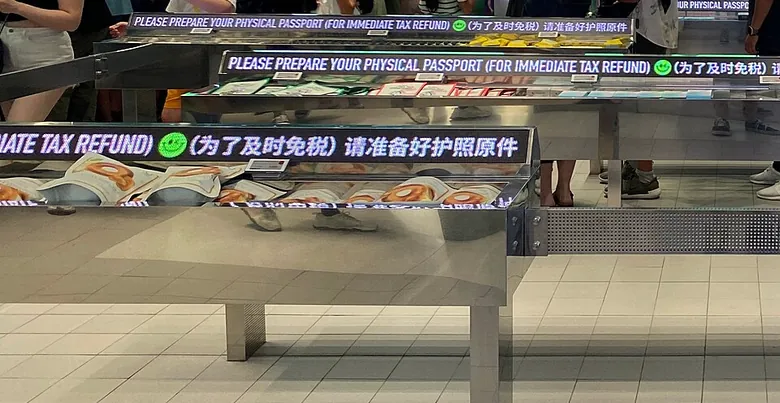
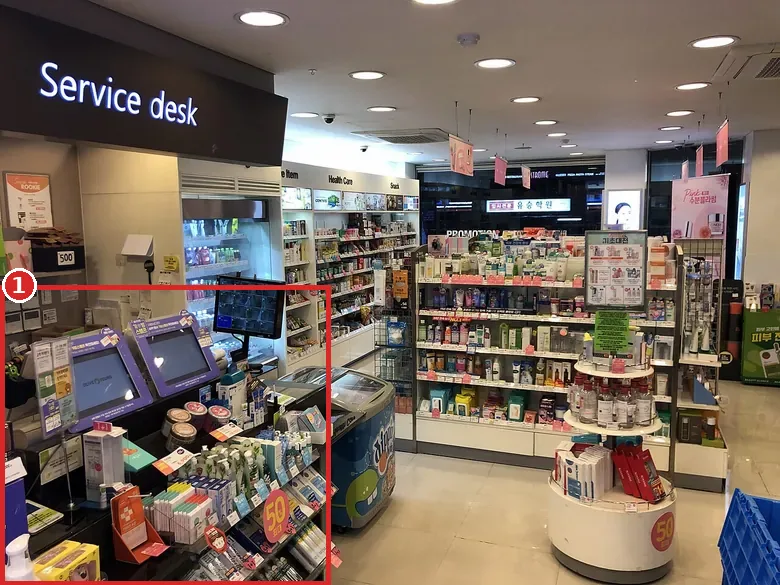

<a class="tr-btn" href="#自分は対象"><i class="ic ic-circle-help" aria-hidden="true"></i>自分は対象?</a><a class="tr-btn go" href="#レジで受け取る"><i class="ic ic-receipt" aria-hidden="true"></i>受け取り方</a><a class="tr-btn" href="#airport"><i class="ic ic-plane" aria-hidden="true"></i>空港で</a>

<figure class="tr-hero acc-hero"><figcaption><b>やることはこれだけ。</b>明洞のあるオリーブヤングのレジの表示:「即時免税のためパスポートの実物をご用意ください(Please prepare your physical passport for immediate tax refund)」。写真:Sgroey、<a href="https://creativecommons.org/licenses/by-sa/4.0/deed.ja" rel="noopener" target="_blank">CC BY-SA 4.0</a>、<a href="https://commons.wikimedia.org/wiki/File:Olive_Young_Myeongdong.jpg" rel="noopener" target="_blank">ウィキメディア・コモンズ</a>(切り抜き、明るさ自動補正)</figcaption></figure>

<ul class="tr-facts"><li><i class="ic ic-id-card" aria-hidden="true"></i>パスポートの実物<small>写真は不可</small></li><li><i class="ic ic-receipt" aria-hidden="true"></i>15,000ウォン以上<small>1店舗・1レシート</small></li><li><i class="ic ic-percent" aria-hidden="true"></i>約5〜8%が戻る<small>還付会社の手数料を引いた後</small></li><li><i class="ic ic-clock" aria-hidden="true"></i>レジでその場で<small>100万ウォン未満</small></li></ul>

**レジですでに税金が引かれたなら、空港ですることはありません。** 還付書類があるなら、仁川空港では4ステップ、この順番で([地図つきの詳しい手順](#airport)):

<ol class="steps"><li><b>チェックイン</b>:還付する商品と書類は預けずに手に持って。</li><li><b>キオスク(税関確認)</b>:出国場に入る前、3階の一般エリア。第1ターミナルはチェックインカウンターB・E・J・L付近、第2ターミナルはF・G付近。</li><li><b>保安検査・出国審査。</b></li><li><b>お金を受け取る</b>:3階の免税エリア。第1ターミナルは28番ゲート付近、第2ターミナルは還付窓口(無人還付機は24時間)。</li></ol>

## 自分は対象?

<ul class="tr-choose"><li><i class="ic ic-user-check" aria-hidden="true"></i><b>対象:韓国滞在が6か月未満の旅行者</b>韓国に住んでおらず、韓国で所得のない外国人旅行者(非居住者)。</li><li><i class="ic ic-user-check" aria-hidden="true"></i><b>対象:海外に2年を超えて住む韓国籍の人</b>韓国滞在が3か月以内の場合(Global Blue・VISITKOREAの案内による)。</li><li><i class="ic ic-user-x" aria-hidden="true"></i><b>対象外:韓国で働いている人・住んでいる人</b>6か月以上滞在する人、韓国駐在の外交官、在韓国連軍・米軍の軍人と軍属、会社名義や代理人による購入も対象外。</li><li><i class="ic ic-ban" aria-hidden="true"></i><b>対象外:皮膚科・美容施術</b>外国人観光客向けの美容施術の還付は2025年12月31日で終了しました。</li></ul>

## 自分のレシートはどっち?

1店舗・1レシートが基準です。別々の店のレシートは合算できません。

<ul class="tr-choose"><li><i class="ic ic-circle-x" aria-hidden="true"></i><b>15,000ウォン未満</b>還付なし。同じ店でまとめて買い、1レシート15,000ウォン以上に。</li><li><i class="ic ic-circle-check" aria-hidden="true"></i><b>15,000ウォン以上100万ウォン未満</b>ほとんどの買い物はこれ。レジでパスポートを見せれば完了(<a href="#レジで受け取る">レジで受け取る</a>)。1回の入国で合計500万ウォンまで。</li><li><i class="ic ic-plane" aria-hidden="true"></i><b>100万ウォン以上</b>全額を払って還付書類を受け取り、空港で税関確認を受けます(<a href="#slip">還付書類で受け取る</a>)。</li><li><i class="ic ic-store" aria-hidden="true"></i><b>免税店舗なのに、レジで即時免税ができない</b>還付書類をもらい、空港か市内の還付カウンター・キオスクへ。</li><li><i class="ic ic-circle-help" aria-hidden="true"></i><b>「Tax Free」の表示がまったくない</b>レジで聞いてみましょう。免税店舗(内国税還付の加盟店)でなければ還付はありません。</li></ul>

## レジで受け取る

<h3 class="tr-step">1<i class="ic ic-store" aria-hidden="true"></i>「Tax Free」「Tax Refund」の表示を探す</h3>

<figure class="tr-photo"><figcaption>レジの表示の例(明洞のあるオリーブヤング)。買う前に加盟店か確かめるよう仁川空港も案内しています。表示が見当たらなければ、レジで「Tax refund?」と聞きましょう。写真:Sgroey、<a href="https://creativecommons.org/licenses/by-sa/4.0/deed.ja" rel="noopener" target="_blank">CC BY-SA 4.0</a>、<a href="https://commons.wikimedia.org/wiki/File:Olive_Young_Myeongdong.jpg" rel="noopener" target="_blank">ウィキメディア・コモンズ</a>(切り抜き、明るさ自動補正)</figcaption></figure>

<h3 class="tr-step">2<i class="ic ic-id-card" aria-hidden="true"></i>支払い時にパスポートを出す</h3>

<figure class="tr-photo"><figcaption><b>1</b> レジ。支払い手段と一緒にパスポートの実物を出すと、お店がパスポートで対象者か確認し、税金分を引いた金額で支払います。セール価格でも対象です。写真:Choi Kwang-mo(オリーブヤング原州丹邱店、2020年、別の支店の写真)、<a href="https://creativecommons.org/publicdomain/zero/1.0/deed.ja" rel="noopener" target="_blank">CC0</a>、<a href="https://commons.wikimedia.org/wiki/File:2020-04-17_22.17.43_%EC%98%AC%EB%A6%AC%EB%B8%8C%EC%98%81_%EC%9B%90%EC%A3%BC%EB%8B%A8%EA%B5%AC%EC%A0%90.jpg" rel="noopener" target="_blank">ウィキメディア・コモンズ</a>(枠と番号を追加)</figcaption></figure>

<h3 class="tr-step">3<i class="ic ic-circle-check" aria-hidden="true"></i>払った金額を確かめて完了</h3>

払った金額が値札の合計より少なければ、税金分が引かれています。オリーブヤング明洞タウンでは、引かれる額は1,000ウォン単位です。

<aside class="tr-note ok"><i class="ic ic-circle-check" aria-hidden="true"></i>空港ですることはありません。購入から3か月以内に商品を韓国から持ち出すだけです。</aside>

<ul class="tr-choose"><li><i class="ic ic-id-card" aria-hidden="true"></i><b>パスポートを持ってこなかったとき</b>即時免税はできません。還付書類をもらえば空港の還付窓口で受け取れます(オリーブヤング明洞タウンの案内)。下の<a href="#slip">還付書類で受け取る</a>の順番で。</li><li><i class="ic ic-receipt" aria-hidden="true"></i><b>レシートが100万ウォン以上、または今回の入国の合計が500万ウォンを超えた</b>即時免税の代わりに還付書類で受け取ります。</li><li><i class="ic ic-circle-x" aria-hidden="true"></i><b>税金が引かれなかった商品がある</b>オリーブヤング明洞タウンでは、衛生用品、ショッピングバッグ、ドライフルーツ商品は免税対象外です。下の「対象外のもの」も見てください。</li></ul>

<h2 id="slip">還付書類で受け取る</h2>

大きな買い物(1レシート100万ウォン以上)、即時免税に対応していない店、パスポートを忘れた日はこの順番です。

<h3 class="tr-step">1<i class="ic ic-receipt" aria-hidden="true"></i>全額を払い、還付書類をもらう</h3>

パスポートを見せて還付書類(Tax Free Form、物品販売確認書)を頼みます。必須項目の漏れや誤りがあると税関で受け付けられないので、自分の情報がもれなく書かれているか確認しましょう。書類を頼まなければ還付は受けられません。レシートと書類は出国まで一緒に保管します。

<h3 class="tr-step">2<i class="ic ic-banknote" aria-hidden="true"></i>希望すれば:市内で先に受け取る</h3>

<ol class="steps"><li><b>どこで:</b>書類に書かれた還付会社の市内の還付カウンターか無人キオスク。GTFの書類なら、オリーブヤング明洞タウン2階グローバルサービスラウンジのGTFデスク(明洞キル53、4号線 明洞駅8番出口)。Global Blueの書類なら、下の地図リンクで近い場所を探します。</li><li><b>持ち物:</b>パスポート、還付書類、クレジットカード。</li><li><b>上限:</b>1回の購入600万ウォン以下。</li><li><b>そのあと:</b>出国時の税関確認は必ず必要で、還付から21日以内(銀聯は15日)です。</li></ol>

<h3 class="tr-step">3<i class="ic ic-stamp" aria-hidden="true"></i>出国の日:空港で税関確認 → 還付</h3>

空港での順番は、すぐ下の[空港で](#airport)に地図と一緒にあります。税関確認がなければ還付もありません。

<ul class="tr-next"><li><a href="https://www.globalblue.com/en/refund-points-map?country=South-Korea" rel="noopener" target="_blank"><i class="ic ic-map-pin" aria-hidden="true"></i>Global Blueの書類なら:税関・還付場所の地図(英語)<i class="ic ic-external-link" aria-hidden="true"></i></a></li></ul>

<h2 id="airport">仁川空港のタックスリファンド、どこでどうする?</h2>

順番はひとつ。**チェックイン → キオスク(税関確認) → 保安検査・出国審査 → 免税エリアでお金を受け取る。** 還付する商品は、税関確認の前に預けないこと。

<figure class="tr-photo"><figcaption><b>第1ターミナル3階 出国場の入口。</b><b>1</b> 出国場番号、<b>2</b> 搭乗口の地図。チェックインとキオスクでの税関確認は、この入口に入る前に、同じ3階の一般エリアで行います。写真:Sgroey、<a href="https://creativecommons.org/licenses/by-sa/4.0/deed.ja" rel="noopener" target="_blank">CC BY-SA 4.0</a>、<a href="https://commons.wikimedia.org/wiki/File:Incheon_airport_departure_gate_access.jpg" rel="noopener" target="_blank">ウィキメディア・コモンズ</a>(切り抜き、明るさ自動補正、枠と番号を追加)</figcaption></figure>

{{fig:tax-refund-t1map|第1ターミナル:3階チェックインカウンターB・E・J・L付近のキオスクで税関確認、免税エリア28番ゲート付近で還付。仁川国際空港公社の施設案内・内国税還付案内(2026年11月26日確認)とVISITKOREAをもとにNadriが描き直しました}}

<h3 class="tr-step">1<i class="ic ic-luggage" aria-hidden="true"></i>チェックイン:還付する商品は手に持って</h3>

<ol class="steps"><li>空港は混むことがあるので余裕を持って。航空会社カウンターで搭乗手続きをし、搭乗券を受け取ります。</li><li>還付する商品と書類は預けずに持っておきます。税関が商品を確認することがあります。</li><li><b>どうしても預けるなら:</b>カウンターのスタッフに、かばんに内国税還付の商品が入っていると伝えます。タグを付けて返されたかばんを持って、次の段階へ。</li></ol>

<h3 class="tr-step">2<i class="ic ic-scan-line" aria-hidden="true"></i>キオスクで税関確認(出国場に入る前)</h3>

<ol class="steps"><li><b>どこで:</b>第1ターミナル3階 一般エリア、チェックインカウンター<b>B・E・J・L付近</b>の内国税還付キオスク(24時間)。第2ターミナルはカウンター<b>F・G付近</b>。カウンター上のアルファベットを見て向かいます。</li><li>キオスクでパスポートと書類を処理します。税関検査の対象と表示されなければ、次の段階へ。Global Blueの書類なら、空港のWi-Fiにつないで korea.mobilevalidation.globalblue.com からスマホでもできます。</li><li><b>税関検査の対象と出たら:</b>税関デスク(第1ターミナル3階 E・Jカウンター付近、第2ターミナル3階 F・Gカウンター付近)に、パスポート、未開封・未使用の商品、書類(物品販売確認書)を出して持ち出し確認を受けます。</li><li>預けるかばんだった場合:税関確認を受けたかばんを、すぐ横の大型手荷物コンベヤーに載せます。</li></ol>

<h3 class="tr-step">3<i class="ic ic-hand-coins" aria-hidden="true"></i>出国審査のあと、免税エリアでお金を受け取る</h3>

<ol class="steps"><li><b>第1ターミナル:</b>3階 免税エリア<b>28番ゲート付近</b>の還付窓口と無人還付機(24時間)。窓口の時間は、空港の還付案内ページとVISITKOREAでは07:00〜22:00、空港の施設リストでは24時間と書かれています。夜なら無人還付機を前提に。搭乗棟(101〜132番ゲート)なら3階中央の薬局横の無人還付機(24時間)。</li><li><b>第2ターミナル:</b>3階 免税エリアの還付窓口 07:00〜21:30。空港の施設リストでは249番ゲート付近と東側270番ゲート付近、空港の還付案内ページでは250番ゲートの向かい・253番ゲート付近と書かれています。無人還付機は24時間。</li><li><b>無人還付機:</b>パスポートを読み取らせると、承認済みの金額が支払われます。金額が大きいときや現金が要らないときは、本人のカードで受け取れます。</li><li><b>受け取れる通貨:</b>窓口はウォン・ドル・人民元・円、無人機はウォン・Alipay・WeChat Pay(VISITKOREA、仁川空港)。</li></ol>

{{fig:tax-refund-t2map|第2ターミナル:3階チェックインカウンターF・G付近のキオスクで税関確認、免税エリアの還付窓口で還付。仁川国際空港公社の施設案内・内国税還付案内とVISITKOREAをもとにNadriが描き直しました}}

<ul class="tr-choose"><li><i class="ic ic-circle-help" aria-hidden="true"></i><b>迷ったとき、機械が使えないとき</b>仁川空港カスタマーセンター 1577-2600。還付窓口:第1ターミナル 032-743-1009(韓国情報通信)、第2ターミナル 032-743-2732(NICE情報通信、施設リストでは032-743-0647)。</li><li><i class="ic ic-mail" aria-hidden="true"></i><b>還付窓口のない空港・港</b>税関確認のあと、書類をメールボックスに入れます。書類に名前と還付方法を書いておく必要があります。</li></ul>

<i class="ic ic-plane" aria-hidden="true"></i>金浦・金海・済州空港

VISITKOREAの案内(2025年10月20日掲載)によります。

| 空港 | 税関 | 還付窓口 | 窓口の時間 |
|---|---|---|---|
| 金浦 | 2階 1番ゲート付近 | 3階 36番ゲート付近 | 06:30〜20:00、無人24時間 |
| 金海 | 2階 B24チェックインカウンター付近 | 2階 4番ゲート付近 | 06:30〜21:00、無人24時間 |
| 済州 | 3階 5番ゲート付近 | 3階 16番ゲート付近 | 06:00〜22:00 |

同じ案内は仁川第2ターミナルの還付窓口を225・249・274番ゲート付近、07:30〜21:30としています。空港公式ページと違うため、上では仁川国際空港公社の資料に従いました。

## 実際に戻る金額

価格の **約5〜8%** です。税率10%は表示価格にすでに含まれていて、還付会社が法令で認められた手数料を差し引きます。購入額が大きいほど割合が上がります。正確な額は還付書類やレシートに出ます。

{{fig:tax-refund-3|手数料を引いたおおよその還付額}}

<i class="ic ic-coins" aria-hidden="true"></i>手数料を引くのは誰か、表で見る

Global Blue、Global Tax Free、Easy Tax Refund、CubeRefundなどの還付会社が、法令で認められた手数料を差し引きます。実際に戻るのは価格の約5〜8%で、購入額が大きいほど割合が上がります。

| 購入額 | 還付額(目安) |
|---|---|
| 50,000ウォン | 2,500ウォン |
| 300,000ウォン | 15,000〜24,000ウォン |
| 1,000,000ウォン | 60,000〜80,000ウォン |

## よくある失敗

<ul class="tr-oops"><li><i class="ic ic-triangle-alert" aria-hidden="true"></i>パスポートの写真だけ持っていく。レジでの即時免税は実物が必要です。</li><li><i class="ic ic-triangle-alert" aria-hidden="true"></i>3つの店で少しずつ買う。レシートは合算できず、1枚ずつ15,000ウォン以上が必要です。</li><li><i class="ic ic-triangle-alert" aria-hidden="true"></i>税関確認の前に、大きな買い物を預け荷物に入れる。預けるならまずチェックインカウンターに伝えます。</li><li><i class="ic ic-triangle-alert" aria-hidden="true"></i>キオスクを飛ばして出国審査へ進む。税関確認は出国場に入る前、3階の一般エリアです。</li><li><i class="ic ic-triangle-alert" aria-hidden="true"></i>店で還付書類をもらわない。書類がなければ還付もありません。</li><li><i class="ic ic-triangle-alert" aria-hidden="true"></i>皮膚科の施術費を還付ありで計算する。2025年12月31日で終了しました。</li></ul>

<i class="ic ic-list-checks" aria-hidden="true"></i>3つの数字と、2024年に変わったこと

- **15,000ウォン:** 1店舗での1回の支払い(税込)の最低額。
- **100万ウォン未満:** 1回の支払いがこれより少なければ、レジでその場で免税。
- **500万ウォン:** 1回の入国中に、その場の免税で買える合計の上限。

100万ウォンと500万ウォンの上限は2024年1月1日に2倍に引き上げられ、2026年も法令にそのまま残っています。最低額15,000ウォンも、2024年から30,000ウォンより引き下げられたものです。市内還付は1回の購入600万ウォン以下です。

<i class="ic ic-ban" aria-hidden="true"></i>対象外のもの

- たばこ、銃砲・刀剣・火薬類、指定文化遺産、依存性のある医薬品、そのほか法律で取引が制限されているもの。
- 本や未加工の食品など付加価値税0%のもの、開封済み・使用済みのもの(還付対象は未使用品に限ります)。
- 税関が目で確認できないサービス(調理済みの食べ物、マッサージなど)と、免税店で買ったもの。
- 2026年1月1日からの美容整形・美容施術。

> 美容施術の還付を復活させる法案は2026年4月に提出されましたが、2026年11月24日の時点でまだ復活していません。施術費は還付なしで計算してください。

<i class="ic ic-calendar-check" aria-hidden="true"></i>買い物の1日、最初から最後まで

**出発前。** 写真ではなくパスポートの実物を、買い物中に取り出しやすい場所へ。大きな買い物(オリーブヤング、百貨店)は、1レシートが15,000ウォンを超えるようにまとめて計画します。

**レジで。** 「Tax Free」の表示を確かめ、カードと一緒にパスポートを出すと、その場で税金分だけ値段が下がります。セール価格でも対象です。オリーブヤングでは大型セール中も免税が使えます。

**帰国の日。** その場で免税になった買い物は、空港ですることはありません。還付書類で買ったものだけ、上の[空港の手順](#airport)どおりに。

<i class="ic ic-info" aria-hidden="true"></i>扱わないもの・出典

このページで扱わないもの:還付会社ごとの手数料表(Global Blueの韓国ページには掲載がなく、ほかの会社は確認できていません)、空港や市内の免税店(タックスリファンドとは別の制度です)。

2026年11月26日(韓国時間)に開いて確認。仁川国際空港公社:<a href="https://www.airport.kr/ap_ko/898/subview.do" rel="noopener" target="_blank">内国税還付の手順</a>(加盟店の確認、1.5万ウォン以上、書類の請求・保管、チェックイン後まずキオスク、検査対象なら税関デスクにパスポート・未開封品・物品販売確認書、預ける荷物はカウンターに伝えてタグ→大型手荷物コンベヤー、第1ターミナル28番ゲート付近の窓口07:00〜22:00(施設リストでは24時間)、無人機は28番付近・搭乗棟3階中央の薬局横で24時間、第2ターミナル250番向かい・253番付近07:00〜21:30、パスポート読み取り・カード受け取り、連絡先)と<a href="https://www.airport.kr/ap_ko/1008/subview.do" rel="noopener" target="_blank">施設リスト</a>(内国税還付キオスク:第1ターミナル3階一般エリアB・E・J・Lカウンター付近24時間、第2ターミナルF・G付近24時間;有人窓口:第1ターミナル免税エリア28番ゲート付近24時間、搭乗棟3階中央、第2ターミナル249番ゲート付近・東側270番ゲート付近07:00〜21:30)。VISITKOREA <a href="https://english.visitkorea.or.kr/svc/contents/infoHtmlView.do?vcontsId=248765" rel="noopener" target="_blank">Comprehensive Tax Refund Guide</a>(2025年10月20日:対象・対象外、サービス・免税品の除外、即時免税の上限、市内還付600万ウォン以下・パスポート・書類・クレジットカード、空港ごとの税関・還付窓口の場所・時間・通貨、メールボックス)。Visit Seoul <a href="https://english.visitseoul.net/Tax-Refund" rel="noopener" target="_blank">Tax Refund</a>(3か月、1.5万ウォン、即時免税100万ウォン未満・合計500万ウォン、市内還付、メールボックス)。Global Blue <a href="https://www.globalblue.com/en/shoppers/how-to-shop-tax-free/destinations/south-korea" rel="noopener" target="_blank">韓国のタックスフリーショッピング案内</a>(対象者、未使用品、付加価値税0%の物品、必須項目、市内還付後21日・銀聯15日、3か月以内の税関確認、空港Wi-Fiでのモバイル確認、税関確認なしなら還付なし)。オリーブヤング<a href="https://myeongdongtown.oliveyoung.com/ja/" rel="noopener" target="_blank">明洞タウンFAQ</a>(1.5万ウォン以上、1レシート最大100万ウォン・上限500万ウォン、5〜8%、千ウォン単位、対象外品、パスポートがなければ書類→空港、GTFデスク)。Korea.net <a href="https://www.korea.net/NewsFocus/policies/view?articleId=242726" rel="noopener" target="_blank">2024年に即時免税の上限が2倍、最低額は3万ウォンから1万5千ウォンへ</a>(2023年11月28日)。The Korea Herald 美容施術の還付終了の報道(<a href="https://www.koreaherald.com/article/10633779" rel="noopener" target="_blank">2025年12月10日</a>、<a href="https://www.koreaherald.com/article/10947687" rel="noopener" target="_blank">2026年11月24日、4月の法案</a>)。韓国 国家法令情報センターの<a href="https://www.law.go.kr/%EB%B2%95%EB%A0%B9/%EC%99%B8%EA%B5%AD%EC%9D%B8%EA%B4%80%EA%B4%91%EA%B0%9D%EB%93%B1%EC%97%90%EB%8C%80%ED%95%9C%EB%B6%80%EA%B0%80%EA%B0%80%EC%B9%98%EC%84%B8%EB%B0%8F%EA%B0%9C%EB%B3%84%EC%86%8C%EB%B9%84%EC%84%B8%ED%8A%B9%EB%A1%80%EA%B7%9C%EC%A0%95" rel="noopener" target="_blank">外国人観光客等に対する付加価値税及び個別消費税特例規定</a>と<a href="https://www.law.go.kr/%EB%B2%95%EB%A0%B9/%EC%99%B8%EA%B5%AD%EC%9D%B8%EA%B4%80%EA%B4%91%EA%B0%9D%EB%93%B1%EC%97%90%EB%8C%80%ED%95%9C%EB%B6%80%EA%B0%80%EA%B0%80%EC%B9%98%EC%84%B8%EB%B0%8F%EA%B0%9C%EB%B3%84%EC%86%8C%EB%B9%84%EC%84%B8%ED%8A%B9%EB%A1%80%EA%B7%9C%EC%A0%95%EC%8B%9C%ED%96%89%EA%B7%9C%EC%B9%99" rel="noopener" target="_blank">施行規則</a>(2026年1月2日施行:対象者、対象外の物品、上限、3か月の持ち出し、還付手数料、たばこ)は以前の版(2026年11月26日午前)で確認し、今回は接続できず開き直せていません。同じ数字は上のVISITKOREA・Visit Seoul・Global Blueで今日確認しました。金額が大きいほど割合が上がることと金額表は、2026年に公開された還付会社の案内で以前の版に確認したもので、今日は開き直せていません(今日確認したオリーブヤングFAQの5〜8%とは合っています)。

## 次に読む

<ul class="tr-next"><li><a href="/ja/olive-young/"><i class="ic ic-shopping-basket" aria-hidden="true"></i>オリーブヤング:店探しから支払いまで<i class="ic ic-arrow-right" aria-hidden="true"></i></a></li><li><a href="/ja/departure-day/"><i class="ic ic-plane" aria-hidden="true"></i>出国の日の準備<i class="ic ic-arrow-right" aria-hidden="true"></i></a></li><li><a href="/ja/deals/"><i class="ic ic-tag" aria-hidden="true"></i>今週のセール情報<i class="ic ic-arrow-right" aria-hidden="true"></i></a></li></ul>
