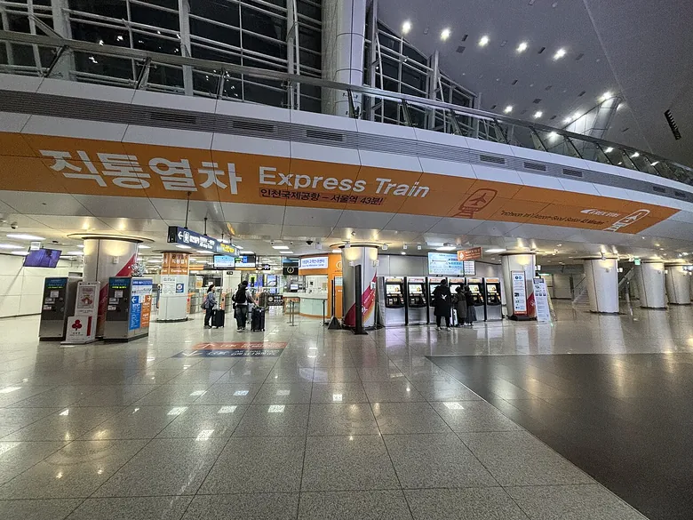
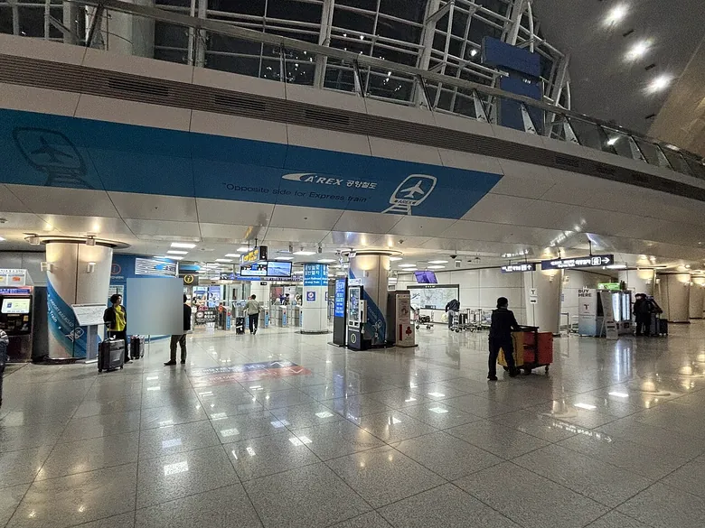
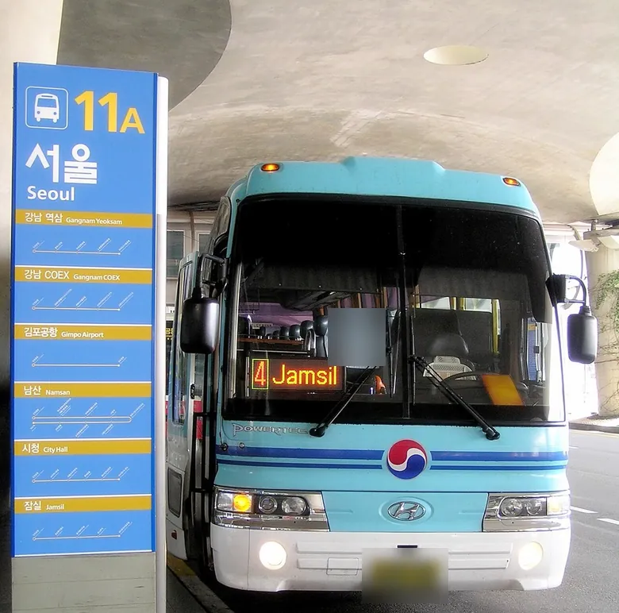
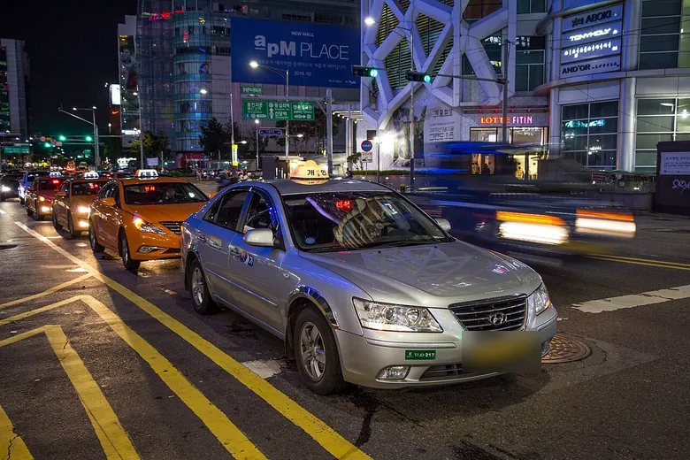
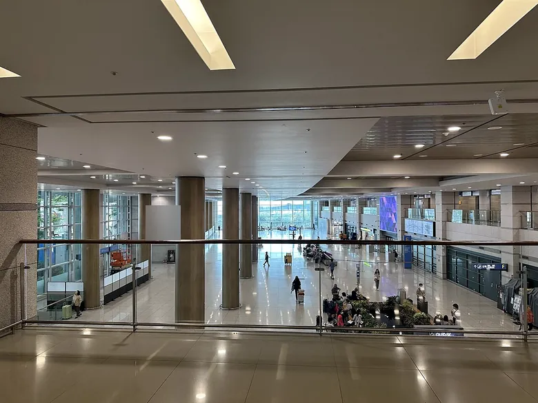
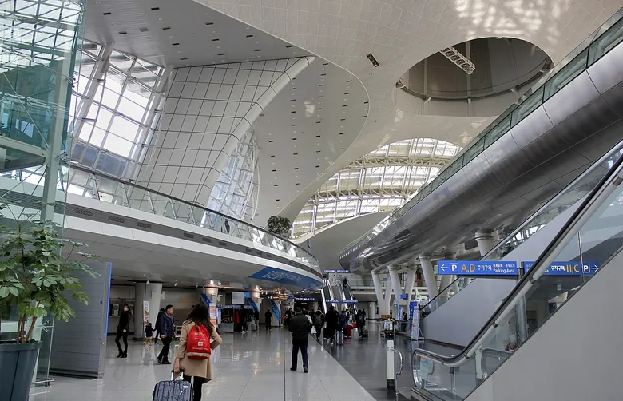
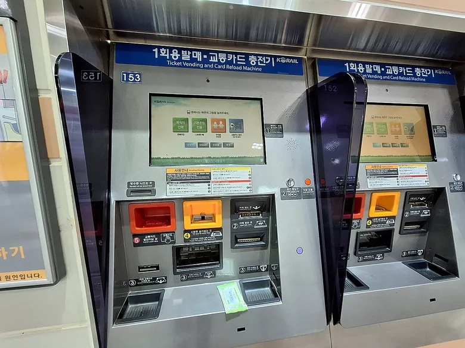
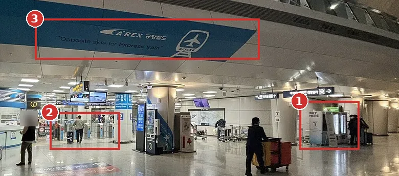
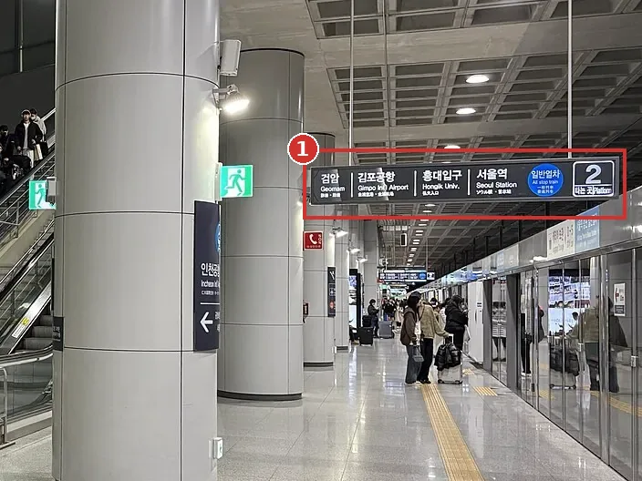
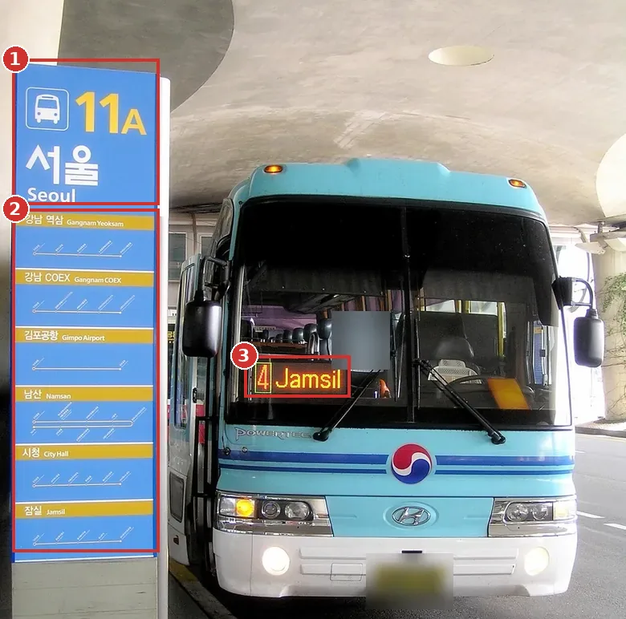

<a class="tr-btn go" href="#pick"><i class="ic ic-hotel" aria-hidden="true"></i>내 숙소엔 뭘 타지?</a><a class="tr-btn" href="#late"><i class="ic ic-moon" aria-hidden="true"></i>밤 9시 이후 착륙?</a>

<figure class="tr-hero"><figcaption><b>서울 가는 열차는 여기서 출발해요.</b> 1터미널 지하 1층 교통센터. 사진: <a href="https://commons.wikimedia.org/wiki/File:202403_AREX_Express_Train_Concourse_at_Incheon_International_Airport_Terminal_1_Station.jpg" rel="noopener" target="_blank">MNXANL</a>, <a href="https://creativecommons.org/licenses/by-sa/4.0" rel="noopener" target="_blank">CC BY-SA 4.0</a>, 위키미디어 공용</figcaption></figure>

<ul class="tr-facts"><li><i class="ic ic-clock" aria-hidden="true"></i>43~80분<small>공항에서 서울 도심까지</small></li><li><i class="ic ic-wallet" aria-hidden="true"></i>4,650~18,000원<small>열차·버스, 어른</small></li><li><i class="ic ic-map-pin" aria-hidden="true"></i>열차: 지하 1층<small>버스표: 1층(1터미널)</small></li><li><i class="ic ic-moon" aria-hidden="true"></i>직통 막차 22:48<small>1터미널 출발</small></li></ul>

<h2 id="pick">내 숙소엔 뭘 타지?</h2>

<ul class="ap-pick"><li><a href="#express"><small><i class="ic ic-hotel" aria-hidden="true"></i>서울역 근처</small><b><i class="ic ic-train-front" aria-hidden="true"></i>공항철도 직통열차</b>43분 · 13,000원 · 지정 좌석</a></li><li><a href="#express"><small><i class="ic ic-hotel" aria-hidden="true"></i>홍대·공덕</small><b><i class="ic ic-train-front" aria-hidden="true"></i>공항철도 일반열차</b>교통카드 4,650원 · 환승 없음</a></li><li><a href="#bus"><small><i class="ic ic-hotel" aria-hidden="true"></i>명동·강남·잠실 등 노선에서 먼 곳</small><b><i class="ic ic-bus" aria-hidden="true"></i>공항 리무진버스</b>60~80분 · 짐은 직원이 실어 줘요</a></li><li><a href="#taxi"><small><i class="ic ic-users" aria-hidden="true"></i>짐 많은 3~4명</small><b><i class="ic ic-car-taxi-front" aria-hidden="true"></i>외국인관광택시(인터내셔널택시)</b>정액 · 70,000~95,000원</a></li><li><a href="#late"><i class="ic ic-moon" aria-hidden="true"></i><small><i class="ic ic-plane" aria-hidden="true"></i>어디든, 밤 9시 이후 착륙</small><b><i class="ic ic-triangle-alert" aria-hidden="true"></i>'늦게 도착한다면' 먼저</b>1터미널 직통 막차 22:48</a></li></ul>

숙소를 아직 못 정했다면 [서울 숙소 지역 고르기](/ko/seoul-areas/)부터 보세요.

<i class="ic ic-info" aria-hidden="true"></i>네 가지 한눈에 비교, 뺀 것

| 숙소가 | 탈 것 | 이유 |
|---|---|---|
| 서울역 근처 | 공항철도 직통열차 | 1터미널에서 안 서고 43분, 지정 좌석 |
| 홍대·공덕 | 공항철도 일반열차 | 두 역 다 서요. 교통카드 4,650원, 환승 없음 |
| 명동·강남·잠실 등 노선에서 먼 곳 | 공항 리무진버스 | 숙소 많은 지역까지 바로, 짐은 직원이 실어 줘요 |
| 어디든, 밤 9시 이후 착륙 | 아래 '늦게 도착한다면' 먼저 | 1터미널 직통 막차가 22:48이에요 |

{{fig:airport-to-seoul-1|1터미널에서 서울까지 네 가지 방법, 어른 요금}}

교통수단 셋과 일행용 대안 하나만 골랐어요. 뺀 것: 김포공항, 렌터카. 시내에 들어온 뒤는 [서울 대중교통](/ko/getting-around/)에 정리했어요.

## 첫 1시간, 사진으로

Visit Seoul은 착륙 뒤 입국심사와 짐 찾기에 1~2시간을 잡으라고 해요. 그다음 열차까지는 이렇게 가요.

<h3 class="tr-step">1<i class="ic ic-signpost" aria-hidden="true"></i>입국장을 나와 열차 표지판을 따라가요</h3>

<figure class="tr-photo"><figcaption><b>1터미널 입국장.</b> 위를 보면 교통센터·공항철도 표지판이 있어요. 사진: <a href="https://commons.wikimedia.org/wiki/File:Incheon_International_Airport_Terminal_1_Arrival_3.jpg" rel="noopener" target="_blank">ノボホショコロトソ</a>, <a href="https://creativecommons.org/licenses/by/4.0" rel="noopener" target="_blank">CC BY 4.0</a>, 위키미디어 공용</figcaption></figure>

<h3 class="tr-step">2<i class="ic ic-arrow-down" aria-hidden="true"></i>지하 1층 교통센터로 내려가요</h3>

<figure class="tr-photo"><figcaption><b>1터미널 교통센터.</b> 열차 발매기, 직통열차 안내센터, 편의점이 지하 1층에 있어요. 사진: <a href="https://commons.wikimedia.org/wiki/File:Incheon_Airport_Transportation_Center_Main_Hall.jpg" rel="noopener" target="_blank">Minseong Kim</a>, <a href="https://creativecommons.org/licenses/by-sa/4.0" rel="noopener" target="_blank">CC BY-SA 4.0</a>, 위키미디어 공용</figcaption></figure>

<h3 class="tr-step">3<i class="ic ic-credit-card" aria-hidden="true"></i>티머니를 사서 충전해요</h3>

<figure><figcaption><b>티머니 카드.</b> 열차·지하철·버스를 한 장으로. 사진: <a href="https://commons.wikimedia.org/wiki/File:T-money_card.jpg" rel="noopener" target="_blank">zisk</a>, Public domain, 위키미디어 공용</figcaption></figure><figure><figcaption><b>교통카드 발매·충전기</b>(사진은 지하철역). 여기서 충전해요. 사진: <a href="https://commons.wikimedia.org/wiki/File:Ticket_Vending_and_Card_Reload_Machine_-_Seoul_Metropolitan_Subway_20240713.jpg" rel="noopener" target="_blank">LandAndTree</a>, <a href="https://creativecommons.org/licenses/by/4.0" rel="noopener" target="_blank">CC BY 4.0</a>, 위키미디어 공용</figcaption></figure>

1. 교통센터의 교통카드 발매기나 편의점에서 사요.
2. 카드에 돈을 충전해요.
3. 카드가 없으면 1회용 승차권: 100원 더 비싸고 보증금 500원은 돌려받아요.

<h3 class="tr-step">4<i class="ic ic-log-in" aria-hidden="true"></i>공항철도 개찰구에 태그해요</h3>

<figure class="tr-photo"><figcaption><b>1터미널역 일반열차 타는 곳(지하 1층).</b> 사진: <a href="https://commons.wikimedia.org/wiki/File:202403_AREX_Local_Train_Concourse_at_Incheon_International_Airport_Terminal_1_Station.jpg" rel="noopener" target="_blank">MNXANL</a>, <a href="https://creativecommons.org/licenses/by-sa/4.0" rel="noopener" target="_blank">CC BY-SA 4.0</a>, 위키미디어 공용; 번호 표시는 Nadri</figcaption></figure>

1. **BUY HERE**라고 적힌 기계: 승차권·교통카드.
2. 개찰구. 카드를 대면 단말기에 잔액이 뜨고 문이 열려요.
3. "Opposite side for Express train"(직통열차는 반대편) 안내. 직통열차는 안내센터가 따로 있어요.

<h3 class="tr-step">5<i class="ic ic-train-front" aria-hidden="true"></i>타고 가며 역 이름을 봐요</h3>

<figure class="tr-photo"><figcaption><b>1터미널역 공항철도 승강장.</b> 사진: <a href="https://commons.wikimedia.org/wiki/File:202403_AREX_Local_Platform_1,2_of_Incheon_International_Airport_Terminal_1_Station.jpg" rel="noopener" target="_blank">MNXANL</a>, <a href="https://creativecommons.org/licenses/by-sa/4.0" rel="noopener" target="_blank">CC BY-SA 4.0</a>, 위키미디어 공용; 번호 표시는 Nadri</figcaption></figure>

1. 표지: 일반열차 2번 타는 곳, 검암·김포공항·홍대입구·서울역 방향.

처음엔 낯선 이름, 그다음 지도에서 본 이름이 나와요.

<ul class="ap-stations"><li>운서</li><li>영종</li><li>청라국제도시</li><li class="sep">→</li><li class="k">김포공항</li><li class="k">홍대입구</li><li class="k">공덕</li><li class="k">서울역</li></ul>

<h3 class="tr-step">6<i class="ic ic-circle-check" aria-hidden="true"></i>숙소 가까운 역에서 태그하고 나와요</h3>

<aside class="tr-note ok"><i class="ic ic-circle-check" aria-hidden="true"></i>나갈 때도 같은 카드를 대요. 끝 장면은 이렇게 고르길 권해요. 표에서 제일 빨라 보이는 것 말고, 숙소에서 제일 가까운 역이나 정류장에서 내리는 것.</aside>

<i class="ic ic-map" aria-hidden="true"></i>1터미널 버스·열차 타는 곳 그림

{{fig:airport-to-seoul-3|1터미널에서 버스와 열차 타는 곳}}

<h2 id="express">열차: 직통이냐 일반이냐</h2>

같은 노선, 같은 역이에요. 내리는 역으로 고르세요.

<h3><i class="ic ic-train-front" aria-hidden="true"></i>직통열차</h3><ul><li><i class="ic ic-clock" aria-hidden="true"></i>서울역까지 안 서고 1터미널 43분, 2터미널 51분</li><li><i class="ic ic-wallet" aria-hidden="true"></i>어른 13,000원</li><li><i class="ic ic-armchair" aria-hidden="true"></i>전 좌석 지정석, 무료 와이파이</li><li><i class="ic ic-ticket" aria-hidden="true"></i>표는 1터미널 지하 1층 교통센터의 직통열차 안내센터나 온라인. 미리 예매하지 않아도 돼요.</li></ul>
숙소가 서울역 근처일 때만. 아니면 아낀 시간이 서울역 환승에 다시 들어가요.
사진: <a href="https://commons.wikimedia.org/wiki/File:202403_AREX_Express_Train_Concourse_at_Incheon_International_Airport_Terminal_1_Station.jpg" rel="noopener" target="_blank">MNXANL</a>, <a href="https://creativecommons.org/licenses/by-sa/4.0" rel="noopener" target="_blank">CC BY-SA 4.0</a>, 위키미디어 공용

<h3><i class="ic ic-train-front" aria-hidden="true"></i>일반열차</h3><ul><li><i class="ic ic-clock" aria-hidden="true"></i>1터미널에서 서울역까지 59분(2터미널 66분)</li><li><i class="ic ic-credit-card" aria-hidden="true"></i>교통카드로 서울역 4,750원, 홍대입구·공덕 4,650원. 2터미널에서 타면 600원 더.</li><li><i class="ic ic-users" aria-hidden="true"></i>지하철처럼 자유석. 출퇴근 시간엔 붐벼서 큰 캐리어는 좀 버거워요.</li></ul>
홍대·공덕이면 이쪽. 같은 노선에 요금은 3분의 1 정도, 갈아탈 필요도 없어요.
사진: <a href="https://commons.wikimedia.org/wiki/File:202403_AREX_Local_Train_Concourse_at_Incheon_International_Airport_Terminal_1_Station.jpg" rel="noopener" target="_blank">MNXANL</a>, <a href="https://creativecommons.org/licenses/by-sa/4.0" rel="noopener" target="_blank">CC BY-SA 4.0</a>, 위키미디어 공용

직통열차는 긴 비행 뒤에 출퇴근 인파를 피하는 게 아낀 시간보다 더 크게 느껴져요.

<i class="ic ic-route" aria-hidden="true"></i>두 열차를 한 노선 위에서 보기

{{fig:airport-to-seoul-2|직통열차와 일반열차는 같은 선로}}

<h2 id="bus">공항 리무진버스</h2>

공항철도 노선에서 먼 숙소라면 짐 들고 갈아타는 횟수가 제일 적은 방법이에요. 표 한 장, 좌석 하나, 짐은 버스 아래 칸.

<figure class="tr-photo"><figcaption><b>인천공항 리무진버스 정류장</b>(2008년 사진: 이 번호 말고 내 승차권에 적힌 정류장 번호를 보세요). 사진: <a href="https://commons.wikimedia.org/wiki/File:Bus_Station_Incheon_Airport.JPG" rel="noopener" target="_blank">Yerbol Nisanbayev</a>, <a href="https://creativecommons.org/licenses/by/3.0" rel="noopener" target="_blank">CC BY 3.0</a>, 위키미디어 공용; 번호 표시는 Nadri</figcaption></figure>

1. 정류장 번호. 내 정류장은 승차권에 적혀 있어요.
2. 이 정류장에서 가는 지역.
3. 버스 앞에 행선지가 떠요.

<ul class="tr-facts"><li><i class="ic ic-clock" aria-hidden="true"></i>약 60~80분<small>서울 시내까지</small></li><li><i class="ic ic-wallet" aria-hidden="true"></i>16,000~18,000원<small>어른, 카드 돼요</small></li><li><i class="ic ic-ticket" aria-hidden="true"></i>표를 사세요<small>승차권 있는 사람이 먼저 타요</small></li><li><i class="ic ic-luggage" aria-hidden="true"></i>1인 짐 2개<small>28인치 이하</small></li></ul>

노선 번호를 찾아요. 예:

<ul class="ap-routes"><li><b>6001</b>명동·동대문</li><li><b>6002</b>홍대·종로</li><li><b>6020</b>강남</li><li><b>6200</b>잠실</li><li><b>6701</b>광화문·시청</li></ul>

1. **표를 사요.** 버스 매표소나 무인 발매기, 1터미널은 1층, 2터미널은 지하층. 티머니도 되지만 승차권을 산 사람이 먼저 타요.
2. **표에 적힌 정류장으로 가요.** 표에는 행선지, 요금, 탑승 시각도 적혀 있어요.
3. **짐은 직원에게 맡기고** 짐표를 받아요.
4. **안내 방송을 듣고 내린 뒤** 짐표 번호를 맞춰 짐을 찾아요.

<i class="ic ic-ticket" aria-hidden="true"></i>승차권에 적힌 것

{{fig:airport-to-seoul-5|공항버스 승차권에 적힌 것}}

<h2 id="taxi">택시: 짐 많은 3~4명이라면</h2>

외국인관광택시(인터내셔널택시)는 인천공항↔서울 정액 요금이라 미터기 걱정이 없어요. 통행료 포함, 1·2터미널에 안내데스크가 있고 해외 카드도 돼요.

<figure class="tr-photo"><figcaption><b>서울 택시.</b> 정액 요금은 터미널 안 외국인관광택시 안내데스크에서. 사진: <a href="https://commons.wikimedia.org/wiki/File:Seoul_taxis_01.jpg" rel="noopener" target="_blank">Ilya Plekhanov</a>, <a href="https://creativecommons.org/licenses/by-sa/4.0" rel="noopener" target="_blank">CC BY-SA 4.0</a>, 위키미디어 공용</figcaption></figure>

중형 기준, 가는 곳(구)별 요금:

<ul class="ap-fares"><li><b>70,000원</b>강서</li><li><b>75,000원</b>마포(홍대)·영등포·은평 등</li><li><b>85,000원</b>중구(명동)·종로·용산 등</li><li><b>90,000원</b>강남·서초·성동 등</li><li><b>95,000원</b>송파(잠실)·강동·광진 등</li></ul>

대형·모범은 100,000~140,000원. 넷이 나누면 85,000원이 1인 약 21,000원이라 버스와 비슷해요.

<i class="ic ic-car-taxi-front" aria-hidden="true"></i>정액 요금 그림으로 보기

{{fig:airport-to-seoul-6|인천공항 출발 외국인관광택시 정액 요금(중형)}}

<h2 id="late">늦게 도착한다면</h2>

<aside class="tr-note"><i class="ic ic-moon" aria-hidden="true"></i><b>공항철도 직통 막차: 1터미널 22:48, 2터미널 22:40.</b> 입국심사와 짐 찾기에 1~2시간이 걸리니 밤 9시 이후 착륙이면 놓칠 수 있어요. 출발 전에 정해 두세요.</aside>

{{fig:airport-to-seoul-7|밤늦게 1터미널에서 탈 수 있는 것}}

- **일반열차:** 더 늦게까지 다녀요. 막차는 날짜별로 [공항철도 열차 시각](https://www.airportrailroad.com/train/normal/info)에서 확인하세요.
- **열차가 끊기면:** 심야 공항버스, 17,000~18,000원. 1터미널 첫차는 23:40~00:10 사이. 표는 매표소나 발매기에서 사요.

<ul class="ap-routes late"><li><b>N6000</b>강남</li><li><b>N6002</b>홍대·청량리</li><li><b>N6701</b>서울역·동대문</li><li><b>N6703</b>잠실·광나루</li></ul>

<i class="ic ic-calendar-days" aria-hidden="true"></i>직통 막차 시각이 바뀐 이유

2026년 10월 23일에 직통열차가 하루 52회에서 56회로 늘면서 시간표가 바뀌었어요. 1터미널 22:48, 2터미널 22:40은 지금 시각표로 평일·휴일 모두 같아요.

## 자주 하는 실수

<ul class="tr-oops"><li><i class="ic ic-triangle-alert" aria-hidden="true"></i><b>공항에서 기후동행카드로 타기.</b> 2026년 10월 1일부터 기후동행카드 단기권으로 공항까지 가서 1·2터미널역에서 내릴 수는 있지만, 공항 역에서 타는 건 안 돼요. 서울로 들어갈 땐 티머니로 내세요.</li><li><i class="ic ic-triangle-alert" aria-hidden="true"></i><b>서울역 근처가 아닌데 직통열차 타기.</b> 아낀 시간이 서울역 환승에 다시 들어가요.</li><li><i class="ic ic-triangle-alert" aria-hidden="true"></i><b>늦은 착륙인데 직통열차 믿기.</b> 1터미널 막차가 22:48이에요.</li><li><i class="ic ic-triangle-alert" aria-hidden="true"></i><b>티머니만 들고 버스 줄 서기.</b> 승차권을 산 사람이 먼저 타요.</li></ul>

## 도착 전에 준비해 두고 싶다면

<aside class="tr-note tip"><i class="ic ic-lightbulb" aria-hidden="true"></i><b>꼭 필요하진 않아요.</b> 교통카드는 공항(발매기·편의점)에서, 직통열차 표는 안내센터에서 팔아요. 미리 사면 사는 시점이 앞당겨질 뿐이에요.</aside>

{{fig:airport-to-seoul-4|티머니와 WOWPASS, 카드마다 되는 것}}

<b>티머니 카드, 공항에서 받기.</b> 일반열차·지하철·버스에 대면 돼요. 사진: <a href="https://commons.wikimedia.org/wiki/File:T-money_card.jpg" rel="noopener" target="_blank">zisk</a>, Public domain, 위키미디어 공용

{{aff:klook_tmoney|티머니 카드 예약하고 공항에서 받기}}

<i class="ic ic-wallet" aria-hidden="true"></i>
<b>WOWPASS.</b> 교통용 티머니에 환전·카드 결제까지 한 장에.

{{aff:klook_wowpass|환전·카드 결제·티머니를 한 장에, WOWPASS}}

<b>직통열차 표를 휴대폰에.</b> 숙소가 서울역 근처일 때만 의미가 있어요. 사진: <a href="https://commons.wikimedia.org/wiki/File:202403_AREX_Express_Train_Concourse_at_Incheon_International_Airport_Terminal_1_Station.jpg" rel="noopener" target="_blank">MNXANL</a>, <a href="https://creativecommons.org/licenses/by-sa/4.0" rel="noopener" target="_blank">CC BY-SA 4.0</a>, 위키미디어 공용

{{aff:klook_airport|공항철도 직통열차 미리 예매하기}}

## 출발 전날 밤에

10분만 준비하면 첫 1시간이 편해요.

1. **숙소가 있는 구를 확인하고** [이 페이지 맨 위](#pick)에서 탈 것을 골라요.
2. **버스라면** 노선 번호를, **택시라면** 그 구의 정액 요금을 적어 둬요.
3. **밤 9시 이후 착륙이라면** 그 지역 심야버스 번호도 적어 둬요.

<ul class="tr-next"><li><a href="/ko/e-arrival-card/"><i class="ic ic-id-card" aria-hidden="true"></i>착륙 전에: 전자입국신고서<i class="ic ic-arrow-right" aria-hidden="true"></i></a></li><li><a href="/ko/getting-around/"><i class="ic ic-route" aria-hidden="true"></i>시내에서: 서울 대중교통<i class="ic ic-arrow-right" aria-hidden="true"></i></a></li><li><a href="/ko/seoul-subway/"><i class="ic ic-train-front" aria-hidden="true"></i>첫 지하철 타기<i class="ic ic-arrow-right" aria-hidden="true"></i></a></li></ul>

<i class="ic ic-list-checks" aria-hidden="true"></i>출처와 사진 정보

2026년 11월 26일 확인: 공항철도 <a href="https://www.airportrailroad.com/train/express/introduce" rel="noopener" target="_blank">직통열차 소개</a>(소요 시간·요금·좌석), <a href="https://www.airportrailroad.com/train/express/info" rel="noopener" target="_blank">직통열차 시각표</a>, <a href="https://www.airportrailroad.com/train/normal/introduce" rel="noopener" target="_blank">일반열차 소개</a>, <a href="https://www.airportrailroad.com/train/normal/fare" rel="noopener" target="_blank">일반열차 운임</a>; Visit Seoul <a href="https://english.visitseoul.net/airport-to-seoul" rel="noopener" target="_blank">Airport to Seoul</a>(2026년 6월 기준 요금·시간, 버스 노선, 짐, 승차권); 인천국제공항 <a href="https://www.airport.kr/" rel="noopener" target="_blank">공항철도 안내</a> (airport.kr: ap_en/1512/subview.do), <a href="https://www.airport.kr/" rel="noopener" target="_blank">심야버스</a> (airport.kr: ap_en/1507/subview.do), <a href="https://www.airport.kr/" rel="noopener" target="_blank">리무진버스 예매 안내</a> (airport.kr: bbs/ap_en/937/138233/artclView.do); 서울시 <a href="https://news.seoul.go.kr/traffic/archives/1659" rel="noopener" target="_blank">서울 택시요금(외국인관광택시 구간요금 포함)</a>(2026년 10월 14일 수정), <a href="https://news.seoul.go.kr/traffic/archives/category/public-news_c1/climate-accompany-card_c1/card-climate_accompany_card" rel="noopener" target="_blank">기후동행카드 단기권</a>(2026년 10월 12일 수정). 이번에 다시 열지 못한 것: 위키트리 <a href="https://www.wikitree.co.kr/articles/1168084" rel="noopener" target="_blank">공항철도 직통열차 2026년 10월 23일부터 하루 52회→56회</a>.

<b>이 페이지의 사진</b>
<ul class="ap-credits"><li><a href="https://commons.wikimedia.org/wiki/File:202403_AREX_Express_Train_Concourse_at_Incheon_International_Airport_Terminal_1_Station.jpg" rel="noopener" target="_blank">File:202403 AREX Express Train Concourse at Incheon International Airport Terminal 1 Station.jpg</a>: MNXANL, <a href="https://creativecommons.org/licenses/by-sa/4.0" rel="noopener" target="_blank">CC BY-SA 4.0</a>. 수정: resized to 780x585, light auto-contrast.</li><li><a href="https://commons.wikimedia.org/wiki/File:202403_AREX_Local_Train_Concourse_at_Incheon_International_Airport_Terminal_1_Station.jpg" rel="noopener" target="_blank">File:202403 AREX Local Train Concourse at Incheon International Airport Terminal 1 Station.jpg</a>: MNXANL, <a href="https://creativecommons.org/licenses/by-sa/4.0" rel="noopener" target="_blank">CC BY-SA 4.0</a>. 수정: resized to 780x585, light auto-contrast, 1 detected face(s) blurred.</li><li><a href="https://commons.wikimedia.org/wiki/File:Bus_Station_Incheon_Airport.JPG" rel="noopener" target="_blank">File:Bus Station Incheon Airport.JPG</a>: Yerbol Nisanbayev, <a href="https://creativecommons.org/licenses/by/3.0" rel="noopener" target="_blank">CC BY 3.0</a>. 수정: cropped, resized to 780x772, light auto-contrast, 1 detected face(s) blurred, 1 area(s) blurred (faces/plates, manual).</li><li><a href="https://commons.wikimedia.org/wiki/File:Seoul_taxis_01.jpg" rel="noopener" target="_blank">File:Seoul taxis 01.jpg</a>: Ilya Plekhanov, <a href="https://creativecommons.org/licenses/by-sa/4.0" rel="noopener" target="_blank">CC BY-SA 4.0</a>. 수정: resized to 780x520, light auto-contrast, 1 area(s) blurred (faces/plates, manual).</li><li><a href="https://commons.wikimedia.org/wiki/File:Incheon_International_Airport_Terminal_1_Arrival_3.jpg" rel="noopener" target="_blank">File:Incheon International Airport Terminal 1 Arrival 3.jpg</a>: ノボホショコロトソ, <a href="https://creativecommons.org/licenses/by/4.0" rel="noopener" target="_blank">CC BY 4.0</a>. 수정: resized to 780x585, light auto-contrast, 1 detected face(s) blurred.</li><li><a href="https://commons.wikimedia.org/wiki/File:Incheon_Airport_Transportation_Center_Main_Hall.jpg" rel="noopener" target="_blank">File:Incheon Airport Transportation Center Main Hall.jpg</a>: Minseong Kim, <a href="https://creativecommons.org/licenses/by-sa/4.0" rel="noopener" target="_blank">CC BY-SA 4.0</a>. 수정: resized to 780x502, light auto-contrast.</li><li><a href="https://commons.wikimedia.org/wiki/File:T-money_card.jpg" rel="noopener" target="_blank">File:T-money card.jpg</a>: zisk, Public domain. 수정: kept at 499x316, light auto-contrast.</li><li><a href="https://commons.wikimedia.org/wiki/File:Ticket_Vending_and_Card_Reload_Machine_-_Seoul_Metropolitan_Subway_20240713.jpg" rel="noopener" target="_blank">File:Ticket Vending and Card Reload Machine - Seoul Metropolitan Subway 20240713.jpg</a>: LandAndTree, <a href="https://creativecommons.org/licenses/by/4.0" rel="noopener" target="_blank">CC BY 4.0</a>. 수정: resized to 780x585, light auto-contrast.</li><li><a href="https://commons.wikimedia.org/wiki/File:202403_AREX_Local_Train_Concourse_at_Incheon_International_Airport_Terminal_1_Station.jpg" rel="noopener" target="_blank">File:202403 AREX Local Train Concourse at Incheon International Airport Terminal 1 Station.jpg</a>: MNXANL, <a href="https://creativecommons.org/licenses/by-sa/4.0" rel="noopener" target="_blank">CC BY-SA 4.0</a>. 수정: cropped, resized to 780x344, light auto-contrast, 1 area blurred (face, manual), numbered red boxes added.</li><li><a href="https://commons.wikimedia.org/wiki/File:202403_AREX_Local_Platform_1,2_of_Incheon_International_Airport_Terminal_1_Station.jpg" rel="noopener" target="_blank">File:202403 AREX Local Platform 1,2 of Incheon International Airport Terminal 1 Station.jpg</a>: MNXANL, <a href="https://creativecommons.org/licenses/by-sa/4.0" rel="noopener" target="_blank">CC BY-SA 4.0</a>. 수정: cropped, kept at 704x528, light auto-contrast, numbered red box added.</li><li><a href="https://commons.wikimedia.org/wiki/File:Bus_Station_Incheon_Airport.JPG" rel="noopener" target="_blank">File:Bus Station Incheon Airport.JPG</a>: Yerbol Nisanbayev, <a href="https://creativecommons.org/licenses/by/3.0" rel="noopener" target="_blank">CC BY 3.0</a>. 수정: cropped, resized to 780x772, light auto-contrast, 1 detected face(s) blurred, 1 area(s) blurred (faces/plates, manual), numbered red boxes added.</li></ul>

