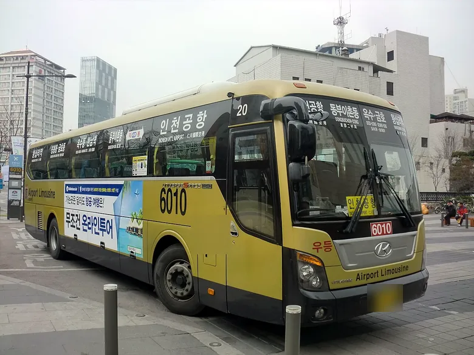

<a class="tr-btn go" href="#pick"><i class="ic ic-hotel" aria-hidden="true"></i>내 숙소엔 뭘 타지?</a><a class="tr-btn" href="#late"><i class="ic ic-moon" aria-hidden="true"></i>밤 9시 이후 착륙?</a>

<figure class="tr-hero"><figcaption><b>1터미널역 공항철도 승강장.</b> 서울 가는 열차가 여기서 출발해요. 사진: <a href="https://commons.wikimedia.org/wiki/File:202403_AREX_Local_Platform_1,2_of_Incheon_International_Airport_Terminal_1_Station.jpg" rel="noopener" target="_blank">MNXANL</a>, <a href="https://creativecommons.org/licenses/by-sa/4.0" rel="noopener" target="_blank">CC BY-SA 4.0</a>, 위키미디어 공용</figcaption></figure>

<ul class="tr-facts"><li><i class="ic ic-clock" aria-hidden="true"></i>43~80분<small>공항에서 서울 도심까지</small></li><li><i class="ic ic-wallet" aria-hidden="true"></i>4,650~18,000원<small>열차·버스, 어른</small></li><li><i class="ic ic-map-pin" aria-hidden="true"></i>열차: 지하 1층<small>버스표: 1층(1터미널)</small></li><li><i class="ic ic-moon" aria-hidden="true"></i>직통 막차 22:48<small>1터미널 출발</small></li></ul>

<h2 id="pick">내 숙소엔 뭘 타지?</h2>

<ul class="ap-pick"><li class="x" id="express">
<small><i class="ic ic-hotel" aria-hidden="true"></i>서울역 근처</small><b><i class="ic ic-train-front" aria-hidden="true"></i>공항철도 직통열차</b>43분 · 13,000원 · 지정 좌석
<ul class="pts"><li><i class="ic ic-clock" aria-hidden="true"></i>서울역까지 안 서고 1터미널 43분, 2터미널 51분</li><li><i class="ic ic-wallet" aria-hidden="true"></i>어른 13,000원</li><li><i class="ic ic-armchair" aria-hidden="true"></i>전 좌석 지정석, 무료 와이파이</li><li><i class="ic ic-ticket" aria-hidden="true"></i>표는 1·2터미널 지하 1층 교통센터의 직통열차 자동발매기·안내센터, 또는 <a href="https://www.airportrailroad.com/ticket/rsv" rel="noopener" target="_blank">공항철도 공식 예매</a>. 해외 카드도 돼요. 미리 예매하지 않아도 돼요. 발매기 누르는 순서는 바로 아래 접힘에 있어요. 클룩에서 미리 샀다면 타기 전에 열차표로 바꿔야 해요: <a href="#express-klook">미리 사기와 공항에서 사기 비교</a>.</li></ul>
우리 판단: 숙소가 서울역 근처일 때 고르세요. 직통열차는 서울역까지만 가서, 다른 곳이면 서울역에서 한 번 더 갈아타야 해요.
</li><li class="x" id="allstop">
<small><i class="ic ic-hotel" aria-hidden="true"></i>홍대·공덕</small><b><i class="ic ic-train-front" aria-hidden="true"></i>공항철도 일반열차</b>교통카드 4,650원 · 환승 없음
<ul class="pts"><li><i class="ic ic-clock" aria-hidden="true"></i>1터미널에서 서울역까지 59분(2터미널 66분)</li><li><i class="ic ic-credit-card" aria-hidden="true"></i>교통카드로 서울역 4,750원, 홍대입구·공덕 4,650원. 2터미널에서 타면 600원 더.</li><li><i class="ic ic-users" aria-hidden="true"></i>지하철처럼 자유석.</li></ul>
홍대·공덕이면 이쪽. 같은 노선에 요금은 3분의 1 정도, 갈아탈 필요도 없어요.
</li><li><a href="#bus"><small><i class="ic ic-hotel" aria-hidden="true"></i>명동·강남·잠실 등 노선에서 먼 곳</small><b><i class="ic ic-bus" aria-hidden="true"></i>공항 리무진버스</b>60~80분 · 짐은 직원이 실어 줘요</a></li><li><a href="#taxi"><i class="ic ic-car-taxi-front" aria-hidden="true"></i><small><i class="ic ic-users" aria-hidden="true"></i>짐 많은 3~4명</small><b><i class="ic ic-car-taxi-front" aria-hidden="true"></i>외국인관광택시(인터내셔널택시)</b>정액 · 70,000~95,000원</a></li><li><a href="#late"><i class="ic ic-moon" aria-hidden="true"></i><small><i class="ic ic-plane" aria-hidden="true"></i>어디든, 밤 9시 이후 착륙</small><b><i class="ic ic-triangle-alert" aria-hidden="true"></i>'밤늦게 도착하면' 먼저</b>1터미널 직통 막차 22:48</a></li></ul>

<i class="ic ic-ticket" aria-hidden="true"></i>직통열차 표, 발매기에서 사는 순서

1. **찾아가기:** 1층 입국장에서 엘리베이터나 에스컬레이터로 지하 1층 교통센터로 내려가요. 1터미널은 교통센터를 바라보고 **오른쪽(서쪽)**이 직통열차 쪽이에요. 2터미널은 방향을 아직 확인하지 못했어요. 지하 1층 교통센터의 **직통열차 고객안내센터**에 물어보세요.
2. **발매기 누르는 순서:** ① 언어 선택(한국어·영어·중국어·일본어) ② 도착역 선택(서울역) ③ 열차(출발 시각) 선택 ④ 인원 선택(어른 만 13세 이상, 어린이 만 6~12세) → '확인' ⑤ 현금이나 카드로 결제 ⑥ 승차권과 영수증을 받아요. 승차권은 꼭 가져가요.
3. **그다음:** 승차권의 QR코드를 게이트에 대고 들어가 **지하 4층** 타는 곳으로 가요. 자세히는 [아래 '산 다음: 직통열차 타기'](#prep).

공항철도 안내에 실린 발매기 화면 예시는 서울역 기계예요. 공항 기계의 화면은 조금 다를 수 있어요.

<i class="ic ic-route" aria-hidden="true"></i>두 열차를 한 노선 위에서 보기

{{fig:airport-to-seoul-2|직통열차와 일반열차는 같은 선로}}

숙소를 아직 못 정했다면 [서울 숙소 지역 고르기](/ko/seoul-areas/)부터 보세요.

<i class="ic ic-info" aria-hidden="true"></i>네 가지 한눈에 비교, 뺀 것

| 숙소가 | 탈 것 | 이유 |
|---|---|---|
| 서울역 근처 | 공항철도 직통열차 | 1터미널에서 안 서고 43분, 지정 좌석 |
| 홍대·공덕 | 공항철도 일반열차 | 두 역 다 서요. 교통카드 4,650원, 환승 없음 |
| 명동·강남·잠실 등 노선에서 먼 곳 | 공항 리무진버스 | 숙소 많은 지역까지 바로, 짐은 직원이 실어 줘요 |
| 어디든, 밤 9시 이후 착륙 | 아래 '밤늦게 도착하면' 먼저 | 1터미널 직통 막차가 22:48이에요 |

{{fig:airport-to-seoul-1|1터미널에서 서울까지 네 가지 방법, 어른 요금}}

교통수단 셋과 일행용 대안 하나만 골랐어요. 뺀 것: 김포공항, 렌터카. 시내에 들어온 뒤는 [서울 대중교통](/ko/getting-around/)에 정리했어요.

## 첫 1시간, 사진으로

Visit Seoul은 착륙 뒤 입국심사와 짐 찾기에 1~2시간을 잡으라고 해요. 그다음 열차까지는 이렇게 가요.

<h3 class="tr-step">1<i class="ic ic-signpost" aria-hidden="true"></i>입국장을 나와 열차 표지판을 따라가요</h3>

<figure class="tr-photo"><figcaption><b>1터미널 입국장,</b> 위층에서 내려다본 모습. 사진: <a href="https://commons.wikimedia.org/wiki/File:Incheon_International_Airport_Terminal_1_Arrival_3.jpg" rel="noopener" target="_blank">ノボホショコロトソ</a>, <a href="https://creativecommons.org/licenses/by/4.0" rel="noopener" target="_blank">CC BY 4.0</a>, 위키미디어 공용</figcaption></figure>

{{fig:airport-to-seoul-t1map|1터미널: 1층 입국장에서 지하 1층 교통센터로. 인천국제공항공사 안내도와 시설 안내(2026년 11월 26일 확인)의 위치를 바탕으로 Nadri가 다시 그렸어요}}

1. 교통센터는 안내도에서 **터미널 가운데(7·8번 출입구 쪽) 앞**이에요. 입국장 A~F 어디로 나와도 교통센터·공항철도(AREX) 표지판을 따라 가운데 쪽으로 가요.
2. 맞게 가고 있다면 보이는 것: 안내데스크(5번·10번 출입구 부근, 24시간), 공항버스 안내데스크(9번·11번 출입구 부근), 통신사 로밍센터(A 입국장 부근 06:00~22:00, F 입국장 부근 24시간).
3. 지하 1층으로 내려가면 교통센터예요. 가운데에 **Travel Center**(07:00~21:30)가 보이면 맞게 온 거예요. 교통센터를 바라보고 왼쪽(동쪽)이 일반열차, 오른쪽(서쪽)이 직통열차예요.

<i class="ic ic-map" aria-hidden="true"></i>2터미널에 도착했다면

{{fig:airport-to-seoul-t2map|2터미널: 1층 입국장에서 지하 1층 교통센터로. 인천국제공항공사 안내도의 위치를 바탕으로 Nadri가 다시 그렸어요}}

2터미널은 입국장(1층)에서 지하 1층 교통센터로 내려가면 열차와 버스가 한곳에 있어요. 버스 타는 곳 번호: 서울 11~35, 경기 36~45, 지방 01~10. 인터내셔널택시는 1층 3C 승차장이에요.

<h3 class="tr-step">2<i class="ic ic-arrow-down" aria-hidden="true"></i>지하 1층 교통센터로 내려가요</h3>

<figure class="tr-photo"><figcaption><b>1터미널역 지하 1층, 직통열차 쪽.</b> 사진: <a href="https://commons.wikimedia.org/wiki/File:202403_AREX_Express_Train_Concourse_at_Incheon_International_Airport_Terminal_1_Station.jpg" rel="noopener" target="_blank">MNXANL</a>, <a href="https://creativecommons.org/licenses/by-sa/4.0" rel="noopener" target="_blank">CC BY-SA 4.0</a>, 위키미디어 공용; 번호 표시는 Nadri</figcaption></figure>

1. 표지: 직통열차 Express Train.
2. 승차권 발매기.

직통열차 안내센터, 교통카드 발매기, 편의점이 모두 지하 1층에 있어요.

<h3 class="tr-step" id="buy-tmoney">3<i class="ic ic-credit-card" aria-hidden="true"></i>티머니를 사서 충전해요</h3>

<figure><figcaption><b>티머니 카드.</b> 열차·지하철·버스를 한 장으로. 사진: <a href="https://commons.wikimedia.org/wiki/File:T-money_card.jpg" rel="noopener" target="_blank">zisk</a>, Public domain (PD-self: released by the author), 위키미디어 공용</figcaption></figure><figure><figcaption><b>교통카드 발매·충전기</b>(인천 소래포구역, 코레일 역. 서울이나 공항의 기계는 모양이 다를 수 있어요). 여기서 충전해요. 사진: <a href="https://commons.wikimedia.org/wiki/File:Ticket_Vending_and_Card_Reload_Machine_-_Seoul_Metropolitan_Subway_20240713.jpg" rel="noopener" target="_blank">LandAndTree</a>, <a href="https://creativecommons.org/licenses/by/4.0" rel="noopener" target="_blank">CC BY 4.0</a>, 위키미디어 공용</figcaption></figure>

1. **사기:** 지하 1층 교통센터의 편의점이나 교통카드 발매기에서 사요. 편의점에서 사는 순서: [편의점 페이지](/ko/convenience-store/#tmoney). 미리 예약한 카드를 받는 법은 [아래 '도착 전에 준비'](#prep)에 있어요.
2. **현금이 없으면:** 1·2터미널 공항철도역의 티머니 자판기에서 교통비가 들어 있는 티머니를 해외 신용카드로 살 수 있어요. 15,000원(카드값 5,000원 + 교통비 10,000원), 2026년 11월 23일부터 팔아요. 다 쓴 뒤 카드로 다시 충전되는지는 공항철도가 밝히지 않았어요. 현금을 뽑으려면 1터미널은 **지하 1층 공항철도 일반열차 승차권 발매기 옆**에 공용 ATM이 있어요(24시간, 1층은 4·6·9·11번 출입구 부근). 이 ATM에서 해외 카드로 돈을 뽑을 수 있는지, 2터미널 ATM이 어디 있는지는 확인하지 못했어요.
3. **충전하기 (현금만):** 발매기에서 ① 화면에서 '교통카드 충전'과 금액을 고르고 ② '교통카드 충전하는 곳'에 카드를 올린 채로 ③ '지폐 넣는 곳'에 지폐를 넣어요. ④ 화면에 뜬 새 잔액을 확인하고 카드를 가져가요. 기계 사진으로 보는 순서: [서울 지하철 2단계](/ko/seoul-subway/)
4. 카드가 없으면 1회용 승차권: 100원 더 비싸고 보증금 500원은 돌려받아요.

<h3 class="tr-step">4<i class="ic ic-log-in" aria-hidden="true"></i>공항철도 개찰구에 태그해요</h3>

<figure class="tr-photo"><figcaption><b>1터미널역 일반열차 타는 곳(지하 1층).</b> 사진: <a href="https://commons.wikimedia.org/wiki/File:202403_AREX_Local_Train_Concourse_at_Incheon_International_Airport_Terminal_1_Station.jpg" rel="noopener" target="_blank">MNXANL</a>, <a href="https://creativecommons.org/licenses/by-sa/4.0" rel="noopener" target="_blank">CC BY-SA 4.0</a>, 위키미디어 공용; 번호 표시는 Nadri</figcaption></figure>

1. **BUY HERE**라고 적힌 기계: 승차권·교통카드.
2. 개찰구. 카드를 대면 단말기에 잔액이 뜨고 문이 열려요. 문이 안 열리면 단말기에 뜬 잔액을 보고, 모자라면 위 3단계처럼 발매기에서 충전하고 다시 대요.
3. "Opposite side for Express train"(직통열차는 반대편) 안내. 직통열차는 안내센터가 따로 있어요.

<h3 class="tr-step">5<i class="ic ic-train-front" aria-hidden="true"></i>타고 가며 역 이름을 봐요</h3>

<figure class="tr-photo"><figcaption><b>1터미널역 공항철도 승강장.</b> 사진: <a href="https://commons.wikimedia.org/wiki/File:202403_AREX_Local_Platform_1,2_of_Incheon_International_Airport_Terminal_1_Station.jpg" rel="noopener" target="_blank">MNXANL</a>, <a href="https://creativecommons.org/licenses/by-sa/4.0" rel="noopener" target="_blank">CC BY-SA 4.0</a>, 위키미디어 공용; 번호 표시는 Nadri</figcaption></figure>

1. 표지: 일반열차 2번 타는 곳, 검암·김포공항·홍대입구·서울역 방향.

처음엔 낯선 이름, 그다음 지도에서 본 이름이 나와요.

<ul class="ap-stations"><li>운서</li><li>영종</li><li>청라국제도시</li><li class="sep">→</li><li class="k">김포공항</li><li class="k">홍대입구</li><li class="k">공덕</li><li class="k">서울역</li></ul>

<h3 class="tr-step">6<i class="ic ic-circle-check" aria-hidden="true"></i>숙소 가까운 역에서 태그하고 나와요</h3>

<aside class="tr-note ok"><i class="ic ic-circle-check" aria-hidden="true"></i>나갈 때도 같은 카드를 대요. 끝 장면은 이렇게 고르길 권해요. 표에서 제일 빨라 보이는 것 말고, 숙소에서 제일 가까운 역이나 정류장에서 내리는 것.</aside>

<i class="ic ic-map" aria-hidden="true"></i>1터미널 버스·열차 타는 곳 그림

{{fig:airport-to-seoul-3|1터미널에서 버스와 열차 타는 곳}}

<h2 id="bus">공항 리무진버스</h2>

공항철도 노선에서 먼 숙소라면 짐 들고 갈아타는 횟수가 제일 적은 방법이에요. 표 한 장, 좌석 하나, 짐은 버스 아래 칸.

<ul class="tr-facts"><li><i class="ic ic-clock" aria-hidden="true"></i>약 60~80분<small>서울 시내까지</small></li><li><i class="ic ic-wallet" aria-hidden="true"></i>16,000~18,000원<small>어른, 카드 돼요</small></li><li><i class="ic ic-ticket" aria-hidden="true"></i>표를 사세요<small>승차권 있는 사람이 먼저 타요</small></li><li><i class="ic ic-luggage" aria-hidden="true"></i>1인 짐 2개<small>28인치 이하</small></li></ul>

**표에 적힌 정류장으로 가요.** 표에는 행선지, 요금, 탑승 시각도 적혀 있어요.

{{fig:airport-to-seoul-5|공항버스 승차권에 적힌 것}}

노선 번호를 찾아요. 예:

<ul class="ap-routes"><li><b>6001</b>명동·동대문</li><li><b>6002</b>홍대·종로</li><li><b>6020</b>강남</li><li><b>6200</b>잠실</li><li><b>6701</b>광화문·시청</li></ul>

1. **표를 사요.** 버스 매표소나 무인 발매기, 1터미널은 1층(공항버스 안내데스크: 9번 출입구 부근 24시간, 11번 출입구 부근 06:00~22:00), 2터미널은 지하층. 티머니도 되지만 승차권을 산 사람이 먼저 타요.
2. **짐은 직원에게 맡기고** 짐표를 받아요.
3. **안내 방송을 듣고 내린 뒤** 짐표 번호를 맞춰 짐을 찾아요.

<h2 id="taxi">택시: 짐 많은 3~4명이라면</h2>

외국인관광택시(인터내셔널택시)는 인천공항↔서울 정액 요금이라 미터기 걱정이 없어요. 통행료 포함, 1·2터미널에 안내데스크가 있고 해외 카드도 돼요.

**인터내셔널택시 타는 곳: 1터미널 4C 승차장, 2터미널 3C 승차장.** 인터내셔널택시 전화 1644-2255. 터미널 안에서 말을 거는 사람을 따라가지 말고 이 지정 승차장에서 타요. 인천국제공항공사가 택시인 척하며 손님을 끄는 승합차(콜밴)의 바가지 요금을 경고하고 있어요.

<figure class="tr-photo"><figcaption><b>일반 택시 사진이에요.</b> 정액 요금은 터미널 안 안내데스크에서 부르는 외국인관광택시(인터내셔널택시)만 해당돼요. 사진: <a href="https://commons.wikimedia.org/wiki/File:Seoul_taxis_01.jpg" rel="noopener" target="_blank">Ilya Plekhanov</a>, <a href="https://creativecommons.org/licenses/by-sa/4.0" rel="noopener" target="_blank">CC BY-SA 4.0</a>, 위키미디어 공용</figcaption></figure>

중형 기준, 가는 곳(구)별 요금:

<ul class="ap-fares"><li><b>70,000원</b>강서</li><li><b>75,000원</b>마포(홍대)·영등포·은평 등</li><li><b>85,000원</b>중구(명동)·종로·용산 등</li><li><b>90,000원</b>강남·서초·성동 등</li><li><b>95,000원</b>송파(잠실)·강동·광진 등</li></ul>

대형·모범은 100,000~140,000원. 넷이 나누면 85,000원이 1인 약 21,000원이라 버스와 비슷해요.

<i class="ic ic-car-taxi-front" aria-hidden="true"></i>정액 요금 그림으로 보기

{{fig:airport-to-seoul-6|인천공항 출발 외국인관광택시 정액 요금(중형)}}

<h2 id="late">인천공항에 밤늦게 도착하면 서울까지 어떻게 가요?</h2>

<aside class="tr-note"><i class="ic ic-moon" aria-hidden="true"></i><b>공항철도 직통 막차: 1터미널 22:48, 2터미널 22:40.</b> Visit Seoul은 입국심사와 짐 찾기에 1~2시간을 잡으라고 안내하니, 밤 9시 이후 착륙이면 놓칠 수 있어요. 출발 전에 정해 두세요.</aside>

**입국장을 나온 시각으로 고르세요.** 아래 시각은 열차·버스가 떠나는 시각이라, 표를 사고 타는 곳까지 갈 시간을 더 두세요.

| 나온 시각 | 이렇게 가요 |
|---|---|
| 직통 막차 전(1터미널 22:48, 2터미널 22:40) | [공항철도 직통열차](#express). 지하 1층 교통센터 |
| 직통이 끊긴 뒤 | [공항철도 일반열차](#allstop). 서울역까지 가는 막차는 1터미널 23:38, 2터미널 23:32(평일·휴일 같음). 그 뒤 1터미널 23:56, 2터미널 23:50 열차는 디지털미디어시티역까지만 가서 홍대입구·서울역에 서지 않아요. [공항철도 역별 시각표](https://www.airportrailroad.com/train/normal/info/100) |
| 1터미널 23:40부터, 2터미널 23:20부터 새벽 4시대까지 | [심야버스](#late-bus) 4개 노선. 숙소 가까이 서는 노선으로 |
| 짐이 많거나 3~4명, 숙소가 버스 정류장에서 멂 | [택시](#late-taxi). 밤 10시~새벽 4시는 미터 요금에 할증이 붙어요(경기 택시는 밤 11시부터) |
| 비행기가 늦어질 수 있음, 짐이 많음, 아이 카시트 필요 | [전용 차량 미리 예약](#late-car). 저희가 본 업체들은 90분 무료 대기가 있었어요 |

{{fig:airport-to-seoul-7|밤늦게 1터미널에서 탈 수 있는 것}}

<h3 id="late-bus">심야버스: 어디서 타고, 몇 시에 있어요?</h3>

- **표:** 1터미널은 1층 버스 매표소(안·밖)나 무인발권기, 2터미널은 지하 1층 교통센터 버스터미널의 매표소(버스 대합실 가운데)나 무인발권기(교통센터 동쪽·서쪽)에서 사요. N6701·N6703은 티머니GO 앱으로도 살 수 있어요.
- **요금(어른):** N6000·N6002 17,000원, N6701·N6703 18,000원. 어린이 10,000원·12,000원.
- **1터미널 타는 곳:** 입국장(1층)에서 3~7번 출구로 나가면 서울행 버스 정류장이 있어요. 그 안에서 **6A(N6000·N6002)**, **3B(N6701·N6703)**를 찾으세요. [인천공항 정류장 그림](https://www.airport.kr/ap_ko/979/subview.do)
- **2터미널 타는 곳:** 입국장(1층)에서 지하 1층 교통센터로 내려가 버스터미널로 가요. 서울행은 가운데 11~35번이에요. **28번(N6000), 19번(N6703)**. N6002는 30번, N6701은 18번인데, 공항 누리집 안에 다른 번호(N6002 24번, N6701 20번)로 적힌 곳도 있어요. 그 근처에서 버스 앞 번호를 확인하세요. [인천공항 정류장 그림](https://www.airport.kr/ap_ko/982/subview.do)

<ul class="ap-routes late"><li><b>N6000</b>강남</li><li><b>N6002</b>홍대·청량리</li><li><b>N6701</b>서울역·동대문</li><li><b>N6703</b>잠실·광나루</li></ul>

| 노선 | 서는 곳(1터미널에서 걸리는 시간) | 1터미널 출발 | 2터미널 출발 |
|---|---|---|---|
| N6000 | 송정역 40분 → 염창역 50분 → 강남고속버스터미널 70분 | 00:10 00:50 01:30 02:10 03:40 04:20 | 23:50 00:30 01:10 01:50 03:20 04:00 |
| N6002 | 홍대 45분 → 포시즌스호텔(광화문) 60분 → 흥인지문(동대문) 75분 → 청량리 90분 | 00:00 00:30 01:00 01:40 04:00 04:40 | 23:40 00:10 00:40 01:20 03:40 04:20 |
| N6701 | 마포역 50분 → 서울역 60분 → 을지로입구 65분 → 동대문디자인플라자 70분 | 23:50 00:40 01:40 03:45 04:40 | 23:30 00:20 01:20 03:25 04:20 |
| N6703 | 서래마을 50분 → 코엑스 65분 → 잠실 롯데월드 70분 → 강변역(테크노마트) 80분 → 광나루역 85분 | 23:40 00:20 01:05 01:45 03:50 04:50 | 23:20 00:00 00:45 01:25 03:30 04:30 |

2터미널에서 타면 1터미널을 거쳐 가서 20분쯤 더 걸려요. 1터미널은 02:10~03:40, 2터미널은 01:50~03:20 사이에 버스가 없어요. 시각은 인천공항 '서울 심야버스' 안내 기준이고, 노선 검색 화면과 1~2분 다른 곳이 있어요.

<h3 id="late-taxi">택시: 밤에는 얼마나 더 내요?</h3>

- **일반택시(미터 요금):** 기본요금 4,800원. 서울·인천 택시는 **22:00~23:00 20%, 23:00~02:00 40%, 02:00~04:00 20%** 더 붙어요. 경기 택시는 23:00~04:00 30%예요. 공항에서 서울·인천·고양·광명·김포·부천으로 가면 시 경계 할증은 없어요.
- **타는 곳:** 1터미널 1층 5C·6C·6D, 2터미널 서울 택시 7C.
- **모범·대형택시(9인승):** 기본요금 7,000원, 22:00~04:00 20%(경기 택시는 23:00~04:00). 1터미널 7C·8C, 2터미널 7D.
- **인터내셔널택시(외국어 지원, 서울까지 정액, 통행료 포함):** 1터미널 4C, 2터미널 3C, 전화 1644-2255. [정액 요금](#taxi)은 서울시 요금표 그대로예요. 이 표에 밤 요금이 따로 적혀 있지 않으니, 탈 때 총액을 먼저 물어보세요.

<h3 id="late-car">전용 차량 미리 예약: 언제 좋아요?</h3>

**밤늦게 도착해 비행기가 늦어질 수 있을 때, 짐이 많을 때, 아이 카시트가 필요할 때, 숙소가 심야버스 정류장에서 멀 때 좋아요.** 공항에서 내 숙소 앞까지 가는 차를 미리 예약해요. 값은 검색 결과의 업체별 줄에서 보고 [택시 정액 요금](#taxi)과 비교하세요.

1. 클룩 공항 이동(Airport transfers) 화면에서 **Airport pick-up**을 고르고, 도착 시각이나 항공편 번호, 숙소 이름(주소), 인원을 넣고 검색해요.
2. 차종마다 최대 인원과 짐 개수가 적혀 있어요. 사람과 짐이 넉넉히 들어가는 차종을 골라요.
3. 그 차종을 펼쳐 업체를 고르기 전에 'See details'에서 대기 시간·취소·짐 규정을 확인해요. 업체마다 다를 수 있어요.
4. **Book now**로 결제하고, 예약 확인서를 휴대폰에 저장해요.

저희가 확인한 범위는 2026년 11월 28일 검색 1번(인천공항→롯데호텔 서울, 밤 11시 30분 도착, 2명)에서 9인승(Comfort 9 seater) 업체 3곳 목록과, 그중 상세 화면 1개예요.

**업체 3곳 모두** 픽업 24시간 전까지 무료 취소, 무료 대기 90분, 마중(Meet & greet)·카시트 표시가 붙어 있었어요.

**상세 화면 1개에서 본 것:**

- 기사가 항공편을 추적해서, 비행기가 늦어져도 착륙 뒤 90분까지 무료로 기다려요. 그 뒤는 추가 요금이에요.
- 24시간 전이 지나 취소하면 환불이 안 돼요.
- 9인승은 최대 5명에 24인치 가방 5개, 또는 26인치 3개, 또는 28인치 2개. 아이와 아기도 1명으로 세요. 휠체어·유모차·골프백은 28인치 가방 1개로 쳐요. 자세한 건 업체에 물어보라고 적혀 있어요.
- **인원이나 짐이 한도를 넘으면 기사가 태우지 않을 수 있고, 이때는 환불이 안 돼요.**
- 마중(Meet & greet)은 돈을 더 내는 선택이고, 기사가 이름판을 들고 입국장에서 기다려요. 카시트도 돈을 더 내는 선택이에요(1~4세 또는 9~18kg).
- 결제하고 몇 분 안에 예약 확인서가 와요.

**확인하지 못한 것:** 마중을 넣지 않았을 때 기사를 어디서 만나고 어떻게 연락하는지. 예약 확인서나 업체 안내를 따르세요.

{{aff:klook_transfer|공항 픽업 차량 찾기(숙소와 도착 시각 넣기)}}

<i class="ic ic-calendar-days" aria-hidden="true"></i>직통 막차 시각이 바뀐 이유

2026년 10월 23일에 직통열차가 하루 52회에서 56회로 늘면서 시간표가 바뀌었어요. 1터미널 22:48, 2터미널 22:40은 지금 시각표로 평일·휴일 모두 같아요.

## 자주 하는 실수

<ul class="tr-oops"><li><i class="ic ic-triangle-alert" aria-hidden="true"></i><b>공항에서 기후동행카드로 타기.</b> 2026년 10월 1일부터 기후동행카드 단기권으로 공항까지 가서 1·2터미널역에서 내릴 수는 있지만, 공항 역에서 타는 건 안 돼요. 서울로 들어갈 땐 티머니로 내세요.</li><li><i class="ic ic-triangle-alert" aria-hidden="true"></i><b>서울역 근처가 아닌데 직통열차 타기.</b> 직통열차는 서울역까지만 가서, 숙소가 다른 곳이면 서울역에서 한 번 더 갈아타야 해요.</li><li><i class="ic ic-triangle-alert" aria-hidden="true"></i><b>늦은 착륙인데 직통열차 믿기.</b> 1터미널 막차가 22:48이에요.</li><li><i class="ic ic-triangle-alert" aria-hidden="true"></i><b>티머니만 들고 버스 줄 서기.</b> 승차권을 산 사람이 먼저 타요.</li></ul>

<h2 id="prep">도착 전에 준비해 두고 싶다면</h2>

<aside class="tr-note tip"><i class="ic ic-lightbulb" aria-hidden="true"></i><b>꼭 필요하진 않아요.</b> 교통카드는 공항(발매기·편의점)에서, 직통열차 표는 지하 1층 발매기·안내센터에서 팔아요. 미리 사면 사는 시점이 앞당겨질 뿐이에요.</aside>

{{fig:airport-to-seoul-4|티머니와 WOWPASS, 카드마다 되는 것}}

<b>티머니 카드, 공항에서 받기.</b> 일반열차·지하철·버스에 대면 돼요. 사진: <a href="https://commons.wikimedia.org/wiki/File:T-money_card.jpg" rel="noopener" target="_blank">zisk</a>, Public domain (PD-self: released by the author), 위키미디어 공용

**받는 곳·시간과 아래 안내 (모두 클룩 상품 페이지, 2026년 11월 28일 운영자가 연 화면 기준):**

| 터미널 | 받는 곳 | 운영 시간 |
|---|---|---|
| 1터미널 | 1층 7번 출구 쪽 서점(Book Store) | 07:00~21:00 |
| 2터미널 | **3층** F 카운터, 트래블메이트 & 서점(Travel Mate & Book Store) | 06:30~21:30 |

- **2터미널은 3층이에요.** 입국장(1층)에서 올라가야 해요.
- **밤늦게 도착하면 못 받을 수 있어요.** 문 닫는 시각(1터미널 21:00, 2터미널 21:30) 전에 입국장을 나올 수 있을 때만 예약하세요. 늦으면 [3단계 '티머니를 사서 충전해요'](#buy-tmoney)의 방법으로 사요. 그곳들이 밤에 문을 여는지는 저희가 확인하지 못했어요.
- **상품은 두 가지:** 카드만, 또는 카드 + 1만 원 충전. 고른 날짜에만 받을 수 있고, 24시간 전까지 무료 취소예요.
- **어린이·청소년:** 6~12세·13~19세는 카드를 산 뒤 편의점 계산대에서 여권으로 생년월일을 등록해야 할인돼요. 0~5세는 기차를 빼고 교통비가 들지 않아요(클룩 안내).
- **충전:** 한 번에 1,000원~90,000원, 카드 잔액은 최대 50만 원. 지하철역 충전기(인천공항역 포함)나 티머니 표시가 있는 편의점에서 해요.

{{aff:klook_tmoney|티머니 카드 예약하고 공항에서 받기}}

<i class="ic ic-list-checks" aria-hidden="true"></i>산 다음: 티머니 받기

1. **받는 곳·시간:** 위 표의 받는 곳으로 가요(1터미널 1층 7번 출구 쪽 서점 07:00~21:00, 2터미널 3층 F 카운터 06:30~21:30). 예약 확인서(바우처)에 다른 곳이 적혀 있으면 확인서를 따르세요. 클룩 안내로는 확인서가 결제 뒤 몇 분 안에 오고, 안 오면 클룩 고객센터에 연락하래요. 가는 길은 아래 그림.
2. **보여 줄 것:** 무엇을 보여 줄지도 예약 확인서에 적혀 있어요. 휴대폰에 미리 저장해 두세요.
3. **잔액:** 개찰구 단말기에 카드를 대면 잔액이 떠요. 모자라면 위 3단계처럼 발매기에서 현금으로 충전해요.
4. **못 받으면:** 판매처(클룩) 고객센터에 예약 번호로 문의하고, 그동안은 지하 1층 편의점이나 공항철도역 티머니 자판기에서 바로 사요.

**받는 곳까지 가는 길**

{{fig:airport-tmoney-t1|1터미널 1층: 입국장(A~F)에서 가운데 밀레니엄홀 근처 서점 K BOOKS로. 인천국제공항공사 매장·시설 안내(2026년 11월 28일 확인)의 위치를 바탕으로 Nadri가 다시 그렸어요}}

- **1터미널:** 짐을 찾고 입국장(A~F 중 하나)에서 나온 곳이 1층이에요. 출입구 번호(1~14번) 표시를 보고 7번 쪽, 곧 가운데로 걸어요. A·B 입국장으로 나왔으면 번호가 커지는 쪽, E·F로 나왔으면 번호가 작아지는 쪽이에요. 서점은 가운데 '밀레니엄홀' 근처의 경인문고(K BOOKS)예요(인천공항 매장 안내: "1층 일반지역 중앙 밀레니엄홀 부근", 07:00~21:00). 가까이에 보이는 것: 7번 출입구 근처 의료관광 안내센터(09:00~21:00), 8번 출입구 근처 꽃집 FLOPORT. 클룩은 'Book Store, 1층 7번 출구, 07:00~21:00'이라고만 적었어요(가게 이름 없음). 인천공항 매장 안내에서 1터미널 1층 서점은 이곳 한 곳뿐이고 시간도 같아서, 같은 곳으로 보여요.

{{fig:airport-tmoney-t2|2터미널 3층: 체크인 카운터 F 맞은편의 트래블메이트 & 북스토어. 인천국제공항공사 3층 안내도와 매장·시설 안내(2026년 11월 28일 확인)를 바탕으로 Nadri가 다시 그렸어요}}

- **2터미널:** 입국장은 1층, 받는 곳은 3층(출국장, 체크인 카운터가 있는 층)이에요. 1층에서 3층으로 올라가는 엘리베이터·에스컬레이터 자리는 저희가 공식 자료로 확인하지 못했어요. 헷갈리면 1층 안내데스크(4번 출입구 근처, 9번 출입구 근처, 24시간)에서 "3층 F 카운터"라고 물어보세요. 3층에는 체크인 카운터 A~N이 늘어서 있고, 가운데 빈 곳을 사이에 두고 한쪽이 A~F, 다른 쪽이 G~N이에요. F는 A~F 쪽에서 가운데에 가장 가까운 카운터예요. 가게 '트래블메이트 & 북스토어'는 F 카운터 맞은편이에요(인천공항 매장 안내). 가까이에 보이는 것: F 카운터 근처 택스리펀드 키오스크, D 카운터 근처 안내데스크(24시간).

<i class="ic ic-wallet" aria-hidden="true"></i>
<b>WOWPASS.</b> 교통용 티머니에 환전·카드 결제까지 한 장에. 단, 지하철·버스에 쓰는 티머니 잔액은 따로 충전해요.

{{aff:klook_wowpass|환전·카드 결제·티머니를 한 장에, WOWPASS}}

<i class="ic ic-list-checks" aria-hidden="true"></i>산 다음: 와우패스 받고 쓰기

1. **받기:** 예약 확인서에 적힌 방법대로 받아요. 와우패스 기기에서 받는 방식이면: 기기에서 **'카드 발급' → '예약 코드로 발급'** → 여권 스캔 → 받은 코드 입력 → 카드가 나오면 한 번 기계에 꽂아 활성화.
2. **앱에 등록:** 와우패스 앱에 카드를 등록해요. 잔액과 티머니 잔액을 보고, 잃어버리면 앱에서 카드를 정지해 와우패스 잔액을 지킬 수 있어요. 단, 카드 안 **티머니 잔액은 카드를 잃어버리면 재발급해도 되찾을 수 없어요.**
3. **결제 잔액 넣기:** 와우패스 기기에서 16종 화폐 현금이나 신용카드로, 또는 앱에서 해외 카드로 충전해요. 기기 위치: [와우패스 기기 찾기](https://www.wowpass.io/ko/map/kiosk).
4. **교통비는 따로:** 지하철·버스는 카드 안의 **티머니 잔액**으로 내요. 역·편의점에서 원화 현금으로, 또는 앱(NFC)에서 와우패스 잔액을 옮겨 충전해요. 이걸 안 하면 개찰구에서 잔액 부족이 떠요.
5. **남은 돈:** 와우패스 잔액은 기기에서 원화 현금으로 출금해요(1회 10만 원까지, 수수료 1,000원, 1,000원 미만 동전은 안 나와요). 티머니 잔액은 편의점 등 티머니 환급처에서 따로 돌려받아요(수수료 500원, 5만 원 이상은 티머니 본사에서만).

출처: [와우패스 사용 안내](https://www.wowpass.io/ko/guide)(2026년 11월 27일 확인).

<h3 id="express-klook">직통열차 표, 클룩에서 미리 살까 공항에서 살까</h3>

**우리 판단: 공항에서 사도 충분해요.** 도착해서 지하 1층 발매기에서 사면 그 표로 바로 타요. 클룩(Klook)에서 미리 사면 결제만 먼저 하는 것이고, 타기 전에 바우처를 열차표로 바꾸는 단계가 하나 더 있어요. 6~12세 아이와 함께거나 휠체어석이 필요하면 공항에서 사세요.

| | 클룩에서 미리 산 바우처 | 공항 지하 1층 발매기·안내센터 |
|---|---|---|
| 사는 때 | 출발 전에 클룩 앱·웹에서 | 도착해서 지하 1층 교통센터에서 |
| 값 | 클룩 결제 화면에 나와요. 공식 요금(어른 13,000원)과 비교해 보고 사세요 | 어른 13,000원 |
| 타기 전에 할 일 | 바우처를 열차표로 바꾸기(활성화). 안 바꾼 바우처로는 못 타요 | 없어요. 받은 승차권 QR로 바로 게이트 |
| 좌석 | 클룩 앱으로 바꾸면 출발 시간대만 고르고 열차·좌석은 자동. 공식 웹사이트나 발매기로 바꾸면 직접 골라요 | 열차(출발 시각)를 골라요. 호차·좌석은 승차권에 적혀 나와요 |
| 바꾸기·환불 | 클룩 앱에서 열차를 고르면 그 뒤에는 환불이 안 되고, 변경은 창구에서 해요(클룩 앱 화면 안내). 공식 웹사이트·발매기로 바꾼 표의 변경·환불은 확인하지 못했어요. 열차 고르기 전 취소는 클룩 예약 화면의 규정을 보세요 | 발매기 표의 방법은 공식 안내에서 찾지 못했어요. 옆 직통열차 고객안내센터에 물어보세요 |
| 6~12세 어린이 | 클룩에서는 어른과 같은 값. 어린이 요금은 현장에서 사라고 클룩이 안내해요 | 인원 선택에서 '어린이'를 골라요 |
| 휠체어석 | 공식 안내: 현장 구매만 돼요 | 현장에서만 사요. 직통열차 고객안내센터에 물어보세요 |
| 필요한 것 | 클룩 앱, 또는 바우처의 13자리 번호 | 카드(해외 카드 가능)나 현금 |

0~5세 아이: 클룩 안내는 '자리를 따로 차지하지 않으면 무료, 어른 1명당 1명까지, 더 있으면 어린이 표'예요. 공항철도 공식 안내는 '보호자 1명이 데려가는 유아가 1명을 넘거나 좌석이 필요하면 어린이 표'예요.

<b>클룩에서 직통열차 바우처 미리 사기.</b> 숙소가 서울역 근처일 때만 의미가 있어요. 사면 타기 전에 아래 세 방법 중 하나로 열차표로 바꿔야 해요. 사진: <a href="https://commons.wikimedia.org/wiki/File:Nearly_empty_Incheon_Airport_Railroad_Express_during_the_coronavirus_outbreak_20200306_104401.jpg" rel="noopener" target="_blank">Bonnielou2013</a>, <a href="https://creativecommons.org/licenses/by-sa/4.0" rel="noopener" target="_blank">CC BY-SA 4.0</a>, 위키미디어 공용

{{aff:klook_airport|클룩에서 직통열차 바우처 미리 사기(타기 전 열차표로 바꿔요)}}

<i class="ic ic-ticket" aria-hidden="true"></i>클룩으로 샀다면: 바우처를 열차표로 바꾸는 3가지

안 바꾼 바우처로는 열차를 못 타요. 공항에 막 도착한 사람에게 쉬운 순서예요(우리 판단: 휴대폰 인터넷이 되면 ①, 안 되면 ②). 화면 글자는 클룩·공항철도 화면에 적힌 영어 그대로예요.

**① 클룩 앱에서 (가장 짧아요)**

1. 클룩 앱 아래쪽 **Account**(계정) → **Bookings**(예약 목록) → AREX 예약을 눌러요.
2. **Status:Awaiting activation**(상태: 활성화 대기)이 보이면 **Go to activate**(활성화하러 가기)를 눌러요.
3. **Select ticket**(표 고르기) 화면에서 **Date**(날짜)와 **Departure Time**(출발 시간대)를 골라요. 그 시간대에 탈 수 있는 가장 이른 열차와 좌석이 자동으로 정해지고, 표는 그날만 써요. 화면 위 안내: 열차를 고른 뒤에는 환불이 안 되고, 변경은 창구(counter)에서 해야 해요.
4. **Status:Activated**(상태: 활성화됨) 아래에 QR코드, **Train no.**(열차 번호), **Car no.**(호차·좌석)가 나와요. 이 QR코드를 게이트에 대요.

**② 공항 '직통열차 승차권발매기'에서 (종이 승차권)**

1. 클룩 앱 예약에서 **See voucher**(바우처 보기)를 눌러 **Voucher no.**(바우처 번호) 13자리를 확인해요. 우리 판단: 도착 전에 적어 두면 휴대폰 인터넷이 없어도 돼요.
2. 지하 1층 교통센터의 **직통열차 승차권발매기**(영어 표지: Express Train Ticket Vending Machine)로 가요. 찾아가는 길은 [위 '발매기에서 사는 순서' 1번](#express-buy).
3. 13자리 번호를 넣고 출발 날짜·시간·좌석을 고르면 종이 승차권이 나와요. 발매기에서 번호를 넣는 메뉴 이름은 확인하지 못했어요. 못 찾으면 옆 직통열차 고객안내센터에 바우처 번호를 보여 주며 물어보세요.
4. 종이 승차권의 QR코드를 게이트에 대요.

**③ 공항철도 공식 웹사이트에서 (좌석을 미리 고르고 싶을 때)**

1. 클룩 예약에서 **See voucher**(바우처 보기)를 눌러 13자리 번호를 확인해요.
2. [공항철도 공식 예매](https://www.airportrailroad.com/ticket/rsv)를 열고 오른쪽 위에서 언어를 골라요(예: ENGLISH - KRW). **Express Train**(직통열차) 탭에서 **Departure Station**(출발역), **Arrival Station**(도착역), **Train Time**(날짜·시각)을 넣어요.
3. **Ticket Reservation**(승차권 예약) 목록에서 탈 열차의 **Reserve**(예약)를 눌러요.
4. **Member Reservation**(회원 예약)이나 **Non-member Reservation**(비회원 예약)을 골라요. 비회원은 이메일 주소만 있으면 돼요. 이메일로 온 6자리 **Verification Code**(인증 번호)를 넣고, **Ticket Confirmation Number**(승차권 확인 번호) 칸에 6자리 숫자를, **Re-enter**(다시 입력) 칸에 같은 숫자를 넣어요(적어 두세요).
5. 좌석을 바꾸려면 **Change Seat**(좌석 변경)를 눌러 골라요.
6. **Discount**(할인)를 눌러 **Exchange Code**(교환 코드) 칸에 13자리 번호를 넣고 **Verify**(확인)를 눌러요. **Total Amount**(총 금액)가 **0 KRW**가 되면 **Pay**(결제)를 눌러요. QR 승차권이 나와요.
7. 이 QR코드를 게이트에 대요.

클룩 상품 페이지에 함께 적힌 것(공항철도 공식 페이지에서는 확인하지 못했어요): 1인당 일반 짐 1개·손가방 1개, 열차 안에서 먹고 마시기 금지, 열차에 짐 두는 곳이 있음, 유모차·휠체어로 탈 수 있음.

출처: Klook 상품 페이지 'AREX Incheon Airport Express'(운영자가 브라우저로 연 화면, 2026년 11월 27일), 공항철도 [직통열차 이용안내](https://www.airportrailroad.com/train/express/guide)(2026년 11월 27일 확인).

<i class="ic ic-list-checks" aria-hidden="true"></i>산 다음: 직통열차 타기

1. **표 확인:** 공항철도 공식 승차권(발매기·공식 예매)은 QR코드가 있어요. 클룩 바우처는 그대로는 못 타요. [위 3가지 중 하나](#express-klook-how)로 먼저 열차표로 바꾸세요(공항철도는 클룩을 제휴 여행사로 두고 있어요).
2. **타는 곳:** 지하 1층 교통센터에서 직통열차 쪽으로 가요. 1터미널은 교통센터를 바라보고 **오른쪽(서쪽)**이에요. 2터미널은 방향을 아직 확인하지 못했어요(직통열차 고객안내센터에 물어보세요). 게이트를 지나 엘리베이터나 에스컬레이터로 **지하 4층** 타는 곳.
3. **게이트:** 승차권 QR코드를 게이트의 QR 스캐너에 대면 문이 열려요.
4. **시간:** 열차 출발 3분 전까지 승강장에 가 있어야 해요. 좌석은 승차권에 적힌 호차·좌석.
5. **바꾸기·취소:** 공식 예매 표는 공항철도 홈페이지·앱의 '승차권 변경/반환'에서 해요(변경은 3번까지, 출발 당일 두 번 이상 바꾸면 수수료). 클룩 앱에서 바꾼 표는 열차를 고른 뒤에는 환불이 안 되고, 변경은 창구에서 해요(클룩 앱 화면 안내). 공식 웹사이트·발매기로 바꾼 표는 확인하지 못했어요. 직통열차 고객안내센터에 물어보세요.

출처: 공항철도 [직통열차 이용안내](https://www.airportrailroad.com/train/express/guide), [제휴사](https://www.airportrailroad.com/train/express/partners)(2026년 11월 27일 확인), Klook 상품 페이지(운영자가 브라우저로 연 화면, 2026년 11월 27일).

## 출발 전날 밤에

세 가지만 정해 두세요.

1. **숙소가 있는 구를 확인하고** [이 페이지 맨 위](#pick)에서 탈 것을 골라요.
2. **버스라면** 노선 번호를, **택시라면** 그 구의 정액 요금을 적어 둬요.
3. **밤 9시 이후 착륙이라면** 그 지역 심야버스 번호도 적어 둬요.

<ul class="tr-next"><li><a href="/ko/e-arrival-card/"><i class="ic ic-id-card" aria-hidden="true"></i>착륙 전에: 전자입국신고서<i class="ic ic-arrow-right" aria-hidden="true"></i></a></li><li><a href="/ko/getting-around/"><i class="ic ic-route" aria-hidden="true"></i>시내에서: 서울 대중교통<i class="ic ic-arrow-right" aria-hidden="true"></i></a></li><li><a href="/ko/seoul-subway/"><i class="ic ic-train-front" aria-hidden="true"></i>첫 지하철 타기<i class="ic ic-arrow-right" aria-hidden="true"></i></a></li></ul>

<i class="ic ic-list-checks" aria-hidden="true"></i>출처와 사진 정보

2026년 11월 26일 확인: 공항철도 <a href="https://www.airportrailroad.com/train/express/introduce" rel="noopener" target="_blank">직통열차 소개</a>(소요 시간·요금·좌석), <a href="https://www.airportrailroad.com/train/express/info" rel="noopener" target="_blank">직통열차 시각표</a>, <a href="https://www.airportrailroad.com/train/normal/introduce" rel="noopener" target="_blank">일반열차 소개</a>, <a href="https://www.airportrailroad.com/train/normal/fare" rel="noopener" target="_blank">일반열차 운임</a>; Visit Seoul <a href="https://english.visitseoul.net/airport-to-seoul" rel="noopener" target="_blank">Airport to Seoul</a>(2026년 6월 기준 요금·시간, 버스 노선, 짐, 승차권); 인천국제공항 <a href="https://www.airport.kr/" rel="noopener" target="_blank">공항철도 안내</a> (airport.kr: ap_en/1512/subview.do), <a href="https://www.airport.kr/" rel="noopener" target="_blank">심야버스</a> (airport.kr: ap_en/1507/subview.do), <a href="https://www.airport.kr/" rel="noopener" target="_blank">리무진버스 예매 안내</a> (airport.kr: bbs/ap_en/937/138233/artclView.do); 서울시 <a href="https://news.seoul.go.kr/traffic/archives/1659" rel="noopener" target="_blank">서울 택시요금(외국인관광택시 구간요금 포함)</a>(2026년 10월 14일 수정), <a href="https://news.seoul.go.kr/traffic/archives/category/public-news_c1/climate-accompany-card_c1/card-climate_accompany_card" rel="noopener" target="_blank">기후동행카드 단기권</a>(2026년 10월 12일 수정). 이번에 다시 열지 못한 것: 위키트리 <a href="https://www.wikitree.co.kr/articles/1168084" rel="noopener" target="_blank">공항철도 직통열차 2026년 10월 23일부터 하루 52회→56회</a>. 인천국제공항공사 <a href="https://www.airport.kr/ap_ko/986/subview.do" rel="noopener" target="_blank">택시이용안내</a>(승차장 번호·콜밴 주의), <a href="https://www.airport.kr/ap_ko/1008/subview.do" rel="noopener" target="_blank">편의·공공시설</a>(공항버스 안내데스크 위치), <a href="https://www.airport.kr/ap_ko/974/subview.do" rel="noopener" target="_blank">버스</a>(매표 안내) — 2026년 11월 26일 12시 확인. <a href="https://www.airport.kr/ap_en/1512/subview.do" rel="noopener" target="_blank">공항철도 안내 안내도</a>(1·2터미널 교통센터 위치, 버스 타는 곳 번호)

2026년 11월 27일 확인: 공항철도 <a href="https://www.airportrailroad.com/train/express/guide" rel="noopener" target="_blank">직통열차 이용안내</a>(자동발매기 1·2터미널 지하 1층 교통센터·서울역 지하 2층, 발매기 이용 순서 01~06, 해외 카드, QR 게이트, 지하 4층 타는 곳, 출발 3분 전, 변경 3회·수수료, 보호자 1명이 데려가는 유아가 1명을 넘거나 좌석이 필요하면 어린이 표, 휠체어 좌석은 현장 구매만), <a href="https://www.airportrailroad.com/train/express/introduce" rel="noopener" target="_blank">직통열차 소개</a>(1·2터미널 지하 1층 교통센터 직통열차 고객안내센터), <a href="https://www.airportrailroad.com/train/express/partners" rel="noopener" target="_blank">제휴사</a>(여행사에 KLOOK); 와우패스 <a href="https://www.wowpass.io/ko/guide" rel="noopener" target="_blank">사용 안내</a>(충전·출금·티머니 충전·환불, 예약 코드 발급 순서, 잃어버리면 티머니 잔액은 못 찾음); 인천국제공항공사 <a href="https://www.airport.kr/ap_ko/1008/subview.do" rel="noopener" target="_blank">편의·공공시설</a>(공용 ATM: 지하 1층 공항철도 일반열차 승차권 발매기 인근, 1층 4·6·9·11번 출입구 부근, 24시간); 코리아헤럴드 <a href="https://www.koreaherald.com/article/10947683" rel="noopener" target="_blank">공항철도 티머니 카드</a>(교통비가 들어 있는 카드 15,000원, 해외 카드, 재충전 방법 미공개). 확인하지 못한 것: 2터미널 지하 1층에서 직통열차 쪽 방향(공항철도·인천공항 안내 글에 방향이 없어요), 공용 ATM의 해외 카드 사용 여부와 2터미널 ATM 위치(인천공항 시설 목록에 1터미널만 있어요); 클룩 상품 페이지(티머니 공항 수령·와우패스의 받는 곳과 사용 방법) — 클룩 사이트가 자동 접속을 막아 열지 못했어요. 그래서 받는 곳은 예약 확인서를 따르라고 적었어요. 직통열차 발매기에서 산 표의 변경·환불 방법과, 발매기에서 클룩 바우처 번호를 넣는 메뉴 이름도 확인하지 못했어요. Klook 상품 페이지 'AREX Incheon Airport Express'(운영자가 브라우저로 연 화면, 2026년 11월 27일): 바우처를 열차표로 바꾸는 3가지(클룩 앱·공항철도 공식 웹사이트·역의 직통열차 승차권발매기)와 각 화면의 글자, 활성화하지 않은 바우처로는 못 탐, 앱에서 바꾸면 시간대를 고른 뒤 열차·좌석 자동 배정·그날만 사용, 열차를 고른 뒤 환불 불가·변경은 창구, 6~12세 어린이 요금은 현장 구매·클룩에서는 어른과 같은 값, 0~5세, 짐·먹고 마시기 안내. 화면 속 가격과 날짜는 예시 화면이라 쓰지 않았어요.

2026년 11월 28일 확인(밤늦게 도착): 인천국제공항공사 서울 심야버스 <a href="https://www.airport.kr/ap_ko/979/subview.do" rel="noopener" target="_blank">1터미널</a>·<a href="https://www.airport.kr/ap_ko/982/subview.do" rel="noopener" target="_blank">2터미널</a>(요금·서는 곳·출발 시각·정류장 그림), <a href="https://www.airport.kr/ap_ko/976/subview.do" rel="noopener" target="_blank">버스 검색</a>(노선별 승차 위치), <a href="https://www.airport.kr/ap_ko/972/subview.do" rel="noopener" target="_blank">1터미널 버스정차장</a>·<a href="https://www.airport.kr/ap_ko/975/subview.do" rel="noopener" target="_blank">2터미널 버스정차장</a>(매표소·발권기 위치, 입국 소요 1~2시간), <a href="https://www.airport.kr/ap_ko/986/subview.do" rel="noopener" target="_blank">택시 이용 안내</a>(승차장 번호·심야 할증·시계 할증); 공항철도 역별 시각표 <a href="https://www.airportrailroad.com/train/normal/info/100" rel="noopener" target="_blank">인천공항1터미널</a>·<a href="https://www.airportrailroad.com/train/normal/info/110" rel="noopener" target="_blank">인천공항2터미널</a>(평일·휴일, 서울역 방면); 서울시 <a href="https://news.seoul.go.kr/traffic/archives/1659" rel="noopener" target="_blank">서울 택시요금</a>(외국인관광택시 구간요금). 전용 차량: 클룩 공항 픽업 검색 화면(운영자가 브라우저로 연 화면, 2026년 11월 28일, 인천공항→롯데호텔 서울, 밤 11시 30분 도착, 2명) — 9인승 업체 3곳 목록(무료 취소·무료 대기·선택 서비스)과 상세 1개(대기·취소·인원·짐·마중·카시트·확인서). 화면 속 가격과 날짜는 쓰지 않았어요.

<b>이 페이지의 사진</b>
<ul class="ap-credits"><li><a href="https://commons.wikimedia.org/wiki/File:202403_AREX_Local_Platform_1,2_of_Incheon_International_Airport_Terminal_1_Station.jpg" rel="noopener" target="_blank">File:202403 AREX Local Platform 1,2 of Incheon International Airport Terminal 1 Station.jpg</a>: MNXANL, <a href="https://creativecommons.org/licenses/by-sa/4.0" rel="noopener" target="_blank">CC BY-SA 4.0</a>. 수정: cropped, resized to 780x492, light auto-contrast.</li><li><a href="https://commons.wikimedia.org/wiki/File:Nearly_empty_Incheon_Airport_Railroad_Express_during_the_coronavirus_outbreak_20200306_104401.jpg" rel="noopener" target="_blank">File:Nearly empty Incheon Airport Railroad Express during the coronavirus outbreak 20200306 104401.jpg</a>: Bonnielou2013, <a href="https://creativecommons.org/licenses/by-sa/4.0" rel="noopener" target="_blank">CC BY-SA 4.0</a>. 수정: cropped, resized to 780x971, light auto-contrast.</li><li><a href="https://commons.wikimedia.org/wiki/File:202403_AREX_Local_Train_Concourse_at_Incheon_International_Airport_Terminal_1_Station.jpg" rel="noopener" target="_blank">File:202403 AREX Local Train Concourse at Incheon International Airport Terminal 1 Station.jpg</a>: MNXANL, <a href="https://creativecommons.org/licenses/by-sa/4.0" rel="noopener" target="_blank">CC BY-SA 4.0</a>. 수정: resized to 780x585, light auto-contrast, 1 detected face(s) blurred.</li><li><a href="https://commons.wikimedia.org/wiki/File:Incheon_Airport_Limousine_6010.JPG" rel="noopener" target="_blank">File:Incheon Airport Limousine 6010.JPG</a>: hyolee2, <a href="https://creativecommons.org/licenses/by-sa/3.0" rel="noopener" target="_blank">CC BY-SA 3.0</a>. 수정: resized to 780x585, light auto-contrast, 1 detected face(s) blurred, 1 area(s) blurred (faces/plates, manual).</li><li><a href="https://commons.wikimedia.org/wiki/File:Incheon_International_Airport_Terminal_1_Arrival_3.jpg" rel="noopener" target="_blank">File:Incheon International Airport Terminal 1 Arrival 3.jpg</a>: ノボホショコロトソ, <a href="https://creativecommons.org/licenses/by/4.0" rel="noopener" target="_blank">CC BY 4.0</a>. 수정: resized to 780x585, light auto-contrast, 1 detected face(s) blurred.</li><li><a href="https://commons.wikimedia.org/wiki/File:202403_AREX_Express_Train_Concourse_at_Incheon_International_Airport_Terminal_1_Station.jpg" rel="noopener" target="_blank">File:202403 AREX Express Train Concourse at Incheon International Airport Terminal 1 Station.jpg</a>: MNXANL, <a href="https://creativecommons.org/licenses/by-sa/4.0" rel="noopener" target="_blank">CC BY-SA 4.0</a>. 수정: resized, light auto-contrast, numbered red boxes added.</li><li><a href="https://commons.wikimedia.org/wiki/File:T-money_card.jpg" rel="noopener" target="_blank">File:T-money card.jpg</a>: zisk, Public domain (PD-self: released by the author). 수정: kept at 499x316, light auto-contrast.</li><li><a href="https://commons.wikimedia.org/wiki/File:Ticket_Vending_and_Card_Reload_Machine_-_Seoul_Metropolitan_Subway_20240713.jpg" rel="noopener" target="_blank">File:Ticket Vending and Card Reload Machine - Seoul Metropolitan Subway 20240713.jpg</a>: LandAndTree, <a href="https://creativecommons.org/licenses/by/4.0" rel="noopener" target="_blank">CC BY 4.0</a>. 수정: resized to 780x585, light auto-contrast.</li><li><a href="https://commons.wikimedia.org/wiki/File:202403_AREX_Local_Train_Concourse_at_Incheon_International_Airport_Terminal_1_Station.jpg" rel="noopener" target="_blank">File:202403 AREX Local Train Concourse at Incheon International Airport Terminal 1 Station.jpg</a>: MNXANL, <a href="https://creativecommons.org/licenses/by-sa/4.0" rel="noopener" target="_blank">CC BY-SA 4.0</a>. 수정: cropped, resized to 780x344, light auto-contrast, 1 area blurred (face, manual), numbered red boxes added.</li><li><a href="https://commons.wikimedia.org/wiki/File:202403_AREX_Local_Platform_1,2_of_Incheon_International_Airport_Terminal_1_Station.jpg" rel="noopener" target="_blank">File:202403 AREX Local Platform 1,2 of Incheon International Airport Terminal 1 Station.jpg</a>: MNXANL, <a href="https://creativecommons.org/licenses/by-sa/4.0" rel="noopener" target="_blank">CC BY-SA 4.0</a>. 수정: cropped to the platform sign (from the full-size original), resized to 780x269, light auto-contrast, numbered red box added.</li><li><a href="https://commons.wikimedia.org/wiki/File:Seoul_taxis_01.jpg" rel="noopener" target="_blank">File:Seoul taxis 01.jpg</a>: Ilya Plekhanov, <a href="https://creativecommons.org/licenses/by-sa/4.0" rel="noopener" target="_blank">CC BY-SA 4.0</a>. 수정: resized to 780x520, light auto-contrast, 1 area(s) blurred (faces/plates, manual).</li></ul>

