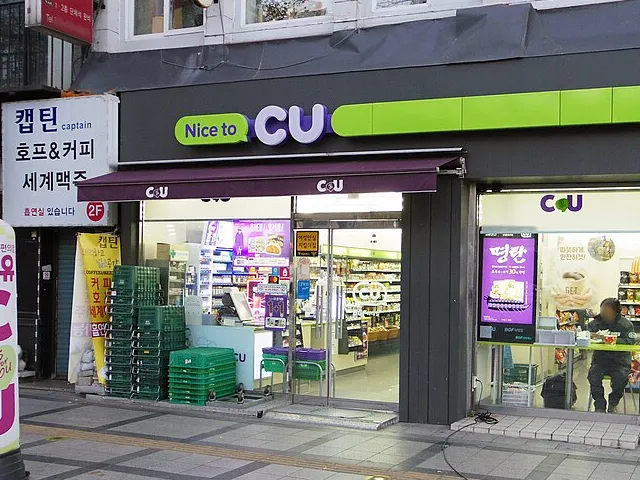
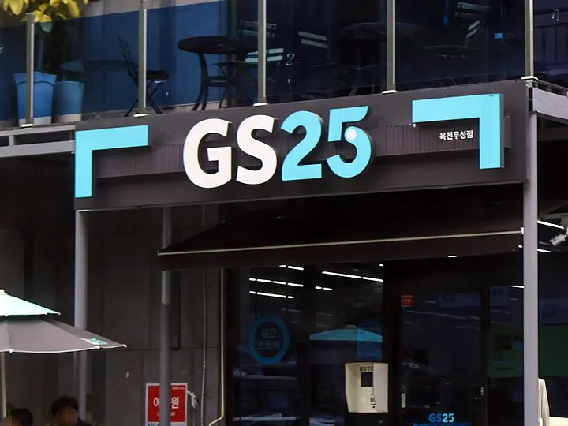
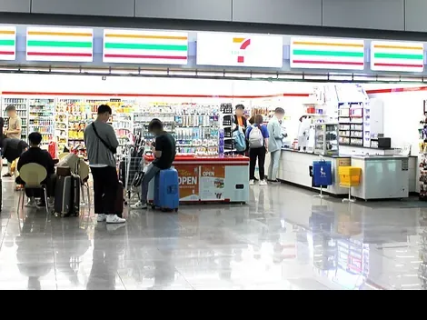
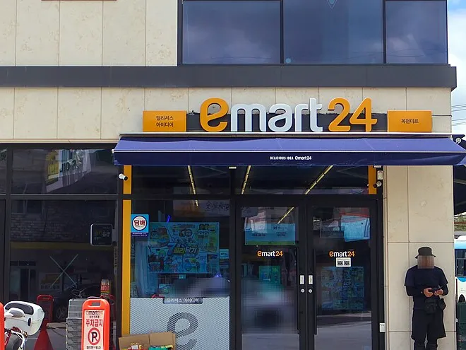
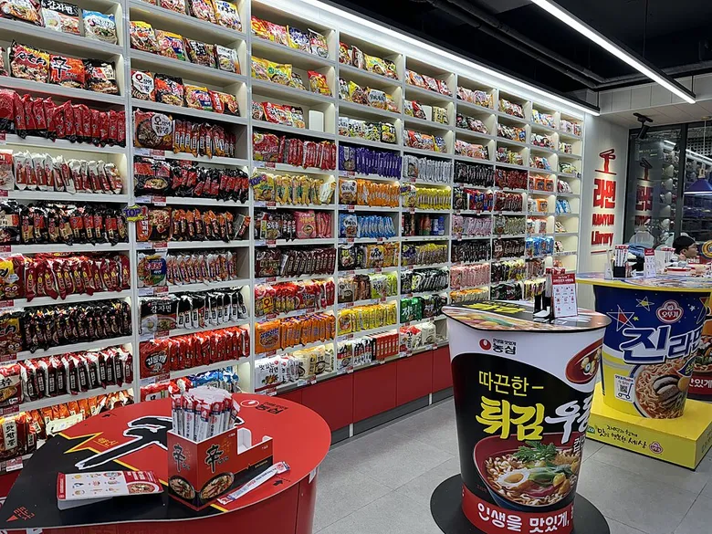

<a class="tr-btn go" href="#tmoney"><i class="ic ic-credit-card" aria-hidden="true"></i>티머니 사고 충전하기</a><a class="tr-btn" href="#find"><i class="ic ic-moon" aria-hidden="true"></i>24시간 매장 찾기</a>

<ul class="tr-colours"><li><b>CU</b>보라색 글자, 연두색 띠.<a href="https://commons.wikimedia.org/wiki/File:CU_Namdaemun-ro-5ga_branch_20181122_072838.jpg" rel="noopener" target="_blank">LERK</a>, <a href="https://creativecommons.org/licenses/by-sa/4.0/deed.ko" rel="noopener" target="_blank">CC BY-SA 4.0</a> (잘라 냄)</li><li><b>GS25</b>흰 ‘GS’와 하늘색 ‘25’.<a href="https://commons.wikimedia.org/wiki/File:GS25_Okcheon_Museong_Branch_20240730.jpg" rel="noopener" target="_blank">LandAndTree</a>, <a href="https://creativecommons.org/publicdomain/zero/1.0/deed.ko" rel="noopener" target="_blank">CC0</a> (잘라 냄)</li><li><b>세븐일레븐</b>주황·초록·빨강 줄무늬와 7.<a href="https://commons.wikimedia.org/wiki/File:7-Eleven_Muan-international-airport_store_20190520_181056.jpg" rel="noopener" target="_blank">LERK</a>, <a href="https://creativecommons.org/licenses/by-sa/4.0/deed.ko" rel="noopener" target="_blank">CC BY-SA 4.0</a> (잘라 냄)</li><li><b>이마트24</b>노란 ‘emart24’ 글자.<a href="https://commons.wikimedia.org/wiki/File:E-mart_24_Okcheon_Mir_Branch_20240731.jpg" rel="noopener" target="_blank">LandAndTree</a>, <a href="https://creativecommons.org/publicdomain/zero/1.0/deed.ko" rel="noopener" target="_blank">CC0</a> (잘라 냄)</li></ul>

<ul class="tr-facts"><li><i class="ic ic-store" aria-hidden="true"></i>4대 편의점<small>2025년 말 53,266곳(보도 기준)</small></li><li><i class="ic ic-moon" aria-hidden="true"></i>약 78%만 24시간<small>새벽엔 영업시간 확인</small></li><li><i class="ic ic-banknote" aria-hidden="true"></i>티머니 충전은 현금<small>계산대에서, 원화</small></li><li><i class="ic ic-id-card" aria-hidden="true"></i>술·담배<small>2026년: 2007년 이전 출생만</small></li></ul>

## 편의점에서 하는 일

<ul class="tr-choose"><li><i class="ic ic-credit-card" aria-hidden="true"></i><b>교통카드 사고 충전하기</b>티머니를 사고 현금으로 충전해요. <a href="#tmoney">방법 보기</a></li><li><i class="ic ic-sun" aria-hidden="true"></i><b>추위·감기에 급할 때</b>핫팩, 마스크, 따뜻한 음료. 24시간 매장엔 감기약·진통제 같은 상비약.</li><li><i class="ic ic-coins" aria-hidden="true"></i><b>싸게 한 끼</b>컵라면, 그리고 일부 CU에선 봉지라면을 끓여 주는 기계. <a href="#ramyeon">쓰는 법</a></li><li><i class="ic ic-banknote" aria-hidden="true"></i><b>현금 뽑기</b>현금지급기(ATM)가 있는 매장에서. CU는 <a href="#find">매장찾기</a>에서 골라 찾을 수 있어요. 수수료는 기계 화면에서 확인: <a href="/ko/money/">돈 쓰기 페이지</a></li></ul>

<ul class="tr-choose"><li><i class="ic ic-user-x" aria-hidden="true"></i><b>편의점이 맞지 않는 것</b>화장품을 많이 살 땐 <a href="/ko/olive-young/">올리브영</a>, 라면·과자를 기념품으로 잔뜩 살 땐 대형마트와 먼저 값을 비교해요.</li></ul>

<h2 id="find">1. 가까운 편의점, 24시간인지 확인하기</h2>

주요 편의점은 **CU, GS25, 세븐일레븐, 이마트24** 네 곳이에요(위 사진). 2026년 4월 보도(CEO스코어데일리)에 따르면 2025년 말 네 곳을 합치면 53,266개 점포였어요(이 출처는 오늘 다시 열지 못해 2026년 11월 25일 확인 내용이에요). 장사가 안되는 점포를 정리하면서 1년 새 3% 가까이 줄었지만, 도시에서는 조금만 걸으면 하나는 나와요.

다만 모두 24시간은 아니에요. 2025년 12월 보도(머니투데이)에 따르면 2025년 6월 기준 24시간 점포는 42,791곳, 전체의 약 78%였어요(오늘 다시 열지 못한 출처예요). 지금 숫자는 다를 수 있어요. 나머지 다섯 곳 중 한 곳은 밤에 문을 닫거나 무인으로 바뀌어요. 그래서 찾는 순서는 이래요.

1. **검색:** 지도 앱(예: 네이버 지도·카카오맵)에서 ‘편의점’이나 ‘CU’, ‘GS25’를 검색해요. 지도 앱 설치와 쓰는 법: [지도 앱 열기](/ko/seoul-subway/#map-app)
2. **영업시간:** 가까운 매장을 눌러 영업시간을 확인해요. 새벽이라면 24시간인지 꼭 봐요.
3. **길:** 그 매장까지 경로를 열고 걸어가요. 도착하면 **출입문**에 적힌 영업시간도 한 번 더 봐요.
4. CU라면 [CU 매장찾기](https://cu.bgfretail.com/store/list.do?category=store)(한국어)에서 지역이나 매장명으로 검색하고, ‘매장 유형 및 서비스’에서 **24시간**이나 **현금지급기**를 골라 찾을 수 있어요.

### 매장 안에서: 고르고, 계산대로

1. 필요한 물건을 골라 **계산대**로 가져가요. 가격은 진열대 가격표에 있어요(1+1 같은 행사 표시도 여기에).
2. 티머니 충전, CU 택스리펀드 같은 서비스도 계산대에서 직원에게 말해요. CU는 매장의 통합단말기로 교통카드를 충전해 줘요.
3. 카드나 현금으로 결제해요. 결제 방법은 아래 [고르고 계산하기](#pay)에.

<h2 id="tmoney">2. 티머니 사고, 현금으로 충전하기</h2>

티머니는 지하철·버스를 타는 충전식 교통카드예요. GS25, CU, 세븐일레븐 같은 전국 편의점에서 팔고 충전해 줘요. 카드값은 3,000~5,000원이에요.

<figure class="tr-photo"><figcaption><b>티머니 카드</b>(예전 디자인). 디자인은 여러 가지예요.사진: <a href="https://commons.wikimedia.org/wiki/File:T-money_card.jpg" rel="noopener" target="_blank">zisk</a>, 퍼블릭 도메인, 위키미디어 공용 (밝기 자동 보정)</figcaption></figure>

<h3 class="tr-step">1<i class="ic ic-shopping-basket" aria-hidden="true"></i>계산대에서 카드 사기</h3>

1. 계산대 직원에게 “**티머니 카드 주세요**”라고 말해요.
2. 카드값을 내요. 외국인 여행자용 ‘TMONEY TRAVEL CARD’는 4,000원이에요.

<h3 class="tr-step">2<i class="ic ic-banknote" aria-hidden="true"></i>원화 현금으로 충전하기</h3>

1. 카드와 **원화 현금**을 같이 내요.
2. 얼마 넣을지 말해요. 예: “**만 원 충전해 주세요**”.
3. 직원이 충전해 줘요. CU는 모든 매장에서 티머니 충전이 돼요.

<aside class="tr-note"><i class="ic ic-triangle-alert" aria-hidden="true"></i>외국에서 발행한 카드로는 대개 충전이 안 돼요. 티머니 충전은 그동안 현금, 국내 발행 카드, 국내 휴대폰 소액결제로만 됐고, 서울시도 외국인은 교통카드를 현금으로 사고 충전해야 했다고 밝혔어요. 계산대에서 해외 카드로 충전해 준다고 밝힌 편의점은 찾지 못했어요. 원화 현금을 조금 챙기세요.</aside>

<h3 class="tr-step">3<i class="ic ic-circle-check" aria-hidden="true"></i>개찰구에서 확인하기</h3>

지하철 개찰구에 카드를 대면 단말기에 잔액이 떠요. 그 뒤로는 지하철역 발매기에서도 충전할 수 있어요(최대 50만 원까지). 기계 사진으로 보는 순서: [서울 지하철 타기](/ko/seoul-subway/)

<i class="ic ic-credit-card" aria-hidden="true"></i>현금이 없을 때 다른 방법

- **아이폰:** 모바일티머니 앱에서 시작하기 버튼 아래 ‘Foreigner’를 누르면 해외 카드로 잔액을 충전할 수 있다고 티머니가 앱스토어 답변에서 안내해요. 지원 카드는 마스터카드·아멕스·유니온페이·JCB이고, 비자는 목록에 없어요.
- **안드로이드:** 티머니의 ‘코리아투어카드’ 앱에서 해외 카드로 충전할 수 있다고 서울시가 밝혔어요.
- **인천공항에 막 도착했다면:** 2026년 11월 23일부터 공항철도역 티머니 자판기에서 15,000원짜리 티머니(카드값 5,000원 + 교통비 10,000원)를 해외 신용카드로 살 수 있어요. 산 뒤에 신용카드로 다시 충전되는지는 발표에 없었어요.
- **서울 지하철역:** 2026년 3월 17일부터 1~8호선 273개 역의 새 발매기(440대)에서 해외 카드로 **기후동행카드와 1회용 승차권**을 살 수 있어요(평균 3.7% 이용료). 티머니 충전용은 아니에요. 자세한 건 [서울 지하철 타기](/ko/seoul-subway/).
- **현금을 뽑으려면:** 편의점 ATM이나 [돈 쓰기 페이지](/ko/money/).

{{fig:convenience-store-1|계산대에서 충전하는 법, 현금이 없을 때}}

<aside class="tr-note tip"><i class="ic ic-lightbulb" aria-hidden="true"></i><b>떠나기 전에 남은 돈 돌려받기:</b> 티머니 잔액은 편의점에서 환불받을 수 있어요. 5만 원이 넘으면 서울역 10번 출구 근처 티머니타운으로 가야 해요.</aside>

<h2 id="pay">3. 고르고 계산하기</h2>

### 1+1, 2+1 읽기

행사 표시는 진열대 가격표에 붙어 있어요. **1+1**은 하나 사면 하나 더, **2+1**은 두 개 사면 하나 더예요. 행사 상품은 달마다 바뀌고, CU는 일부 행사 상품이 일찍 동날 수 있으니 가기 전에 매장에 물어보라고 안내해요. 이번 달 CU 행사 상품: [CU 행사 상품](https://cu.bgfretail.com/event/plus.do)(한국어).

{{fig:convenience-store-2|행사 표시의 뜻과 해 볼 계산 하나}}

개당 값을 따져 봐요. 1+1 음료도 개당으로 따지면 마트보다 비싼 경우가 있었다는 보도가 있어요. 원래 두 개 살 생각이었을 때만 이득이에요.

### 결제

<ul class="tr-choose"><li><i class="ic ic-credit-card" aria-hidden="true"></i><b>카드: 거의 다 돼요</b>일본 미쓰비시UFJ니코스의 한국 안내는 편의점을 카드를 쓸 수 있는 곳으로 꼽고 비자·마스터카드·아멕스·JCB·유니온페이를 들어요.</li><li><i class="ic ic-smartphone" aria-hidden="true"></i><b>간편결제</b>2025년 GS25의 외국인 결제 금액 중 알리페이·위챗페이가 97.7%였어요. 페이페이(PayPay)는 한국 가맹점으로 CU, 이마트24, GS25, 세븐일레븐을 들지만 일부 매장은 안 될 수 있어요.</li></ul>

### CU에서 택스리펀드(즉시 환급)

편의점은 금액이 작아서 대상이 되기 어렵지만, CU는 운영점에서 24시간 즉시 환급을 해 줘요(결제 금액의 최대 7%).

1. 매장에 붙은 **Tax-Refund 운영점 스티커**를 확인해요. 2025년 9월 보도 기준으로 600곳 넘는 CU 매장에서 해 줘요.
2. 계산대에서 **택스리펀드 결제**를 해 달라고 말해요.
3. **실물 여권**(또는 모바일 여권)을 보여 줘요. 한 번에 15,000원~999,999원이어야 해요.

<aside class="tr-note"><i class="ic ic-triangle-alert" aria-hidden="true"></i>안 되는 것: 술, 담배, 세금이 없는 상품(흰 우유, 과일, 채소, 생리대 등), 매장에서 조리한 음식, 서비스 상품. 대상자와 규칙: <a href="/ko/tax-refund/">택스리펀드</a></aside>

### 술·담배는 ‘태어난 해’ 기준

청소년보호법은 생일이 아니라 **태어난 해**로 따져요. 19세가 되는 해의 1월 1일부터 살 수 있어서, 2026년에는 2007년 이전 출생자는 살 수 있고 2008년 이후 출생자는 살 수 없어요. 2008년생은 2027년 1월 1일부터예요. 신분증 확인을 할 수 있으니 여권을 챙기세요.

<h2 id="ramyeon">4. 매장에서 라면 먹기</h2>

창가 자리에서 라면을 먹는 것도 편의점을 즐기는 방법이에요. 컵라면은 어느 매장에서나 되고, 봉지라면은 조리기가 있는 CU에서 끓여요. CU는 2016년부터 이 기계를 들여왔어요.

<figure class="tr-photo"><figcaption>라면 특화 편의점의 진열대. 봉지라면을 골라 기계로 끓여요.사진: lazy fri13th, <a href="https://creativecommons.org/licenses/by/2.0/deed.ko" rel="noopener" target="_blank">CC BY 2.0</a>, <a href="https://commons.wikimedia.org/wiki/File:24_hours_Ramyeon_Ramen_convenience_store_(South_Korea).jpg" rel="noopener" target="_blank">위키미디어 공용</a> (밝기 자동 보정)</figcaption></figure>

<h3 class="tr-step">1<i class="ic ic-shopping-basket" aria-hidden="true"></i>라면과 일회용 용기를 따로 사기</h3>

봉지라면을 고르고, 계산할 때 조리용 **일회용 용기**도 같이 사요. 홍대상상점은 보도 당시 용기 포함 조리 이용료가 900원이었어요. 지금 가격은 매장에서 확인하세요.

<h3 class="tr-step">2<i class="ic ic-scan-line" aria-hidden="true"></i>용기에 담고, 바코드 찍고, 시작</h3>

1. 면과 스프를 용기에 담아요.
2. 용기의 **바코드**를 조리기에 찍어요.
3. **시작 버튼**을 눌러요. 홍대 ‘라면 라이브러리’의 기계 안내는 영어·중국어·일본어로도 되어 있어요.

{{fig:convenience-store-3|라면 조리기 쓰는 법}}

<ul class="tr-choose"><li><i class="ic ic-map-pin" aria-hidden="true"></i><b>CU 홍대상상점 ‘라면 라이브러리’</b>서울 마포구 서교동. 봉지라면 약 230종, 조리기 3대. 2024년 3월 기준 브랜드 상관없이 다섯 봉지 넘게 사면 50% 할인(이 매장만).</li><li><i class="ic ic-store" aria-hidden="true"></i><b>다른 라면 특화 매장</b>CU는 라면 특화 매장을 전국 40곳 넘게 운영하고, 인천공항과 명동역에도 있어요. 한강 매장은 밖에서 먹는 ‘한강 라면’으로 유명해요. 일반 매장엔 조리기가 없을 수 있어요.</li></ul>

## 5. 겨울과 아플 때

- **핫팩·마스크·따뜻한 음료:** 한파가 몰아친 2026년 1월, 3대 편의점 모두 핫팩 매출이 1년 전보다 22~43% 늘었고 GS25 내의 매출은 두 배 가까이 됐어요. 장갑이나 겉옷을 두고 왔다면 편의점에서 먼저 찾아봐요.
- **감기약·진통제:** 약사법상 편의점은 **24시간 연중무휴 점포만** 안전상비의약품(20개 품목 이내)을 팔 수 있어요. 밤에 약이 필요하면 24시간 매장으로 가요. 약국 찾는 법: [여행 중 아플 때](/ko/health/)

## 자주 하는 실수

<ul class="tr-oops"><li><i class="ic ic-triangle-alert" aria-hidden="true"></i>해외 카드만 들고 티머니 충전하러 가기. 원화 현금을 챙겨요.</li><li><i class="ic ic-triangle-alert" aria-hidden="true"></i>모든 편의점이 24시간이라고 믿기. 다섯 곳 중 한 곳은 아니에요.</li><li><i class="ic ic-triangle-alert" aria-hidden="true"></i>1+1이라서 무조건 담기. 개당 값을 마트와 비교해요.</li><li><i class="ic ic-triangle-alert" aria-hidden="true"></i>CU 택스리펀드로 술·담배까지 계산하기. 대상이 아니에요.</li><li><i class="ic ic-triangle-alert" aria-hidden="true"></i>떠나는 날 티머니 잔액을 그냥 두기. 편의점에서 환불받을 수 있어요.</li></ul>

<i class="ic ic-list-checks" aria-hidden="true"></i>한 줄 판단, 표로 보기

| 상황 | 이렇게 하세요 | 이유 |
|---|---|---|
| 도착하자마자 교통카드가 필요할 때 | 처음 보이는 편의점에서 티머니를 사고 원화 현금으로 충전 | 전국 편의점에서 팔고 충전도 해 줘요. 해외 카드로는 대개 충전이 안 돼요 |
| 너무 춥거나 새벽에 감기약이 필요할 때 | 24시간 편의점으로 | 상비약은 연중무휴 24시간 점포만 팔 수 있어요 |
| 싸게 야식을 먹고 싶을 때 | 매장에서 라면 | 봉지라면을 끓여 주는 기계가 있는 곳도 있어요 |
| 화장품을 많이 살 때 | [올리브영](/ko/olive-young/)이나 백화점으로 | 고를 게 많고, 택스리펀드도 큰 금액에 맞춰져 있어요 |
| 라면·과자를 기념품으로 잔뜩 살 때 | 1+1부터 담지 말고 대형마트와 값을 비교 | 1+1이어도 개당 값이 마트보다 비쌀 때가 있어요 |

<i class="ic ic-calendar-check" aria-hidden="true"></i>첫 여행에서 들르게 되는 세 번

첫날: 계산대에 티머니 카드와 원화 현금을 내밀고 얼마 충전할지 말하면, 지하철 탈 준비가 끝나요. 추운 저녁: 내일 궁궐 걸을 때 쓸 핫팩 하나와 컵라면 하나. 마지막 방문으로 저희가 고른 장면은 집에 가는 날 아침, 빠뜨린 것을 사고 티머니 잔액을 돌려받으러 들르는 거예요.

**떠나기 전에:** 충전용 원화 현금을 조금 챙기고, 맥주를 살 생각이면 여권을 가지고 다니세요. 식사가 포함된 패키지 여행이고 교통카드도 이미 충전해 뒀다면, 술 나이 기준 말고는 건너뛰어도 돼요.

<i class="ic ic-info" aria-hidden="true"></i>이런 것도 있어요, 뺀 것

- **환전:** GS25에는 외화 15종을 원화로 바꿔 주는 키오스크가 있어요. 세븐일레븐도 관광지 매장을 중심으로 무인 환전기를 늘리고 있어요.
- **통역:** CU는 매장 약 70곳에서 38개 언어 AI 통역을 해 줘요.
- **보조배터리 대여:** 기계가 있는 CU에서 빌리고 기계가 있는 곳 어디서나 반납해요. ‘완충이’ 앱을 쓰고, 30분 800원이에요(제휴사 정책에 따라 바뀔 수 있음).

뺀 것: 택배와 짐 배송. CU가 DHL과 손잡고 해외 택배를 받아 주긴 하지만, 한국 휴대폰 번호가 없는 여행자도 예약할 수 있는지는 확인하지 못했어요. ATM 수수료는 기기마다 달라서, 인출하기 전에 화면에서 확인해야 해요.

<i class="ic ic-info" aria-hidden="true"></i>출처

2026년 11월 26일 직접 열어 확인(cu.bgfretail.com은 오후에 접속이 허용된 뒤 열었어요): CU <a href="https://cu.bgfretail.com/service/tax_info.do?category=service&amp;depth3=19" rel="noopener" target="_blank">Tax-Refund(즉시환급) 안내</a>(운영점 스티커, 최대 7%, 15,000~999,999원, 제외 상품, 실물·모바일 여권)·<a href="https://cu.bgfretail.com/service/traffic_info.do?category=service&amp;depth3=3" rel="noopener" target="_blank">교통카드 안내</a>(전 매장 티머니 충전)·<a href="https://cu.bgfretail.com/service/ticket_info.do?category=service&amp;depth3=2" rel="noopener" target="_blank">현금지급기</a>·<a href="https://cu.bgfretail.com/service/frugal_info.do?category=service&amp;depth3=9" rel="noopener" target="_blank">공유보조배터리</a>·<a href="https://cu.bgfretail.com/store/list.do?category=store" rel="noopener" target="_blank">매장찾기</a>(24시간·현금지급기 필터)·<a href="https://cu.bgfretail.com/event/plus.do" rel="noopener" target="_blank">행사 상품</a>(1+1·2+1, 조기 소진); 국가법령정보센터 <a href="https://www.law.go.kr/%EB%B2%95%EB%A0%B9/%EC%95%BD%EC%82%AC%EB%B2%95" rel="noopener" target="_blank">약사법</a> 제44조의2(2026년 11월 12일 시행: 20개 품목 이내, 24시간 연중무휴 점포)·<a href="https://www.law.go.kr/%EB%B2%95%EB%A0%B9/%EC%B2%AD%EC%86%8C%EB%85%84%EB%B3%B4%ED%98%B8%EB%B2%95" rel="noopener" target="_blank">청소년보호법</a> 제2조(19세가 되는 해의 1월 1일); VISITKOREA <a href="https://english.visitkorea.or.kr/svc/contents/contentsView.do?vcontsId=140663" rel="noopener" target="_blank">Transportation Cards</a>(2026년 8월 갱신: 편의점 판매·충전, 3,000~5,000원, 발매기 최대 50만 원, 편의점 환불과 5만 원 초과 티머니타운); 티머니 <a href="https://www.tmoney.co.kr/aeb/biz/bridge/foreignTravel.dev" rel="noopener" target="_blank">외국인 전용 카드</a>(TMONEY TRAVEL CARD 4,000원, 편의점); 앱스토어 <a href="https://apps.apple.com/us/app/-/id1470361790" rel="noopener" target="_blank">모바일티머니</a> 개발자 답변(Foreigner 버튼, 마스터카드·아멕스·유니온페이·JCB); 서울시 <a href="https://news.seoul.go.kr/traffic/archives/515573" rel="noopener" target="_blank">2025년 외국인 교통결제 개선</a>(현금 구입·충전, 안드로이드 코리아투어카드 앱)·<a href="https://news.seoul.go.kr/traffic/archives/516544" rel="noopener" target="_blank">2026년 3월 16일 발표</a>(273개 역 440대, 기후동행카드·1회권, 3.7%); 코리아헤럴드 <a href="https://www.koreaherald.com/article/10947683" rel="noopener" target="_blank">공항철도 충전식 티머니</a>(2026년 11월 24일)·<a href="https://www.koreaherald.com/article/3279412" rel="noopener" target="_blank">CU 홍대상상점 라면 매장</a>(2023년 12월 11일, 2024년 12월 23일 갱신: 900원, 조리기 3대, 2016년부터); 코리아넷 <a href="https://www.korea.net/NewsFocus/FoodTravel/view?articleId=249125" rel="noopener" target="_blank">라면 라이브러리</a>(2024년 3월 20일: 약 230종, 용기·바코드·시작 버튼, 영·중·일 안내, 다섯 봉지 넘게 50% 할인).

이번에 다시 열지 못해(확인 도구에서 접속이 막힘) 2026년 11월 25일 확인 내용을 유지한 것: CEO스코어데일리(점포 수, 2026년 4월 7일); 머니투데이(24시간 점포 수, 2025년 12월 21일); 아주경제(겨울 매출, 2026년 1월 22일); 아시아경제(CU 라면 특화 매장, 2025년 4월 22일; 월별 행사, 2025년 1월 12일); sidae.com(1+1 개당 가격, 2025년 3월 26일); SBS Biz(티머니 충전 수단, 2026년 3월 19일); 코리아타임스(티머니 원화 충전, 2025년 4월 23일); <a href="https://www.cr.mufg.jp/mycard/beginner/22103/index.html" rel="noopener" target="_blank">MUFG카드 한국 안내</a>(2025년 12월 9일 갱신); 세계일보(결제, 2026년 6월 26일; 환전기와 통역, 2026년 7월 1일); <a href="https://paypay.ne.jp/overseas/korea/" rel="noopener" target="_blank">페이페이 한국 가맹점</a>; 더팩트(CU 즉시 환급 600곳과 세븐일레븐 환전기, 2025년 9월 23일). GS25 공식 사이트는 이번에도 열리지 않았어요.

## 다음

<ul class="tr-next"><li><a href="/ko/seoul-subway/"><i class="ic ic-train-front" aria-hidden="true"></i>서울 지하철 타기: 티머니 대고 타는 법<i class="ic ic-arrow-right" aria-hidden="true"></i></a></li><li><a href="/ko/money/"><i class="ic ic-wallet" aria-hidden="true"></i>돈 쓰기: 현금, 카드, ATM<i class="ic ic-arrow-right" aria-hidden="true"></i></a></li><li><a href="/ko/tax-refund/"><i class="ic ic-receipt" aria-hidden="true"></i>택스리펀드: 여권만 보여 주세요<i class="ic ic-arrow-right" aria-hidden="true"></i></a></li></ul>
