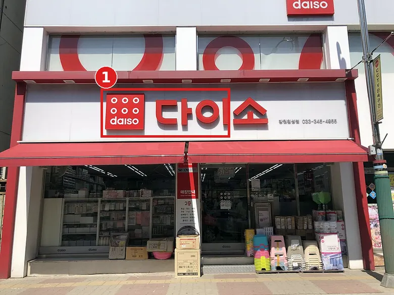
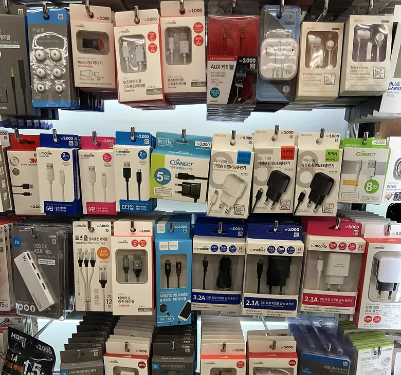
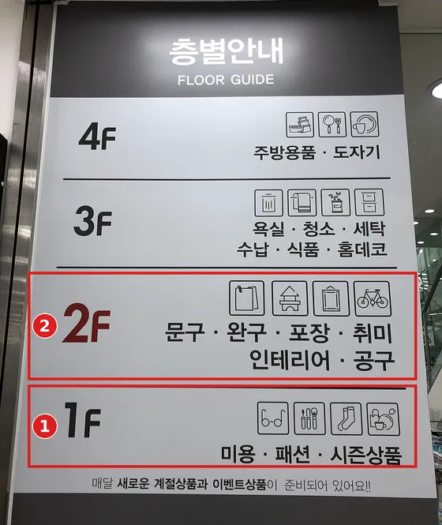
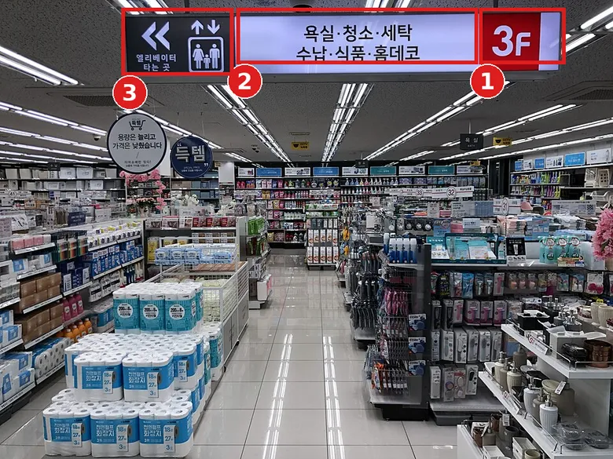
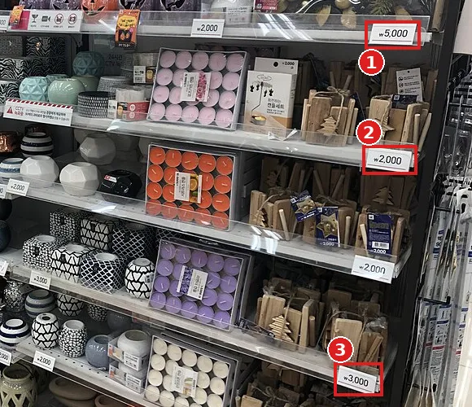

<a class="tr-btn go" href="#find"><i class="ic ic-map-pin" aria-hidden="true"></i>가까운 다이소 찾기</a><a class="tr-btn" href="#pay"><i class="ic ic-credit-card" aria-hidden="true"></i>계산·택스리펀드</a>

<figure class="tr-hero acc-hero"><figcaption><b>이 간판을 찾으세요.</b> <b>1</b> 빨간 네모 ‘daiso’ 로고와 ‘다이소’ 글자. 전국에 약 1,500개 매장이 있어요.사진: Choi Kwang-mo(다이소 강원횡성점, 2020), <a href="https://creativecommons.org/publicdomain/zero/1.0/deed.ko" rel="noopener" target="_blank">CC0</a>, <a href="https://commons.wikimedia.org/wiki/File:2020-04-06_12.55.48_%EB%8B%A4%EC%9D%B4%EC%86%8C_%EA%B0%95%EC%9B%90%ED%9A%A1%EC%84%B1%EC%A0%90_%EC%99%B8%EB%B6%80_%EC%A0%84%EA%B2%BD.jpg" rel="noopener" target="_blank">위키미디어 공용</a> (밝기 자동 보정, 상자·번호 추가)</figcaption></figure>

<ul class="tr-facts"><li><i class="ic ic-tag" aria-hidden="true"></i>500~5,000원<small>가격은 6가지뿐</small></li><li><i class="ic ic-clock" aria-hidden="true"></i>10:00~22:00<small>명동역점 기준, 매장마다 달라요</small></li><li><i class="ic ic-id-card" aria-hidden="true"></i>여권 + 15,000원<small>택스리펀드 매장, 영수증 한 장</small></li><li><i class="ic ic-receipt" aria-hidden="true"></i>영수증 2주<small>교환·환불 기한</small></li></ul>

## 다이소에서 사면 좋은 것

<ul class="tr-choose"><li><i class="ic ic-luggage" aria-hidden="true"></i><b>여행 중 급한 물건</b>잃어버리거나 빠뜨린 멀티 어댑터, 휴대용 수하물 저울, 휴대폰 충전기.</li><li><i class="ic ic-shopping-basket" aria-hidden="true"></i><b>과자와 작은 기념품</b>과자는 대체로 1,000~2,000원. 캐릭터 상품, 포토카드 용품, 휴대폰 액세서리, 한국 과자.</li><li><i class="ic ic-sparkles" aria-hidden="true"></i><b>싸게 써 보는 화장품</b>작은 용량이나 다이소 전용 라인이 많아요. 사기 전에 <a href="/ko/kbeauty-how-to-choose/">상자 뒷면 30초 읽기</a>.</li></ul>

<figure class="tr-photo"><figcaption>충전기·케이블·이어폰 진열대(강원횡성점). 큰 매장이라면 층별 안내에서 어느 층인지 먼저 찾아요.사진: Choi Kwang-mo(다이소 강원횡성점, 2020), <a href="https://creativecommons.org/publicdomain/zero/1.0/deed.ko" rel="noopener" target="_blank">CC0</a>, <a href="https://commons.wikimedia.org/wiki/File:2020-04-06_12.54.12_%EB%8B%A4%EC%9D%B4%EC%86%8C_%EA%B0%95%EC%9B%90%ED%9A%A1%EC%84%B1%EC%A0%90_%EC%B6%A9%EC%A0%84%EA%B8%B0.jpg" rel="noopener" target="_blank">위키미디어 공용</a> (잘라 냄, 밝기 자동 보정)</figcaption></figure>

<ul class="tr-choose"><li><i class="ic ic-user-x" aria-hidden="true"></i><b>다이소가 필요 없는 사람</b>한 브랜드의 정품 용량 화장품만 사거나 큰 세일을 기다린다면 <a href="/ko/olive-young/">올리브영</a>이 나아요. 지금 세일은 <a href="/ko/deals/">할인 상황판</a>에.</li></ul>

<h2 id="find">1. 가까운 다이소 찾기</h2>

<h3 class="tr-step">1<i class="ic ic-globe" aria-hidden="true"></i>다이소 매장검색 열기</h3>

1. [다이소 매장검색](https://www.daiso.co.kr/cs/shop)을 열어요(한국어 사이트).
2. ‘매장명 검색’에 동네 이름(예: 명동, 홍대)을 넣거나 ‘지역 검색’에서 고르고 ‘검색’을 눌러요.
3. 결과에서 매장 이름을 누르면 **주소, 영업시간, 서비스**가 나와요. 서비스에 ‘택스리펀드’가 있으면 여권으로 세금을 돌려받을 수 있는 매장이에요. ‘매장옵션’에서 택스리펀드만 골라 찾을 수도 있어요.
4. 주소를 복사해 지도 앱에 붙여 넣고 길을 찾아요.

<aside class="tr-note tip"><i class="ic ic-lightbulb" aria-hidden="true"></i>매장마다 영업시간이 달라요(예: 명동역점 10:00~22:00, 신촌본점 09:30~22:00). 한국관광공사 정보에는 명동역점이 설·추석 연휴에 쉰다고 나와 있고, 다이소는 명절 당일 여는 매장을 공지사항으로 따로 알려요.</aside>

<h3 class="tr-step">2<i class="ic ic-signpost" aria-hidden="true"></i>도심에서 큰 매장을 원하면</h3>

<ul class="tr-choose"><li><i class="ic ic-map-pin" aria-hidden="true"></i><b>명동역점: 지하 1층~12층</b>명동역 1번과 4번 출구 사이 길가. 출구로 나와 지도 앱에서 ‘다이소 명동역점’을 검색해 경로를 열어요(<a href="/ko/seoul-subway/#map-app">지도 앱 쓰는 법</a>). 주소 서울 중구 퇴계로 134-1. 10:00~22:00, 택스리펀드 매장. 영어·일본어·중국어 층별 안내와 셀프 계산대가 있어요. 강남고속버스터미널점 다음으로 서울에서 두 번째로 큰 매장이에요(2023년 3월 1일 재개장 때 1~12층, 약 500평·1,650㎡).</li><li><i class="ic ic-bus" aria-hidden="true"></i><b>강남고속버스터미널점: 가장 큰 매장</b>터미널 건물 안, 서울 서초구 신반포로 194. 08:30~22:00. 다국어 셀프 계산대, 택스리펀드. 버스 기다리는 시간에 들르기 좋지만 통로가 미로 같아서 시간을 꼭 확인하세요.</li></ul>

주변 쇼핑 거리는 [서울 쇼핑 어디서 할까](/ko/shopping-streets/)에 있어요.

## 2. 매장 안에서 길 찾기

큰 매장은 층마다 파는 물건이 달라요. 들어가자마자 **층별 안내**를 보고 갈 층을 두세 개만 정해요.

<figure class="tr-photo"><figcaption>매장 안의 <b>층별안내(FLOOR GUIDE)</b> 판. <b>1</b> 1층 미용·패션·시즌상품, <b>2</b> 2층 문구·완구·포장·취미. 매장마다 층 구성은 달라요.사진: MatthieuRicard(다이소 원주단구점, 2020), <a href="https://creativecommons.org/publicdomain/zero/1.0/deed.ko" rel="noopener" target="_blank">CC0</a>, <a href="https://commons.wikimedia.org/wiki/File:2020-03-17_21.40.56_%EB%8B%A4%EC%9D%B4%EC%86%8C_%EC%9B%90%EC%A3%BC%EB%8B%A8%EA%B5%AC%EC%A0%90.jpg" rel="noopener" target="_blank">위키미디어 공용</a> (잘라 냄, 밝기 자동 보정, 상자·번호 추가)</figcaption></figure>

<figure class="tr-photo"><figcaption>층마다 천장에 이런 안내판이 걸려 있어요(원주단구점). <b>1</b> 지금 층, <b>2</b> 이 층에서 파는 것, <b>3</b> 엘리베이터 타는 곳 방향.사진: MatthieuRicard(다이소 원주단구점, 2020), <a href="https://creativecommons.org/publicdomain/zero/1.0/deed.ko" rel="noopener" target="_blank">CC0</a>, <a href="https://commons.wikimedia.org/wiki/File:2020-03-17_21.39.49_%EB%8B%A4%EC%9D%B4%EC%86%8C_%EC%9B%90%EC%A3%BC%EB%8B%A8%EA%B5%AC%EC%A0%90.jpg" rel="noopener" target="_blank">위키미디어 공용</a> (밝기 자동 보정, 상자·번호 추가)</figcaption></figure>

**안내판에서 찾을 단어:** 미용(화장품) · 식품(과자) · 문구 · 완구 · 주방 · 욕실 · 시즌상품.

<i class="ic ic-layers" aria-hidden="true"></i>명동역점 층 구성(2023년 재개장 때)

다이소가 2023년 재개장 때 밝힌 구성이에요. 지금은 바뀌었을 수 있으니 입구의 층별 안내로 확인하세요.

- **1층:** 계산대, 시즌용품
- **2층:** 미용용품(뷰티). 2026년 9월에도 외국인 손님으로 붐빈다는 보도가 있었어요.
- **3~4층:** 문구·팬시
- **5층:** 식품, 주방용품
- **6~7층:** 주방용품
- **8층:** 욕실용품
- **9층:** 홈데코
- **10층:** 원예
- **11~12층:** 취미용품

계산대가 1층에 있으니, 위층에서 고른 물건은 들고 1층으로 내려와 계산해요.

## 3. 가격표 읽기

<figure class="tr-photo"><figcaption>가격은 선반 가장자리 가격표에 크게 적혀 있어요. <b>1</b> ₩5,000, <b>2</b> ₩2,000, <b>3</b> ₩3,000. 같은 선반이라도 칸마다 가격이 달라요.사진: Choi Kwang-mo(다이소 원주단구점, 2020), <a href="https://creativecommons.org/publicdomain/zero/1.0/deed.ko" rel="noopener" target="_blank">CC0</a>, <a href="https://commons.wikimedia.org/wiki/File:2020-04-02_20.18.01_%EB%8B%A4%EC%9D%B4%EC%86%8C_%EC%9B%90%EC%A3%BC%EB%8B%A8%EA%B5%AC%EC%A0%90.jpg" rel="noopener" target="_blank">위키미디어 공용</a> (잘라 냄, 밝기 자동 보정, 상자·번호 추가)</figcaption></figure>

- 가격은 **500원부터 5,000원까지 6가지**예요. 1997년 첫 매장부터 이 체계를 지켜 왔다고 다이소가 밝혔어요. 많은 물건이 1,000~3,000원이에요.
- 전부 1,000원은 아니에요. 계산 전에 칸마다 가격표를 확인해요.
- 5,000원에 맞추느라 화장품은 용량이 작거나(한국관광공사: “용량은 부족할 수 있다”), 가격·성분을 따로 정한 다이소 전용 라인인 경우가 많아요.

<h2 id="pay">4. 계산하기</h2>

<ul class="tr-choose"><li><i class="ic ic-credit-card" aria-hidden="true"></i><b>카드 돼요</b>해외 카드 결제도 많아요. 매장검색의 서비스에 ‘현금없는매장’이 있으면 현금을 받지 않는 매장이에요. 카드·현금·WOWPASS는 <a href="/ko/money/">돈 쓰기 페이지</a>에.</li></ul>

<h3 class="tr-step">1<i class="ic ic-id-card" aria-hidden="true"></i>택스리펀드를 받을 거면: 직원 계산대로</h3>

1. 매장에 “Tax Free”나 “Tax Refund” 표시가 있는지, 또는 매장검색 서비스에 ‘택스리펀드’가 있는지 확인해요. 예: 명동역점, 명동본점, 신촌본점, 서울역점, 서울시청광장점, 종로본점.
2. 받을 물건을 **한 바구니에 모아 한 번에** 계산해요. 영수증 한 장이 15,000원 이상이어야 해요. 최고가가 5,000원이라 최소 세 개는 사야 해요.
3. 결제할 때 **실물 여권**을 직원에게 보여 줘요. 그 자리에서 세금만큼 빠져요.

셀프 계산대에서 택스리펀드가 되는지는 확인하지 못했어요. 택스리펀드를 받을 때는 직원이 있는 계산대로 가세요. 대상자, 한도, 실제로 돌려받는 금액은 [택스리펀드 페이지](/ko/tax-refund/)에 있어요. 그 페이지 추정으로 50,000원 영수증이면 약 2,500원이라, 다이소 환급 때문에 일정을 바꿀 필요는 없어요.

<h3 class="tr-step">2<i class="ic ic-scan-line" aria-hidden="true"></i>셀프 계산대: 바코드 말고 QR</h3>

1. 상품마다 **QR코드**를 스캐너에 찍어요(바코드가 아니에요).
2. QR코드가 없는 상품만 바코드를 찍고, 그래도 안 되면 직원을 불러요.
3. 화면에서 결제하고 영수증을 챙겨요.

<h3 class="tr-step">3<i class="ic ic-receipt" aria-hidden="true"></i>영수증은 2주 동안 챙기기</h3>

- **교환:** 산 날부터 2주 안, 영수증을 가지고 산 매장이나 가까운 직영점에서.
- **환불:** 산 날부터 2주 안, 영수증을 가지고 **산 매장에서만**.
- 카드로 샀다면 그 카드도 가져가요. 내 부주의로 망가지거나 포장이 훼손되면 안 돼요. 불량이면 산 매장 직원에게 보여 주고 교환·환불받아요.

## 찾는 물건이 없을 때

매장마다 재고가 달라서 모든 매장에 모든 상품이 있지는 않아요.

1. 다이소의 [매장별 재고 조회](https://prdm.daisomall.co.kr/ms/msb/SCR_MSB_0011?tab=tab2)에서 상품을 검색해요(한국어).
2. 또는 다이소 고객만족실 **1522-4400**(평일 09:00~18:00)에 상품 번호와 이름을 말하면 재고 있는 가까운 매장을 알려 줘요. 상담 언어는 확인하지 못했어요.
3. 한국어가 어렵다면 관광통역안내 **1330**(+82-2-1330, 영어·일본어·중국어 등)에 도움을 청해 보세요.

## 자주 하는 실수

<ul class="tr-oops"><li><i class="ic ic-triangle-alert" aria-hidden="true"></i>전부 1,000원이라고 생각하기. 500원부터 5,000원까지예요.</li><li><i class="ic ic-triangle-alert" aria-hidden="true"></i>세 곳에서 조금씩 사기. 택스리펀드는 영수증 한 장마다 15,000원이 넘어야 해요.</li><li><i class="ic ic-triangle-alert" aria-hidden="true"></i>셀프 계산대에서 바코드만 찍기. QR코드를 찍어요.</li><li><i class="ic ic-triangle-alert" aria-hidden="true"></i>영수증을 버리기. 교환·환불은 2주 안, 영수증이 있어야 해요.</li><li><i class="ic ic-triangle-alert" aria-hidden="true"></i>모든 매장이 같다고 생각하기. 영업시간, 층 구성, 택스리펀드, 재고가 지점마다 달라요.</li></ul>

<i class="ic ic-list-checks" aria-hidden="true"></i>한 줄 판단, 표로 보기

| 상황 | 이렇게 | 이유 |
|---|---|---|
| 싼 기념품·과자, 여행 중 급한 물건(멀티 어댑터, 휴대용 저울, 충전기)이 필요해요 | 다이소 | 가격이 500~5,000원이고, 한국관광공사 다이소 소개에도 이런 여행용품이 나와요 |
| 가성비 화장품을 써 보고 싶어요 | 뷰티 코너부터 | 2026년 다이소 뷰티 브랜드는 약 170개, 다이소 전용 라인이 많고 화제 상품은 품절돼요 |
| 서울 도심에서 가장 많은 상품을 보고 싶어요 | 명동역점(12개 층) | 다이소가 밝힌 서울 두 번째 규모 매장이고 영어·일본어·중국어 층별 안내가 있어요 |
| 정품 용량 K-뷰티나 큰 시즌 세일이 필요해요 | [올리브영](/ko/olive-young/) | 다이소 화장품은 다이소 전용 라인이나 작은 용량이 많아요. 지금 세일은 [할인 상황판](/ko/deals/)에 |

<i class="ic ic-sparkles" aria-hidden="true"></i>다이소 화장품, 조금 더

- 코리아헤럴드에 따르면 다이소 뷰티 브랜드는 2022년 7개에서 2026년 약 170개로, 상품은 약 120개에서 1,900개 넘게 늘었어요.
- 아모레퍼시픽·LG생활건강·애경은 서브 브랜드로 다이소 전용 라인을 내요. 처음부터 가격·성분·대상을 따로 정한 다이소 전용 라인이 많아요.
- 한국관광공사는 2024년 3월 VT 리들샷을 다이소 최고 인기 상품으로 꼽았고, 코리아헤럴드(2026년 9월)는 다이소 화장품이 입소문 뒤 여러 번 품절됐다고 보도했어요. 지금 가격과 구성은 공식 페이지에서 확인하지 못했으니 매장 가격표를 보세요.
- 사기 전에 [상자 뒷면 30초 읽기](/ko/kbeauty-how-to-choose/)로 기능성화장품 표시와 사용기한을 확인하세요.

<i class="ic ic-pencil" aria-hidden="true"></i>가기 전에: 사람별로 목록 쓰기

목록 쓰기가 다이소 쇼핑의 절반이고, 영수증을 한 장으로 모으는 데도 도움이 돼요.

1. **받을 사람별로 한 줄씩 써요.** 나 자신도 포함해서요. 스킨케어는 나를 위해, 과자는 나눠 주기용, 포토카드 용품은 K-팝 팬에게, 여행 중 필요한 물건은 여행 중의 나에게(저희 판단).
2. **택스리펀드를 받으려면 실물 여권을 챙기고**, 영수증 한 장을 15,000원 이상으로 계획해요.

저희가 고른 끝 장면은 문을 나설 때의 가득 찬 봉투가 아니라 일주일 뒤예요. 여행 중 문제를 해결해 준 물건(휴대용 수하물 저울이나 멀티 어댑터)과 집에 돌아가 나눠 준 과자요.

<i class="ic ic-info" aria-hidden="true"></i>다이소는 어떤 회사, 그리고 출처

한국 다이소는 한국 회사 아성다이소가 운영하고, 2023년에 일본 측 지분을 정리해 완전한 한국 기업이 됐어요. 2014년부터 자체 상품을 설계·생산해 왔어요.

2026년 11월 26일 직접 열어 확인: 다이소 <a href="https://www.daiso.co.kr/cs/shop" rel="noopener" target="_blank">매장검색</a>(명동역점 주소·B1~12층·10:00~22:00·택스리펀드, 서비스 옵션 택스리펀드·현금없는매장, 명동본점·서울시청광장점·종로본점·서울역점 택스리펀드 표시)·<a href="https://www.daiso.co.kr/cs/faq" rel="noopener" target="_blank">자주 묻는 질문</a>(매장 찾기, 매장별 재고, 1522-4400 평일 9~18시, 교환·환불 2주와 영수증·결제카드, 불량품, 명절 당일 영업 매장 공지); 아성다이소 보도자료 <a href="https://www.daiso.co.kr/brand/daiso_news/26502?btype=company" rel="noopener" target="_blank">명동역점 재오픈</a>(2023년 3월 14일: 1~12층 500여 평, 서울 두 번째 규모, 층 구성)·<a href="https://www.daiso.co.kr/brand/daiso_news/125585?btype=company" rel="noopener" target="_blank">500~5,000원 6가지 가격 체계</a>(2026년 11월 11일); 한국관광공사 VISITKOREA <a href="https://english.visitkorea.or.kr/svc/contents/contentsView.do?menuSn=&amp;vcontsId=194390" rel="noopener" target="_blank">"Find Everything at Daiso Korea!"</a>(약 1,500개 매장, 여행용품, 과자 1,000~2,000원, 대부분 1,000~3,000원, 리들샷, 셀프 계산 QR, 명동역점 1·4번 출구 사이와 다국어 층별 안내, 강남고속버스터미널점 08:30~22:00·최대 매장, 1330)와 택스리펀드 매장 정보 <a href="https://english.visitkorea.or.kr/svc/contents/contentsView.do?menuSn=459&amp;vcontsId=146975" rel="noopener" target="_blank">명동역점</a>(10:00~22:00, 설·추석 연휴 휴무, 카드 가능)·<a href="https://english.visitkorea.or.kr/svc/contents/contentsView.do?menuSn=459&amp;vcontsId=146952" rel="noopener" target="_blank">명동본점</a>·<a href="https://english.visitkorea.or.kr/svc/contents/contentsView.do?menuSn=459&amp;vcontsId=146026" rel="noopener" target="_blank">신촌본점</a>(09:30~22:00)·<a href="https://english.visitkorea.or.kr/svc/contents/contentsView.do?menuSn=459&amp;vcontsId=1573799" rel="noopener" target="_blank">서울역점</a>; 코리아헤럴드 <a href="https://www.koreaherald.com/article/3281373" rel="noopener" target="_blank">다이소 완전 한국 기업화</a>(2023년 12월 13일), <a href="https://www.koreaherald.com/article/10589279" rel="noopener" target="_blank">다이소 뷰티 브랜드와 서브 브랜드</a>(2025년 10월 3일), <a href="https://www.koreaherald.com/article/10649917" rel="noopener" target="_blank">다이소 전용 뷰티 라인</a>(2026년 1월 6일), <a href="https://www.koreaherald.com/article/10872741" rel="noopener" target="_blank">입소문 품절과 리들샷</a>(2026년 9월 14일), <a href="https://www.koreaherald.com/article/10877187" rel="noopener" target="_blank">500~5,000원, 뷰티 브랜드 170개·상품 1,900개, 명동역점 2층 뷰티, 해외 카드 결제</a>(2026년 9월 17일). 택스리펀드 규정: <a href="/ko/tax-refund/">택스리펀드 페이지</a>.

## 다음

<ul class="tr-next"><li><a href="/ko/kbeauty-how-to-choose/"><i class="ic ic-scan-line" aria-hidden="true"></i>화장품 고르는 법: 상자 뒷면 30초<i class="ic ic-arrow-right" aria-hidden="true"></i></a></li><li><a href="/ko/tax-refund/"><i class="ic ic-receipt" aria-hidden="true"></i>택스리펀드: 여권만 보여 주세요<i class="ic ic-arrow-right" aria-hidden="true"></i></a></li><li><a href="/ko/olive-young/"><i class="ic ic-shopping-basket" aria-hidden="true"></i>올리브영: 세일 시기와 기본템<i class="ic ic-arrow-right" aria-hidden="true"></i></a></li></ul>
