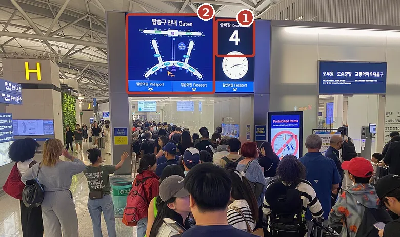
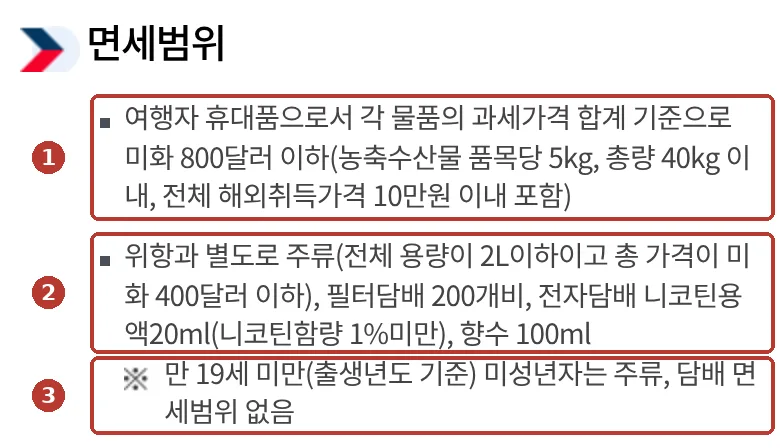

<a class="tr-btn go" href="#pickup"><i class="ic ic-map-pin" aria-hidden="true"></i>인도장 가는 길</a><a class="tr-btn" href="#limit"><i class="ic ic-luggage" aria-hidden="true"></i>얼마까지 면세?</a>

<figure class="tr-hero acc-hero"><figcaption><b>면세품은 이 문 안쪽에서 받아요.</b> 인천공항 1터미널 출국장 입구. <b>1</b> 출국장 번호, <b>2</b> 탑승구 지도. 보안검색과 출국심사를 지나면 면세구역이고, 인도장도 그 안에 있어요.사진: Sgroey(2024), <a href="https://creativecommons.org/licenses/by-sa/4.0/deed.ko" rel="noopener" target="_blank">CC BY-SA 4.0</a>, <a href="https://commons.wikimedia.org/wiki/File:Incheon_airport_departure_gate_access.jpg" rel="noopener" target="_blank">위키미디어 공용</a> (잘라 냄, 밝기 자동 보정, 상자·번호 추가)</figcaption></figure>

<ul class="tr-facts"><li><i class="ic ic-id-card" aria-hidden="true"></i>여권 실물 + 항공편<small>사본·사진으로는 못 사요</small></li><li><i class="ic ic-clock" aria-hidden="true"></i>인터넷 주문: 보통 전날 19:30<small>출발 시각·인도장마다 달라요</small></li><li><i class="ic ic-map-pin" aria-hidden="true"></i>인도장: 출국심사 뒤<small>입국할 때는 못 받아요</small></li><li><i class="ic ic-luggage" aria-hidden="true"></i>한국 귀국 1인 800달러<small>술 2L·400달러는 별도</small></li></ul>

## 어디서 살까

세 곳 모두 같은 면세품이에요. 고르는 기준은 하나, **살 게 얼마나 정해져 있느냐**예요.

<ul class="tr-choose"><li><i class="ic ic-smartphone" aria-hidden="true"></i><b>살 게 정해져 있다: 인터넷면세점(앱)</b>향수, 수입 화장품, 술처럼 이미 아는 물건. 매장에 갈 필요 없이 출국 전날 저녁까지 주문하고 공항에서 받아요. <a href="#online">사는 순서</a></li><li><i class="ic ic-store" aria-hidden="true"></i><b>직접 보고 비교하고 싶다: 시내면세점</b>여권과 항공편 정보를 들고 서울 매장으로. 결제는 시내에서, 물건은 공항 인도장에서 기다려요. <a href="#downtown">매장과 가는 법</a></li><li><i class="ic ic-plane" aria-hidden="true"></i><b>급하게 조금만: 공항 면세점</b>보안검색·출국심사 뒤 매장에서 사서 바로 들고 타요. 인도장을 챙길 필요가 없어요.</li></ul>

<aside class="tr-note tip"><i class="ic ic-lightbulb" aria-hidden="true"></i>올리브영 같은 국내 화장품 위주라면 면세점보다 <a href="/ko/olive-young/">올리브영</a>에서 <a href="/ko/tax-refund/">계산대 즉시 환급</a>(한국을 방문 중인 사람 대상)이 더 간단해요.</aside>

<i class="ic ic-info" aria-hidden="true"></i>면세점과 택스리펀드는 달라요

계산 전에 어느 쪽인지 알아 두세요. 물건을 받는 곳이 달라요.

{{fig:duty-free-4|면세점과 택스리펀드 매장, 물건을 받는 곳이 달라요}}

- **면세점:** 출국하는 사람에게만 파는 보세판매장이에요. 시내·인터넷에서 산 물건은 바로 들고 갈 수 없고, 출국날 출국심사를 지나서 받아요.
- **택스리펀드(사후면세):** 올리브영·백화점 같은 일반 매장에서 외국인 여행자에게 부가세 10% 일부를 돌려주는 제도예요. [택스리펀드](/ko/tax-refund/)에 따로 정리했어요.

한 번 산 물건에는 둘 중 하나만 적용돼요.

<h2 id="online">인터넷면세점에서 사기</h2>

{{fig:duty-free-1|주문부터 출국날 인도까지}}

현대면세점이 안내하는 순서예요. 다른 면세점도 단계는 같아요.

<h3 class="tr-step">1<i class="ic ic-log-in" aria-hidden="true"></i>면세점 사이트나 앱에 들어가요</h3>

출국이 확정된 사람이면 한국인·외국인 모두 살 수 있어요. 회원으로도, 비회원으로도 살 수 있고, 회원이면 추가 할인을 받을 수 있어요. 출국일 90일 전부터 주문할 수 있어요.

<ul class="tr-next"><li><a href="https://www.hddfs.com/" rel="noopener" target="_blank"><i class="ic ic-globe" aria-hidden="true"></i>현대면세점 온라인몰<i class="ic ic-external-link" aria-hidden="true"></i></a></li><li><a href="https://www.shilladfs.com/estore/kr/en/" rel="noopener" target="_blank"><i class="ic ic-globe" aria-hidden="true"></i>신라면세점 온라인몰<i class="ic ic-external-link" aria-hidden="true"></i></a></li></ul>

롯데·신세계 온라인몰 주소는 비짓서울 매장 소개의 'View Website'에 있어요([롯데](https://english.visitseoul.net/shopping/Lotte-Duty-Free-Shop-Main-Store/ENP009641), [신세계](https://english.visitseoul.net/area/Shinsegae-Duty-Free-en/ENP024463)).

<h3 class="tr-step">2<i class="ic ic-shopping-basket" aria-hidden="true"></i>상품을 장바구니에 담아요</h3>

상품별·브랜드별로 찾아 수량과 옵션을 고르고 장바구니에 담아요.

<h3 class="tr-step">3<i class="ic ic-id-card" aria-hidden="true"></i>출국 정보를 넣고 결제해요</h3>

1. **여권번호와 영문 이름**: 실제로 들고 갈 여권 그대로. 다르면 공항에서 물건을 못 받아요.
2. **출국일, 공항, 편명, 출발 시각**: 항공권(e-ticket)에 적힌 그대로.
3. **결제**: 결제 당일 환율의 원화로 계산돼요. 현대는 신용카드, 무통장입금, 카카오페이·네이버페이·토스페이, 알리페이플러스·위챗페이·유니온페이 등을 받아요.

<aside class="tr-note"><i class="ic ic-triangle-alert" aria-hidden="true"></i><b>마감 전에 주문해야 해요.</b> 기준은 보통 출국 전날 저녁이지만, 자정 넘어 바로 출발하는 비행기라면 마감은 전날 14:30이에요. 아래 표를 보세요.</aside>

<h3 class="tr-step">4<i class="ic ic-ticket" aria-hidden="true"></i>교환권을 저장해요</h3>

결제가 끝나면 주문내역에서 교환권을 출력해요. 인쇄가 안 되면 교환권 번호를 메모하거나 문자(SMS)로 받아 두고, 공항에서 여권·항공권과 함께 보여 줘요. **교환권에 적힌 인도장 이름**(예: T1 서편)을 확인해 두세요. 출국날 갈 곳이에요.

<i class="ic ic-clock" aria-hidden="true"></i>주문 마감 시간표(현대면세점, 인천)

면세점마다, 인도장과 출발 시각마다 달라요. 현대면세점이 지금 공개한 인천 1터미널 서편 인도장 기준:

| 출발 시각 | 주문 마감 |
|---|---|
| 00:00~02:59 | 전날 14:30 |
| 03:00~16:59 | 전날 19:30 |
| 17:00~19:59 | 당일 11:30 |
| 20:00~23:59 | 당일 14:30 |

1터미널 탑승동과 2터미널 인도장은 구간이 1시간씩 늦어요(03:00~17:59, 18:00~20:59, 21:00~23:59). 항공편을 등록하면 실제 마감 시간이 떠요. 출발이 임박했다면 고객센터에 물어보라고 안내해요.

<h2 id="downtown">시내면세점에서 사기</h2>

<figure class="tr-photo"><figcaption><b>롯데면세점 본점(명동)</b>. 롯데백화점 9~12층이에요.사진: Leeinm(2023), <a href="https://creativecommons.org/licenses/by/4.0/deed.ko" rel="noopener" target="_blank">CC BY 4.0</a>, <a href="https://commons.wikimedia.org/wiki/File:Night_view_of_Lotte_Duty_Free_Shop.jpg" rel="noopener" target="_blank">위키미디어 공용</a> (줄임, 밝기 자동 보정)</figcaption></figure>

<h3 class="tr-step">1<i class="ic ic-id-card" aria-hidden="true"></i>여권 실물과 항공권을 챙겨요</h3>

출국 날짜·시각과 편명이 보이는 항공권(e-ticket, 휴대폰 화면도 돼요)이 필요해요. 여권 사본이나 사진으로는 살 수 없어요.

<h3 class="tr-step">2<i class="ic ic-map-pin" aria-hidden="true"></i>매장으로 가요</h3>

<ul class="tr-choose"><li><i class="ic ic-store" aria-hidden="true"></i><b>롯데면세점 본점(명동)</b>롯데백화점 9~12층. 2호선 을지로입구역 7·8번 출구에서 50m. 매일 09:30~20:00.</li><li><i class="ic ic-store" aria-hidden="true"></i><b>신세계면세점 명동점</b>신세계백화점 본점 8~12층. 4호선 회현역 5번 출구에서 145m. 월~목 10:30~20:00, 금~일 10:30~20:30.</li><li><i class="ic ic-store" aria-hidden="true"></i><b>신라면세점 서울점</b>신라호텔 옆. 3호선 동대입구역 5번 출구에서 278m. 매일 09:00~20:00. 주요 쇼핑 지역을 잇는 무료 셔틀버스를 운영해요.</li><li><i class="ic ic-store" aria-hidden="true"></i><b>현대면세점 무역센터점</b>월~목 10:30~20:00, 금~일 10:30~20:30.</li></ul>

출구 찾는 법은 [서울 지하철](/ko/seoul-subway/)에 있어요. 영업시간은 바뀔 수 있으니 가기 전에 위 링크에서 다시 보세요.

<h3 class="tr-step">3<i class="ic ic-credit-card" aria-hidden="true"></i>고르고, 계산대에서 여권과 항공권을 보여 줘요</h3>

계산하면 물건은 매장에 두고, 출국날 공항 인도장에서 받아요. 영수증·교환권에 적힌 인도장을 확인하세요.

<aside class="tr-note ok"><i class="ic ic-circle-check" aria-hidden="true"></i><b>한국 상품은 바로 들고 갈 수도 있어요.</b> 현대면세점은 외국인이 출국일 60일 전부터 한국 상품을 매장에서 사서 바로 받을 수 있다고 안내해요. 2026년 7월부터는 외국인 여행자가 인터넷면세점에서 산 K-뷰티·K-푸드 상품을 시내면세점에서 찾을 수 있게 됐어요(세계일보 보도).</aside>

<h2 id="pickup">출국날: 인도장까지 가는 길</h2>

어디서 샀든 **출국장 안 인도장**에서만 받아요. 보안검색과 출국심사 뒤에 있고, 입국할 때는 못 받아요. 공항에는 3시간 전에 도착하면 여유 있어요([출국하는 날](/ko/departure-day/)). 현대는 인도장이 붐빌 수 있으니 **최소 출국 1시간 전**에 오라고 안내해요.

<h3 class="tr-step">1<i class="ic ic-ticket" aria-hidden="true"></i>교환권에서 인도장 이름을 확인해요</h3>

{{fig:duty-free-2|인천공항 인도장 네 곳}}

<h3 class="tr-step">2<i class="ic ic-door-open" aria-hidden="true"></i>체크인하고 출국장으로 들어가요</h3>

항공사 카운터에서 체크인하고 짐을 부친 뒤, 위 사진처럼 '출국장 Departure Hall' 번호가 적힌 입구로 들어가 보안검색과 출국심사를 받아요. 공항 순서는 [출국하는 날](/ko/departure-day/)에 있어요.

<h3 class="tr-step">3<i class="ic ic-signpost" aria-hidden="true"></i>게이트 번호 표지판을 따라 인도장으로 가요</h3>

{{fig:duty-free-t1map|1터미널: 출국심사 뒤 3층 면세구역에서 4층 인도장(43번 게이트 맞은편)까지. 현대·신라면세점 인도장 안내와 인천국제공항 시설 안내(2026년 11월 26일 확인)의 위치를 바탕으로 Nadri가 다시 그렸어요}}

<ul class="tr-choose"><li><i class="ic ic-map-pin" aria-hidden="true"></i><b>1터미널 서편(4층)</b>출국심사를 지나면 3층 면세구역이에요. 게이트 번호가 커지는 쪽(서편)으로 걸어가요. 가는 길 29번 게이트 부근에 <strong>24시간 안내데스크</strong>와 한국전통문화센터 서관이 있어요. 43번 게이트에 오면 <strong>맞은편 위층(4층)</strong>이 인도장이에요. 4층 43번 게이트 부근에는 마티나 라운지(서편)가 있어요.</li><li><i class="ic ic-train-front" aria-hidden="true"></i><b>1터미널 탑승동(4층)</b>탑승구가 101~132번이면 셔틀트레인을 타고 탑승동으로 가요. 내려서 <strong>119번 게이트 옆 에스컬레이터</strong>로 4층에 올라가면 인도장이에요.</li><li><i class="ic ic-map-pin" aria-hidden="true"></i><b>2터미널 서편(2층)</b>225번 게이트 근처, 한국전통문화센터(서관) 맞은편 에스컬레이터로 2층에 내려가요.</li><li><i class="ic ic-map-pin" aria-hidden="true"></i><b>2터미널 동편(2층)</b>274번 게이트 방향, 한국전통문화센터(동관) 맞은편 에스컬레이터로 아래층(2층)에 내려가요.</li></ul>

<i class="ic ic-map" aria-hidden="true"></i>2터미널 그림으로 보기

{{fig:duty-free-t2map|2터미널: 3층 면세구역에서 2층 인도장으로. 현대·신라면세점 인도장 안내를 바탕으로 Nadri가 다시 그렸어요}}

<aside class="tr-note tip"><i class="ic ic-circle-help" aria-hidden="true"></i>길을 잃으면 면세구역 안내데스크(1터미널 3층 25번·29번 게이트 부근, 24시간)에서 교환권을 보여 주세요.</aside>

<h3 class="tr-step">4<i class="ic ic-scan-line" aria-hidden="true"></i>교환권·여권·탑승권을 내고 확인 후 서명해요</h3>

1. 산 사람 본인이 교환권, 여권, 탑승권을 보여 줘요.
2. 품명과 수량, 상품 상태를 확인하고 인수란에 서명해요. 이상이 있으면 그 자리에서 직원에게 말해요. 출국 뒤의 물건은 면세점이 책임지지 않아요.
3. 액체류는 밀봉 봉투에 담겨 나와요. 최종 목적지까지 뜯지 마세요([아래](#liquids)).

<aside class="tr-note ok"><i class="ic ic-circle-check" aria-hidden="true"></i>이걸로 끝. 산 것이 들어갈 나라의 면세범위 안이라면, 도착해서 신고할 것도 없어요.</aside>

<i class="ic ic-triangle-alert" aria-hidden="true"></i>못 받는 경우와 그때 할 일

- **못 받는 경우:** 주문한 사람과 출국하는 사람이 다를 때, 주문서의 여권번호와 보여 준 여권번호가 다를 때, 등록한 출국 정보(공항, 일시, 편명)가 실제와 다를 때.
- **미리 고치기:** 신라는 여권번호를 고치려면 출국 최소 3일 전에 고객센터에 연락하라고 안내해요.
- **못 찾았다면:** 면세점 고객센터에 연락하세요. 현대는 주문일로부터 180일까지 출국 정보를 바꿀 수 있고, 넘기면 취소 후 다시 사야 해요. 현대 고객센터 1811-6688(09:30~18:30), 영어 인도장 문의 +82-2-2163-6215(매일 10:00~19:00).
- 면세품은 집 주소로 배송되지 않아요.

<h2 id="limit">얼마까지 사도 되나</h2>

한국에서 나갈 때 면세점에서 사는 데는 **한도가 없어요.** 현대면세점은 출국하는 고객이라면 내·외국인 구분 없이 무제한 구매할 수 있다고 안내해요. 걸리는 건 **다음에 들어가는 나라의 면세범위**예요. 면세점에서 산 물건도 그 범위에 들어가요.

### 한국으로 돌아올 때(관세청)

<figure class="tr-photo"><figcaption><b>1</b> 물품 합계 미화 800달러 이하, <b>2</b> 그와 별도로 술 2L·400달러 이하, 필터담배 200개비, 전자담배 니코틴용액 20ml, 향수 100ml, <b>3</b> 만 19세 미만은 술·담배 면세 없음.화면: 관세청 <a href="https://www.customs.go.kr/kcs/cm/cntnts/cntntsView.do?mi=2837&amp;cntntsId=829" rel="noopener" target="_blank">여행자 휴대품 통관</a>, 2026년 11월 26일 캡처(일부만 잘라 냄, 상자·번호 추가)</figcaption></figure>

| | 면세범위(1인) |
|---|---|
| 물품 | **800달러** 이하. 농축수산물은 품목당 5kg, 총 40kg, 해외 취득가격 합계 10만 원 이내로 이 안에 포함 |
| 술 | 별도로 합계 **2L 이하, 400달러 이하** |
| 담배 | 별도로 필터담배(궐련) **200개비**, 전자담배 니코틴용액 20ml |
| 향수 | 별도로 **100ml** |

<ul class="tr-choose"><li><i class="ic ic-circle-check" aria-hidden="true"></i><b>신고할 것이 없을 때</b>신고서를 내지 않고 '신고없음' 통로로 나가요. 경우에 따라 세관 검사를 받을 수 있어요.</li><li><i class="ic ic-pencil" aria-hidden="true"></i><b>면세범위를 넘었을 때</b>신고서를 종이나 모바일로 내요. 모바일로 자진신고하면 고지서 발급과 납부도 모바일로 돼요. 자진신고하면 관세의 30%를 줄여 주고, 신고하지 않다가 걸리면 낼 세금의 40%(2년 안에 2번 이상이면 60%)를 가산세로 더 내요.</li></ul>

2026년 7월부터는 면세범위 안의 물건을 귀국 후 같은 모델의 색상·사이즈 교환에 한해 우편·택배로 바꿀 수 있게 됐어요(세계일보 보도).

### 다른 나라로 들어갈 때

그 나라 세관 기준이 한도예요. 자주 묻는 세 곳:

<i class="ic ic-globe" aria-hidden="true"></i>일본·대만·미국 면세범위 보기

| 나라 | 물품 | 술 | 담배 |
|---|---|---|---|
| 일본 | 해외 시가 합계 **20만 엔**. 1개가 20만 엔을 넘으면 전액 과세. 같은 품목 합계 1만 엔 이하는 원칙적으로 면세 | **3병**(1병 760ml) | 궐련만이면 200개비, 가열식만이면 개별 포장 10개, 엽궐련만이면 50개비. 향수는 별도 2온스(약 28ml가 1온스, 오드콜로뉴·오드투왈렛 제외) |
| 대만 | 완세가격 합계 **NT$35,000**. 명백히 영리 목적이거나, 자주 출입국(30일 안에 2번 이상 또는 6개월 안에 6번 이상)하면서 위반 기록이 있으면 적용 안 됨 | 관무서 여행자 안내는 1L(20세 이상). 2026년 2월 1일 시행 개정 규정은 1.5L·18세라고 적어 서로 달라요. 엄한 쪽(1L)으로 준비하고 출발 전 확인 | 궐련 200개비 또는 시가 25개비 또는 담배잎 1파운드(20세 이상) |
| 미국 | **800달러**(해외 48시간 이상, 31일 안에 쓰지 않았을 때) | **1L**(만 21세 이상, 개인용) | 궐련 200개비와 시가 100개비(만 21세 이상) |

- 일본·한국 모두 20세(한국은 만 19세) 미만은 술·담배 면세가 없어요.
- 미국 세관은 면세점에서 산 물건도 귀국 때 자동으로 면세가 아니라고 분명히 적어요. 주마다 술 규정이 더 엄할 수 있어요.

<h2 id="liquids">술과 액체류</h2>

{{fig:duty-free-5|면세 밀봉 봉투, 뜯으면 안 되는 때}}

- **직항이면:** 면세점 공동 투명 봉인봉투(영수증이 붙은 것)에 담겨 있으면 용량·수량과 관계없이 기내에 가지고 탈 수 있어요. 시내·인터넷에서 산 술도 보안검색 뒤에 받으니 한국에서 탈 때는 액체류 제한에 걸리지 않아요.
- **최종 목적지까지 뜯지 마세요.** 그전에 뜯거나 훼손되면 반입할 수 없어요.
- **환승한다면:** 경유하는 나라의 보안 규정에 따라 압수될 수 있어요. 미국 경유는 불투명·금속 용기의 액체류가 제한되고, 경유 후 도착지가 미국령·호주령·캐나다·버진아일랜드면 액체류를 살 수 없어요. 항공사에 먼저 물어보세요. 자세한 건 [출국하는 날](/ko/departure-day/)에.

## 자주 하는 실수

<ul class="tr-oops"><li><i class="ic ic-triangle-alert" aria-hidden="true"></i>여권번호나 편명을 잘못 넣기. 인도장에서 물건을 못 받아요.</li><li><i class="ic ic-triangle-alert" aria-hidden="true"></i>자정 넘어 출발하는데 전날 저녁에 주문하기. 마감이 전날 14:30이에요.</li><li><i class="ic ic-triangle-alert" aria-hidden="true"></i>탑승 직전에 인도장 찾기. 최소 1시간 전에 가요.</li><li><i class="ic ic-triangle-alert" aria-hidden="true"></i>환승 공항 전에 밀봉 봉투 뜯기.</li><li><i class="ic ic-triangle-alert" aria-hidden="true"></i>"면세점에서 샀으니 귀국 때도 면세"라고 생각하기. 들어가는 나라 면세범위에 들어가요.</li></ul>

<i class="ic ic-list-checks" aria-hidden="true"></i>한 줄 판단, 표로 보기

| 상황 | 할 일 | 이유 |
|---|---|---|
| 살 게 정해져 있다(향수, 수입 화장품, 술) | 전날까지 인터넷면세점·앱으로 주문하고 공항 인도장에서 수령 | 같은 물건이고 매장에 갈 필요가 없어요. 출국심사 뒤에 찾아요 |
| 직접 써 보고 비교하고 싶다 | 여권과 항공편 정보를 들고 시내면세점으로 | 결제는 시내에서, 물건은 공항에서 기다려요 |
| 급하게 조금만 | 보안검색 뒤 공항 면세점에서 | 인도장을 챙길 필요가 없어요. 인천의 화장품·주류·담배 핵심 구역은 2026년부터 롯데와 현대가 운영해요 |

뺀 것: 브랜드별 가격 비교, 멤버십 등급 꿀팁. 가격이 매일 바뀌어서예요.

<i class="ic ic-store" aria-hidden="true"></i>2026년 면세점 지형

- **인천공항:** 신라·신세계가 매출 부진 속에 화장품·향수·주류·담배 위주의 핵심 구역(DF1·DF2)을 반납했고, 2026년 롯데(DF1)와 현대(DF2)가 이어받았어요. 계약은 2033년 6월까지. 신세계는 DF4 구역을 계속 운영하고, 신라·신세계는 패션·부티크 구역도 계속 운영해요.
- **시내:** 네 곳 모두 서울에 매장이 있어요. 2026년 6월 보도로는 현대가 동대문점·무역센터점을 줄이고, 신라·신세계는 시내점과 온라인에 힘을 싣고 있어요. 가기 전에 영업시간을 확인하세요.
- **세일:** 신라면세점 블랙프라이데이는 종료일과 출처를 붙여 [할인 상황판](/ko/deals/)에 올려 뒀어요.

<i class="ic ic-calendar-check" aria-hidden="true"></i>면세 쇼핑하는 출국날, 처음부터 끝까지

미리 주문해 두면 여행의 마지막은 이렇게 흘러가요. 체크인하고 보안검색과 출국심사를 지나, 교환권에 적힌 인도장으로 걸어가요. 여권과 탑승권을 보여 주고 품명과 수량을 확인한 뒤 서명. 액체류는 밀봉 봉투에 담겨 나오고, 집에 갈 때까지 그대로 둬요. 끝 장면은 도착한 날 세관 앞으로 고르길 권해요. 산 것이 면세범위 안이라 신고할 게 없는 순간이요.

<i class="ic ic-info" aria-hidden="true"></i>출처

2026년 11월 26일 확인: 현대면세점 <a href="https://www.hddfs.com/shop/om/consmGuide/useNotice.do" rel="noopener" target="_blank">이용 안내</a>(인도장별 주문 마감, 출국 시 구매 한도 없음, 90일 전 주문, 여권 실물·e-ticket), <a href="https://www.hddfs.com/shop/om/consmCont/bcaInfo.do" rel="noopener" target="_blank">인도장 및 상품 수령 안내</a>(위치, 준비물, 최소 1시간 전, 못 받는 경우, 180일 변경, 고객센터), <a href="https://www.hddfs.com/shop/om/consmCont/shopProc.do" rel="noopener" target="_blank">쇼핑 절차</a>(회원·비회원, 결제 수단, 교환권), <a href="https://www.hddfs.com/shop/om/consmCont/cariProhInfo.do" rel="noopener" target="_blank">기내 반입 제한 안내</a>(봉인봉투, 환승 제한), <a href="https://www.hddfs.com/store/en/dm/stShop/shoppingGuide.do" rel="noopener" target="_blank">영문 쇼핑 가이드</a>(무역센터점 영업시간, 외국인 한국 상품 60일 전 현장 수령, 영어 인도장 문의 번호); 신라면세점 <a href="https://www.shilladfs.com/estore/kr/en/shilladfscustomercenter/deliverypointinfo" rel="noopener" target="_blank">인도 안내</a>(인천 인도장 네 곳, 119번 게이트 옆 에스컬레이터, 여권번호 수정은 3일 전, 입국 시 수령 불가); 인천국제공항 <a href="https://www.airport.kr/ap_ko/1008/subview.do" rel="noopener" target="_blank">편의·공공시설</a>(1터미널 3층 면세지역 25·29번 게이트 부근 24시간 안내데스크, 중앙 28번 게이트, 한국전통문화센터 서관, 4층 43번 게이트 부근 마티나 라운지(서편)); 비짓서울 <a href="https://english.visitseoul.net/shopping/Lotte-Duty-Free-Shop-Main-Store/ENP009641" rel="noopener" target="_blank">롯데면세점 본점</a>(2026년 11월 23일 수정), <a href="https://english.visitseoul.net/area/Shinsegae-Duty-Free-en/ENP024463" rel="noopener" target="_blank">신세계면세점</a>(11월 25일 수정), <a href="https://english.visitseoul.net/area/Shilla-Duty-Free-Shop/ENP000521" rel="noopener" target="_blank">신라면세점</a>(8월 6일 수정); 관세청 <a href="https://www.customs.go.kr/kcs/cm/cntnts/cntntsView.do?mi=2837&amp;cntntsId=829" rel="noopener" target="_blank">여행자 휴대품 통관</a>(면세범위, 신고 절차, 자진신고 감면·가산세); 일본 세관 <a href="https://www.customs.go.jp/kaigairyoko/menzei.htm" rel="noopener" target="_blank">해외여행자 면세범위</a>; 코리아타임스·연합뉴스 <a href="https://www.koreatimes.co.kr/business/companies/20260226/lotte-hyundai-win-approval-to-operate-new-duty-free-zones-at-incheon-airport" rel="noopener" target="_blank">롯데·현대, 인천공항 면세 구역 운영 승인</a>, 코리아헤럴드 <a href="https://www.koreaherald.com/article/10683421" rel="noopener" target="_blank">같은 보도</a>(2026년 2월 26일). 오늘 열지 못한 것: 롯데·신세계 면세점 사이트(접속 차단), 미국 CBP(사이트가 확인 도구 거부; 2026년 11월 25일 확인분 Customs Duty Information 2024년 5월 14일 수정, 19 CFR 148.33), 대만 재정부 관무서 「입경여객 휴대 행리물품 보험세방 판법」 제11조(2026년 1월 30일 개정, 접속 차단; 11월 25일 확인분). 언론(11월 25일 확인): 뉴시스(개장일, 2026년 4월 8일); 더팩트(2026년 6월 10일); 비즈워치(2026년 11월 18일); 세계일보(인터넷면세품 시내점 인도·귀국 후 교환, 2026년 7월 1일); 택스워치(여행자 면세범위, 2026년 9월 1일).

## 다음

<ul class="tr-next"><li><a href="/ko/departure-day/"><i class="ic ic-plane" aria-hidden="true"></i>출국하는 날: 공항 순서<i class="ic ic-arrow-right" aria-hidden="true"></i></a></li><li><a href="/ko/tax-refund/"><i class="ic ic-receipt" aria-hidden="true"></i>택스리펀드: 일반 매장에서 세금 돌려받기<i class="ic ic-arrow-right" aria-hidden="true"></i></a></li><li><a href="/ko/olive-young/"><i class="ic ic-shopping-basket" aria-hidden="true"></i>올리브영: 세일 시기와 기본템<i class="ic ic-arrow-right" aria-hidden="true"></i></a></li></ul>
