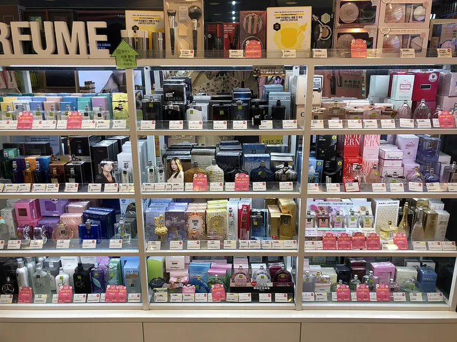
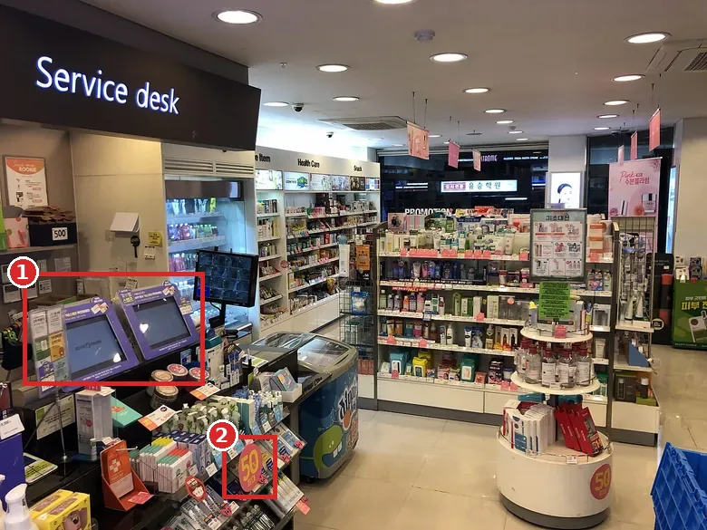

<a class="tr-btn" href="#언제-갈까"><i class="ic ic-calendar-days" aria-hidden="true"></i>다음 세일</a><a class="tr-btn go" href="#무엇을-살까-기본템-세-가지"><i class="ic ic-shopping-basket" aria-hidden="true"></i>무엇을 살까</a>

<figure class="tr-hero acc-hero"><figcaption><b>올리브영</b>, 한국에서 가장 큰 헬스·뷰티 체인이에요.사진: Pkccccj, <a href="https://creativecommons.org/licenses/by-sa/4.0/deed.ko" rel="noopener" target="_blank">CC BY-SA 4.0</a>, <a href="https://commons.wikimedia.org/wiki/File:OliveYoung_store.png" rel="noopener" target="_blank">위키미디어 공용</a> (밝기 자동 보정)</figcaption></figure>

<ul class="tr-facts"><li><i class="ic ic-calendar-check" aria-hidden="true"></i>올영세일<small>3·6·9·12월 첫 주</small></li><li><i class="ic ic-id-card" aria-hidden="true"></i>여권<small>택스리펀드 대상이면 계산대에서 세금 빠짐</small></li><li><i class="ic ic-receipt" aria-hidden="true"></i>₩15,000 이상<small>영수증 한 장, 한 매장</small></li><li><i class="ic ic-shopping-basket" aria-hidden="true"></i>기본템 3개<small>선크림, 토너 패드, 시트 마스크</small></li></ul>

## 언제 갈까

올리브영 세일은 두 종류인데, 일정을 맞출 만한 건 하나예요.

{{fig:olive-young-1|올리브영의 1년: 큰 세일 네 번, 매달 작은 행사 한 번}}

<ul class="tr-choose"><li><i class="ic ic-calendar-check" aria-hidden="true"></i><b>올영세일: 여기에 맞추세요</b>1년에 네 번, 3·6·9·12월에 약 7일간. 1년 중 할인 폭이 가장 넓어요. 매장과 온라인 모두. 2026년: 3월 1~7일, 5월 31일~6월 6일, 8월 30일~9월 5일. 12월 세일은 12월 첫째 주이고, 올리브영이 발표하는 대로 할인 상황판에 확정 날짜를 올릴게요.</li><li><i class="ic ic-tag" aria-hidden="true"></i><b>올영데이: 겹치면 좋은 정도</b>매달 25~27일. 매장 내 소소한 할인이고, 추가 쿠폰은 대부분 앱 회원 몫이에요.</li></ul>

<aside class="tr-note tip"><i class="ic ic-lightbulb" aria-hidden="true"></i>기다림도 즐거움이에요. 세일 주간을 달력에 적고, 가기 전에 살 것 세 개만 적어 두세요.</aside>

{{deals:2}}

## 매장에서

<h3 class="tr-step">1<i class="ic ic-id-card" aria-hidden="true"></i>여권 실물 챙기기(택스리펀드 대상이라면)</h3>

<figure class="tr-photo"><figcaption>명동 올리브영 계산대 위 안내판: “즉시 환급을 위해 여권 실물을 준비해 주세요”.사진: Sgroey, <a href="https://creativecommons.org/licenses/by-sa/4.0/deed.ko" rel="noopener" target="_blank">CC BY-SA 4.0</a>, <a href="https://commons.wikimedia.org/wiki/File:Olive_Young_Myeongdong.jpg" rel="noopener" target="_blank">위키미디어 공용</a> (잘라 냄, 밝기 자동 보정)</figcaption></figure>

매장이 스캔해서 사진은 안 돼요. 계산대에서 가격을 바꾸는 건 여권 하나라서, 지갑처럼 챙겨야 해요. [택스리펀드 대상자 확인](/ko/tax-refund/#나도-대상일까)

<h3 class="tr-step">2<i class="ic ic-tag" aria-hidden="true"></i>진열대 가격표 읽기</h3>

<figure class="tr-photo"><figcaption>상품마다 아래에 가격표가 있어요. 세일 땐 1+1, 2+1이 어디에나 있으니 어느 상품·세트에 적용되는지 확인하세요.사진: 최광모(올리브영 원주단구점, 2020), <a href="https://creativecommons.org/publicdomain/zero/1.0/deed.ko" rel="noopener" target="_blank">CC0</a>, <a href="https://commons.wikimedia.org/wiki/File:2020-04-17_22.18.09_%EC%98%AC%EB%A6%AC%EB%B8%8C%EC%98%81_%EC%9B%90%EC%A3%BC%EB%8B%A8%EA%B5%AC%EC%A0%90.jpg" rel="noopener" target="_blank">위키미디어 공용</a> (밝기 자동 보정)</figcaption></figure>

{{fig:olive-young-3|1+1 가격표에서 확인할 것}}

<h3 class="tr-step">3<i class="ic ic-credit-card" aria-hidden="true"></i>계산하기</h3>

<figure class="tr-photo"><figcaption><b>1</b> 계산대: 대상자라면 카드와 함께 여권을 내요. <b>2</b> 둥근 세일 스티커: 옆 가격표에서 어느 상품에 해당하는지 확인하세요.사진: 최광모(올리브영 원주단구점, 2020), <a href="https://creativecommons.org/publicdomain/zero/1.0/deed.ko" rel="noopener" target="_blank">CC0</a>, <a href="https://commons.wikimedia.org/wiki/File:2020-04-17_22.17.43_%EC%98%AC%EB%A6%AC%EB%B8%8C%EC%98%81_%EC%9B%90%EC%A3%BC%EB%8B%A8%EA%B5%AC%EC%A0%90.jpg" rel="noopener" target="_blank">위키미디어 공용</a> (상자·번호 추가)</figcaption></figure>

영수증 한 장 15,000~1,000,000원이면 세일가에서도 그 자리에서 세금이 빠져요(택스리펀드 대상자).

{{fig:olive-young-2|계산대 즉시 환급, 영수증 한 장 기준}}

<h3 class="tr-step">4<i class="ic ic-receipt" aria-hidden="true"></i>한 영수증이 1,000,000원을 넘으면?</h3>

전액을 내고 키오스크나 공항에서 환급받아요. [택스리펀드 받는 법](/ko/tax-refund/)

<aside class="tr-note"><i class="ic ic-triangle-alert" aria-hidden="true"></i>다른 매장 영수증은 합쳐지지 않아요. 영수증마다 15,000원을 넘어야 하니 세 곳에서 나눠 사지 말고 한 곳에서 사세요.</aside>

<ul class="tr-choose"><li><i class="ic ic-map-pin" aria-hidden="true"></i><b>어느 매장?</b>명동과 성수의 대형 매장은 상품 구색이 가장 넓고 외국인 손님에 익숙한 직원이 있어요. 세일 주간엔 작은 지점이 더 한산할 수 있어요.</li></ul>

## 무엇을 살까: 기본템 세 가지

다 쓰는 건 짧은 목록이라서 세 개만 골랐어요. 브랜드 목록이 아니라 종류예요. 일주일 뒤에도 쓰고 있을 물건이라서 골랐어요.

<ul class="acc-picks">
<li><b><i class="ic ic-sun" aria-hidden="true"></i>선크림</b>매일 쓰니까 끝까지 써요. 라벨의 <strong>1</strong> SPF와 <strong>2</strong> PA를 보고 실제 일정에 맞춰 고르세요. (라벨 읽는 예시일 뿐이에요. 사진은 일본 브랜드이고 추천이 아니에요.)사진: Yiting, <a href="https://creativecommons.org/licenses/by-sa/4.0/deed.ko" rel="noopener" target="_blank">CC BY-SA 4.0</a>, <a href="https://commons.wikimedia.org/wiki/File:Japanese_sunscreen.jpg" rel="noopener" target="_blank">위키미디어 공용</a> (잘라 냄, 상자·번호 추가)</li>
<li><i class="ic ic-layers" aria-hidden="true"></i><b><i class="ic ic-droplets" aria-hidden="true"></i>토너 패드</b>용기 하나라 챙기기 쉽고 금방 써요.</li>
<li><b><i class="ic ic-package" aria-hidden="true"></i>시트 마스크</b>싸고, 납작하고, 한 번에 한 장. 이렇게 납작한 파우치 하나에 한 장씩 들어 있어요.사진: 김인겸, <a href="https://creativecommons.org/licenses/by-sa/4.0/deed.ko" rel="noopener" target="_blank">CC BY-SA 4.0</a>, <a href="https://commons.wikimedia.org/wiki/File:PX%EB%A7%88%EC%8A%A4%ED%81%AC%ED%8C%A9.jpg" rel="noopener" target="_blank">위키미디어 공용</a> (밝기 자동 보정)</li>
</ul>

{{fig:olive-young-4|처음 장바구니 세 가지와 고른 이유}}

<ul class="tr-choose"><li><i class="ic ic-sparkles" aria-hidden="true"></i><b>12월에 간다면</b>12월 세일은 그해 베스트셀러를 중심으로 꾸려져서, 올리브영 어워즈 수상 제품과 세일 전용 기획 세트가 가성비가 좋은 편이에요.</li><li><i class="ic ic-user-x" aria-hidden="true"></i><b>이 목록이 필요 없는 사람</b>이미 쓰는 루틴이 있다면 세일 때 리필만 사세요.</li></ul>

뺀 것: 유행템과 랭킹. 랭킹은 잘 팔리는 걸 알려 줄 뿐, 내게 맞는 걸 알려 주진 않아요.

## 자주 하는 실수

<ul class="tr-oops"><li><i class="ic ic-triangle-alert" aria-hidden="true"></i>택스리펀드를 받으려는데 여권 사진만 챙기기. 매장은 실물을 스캔해요.</li><li><i class="ic ic-triangle-alert" aria-hidden="true"></i>세 매장에 나눠 사기. 영수증은 합쳐지지 않아요.</li><li><i class="ic ic-triangle-alert" aria-hidden="true"></i>가격표가 어느 상품·세트에 적용되는지 안 보고 1+1 집기.</li><li><i class="ic ic-triangle-alert" aria-hidden="true"></i>올영데이에 일정을 맞추기. 규모가 작고, 추가 쿠폰은 대부분 앱 회원 몫이에요.</li></ul>

## 여행 후에 다시 사려면

<ul class="tr-choose"><li><i class="ic ic-globe" aria-hidden="true"></i><b>대부분의 나라: 올리브영 글로벌</b>여러 나라로 배송해요. 내 나라로 배송되는지는 결제 단계에서 확인하세요.</li><li><i class="ic ic-truck" aria-hidden="true"></i><b>미국: 올리브영 US</b>2026년 5월 29일부터 올리브영 글로벌은 미국 고객에게 서비스하지 않아요.</li></ul>

{{fig:olive-young-5|집에서 다시 사려면 어디서}}

<i class="ic ic-list-checks" aria-hidden="true"></i>한 줄 판단, 표로 보기

| 상황 | 이렇게 | 이유 |
|---|---|---|
| 일정이 3·6·9·12월 첫 주와 겹칠 때 | 올영세일 기간에 사요 | 1년 중 할인 폭이 가장 넓어요. 매장과 온라인 모두 |
| 그 밖의 주 | 대상자라면 여권 들고 그냥 사요 | 영수증 한 장 15,000~1,000,000원이면 계산대에서 세금이 빠져요 |
| K-뷰티가 처음 | 기본템 세 가지부터 | 선크림, 토너 패드, 시트 마스크: 싸고, 챙기기 쉽고, 다 쓰기 쉬워요 |
| 이미 집에 돌아왔을 때 | 올리브영 글로벌, 미국이면 올리브영 US | 2026년 5월 29일부터 글로벌몰은 미국 고객을 받지 않아요 |

<i class="ic ic-calendar-check" aria-hidden="true"></i>세일 주간 올리브영, 처음부터 끝까지

절약이 실제로 일어나는 곳은 계산대예요. 바구니를 내려놓고 여권을 건네면 직원이 스캔하고, 결제 전에 영수증에서 세금이 빠져요. 올영세일 기간이면 세일가 위에 한 번 더 빠지는 셈이에요. 끝 장면은 가득 찬 쇼핑백이 아니라 일주일 뒤로 고르길 권해요. 실제로 쓰고 있는 선크림, 하나씩 쓰고 있는 시트 마스크 한 상자. 그래서 처음 장바구니는 짧게 잡았어요.

<i class="ic ic-info" aria-hidden="true"></i>출처

2026년 11월 26일 확인: CJ뉴스룸 <a href="https://cjnews.cj.net/cj올리브영-올해-첫-올영세일-봄맞이-뷰티·웰니/" rel="noopener" target="_blank">3월 올영세일 3월 1~7일</a>(2026년 2월 27일), <a href="https://cjnews.cj.net/선파우더·픽서·데오드란트-산다6월-올영세일-대/" rel="noopener" target="_blank">6월 올영세일 5월 31일~6월 6일</a>(2026년 6월 4일), <a href="https://cjnews.cj.net/cj올리브영-9월-올영세일서-취향-소비-두드러져/" rel="noopener" target="_blank">9월 올영세일 8월 30일~9월 5일</a>(2026년 9월 6일), <a href="https://cjnews.cj.net/cj올리브영-올영세일-외국인-재방문-3년-새-11배-증가/" rel="noopener" target="_blank">연 4회(3·6·9·12월)</a>(2026년 6월 22일); 코리아타임스 <a href="https://www.koreatimes.co.kr/business/companies/20260622/foreign-repeat-visits-to-olive-young-sale-surge-11-fold-in-3-years" rel="noopener" target="_blank">같은 내용 영문 보도</a>(2026년 6월 22일); 우리 <a href="/ko/tax-refund/">택스리펀드 페이지</a>(환급 한도, 여권 실물, 대상자). 2026년 12월 세일 발표는 11월 26일 현재 CJ뉴스룸에 없어요. 다시 열지 못한 것(올리브영 글로벌 사이트가 확인 도구를 거부): 미국 플랫폼 변경 고객센터 공지(2026년 5월); 올영데이 쿠폰(할인 상황판 출처, 2026년 11월 18일).

## 다음

<ul class="tr-next"><li><a href="/ko/tax-refund/"><i class="ic ic-receipt" aria-hidden="true"></i>택스리펀드: 대상자, 큰 구매<i class="ic ic-arrow-right" aria-hidden="true"></i></a></li><li><a href="/ko/deals/"><i class="ic ic-tag" aria-hidden="true"></i>할인 상황판: 세일 날짜가 나오는 대로<i class="ic ic-arrow-right" aria-hidden="true"></i></a></li></ul>
