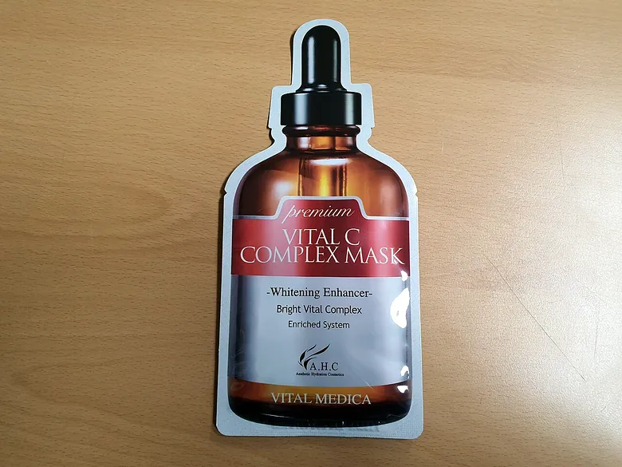

<a class="tr-btn go" href="#pay"><i class="ic ic-credit-card" aria-hidden="true"></i>계산하는 법</a><a class="tr-btn" href="#find"><i class="ic ic-map-pin" aria-hidden="true"></i>가까운 매장 찾기</a><a class="tr-btn" href="/ko/deals/"><i class="ic ic-calendar-days" aria-hidden="true"></i>다음 세일</a>

<figure class="tr-hero acc-hero"><figcaption><b>올리브영</b>, 한국에서 가장 큰 헬스·뷰티 체인이에요. 이 간판이 보이면 이 페이지 순서대로 하면 돼요.사진: Pkccccj, <a href="https://creativecommons.org/licenses/by-sa/4.0/deed.ko" rel="noopener" target="_blank">CC BY-SA 4.0</a>, <a href="https://commons.wikimedia.org/wiki/File:OliveYoung_store.png" rel="noopener" target="_blank">위키미디어 공용</a> (밝기 자동 보정). 어느 지점인지는 사진 설명에 없어요.</figcaption></figure>

<ul class="tr-facts"><li><i class="ic ic-id-card" aria-hidden="true"></i>실물 여권<small>세금 환급 대상이면 계산대에서 세금 빠짐</small></li><li><i class="ic ic-receipt" aria-hidden="true"></i>₩15,000 이상<small>영수증 한 장, 한 매장</small></li><li><i class="ic ic-shopping-basket" aria-hidden="true"></i>봉투는 유료<small>종이봉투 100원(명동 타운 기준)</small></li><li><i class="ic ic-calendar-check" aria-hidden="true"></i>다음 세일: 11/29(일)~12/5(토) 무렵 예상<small>공식 발표 전, 최근 세 번의 날짜로 본 예상</small></li></ul>

<aside class="tr-note"><i class="ic ic-user-check" aria-hidden="true"></i><b>세금 환급(택스리펀드) 대상</b>은 한국에 6개월 미만 머무는 외국인 방문객, 그리고 해외에 2년 넘게 살면서 3개월 이하로 방문한 한국 국민이에요(비짓서울·비짓코리아). 이 페이지에서 "대상"은 이 사람들을 말해요. 자세히: <a href="/ko/tax-refund/#나도-대상일까">나도 대상일까?</a></aside>

<h2 id="stores">매장은 네 종류예요</h2>

어느 매장이든 상품을 고르고 계산하는 순서는 같아요. 다른 건 크기와 외국어 도움이에요.

<ul class="tr-choose"><li><i class="ic ic-store" aria-hidden="true"></i><b>동네 매장: 대부분의 매장</b>필요한 것만 빨리 살 때. 상품 종류가 적고, 계산대 즉시 환급이 안 되는 곳도 있어요. 계산대에 먼저 물어보세요(아래 <a href="#pay">계산하기</a>).</li><li><i class="ic ic-globe" aria-hidden="true"></i><b>글로벌관광상권 매장: 전국 151곳(2026년 8월)</b>명동·홍대·강남, 부산, 제주처럼 외국인이 많은 곳. 외국어를 하는 직원을 먼저 두고, 안내문을 여러 언어로 두고, 상품 이름과 행사 정보를 영어로 함께 적어요. 외국인이 많이 사는 상품은 입구 가까이에 모아 둬요.</li><li><i class="ic ic-layers" aria-hidden="true"></i><b>타운: 큰 매장</b>평균 200평이 넘는 큰 매장. 예: 명동 타운(1~2층), 센트럴 명동 타운(3개 층 약 950평, 계산대 22개), 센트럴 강남 타운(외국인 대상 45분 퍼스널 쇼퍼, 여행 예약 플랫폼에서 미리 예약).</li><li><i class="ic ic-sparkles" aria-hidden="true"></i><b>특화 매장: 구경하러 가는 곳</b>올리브영N 성수(약 1,400평, 가장 큰 매장, 체험·예약 서비스), 경주황남점(한옥 디자인)처럼 그 자리에서만 하는 경험이 있는 곳.</li></ul>

<h2 id="find">가까운 매장 찾기</h2>

<h3 class="tr-step">1<i class="ic ic-smartphone" aria-hidden="true"></i>지도 앱에서 "올리브영" 검색</h3>

<ol class="steps"><li>네이버 지도나 카카오맵을 열어요. 네이버 지도는 영어·일본어·중국어, 카카오맵은 영어로 쓸 수 있어요. 처음이면 <a href="/ko/seoul-subway/#map-app">서울 지하철 1단계: 지도 앱 쓰는 법</a>부터.</li><li>검색창에 <b>올리브영</b>(또는 Olive Young)을 넣어요. 지금 있는 곳 가까운 매장이 지도에 핀으로 떠요.</li><li>매장 이름 끝을 보세요. <b>타운</b>이 붙은 곳(예: 명동 타운, 홍대 타운)이 큰 매장이에요.</li></ol>

<h3 class="tr-step">2<i class="ic ic-clock" aria-hidden="true"></i>영업시간 확인</h3>

<ol class="steps"><li>핀이나 목록에서 매장 이름을 눌러 매장 정보를 열어요.</li><li>영업시간을 봐요. 매장마다 달라요. 예: 명동 타운 매일 10:00~22:30, 올리브영N 성수 매일 10:00~22:00. 명동 타운은 "매장 상황에 따라 바뀔 수 있다"고 적어 둬요.</li><li>늦게 갈 거면 문 닫는 시각 30분 전엔 도착하게 잡아요(우리 판단: 계산 줄이 길 수 있어요).</li></ol>

<h3 class="tr-step">3<i class="ic ic-route" aria-hidden="true"></i>길찾기 시작</h3>

<ol class="steps"><li>매장 정보에서 길찾기를 눌러 도착지로 정해요. 출발지는 내 위치예요.</li><li>지하철로 가면 앱이 내릴 역과 <b>출구 번호</b>를 보여 줘요. 그 번호로 나가는 게 길 찾기의 절반이에요. 출구 번호 읽는 법: <a href="/ko/seoul-subway/">서울 지하철 6단계</a>.</li><li>역에서 나오면 걷기로 바꿔 화살표를 따라가요.</li></ol>

<h2 id="go">큰 매장 가는 길: 명동과 성수</h2>

<ul class="tr-choose"><li><i class="ic ic-map-pin" aria-hidden="true"></i><b>올리브영 명동 타운</b><strong>4호선 명동역 8번 출구</strong>(356m) 또는 <strong>2호선 을지로입구역 5번 출구</strong>. 주소 <strong>서울 중구 명동길 53</strong>(1~2층), 매일 10:00~22:30. 맞게 가면 근처에 보이는 것: <strong>명동 관광정보센터</strong>(을지로 66 하나금융그룹 명동사옥 별관 1층, 을지로입구역 5번 출구에서 211m, 매장에서 70m), 곰탕집 <strong>하동관</strong>(매장에서 50m), <strong>로얄호텔서울</strong>(70m). 길을 잃으면 관광정보센터에 들어가 물어봐요.</li><li><i class="ic ic-map-pin" aria-hidden="true"></i><b>올리브영N 성수</b><strong>2호선 성수역 4번 출구</strong>에서 118m(걸어서 약 1분). 주소 <strong>서울 성동구 연무장7길 13</strong>(팩토리얼 성수 건물), 매일 10:00~22:00. 맞게 나왔다면: 4번 출구에서 <strong>연무장길</strong>이 시작되고, 출구 앞에 팝업 매장 줄이 서 있는 경우가 많아요(비짓서울).</li><li><i class="ic ic-store" aria-hidden="true"></i><b>센트럴 명동 타운</b>2026년 3월 26일 명동에 연 3개 층 매장. 상품 수가 올리브영 매장 중 가장 많아요(약 1,000개 브랜드, 1만 5천 개 상품). 주소는 오늘 공식 자료에서 확인하지 못해서, 지도 앱에서 "올리브영 센트럴 명동 타운"으로 검색하세요.</li></ul>

<figure class="tr-photo"><figcaption><b>연무장길</b>. 성수역 4번 출구에서 시작해요. 올리브영N 성수는 이 길 쪽으로 118m.사진: Dr. Thomas Liptak, <a href="https://creativecommons.org/licenses/by-sa/4.0/deed.ko" rel="noopener" target="_blank">CC BY-SA 4.0</a>, <a href="https://commons.wikimedia.org/wiki/File:Seoul,_Seongdong_District,_Seongsu_(Yeonmujang-gil).jpg" rel="noopener" target="_blank">위키미디어 공용</a> (잘라 냄, 밝기 자동 보정)</figcaption></figure>

<aside class="tr-note tip"><i class="ic ic-lightbulb" aria-hidden="true"></i>큰 매장은 상품 종류가 가장 넓고 외국어 응대 직원이 있어요.</aside>

<h2 id="inside">매장 안에서: 입구 → 구역 → 써 보기 → 계산대</h2>

<h3 class="tr-step">1<i class="ic ic-door-open" aria-hidden="true"></i>입구: 바구니 들고, 큰 짐은 들고 다녀요</h3>

글로벌관광상권 매장은 외국인이 많이 사는 상품을 입구 가까이에 모아 둬요. 캐리어·우산 같은 개인 물건은 맡아 주지 않아요(명동 타운). 매장에 화장실이 없는 곳도 있어요. 명동 타운은 가까운 지하철역 화장실을 쓰라고 안내해요.

<h3 class="tr-step">2<i class="ic ic-layers" aria-hidden="true"></i>구역: 상품 종류별로 모여 있어요</h3>

예를 들면 명동 타운의 층별 안내는 이래요. 다른 매장도 종류별로 모아 두는 방식은 같아요(크기만 달라요).

<ul class="tr-choose"><li><i class="ic ic-droplets" aria-hidden="true"></i><b>1층</b>스킨케어(크림·에센스·클렌징), 선케어·트러블 패치, 마스크팩(시트·패드·씻어내는 팩), 시즌 기획전, <strong>계산대</strong></li><li><i class="ic ic-sparkles" aria-hidden="true"></i><b>2층</b>메이크업, 럭스 에딧(고가 브랜드), 향수, 헤어, 바디, 남성, 헬스케어, 식품·음료, 화장솜·브러시, <strong>계산대</strong>, <strong>글로벌 서비스 라운지</strong>(무료 와이파이, 쉬는 자리, 회원 선물), <strong>GTF 환급 데스크</strong></li></ul>

<h3 class="tr-step">3<i class="ic ic-tag" aria-hidden="true"></i>가격표 읽고, 써 보고 고르기</h3>

<figure class="tr-photo"><figcaption><b>1</b> 분홍 행사 가격표, <b>2</b> 일반 가격표. 가격표는 상품 바로 아래에 있어요. 세일 땐 1+1(하나 사면 하나 더), 2+1이 어디에나 있으니 어느 상품·세트에 적용되는지 확인하세요.사진: 최광모(올리브영 원주단구점, 2020, 다른 지점 사진), <a href="https://creativecommons.org/publicdomain/zero/1.0/deed.ko" rel="noopener" target="_blank">CC0</a>, <a href="https://commons.wikimedia.org/wiki/File:2020-04-17_22.18.09_%EC%98%AC%EB%A6%AC%EB%B8%8C%EC%98%81_%EC%9B%90%EC%A3%BC%EB%8B%A8%EA%B5%AC%EC%A0%90.jpg" rel="noopener" target="_blank">위키미디어 공용</a> (잘라 냄, 상자·번호 추가)</figcaption></figure>

{{fig:olive-young-3|1+1 가격표에서 확인할 것}}

매장에서는 상품을 직접 발라 보고 고를 수 있어요(비짓서울). 제형과 향을 먼저 보고 정품을 사세요. 테스터 쓰는 순서와 라벨 읽는 법: [K-뷰티 고르는 법](/ko/kbeauty-how-to-choose/).

<h3 class="tr-step">4<i class="ic ic-circle-help" aria-hidden="true"></i>못 찾겠으면 물어보기</h3>

글로벌관광상권 매장에는 외국어를 하는 직원이 있어요. 센트럴 명동 타운에서는 영어·중국어·일본어로 응대하는 직원이 **국기 배지**를 달고 있어요. 서울 일부 매장에는 8개 언어로 음성 대화가 되는 AI 쇼핑 도우미도 있어요(2026년 6월 도입). 찾는 상품 사진을 휴대폰으로 보여 주면 빨라요.

<h2 id="pay">계산하기</h2>

<figure class="tr-photo"><figcaption>명동의 한 올리브영 계산대 위 안내판: “즉시 환급을 위해 여권 실물을 준비해 주세요”.사진: Sgroey, <a href="https://creativecommons.org/licenses/by-sa/4.0/deed.ko" rel="noopener" target="_blank">CC BY-SA 4.0</a>, <a href="https://commons.wikimedia.org/wiki/File:Olive_Young_Myeongdong.jpg" rel="noopener" target="_blank">위키미디어 공용</a> (잘라 냄, 밝기 자동 보정). 명동의 어느 지점인지는 사진 설명에 없어요.</figcaption></figure>

<h3 class="tr-step">1<i class="ic ic-id-card" aria-hidden="true"></i>계산대에 여권 실물을 먼저 내요</h3>

바구니를 올리고 결제 수단과 함께 **여권 실물**을 내요(대상이라면). 사진이나 사본은 안 돼요. 대상인지는 여권으로 확인해요. 즉시 환급이 되는 매장은 주요 매장이에요. "Tax refund?"라고 물어보면 돼요.

<h3 class="tr-step">2<i class="ic ic-receipt" aria-hidden="true"></i>세금을 뺀 금액으로 결제해요</h3>

<figure class="tr-photo"><figcaption><b>1</b> 계산대: 대상이라면 결제 수단과 함께 여권을 내요. <b>2</b> 둥근 세일 스티커: 옆 가격표에서 어느 상품에 해당하는지 확인하세요.사진: 최광모(올리브영 원주단구점, 2020, 다른 지점 사진), <a href="https://creativecommons.org/publicdomain/zero/1.0/deed.ko" rel="noopener" target="_blank">CC0</a>, <a href="https://commons.wikimedia.org/wiki/File:2020-04-17_22.17.43_%EC%98%AC%EB%A6%AC%EB%B8%8C%EC%98%81_%EC%9B%90%EC%A3%BC%EB%8B%A8%EA%B5%AC%EC%A0%90.jpg" rel="noopener" target="_blank">위키미디어 공용</a> (상자·번호 추가)</figcaption></figure>

영수증 한 장이 15,000원 이상 1,000,000원 미만이면 세금만큼 뺀 금액으로 결제해요. 세일가에서도 돼요. 빠지는 금액은 산 금액의 5~8%이고 1,000원 단위로 계산돼요.

{{fig:olive-young-2|계산대 즉시 환급, 영수증 한 장 기준}}

<h3 class="tr-step">3<i class="ic ic-circle-check" aria-hidden="true"></i>영수증 받고 확인해요</h3>

결제한 금액이 가격표를 더한 금액보다 적으면 세금이 빠진 거예요. 영수증은 출국할 때까지 챙겨 두세요. 교환·환불에도 필요해요.

<aside class="tr-note"><i class="ic ic-triangle-alert" aria-hidden="true"></i>다른 매장 영수증은 합쳐지지 않아요. 영수증마다 15,000원을 넘어야 하니 세 곳에서 나눠 사지 말고 한 곳에서 사세요.</aside>

<ul class="tr-choose"><li><i class="ic ic-credit-card" aria-hidden="true"></i><b>카드가 안 될 때</b>다른 카드나 현금으로 내요. 명동 타운은 위챗페이·알리페이 같은 간편결제도 받아요. 올리브영은 유니온페이·알리페이·위챗페이·와우패스 결제 할인 행사를 연 적도 있어요. 카드·현금 준비: <a href="/ko/money/">환전과 결제</a>.</li><li><i class="ic ic-receipt" aria-hidden="true"></i><b>영수증 한 장이 1,000,000원 이상</b>계산대에서 바로 빼 주지 않아요. 전액을 내고 <strong>환급 전표</strong>를 받아, 시내 환급 창구나 공항에서 돌려받아요. <a href="/ko/tax-refund/">택스리펀드 받는 법</a></li><li><i class="ic ic-ban" aria-hidden="true"></i><b>이번 여행 합계가 5,000,000원을 넘었을 때</b>즉시 환급은 한 번 입국에 합계 5,000,000원까지예요. 그 뒤로는 전표를 받아 공항에서 돌려받아요.</li><li><i class="ic ic-id-card" aria-hidden="true"></i><b>여권을 안 가져왔을 때</b>계산대 즉시 환급은 안 돼요. 명동 타운 안내대로 환급 전표를 받아 공항 환급 창구에서 받으면 돼요. 관세청에 등록되지 않은 경우, 6개월 넘게 머문 경우도 같아요(명동 타운 FAQ).</li><li><i class="ic ic-circle-x" aria-hidden="true"></i><b>세금이 안 빠지는 물건</b>위생용품, 쇼핑백, 말린 과일 상품은 면세에서 빠져요(명동 타운).</li></ul>

<h3 class="tr-step">4<i class="ic ic-shopping-basket" aria-hidden="true"></i>봉투와 선물 포장</h3>

봉투는 돈을 내요. 명동 타운 기준 종이봉투 100원, 다시 쓰는 가방(리유저블 백) 500원. 선물 포장은 선물 상자로 크기에 따라 1,000~2,500원이에요. 장바구니를 가져가면 봉투값이 안 들어요.

<h3 class="tr-step">5<i class="ic ic-hand-coins" aria-hidden="true"></i>다른 매장의 GTF 전표도 여기서</h3>

올리브영과 같은 환급 회사(GTF) 전표를 다른 가게에서 받았다면, 실물 여권을 들고 명동 타운 2층 글로벌 서비스 라운지의 **GTF 데스크**에서 환급받을 수 있어요.

<h2 id="exchange">교환·환불</h2>

<ul class="tr-facts"><li><i class="ic ic-calendar-days" aria-hidden="true"></i>15일 안<small>결제한 날부터</small></li><li><i class="ic ic-package" aria-hidden="true"></i>뜯지 않은 정상품<small>다시 팔 수 있는 상태</small></li><li><i class="ic ic-receipt" aria-hidden="true"></i>영수증 + 결제한 카드<small>둘 다 들고 매장 방문</small></li><li><i class="ic ic-store" aria-hidden="true"></i>환불: 산 매장만<small>교환: 같은 금액 이상이면 전국 어디서나</small></li></ul>

출처는 올리브영 명동 타운 FAQ예요. 다른 매장도 같은지는 그 매장에서 확인하세요.

<h2 id="sale">언제 갈까: 세일</h2>

올리브영 세일은 두 종류인데, 일정을 맞출 만한 건 하나예요.

{{fig:olive-young-1|올리브영의 1년: 큰 세일 네 번, 매달 작은 행사 한 번}}

<ul class="tr-choose"><li><i class="ic ic-calendar-check" aria-hidden="true"></i><b>올영세일: 여기에 맞추세요</b>1년에 네 번, 3·6·9·12월에 약 7일간. 1년 중 할인 폭이 가장 넓어요. 매장과 온라인 모두. 2026년: 3월 1~7일, 5월 31일~6월 6일, 8월 30일~9월 5일. 12월 세일은 아직 공식 발표 전이라 날짜는 예상이에요: 11/29(일)~12/5(토) 무렵. 근거: 최근 세 번(<a href="https://cjnews.cj.net/올영세일로-본-k뷰티-트렌드-집에서도-전문가처럼/" rel="noopener" target="_blank">2025년 12월 11/30~12/6</a>, 2026년 6월 5/31~6/6, 9월 8/30~9/5, 모두 CJ뉴스룸)이 일요일에 시작해 7일 동안 열렸어요. 발표되면 <a href="/ko/deals/">할인 상황판</a>에 확정 날짜를 올릴게요.</li><li><i class="ic ic-tag" aria-hidden="true"></i><b>올영데이(올리브 데이): 겹치면 좋은 정도</b>매달 25~27일. 추가 할인 쿠폰은 올리브영 회원(올리브 멤버스) 계정으로 나와요. 회원 가입은 한국에 살고 본인 이름의 한국 연락처가 있어야 해요.</li></ul>

<aside class="tr-note tip"><i class="ic ic-lightbulb" aria-hidden="true"></i>기다림도 즐거움이에요. 세일 주간을 달력에 적고, 가기 전에 살 것 세 개만 적어 두세요.</aside>

<h2 id="buy">무엇을 살까: 처음이라면 세 가지</h2>

다 쓰는 건 짧은 목록이라서 세 개만 골랐어요. 브랜드 목록이 아니라 종류예요. 일주일 뒤에도 쓰고 있을 물건이라서 골랐어요.

{{fig:olive-young-4|처음 장바구니 세 가지와 고른 이유}}

<i class="ic ic-droplets" aria-hidden="true"></i><b>토너 패드:</b> 용기 하나라 챙기기 쉽고 금방 써요.

두 가지는 이렇게 생겼어요(예시이고 추천이 아니에요):

<ul class="acc-picks">
<li><b><i class="ic ic-sun" aria-hidden="true"></i>선크림</b>매일 쓰니까 끝까지 써요. 라벨의 <strong>1</strong> SPF와 <strong>2</strong> PA를 보고 실제 일정에 맞춰 고르세요. (라벨 읽는 예시일 뿐이에요. 사진은 일본 브랜드이고 추천이 아니에요.)사진: Yiting, <a href="https://creativecommons.org/licenses/by-sa/4.0/deed.ko" rel="noopener" target="_blank">CC BY-SA 4.0</a>, <a href="https://commons.wikimedia.org/wiki/File:Japanese_sunscreen.jpg" rel="noopener" target="_blank">위키미디어 공용</a> (잘라 냄, 상자·번호 추가)</li>
<li><b><i class="ic ic-package" aria-hidden="true"></i>시트 마스크</b>싸고, 납작하고, 한 번에 한 장. 이렇게 납작한 파우치 하나에 한 장씩 들어 있어요. 예시이고 추천이 아니에요.사진: 김인겸, <a href="https://creativecommons.org/licenses/by-sa/4.0/deed.ko" rel="noopener" target="_blank">CC BY-SA 4.0</a>, <a href="https://commons.wikimedia.org/wiki/File:PX%EB%A7%88%EC%8A%A4%ED%81%AC%ED%8C%A9.jpg" rel="noopener" target="_blank">위키미디어 공용</a> (밝기 자동 보정)</li>
</ul>

<ul class="tr-choose"><li><i class="ic ic-sparkles" aria-hidden="true"></i><b>12월에 간다면</b>작년(2025년) 12월 세일은 그해 많이 팔린 상품을 뽑는 '올리브영 어워즈'와 함께 열렸고, 수상 상품이 대용량, 1+1, 사은품을 붙인 한정 상품으로 나와 같은 돈에 더 많이 들어 있는 경우가 많았어요(<a href="https://cjnews.cj.net/모두가-사랑한-제품을-모두가-사랑할-혜택으로-cj/" rel="noopener" target="_blank">CJ뉴스룸 2025-11-28</a>). 올해도 같을 거라고 예상하지만 공식 발표 전이에요.</li><li><i class="ic ic-user-x" aria-hidden="true"></i><b>이 목록이 필요 없는 사람</b>이미 쓰는 루틴이 있다면 세일 때 리필만 사세요.</li></ul>

뺀 것: 유행하는 상품과 랭킹. 랭킹은 잘 팔리는 걸 알려 줄 뿐, 내게 맞는 걸 알려 주진 않아요.

<h2 id="members">회원·쿠폰</h2>

<ul class="tr-choose"><li><i class="ic ic-user-check" aria-hidden="true"></i><b>한국 회원(올리브 멤버스)</b>한국에 살고 본인 이름의 연락처가 있어야 가입하고 포인트를 쓸 수 있어요. 회원 특가도 한국 계정 회원만 받아요.</li><li><i class="ic ic-globe" aria-hidden="true"></i><b>외국인: 글로벌몰 회원</b>외국 국적이면 올리브영 글로벌몰에 가입하라고 안내해요. 명동 타운 2층 글로벌 서비스 라운지에서 신규 회원 선물을 줘요.</li><li><i class="ic ic-tag" aria-hidden="true"></i><b>외국인 할인 행사: 기간 한정</b>예: 2026년 2~3월 유니온페이·알리페이·위챗페이 결제 할인, 와우패스 결제 5%(2월 15~22일). 지금 하는 행사는 <a href="/ko/deals/">할인 상황판</a>에서 확인하세요. 한국에서 쓰는 올리브영 모바일 상품권은 2025년부터 클룩 같은 여행 플랫폼에서도 팔아요.</li></ul>

## 자주 하는 실수

<ul class="tr-oops"><li><i class="ic ic-triangle-alert" aria-hidden="true"></i>세금을 빼려는데 여권 사진만 챙기기. 실물 여권이어야 해요.</li><li><i class="ic ic-triangle-alert" aria-hidden="true"></i>세 매장에 나눠 사기. 영수증은 합쳐지지 않아요.</li><li><i class="ic ic-triangle-alert" aria-hidden="true"></i>가격표가 어느 상품·세트에 적용되는지 안 보고 1+1 집기.</li><li><i class="ic ic-triangle-alert" aria-hidden="true"></i>올영데이에 일정을 맞추기. 규모가 작고, 추가 쿠폰은 한국 회원 몫이에요.</li><li><i class="ic ic-triangle-alert" aria-hidden="true"></i>환불하려고 다른 지점에 가기. 환불은 산 매장에서만, 15일 안이에요.</li><li><i class="ic ic-triangle-alert" aria-hidden="true"></i>캐리어를 맡기려 하기. 매장은 개인 물건을 맡아 주지 않아요.</li></ul>

<h2 id="home">여행 후에 다시 사려면</h2>

<ul class="tr-choose"><li><i class="ic ic-globe" aria-hidden="true"></i><b>대부분의 나라: 올리브영 글로벌</b>여러 나라로 배송해요. 내 나라로 배송되는지는 결제 단계에서 확인하세요.</li><li><i class="ic ic-truck" aria-hidden="true"></i><b>미국: 올리브영 US</b>2026년 5월 29일 미국 전용 온라인몰이 열렸고, 이날부터 올리브영 글로벌은 미국 고객에게 서비스하지 않아요.</li></ul>

<ul class="tr-next"><li><a href="https://global.oliveyoung.com" rel="noopener" target="_blank"><i class="ic ic-globe" aria-hidden="true"></i>올리브영 글로벌<i class="ic ic-external-link" aria-hidden="true"></i></a></li><li><a href="https://us.oliveyoung.com" rel="noopener" target="_blank"><i class="ic ic-truck" aria-hidden="true"></i>올리브영 US(미국)<i class="ic ic-external-link" aria-hidden="true"></i></a></li></ul>

배송비·반품·받을 때 세금(나라별)까지 비교하려면: [K-뷰티, 집에서 받는 법](/ko/buy-from-home/)

{{fig:olive-young-5|집에서 다시 사려면 어디서}}

<i class="ic ic-list-checks" aria-hidden="true"></i>한 줄 판단, 표로 보기

| 상황 | 이렇게 | 이유 |
|---|---|---|
| 일정이 올영세일 기간(3·6·9·12월, 약 7일)과 겹칠 때 | 올영세일 기간에 사요 | 1년 중 할인 폭이 가장 넓어요. 매장과 온라인 모두 |
| 그 밖의 주 | 대상이라면 여권 들고 그냥 사요 | 영수증 한 장 15,000원 이상 1,000,000원 미만이면 계산대에서 세금이 빠져요 |
| K-뷰티가 처음 | 처음 살 것 세 가지부터 | 선크림, 토너 패드, 시트 마스크: 싸고, 챙기기 쉽고, 다 쓰기 쉬워요 |
| 이미 집에 돌아왔을 때 | 올리브영 글로벌, 미국이면 올리브영 US | 2026년 5월 29일부터 글로벌몰은 미국 고객을 받지 않아요 |

<i class="ic ic-info" aria-hidden="true"></i>출처

2026년 11월 26일(한국 시간) 열어 확인. 올리브영 <a href="https://myeongdongtown.oliveyoung.com/ko/" rel="noopener" target="_blank">명동 타운 사이트</a>(한국어·영어·일본어·중국어판: 층별 안내, FAQ의 즉시·사후 환급, 제외 물품, 영수증 1장 1만5천~100만 원·한도 500만 원·5~8%·천 원 단위, GTF 데스크, 교환·환불 15일, 봉투 100원·500원, 선물 포장 1,000~2,500원, 개인물품 보관 불가, 멤버십, 화장실 없음, 주소·영업시간·출구·간편결제). 비짓서울: <a href="https://english.visitseoul.net/shopping/Olive-Young-Lifestyle-Experience-Center/ENP012015" rel="noopener" target="_blank">올리브영 명동 플래그십</a>(명동역 8번 출구 356m, 주변 하동관 50m·명동 관광정보센터 70m·로얄호텔서울 70m, 써 보고 고르기, 2026년 11월 24일 수정), <a href="https://english.visitseoul.net/attractions/Myeong-dong-Tourist-Information-Center/ENP011469" rel="noopener" target="_blank">명동 관광정보센터</a>(을지로 66, 을지로입구역 5번 출구 211m), <a href="https://english.visitseoul.net/editorspicks/2025SeoulTrendReportSeongsu-dong/ENNvepwqx" rel="noopener" target="_blank">성수동 트렌드 리포트</a>(올리브영N 성수 주소·영업시간·4번 출구 118m·1,400평·층별·예약, 연무장길과 4번 출구), <a href="https://english.visitseoul.net/Tax-Refund" rel="noopener" target="_blank">Tax Refund</a>(대상자). CJ뉴스룸: <a href="https://cjnews.cj.net/cj올리브영-글로벌관광상권-전략-성과오프라인/" rel="noopener" target="_blank">글로벌관광상권 110여 매장 운영 방식·즉시환급 주요 매장·센트럴 강남 타운 퍼스널 쇼퍼·경주황남점</a>(2025년 7월 22일), <a href="https://cjnews.cj.net/?p=79498" rel="noopener" target="_blank">글로벌관광상권 151개·타운 평균 200평·AI 쇼핑 도우미 8개 언어</a>(2026년 8월 31일), <a href="https://cjnews.cj.net/cj올리브영-k뷰티-쇼핑-심장부에-글로벌-고객-겨냥-센/" rel="noopener" target="_blank">센트럴 명동 타운 개점</a>(2026년 3월 26일), <a href="https://cjnews.cj.net/cj올리브영-외국인-관광객-대상-제휴·할인-혜택-확대/" rel="noopener" target="_blank">외국인 제휴·할인, 클룩 모바일 상품권</a>(2026년 2월 2일), <a href="https://cjnews.cj.net/cj올리브영-25일부터-3일간-멤버십-회원-위한-올리브/" rel="noopener" target="_blank">올리브 데이 매달 25~27일, 회원 대상</a>(2025년 3월 24일), <a href="https://cjnews.cj.net/?p=71722" rel="noopener" target="_blank">올리브영 어워즈와 12월 세일, 대용량·1+1·굿즈 한정 상품</a>(2025년 11월 28일), <a href="https://cjnews.cj.net/cj올리브영-올해-첫-올영세일-봄맞이-뷰티·웰니/" rel="noopener" target="_blank">3월 올영세일 3월 1~7일</a>(2026년 2월 27일), <a href="https://cjnews.cj.net/선파우더·픽서·데오드란트-산다6월-올영세일-대/" rel="noopener" target="_blank">6월 올영세일 5월 31일~6월 6일</a>(2026년 6월 4일), <a href="https://cjnews.cj.net/cj올리브영-9월-올영세일서-취향-소비-두드러져/" rel="noopener" target="_blank">9월 올영세일 8월 30일~9월 5일</a>(2026년 9월 6일), <a href="https://cjnews.cj.net/cj올리브영-올영세일-외국인-재방문-3년-새-11배-증가/" rel="noopener" target="_blank">연 4회(3·6·9·12월)</a>(2026년 6월 22일). 코리아타임스 <a href="https://www.koreatimes.co.kr/business/companies/20260622/foreign-repeat-visits-to-olive-young-sale-surge-11-fold-in-3-years" rel="noopener" target="_blank">같은 내용 영문 보도</a>(2026년 6월 22일). 코리아헤럴드 <a href="https://www.koreaherald.com/article/10742777" rel="noopener" target="_blank">5월 29일 미국 전용 온라인몰</a>(2026년 5월 21일). 비짓코리아 <a href="https://english.visitkorea.or.kr/svc/contents/infoHtmlView.do?vcontsId=248765" rel="noopener" target="_blank">택스리펀드 안내</a>(여권으로 대상 확인 → 세금 뺀 금액 결제, 합계 500만 원). 2026년 12월 세일 발표는 11월 26일 현재 CJ뉴스룸에 없어요. 다시 열지 못한 것: 올리브영 글로벌 고객센터의 미국 플랫폼 변경 공지(확인 도구 접속 거부, 2026년 5월, 이전 판에서 확인), 올리브영 공식몰·매장 찾기(접속 거부). 영업시간 30분 여유는 우리 판단이에요.

## 다음

<ul class="tr-next"><li><a href="/ko/tax-refund/"><i class="ic ic-receipt" aria-hidden="true"></i>택스리펀드: 대상자, 큰 구매, 공항<i class="ic ic-arrow-right" aria-hidden="true"></i></a></li><li><a href="/ko/kbeauty-how-to-choose/"><i class="ic ic-droplets" aria-hidden="true"></i>K-뷰티 라벨 읽고 고르는 법<i class="ic ic-arrow-right" aria-hidden="true"></i></a></li><li><a href="/ko/deals/"><i class="ic ic-tag" aria-hidden="true"></i>할인 상황판: 세일 날짜가 나오는 대로<i class="ic ic-arrow-right" aria-hidden="true"></i></a></li></ul>
