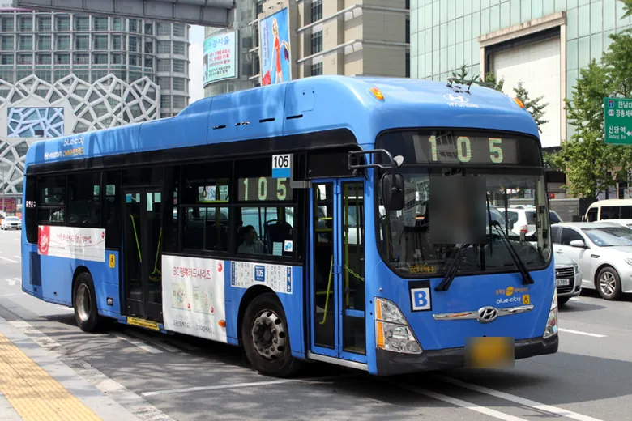
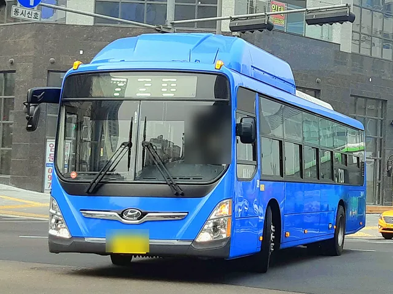
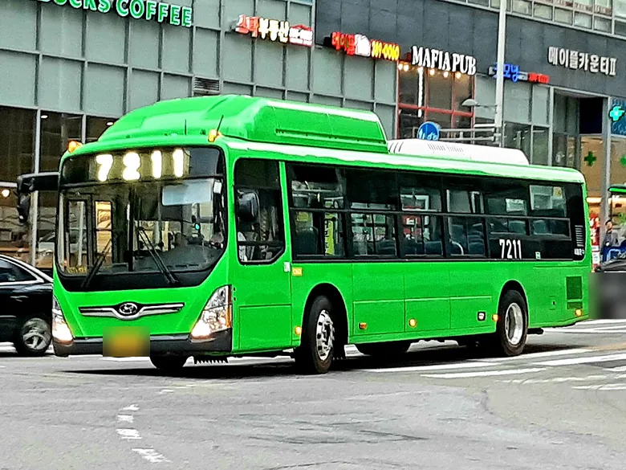
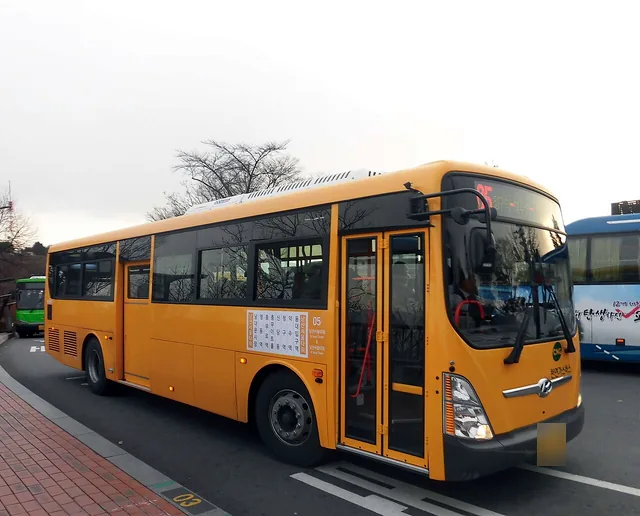
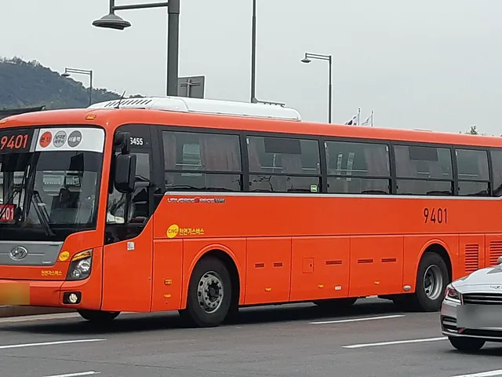
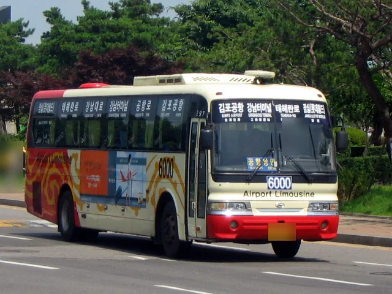

<a class="tr-btn go" href="#따라-하기"><i class="ic ic-bus" aria-hidden="true"></i>5단계 바로 보기</a><a class="tr-btn" href="#먼저-색깔을-봐요"><i class="ic ic-info" aria-hidden="true"></i>버스 색깔의 뜻</a>

<figure class="tr-hero"><figcaption>파란 간선버스. 노선 번호는 앞면과 옆면에 있어요. 사진: Ki hoon, <a href="https://creativecommons.org/licenses/by-sa/4.0/" rel="noopener" target="_blank">CC BY-SA 4.0</a>, <a href="https://commons.wikimedia.org/wiki/File:Seoul_105_Blue_City_Front_side.png" rel="noopener" target="_blank">위키미디어 공용</a> (자동 대비 보정, 운전자·번호판 흐림 처리)</figcaption></figure>

<ul class="tr-facts"><li><i class="ic ic-coins" aria-hidden="true"></i>1,500원<small>파랑·초록, 교통카드</small></li><li><i class="ic ic-credit-card" aria-hidden="true"></i>두 번 태그<small>탈 때, 내릴 때</small></li><li><i class="ic ic-timer" aria-hidden="true"></i>30분<small>환승 인정(밤엔 1시간)</small></li><li><i class="ic ic-banknote" aria-hidden="true"></i>현금 불가<small>183개 노선</small></li></ul>

## 따라 하기

<h3 class="tr-step">1<i class="ic ic-credit-card" aria-hidden="true"></i>출발 전에 카드 충전</h3>

서울시의 2026년 1월 기준 목록에 '현금 없는 버스'가 183개 노선 있어요(전체 시내버스 396개 노선 중). 이 노선에서는 현금을 아예 못 내요. 우리 판단: 노선마다 목록을 확인하기보다, 어떤 버스든 충전된 티머니 같은 국내 교통카드로 타요. 어떤 카드를 어디서 사고 충전하는지는 [서울 지하철 타기](/ko/seoul-subway/#어떤-카드로-탈까)와 [필수 준비](/ko/essentials/)에 있어요.

<h3 class="tr-step">2<i class="ic ic-map-pin" aria-hidden="true"></i>탈 버스 찾기</h3>

**네이버 지도**에서 경로를 열고(언어를 영어·일본어·중국어로 바꿀 수 있어요) 노선 번호와 정류장 이름을 저장해요. 정류장에는 버스 정보를 실시간으로 보여 주는 화면이 많아요.

{{fig:seoul-bus-stop-display|서울 버스 정류장 안내 화면. 사진: Wikiwater2020, [CC BY-SA 3.0](https://creativecommons.org/licenses/by-sa/3.0/), [위키미디어 공용](https://commons.wikimedia.org/wiki/File:Bus_Info_in_the_Bus_Stop.jpg) (자름, 번호 추가)}}

1. **7025**번이 **3분** 뒤에 와요.

{{fig:seoul-bus-front|번호 맞춰 보기. 사진: Ki hoon, [CC BY-SA 4.0](https://creativecommons.org/licenses/by-sa/4.0/), [위키미디어 공용](https://commons.wikimedia.org/wiki/File:Seoul_105_Blue_City_Front_side.png) (자동 대비 보정, 운전자·번호판 흐림 처리, 번호 추가)}}

1. 앞면의 노선 번호. 지도 앱 번호와 맞춰요.
2. 앞문. 여기로 타요.

<h3 class="tr-step">3<i class="ic ic-log-in" aria-hidden="true"></i>앞문으로 타면서 태그</h3>

{{fig:seoul-bus-reader-front|앞문 단말기: 2012년 캐시비 단말기 사진으로, 촬영 도시가 적혀 있지 않고 서울이 아닐 가능성이 커요. 서울 단말기는 모양이 다르지만 대는 방법은 같아요. 사진: Wnstlr93, [CC BY 3.0](https://creativecommons.org/licenses/by/3.0/), [위키미디어 공용](https://commons.wikimedia.org/wiki/File:%EC%8A%B9%EC%B0%A8%EC%9A%A9_%EB%8B%A8%EB%A7%90%EA%B8%B0.jpg) (자름, 밝기 보정, 번호 추가)}}

1. 타면서 여기에 카드를 대요.

<h3 class="tr-step">4<i class="ic ic-bell" aria-hidden="true"></i>정류장 확인, 하차벨</h3>

자리가 있으면 창가에 앉아 보세요. 한국관광공사도 창밖으로 지나가는 거리 풍경을 시내버스 여행의 즐거움으로 꼽아요. 지도에서 정류장을 보다가, 다음이 내릴 정류장이면 창가의 하차벨을 눌러요.

<h3 class="tr-step">5<i class="ic ic-log-out" aria-hidden="true"></i>뒷문 옆 단말기에 다시 태그하고 내리기</h3>

{{fig:seoul-bus-reader-rear|뒷문 단말기: 2012년 캐시비 단말기 사진으로, 촬영 도시가 적혀 있지 않고 서울이 아닐 가능성이 커요. 서울 단말기는 모양이 다르지만 대는 방법은 같아요. 사진: Wnstlr93, [CC BY 3.0](https://creativecommons.org/licenses/by/3.0/), [위키미디어 공용](https://commons.wikimedia.org/wiki/File:%ED%99%98%EC%8A%B9_%EB%8B%A8%EB%A7%90%EA%B8%B0.jpg) (자름, 번호 추가)}}

1. "내리실 때 꼭 체크하세요."
2. 여기에 카드를 대요.
3. 남은 잔액.

<aside class="tr-note"><i class="ic ic-triangle-alert" aria-hidden="true"></i>서울시 안내로는 하차 태그를 안 하면 그 수단부터 환승이 끊기고, 다음 버스나 지하철을 탈 때 덜 낸 기본요금이 붙어요.</aside>

<aside class="tr-note ok"><i class="ic ic-circle-check" aria-hidden="true"></i><b>끝.</b> 우리가 고른 끝 장면: 지하철이 안 닿는 곳에서 두 번 태그하고 내렸고, 30분 안에 다음 걸 타면 기본요금을 또 안 낸다는 것까지 아는 거예요.</aside>

## 먼저 색깔을 봐요

서울 버스는 색이 곧 노선의 역할이라, 색만 봐도 맞는 종류인지 알 수 있어요. 모두 어른이 교통카드로 낼 때 요금이에요.

<ul class="tr-colours"><li><b><i class="sw" style="background:#1f6fd1"></i>파랑 · 1,500원</b>간선: 외곽과 도심·부도심을 길게 이어요.<a href="https://commons.wikimedia.org/wiki/File:Seoul_Blue_Bus.jpg" rel="noopener" target="_blank">Wikiwater2020</a>, <a href="https://creativecommons.org/licenses/by-sa/3.0/" rel="noopener" target="_blank">CC BY-SA 3.0</a></li><li><b><i class="sw" style="background:#3cb043"></i>초록 · 1,500원</b>지선: 동네와 간선버스·지하철을 이어요. 초록 마을버스는 1,200원.<a href="https://commons.wikimedia.org/wiki/File:Seoul_Bus_7211.jpg" rel="noopener" target="_blank">Wikiwater2020</a>, <a href="https://creativecommons.org/licenses/by-sa/3.0/" rel="noopener" target="_blank">CC BY-SA 3.0</a></li><li><b><i class="sw" style="background:#f2b21b"></i>노랑 · 1,400원</b>순환: 도심 안을 돌아요.<a href="https://commons.wikimedia.org/wiki/File:Seoul_Bus_05.JPG" rel="noopener" target="_blank">hyolee2</a>, <a href="https://creativecommons.org/licenses/by-sa/4.0/" rel="noopener" target="_blank">CC BY-SA 4.0</a> (번호판 흐림)</li><li><b><i class="sw" style="background:#e2462b"></i>빨강 · 3,000원</b>광역: 수도권과 도심을 이어요. 기후동행카드 단기권으로는 <b>못 타요.</b><a href="https://commons.wikimedia.org/wiki/File:Seoul_Bus_9401.jpg" rel="noopener" target="_blank">Wikiwater2020</a>, <a href="https://creativecommons.org/licenses/by-sa/3.0/" rel="noopener" target="_blank">CC BY-SA 3.0</a> (번호판 흐림)</li></ul>

<aside class="tr-note tip"><i class="ic ic-moon" aria-hidden="true"></i><b>N으로 시작하는 번호</b>는 심야버스예요. 2,500원.</aside>

## 환승: 내린 뒤 30분

하차 태그를 했고 시간 안에 다음 차를 타면 새 요금이 아니라 환승이에요.

{{fig:seoul-bus-3|하차 태그 뒤 환승 인정 시간 (Nadri가 그림: 시간 규칙은 사진으로 보여 줄 수 없어요)}}

1. **첫 버스에서 내릴 때 태그.**
2. **30분 안에 다음 버스나 지하철 탑승** (다음 차를 밤 9시~다음 날 아침 7시에 타면 1시간).
3. **처음 10km는 기본요금 한 번**(탄 수단 중 높은 기본요금), 이후 5km마다 100원. 환승은 최대 4번, 모두 5번 승차까지 인정돼요.

## 자주 하는 실수

<ul class="tr-oops"><li><i class="ic ic-triangle-alert" aria-hidden="true"></i><b>하차 태그 안 하고 내리기.</b> 환승이 끊겨 다음 차에서 기본요금을 다시 내요.</li><li><i class="ic ic-triangle-alert" aria-hidden="true"></i><b>카드 없이, 또는 잔액 없이 타기.</b> 현금 안 받는 노선이 있어요.</li><li><i class="ic ic-triangle-alert" aria-hidden="true"></i><b>기후동행카드 단기권으로 빨간 버스 타기.</b> 적용이 안 돼요.</li><li><i class="ic ic-triangle-alert" aria-hidden="true"></i><b>환승 사이에 너무 오래 있기.</b> 30분(밤엔 1시간)이 지나면 환승이 끊겨요.</li><li><i class="ic ic-triangle-alert" aria-hidden="true"></i><b>공항 N버스와 시내 N버스 헷갈리기.</b> 요금이 일곱 배 가까이 차이 나요.</li></ul>

## 공항버스는 다른 버스예요

<figure class="tr-photo"><figcaption>공항 리무진: 표를 따로 사는 별도 서비스예요. 6000번, 2009년 사진. 사진: Baek Seung Woon, <a href="https://creativecommons.org/licenses/by-sa/2.0/kr/" rel="noopener" target="_blank">CC BY-SA 2.0 KR</a>, <a href="https://commons.wikimedia.org/wiki/File:Seoul_Airport_Bus_6000.jpg" rel="noopener" target="_blank">위키미디어 공용</a> (자동 대비 보정, 사람·번호판 흐림 처리)</figcaption></figure>

시내버스와 공항 리무진 버스는 같은 '버스'지만 따로 움직이는 서비스예요.

<ul class="tr-choose tr-compare"><li><i class="ic ic-bus" aria-hidden="true"></i><b>시내버스</b><ul class="tr-kv"><li><b>요금(어른)</b> 1,200~3,000원</li><li><b>표</b> 카드 태그</li><li><b>기후동행카드 단기권</b> 가능(광역버스 제외)</li><li><b>큰 짐</b> 맞지 않아요</li></ul></li><li><i class="ic ic-plane" aria-hidden="true"></i><b>공항 리무진</b><ul class="tr-kv"><li><b>요금(어른)</b> 서울까지 16,000~18,000원</li><li><b>표</b> 공항 무인발권기·매표소에서 표 구입. 티머니도 되지만 표가 있는 사람이 먼저 타요</li><li><b>기후동행카드 단기권</b> 안 돼요</li><li><b>큰 짐</b> 직원이 실어 줘요(1인 2개, 28인치 이하)</li></ul></li></ul>

<aside class="tr-note"><i class="ic ic-triangle-alert" aria-hidden="true"></i>번호 주의: 심야 공항버스(N6000, N6002, N6701, N6703)도 N으로 시작하지만 요금이 17,000~18,000원이고 표를 사서 타요. 2,500원짜리 시내 N버스가 아니에요.</aside>

자세한 건 [인천공항에서 서울까지](/ko/airport-to-seoul/)에 있어요.

## 심야버스

지하철이 끊긴 뒤엔 번호가 N으로 시작하는 심야버스(올빼미버스) 14개 노선이 밤 11시부터 새벽 6시까지 다녀요. 어른 교통카드 2,500원이에요([서울시, 2026년 3월 20일 수정](https://news.seoul.go.kr/traffic/archives/27974)). 첫차·막차와 배차 간격은 노선마다 달라서, 정류장에 나가기 전에 네이버 지도로 노선과 다음 버스를 먼저 확인해요.

<i class="ic ic-moon" aria-hidden="true"></i>N버스 두 종류, 그림 한 장으로

{{fig:seoul-bus-5|N버스 두 종류: 시내 심야버스와 공항 심야버스 (Nadri가 그림)}}

## 다음

<ul class="tr-next"><li><a href="/ko/seoul-subway/"><i class="ic ic-train-front" aria-hidden="true"></i>서울 지하철 7단계<i class="ic ic-arrow-right" aria-hidden="true"></i></a></li><li><a href="/ko/airport-to-seoul/"><i class="ic ic-plane" aria-hidden="true"></i>인천공항에서 서울까지<i class="ic ic-arrow-right" aria-hidden="true"></i></a></li><li><a href="/ko/getting-around/"><i class="ic ic-route" aria-hidden="true"></i>서울 대중교통: 택시, 막차, 어떤 카드<i class="ic ic-arrow-right" aria-hidden="true"></i></a></li><li><a href="/ko/emergency/"><i class="ic ic-triangle-alert" aria-hidden="true"></i>버스에 물건을 두고 내렸다면<i class="ic ic-arrow-right" aria-hidden="true"></i></a></li></ul>

여기 없는 실수를 겪었다면 이 페이지 끝의 업데이트 요청 상자로 알려 주세요.

## 더 자세히

<i class="ic ic-list-checks" aria-hidden="true"></i>한 줄 판단 표

| 상황 | 이렇게 | 이유 |
|---|---|---|
| 목적지가 지하철역에서 멀 때 | 충전된 카드로 버스 | 서울시 목록상 현금을 안 받는 노선이 183개예요 |
| 버스에서 내릴 때 | 단말기에 한 번 더 태그 | 안 찍으면 환승이 거기서 끊겨요 |
| 어디서 내릴지 모를 때 | 네이버 지도로 경로 따라가기 | 영어·일본어·중국어로 바꿔 쓸 수 있어요 |
| 막차를 놓쳤을 때 | N버스, 2,500원 | 심야 노선 14개, 밤 11시~새벽 6시 |

이 페이지는 서울 시내버스만 다뤄요. 지하철은 [서울 지하철 타기](/ko/seoul-subway/)에, 택시, 막차, 어떤 카드를 살지는 [서울 대중교통](/ko/getting-around/)에, 공항↔숙소는 [인천공항에서 서울까지](/ko/airport-to-seoul/)에 있어요. 숙소와 갈 곳이 다 지하철역 근처라면 이 페이지 없이 지하철만으로 충분해요.

고른 기준: 버스냐 지하철이냐는 "가는 곳이 역에서 먼가" 하나로 정해요. 일부러 뺀 것: 버스 전용 앱과 현금 불가 노선 전체 목록이에요. 지도 앱 하나와 충전된 카드면 둘 다 해결돼요.

<i class="ic ic-route" aria-hidden="true"></i>타기 전에 해 둘 것

우리 판단: 정류장이 아니라 숙소에서 미리 해 두세요.

1. **카드 충전.** 서울 시내버스 183개 노선은 현금을 안 받아요.
2. **네이버 지도 설치,** 필요하면 언어를 영어·일본어·중국어로 바꾸기.
3. **첫 노선 번호와 정류장 이름 저장,** 지도에서 경로를 한 번 봐 두기.
4. **늦게까지 다닐 거라면** 숙소 근처를 지나는 N버스를 찾아 두기.

한국관광공사 안내는 한 줄이에요. 앞문으로 타고 뒷문으로 내린다. 큰 도시엔 버스 정보를 실시간으로 보여 주는 정류장 화면이 많아요.

<i class="ic ic-coins" aria-hidden="true"></i>버스 종류와 요금 한눈에

{{fig:seoul-bus-1|서울 버스 종류와 어른 교통카드 요금 (Nadri가 그림)}}

- **파랑(간선)** 은 외곽과 도심·부도심을 길게 이어요. 1,500원.
- **초록(지선)** 은 동네와 간선버스·지하철을 이어요. 1,500원. 마을버스도 초록색이고 1,200원이에요.
- **노랑(순환)** 은 도심 안을 돌아요. 1,400원.
- **빨강(광역)** 은 수도권과 도심을 이어요. 3,000원. 기후동행카드 단기권으로는 **못 타요.**
- **N으로 시작하는 번호**는 심야버스예요. 2,500원.

<i class="ic ic-arrow-right-left" aria-hidden="true"></i>환승 규칙 전체

같은 노선이나 같은 차를 다시 타는 건 환승이 아니에요. 빨간 광역버스가 끼면 기본 거리는 10km가 아니라 30km예요. 요금 전반은 [서울 대중교통](/ko/getting-around/)에 있어요.

<i class="ic ic-info" aria-hidden="true"></i>출처와 사진

서울시: <a href="https://news.seoul.go.kr/traffic/archives/1706" rel="noopener" target="_blank">서울 시내버스 체계 및 이용방법</a>(2026년 3월 9일 수정, 요금·색깔·환승 규칙), <a href="https://news.seoul.go.kr/traffic/transfer_discount" rel="noopener" target="_blank">통합환승 할인제도</a>(2026년 2월 2일 수정), <a href="https://news.seoul.go.kr/traffic/traffic_price" rel="noopener" target="_blank">교통 요금 안내</a>(2025년 7월 11일 수정), <a href="https://news.seoul.go.kr/traffic/archives/508898" rel="noopener" target="_blank">현금 없는 버스 운영 노선번호 안내('26.1.)</a>(2026년 3월 6일 수정), <a href="https://news.seoul.go.kr/traffic/archives/category/public-news_c1/climate-accompany-card_c1/card-climate_accompany_card" rel="noopener" target="_blank">기후동행카드(단기권) 소개</a>(2026년 10월 12일 수정); 인천공항: <a href="https://www.airport.kr/" rel="noopener" target="_blank">버스 검색</a> (airport.kr: ap_ko/976/subview.do), <a href="https://www.airport.kr/" rel="noopener" target="_blank">서울 심야버스</a> (airport.kr: ap_ko/979/subview.do); Visit Seoul: <a href="https://english.visitseoul.net/airport-to-seoul/1078" rel="noopener" target="_blank">Airport to Seoul</a>(2026년 6월 기준 요금); 코리아헤럴드, <a href="https://www.koreaherald.com/article/10608612" rel="noopener" target="_blank">Tips on using public transportation in Korea</a>(2025년 11월 6일). 모두 2026년 11월 26일 확인. 2026년 11월 26일에 함께 열어 봄: 서울시 <a href="https://news.seoul.go.kr/traffic/archives/27974" rel="noopener" target="_blank">심야 전용 시내버스(올빼미버스)</a>(2026년 3월 20일 수정), 한국관광공사 <a href="https://english.visitkorea.or.kr/svc/contents/contentsView.do?vcontsId=140659" rel="noopener" target="_blank">City Bus(영문)</a>(2026년 10월 8일 갱신, 앞문·뒷문, 하차벨, 실시간 정류장).

사진: 위키미디어 공용의 사진을 각 설명에 적은 라이선스로 썼어요. 환승 시간, N버스, 버스 종류 그림은 Nadri가 그렸어요.

