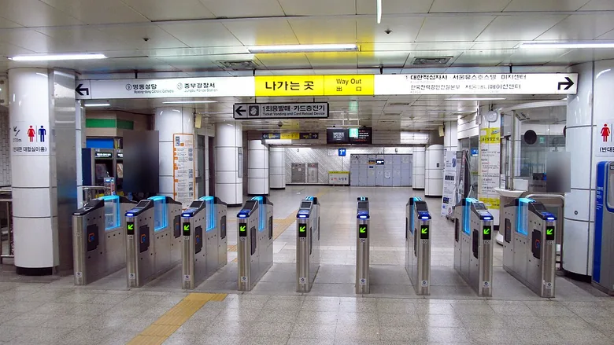
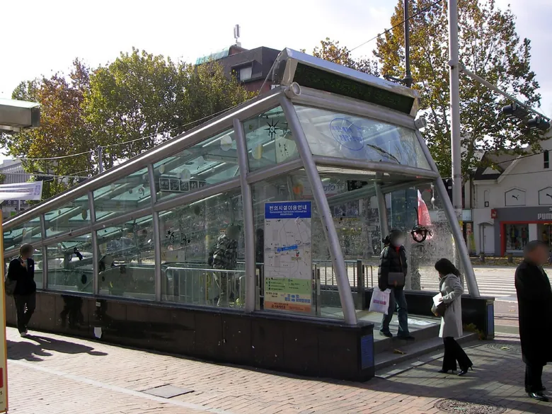
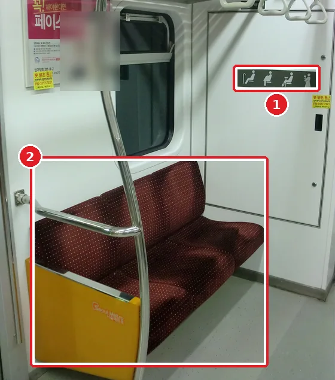
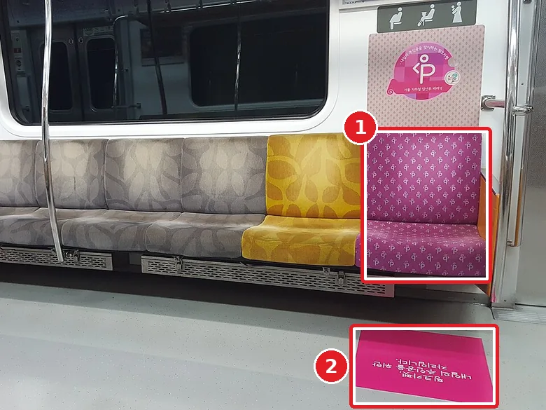

<a class="tr-btn go" href="#따라-하기"><i class="ic ic-train-front" aria-hidden="true"></i>7단계 바로 보기</a><a class="tr-btn" href="#어떤-카드로-탈까"><i class="ic ic-credit-card" aria-hidden="true"></i>어떤 카드로?</a>

<figure class="tr-hero"><figcaption>역에 들어서면 보이는 모습: 카드 단말기가 달린 개찰구, 노란 <b>나가는 곳</b> 표지판. 명동역. 사진: LERK, <a href="https://creativecommons.org/licenses/by-sa/4.0/" rel="noopener" target="_blank">CC BY-SA 4.0</a>, <a href="https://commons.wikimedia.org/wiki/File:Seoul-metro-424-Myeongdong-station-gate-20181124-081950.jpg" rel="noopener" target="_blank">위키미디어 공용</a> (자동 대비 보정, 사람 흐림 처리)</figcaption></figure>

<ul class="tr-facts"><li><i class="ic ic-coins" aria-hidden="true"></i>1,550원<small>교통카드 1회(10km까지)</small></li><li><i class="ic ic-banknote" aria-hidden="true"></i>현금<small>티머니 충전은 현금만</small></li><li><i class="ic ic-arrow-right-left" aria-hidden="true"></i>역 안에서 환승<small>개찰구 다시 안 나가요</small></li><li><i class="ic ic-moon" aria-hidden="true"></i>막차<small>저녁 약속 전에 확인</small></li></ul>

## 따라 하기

<h3 class="tr-step">1<i class="ic ic-map" aria-hidden="true"></i>전날 밤: 경로 열어 보기</h3>

<ul class="tr-facts"><li><i class="ic ic-smartphone" aria-hidden="true"></i>네이버 지도·카카오맵<small>네이버: 영어·일본어·중국어, 카카오: 영어</small></li><li><i class="ic ic-map-pin" aria-hidden="true"></i>역 이름 + 출구 번호 저장<small>"명동역 8번 출구"처럼</small></li></ul>

내일 첫 경로를 미리 열어 노선 번호, 환승, 나갈 출구를 봐 두세요. 지도 앱은 타고 가는 동안 지금 어디쯤인지도 보여 줘요. 우리 판단: 개찰구 앞이 아니라 숙소에서 미리 해 두세요. 타기 전에 한 번 가 본 셈이에요.

<h3 class="tr-step">2<i class="ic ic-credit-card" aria-hidden="true"></i>발매기에서 카드 충전</h3>

{{fig:seoul-subway-machine-yongsan|서울 용산역(1호선, 코레일)의 발매·충전기. 역마다 기계가 달라요. 사진: YKJJ, [CC BY-SA 4.0](https://creativecommons.org/licenses/by-sa/4.0/), [위키미디어 공용](https://commons.wikimedia.org/wiki/File:Ticket_vending_machines.jpg) (자름, 번호 추가)}}

1. 이 파란 '전철승차권자동발매기' 표지를 찾아요.
2. 기계 화면에서 충전과 금액을 골라요.

{{fig:seoul-subway-machine-closeup|같은 종류 기계를 가까이 본 모습: 인천 소래포구역(코레일). 서울교통공사 기계는 모양이 달라요. 사진: LandAndTree, [CC BY 4.0](https://creativecommons.org/licenses/by/4.0/), [위키미디어 공용](https://commons.wikimedia.org/wiki/File:Ticket_Vending_and_Card_Reload_Machine_-_Seoul_Metropolitan_Subway_20240713.jpg) (자름, 번호 추가)}}

1. '교통카드 충전하는 곳': 카드를 여기에 올려요.
2. '지폐 넣는 곳': 지폐를 넣어요. **티머니 충전은 현금만 돼요.**
3. 1회용 승차권은 여기로 나와요.

<aside class="tr-note"><i class="ic ic-banknote" aria-hidden="true"></i>다른 건 다 카드로 내더라도 티머니용으로 1만~2만 원은 지폐로 갖고 있으세요. 화면에 뜬 잔액을 확인하고 카드를 빼요.</aside>

<h3 class="tr-step">3<i class="ic ic-log-in" aria-hidden="true"></i>개찰구에서 태그</h3>

{{fig:seoul-subway-gate|건대입구역 개찰구. 사진: revi, [CC BY 2.0 KR](https://creativecommons.org/licenses/by/2.0/kr/), [위키미디어 공용](https://commons.wikimedia.org/wiki/File:%EA%B1%B4%EB%8C%80%EC%9E%85%EA%B5%AC_%EA%B0%9C%EC%B0%B0%EA%B5%AC.jpeg) (자름, 사람 흐림 처리, 번호 추가)}}

1. 위쪽 단말기에 카드를 대요. 잔액이 떠요.
2. 초록 화살표: 화살표가 가리키는 통로로 들어가요. 빨간 ✕는 이쪽에서 못 들어간다는 뜻이에요(사진을 보고 읽은 내용).

<aside class="tr-note"><i class="ic ic-users" aria-hidden="true"></i>카드는 한 사람에 한 장이에요. 환승 규정이 '1인 1장'이라 둘이 카드 한 장을 같이 쓰면 환승이 안 돼요.</aside>

<h3 class="tr-step">4<i class="ic ic-signpost" aria-hidden="true"></i>노선 번호로 승강장 찾기</h3>

{{fig:seoul-subway-platform-sign|잠실역 2호선 승강장 표지. 사진: 阿貴, [CC BY-SA 3.0](https://creativecommons.org/licenses/by-sa/3.0/), [위키미디어 공용](https://commons.wikimedia.org/wiki/File:Seoul_Subway_Jamsil_Station_Line_2_Platform_Direction_Info.jpg) (자름, 번호 추가)}}

1. 지금 있는 역. 노선 색 동그라미 안에 역 번호.
2. 다음 역. 내가 가는 쪽이면 이 승강장이에요. 2호선은 순환선이라 표지에 다음 역이 나오고, 다른 노선은 종착역도 함께 나와요(사진을 보고 읽은 내용).

우리 판단: 색보다 **노선 번호**와 방향(어느 종착역 쪽인지)을 보세요. 승강장에 내려가기 전에 어느 종착역 쪽인지 확인해요.

<aside class="tr-note tip"><i class="ic ic-lightbulb" aria-hidden="true"></i><b>9호선에는 급행이 있어요.</b> 급행은 정해진 역에만 서요. 내릴 역에 급행이 안 서면 그 전 급행역에서 일반열차로 갈아타요.</aside>

<h3 class="tr-step">5<i class="ic ic-arrow-right-left" aria-hidden="true"></i>환승은 역 안에서</h3>

개찰구를 다시 안 나가요. 갈아탈 노선 번호 표지를 따라가요. 카드 한 장으로 최대 4번(5번 탑승)까지 환승이 돼요.

<h3 class="tr-step">6<i class="ic ic-log-out" aria-hidden="true"></i>나갈 때 태그, 저장한 출구로</h3>

{{fig:seoul-subway-exit-sign|명동역 개찰구 앞 표지. 사진: LERK, [CC BY-SA 4.0](https://creativecommons.org/licenses/by-sa/4.0/), [위키미디어 공용](https://commons.wikimedia.org/wiki/File:Seoul-metro-424-Myeongdong-station-gate-20181124-081950.jpg) (자름, 번호 추가)}}

1. 노란 **나가는 곳** 표지를 따라가요.
2. 동그라미 안 숫자가 출구 번호, 화살표가 방향이에요. 저장한 번호를 따라가요.
3. 이 화살표는 1회용 발매·카드 충전기 쪽이에요.

{{fig:seoul-subway-exit-zoom|확대: ⑨번 출구 명동성당, ⑩번 출구 중부경찰서, 이쪽 ←. 사진: LERK, [CC BY-SA 4.0](https://creativecommons.org/licenses/by-sa/4.0/), [위키미디어 공용](https://commons.wikimedia.org/wiki/File:Seoul-metro-424-Myeongdong-station-gate-20181124-081950.jpg) (자름, 확대)}}

<aside class="tr-note"><i class="ic ic-triangle-alert" aria-hidden="true"></i><b>나갈 때 꼭 태그.</b> 요금이 거리로 정해지고, 하차 태그를 안 하면 환승이 끊기고 추가 요금이 붙어요.</aside>

<figure class="tr-photo"><figcaption>밖에서 본 출구 모습(혜화역 1번 출구). 우리가 고른 끝 장면: 딱 그 출구로 올라와서, 첫걸음부터 가려던 방향을 보고 서는 거예요. 혜화역 1번 출구, 2006년 사진. 사진: Jolly6656(한국어 위키백과), 퍼블릭 도메인, <a href="https://commons.wikimedia.org/wiki/File:Seoul_subway_Hyehwa_Station_Exit_01.jpg" rel="noopener" target="_blank">위키미디어 공용</a></figcaption></figure>

<h3 class="tr-step">7<i class="ic ic-ticket" aria-hidden="true"></i>1회용 승차권이면 500원 돌려받기</h3>

{{fig:seoul-subway-refund|보증금 환급기. 사진: Sgroey, [CC BY-SA 4.0](https://creativecommons.org/licenses/by-sa/4.0/), [위키미디어 공용](https://commons.wikimedia.org/wiki/File:Seoul_subway_single_use_card_deposit_refund_machine.jpg) (자름, 번호 추가)}}

1. 개찰구 근처 **보증금 환급기**.
2. 1회용 승차권을 여기에 넣어요.
3. 보증금 500원이 여기로 나와요.

<aside class="tr-note ok"><i class="ic ic-circle-check" aria-hidden="true"></i><b>버스로 갈아탈 거면</b> 같은 카드로 하차 후 30분 안에(밤 9시~다음 날 아침 7시는 60분) 타야 환승 할인이 돼요. 버스 타는 법: <a href="/ko/seoul-bus/">서울 버스 타기</a>.</aside>

## 어떤 카드로 탈까

우리 판단: 거의 모든 경우 충전식 카드가 정답이고, 1회용 승차권은 비상용이에요. "하루에 몇 번 타는지, 서울 밖으로 나가는지" 하나로 갈라요.

<ul class="tr-choose"><li><i class="ic ic-credit-card" aria-hidden="true"></i><b>티머니, 또는 티머니가 들어 있는 와우패스</b>3~7일 일반적인 서울 여행1회용보다 한 번에 100원 싸고, 버스 환승 할인도 돼요. 와우패스의 티머니 잔액은 와우패스 잔액과 따로 충전해야 해요(와우패스 공식 안내).</li><li><i class="ic ic-calendar-days" aria-hidden="true"></i><b>기후동행카드 단기권</b>서울 안에서만, 하루 3번 이상, 3일 이상3일권 10,000원 + 카드 3,000원, 교통카드 요금 약 8번 값. 하루 한두 번만 타거나 같은 날 수원·판교로 나가면 필요 없어요.</li><li><i class="ic ic-ticket" aria-hidden="true"></i><b>1회용 승차권</b>카드가 아직 없을 때요금에 100원이 더 붙고 보증금 500원을 따로 내요. 수도권 도시철도에서만 써서 버스에는 못 써요.</li></ul>

<aside class="tr-note tip"><i class="ic ic-info" aria-hidden="true"></i>막 도착했는데 카드도 현금도 없다면: 새 무인기에서 기후동행카드나 1회용 승차권을 해외 신용·체크카드로 살 수 있어요(2026년 3월 17일부터).</aside>

필수는 아니에요. 공항 상점에서도 교통카드를 팔아서 미리 예약할 필요는 없어요. 도착하자마자 받고 싶다면:

<i class="ic ic-credit-card" aria-hidden="true"></i>
<b>티머니 카드</b>를 공항에서 받기. 충전은 역에서 현금으로 해요.

{{aff:klook_tmoney|티머니 카드 예약하고 공항에서 받기}}

<i class="ic ic-wallet" aria-hidden="true"></i>
<b>와우패스</b>: 환전·카드 결제·티머니를 한 장에. 티머니 잔액은 따로예요.

{{aff:klook_wowpass|환전·카드 결제·티머니를 한 장에, WOWPASS}}

## 첫날 자주 하는 실수

<ul class="tr-oops"><li><i class="ic ic-triangle-alert" aria-hidden="true"></i><b>하차 태그를 안 함.</b> 환승이 끊기고 추가 요금이 붙어요.</li><li><i class="ic ic-triangle-alert" aria-hidden="true"></i><b>1회용 승차권을 버림.</b> 보증금 500원이 거기 들어 있어요.</li><li><i class="ic ic-triangle-alert" aria-hidden="true"></i><b>신용카드로 티머니를 충전하려 함.</b> 역 충전은 현금이에요.</li><li><i class="ic ic-triangle-alert" aria-hidden="true"></i><b>기후동행카드로 서울 밖이나 신분당선을 탐.</b> 내릴 때 요금을 따로 내요.</li><li><i class="ic ic-triangle-alert" aria-hidden="true"></i><b>내릴 역을 지나치는 9호선 급행을 탐.</b></li><li><i class="ic ic-triangle-alert" aria-hidden="true"></i><b>막차 시각을 외워 두고 믿음.</b> 그날그날 확인해요.</li></ul>

## 공항철도: 일반열차와 직통열차

<figure class="tr-photo"><figcaption>인천공항1터미널역의 주황색 <b>직통열차</b> 구역은 따로 표를 사는 직통열차용이에요. 사진: MNXANL, <a href="https://creativecommons.org/licenses/by-sa/4.0/" rel="noopener" target="_blank">CC BY-SA 4.0</a>, <a href="https://commons.wikimedia.org/wiki/File:202403_AREX_Express_Train_Concourse_at_Incheon_International_Airport_Terminal_1_Station.jpg" rel="noopener" target="_blank">위키미디어 공용</a> (자동 대비 보정)</figcaption></figure>

우리 판단: **일반열차**는 교통카드로 타는 지하철 노선 하나라고 보면 되고, **직통열차**는 따로 표를 사는 열차예요.

- **일반열차:** 모든 역(홍대입구·공덕 포함)에 서요. 교통카드를 찍고 타고, 수도권 통합환승이 돼요.
- **직통열차:** 서울역과 인천공항 사이 무정차, 지정 좌석, 타기 전에 승차권을 따로 사요. 어른 13,000원.

필수는 아니지만, 직통열차 표를 도착 전에 휴대폰에 받아 두고 싶다면:

{{aff:klook_airport|공항철도 직통열차 미리 예매하기}}

자세한 비교는 [인천공항에서 서울까지](/ko/airport-to-seoul/)에 있어요.

<i class="ic ic-route" aria-hidden="true"></i>일반열차와 직통열차, 그림 한 장으로

{{fig:seoul-subway-8|같은 노선, 다른 열차: 일반열차와 직통열차 (Nadri가 그림: 어느 역을 건너뛰는지는 사진으로 보여 줄 수 없어요)}}

## 다음

<ul class="tr-next"><li><a href="/ko/seoul-bus/"><i class="ic ic-bus" aria-hidden="true"></i>서울 버스 타기: 탈 때 찍고 내릴 때 찍기<i class="ic ic-arrow-right" aria-hidden="true"></i></a></li><li><a href="/ko/airport-to-seoul/"><i class="ic ic-plane" aria-hidden="true"></i>인천공항에서 서울까지<i class="ic ic-arrow-right" aria-hidden="true"></i></a></li><li><a href="/ko/getting-around/"><i class="ic ic-route" aria-hidden="true"></i>서울 대중교통: 택시, 막차 놓쳤을 때<i class="ic ic-arrow-right" aria-hidden="true"></i></a></li><li><a href="/ko/emergency/"><i class="ic ic-triangle-alert" aria-hidden="true"></i>열차에 물건을 두고 내렸다면: 서울 유실물센터<i class="ic ic-arrow-right" aria-hidden="true"></i></a></li></ul>

여기 없는 실수를 겪었다면 이 페이지 끝의 업데이트 요청 상자로 알려 주세요.

## 더 자세히

<i class="ic ic-list-checks" aria-hidden="true"></i>한 줄 판단 표

| 상황 | 이렇게 | 이유 |
|---|---|---|
| 3~7일 일반적인 서울 여행 | 티머니, 또는 티머니가 들어 있는 와우패스 | 1회용보다 한 번에 100원 싸고, 버스 환승 할인도 돼요 |
| 서울 안에서만, 하루 3번 이상 따로 이동하는 날이 3일 이상 | 기후동행카드 단기권 | 3일권 10,000원 + 카드 3,000원, 교통카드 요금 약 8번 값 |
| 막 도착했는데 카드도 현금도 없음 | 새 무인기에서 기후동행카드나 1회용 승차권 | 2026년 3월 17일부터 해외 신용·체크카드를 받아요 |
| 저녁 늦게 움직임 | 지금 그 역 막차 확인 | 주말은 더 일찍 끊기고, 막차 시각이 바뀌었을 수 있어요 |

이 페이지는 지하철만 다뤄요. 시내버스는 [서울 버스 타기](/ko/seoul-bus/), 택시는 [서울 대중교통](/ko/getting-around/), 공항 이동은 [인천공항에서 서울까지](/ko/airport-to-seoul/)를 보세요. 처음 타는 사람에게 제일 낯선 건 '하차 태그'와 '현금 충전' 두 가지라, 위 단계에서 따로 표시했어요.

고른 기준: 결제 수단 세 가지를 "하루에 몇 번 타는지, 서울 밖으로 나가는지" 하나로 갈랐어요. 일부러 뺀 것: 같은 무인기에서 파는 정기권(매일 출퇴근용이라 짧은 여행엔 맞지 않아요)과 수원·인천처럼 서울 밖으로 가는 이동이에요.

<i class="ic ic-calendar-days" aria-hidden="true"></i>기후동행카드 단기권: 가격과 범위

- **기후동행카드 단기권**은 1·2·3·5·7일권이 5,000원 / 8,000원 / 10,000원 / 15,000원 / 20,000원이고, 실물카드는 3,000원을 따로 내요. 서울 지역 지하철과 서울시 면허 버스가 되고, 사용 개시일 첫차부터 종료일 막차까지예요. 1일권은 24시간이 아니라 그날 막차까지예요.
- 충전한 날이 사용 시작일이고, 미리 충전해 둘 수 없어요(서울시 기후동행카드 안내).
- 신분당선, GTX, 광역·공항버스, 서울 밖 지하철은 **안 돼요**. 서울에서 타서 서울 밖 역에서 내리면 역무원이 요금을 따로 받아요. 서울시가 드는 예가 종로3가 승차, 인덕원 하차예요. 예외로 인천공항1·2터미널역에서 내리는 건 돼요(그 역에서 타는 건 안 돼요).
- 필요 없는 경우: 하루 한두 번만 타거나, 같은 날 수원·판교처럼 서울 밖으로 나가는 일정이에요.

<i class="ic ic-coins" aria-hidden="true"></i>요금: 교통카드와 1회용 승차권

{{fig:seoul-subway-3|교통카드와 1회용 승차권 비교(어른, Nadri가 서울시 요금표로 그림)}}

우리 판단: 요금 계산은 지도 앱에 맡기고, 카드가 왜 싼지만 알면 돼요.

- 어른 기본요금(10km까지, 2025년 6월 28일부터): 교통카드 **1,550원**, 1회용 **1,650원**. 50km까지는 5km마다 100원, 그 뒤로는 8km마다 100원씩 붙어요.
- 환승은 카드 한 장으로 최대 4번(5번 탑승)까지예요. 같은 노선을 다시 타는 건 환승이 아니에요.

<i class="ic ic-banknote" aria-hidden="true"></i>무인기와 해외 카드

- 서울교통공사 신형 키오스크는 1회권·정기권·기후동행카드는 신용카드로 되지만, 선불카드(티머니) 충전은 현금만 돼요.
- 1~8호선 273개 역의 신형 발매기 440대는 해외 발급 카드를 받지만(수수료 평균 약 3.7%), 기후동행카드와 1회용 승차권용이에요.
- 와우패스는 앱에서 와우패스 잔액으로 티머니를 충전할 수 있어요.

<i class="ic ic-armchair" aria-hidden="true"></i>출퇴근 시간과 비워 둘 자리

우리 판단: 캐리어가 있다면 평일 아침 7~9시는 피하세요.

<figure class="tr-photo"><figcaption><b>1</b> 표지, <b>2</b> 칸 끝 노약자석. 사진: hyolee2, <a href="https://creativecommons.org/licenses/by-sa/3.0/" rel="noopener" target="_blank">CC BY-SA 3.0</a>, <a href="https://commons.wikimedia.org/wiki/File:Priority_seats_Seoul_Metro_3000.JPG" rel="noopener" target="_blank">위키미디어 공용</a> (자름, 광고 흐림 처리, 번호 추가)</figcaption></figure>

<figure class="tr-photo"><figcaption><b>1</b> 분홍색 임산부 배려석, <b>2</b> 바닥 분홍 표지. 서울 지하철, 2018년. 사진: Garam. Attribution licence: “allows anyone to use it for any purpose, provided that the copyright holder is properly attributed”, <a href="https://commons.wikimedia.org/wiki/File:Designated_seats_for_pregnant_women_of_Seoul_Metro_Line_1_in_2018.jpg" rel="noopener" target="_blank">위키미디어 공용</a> (자름, 번호 추가)</figcaption></figure>

- **노약자석**(칸 양 끝)은 어르신, 장애인, 다친 사람, 임산부를 위한 자리예요. 우리 조언: 앉지 마세요.
- **분홍색 좌석**(한 칸에 두 자리)은 임산부 배려석이에요. 비워 둬요. 초기 임산부는 티가 안 나서 분홍색 임산부 배지를 달기도 해요.
- 서울시 2014년 교통카드 분석에서 오전 7~9시에 하루 이용객의 20.2%가 몰렸고, 가장 붐빈 10분은 8시 10~19분이었어요.
- 9호선 아침 급행은 최고 혼잡도가 192.5%였어요. 서울시가 2026년 11월 16일부터 출근 급행을 늘렸고, 9호선 운영사도 출근 시간엔 일반열차를 타 달라고 안내해요.

<i class="ic ic-moon" aria-hidden="true"></i>막차

우리 판단: 저녁 약속 전에 돌아갈 방법을 정해 두세요.

- 서울시는 2022년 평일 막차가 **종착역에 새벽 1시 무렵** 닿도록 연장했어요. 토·일·공휴일은 빠졌어요.
- 2025년 5월 서울시는 1~8호선 첫차·막차를 30분씩 앞당기겠다고(이르면 2025년 8월) 발표했어요. 실제로 시행됐는지는 확인하지 못했어요.
- 그러니 시각을 외우지 말고 그 역 막차를 네이버 지도나 카카오맵으로 확인해요. 코레일 구간(1·3·4호선 일부)은 다를 수 있어요.

막차를 놓쳤다면 [서울 대중교통](/ko/getting-around/)을 보세요.

<i class="ic ic-info" aria-hidden="true"></i>출처와 사진

2026년 11월 26일(한국 시간)에 열어 확인. 서울시 교통 누리집: <a href="https://news.seoul.go.kr/traffic/traffic_price" rel="noopener" target="_blank">교통 요금 안내</a>(2025년 6월 28일 조정), <a href="https://news.seoul.go.kr/traffic/transfer_discount" rel="noopener" target="_blank">통합환승 할인제도</a>(2026년 2월 2일 수정), <a href="https://news.seoul.go.kr/traffic/archives/1763" rel="noopener" target="_blank">일회용 교통카드</a>, <a href="https://news.seoul.go.kr/traffic/archives/510651" rel="noopener" target="_blank">기후동행카드(단기권) 소개</a>(2026년 10월 12일 수정)와 <a href="https://news.seoul.go.kr/traffic/public/climatecard-faq/faq-short" rel="noopener" target="_blank">FAQ</a>, <a href="https://news.seoul.go.kr/traffic/archives/516544" rel="noopener" target="_blank">해외 신용카드 구매 보도자료</a>(2026년 3월 16일), <a href="https://news.seoul.go.kr/traffic/archives/27958" rel="noopener" target="_blank">임산부배려석 안내</a>. 내 손안에 서울: <a href="https://mediahub.seoul.go.kr/archives/2015499" rel="noopener" target="_blank">신형 키오스크·선불카드 현금 충전</a>(2025년 9월 2일), <a href="https://mediahub.seoul.go.kr/archives/2016718" rel="noopener" target="_blank">해외카드 팩트브리핑</a>(2026년 1월 7일), <a href="https://mediahub.seoul.go.kr/archives/2004711" rel="noopener" target="_blank">지하철 심야 운행 재개</a>(2022년 5월 30일), <a href="https://mediahub.seoul.go.kr/archives/864021" rel="noopener" target="_blank">2014년 교통카드 분석</a>(2015년 4월 29일), <a href="https://mediahub.seoul.go.kr/archives/2019693" rel="noopener" target="_blank">9호선 급행 확대</a>(2026년 10월 14일). 서울시 영문 누리집: <a href="https://english.seoul.go.kr/climate-cards-and-single-journey-transit-tickets-now-accepting-international-credit-cards-no-cash-needed/" rel="noopener" target="_blank">해외카드</a>(2026년 3월 17일), <a href="https://english.seoul.go.kr/autonomous-bus-and-earlier-subway-service-for-early-morning-commuters/" rel="noopener" target="_blank">첫차·막차 30분 조정 계획</a>(2025년 5월 27일). <a href="https://www.metro9.co.kr/kor/sub01_03.do" rel="noopener" target="_blank">서울시메트로9호선 출근시간 열차 이용 안내</a>. 공항철도 <a href="https://www.airportrailroad.com/train/normal/introduce" rel="noopener" target="_blank">일반열차</a>·<a href="https://www.airportrailroad.com/train/express/introduce" rel="noopener" target="_blank">직통열차</a> 안내. <a href="https://wowpass.io/ko/guide" rel="noopener" target="_blank">와우패스 공식 가이드</a>. 코리아헤럴드: <a href="https://www.koreaherald.com/article/10493311" rel="noopener" target="_blank">첫차·막차 30분 앞당김</a>(2025년 5월 22일), <a href="https://www.koreaherald.com/article/3154442" rel="noopener" target="_blank">임산부석과 배지</a>(2023년 6월 27일). 코리아타임스: <a href="https://www.koreatimes.co.kr/southkorea/health/20171206/priority-seats-for-pregnant-women-complaint-rich-territory-on-subway" rel="noopener" target="_blank">임산부 배려석</a>(2017년 12월 6일). 2026년 11월 26일에 함께 열어 봄: 코리아헤럴드 <a href="https://www.koreaherald.com/article/10694586" rel="noopener" target="_blank">지하철 무인기 해외 카드 결제</a>(2026년 3월 16일), <a href="https://www.koreaherald.com/article/10608612" rel="noopener" target="_blank">대중교통 이용 팁</a>(2025년 11월 6일, 지도 앱).

사진: 위키미디어 공용의 사진을 각 설명에 적은 라이선스로 썼어요. 요금 비교와 일반·직통열차 그림은 Nadri가 그렸어요.

