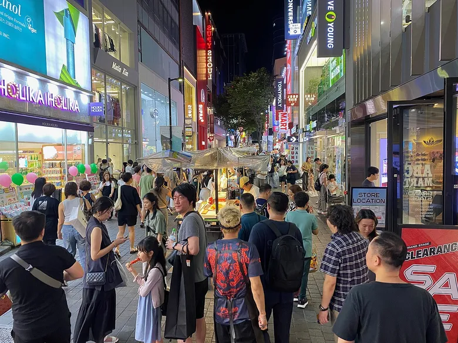
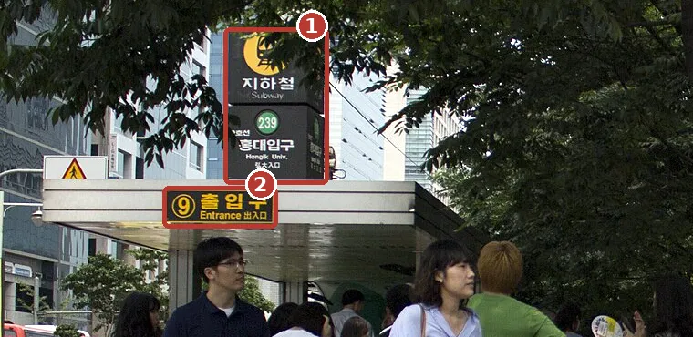
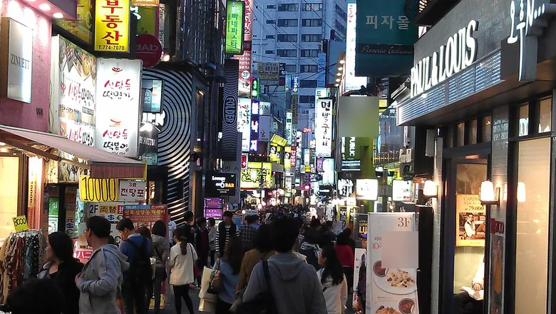
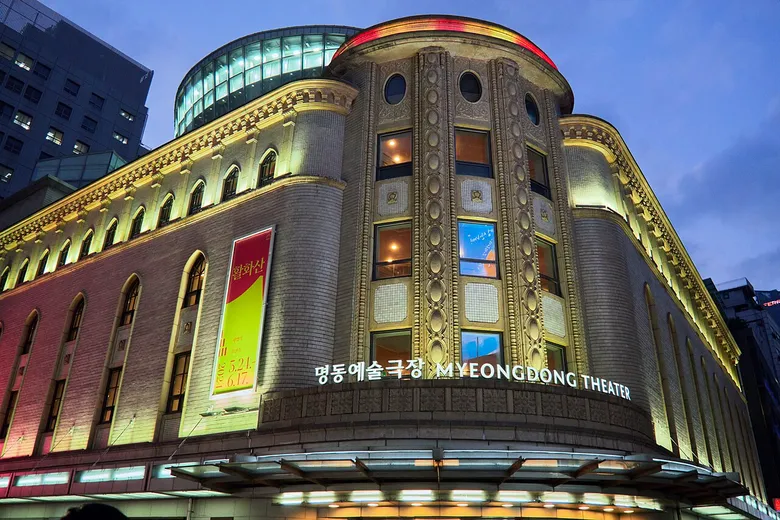
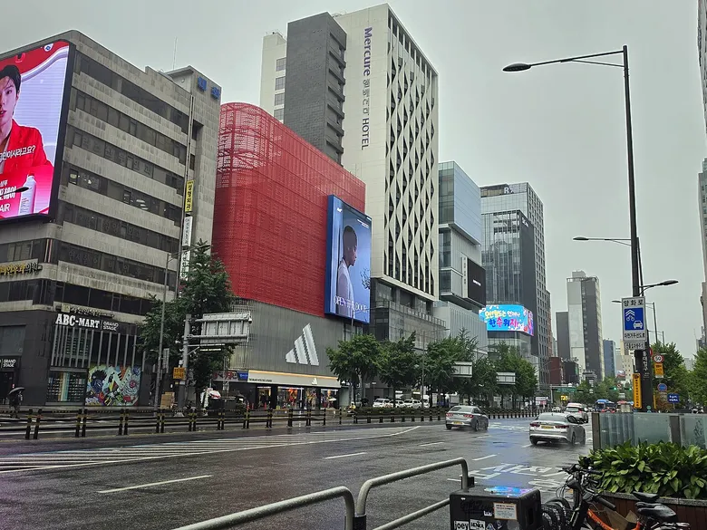

<a class="tr-btn go" href="#pick"><i class="ic ic-map-pin" aria-hidden="true"></i>어디로 갈까</a><a class="tr-btn" href="#pay"><i class="ic ic-receipt" aria-hidden="true"></i>계산·택스프리</a>

<figure class="tr-hero acc-hero"><figcaption><b>명동의 밤.</b> 큰길 양쪽에 화장품 가게, 가운데에 먹거리 노점이 늘어서요.사진: Sgroey(2024), <a href="https://creativecommons.org/licenses/by-sa/4.0/deed.ko" rel="noopener" target="_blank">CC BY-SA 4.0</a>, <a href="https://commons.wikimedia.org/wiki/File:Myeongdong_night_market_seoul_1.jpg" rel="noopener" target="_blank">위키미디어 공용</a> (줄임, 밝기 자동 보정)</figcaption></figure>

<ul class="tr-facts"><li><i class="ic ic-train-front" aria-hidden="true"></i>셋 다 2호선<small>을지로입구·성수·홍대입구역</small></li><li><i class="ic ic-signpost" aria-hidden="true"></i>출구 번호가 길 찾기<small>명동 5번, 성수 4번, 홍대 9번</small></li><li><i class="ic ic-id-card" aria-hidden="true"></i>여권 실물<small>계산대에서 세금 빠짐(택스프리 매장)</small></li><li><i class="ic ic-receipt" aria-hidden="true"></i>영수증 한 장 1.5만~100만 원<small>그 자리에서 즉시 환급</small></li></ul>

<h2 id="pick">어디로 갈까</h2>

이 글은 어디서 **살지**를 다뤄요. 어디서 **잘지**는 [서울 숙소 지역 고르기](/ko/seoul-areas/)를 보세요.

<ul class="tr-choose"><li><i class="ic ic-sparkles" aria-hidden="true"></i><b>K-뷰티, 첫 서울: 명동</b>2호선 을지로입구역 5번 또는 4호선 명동역 8번 출구. 비짓서울이 '쇼핑 1번지'로 소개하는 곳. <a href="#myeongdong">명동 보기</a></li><li><i class="ic ic-store" aria-hidden="true"></i><b>새 한국 브랜드, 팝업: 성수</b>2호선 성수역 4번 출구. 연무장길에 올리브영 N 성수, 무신사 메가스토어. 주말은 붐벼서 평일이 좋다고 봐요. <a href="#seongsu">성수 보기</a></li><li><i class="ic ic-shopping-basket" aria-hidden="true"></i><b>젊은 패션, K-팝 굿즈: 홍대</b>2호선 홍대입구역 9번 출구에서 350m, R3 패션 거리. 늦은 오후~저녁이 좋다고 봐요. <a href="#hongdae">홍대 보기</a></li></ul>

{{fig:shopping-streets-1|저희 판단: 거리마다 잘 맞는 물건과 가기 좋은 시간}}

## 출구 번호로 찾아가기

서울에서 쇼핑 거리를 찾는 기술은 하나예요. **역 이름 + 출구 번호.** 이것만 알면 어느 동네든 같은 방법으로 가요.

<figure class="tr-photo"><figcaption><b>1</b> 지하철 표지: 역 이름(홍대입구)과 역 번호(239). <b>2</b> 출구 번호(9번 출입구). 지상에서는 이 표지로 맞는 출구인지 확인해요.사진: Jonathan Kramer(홍대입구역 9번 출구), <a href="https://creativecommons.org/licenses/by-sa/3.0/deed.ko" rel="noopener" target="_blank">CC BY-SA 3.0</a>, <a href="https://commons.wikimedia.org/wiki/File:Hongik_University_Station_exit_9.jpg" rel="noopener" target="_blank">위키미디어 공용</a> (잘라 냄, 밝기 자동 보정, 상자·번호 추가)</figcaption></figure>

1. **지도 앱에서 가게를 찾아요.** 네이버 지도나 카카오맵에 가게 이름을 넣으면 가까운 역과 출구 번호가 나와요. 이 페이지의 출구 번호를 그대로 써도 돼요.
2. **역에서 나갈 때 태그하고 출구 번호 안내판을 따라가요.** 동그라미 안 숫자가 출구 번호, 화살표가 방향이에요([서울 지하철 6단계](/ko/seoul-subway/)에 실제 표지판 사진).
3. **올라와서 위 사진처럼 출구 번호를 확인해요.** 큰 역은 출구를 잘못 나오면 한참 걸어요.
4. **출구에서 가게까지는 지도 앱의 길찾기에서 '도보'를 골라 따라가요.** 아래 거리마다 출구에서 보이는 기준점(건물·길 이름)을 적어 뒀어요. 그래도 헷갈리면 관광안내소(홍대는 7번 출구 근처 마포 관광안내소)나 매장 직원에게 이 페이지의 가게 이름을 보여 주세요.

지하철 타는 법, 노선 읽는 법, 교통카드 충전은 [서울 지하철](/ko/seoul-subway/)에 사진으로 정리했어요.

{{fig:shopping-streets-2|개념도: 한강 북쪽의 쇼핑 지역(실제 거리·축척 아님)}}

2호선은 서울을 한 바퀴 도는 순환선이고(코리아헤럴드), 세 지역 모두 2호선 역이 있어요.

<h2 id="myeongdong">명동: 뷰티, 그리고 첫 서울</h2>

<figure class="tr-photo"><figcaption><b>명동 쇼핑 거리</b>(2012년 사진).사진: Christian Bolz, <a href="https://creativecommons.org/licenses/by-sa/4.0/deed.ko" rel="noopener" target="_blank">CC BY-SA 4.0</a>, 위키미디어 공용</figcaption></figure>

{{fig:shopping-streets-4|명동: 어느 출구로 어느 매장에}}

- **가는 법:** 2호선 을지로입구역 5번 출구 또는 4호선 명동역 8번 출구. 올리브영 명동 글로벌 매장이 안내하는 출구예요.
- **있는 것:** 대형 백화점 두 곳, 쇼핑센터, 브랜드 매장, 노점. 큰길 양쪽에 먹거리 노점. 명동 지하쇼핑센터에는 K-팝 상품과 기념품이 있어요. 비짓서울은 요즘 특히 외국인 방문객으로 붐빈다고 적었어요.
- **길 찾기 기준점:** 명동 한가운데의 **명동예술극장 사거리**. 골목을 따라 걸으면 이 사거리가 나와요. 명동성당은 유네스코길 끝에 있어요(비짓서울).

<figure class="tr-photo"><figcaption><b>명동예술극장</b>. 이 건물이 보이면 명동 한가운데 사거리예요.사진: lumoplank, <a href="https://creativecommons.org/publicdomain/zero/1.0/deed.ko" rel="noopener" target="_blank">CC0</a>, <a href="https://commons.wikimedia.org/wiki/File:Myeongdong,_Seoul_-_Myeongdong3165.jpg" rel="noopener" target="_blank">위키미디어 공용</a> (줄임, 밝기 자동 보정)</figcaption></figure>

- **올리브영 명동 글로벌 매장:** 명동길 53. 매일 10:00~22:30(매장 사정에 따라 바뀔 수 있음). 1~2층, 계산대 즉시 택스리펀드, 위챗페이·알리페이 같은 간편결제, 선물 포장, 외국어 응대. 매장에 화장실이 없어서 가까운 지하철역 화장실을 쓰라고 안내해요.
- **근처:** 명동역 옆 12층짜리 [다이소](/ko/daiso/). 면세점은 롯데면세점 본점(을지로입구역 7·8번 출구), 신세계면세점(회현역 5번 출구)이 가까워요([면세점](/ko/duty-free/)).
- **이런 분은 건너뛰세요:** 현지인이 다니는 거리를 원하는 분.

<h2 id="seongsu">성수: 새 브랜드와 팝업</h2>

<figure class="tr-photo"><figcaption><b>연무장길</b>, 성수역 4번 출구에서 시작해요.사진: Dr. Thomas Liptak, <a href="https://creativecommons.org/licenses/by-sa/4.0/deed.ko" rel="noopener" target="_blank">CC BY-SA 4.0</a>, <a href="https://commons.wikimedia.org/wiki/File:Seoul,_Seongdong_District,_Seongsu_(Yeonmujang-gil).jpg" rel="noopener" target="_blank">위키미디어 공용</a> (잘라 냄, 밝기 자동 보정)</figcaption></figure>

{{fig:shopping-streets-5|성수역: 4번 출구 또는 3번 출구}}

- **가는 법:** 2호선 성수역 4번 출구. 연무장길이 여기서 시작해요. 무신사 메가스토어는 3번 출구에서 475m.
- **어떤 곳:** 1950년대 말부터 작은 공장이 들어섰고, 1967년 이후 수제화 업체가 모여 수제화 거리가 됐어요. 지금은 패션·뷰티·팝업·플래그십 매장이 모인 곳이에요(비짓서울).
- **올리브영 N 성수:** 연무장7길 13 팩토리얼 성수 건물, 4번 출구에서 118m(걸어서 약 1분). 2024년 11월 말 개점. 1층은 브랜드 팝업이 바뀌는 광장이고 매일 선착순 300명에게 무료 네 컷 사진, 2층 뷰티·컬처, 3층 스킨·웰니스, 4층 VIP 라운지. 메이크업 같은 무료 서비스는 사전 예약이고, 매주 금요일 정오에 다음 주 예약이 열려요.
- **무신사 메가스토어 성수:** 2026년 4월 24일 개점, 지상 4층과 지하층, 약 6,600㎡. 2층이 무신사의 첫 오프라인 뷰티 층. 매일 11:00~22:00.
- **가기 좋은 시간:** 평일. 코리아헤럴드의 성수 쇼핑 가이드(2026년 7월)는 무신사 메가스토어가 주말에 붐비고, 일부 매장은 주말이면 대개 기다려야 한다고 적었어요.
- **택스프리:** 매장마다 규칙을 확인하지 못했어요. 여권을 챙겨 계산 전에 물어보세요.
- **이런 분은 건너뛰세요:** 줄 서기 싫은 분, 온라인에서 본 팝업 하나만 보러 가는 분. 팝업은 기간이 정해져 있어요(예: 무신사 스토어 성수의 조조타운 팝업은 2026년 10월 16~31일). 아직 하는지 먼저 확인하세요.

<h2 id="hongdae">홍대: 젊은 패션과 K-팝 굿즈</h2>

<figure class="tr-photo"><figcaption><b>홍대 거리</b>(2026년).사진: Qhairy, <a href="https://creativecommons.org/licenses/by/4.0/deed.ko" rel="noopener" target="_blank">CC BY 4.0</a>, <a href="https://commons.wikimedia.org/wiki/File:Hongdae_Street_02.jpg" rel="noopener" target="_blank">위키미디어 공용</a> (줄임, 밝기 자동 보정)</figcaption></figure>

{{fig:shopping-streets-6|홍대입구역: 9번 출구 또는 1번 출구}}

- **가는 법:** 홍대입구역(2호선, 공항철도, 경의·중앙선) 9번 출구에서 350m가 R3 패션 거리예요. 공항철도역이라 공항 오가는 날 들르기도 쉬워요.
- **있는 것:** 홍익대학교 주변. R3 일대는 옷 가게와 화장품 가게가 빽빽해요. 1번 출구 쪽 옛 라인프렌즈 플래그십은 K-Pop Square로 바뀌었어요(매일 11:00~22:00). 카카오프렌즈 플래그십은 8번 출구.
- **커버낫 홍대 플래그십:** 9번 출구에서 걸어서 약 10분(잔다리로 24). 주변에 복합문화공간 KT&G 상상마당이 있어요. 매일 12:00~21:00, 외국인 관광객은 계산대에서 택스 리펀드, 알리페이 가능.
- **도움받을 곳:** 마포 관광안내소, 7번 출구에서 걸어서 3분.
- **가기 좋은 시간:** 늦은 오후~저녁. 혼잡 자료가 아니라 영업시간을 보고 한 판단이에요. 정오에야 여는 플래그십이 있어요.
- **이런 분은 건너뛰세요:** 조용히 둘러보고 싶은 분.

<h2 id="pay">계산하기: 카드와 택스프리</h2>

큰 매장은 카드가 되고, 올리브영 명동 글로벌 매장과 커버낫 홍대처럼 알리페이·위챗페이를 받는 곳도 있어요. 현금·카드 준비는 [환전과 결제](/ko/money/)에 있어요.

{{fig:shopping-streets-7|영수증 한 장의 즉시 환급 범위}}

<h3 class="tr-step">1<i class="ic ic-id-card" aria-hidden="true"></i>여권 실물을 챙겨요</h3>

<figure class="tr-photo"><figcaption>계산대 위 이런 표시('Tax Free', 'Tax Refund', 여권 준비 안내)가 있는 매장이면 돼요. 없으면 계산 전에 물어보세요.사진: Sgroey, <a href="https://creativecommons.org/licenses/by-sa/4.0/deed.ko" rel="noopener" target="_blank">CC BY-SA 4.0</a>, <a href="https://commons.wikimedia.org/wiki/File:Olive_Young_Myeongdong.jpg" rel="noopener" target="_blank">위키미디어 공용</a> (잘라 냄, 밝기 자동 보정)</figcaption></figure>

계산대 즉시 환급은 여권 실물이 있어야 해요. 사진은 안 돼요. 한국을 방문 중인 사람이 대상이에요([대상자 확인](/ko/tax-refund/#나도-대상일까)).

<h3 class="tr-step">2<i class="ic ic-receipt" aria-hidden="true"></i>한 매장에서 영수증 한 장을 1만 5천~100만 원으로</h3>

다른 매장 영수증은 합쳐지지 않아요. 한 번 입국에 즉시 환급 합계는 500만 원까지.

<h3 class="tr-step">3<i class="ic ic-credit-card" aria-hidden="true"></i>결제할 때 여권을 같이 내요</h3>

그 자리에서 세금만큼 빠져요. 올리브영 명동 글로벌 매장 FAQ 기준 환급률은 구매 금액의 5~8%이고 1,000원 단위로 계산돼요. 위생용품, 쇼핑백, 말린 과일 등은 제외예요.

<h3 class="tr-step">4<i class="ic ic-plane" aria-hidden="true"></i>100만 원이 넘거나 여권이 없으면</h3>

계산대 즉시 환급이 안 돼요. 환급 전표를 받아 공항 환급 창구에서 받아요. 순서는 [택스리펀드](/ko/tax-refund/)에. 같은 GTF 사업자의 다른 매장 전표라면 올리브영 명동 글로벌 매장 2층 글로벌 서비스 라운지의 GTF 데스크에서도 받을 수 있어요(여권 실물 필요).

## 자주 하는 실수

<ul class="tr-oops"><li><i class="ic ic-triangle-alert" aria-hidden="true"></i>출구 번호를 안 보고 큰 역에서 나오기. 반대편으로 나와 한참 걸어요.</li><li><i class="ic ic-triangle-alert" aria-hidden="true"></i>여권 사진만 챙기기. 계산대 환급은 여권 실물이에요.</li><li><i class="ic ic-triangle-alert" aria-hidden="true"></i>세 매장에 나눠 사기. 영수증마다 1만 5천 원을 넘어야 해요.</li><li><i class="ic ic-triangle-alert" aria-hidden="true"></i>끝난 팝업을 보러 성수에 가기. 날짜를 먼저 확인하세요.</li></ul>

<i class="ic ic-route" aria-hidden="true"></i>2호선 한나절 동선 예시

{{fig:shopping-streets-3|2호선 한나절 쇼핑 동선}}

1. 성수역 4번 출구 → 연무장길, 올리브영 N 성수(118m).
2. 성수역에서 2호선 → 홍대입구역.
3. 홍대입구역 9번 출구 → R3 패션 거리(350m). 커버낫은 21:00까지라 마지막에 둬도 돼요.

뷰티가 먼저라면 성수 대신 명동(을지로입구역, 2호선)을 넣으세요. 팝업은 선택이에요.

<i class="ic ic-list-checks" aria-hidden="true"></i>가기 전 짧은 목록, 선물 고르기

1. **사고 싶은 것을 종류별로 적어요:** 뷰티, 옷, K-팝 굿즈. 위 '어디로 갈까'가 그걸 거리로 바꿔 줘요.
2. **온라인에서 본 팝업은 날짜를 확인해요.** 팝업은 기간이 정해져 있어요.
3. **지도 앱에 출구를 저장하고**, 계산대 택스프리를 위해 실물 여권을 챙겨요.

**다른 사람에게 줄 건가요?** 이 페이지의 사실로 고른 저희 판단이에요.

- **K-팝 팬:** 홍대, 1번 출구 쪽 K-Pop Square.
- **스킨케어를 쓰는 사람:** 명동 또는 올리브영 N 성수. 먼저 [라벨 확인법](/ko/kbeauty-how-to-choose/)을 보세요.

<i class="ic ic-info" aria-hidden="true"></i>뺀 것, 이 글이 필요 없는 사람

동대문은 뺐어요. 사실은 이것이에요. 비짓서울 기준 두타몰은 10:30~자정 영업이고, 1·4호선 동대문역 8번 출구에서 207m예요. 나머지는 저희 판단이에요. 밤늦게 옷을 사는 게 동대문의 강점이라고 봤고, 짧은 여행이라면 패션은 성수와 홍대로 충분하다고 봤어요. 무신사 메가스토어가 문을 닫는 22:00 이후에도 옷을 보고 싶다면 동대문을 더하세요. 신사동 가로수길, 한남동, 강남 백화점도 뺐어요. 품목별로 아직 확인하지 못해서예요. 매장 순위나 가격은 바뀌기 때문에 다루지 않아요.

화장품만 살 거라면 바로 [올리브영 가이드](/ko/olive-young/)로, 비싼 물건을 산다면 [면세점](/ko/duty-free/)을 먼저 보세요. 지금 하는 세일은 [할인 상황판](/ko/deals/)에 있어요.

<i class="ic ic-info" aria-hidden="true"></i>출처

2026년 11월 26일(한국 시간) 확인. 비짓서울(영문): <a href="https://english.visitseoul.net/editorspicks/myeongdong-dasi-seoul-yeohaengyi-jungsimi-doeda/ENNlwcnrh" rel="noopener" target="_blank">명동 특집</a>(쇼핑 1번지, 백화점·노점, 지하쇼핑센터, 명동예술극장 사거리, 유네스코길 끝 명동성당, 2025년 11월 18일 수정), <a href="https://english.visitseoul.net/editorspicks/2025SeoulTrendReportSeongsu-dong/ENNvepwqx" rel="noopener" target="_blank">'2025 Seoul Trend Dispatch: Seongsu-dong'</a>(연무장길·4번 출구, 수제화 거리의 역사, 올리브영 N 성수 층별·예약·118m, 2026년 6월 15일 수정), <a href="https://english.visitseoul.net/shopping/MUSINSA-MEGA-STORE-SEONGSU/ENPxwxy2m" rel="noopener" target="_blank">무신사 메가스토어 성수</a>(6,600㎡, 3번 출구 475m, 11:00~22:00, 2026년 7월 20일 수정), <a href="https://english.visitseoul.net/attractions/HONGDAE-R3/ENPc8w958" rel="noopener" target="_blank">HONGDAE R3</a>(9번 출구 350m, 마포 관광안내소 7번 출구 3분, 2026년 8월 31일 수정), <a href="https://english.visitseoul.net/shopping/COVERNAT/ENP77xns8" rel="noopener" target="_blank">커버낫</a>(12:00~21:00, 택스 리펀드, 알리페이, 9번 출구 10분, 잔다리로 24, KT&G 상상마당 인근, 2026년 8월 8일 수정), <a href="https://english.visitseoul.net/editorspicks/Fan-life-starts-in-Hongdae/ENN033076" rel="noopener" target="_blank">'Fan life starts in Hongdae'</a>(K-Pop Square 1번 출구 11:00~22:00, 카카오프렌즈 8번 출구, 2026년 10월 24일 수정), <a href="https://english.visitseoul.net/shopping/Doota-Dongdaemun/ENP000416" rel="noopener" target="_blank">두타몰</a>(10:30~24:00, 동대문역 8번 출구, 2026년 11월 20일 수정). 올리브영 <a href="https://myeongdongtown.oliveyoung.com/en/" rel="noopener" target="_blank">명동 글로벌 타운 사이트</a>(주소·영업시간·출구·서비스, 택스리펀드 FAQ, 화장실 없음). 코리아헤럴드: <a href="https://www.koreaherald.com/article/10011387" rel="noopener" target="_blank">올리브영 N 성수</a>(2024년 11월 21일), <a href="https://www.koreaherald.com/article/10654319" rel="noopener" target="_blank">서울 버스 파업과 2호선</a>(2026년 1월 13일), <a href="https://www.koreaherald.com/article/10725111" rel="noopener" target="_blank">무신사 메가스토어 성수 개점</a>(2026년 4월 25일), <a href="https://www.koreaherald.com/article/10795872" rel="noopener" target="_blank">성수 쇼핑 가이드</a>(2026년 7월 4일), <a href="https://www.koreaherald.com/article/10894150" rel="noopener" target="_blank">무신사 조조타운 팝업</a>(2026년 10월 6일); 코리아헤럴드 기사들은 이전 판(2026년 11월 26일 오전)에서 확인했고 이번에 다시 열지 않았어요. 무신사 메가스토어 개점 기사(지상 4층·지하층)는 11월 26일 오후 다시 열어 확인했어요.

## 다음

<ul class="tr-next"><li><a href="/ko/olive-young/"><i class="ic ic-shopping-basket" aria-hidden="true"></i>올리브영: 세일 시기와 기본템<i class="ic ic-arrow-right" aria-hidden="true"></i></a></li><li><a href="/ko/tax-refund/"><i class="ic ic-receipt" aria-hidden="true"></i>택스리펀드: 대상자, 큰 구매<i class="ic ic-arrow-right" aria-hidden="true"></i></a></li><li><a href="/ko/seoul-subway/"><i class="ic ic-train-front" aria-hidden="true"></i>서울 지하철 타는 법<i class="ic ic-arrow-right" aria-hidden="true"></i></a></li></ul>
