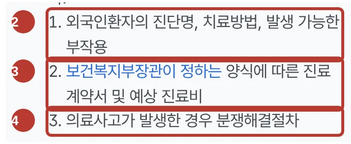
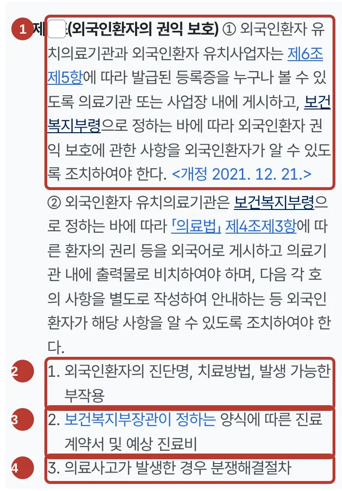

<a class="tr-btn go" href="#check"><i class="ic ic-shield-check" aria-hidden="true"></i>예약 전 확인 4가지</a><a class="tr-btn" href="#help"><i class="ic ic-circle-help" aria-hidden="true"></i>문제가 생기면</a>

<aside class="tr-note"><i class="ic ic-info" aria-hidden="true"></i><b>절차 안내이지 의료 정보가 아니에요.</b> 병원 이름과 가격은 싣지 않고, 효과나 안전도 약속하지 않아요. 시술 여부는 진찰한 의사와 상담해서 정하세요.</aside>

<figure class="tr-hero acc-hero"><figcaption><b>외국인환자를 받는 병원이 따로 적어 알려 줘야 하는 것(법).</b> <b>2</b> 진단명·치료 방법·생길 수 있는 부작용, <b>3</b> 진료계약서와 예상 진료비, <b>4</b> 의료사고 때 분쟁 해결 절차. 결제 전에 이 세 가지를 서면으로 받으세요.화면: 국가법령정보센터 <a href="https://www.law.go.kr/%EB%B2%95%EB%A0%B9/%EC%9D%98%EB%A3%8C%ED%95%B4%EC%99%B8%EC%A7%84%EC%B6%9C%EB%B0%8F%EC%99%B8%EA%B5%AD%EC%9D%B8%ED%99%98%EC%9E%90%EC%9C%A0%EC%B9%98%EC%A7%80%EC%9B%90%EC%97%90%EA%B4%80%ED%95%9C%EB%B2%95%EB%A5%A0" rel="noopener" target="_blank">의료 해외진출 및 외국인환자 유치 지원에 관한 법률 제8조</a>(법제처), 2026년 11월 26일 캡처(일부만 잘라 냄, 상자·번호 추가)</figcaption></figure>

<ul class="tr-facts"><li><i class="ic ic-shield-check" aria-hidden="true"></i>정부 등록부터 조회<small>병원·에이전시 모두 등록 의무</small></li><li><i class="ic ic-receipt" aria-hidden="true"></i>예상 비용은 서면으로<small>고지한 가격보다 더 받을 수 없어요</small></li><li><i class="ic ic-ban" aria-hidden="true"></i>부가세 환급 없음<small>2025년 12월 31일로 끝</small></li><li><i class="ic ic-smartphone" aria-hidden="true"></i>1577-7129<small>24시간, 6개 언어 상담</small></li></ul>

## 내 상황은?

<ul class="tr-choose"><li><i class="ic ic-scan-line" aria-hidden="true"></i><b>SNS나 광고에서 병원을 찾았어요</b>연락하기 전에 정부 등록 명단에서 조회해요. 외국인환자를 유치하는 의료기관과 유치업자는 등록이 의무예요. <a href="#check-1">조회하는 법</a></li><li><i class="ic ic-users" aria-hidden="true"></i><b>에이전시나 예약 앱으로 예약했어요</b>병원뿐 아니라 에이전시도 같은 방법으로 조회해요. 등록 제도는 유치업자에게도 적용돼요.</li><li><i class="ic ic-receipt" aria-hidden="true"></i><b>견적에 부가세 환급이 들어 있어요</b>환급 없이 다시 계산하세요. 외국인 관광객 미용 시술 부가세 환급 특례는 2025년 12월 31일로 끝났어요. <a href="#vat">자세히</a></li><li><i class="ic ic-plane" aria-hidden="true"></i><b>시술 직후 출국 비행기가 있어요</b>결제 전에 재진 날짜와 비행기를 타도 되는 시점을 의사에게 묻고 서면으로 받아요. 진찰한 의사만 답할 수 있어요.</li><li><i class="ic ic-triangle-alert" aria-hidden="true"></i><b>문제가 생겼어요</b>1577-7129(24시간, 외국어 상담). 외국인환자 민원과 의료분쟁도 받는 공공 창구예요. 응급이면 119. <a href="#help">도움받을 곳</a></li></ul>

화장품만 살 거라면 [올리브영 페이지](/ko/olive-young/)를 보세요. 이 페이지는 의료기관에서 받는 시술에 관한 내용이에요.

<h2 id="check">예약 전에 확인할 4가지</h2>

<h3 class="tr-step" id="check-1">1<i class="ic ic-scan-line" aria-hidden="true"></i>정부 등록 명단에서 병원·에이전시 조회하기</h3>

한국에서 외국인환자를 유치하려는 의료기관은 시·도에 등록해야 하고, 진료과목마다 전문의를 1명 이상 두고, 외국인환자까지 보장하는 의료사고배상책임보험(의원·병원 1억 원 이상, 종합병원 2억 원 이상) 등에 가입해야 해요. 에이전시(유치업자)는 보증보험 1억 원 이상, 자본금 1억 원 이상, 국내 사무소가 요건이에요. 등록은 3년마다 갱신해요. 등록 없이 외국인환자를 유치하면 3년 이하 징역 또는 3천만 원 이하 벌금 대상이에요.

**조회하는 법**(외국인환자유치 정보시스템, 한국어 사이트, 2026년 11월 26일 기준 유치의료기관 4,577개·유치사업자 3,002개):

1. [medicalkorea.or.kr/korp](https://www.medicalkorea.or.kr/korp/main.do)를 열어요. 휴대폰에서 '한국어 → 내 언어' 번역 기능을 켜도 돼요.
2. 아래쪽 **'유치기관 조회'** 칸에 병원이나 에이전시의 **한글 이름**(또는 등록번호)을 넣고 **'조회하기'**를 눌러요. 한글 이름은 병원 홈페이지·영수증·간판에서 복사해요. 빈칸으로 조회하면 전체 명단이 나와요.
3. 결과 표를 이렇게 읽어요:

| 칸 | 볼 것 |
|---|---|
| 상태 | **유지**면 등록이 살아 있어요 |
| 상호 | 내가 예약한 곳과 이름이 같은가(지점명까지) |
| 대표자명·연락처 | 병원이 알려 준 번호와 같은가 |
| 기관구분·지역 | 의원·병원 등 종류, 시·도 |

<aside class="tr-note"><i class="ic ic-triangle-alert" aria-hidden="true"></i><b>결과에 없거나 상태가 '유지'가 아니면</b> 예약 전에 그 병원·에이전시에 등록증을 보여 달라고 하거나, 1577-7129에 물어보세요.</aside>

<aside class="tr-note tip"><i class="ic ic-lightbulb" aria-hidden="true"></i><b>병원에 가서도 확인돼요.</b> 등록 의료기관과 유치업자는 등록증을 누구나 볼 수 있는 곳에 게시해야 해요(제8조, 아래 3단계 사진 1). 접수대 주변을 보세요.</aside>

<i class="ic ic-info" aria-hidden="true"></i>등록, 인증, 법무부 지정은 뜻이 달라요

- **등록:** 품질 평가나 추천이 아니라, 외국인환자를 유치할 법적 요건을 갖췄다는 뜻이에요.
- **평가인증(보건복지부):** 등록 기관 가운데 신청한 곳을 의료기관평가인증원이 현지 조사해 인증해요. 외국인환자 유치 체계, 전문의 보유, 환자 권리 존중과 의료분쟁 예방, 환자 안전, 진료, 의약품, 감염, 시설 관리를 봐요. 유효기간 4년. 인증받지 않고 인증 마크를 쓰면 처벌 대상이에요. 인증 현황은 같은 사이트의 '평가인증기관현황'에서 조회해요.
- **법무부 '우수 유치기관' 지정:** 비자 절차 지원에 관한 거예요. 2026년 10월 1일부터 112곳(의료기관 89, 에이전시 23), 2027년 9월 30일까지. 특정 치료나 의사를 정부가 추천한다는 뜻이 아니에요.
- **외국어 광고:** 외국인환자 유치의료기관의 외국어 의료광고에서 치료 전후 비교 사진·영상처럼 외국인환자를 속이거나 잘못 알게 할 우려가 있는 광고는 금지돼 있어요(제15조).
- 한 단계 더 보고 싶다면 건강보험심사평가원 [병원·약국 찾기](https://www.hira.or.kr/ra/hosp/getHealthMap.do?pgmid=HIRAA030002010000)(한국어)에서 진료과목과 의사·전문의 수를 볼 수 있어요.

<h3 class="tr-step">2<i class="ic ic-receipt" aria-hidden="true"></i>가격 확인하기</h3>

1. **견적은 서면으로 받아요.** 등록 의료기관은 보건복지부 양식의 진료계약서와 예상 진료비를 따로 알려 줘야 해요(제8조, 맨 위 사진 3).
2. **고지 가격과 비교해요.** 의료기관은 건강보험이 안 되는 진료(비급여)의 비용을 환자가 쉽게 알 수 있게 고지해야 하고, 고지한 금액보다 더 받을 수 없어요(의료법 제45조).
3. **공개 가격을 찾아봐요.** 건강보험심사평가원 [비급여 진료비용 정보](https://www.hira.or.kr/npay/index.do?pgmid=HIRAA030009000000)(한국어)에서 병·의원 이름이나 주소, 지역, 항목으로 조회할 수 있어요. 미용 시술 항목이 모두 실려 있는지는 확인하지 못했어요.
4. **부가세 환급은 빼고 계산해요**([아래](#vat)).

<h3 class="tr-step">3<i class="ic ic-pencil" aria-hidden="true"></i>상담 때 설명을 서면으로 받기</h3>

<figure class="tr-photo"><figcaption><b>제8조 전문.</b> <b>1</b> 등록증을 누구나 볼 수 있게 게시, ② 환자의 권리를 외국어로 게시, <b>2~4</b> 따로 작성해 알려 줄 사항.화면: 국가법령정보센터 <a href="https://www.law.go.kr/%EB%B2%95%EB%A0%B9/%EC%9D%98%EB%A3%8C%ED%95%B4%EC%99%B8%EC%A7%84%EC%B6%9C%EB%B0%8F%EC%99%B8%EA%B5%AD%EC%9D%B8%ED%99%98%EC%9E%90%EC%9C%A0%EC%B9%98%EC%A7%80%EC%9B%90%EC%97%90%EA%B4%80%ED%95%9C%EB%B2%95%EB%A5%A0" rel="noopener" target="_blank">의료 해외진출 및 외국인환자 유치 지원에 관한 법률 제8조</a>(법제처), 2026년 11월 26일 캡처(일부만 잘라 냄, 상자·번호 추가)</figcaption></figure>

등록 의료기관은 외국인환자에게 진단명, 치료 방법과 생길 수 있는 부작용, 진료계약서와 예상 진료비, 의료사고 때 분쟁 해결 절차를 따로 작성해 알려 줘야 해요. 환자의 권리도 외국어로 게시하고 출력물로 비치해야 해요(제8조). 서명하기 전에 **내가 읽을 수 있는 언어로** 달라고 하세요.

수술, 수혈, 전신마취처럼 생명이나 몸에 중대한 위해가 생길 수 있는 경우에는 의사가 진단명, 필요성·방법·내용, **설명하는 의사와 참여하는 주된 의사의 이름**, 예상되는 후유증·부작용, 전후에 지킬 것을 설명하고 서면 동의를 받아야 해요. 환자는 **동의서 사본**을 달라고 할 수 있고, 방법이나 주된 의사가 바뀌면 서면으로 알려야 해요(의료법 제24조의2).

**코디네이터가 아니라 의사에게 물어볼 것:**

1. 시술은 누가 하나요?
2. 예상 총액은 얼마이고, 빠지는 항목은 뭔가요?
3. 재진은 언제이고, 직접 와야 하나요?
4. 비행기는 언제부터 탈 수 있나요? 귀국 후 문제가 생기면 어떻게 하나요?

<h3 class="tr-step">4<i class="ic ic-file-down" aria-hidden="true"></i>선결제 패키지라면 환불 조건 읽기</h3>

2026년 7월 공정거래위원회가 피부·미용 의원 15곳의 약관을 시정했어요. 선납 진료비를 일절 환불하지 않는다는 조항은 삭제됐고, 중도 해지 위약금 20~30%는 10%로 바뀌었고, 병원이 의사를 마음대로 바꿀 수도 없게 됐어요. 결제 전에 약관의 환불·해지 조항을 읽고, 사진으로 남겨 두세요.

<aside class="tr-note ok"><i class="ic ic-circle-check" aria-hidden="true"></i><b>끝 장면:</b> 서면 설명·진료계약서·예상 진료비를 받고, 1577-7129를 저장한 휴대폰을 들고 나와요. 진행할지는 그다음에 정해요.</aside>

<h2 id="vat">2026년에 바뀐 점: 부가세 환급 없음</h2>

외국인 관광객이 등록 의료기관에서 받은 미용·성형 의료용역의 부가세(세율 10%, 부가가치세법 제30조)를 돌려받는 특례(2016년 4월 시작)는 **2025년 12월 31일까지** 받은 시술에만 적용됐어요(조세특례제한법 제107조의3). 2026년 1월 1일부터 피부과·미용 시술은 택스리펀드 대상이 아니에요(쇼핑 환급은 [택스리펀드 페이지](/ko/tax-refund/)).

다시 생길까요? 국회에 환급을 되살리는 법안이 2건 있어요. 2026년 4월에 발의된 2027년 말까지 연장안, 2026년 8월 13일에 발의된 2029년 말까지 재도입안(외국인환자 유치 등록 의료기관 대상)이에요. 2026년 11월 20일 기준으로 둘 다 통과되지 않았어요. 2026년 11월 24일 [코리아헤럴드](https://www.koreaherald.com/article/10947687)도 환급이 끝난 상태이고 성형외과 의사들이 국회에 부활을 요구하고 있다고 보도했어요. 법이 실제로 통과되기 전까지는 환급 없이 예산을 잡는 게 맞아요. 바뀌면 이 페이지를 고칠게요.

<h2 id="help">문제가 생기면: 외국어로 도움받을 곳</h2>

<aside class="tr-note"><i class="ic ic-triangle-alert" aria-hidden="true"></i><b>응급이면 119.</b> 응급 상황 대처는 <a href="/ko/emergency/">응급 상황 페이지</a>에 있어요.</aside>

<ul class="tr-choose"><li><i class="ic ic-smartphone" aria-hidden="true"></i><b>메디컬코리아 상담센터 1577-7129</b>해외에서는 +82-1577-7129. 한국보건산업진흥원 운영, 24시간, 한국어·영어·일본어·중국어·러시아어·아랍어. 의료기관·진료 정보, 외국인환자 민원 접수와 의료사고 기초 상담, 의료분쟁 접수, 재난 등 비상 상황 지원.</li><li><i class="ic ic-map-pin" aria-hidden="true"></i><b>의료관광 비즈니스센터(한국관광공사)</b>서울 중구 청계천로 40, 하이커 그라운드 동관 1층. 평일 9:00~18:00(주말·공휴일 휴무). 영어·중국어·일본어·러시아어 상담(온라인·방문), 의료관광 정보와 검증된 병원·에이전시 연결. 이메일 k-medi@knto.or.kr. 가는 길은 지도 앱에서 '하이커 그라운드'를 도보 길찾기로 찾아요.</li><li><i class="ic ic-stamp" aria-hidden="true"></i><b>한국의료분쟁조정중재원(K-medi)</b>무료 상담 +82-2-1670-2545(평일 9:00~12:00, 13:00~18:00). 온라인 상담은 24시간 신청, 다음 영업일까지 답해요. 방문 상담은 서울 중구 소월로2길 30 T타워 8층(미리 연락하면 빨라요). 영어 사이트가 있지만 상담 언어는 안내돼 있지 않아서, 외국어가 필요하면 1577-7129에서 접수를 도와받는 쪽이 확실해요.</li></ul>

{{fig:skin-clinic-3|외국어 상담 창구, 시간과 언어}}

<i class="ic ic-file-down" aria-hidden="true"></i>의료분쟁 조정을 이메일로 신청하는 순서(K-medi)

1. K-medi 영어 사이트의 [이메일 신청 안내](https://www.k-medi.or.kr/eng/lay1/S239T385C455/contents.do)에서 신청서와 부속 서류를 내려받아요.
2. 필수 서류: 조정 신청서, 신청서 부속 서류, 민감정보·개인정보 수집 동의서, 신분증 사본. 본인이 작성하고 서명해요. 환자가 아닌 사람이 신청하면 위임장과 관계 증명 서류가 필요해요.
3. 서류는 한국어로 작성해요. 영어로 쓰면 한국어 번역본을 함께 내야 해요.
4. PDF로 만들어 forcc@k-medi.or.kr로 보내요(안 되면 팩스 +82-2-6210-0099).
5. 담당자가 검토 후 신청 수수료 납부 계좌를 문자로 알려 줘요. 환불 계좌는 한국 은행 계좌를 권해요(해외 송금·환율 손실은 보상하지 않아요).

<i class="ic ic-info" aria-hidden="true"></i>1330 관광통역안내전화는?

1330은 일반 여행 통역·안내예요. 안내 페이지에 의료 지원은 나와 있지 않아서, 의료 문의는 1577-7129가 맞아요.

## 회복 기간과 출국 비행기

시술 후 며칠 뒤에 비행기를 타도 되는지에 대한 공식 기준은 찾지 못했어요. 그래서 날짜는 쓰지 않아요. 시술 내용과 사람마다 달라요. 출국 날짜는 상담 때 의사에게 먼저 알려야 하는 정보예요. 답이 일정과 안 맞으면 일정이나 계획을 바꾸세요. 공항 절차는 [출국하는 날 페이지](/ko/departure-day/)를 보세요.

## 비자

한국관광공사 안내상 90일 이하 치료는 관광 등 방문 비자로 가능한 경우가 있어요. 다만 진료 일정이 있어도 허가된 체류 기간을 넘길 수는 없어요. 더 긴 치료는 의료 비자가 필요해요. 의료 비자는 90일 이하 치료·요양용 C-3-3, 91일 이상 치료·요양용 G-1-10(최대 1년)이 있어요(2026년 11월 7일 코리아헤럴드 보도). 신청 전 내 국적의 한국 대사관·영사관이나 한국 비자포털(www.visa.go.kr)에서 확인하고, 한국 안에서는 출입국 고객센터 1345에 물어볼 수 있어요.

## 자주 하는 실수

<ul class="tr-oops"><li><i class="ic ic-triangle-alert" aria-hidden="true"></i>SNS 후기만 보고 예약하기. 예약 전에 등록부터 조회하세요.</li><li><i class="ic ic-triangle-alert" aria-hidden="true"></i>부가세 환급을 넣어 예산 짜기. 2026년부터 없어요.</li><li><i class="ic ic-triangle-alert" aria-hidden="true"></i>말로만 듣고 서명하기. 진단·부작용·비용은 서면으로, 읽을 수 있는 언어로.</li><li><i class="ic ic-triangle-alert" aria-hidden="true"></i>귀국 비행기 날짜를 말하지 않고 시술 받기.</li></ul>

<i class="ic ic-list-checks" aria-hidden="true"></i>한 줄 판단, 표로 보기

| 이런 상황 | 할 일 | 이유 |
|---|---|---|
| SNS에서 병원을 찾았어요 | 연락하기 전에 공식 등록 명단부터 조회 | 외국인환자를 유치하는 의료기관과 유치업자는 정부 등록이 의무예요 |
| 에이전시나 앱으로 예약했어요 | 병원뿐 아니라 에이전시 등록도 확인 | 등록 제도는 유치업자에게도 적용돼요 |
| 견적에 부가세 환급이 들어 있어요 | 환급 없이 다시 계산 | 외국인 관광객 미용 시술 부가세 환급 특례는 2025년 12월 31일로 끝났어요 |
| 시술 직후 출국 비행기가 있어요 | 결제 전에 재진 날짜와 비행기 탑승 가능 시점을 의사에게 묻고 서면으로 받기 | 진찰한 의사만 답할 수 있어요 |
| 문제가 생겼어요 | 1577-7129(24시간, 외국어 상담) | 외국인환자 민원도 받는 공공 창구예요 |

<i class="ic ic-calendar-check" aria-hidden="true"></i>예약부터 상담까지, 이런 순서예요

진행 순서를 설명한 것이고, 결과를 약속하지 않아요.

**몇 주 전, 집에서.** 예약하려는 의료기관의 한글 이름을 공식 등록 명단에 넣고 '유지'인지 확인해요. 비용은 세금 환급 없이 다시 계산하고, 비행기 날짜도 메모해 둬요.

**접수대에서.** 등록 의료기관은 등록증을 누구나 볼 수 있는 곳에 게시해야 해요.

**상담 때.** 진단명, 치료 방법, 생길 수 있는 부작용, 진료계약서와 예상 진료비, 분쟁 해결 절차를 내가 읽을 수 있는 언어로, 서면으로 받아요. 결제 전에 의사에게 비행기 날짜를 알려요.

**끝 장면:** 그 서류와 1577-7129를 저장한 휴대폰을 들고 나와요. 진행할지는 그다음에 정해요.

<i class="ic ic-ban" aria-hidden="true"></i>싣지 않은 것

병원 이름, 가격, 전후 사진, 시술 비교. 우리가 확인할 수 있는 내용이 아니고, 시술 선택은 의료 판단이기 때문이에요. 한국보건산업진흥원은 등록 기관 명단을 공공데이터로도 공개해요(2026년 7월 자료 6,921건, 매년 갱신).

<i class="ic ic-info" aria-hidden="true"></i>출처

2026년 11월 26일 확인(공식): 국가법령정보센터 <a href="https://www.law.go.kr/%EB%B2%95%EB%A0%B9/%EC%9D%98%EB%A3%8C%ED%95%B4%EC%99%B8%EC%A7%84%EC%B6%9C%EB%B0%8F%EC%99%B8%EA%B5%AD%EC%9D%B8%ED%99%98%EC%9E%90%EC%9C%A0%EC%B9%98%EC%A7%80%EC%9B%90%EC%97%90%EA%B4%80%ED%95%9C%EB%B2%95%EB%A5%A0" rel="noopener" target="_blank">의료 해외진출 및 외국인환자 유치 지원에 관한 법률</a>(2026년 5월 12일 시행: 제6조 등록 요건·3년, 제7조, 제8조 등록증 게시·서면 안내, 제14조 평가인증 4년, 제15조 외국어 광고, 제28조 벌칙), <a href="https://www.law.go.kr/%EB%B2%95%EB%A0%B9/%EC%9D%98%EB%A3%8C%EB%B2%95" rel="noopener" target="_blank">의료법</a>(2026년 11월 12일 시행: 제24조의2 수술 등 설명·서면 동의, 제45조 비급여 진료비용 고지), <a href="https://www.law.go.kr/%EB%B2%95%EB%A0%B9/%EC%A1%B0%EC%84%B8%ED%8A%B9%EB%A1%80%EC%A0%9C%ED%95%9C%EB%B2%95" rel="noopener" target="_blank">조세특례제한법</a> 제107조의3(미용성형 의료용역 부가세 환급, 2025년 12월 31일까지), <a href="https://www.law.go.kr/%EB%B2%95%EB%A0%B9/%EB%B6%80%EA%B0%80%EA%B0%80%EC%B9%98%EC%84%B8%EB%B2%95" rel="noopener" target="_blank">부가가치세법</a> 제30조(세율 10%); 한국보건산업진흥원 <a href="https://www.medicalkorea.or.kr/korp/main.do" rel="noopener" target="_blank">외국인환자유치 정보시스템</a>(유치기관 조회, 기관 수, 결과 칸), <a href="https://www.medicalkorea.or.kr/korp/intro/registration.do" rel="noopener" target="_blank">등록제도</a>(배상보험 한도, 유치업자 요건, 3년), <a href="https://www.medicalkorea.or.kr/korp/intro/evaluation.do" rel="noopener" target="_blank">평가인증제도</a>(평가 항목, 4년), <a href="https://www.khidi.or.kr/board?menuId=MENU00807" rel="noopener" target="_blank">메디컬코리아 상담센터</a>(1577-7129, 24시간, 6개 언어, 업무); 서울시 <a href="https://news.seoul.go.kr/welfare/archives/541972" rel="noopener" target="_blank">외국인환자 유치기관 등록현황 안내</a>(2026년 3월 13일 수정); 건강보험심사평가원 <a href="https://www.hira.or.kr/main.do" rel="noopener" target="_blank">홈페이지</a>, <a href="https://www.hira.or.kr/npay/index.do?pgmid=HIRAA030009000000" rel="noopener" target="_blank">비급여 진료비용 정보</a>, 병원·약국 찾기; 한국의료분쟁조정중재원 <a href="https://www.k-medi.or.kr/eng/" rel="noopener" target="_blank">영문 홈페이지</a>(무료 상담 번호), <a href="https://www.k-medi.or.kr/eng/lay1/S239T269C270/contents.do" rel="noopener" target="_blank">상담 방법</a>(전화 시간, 온라인 24시간, 방문), <a href="https://www.k-medi.or.kr/eng/lay1/S239T385C455/contents.do" rel="noopener" target="_blank">이메일 조정 신청</a>; 한국관광공사 <a href="https://english.visitkorea.or.kr/svc/contents/contentsView.do?vcontsId=247707" rel="noopener" target="_blank">의료관광 비즈니스센터</a>(주소, 시간, 언어, 이메일, 2025년 9월 24일 게시). 언론(11월 26일 확인): 코리아헤럴드 <a href="https://www.koreaherald.com/article/10926943" rel="noopener" target="_blank">Planning a medical trip to Korea</a>(2026년 11월 7일: 한국관광공사 90일 안내, C-3-3·G-1-10, 법무부 지정 112곳, 1345, 비자포털), <a href="https://www.koreaherald.com/article/10947687" rel="noopener" target="_blank">환급 부활 요구</a>(2026년 11월 24일), <a href="https://www.koreaherald.com/article/10633779" rel="noopener" target="_blank">미용 시술 부가세 환급 종료</a>(2025년 12월 10일). 이전 판에서 확인하고 오늘 다시 열지 못한 것: 공정거래위원회 피부·미용 의원 약관 시정(뉴스토마토 2026년 7월 19일; ftc.go.kr 접속 차단); 뉴시스 2025 세제개편안(2016년 4월 시작, 2025년 7월 31일); 한국경제 연장법 소위 회부(2026년 7월 31일); 머니투데이방송·데일리메디 재도입 법안(2026년 8월 14·16일); IB토마토 법안 미통과(2026년 11월 20일); 공공데이터포털 유치기관 현황(2026년 7월, data.go.kr 접속 차단); 대한민국 구석구석 1330; 정책브리핑 건강보험심사평가원 병원 찾기(2023년 9월 26일: 진료과목·의사·전문의 수).

## 다음

<ul class="tr-next"><li><a href="/ko/health/"><i class="ic ic-shield-check" aria-hidden="true"></i>여행 중 아플 때: 병원·약국<i class="ic ic-arrow-right" aria-hidden="true"></i></a></li><li><a href="/ko/emergency/"><i class="ic ic-triangle-alert" aria-hidden="true"></i>응급 상황 대처<i class="ic ic-arrow-right" aria-hidden="true"></i></a></li><li><a href="/ko/tax-refund/"><i class="ic ic-receipt" aria-hidden="true"></i>택스리펀드: 쇼핑 환급<i class="ic ic-arrow-right" aria-hidden="true"></i></a></li></ul>
