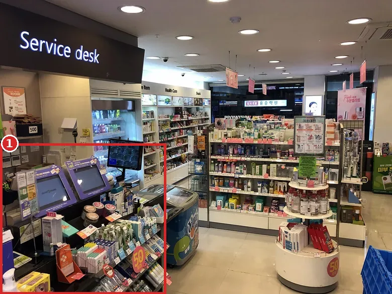

<a class="tr-btn" href="#나도-대상일까"><i class="ic ic-circle-help" aria-hidden="true"></i>나도 대상일까?</a><a class="tr-btn go" href="#계산대에서-받기"><i class="ic ic-receipt" aria-hidden="true"></i>받는 방법</a>

<figure class="tr-hero acc-hero"><figcaption><b>핵심은 이게 전부예요.</b> 명동 올리브영 계산대 안내판: “즉시 환급을 위해 여권 실물을 준비해 주세요(Please prepare your physical passport for immediate tax refund)”.사진: Sgroey, <a href="https://creativecommons.org/licenses/by-sa/4.0/deed.ko" rel="noopener" target="_blank">CC BY-SA 4.0</a>, <a href="https://commons.wikimedia.org/wiki/File:Olive_Young_Myeongdong.jpg" rel="noopener" target="_blank">위키미디어 공용</a> (잘라 냄, 밝기 자동 보정)</figcaption></figure>

<ul class="tr-facts"><li><i class="ic ic-id-card" aria-hidden="true"></i>여권 실물<small>사진은 안 돼요</small></li><li><i class="ic ic-receipt" aria-hidden="true"></i>₩15,000 이상<small>한 매장, 영수증 한 장</small></li><li><i class="ic ic-percent" aria-hidden="true"></i>약 5~8% 환급<small>사업자 수수료를 뗀 뒤</small></li><li><i class="ic ic-clock" aria-hidden="true"></i>계산대에서 즉시<small>₩1,000,000 미만</small></li></ul>

## 나도 대상일까?

<ul class="tr-choose"><li><i class="ic ic-user-check" aria-hidden="true"></i><b>대상: 한국에 6개월 미만 머무르는 방문객</b>한국에 살지 않는 외국인 방문객(비거주자).</li><li><i class="ic ic-user-check" aria-hidden="true"></i><b>대상: 해외에 2년 넘게 사는 한국 국민</b>한국 방문 기간이 3개월 이하일 때(글로벌블루 한국 안내 기준).</li><li><i class="ic ic-user-x" aria-hidden="true"></i><b>대상 아님: 한국에서 일하거나 사는 사람</b>국내 주재 외교관, 주한 국제연합군·미군 장병과 군무원, 회사 명의 구매도 해당되지 않아요.</li><li><i class="ic ic-ban" aria-hidden="true"></i><b>대상 아님: 피부과·성형 시술</b>외국인 관광객 미용 시술 환급은 2025년 12월 31일로 끝났어요.</li></ul>

## 내 영수증은 어느 쪽?

영수증 한 장, 한 매장 기준이에요. 다른 매장 영수증끼리는 합산이 안 돼요.

<ul class="tr-choose"><li><i class="ic ic-circle-x" aria-hidden="true"></i><b>₩15,000 미만</b>환급 없음. 같은 매장에서 더 사서 영수증 한 장을 ₩15,000 이상으로 만드세요.</li><li><i class="ic ic-circle-check" aria-hidden="true"></i><b>₩15,000 이상 ₩1,000,000 미만</b>대부분의 쇼핑. 계산대에서 여권을 보여 주면 끝. 한 번 입국에 합계 ₩5,000,000까지.</li><li><i class="ic ic-plane" aria-hidden="true"></i><b>₩1,000,000 이상</b>정가로 내고 환급 전표를 받아, 공항에서 세관 확인을 받아요.</li><li><i class="ic ic-store" aria-hidden="true"></i><b>택스프리 매장인데 계산대 즉시 환급이 안 될 때</b>환급 전표를 받고 공항이나 시내 키오스크로.</li><li><i class="ic ic-circle-help" aria-hidden="true"></i><b>“Tax Free” 표시가 아예 없을 때</b>계산대에 물어보세요. 택스프리 매장이 아니면 환급이 없어요.</li></ul>

## 계산대에서 받기

<h3 class="tr-step">1<i class="ic ic-store" aria-hidden="true"></i>“Tax Free”나 “Tax Refund” 표시 찾기</h3>

<figure class="tr-photo"><figcaption>계산대 표시는 이렇게 생겼어요. 올리브영과 백화점을 포함한 대부분의 대형 체인에 있어요.사진: Sgroey, <a href="https://creativecommons.org/licenses/by-sa/4.0/deed.ko" rel="noopener" target="_blank">CC BY-SA 4.0</a>, <a href="https://commons.wikimedia.org/wiki/File:Olive_Young_Myeongdong.jpg" rel="noopener" target="_blank">위키미디어 공용</a> (잘라 냄, 밝기 자동 보정)</figcaption></figure>

<h3 class="tr-step">2<i class="ic ic-id-card" aria-hidden="true"></i>결제할 때 여권 내기</h3>

<figure class="tr-photo"><figcaption><b>1</b> 계산대. 카드와 함께 여권 실물을 내면 매장이 스캔하고, 그 자리에서 세금만큼 가격이 내려가요. 세일가도 돼요.사진: 최광모(올리브영 원주단구점, 2020), <a href="https://creativecommons.org/publicdomain/zero/1.0/deed.ko" rel="noopener" target="_blank">CC0</a>, <a href="https://commons.wikimedia.org/wiki/File:2020-04-17_22.17.43_%EC%98%AC%EB%A6%AC%EB%B8%8C%EC%98%81_%EC%9B%90%EC%A3%BC%EB%8B%A8%EA%B5%AC%EC%A0%90.jpg" rel="noopener" target="_blank">위키미디어 공용</a> (상자·번호 추가)</figcaption></figure>

<h3 class="tr-step">3<i class="ic ic-circle-check" aria-hidden="true"></i>끝</h3>

<aside class="tr-note ok"><i class="ic ic-circle-check" aria-hidden="true"></i>공항에서 할 일은 없어요. 물건을 3개월 안에 한국 밖으로 가지고 나가기만 하면 돼요.</aside>

## 큰 구매: 영수증 한 장 ₩1,000,000 이상

즉시 환급 시스템이 없는 매장도 이 순서예요.

{{fig:tax-refund-4|공항에서는 순서가 중요해요}}

<h3 class="tr-step">1<i class="ic ic-receipt" aria-hidden="true"></i>정가로 내고 환급 전표 요청</h3>

환급 전표(Tax Free Form)예요. 필수 항목이 빠지거나 틀리면 세관에서 반려되니 내용을 확인하세요.

<h3 class="tr-step">2<i class="ic ic-banknote" aria-hidden="true"></i>원하면: 시내에서 먼저 현금으로</h3>

시내 환급 창구나 키오스크에서 받을 수 있어요. 그래도 출국할 때 세관 확인은 받아야 하고, 환급받은 날부터 21일(유니온페이는 15일) 안이어야 해요.

<h3 class="tr-step">3<i class="ic ic-stamp" aria-hidden="true"></i>공항: 세관 확인 먼저, 짐 부치기는 그다음</h3>

세관 사무소나 셀프 확인 키오스크에서 해요. 세관이 물건을 볼 수 있어요. 글로벌블루 전표라면 공항 와이파이에 연결해 korea.mobilevalidation.globalblue.com 에서 휴대폰으로도 할 수 있어요.

<aside class="tr-note"><i class="ic ic-luggage" aria-hidden="true"></i>큰 물건은 세관 확인이 끝날 때까지 기내 가방에 두세요. 부친 가방에 들어가면 보여 줄 수 없어요.</aside>

<h3 class="tr-step">4<i class="ic ic-hand-coins" aria-hidden="true"></i>돈 받기</h3>

환급 창구·키오스크에서 받거나, 고른 카드로 자동 환급돼요. 세관 확인이 없으면 환급도 없어요.

<ul class="tr-next"><li><a href="https://www.globalblue.com/en/refund-points-map?country=South-Korea" rel="noopener" target="_blank"><i class="ic ic-map-pin" aria-hidden="true"></i>글로벌블루 전표라면: 세관·환급 장소 지도(영어)<i class="ic ic-external-link" aria-hidden="true"></i></a></li></ul>

## 실제로 돌려받는 금액

가격의 약 **5~8%**예요. 부가세 10%는 보이는 가격 안에 이미 들어 있고, 환급 사업자가 법령이 허용하는 수수료를 떼요. 구매 금액이 클수록 비율이 올라가요. 정확한 금액은 전표나 영수증에 나와요.

{{fig:tax-refund-3|수수료를 떼고 대략 돌려받는 금액}}

<i class="ic ic-coins" aria-hidden="true"></i>수수료는 누가 떼나, 표로 보기

글로벌블루(Global Blue), 글로벌텍스프리(Global Tax Free), 이지택스리펀드(Easy Tax Refund), 큐브리펀드(CubeRefund) 같은 환급 사업자가 법령이 허용하는 수수료를 떼요. 실제로는 가격의 약 5~8%를 돌려받고, 구매 금액이 클수록 비율이 올라가요.

| 쓴 금액 | 돌려받는 금액(대략) |
|---|---|
| ₩50,000 | ₩2,500 |
| ₩300,000 | ₩15,000~₩24,000 |
| ₩1,000,000 | ₩60,000~₩80,000 |

## 자주 하는 실수

<ul class="tr-oops"><li><i class="ic ic-triangle-alert" aria-hidden="true"></i>여권 사진만 챙기기. 매장은 실물을 스캔해요.</li><li><i class="ic ic-triangle-alert" aria-hidden="true"></i>세 매장에서 조금씩 사기. 영수증은 합산이 안 되고, 한 장마다 ₩15,000을 넘어야 해요.</li><li><i class="ic ic-triangle-alert" aria-hidden="true"></i>세관 확인 전에 큰 물건을 부치는 짐에 넣기.</li><li><i class="ic ic-triangle-alert" aria-hidden="true"></i>피부과 시술 비용을 환급 기준으로 계산하기. 2025년 12월 31일로 끝났어요.</li></ul>

<i class="ic ic-list-checks" aria-hidden="true"></i>숫자 세 가지, 2024년에 바뀐 것

- **₩15,000:** 한 매장에서 한 번 결제한 금액(세금 포함)의 최소 기준.
- **₩1,000,000 미만:** 한 번 결제가 이보다 적으면 계산대에서 즉시 환급.
- **₩5,000,000:** 한 번 입국해서 즉시 환급으로 살 수 있는 합계 한도.

₩1,000,000과 ₩5,000,000 한도는 2024년 1월 1일에 두 배로 올랐고, 2026년에도 법령에 그대로 있어요. 최소 기준 ₩15,000도 2024년부터 ₩30,000에서 내려간 거예요.

<i class="ic ic-ban" aria-hidden="true"></i>대상이 아닌 것

- 담배, 총포·도검, 지정 문화유산, 중독성 의약품, 그 밖에 법으로 거래가 제한된 물건.
- 책·가공하지 않은 식품처럼 부가세가 0%인 물건, 그리고 이미 쓴 물건(환급 대상은 미사용품이어야 해요).
- 2026년 1월 1일부터 성형수술과 미용 시술.

> 미용 시술 환급을 되살리는 법안이 2026년 4월에 발의됐지만, 2026년 11월 24일 기준으로 아직 부활하지 않았어요. 시술 비용은 환급 없이 계산하세요.

<i class="ic ic-calendar-check" aria-hidden="true"></i>쇼핑하는 하루, 처음부터 끝까지

이 페이지의 규정으로 그린 장면이에요. 지어낸 경험담이 아니에요.

**출발 전.** 여권 사진 말고 실물 여권을 쇼핑 중에 꺼내기 쉬운 곳에 두세요. 큰 쇼핑(올리브영, 백화점)은 영수증 한 장이 ₩15,000을 넘게 묶어서 계획해요.

**계산대에서.** "Tax Free" 표시를 확인하고, 카드와 함께 여권을 내밀면 그 자리에서 세금만큼 가격이 내려가요. 세일 가격도 해당돼요. 올리브영에서는 대형 시즌 세일 기간에도 택스리펀드가 적용돼요.

**출국하는 날.** 즉시 환급으로 산 물건은 공항에서 할 일이 없어요. 계획할 끝 장면은 이거예요.

<i class="ic ic-info" aria-hidden="true"></i>뺀 것과 출처

뺀 것: 환급 사업자별 수수료표(글로벌블루 한국 페이지에는 표가 없고, 다른 사업자는 확인하지 못했어요), 공항·시내 면세점(택스리펀드와는 다른 제도예요).

국가법령정보센터(2026년 11월 26일 확인): <a href="https://www.law.go.kr/%EB%B2%95%EB%A0%B9/%EC%99%B8%EA%B5%AD%EC%9D%B8%EA%B4%80%EA%B4%91%EA%B0%9D%EB%93%B1%EC%97%90%EB%8C%80%ED%95%9C%EB%B6%80%EA%B0%80%EA%B0%80%EC%B9%98%EC%84%B8%EB%B0%8F%EA%B0%9C%EB%B3%84%EC%86%8C%EB%B9%84%EC%84%B8%ED%8A%B9%EB%A1%80%EA%B7%9C%EC%A0%95" rel="noopener" target="_blank">외국인관광객 등에 대한 부가가치세 및 개별소비세 특례규정</a>(2026년 1월 2일 시행: 대상자, 제외 물품, 1회 100만 원 미만·입국 후 합계 500만 원 이하 즉시 환급, 3개월 반출, 환급 수수료)과 <a href="https://www.law.go.kr/%EB%B2%95%EB%A0%B9/%EC%99%B8%EA%B5%AD%EC%9D%B8%EA%B4%80%EA%B4%91%EA%B0%9D%EB%93%B1%EC%97%90%EB%8C%80%ED%95%9C%EB%B6%80%EA%B0%80%EA%B0%80%EC%B9%98%EC%84%B8%EB%B0%8F%EA%B0%9C%EB%B3%84%EC%86%8C%EB%B9%84%EC%84%B8%ED%8A%B9%EB%A1%80%EA%B7%9C%EC%A0%95%EC%8B%9C%ED%96%89%EA%B7%9C%EC%B9%99" rel="noopener" target="_blank">같은 규정 시행규칙</a>(최소 1만5천 원, 담배); 코리아넷 <a href="https://www.korea.net/NewsFocus/policies/view?articleId=242726" rel="noopener" target="_blank">2024년 즉시 환급 한도 두 배</a>(2023년 11월 28일); 글로벌블루 <a href="https://www.globalblue.com/en/shoppers/how-to-shop-tax-free/destinations/south-korea" rel="noopener" target="_blank">한국 택스프리 쇼핑 안내</a>(2026년 11월 26일 확인: 대상자(해외 2년 넘게 거주하고 3개월 이하 방문하는 한국 국민 포함), 미사용품, 부가세 0% 물품, 세관 확인, 공항 와이파이 모바일 셀프 확인, 시내 환급 후 21일, 3개월 안 세관 확인); 인천국제공항 택스리펀드 안내(이전 판에서 확인, 이번에 다시 열지 않음); 코리아헤럴드 미용 시술 환급 종료 보도(<a href="https://www.koreaherald.com/article/10633779" rel="noopener" target="_blank">2025년 12월 10일</a>, <a href="https://www.koreaherald.com/article/10947687" rel="noopener" target="_blank">2026년 11월 24일</a>), 2026년 11월 26일 확인. 환급 비율과 금액표는 2026년에 게시된 택스프리 사업자 안내로, 이전 판에서 확인했어요. 2026년 11월 26일 연 글로벌블루 한국 페이지에는 환급률 표가 없어서 대략값으로 남겨 뒀어요.

## 다음

<ul class="tr-next"><li><a href="/ko/olive-young/"><i class="ic ic-shopping-basket" aria-hidden="true"></i>올리브영: 세일 시기와 기본템 세 가지<i class="ic ic-arrow-right" aria-hidden="true"></i></a></li><li><a href="/ko/deals/"><i class="ic ic-tag" aria-hidden="true"></i>이번 주 할인 상황판<i class="ic ic-arrow-right" aria-hidden="true"></i></a></li></ul>
