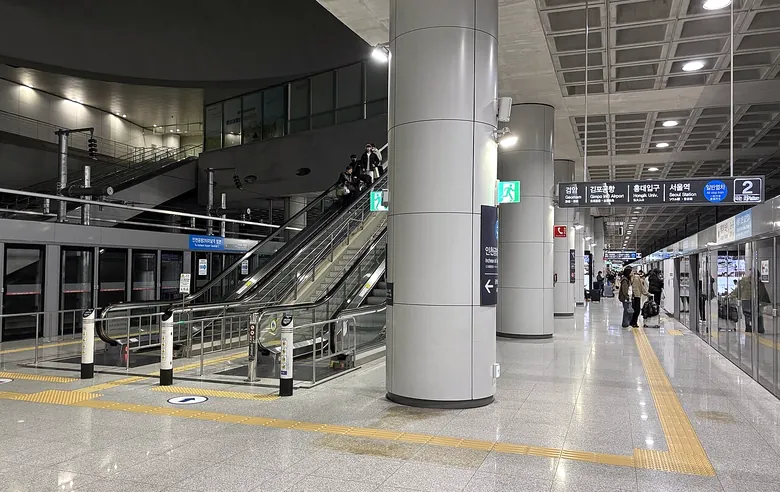
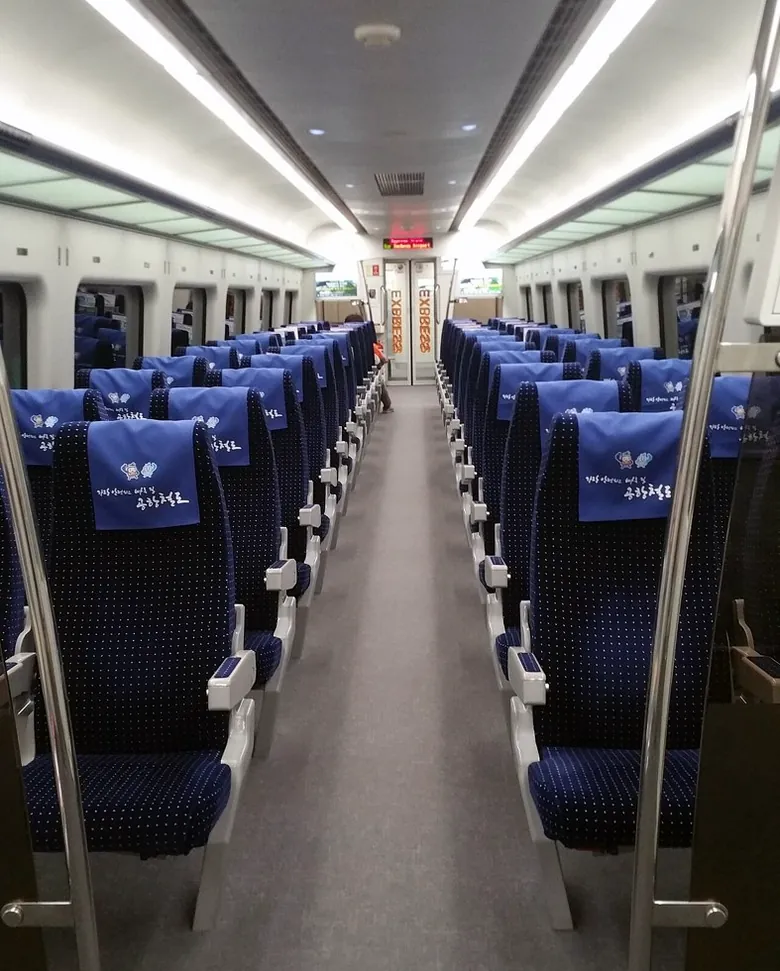
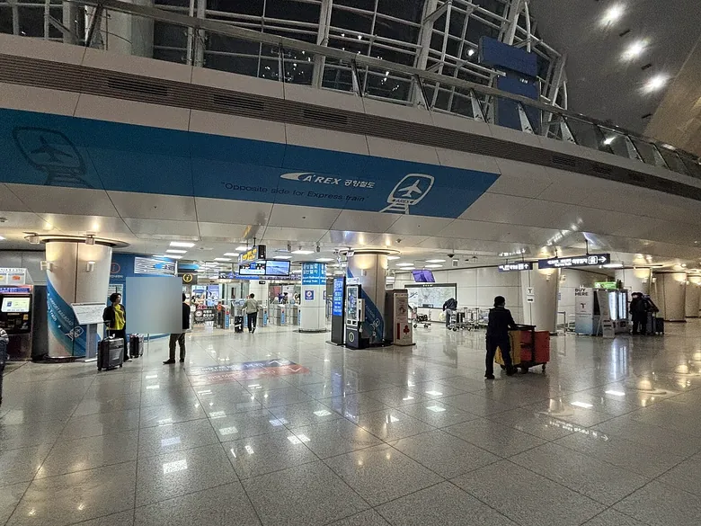
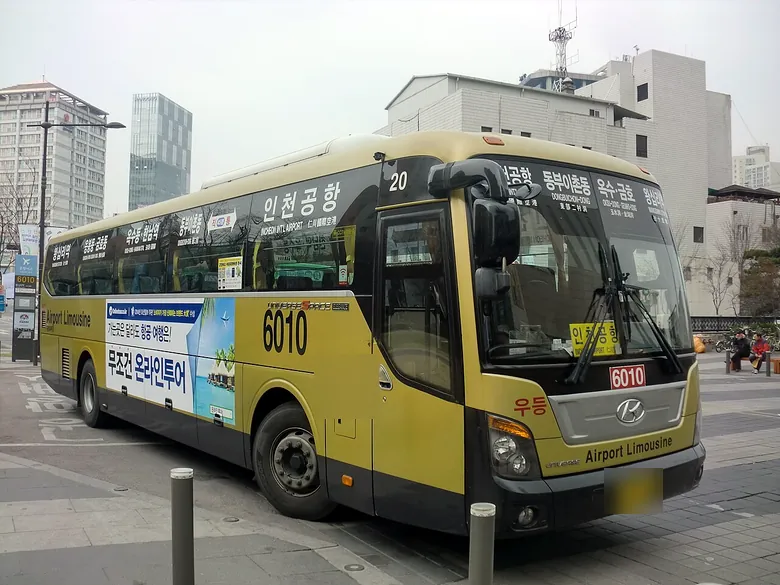
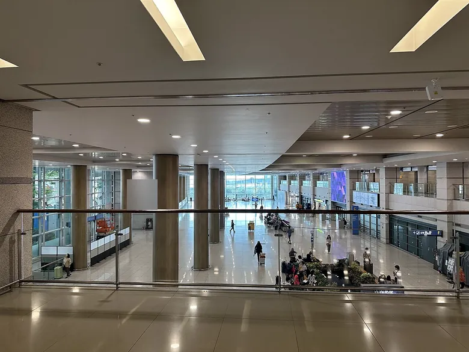
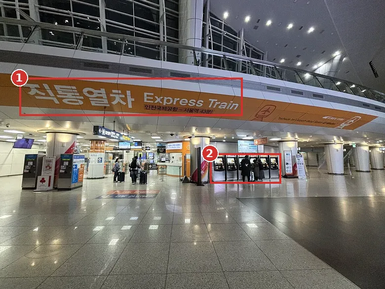
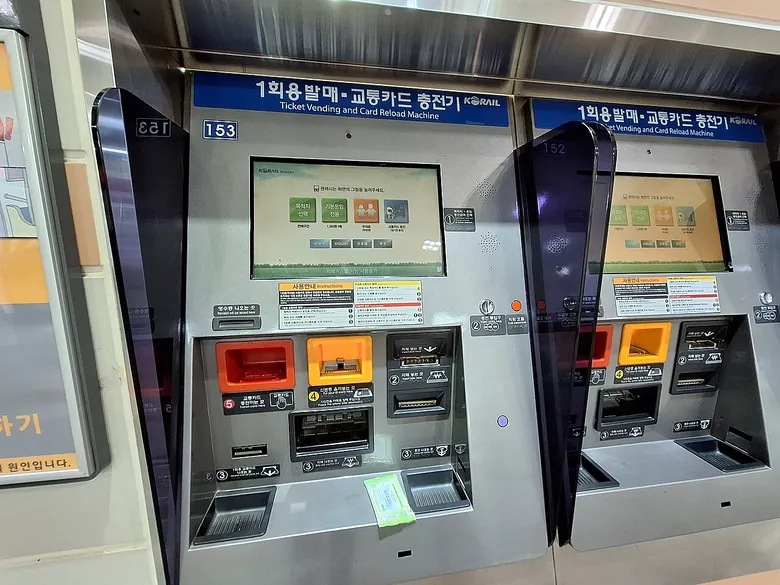
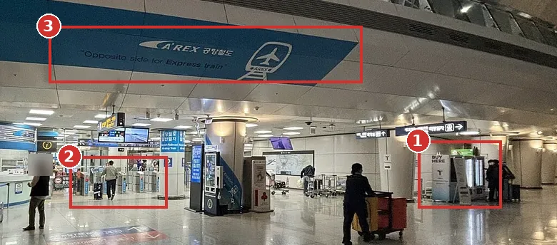
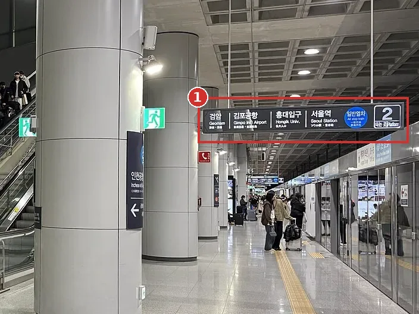
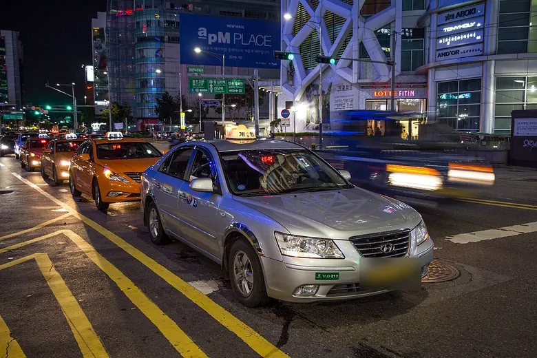

<a class="tr-btn go" href="#pick"><i class="ic ic-hotel" aria-hidden="true"></i>我的飯店該搭什麼?</a><a class="tr-btn" href="#late"><i class="ic ic-moon" aria-hidden="true"></i>晚上9點後落地?</a>

<figure class="tr-hero"><figcaption><b>第1航廈站的機場鐵路月台。</b> 往首爾的列車從這裡出發。 照片: <a href="https://commons.wikimedia.org/wiki/File:202403_AREX_Local_Platform_1,2_of_Incheon_International_Airport_Terminal_1_Station.jpg" rel="noopener" target="_blank">MNXANL</a>, <a href="https://creativecommons.org/licenses/by-sa/4.0" rel="noopener" target="_blank">CC BY-SA 4.0</a>, 維基共享資源</figcaption></figure>

<ul class="tr-facts"><li><i class="ic ic-clock" aria-hidden="true"></i>43〜80分鐘<small>機場到首爾市中心</small></li><li><i class="ic ic-wallet" aria-hidden="true"></i>4,650〜18,000韓元<small>列車、巴士,成人</small></li><li><i class="ic ic-map-pin" aria-hidden="true"></i>列車:地下1樓<small>巴士票:1樓(第1航廈)</small></li><li><i class="ic ic-moon" aria-hidden="true"></i>直達車末班 22:48<small>第1航廈發車</small></li></ul>

<h2 id="pick">我的飯店該搭什麼?</h2>

<ul class="ap-pick"><li class="x" id="express">
<small><i class="ic ic-hotel" aria-hidden="true"></i>首爾站附近</small><b><i class="ic ic-train-front" aria-hidden="true"></i>機場鐵路直達車</b>43分鐘 · 13,000韓元 · 對號座
<ul class="pts"><li><i class="ic ic-clock" aria-hidden="true"></i>不停站直達首爾站:第1航廈43分鐘、第2航廈51分鐘</li><li><i class="ic ic-wallet" aria-hidden="true"></i>成人13,000韓元</li><li><i class="ic ic-armchair" aria-hidden="true"></i>全車對號座,有免費Wi-Fi</li><li><i class="ic ic-ticket" aria-hidden="true"></i>車票在第1、第2航廈地下1樓交通中心的直達車自動售票機或櫃台,或在<a href="https://www.airportrailroad.com/ticket/rsv" rel="noopener" target="_blank">機場鐵路官方訂票</a>購買,海外信用卡也能用。不一定要事先訂。售票機怎麼按:看下方的收合區塊。</li></ul>
只有飯店在首爾站附近才選它,不然省下的時間會花在首爾站轉車上。
</li><li class="x" id="allstop">
<small><i class="ic ic-hotel" aria-hidden="true"></i>弘大、孔德</small><b><i class="ic ic-train-front" aria-hidden="true"></i>機場鐵路普通車</b>刷卡4,650韓元 · 不用轉車
<ul class="pts"><li><i class="ic ic-clock" aria-hidden="true"></i>第1航廈到首爾站59分鐘(第2航廈66分鐘)</li><li><i class="ic ic-credit-card" aria-hidden="true"></i>刷交通卡到首爾站4,750韓元,到弘大入口、孔德4,650韓元;從第2航廈上車多600韓元。</li><li><i class="ic ic-users" aria-hidden="true"></i>座位跟地鐵一樣不對號,上下班尖峰很擠,大行李箱會比較辛苦。</li></ul>
住弘大、孔德選這個:同一條線,票價約三分之一,也不用換車。
</li><li><a href="#bus"><small><i class="ic ic-hotel" aria-hidden="true"></i>明洞、江南、蠶室等離路線較遠的飯店</small><b><i class="ic ic-bus" aria-hidden="true"></i>機場巴士</b>60〜80分鐘 · 行李由站務人員放車底</a></li><li><a href="#taxi"><i class="ic ic-car-taxi-front" aria-hidden="true"></i><small><i class="ic ic-users" aria-hidden="true"></i>3〜4人、行李多</small><b><i class="ic ic-car-taxi-front" aria-hidden="true"></i>外國人觀光計程車</b>定額 · 70,000〜95,000韓元</a></li><li><a href="#late"><i class="ic ic-moon" aria-hidden="true"></i><small><i class="ic ic-plane" aria-hidden="true"></i>任何地方,晚上9點後落地</small><b><i class="ic ic-triangle-alert" aria-hidden="true"></i>先看「晚上才抵達」</b>第1航廈直達車末班 22:48</a></li></ul>

直達車不用跟通勤族擠,長途飛行後這點比省下的時間更重要。

<i class="ic ic-ticket" aria-hidden="true"></i>直達車車票,在售票機怎麼買

1. **怎麼走:** 從1樓入境大廳搭電梯或手扶梯下到地下1樓交通中心。第1航廈面向交通中心,**右邊(西)**是直達車那側。第2航廈的方向我們還沒能確認,請到地下1樓交通中心的**直達車旅客服務中心**詢問。
2. **售票機步驟:** ① 選語言(韓文、英文、中文、日文) ② 選到達站(首爾站) ③ 選列車(出發時間) ④ 選人數(大人滿13歲以上,兒童滿6〜12歲)→確認 ⑤ 用現金或信用卡付款 ⑥ 取車票和收據。車票一定要帶走。
3. **接下來:** 把車票的QR碼對準閘門進站,到**地下4樓**月台。詳細請看[下方「買了之後:搭直達車」](#prep)。

機場鐵路說明裡的售票機畫面範例是首爾站的機器,機場的機器畫面可能有點不同。

<i class="ic ic-route" aria-hidden="true"></i>兩種列車在同一條線上

{{fig:airport-to-seoul-2|直達車和普通車走同一條路線}}

還沒訂飯店?先看[首爾住哪一區](/zh-tw/seoul-areas/)。

<i class="ic ic-info" aria-hidden="true"></i>四種方式一次比較,以及沒寫的

| 住在 | 搭 | 原因 |
|---|---|---|
| 首爾站附近 | 機場鐵路直達車 | 第1航廈直達43分鐘,對號座 |
| 弘大、孔德 | 機場鐵路普通車 | 兩站都停,刷交通卡4,650韓元,不用轉車 |
| 明洞、江南、蠶室等離路線較遠的飯店 | 機場巴士 | 直達飯店密集區,行李由站務人員放車底 |
| 任何地方,晚上9點後落地 | 先看下面「晚上才抵達」 | 第1航廈直達車末班22:48 |

{{fig:airport-to-seoul-1|從第1航廈進首爾的4種方式,成人票價}}

我們只挑了三種交通方式,加上一個適合多人同行的備案。沒寫的:金浦機場、租車。進市區後請看[首爾地鐵、公車、計程車](/zh-tw/getting-around/)。

## 第一個小時,用照片看

Visit Seoul建議落地後預留1〜2小時給入境審查和領行李。之後到列車這樣走。

<h3 class="tr-step">1<i class="ic ic-signpost" aria-hidden="true"></i>走出入境大廳,跟著列車指標走</h3>

<figure class="tr-photo"><figcaption><b>第1航廈入境大廳,</b>從樓上往下看。 照片: <a href="https://commons.wikimedia.org/wiki/File:Incheon_International_Airport_Terminal_1_Arrival_3.jpg" rel="noopener" target="_blank">ノボホショコロトソ</a>, <a href="https://creativecommons.org/licenses/by/4.0" rel="noopener" target="_blank">CC BY 4.0</a>, 維基共享資源</figcaption></figure>

{{fig:airport-to-seoul-t1map|第1航廈:從1樓入境大廳下到地下1樓交通中心。依仁川國際機場公社的平面圖和設施介紹(2026年11月26日查閱)上的位置,由Nadri重新繪製}}

1. 在機場平面圖上,交通中心在**航廈中間(7、8號出入口那邊)的前方**。不管從入境大廳A〜F哪一個出來,都跟著交通中心、機場鐵路(AREX)的指標往中間走。
2. 走對的話會看到:服務台(5號、10號出入口附近,24小時)、機場巴士服務台(9號、11號出入口附近)、電信公司漫遊中心(入境大廳A附近 06:00〜22:00、F附近 24小時)。
3. 下到地下1樓就是交通中心。看到中間的**Travel Center**(07:00〜21:30)就對了。面向交通中心,左邊(東)是普通列車,右邊(西)是直達車。

<i class="ic ic-map" aria-hidden="true"></i>在第2航廈下機的話

{{fig:airport-to-seoul-t2map|第2航廈:從1樓入境大廳下到地下1樓交通中心。依仁川國際機場公社平面圖上的位置,由Nadri重新繪製}}

第2航廈從入境大廳(1樓)下到地下1樓交通中心,列車和巴士都在同一個地方。巴士乘車處編號:首爾11〜35、京畿36〜45、地方01〜10。International Taxi在1樓3C乘車處。

<h3 class="tr-step">2<i class="ic ic-arrow-down" aria-hidden="true"></i>下到地下1樓交通中心</h3>

<figure class="tr-photo"><figcaption><b>第1航廈站地下1樓,直達車這一側。</b> 照片: <a href="https://commons.wikimedia.org/wiki/File:202403_AREX_Express_Train_Concourse_at_Incheon_International_Airport_Terminal_1_Station.jpg" rel="noopener" target="_blank">MNXANL</a>, <a href="https://creativecommons.org/licenses/by-sa/4.0" rel="noopener" target="_blank">CC BY-SA 4.0</a>, 維基共享資源; 編號由Nadri標示</figcaption></figure>

1. 標示:直達車 Express Train(직통열차)。
2. 車票售票機。

直達車櫃台、交通卡販賣機和便利商店都在地下1樓。

<h3 class="tr-step">3<i class="ic ic-credit-card" aria-hidden="true"></i>買T-money並儲值</h3>

<figure><figcaption><b>T-money卡。</b> 列車、地鐵、公車一張搞定。 照片: <a href="https://commons.wikimedia.org/wiki/File:T-money_card.jpg" rel="noopener" target="_blank">zisk</a>, Public domain (PD-self: released by the author), 維基共享資源</figcaption></figure><figure><figcaption><b>交通卡售票儲值機</b>(仁川蘇萊浦口站,韓國鐵道公社的車站;首爾或機場的機器外觀可能不同)。在這裡儲值。 照片: <a href="https://commons.wikimedia.org/wiki/File:Ticket_Vending_and_Card_Reload_Machine_-_Seoul_Metropolitan_Subway_20240713.jpg" rel="noopener" target="_blank">LandAndTree</a>, <a href="https://creativecommons.org/licenses/by/4.0" rel="noopener" target="_blank">CC BY 4.0</a>, 維基共享資源</figcaption></figure>

1. **買卡:** 在地下1樓交通中心的便利商店或交通卡販賣機。在便利商店怎麼買:[便利商店頁面](/zh-tw/convenience-store/#tmoney)。預訂的卡怎麼取,寫在[下方「落地前先準備」](#prep)。
2. **沒有現金時:** 第1、第2航廈機場鐵路站的T-money自動販賣機,可以用海外信用卡買已內含交通費的T-money。15,000韓元(卡費5,000韓元+交通費10,000韓元),2026年11月23日開賣。用完後能不能再用信用卡儲值,機場鐵路沒有說明。要領現金的話,第1航廈**地下1樓機場鐵路普通列車售票機旁**有共用ATM(24小時;1樓在4、6、9、11號出入口附近)。這台ATM能不能用海外卡領錢、第2航廈的ATM在哪裡,我們還沒能確認。
3. **儲值(只收現金):** 在機器上 ① 在螢幕選儲值和金額 ② 卡片放在「交通卡放置處」不要拿走 ③ 把紙鈔放進「紙鈔投入口」 ④ 確認螢幕上的新餘額再拿卡。用機器照片看步驟:[首爾地鐵 第2步](/zh-tw/seoul-subway/)
4. 沒有卡就買單程票:貴100韓元,押金500韓元會退還。

<h3 class="tr-step">4<i class="ic ic-log-in" aria-hidden="true"></i>在機場鐵路閘門刷卡</h3>

<figure class="tr-photo"><figcaption><b>第1航廈站普通車搭乘處(地下1樓)。</b> 照片: <a href="https://commons.wikimedia.org/wiki/File:202403_AREX_Local_Train_Concourse_at_Incheon_International_Airport_Terminal_1_Station.jpg" rel="noopener" target="_blank">MNXANL</a>, <a href="https://creativecommons.org/licenses/by-sa/4.0" rel="noopener" target="_blank">CC BY-SA 4.0</a>, 維基共享資源; 編號由Nadri標示</figcaption></figure>

1. 寫著**BUY HERE**的機器:車票、交通卡。
2. 閘門。卡片一碰,螢幕跳出餘額,閘門就開。閘門不開多半是餘額不足:像上面第3步那樣在售票機儲值,再刷一次。
3. 「Opposite side for Express train」(直達車在對面)的標示。直達車有自己的櫃台。

<h3 class="tr-step">5<i class="ic ic-train-front" aria-hidden="true"></i>上車後看站名變化</h3>

<figure class="tr-photo"><figcaption><b>第1航廈站的機場鐵路月台。</b> 照片: <a href="https://commons.wikimedia.org/wiki/File:202403_AREX_Local_Platform_1,2_of_Incheon_International_Airport_Terminal_1_Station.jpg" rel="noopener" target="_blank">MNXANL</a>, <a href="https://creativecommons.org/licenses/by-sa/4.0" rel="noopener" target="_blank">CC BY-SA 4.0</a>, 維基共享資源; 編號由Nadri標示</figcaption></figure>

1. 標示:普通車2號月台,往黔岩、金浦機場、弘大入口、首爾站。

最先是你還不認得的站名,接著才是地圖上看過的名字。

<ul class="ap-stations"><li>雲西</li><li>永宗</li><li>青羅國際城市</li><li class="sep">→</li><li class="k">金浦機場</li><li class="k">弘大入口</li><li class="k">孔德</li><li class="k">首爾站</li></ul>

<h3 class="tr-step">6<i class="ic ic-circle-check" aria-hidden="true"></i>在離飯店最近的站刷卡出站</h3>

<aside class="tr-note ok"><i class="ic ic-circle-check" aria-hidden="true"></i>出站也刷同一張卡。我們建議的結尾:不是在表上看起來最快的那個,而是在離飯店最近的車站或站牌下車。</aside>

<i class="ic ic-map" aria-hidden="true"></i>第1航廈巴士、列車搭乘處圖

{{fig:airport-to-seoul-3|第1航廈的巴士和列車在哪裡搭}}

<h2 id="bus">機場巴士</h2>

飯店離機場鐵路遠的話,帶著行李轉車次數最少的就是巴士:一張票、一個座位,行李放車底。

<ul class="tr-facts"><li><i class="ic ic-clock" aria-hidden="true"></i>約60〜80分鐘<small>到首爾市區</small></li><li><i class="ic ic-wallet" aria-hidden="true"></i>16,000〜18,000韓元<small>成人,可刷卡</small></li><li><i class="ic ic-ticket" aria-hidden="true"></i>買票<small>有車票的人先上車</small></li><li><i class="ic ic-luggage" aria-hidden="true"></i>每人2件行李<small>28吋以下</small></li></ul>

**到車票上寫的乘車處。** 車票上也有目的地、票價和上車時間。

{{fig:airport-to-seoul-5|機場巴士車票上寫了什麼}}

先查路線號碼。例如:

<ul class="ap-routes"><li><b>6001</b>明洞、東大門</li><li><b>6002</b>弘大、鍾路</li><li><b>6020</b>江南</li><li><b>6200</b>蠶室</li><li><b>6701</b>光化門、市廳</li></ul>

1. **買票。** 在巴士售票處或售票機:第1航廈在1樓(機場巴士服務台:9號出入口附近24小時、11號出入口附近06:00〜22:00),第2航廈在地下樓層。可以刷T-money,但有買票的人先上車。
2. **行李交給站務人員**,收好行李牌。
3. **聽廣播下車**,核對行李牌號碼取行李。

<h2 id="taxi">計程車:3〜4人、行李多</h2>

外國人觀光計程車(International Taxi)有仁川機場⇔首爾的定額車資,不用擔心跳表,含過路費。第1、第2航廈都有服務櫃台,可以刷海外信用卡。

**International Taxi上車處:第1航廈4C、第2航廈3C乘車處。** International Taxi電話 1644-2255。在航廈裡主動搭話的人不要跟著走,請在這個指定乘車處上車。仁川國際機場公社提醒:有假裝成計程車的廂型車(call-van)拉客、亂收費。

<figure class="tr-photo"><figcaption><b>這是一般計程車。</b> 定額只適用於在航廈內櫃台叫的外國人觀光計程車。 照片: <a href="https://commons.wikimedia.org/wiki/File:Seoul_taxis_01.jpg" rel="noopener" target="_blank">Ilya Plekhanov</a>, <a href="https://creativecommons.org/licenses/by-sa/4.0" rel="noopener" target="_blank">CC BY-SA 4.0</a>, 維基共享資源</figcaption></figure>

中型車,依要去的區計價:

<ul class="ap-fares"><li><b>70,000韓元</b>江西區</li><li><b>75,000韓元</b>麻浦(弘大)、永登浦、恩平等</li><li><b>85,000韓元</b>中區(明洞)、鍾路、龍山等</li><li><b>90,000韓元</b>江南、瑞草、城東等</li><li><b>95,000韓元</b>松坡(蠶室)、江東、廣津等</li></ul>

大型、模範計程車100,000〜140,000韓元。4個人分攤85,000韓元,每人約21,000韓元,跟巴士差不多。

<i class="ic ic-car-taxi-front" aria-hidden="true"></i>定額車資圖

{{fig:airport-to-seoul-6|仁川機場出發的外國人觀光計程車定額(中型)}}

<h2 id="late">晚上才抵達的話</h2>

<aside class="tr-note"><i class="ic ic-moon" aria-hidden="true"></i><b>機場鐵路直達車末班:第1航廈22:48,第2航廈22:40。</b> 入境審查和領行李要1〜2小時,晚上9點後落地的班機可能趕不上。出發前就決定好。</aside>

{{fig:airport-to-seoul-7|深夜從第1航廈還能搭什麼}}

- **普通車:** 開得比較晚,末班請依日期上[機場鐵路列車時刻](https://www.airportrailroad.com/train/normal/info)確認。
- **列車收班後:** 深夜機場巴士,17,000〜18,000韓元。第1航廈首班在23:40〜00:10之間發車,在售票處或售票機買票。

<ul class="ap-routes late"><li><b>N6000</b>江南</li><li><b>N6002</b>弘大、清涼里</li><li><b>N6701</b>首爾站、東大門</li><li><b>N6703</b>蠶室、廣渡口</li></ul>

<i class="ic ic-calendar-days" aria-hidden="true"></i>直達車末班時間為什麼變了

2026年10月23日起直達車每日從52班增為56班,時刻有變。第1航廈22:48、第2航廈22:40,目前時刻表平日、假日相同。

## 常見錯誤

<ul class="tr-oops"><li><i class="ic ic-triangle-alert" aria-hidden="true"></i><b>在機場用氣候同行卡(Climate Card)上車。</b> 2026年10月1日起,短期券可以搭到機場、在第1或第2航廈站下車,但不能從機場的車站上車。進首爾請用T-money付款。</li><li><i class="ic ic-triangle-alert" aria-hidden="true"></i><b>飯店不在首爾站附近卻搭直達車。</b> 省下的時間會花在首爾站轉車上。</li><li><i class="ic ic-triangle-alert" aria-hidden="true"></i><b>晚班機還指望直達車。</b> 第1航廈末班22:48。</li><li><i class="ic ic-triangle-alert" aria-hidden="true"></i><b>只拿T-money排巴士。</b> 有買票的人先上車。</li></ul>

<h2 id="prep">想在落地前先準備好?</h2>

<aside class="tr-note tip"><i class="ic ic-lightbulb" aria-hidden="true"></i><b>不是必要的。</b> 機場就買得到交通卡(販賣機、便利商店)和直達車票(地下1樓售票機、櫃台)。先訂只是把購買時間提前。</aside>

{{fig:airport-to-seoul-4|T-money 和 WOWPASS,各自能做什麼}}

<b>T-money卡,機場取卡。</b> 普通車、地鐵、公車刷一下就好。 照片: <a href="https://commons.wikimedia.org/wiki/File:T-money_card.jpg" rel="noopener" target="_blank">zisk</a>, Public domain (PD-self: released by the author), 維基共享資源

**購買前:** 先在商品說明確認你抵達的航廈(第1或第2)和抵達時間能不能領。領取地點我們還沒能確認(Klook網站擋下自動連線,我們打不開)。

{{aff:klook_tmoney|預訂T-money卡,機場取卡}}

<i class="ic ic-list-checks" aria-hidden="true"></i>買了之後:領取T-money卡

1. **地點和時間:** 依預訂確認單(憑證)上寫的地點和時間去領。
2. **要出示什麼:** 要出示的東西也寫在確認單上。出發前先存在手機裡。
3. **餘額:** 把卡靠在閘門感應器上就會顯示餘額。不夠的話,像上面第3步一樣在售票機用現金儲值。
4. **領不到時:** 用訂單編號聯絡賣方(Klook)客服;在那之前,先在地下1樓便利商店或機場鐵路站的T-money自動販賣機直接買。

<i class="ic ic-wallet" aria-hidden="true"></i>
<b>WOWPASS。</b> 交通用的T-money,加上換錢和刷卡付款,一張卡。不過搭地鐵、公車用的T-money餘額要另外儲值。

{{aff:klook_wowpass|或是換錢、刷卡、T-money三合一的WOWPASS}}

<i class="ic ic-list-checks" aria-hidden="true"></i>買了之後:領取和使用WOWPASS

1. **領卡:** 照預訂確認單上的方式領取。如果是在WOWPASS機器領:在機台選單選**「發行新卡」**,再點**「使用預約碼領取」**→掃描護照→輸入收到的代碼→卡片出來後,再插進機器一次完成啟用。
2. **在App登錄:** 把卡登錄到WOWPASS App,可以看餘額和T-money餘額,遺失時可在App停卡,保護WOWPASS餘額。不過卡裡的**T-money餘額,卡片遺失後即使補發也找不回來。**
3. **儲值付款餘額:** 在WOWPASS機器用16種貨幣的現金或信用卡,或在App用海外信用卡儲值。機器位置:[找WOWPASS機器](https://www.wowpass.io/zh-TW/map/kiosk)。
4. **交通費另外算:** 地鐵、公車是從卡裡的**T-money餘額**扣款。在車站、便利商店用韓元現金儲值,或在App(NFC)把WOWPASS餘額轉進去。沒做這一步,閘門會顯示餘額不足。
5. **剩下的錢:** WOWPASS餘額可在機器提領韓元現金(每次最多10萬韓元,手續費1,000韓元,1,000韓元以下的硬幣領不出來)。T-money餘額要另外到便利商店等T-money退款處退(手續費500韓元,5萬韓元以上只能在T-money總公司)。

出處:[WOWPASS 使用說明](https://www.wowpass.io/zh-TW/guide)(2026年11月27日確認)。

<b>直達車票存在手機裡。</b> 只有飯店在首爾站附近才值得。 照片: <a href="https://commons.wikimedia.org/wiki/File:Nearly_empty_Incheon_Airport_Railroad_Express_during_the_coronavirus_outbreak_20200306_104401.jpg" rel="noopener" target="_blank">Bonnielou2013</a>, <a href="https://creativecommons.org/licenses/by-sa/4.0" rel="noopener" target="_blank">CC BY-SA 4.0</a>, 維基共享資源

{{aff:klook_airport|事先預訂機場鐵路直達車}}

<i class="ic ic-list-checks" aria-hidden="true"></i>買了之後:搭直達車

1. **確認車票:** 機場鐵路官方車票付款後會產生QR碼。在Klook買的話,請照確認單上的使用方式(機場鐵路把Klook列為合作旅行社)。
2. **搭車處:** 到地下1樓交通中心的直達車那側。第1航廈面向交通中心是**右邊(西)**;第2航廈的方向我們還沒能確認(請問直達車旅客服務中心)。過閘門後搭電梯或手扶梯到**地下4樓**月台。
3. **閘門:** 把車票的QR碼對準閘門的QR掃描器,門就會開。
4. **時間:** 發車前3分鐘要到月台。車廂和座位寫在車票上。
5. **變更、取消:** 官方訂的票在機場鐵路網站或App的「車票變更/退票」(韓文畫面:승차권 변경/반환,我們的翻譯)辦理(最多變更3次,出發當天變更2次以上要手續費)。在Klook買的票依Klook的規定。

出處:機場鐵路 [直達車使用說明](https://www.airportrailroad.com/train/express/guide)、[合作夥伴](https://www.airportrailroad.com/train/express/partners)(韓文頁面,可用上方語言選單切換),2026年11月27日確認。

## 出發前一晚

花10分鐘準備,第一個小時就輕鬆了。

1. **確認飯店在哪一區**,從[本頁最上面](#pick)挑交通方式。
2. **搭巴士**就記下路線號碼,**搭計程車**就記下那一區的定額。
3. **晚上9點後落地**的話,也記下那一區的深夜巴士號碼。

<ul class="tr-next"><li><a href="/zh-tw/e-arrival-card/"><i class="ic ic-id-card" aria-hidden="true"></i>落地前:電子入境卡<i class="ic ic-arrow-right" aria-hidden="true"></i></a></li><li><a href="/zh-tw/getting-around/"><i class="ic ic-route" aria-hidden="true"></i>進市區:首爾地鐵、公車、計程車<i class="ic ic-arrow-right" aria-hidden="true"></i></a></li><li><a href="/zh-tw/seoul-subway/"><i class="ic ic-train-front" aria-hidden="true"></i>第一次搭地鐵<i class="ic ic-arrow-right" aria-hidden="true"></i></a></li></ul>

<i class="ic ic-list-checks" aria-hidden="true"></i>來源與照片資訊

2026年11月26日查閱:機場鐵路 <a href="https://www.airportrailroad.com/train/express/introduce" rel="noopener" target="_blank">直達車介紹</a>(時間、票價、座位)、<a href="https://www.airportrailroad.com/train/express/info" rel="noopener" target="_blank">直達車時刻表</a>、<a href="https://www.airportrailroad.com/train/normal/introduce" rel="noopener" target="_blank">普通車介紹</a>、<a href="https://www.airportrailroad.com/train/normal/fare" rel="noopener" target="_blank">普通車票價</a>;Visit Seoul <a href="https://english.visitseoul.net/airport-to-seoul" rel="noopener" target="_blank">Airport to Seoul</a>(2026年6月的票價與時間、巴士路線、行李、購票);仁川國際機場 <a href="https://www.airport.kr/" rel="noopener" target="_blank">機場鐵路介紹</a> (airport.kr: ap_en/1512/subview.do)、<a href="https://www.airport.kr/" rel="noopener" target="_blank">深夜巴士</a> (airport.kr: ap_en/1507/subview.do)、<a href="https://www.airport.kr/" rel="noopener" target="_blank">機場巴士訂票說明</a> (airport.kr: bbs/ap_en/937/138233/artclView.do);首爾市 <a href="https://news.seoul.go.kr/traffic/archives/1659" rel="noopener" target="_blank">計程車費率(含外國人觀光計程車定額)</a>(2026年10月14日更新)、<a href="https://news.seoul.go.kr/traffic/archives/category/public-news_c1/climate-accompany-card_c1/card-climate_accompany_card" rel="noopener" target="_blank">氣候同行卡短期券</a>(2026年10月12日更新)。這次未能重新開啟的:Wikitree <a href="https://www.wikitree.co.kr/articles/1168084" rel="noopener" target="_blank">機場鐵路直達車自2026年10月23日起每日52班增為56班</a>。 仁川國際機場公社(韓文頁面,2026年11月26日12點查閱):<a href="https://www.airport.kr/ap_ko/986/subview.do" rel="noopener" target="_blank">計程車搭乘指南</a>(乘車處編號、call-van提醒)、<a href="https://www.airport.kr/ap_ko/1008/subview.do" rel="noopener" target="_blank">便利·公共設施</a>(機場巴士服務台位置)、<a href="https://www.airport.kr/ap_ko/974/subview.do" rel="noopener" target="_blank">巴士</a>(購票)。<a href="https://www.airport.kr/ap_en/1512/subview.do" rel="noopener" target="_blank">機場鐵路指南平面圖</a>(第1、第2航廈交通中心位置、巴士乘車處編號)

2026年11月27日確認:機場鐵路 <a href="https://www.airportrailroad.com/train/express/guide" rel="noopener" target="_blank">直達車使用說明</a>(自動售票機在第1、第2航廈地下1樓交通中心和首爾站地下2樓、售票機步驟01〜06、海外信用卡、QR閘門、地下4樓月台、發車前3分鐘、變更與手續費)、<a href="https://www.airportrailroad.com/train/express/partners" rel="noopener" target="_blank">合作夥伴</a>(旅行社列有KLOOK)、<a href="https://www.airportrailroad.com/train/express/introduce" rel="noopener" target="_blank">直達車介紹</a>(第1、第2航廈地下1樓交通中心設有直達車旅客服務中心;設施名稱與售票機步驟名稱由韓文頁面翻譯);WOWPASS <a href="https://www.wowpass.io/zh-TW/guide" rel="noopener" target="_blank">使用說明</a>(儲值、提領、T-money儲值與退款、「發行新卡」→「使用預約碼領取」步驟、卡片遺失時T-money餘額);仁川國際機場公社 <a href="https://www.airport.kr/ap_ko/1008/subview.do" rel="noopener" target="_blank">便利與公共設施</a>(共用ATM:地下1樓機場鐵路普通列車售票機旁、1樓4、6、9、11號出入口附近,24小時);韓國先驅報 <a href="https://www.koreaherald.com/article/10947683" rel="noopener" target="_blank">機場鐵路T-money卡</a>(內含交通費,15,000韓元、海外信用卡、再儲值方式未公布)。未能確認:第2航廈地下1樓往直達車那側的方向(機場鐵路與仁川機場的說明文字沒有寫方向)、共用ATM能否使用海外卡與第2航廈ATM位置(我們打開的機場設施列表只有第1航廈);Klook商品頁(T-money機場領取、WOWPASS、直達車的領取地點與使用方式)——Klook網站擋下自動連線,我們打不開。所以領取地點請依預訂確認單。

<b>本頁使用的照片</b>
<ul class="ap-credits"><li><a href="https://commons.wikimedia.org/wiki/File:202403_AREX_Local_Platform_1,2_of_Incheon_International_Airport_Terminal_1_Station.jpg" rel="noopener" target="_blank">File:202403 AREX Local Platform 1,2 of Incheon International Airport Terminal 1 Station.jpg</a>: MNXANL, <a href="https://creativecommons.org/licenses/by-sa/4.0" rel="noopener" target="_blank">CC BY-SA 4.0</a>. 修改: cropped, resized to 780x492, light auto-contrast.</li><li><a href="https://commons.wikimedia.org/wiki/File:Nearly_empty_Incheon_Airport_Railroad_Express_during_the_coronavirus_outbreak_20200306_104401.jpg" rel="noopener" target="_blank">File:Nearly empty Incheon Airport Railroad Express during the coronavirus outbreak 20200306 104401.jpg</a>: Bonnielou2013, <a href="https://creativecommons.org/licenses/by-sa/4.0" rel="noopener" target="_blank">CC BY-SA 4.0</a>. 修改: cropped, resized to 780x971, light auto-contrast.</li><li><a href="https://commons.wikimedia.org/wiki/File:202403_AREX_Local_Train_Concourse_at_Incheon_International_Airport_Terminal_1_Station.jpg" rel="noopener" target="_blank">File:202403 AREX Local Train Concourse at Incheon International Airport Terminal 1 Station.jpg</a>: MNXANL, <a href="https://creativecommons.org/licenses/by-sa/4.0" rel="noopener" target="_blank">CC BY-SA 4.0</a>. 修改: resized to 780x585, light auto-contrast, 1 detected face(s) blurred.</li><li><a href="https://commons.wikimedia.org/wiki/File:Incheon_Airport_Limousine_6010.JPG" rel="noopener" target="_blank">File:Incheon Airport Limousine 6010.JPG</a>: hyolee2, <a href="https://creativecommons.org/licenses/by-sa/3.0" rel="noopener" target="_blank">CC BY-SA 3.0</a>. 修改: resized to 780x585, light auto-contrast, 1 detected face(s) blurred, 1 area(s) blurred (faces/plates, manual).</li><li><a href="https://commons.wikimedia.org/wiki/File:Incheon_International_Airport_Terminal_1_Arrival_3.jpg" rel="noopener" target="_blank">File:Incheon International Airport Terminal 1 Arrival 3.jpg</a>: ノボホショコロトソ, <a href="https://creativecommons.org/licenses/by/4.0" rel="noopener" target="_blank">CC BY 4.0</a>. 修改: resized to 780x585, light auto-contrast, 1 detected face(s) blurred.</li><li><a href="https://commons.wikimedia.org/wiki/File:202403_AREX_Express_Train_Concourse_at_Incheon_International_Airport_Terminal_1_Station.jpg" rel="noopener" target="_blank">File:202403 AREX Express Train Concourse at Incheon International Airport Terminal 1 Station.jpg</a>: MNXANL, <a href="https://creativecommons.org/licenses/by-sa/4.0" rel="noopener" target="_blank">CC BY-SA 4.0</a>. 修改: resized, light auto-contrast, numbered red boxes added.</li><li><a href="https://commons.wikimedia.org/wiki/File:T-money_card.jpg" rel="noopener" target="_blank">File:T-money card.jpg</a>: zisk, Public domain (PD-self: released by the author). 修改: kept at 499x316, light auto-contrast.</li><li><a href="https://commons.wikimedia.org/wiki/File:Ticket_Vending_and_Card_Reload_Machine_-_Seoul_Metropolitan_Subway_20240713.jpg" rel="noopener" target="_blank">File:Ticket Vending and Card Reload Machine - Seoul Metropolitan Subway 20240713.jpg</a>: LandAndTree, <a href="https://creativecommons.org/licenses/by/4.0" rel="noopener" target="_blank">CC BY 4.0</a>. 修改: resized to 780x585, light auto-contrast.</li><li><a href="https://commons.wikimedia.org/wiki/File:202403_AREX_Local_Train_Concourse_at_Incheon_International_Airport_Terminal_1_Station.jpg" rel="noopener" target="_blank">File:202403 AREX Local Train Concourse at Incheon International Airport Terminal 1 Station.jpg</a>: MNXANL, <a href="https://creativecommons.org/licenses/by-sa/4.0" rel="noopener" target="_blank">CC BY-SA 4.0</a>. 修改: cropped, resized to 780x344, light auto-contrast, 1 area blurred (face, manual), numbered red boxes added.</li><li><a href="https://commons.wikimedia.org/wiki/File:202403_AREX_Local_Platform_1,2_of_Incheon_International_Airport_Terminal_1_Station.jpg" rel="noopener" target="_blank">File:202403 AREX Local Platform 1,2 of Incheon International Airport Terminal 1 Station.jpg</a>: MNXANL, <a href="https://creativecommons.org/licenses/by-sa/4.0" rel="noopener" target="_blank">CC BY-SA 4.0</a>. 修改: cropped to the platform sign (from the full-size original), resized to 780x269, light auto-contrast, numbered red box added.</li><li><a href="https://commons.wikimedia.org/wiki/File:Seoul_taxis_01.jpg" rel="noopener" target="_blank">File:Seoul taxis 01.jpg</a>: Ilya Plekhanov, <a href="https://creativecommons.org/licenses/by-sa/4.0" rel="noopener" target="_blank">CC BY-SA 4.0</a>. 修改: resized to 780x520, light auto-contrast, 1 area(s) blurred (faces/plates, manual).</li></ul>

