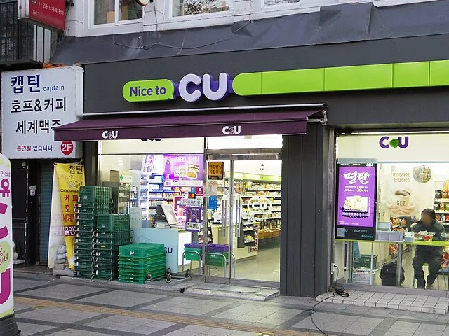
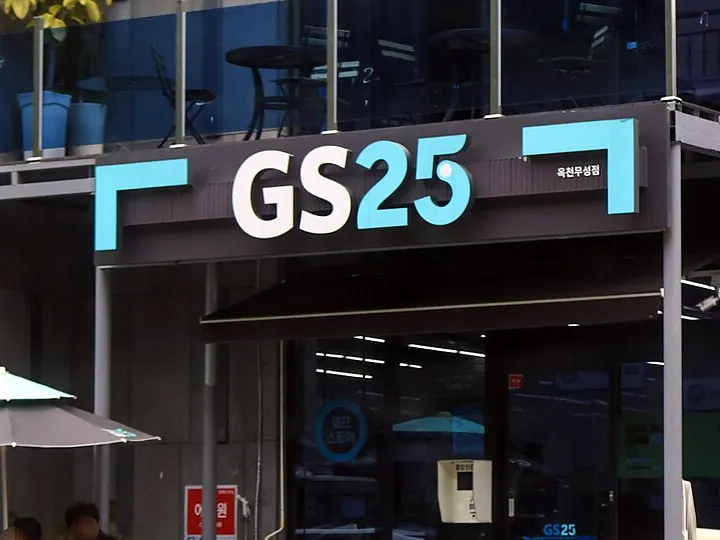
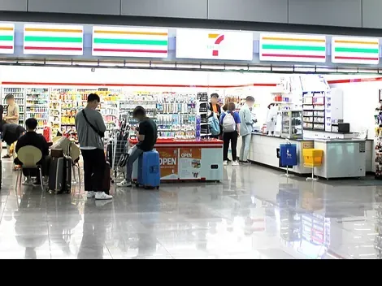
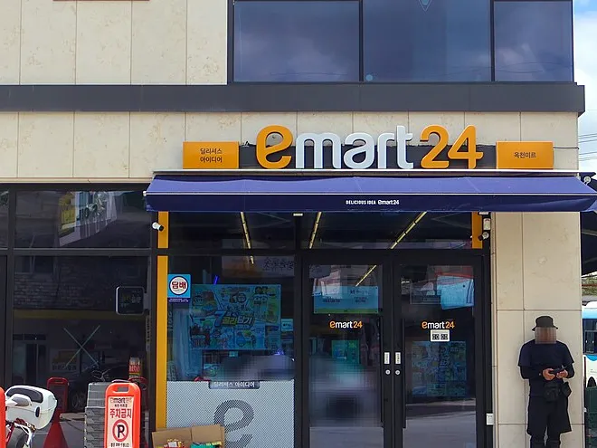
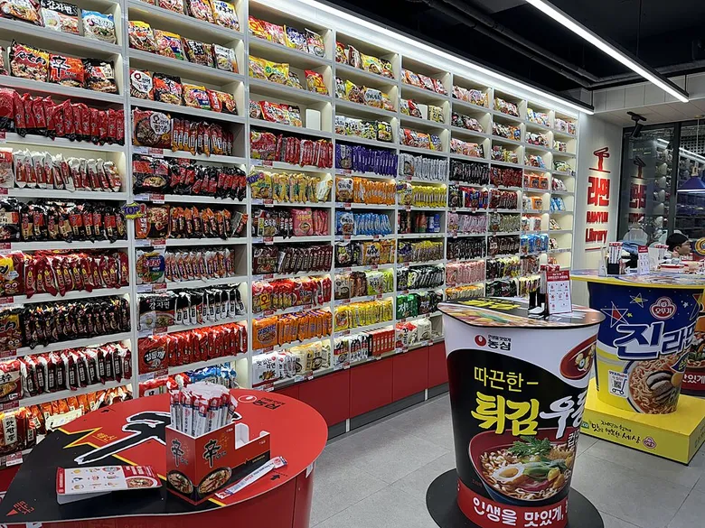

<a class="tr-btn go" href="#tmoney"><i class="ic ic-credit-card" aria-hidden="true"></i>買 T-money 並儲值</a><a class="tr-btn" href="#find"><i class="ic ic-moon" aria-hidden="true"></i>找 24 小時的店</a>

<ul class="tr-colours"><li><b>CU</b>紫色字、淺綠色色帶。<a href="https://commons.wikimedia.org/wiki/File:CU_Namdaemun-ro-5ga_branch_20181122_072838.jpg" rel="noopener" target="_blank">LERK</a>,<a href="https://creativecommons.org/licenses/by-sa/4.0/deed.zh_TW" rel="noopener" target="_blank">CC BY-SA 4.0</a>(裁切)</li><li><b>GS25</b>白色「GS」、淺藍色「25」。<a href="https://commons.wikimedia.org/wiki/File:GS25_Okcheon_Museong_Branch_20240730.jpg" rel="noopener" target="_blank">LandAndTree</a>,<a href="https://creativecommons.org/publicdomain/zero/1.0/deed.zh_TW" rel="noopener" target="_blank">CC0</a>(裁切)</li><li><b>7-ELEVEN</b>橘・綠・紅條紋和 7。<a href="https://commons.wikimedia.org/wiki/File:7-Eleven_Muan-international-airport_store_20190520_181056.jpg" rel="noopener" target="_blank">LERK</a>,<a href="https://creativecommons.org/licenses/by-sa/4.0/deed.zh_TW" rel="noopener" target="_blank">CC BY-SA 4.0</a>(裁切)</li><li><b>emart24</b>黃色「emart24」字樣。<a href="https://commons.wikimedia.org/wiki/File:E-mart_24_Okcheon_Mir_Branch_20240731.jpg" rel="noopener" target="_blank">LandAndTree</a>,<a href="https://creativecommons.org/publicdomain/zero/1.0/deed.zh_TW" rel="noopener" target="_blank">CC0</a>(裁切)</li></ul>

<ul class="tr-facts"><li><i class="ic ic-store" aria-hidden="true"></i>四大超商<small>2025 年底 53,266 家(依報導)</small></li><li><i class="ic ic-moon" aria-hidden="true"></i>約 78% 才是 24 小時<small>深夜先確認營業時間</small></li><li><i class="ic ic-banknote" aria-hidden="true"></i>T-money 用現金儲值<small>在櫃台,用韓元</small></li><li><i class="ic ic-id-card" aria-hidden="true"></i>菸酒<small>2026 年:2007 年以前出生</small></li></ul>

## 在超商做什麼

<ul class="tr-choose"><li><i class="ic ic-credit-card" aria-hidden="true"></i><b>買交通卡、儲值</b>買 T-money,用現金儲值。<a href="#tmoney">怎麼做</a></li><li><i class="ic ic-sun" aria-hidden="true"></i><b>太冷、快感冒時</b>暖暖包、口罩、熱飲。24 小時的店還有感冒藥、止痛藥等常備藥。</li><li><i class="ic ic-coins" aria-hidden="true"></i><b>便宜吃一餐</b>杯麵,部分 CU 還有幫你煮袋裝泡麵的機器。<a href="#ramyeon">怎麼用</a></li><li><i class="ic ic-banknote" aria-hidden="true"></i><b>領現金</b>在有 ATM 的店。CU 可在<a href="#find">門市搜尋</a>篩選。手續費看機器畫面:<a href="/zh-tw/money/">花錢頁面</a></li></ul>

<ul class="tr-choose"><li><i class="ic ic-user-x" aria-hidden="true"></i><b>不適合在超商買的</b>大量買保養品去 <a href="/zh-tw/olive-young/">Olive Young</a>;泡麵・零食要大量當伴手禮,先跟大賣場比價。</li></ul>

<h2 id="find">1. 找附近的超商,確認是不是 24 小時</h2>

四大超商是 **CU、GS25、7-ELEVEN、emart24**(上面照片)。據 2026 年 4 月報導(CEO Score Daily),2025 年底四家合計 53,266 家店(這個來源今天無法重新開啟,是 2026 年 11 月 25 日查證的內容)。因為收掉經營不善的店,一年內減少近 3%,但在城市裡走一下就會遇到一家。

不過不是每家都 24 小時。據 2025 年 12 月報導(Money Today,今天無法重新開啟),2025 年 6 月 24 小時營業的店有 42,791 家,約占 78%。現在的數字可能不同。剩下每五家就有一家晚上關門或轉為無人店。找店的順序是這樣:

1. **搜尋:** 在地圖 App(例:NAVER Map、KakaoMap)搜尋「편의점」(超商)或「CU」「GS25」。地圖 App 的安裝與使用:[打開地圖 App](/zh-tw/seoul-subway/#map-app)
2. **營業時間:** 點附近的店確認營業時間。深夜一定要看是不是 24 小時。
3. **路線:** 打開到那家店的路線走過去。到了再看一次**店門**上的營業時間。
4. CU 可以用 [CU 門市搜尋](https://cu.bgfretail.com/store/list.do?category=store)(韓文),依地區或店名搜尋,在「매장 유형 및 서비스」勾選 **24시간**(24 小時)或 **현금지급기**(ATM)。

### 在店裡:挑好,拿到櫃台

1. 把需要的東西拿到**櫃台**。價格在貨架的價格標籤上(1+1 等優惠標示也在這裡)。
2. T-money 儲值、CU 退稅等服務也在櫃台跟店員說。CU 用店裡的整合終端機幫你儲值交通卡。
3. 用卡片或現金付款。付款方式看下面的[挑選與結帳](#pay)。

<h2 id="tmoney">2. 買 T-money,用現金儲值</h2>

T-money 是搭地鐵・公車的儲值交通卡。GS25、CU、7-ELEVEN 等全國超商都有賣、也能儲值。卡片費用 3,000~5,000 韓元。

<figure class="tr-photo"><figcaption><b>T-money 卡</b>(舊款設計)。設計有很多種。照片:<a href="https://commons.wikimedia.org/wiki/File:T-money_card.jpg" rel="noopener" target="_blank">zisk</a>,公有領域,維基共享資源(自動調整亮度)</figcaption></figure>

<h3 class="tr-step">1<i class="ic ic-shopping-basket" aria-hidden="true"></i>在櫃台買卡</h3>

1. 跟店員說「**티머니 카드 주세요**」(T-money 卡,麻煩你)。
2. 付卡片費用。外國旅客專用的「TMONEY TRAVEL CARD」是 4,000 韓元。

<h3 class="tr-step">2<i class="ic ic-banknote" aria-hidden="true"></i>用韓元現金儲值</h3>

1. 把卡片和**韓元現金**一起給店員。
2. 說要儲多少。例:「**만 원 충전해 주세요**」(請儲值 1 萬韓元)。
3. 店員幫你儲值。CU 所有門市都能儲值 T-money。

<aside class="tr-note"><i class="ic ic-triangle-alert" aria-hidden="true"></i>海外發行的卡通常不能儲值。T-money 儲值一直只能用現金、韓國發行的卡或韓國手機小額付款;首爾市也說外國人只能用現金買卡、儲值。我們沒找到哪家超商表示櫃台可用海外卡儲值。帶一點韓元現金。</aside>

<h3 class="tr-step">3<i class="ic ic-circle-check" aria-hidden="true"></i>在閘門確認</h3>

在地鐵閘門感應卡片,機器會顯示餘額。之後也可以在車站售票機儲值(卡內最多 50 萬韓元)。附照片的步驟:[搭首爾地鐵](/zh-tw/seoul-subway/)

<i class="ic ic-credit-card" aria-hidden="true"></i>沒有現金時的其他方法

- **iPhone:** T-money 在 App Store 回覆中說明,在行動 T-money App 開始按鈕下方點「Foreigner」,就能用海外卡儲值餘額。支援 Mastercard、Amex、銀聯、JCB,清單上沒有 Visa。
- **Android:** 首爾市表示,T-money 的「Korea Tour Card」App 可以用海外卡儲值。
- **剛抵達仁川機場:** 2026 年 11 月 23 日起,機場快線車站的 T-money 自動販賣機可用海外信用卡買 15,000 韓元的 T-money(卡片 5,000 + 交通費 10,000 韓元)。公告沒說買了之後能不能再用信用卡儲值。
- **首爾地鐵站:** 2026 年 3 月 17 日起,1~8 號線 273 站的新型售票機(440 台)可用海外卡買**氣候同行卡和單程票**(平均 3.7% 手續費)。不能儲值 T-money。詳情:[搭首爾地鐵](/zh-tw/seoul-subway/)。
- **要領現金:** 超商 ATM,或看[花錢頁面](/zh-tw/money/)。

{{fig:convenience-store-1|櫃台儲值方法,沒有現金時}}

<aside class="tr-note tip"><i class="ic ic-lightbulb" aria-hidden="true"></i><b>回國前把餘額退回來:</b> T-money 餘額可在超商退款。超過 5 萬韓元要到首爾站 10 號出口附近的 T-money Town。</aside>

<h2 id="pay">3. 挑選與結帳</h2>

### 看懂 1+1、2+1

優惠標示貼在貨架價格標籤上。**1+1** 是買一送一,**2+1** 是買二送一。優惠商品每月更換,CU 也提醒部分優惠商品可能提早賣完,去之前先問門市。本月 CU 優惠:[CU 優惠商品](https://cu.bgfretail.com/event/plus.do)(韓文)。

{{fig:convenience-store-2|優惠標示的意思,和值得算一下的帳}}

算一下每件單價。有報導指出 1+1 飲料換算單價後,仍比賣場貴。本來就要買兩個才划算。

### 付款:刷卡、LINE Pay、支付寶

<ul class="tr-choose"><li><i class="ic ic-credit-card" aria-hidden="true"></i><b>信用卡:幾乎都能刷</b>日本三菱 UFJ 旗下 MUFG 卡的韓國指南把超商列為可刷卡的地方,主要卡別是 Visa、Mastercard、Amex、JCB、銀聯。</li><li><i class="ic ic-smartphone" aria-hidden="true"></i><b>行動支付</b>2025 年 GS25 外國人付款金額中,支付寶和微信支付占 97.7%。7-ELEVEN 從 2026 年 4 月起為台灣旅客提供 LINE Pay,5 月的 LINE Pay 銷售比 4 月成長 12%。PayPay 也列出 CU、emart24、GS25、7-ELEVEN 為韓國特約店。各分店不一定相同,結帳前先問店員或看櫃台標示。</li></ul>

### 在 CU 退稅(即時退稅)

超商金額小,通常不夠退稅門檻,但 CU 在有提供服務的門市 24 小時即時退稅(最多付款金額的 7%)。

1. 確認店裡貼的 **Tax-Refund 服務店貼紙**。依 2025 年 9 月報導,600 家以上 CU 門市提供。
2. 在櫃台說要**退稅結帳**(택스리펀 결제)。
3. 出示**護照正本**(或行動護照)。一次 15,000~999,999 韓元才適用。

<aside class="tr-note"><i class="ic ic-triangle-alert" aria-hidden="true"></i>不適用:酒、菸、免稅商品(白牛奶、水果、蔬菜、衛生棉等)、店內現做食品、服務類商品。資格與規則:<a href="/zh-tw/tax-refund/">退稅</a></aside>

### 菸酒看「出生年」

青少年保護法不看生日,看**出生年**。滿 19 歲那一年的 1 月 1 日起就能買,所以 2026 年是 2007 年以前出生的人可以買,2008 年以後出生的不行;2008 年出生的人從 2027 年 1 月 1 日起可以買。可能會查證件,請帶護照。

<h2 id="ramyeon">4. 在店裡吃泡麵</h2>

坐在窗邊吃泡麵也是逛超商的樂趣。杯麵哪家店都行;袋裝泡麵要找有煮麵機的 CU。CU 從 2016 年開始設置這種機器。

<figure class="tr-photo"><figcaption>泡麵主題超商的貨架。挑一包,用機器煮。照片:lazy fri13th,<a href="https://creativecommons.org/licenses/by/2.0/deed.zh_TW" rel="noopener" target="_blank">CC BY 2.0</a>,<a href="https://commons.wikimedia.org/wiki/File:24_hours_Ramyeon_Ramen_convenience_store_(South_Korea).jpg" rel="noopener" target="_blank">維基共享資源</a>(自動調整亮度)</figcaption></figure>

<h3 class="tr-step">1<i class="ic ic-shopping-basket" aria-hidden="true"></i>泡麵和一次性容器分開買</h3>

挑好袋裝泡麵,結帳時一起買煮麵用的**一次性容器**。弘大想像店在報導當時,含容器的煮麵費是 900 韓元。現在的價格請在店裡確認。

<h3 class="tr-step">2<i class="ic ic-scan-line" aria-hidden="true"></i>放進容器、掃條碼、按開始</h3>

1. 把麵和調味包放進容器。
2. 把容器的**條碼**對著煮麵機掃描。
3. 按下**開始按鈕**。弘大「泡麵圖書館」的機器說明也有英文、中文、日文。

{{fig:convenience-store-3|煮麵機怎麼用}}

<ul class="tr-choose"><li><i class="ic ic-map-pin" aria-hidden="true"></i><b>CU 弘大想像店「泡麵圖書館」</b>首爾麻浦區西橋洞。袋裝泡麵約 230 種,煮麵機 3 台。2024 年 3 月時,不分品牌買超過 5 包打 5 折(僅限此店)。</li><li><i class="ic ic-store" aria-hidden="true"></i><b>其他泡麵主題店</b>CU 在全國經營 40 家以上泡麵主題店,仁川機場和明洞站也有。漢江的店以在戶外吃的「漢江泡麵」聞名。一般門市可能沒有煮麵機。</li></ul>

## 5. 冬天與身體不適

- **暖暖包・口罩・熱飲:** 2026 年 1 月寒流來襲,三大超商的暖暖包銷售都比前一年增加 22~43%,GS25 的保暖內衣銷售幾乎翻倍。忘了帶手套或外套,先去超商找。
- **感冒藥・止痛藥:** 依藥事法,只有 **24 小時全年無休的店**能販售安全常備藥(20 項以內)。晚上需要藥就去 24 小時的店。怎麼找藥局:[旅途中生病時](/zh-tw/health/)

## 常見失誤

<ul class="tr-oops"><li><i class="ic ic-triangle-alert" aria-hidden="true"></i>只帶海外卡去儲值 T-money。要帶韓元現金。</li><li><i class="ic ic-triangle-alert" aria-hidden="true"></i>以為每家超商都 24 小時。五家就有一家不是。</li><li><i class="ic ic-triangle-alert" aria-hidden="true"></i>看到 1+1 就放進籃子。先跟賣場比單價。</li><li><i class="ic ic-triangle-alert" aria-hidden="true"></i>用 CU 退稅結帳菸酒。不適用。</li><li><i class="ic ic-triangle-alert" aria-hidden="true"></i>回國那天把 T-money 餘額留著。超商就能退。</li></ul>

<i class="ic ic-list-checks" aria-hidden="true"></i>一句話判斷,表格版

| 情況 | 這樣做 | 理由 |
|---|---|---|
| 一抵達就需要交通卡 | 在第一家看到的超商買 T-money,用韓元現金儲值 | 全國超商都賣也能儲值;海外卡通常不能儲值 |
| 很冷,或半夜需要感冒藥 | 去 24 小時超商 | 常備藥只有全年無休 24 小時的店能賣 |
| 想便宜吃宵夜 | 在店裡吃泡麵 | 有些店有煮袋裝泡麵的機器 |
| 要買很多保養品 | 去 [Olive Young](/zh-tw/olive-young/) 或百貨公司 | 選擇多,退稅也適合大金額 |
| 要大量買泡麵・零食當伴手禮 | 別急著拿 1+1,先跟大賣場比價 | 1+1 的單價有時還是比賣場貴 |

<i class="ic ic-calendar-check" aria-hidden="true"></i>第一次旅行會去的三次

第一天:把 T-money 卡和韓元現金交給店員,說要儲多少,就能搭地鐵了。寒冷的晚上:買明天逛古宮用的暖暖包和一碗杯麵。我們選的最後一次,是回國那天早上,買忘了的東西,順便退掉 T-money 餘額。

**出發前:** 帶一點儲值用的韓元現金,要買啤酒就帶護照。如果是含餐的團體旅遊、交通卡也已儲值,除了買酒年齡以外都可以略過。

<i class="ic ic-info" aria-hidden="true"></i>還有這些,以及沒寫的

- **換匯:** GS25 有可把 15 種外幣換成韓元的機台。7-ELEVEN 也以觀光區門市為主增設無人換匯機。
- **口譯:** CU 約 70 家門市提供 38 種語言的 AI 口譯。
- **行動電源租借:** 在有機台的 CU 租,有機台的地方都能還。使用「완충이」App,30 分鐘 800 韓元(可能依合作公司政策變動)。

沒寫:宅配和行李配送。CU 和 DHL 合作受理國際快遞,但我們無法確認沒有韓國手機號碼的旅客能否預約。ATM 手續費依機器不同,領錢前看畫面確認。

<i class="ic ic-info" aria-hidden="true"></i>資料來源

2026 年 11 月 26 日開啟確認(cu.bgfretail.com 在下午允許連線後開啟):CU <a href="https://cu.bgfretail.com/service/tax_info.do?category=service&amp;depth3=19" rel="noopener" target="_blank">Tax-Refund(即時退稅)說明</a>(服務店貼紙、最多 7%、15,000~999,999 韓元、不適用商品、護照正本或行動護照)・<a href="https://cu.bgfretail.com/service/traffic_info.do?category=service&amp;depth3=3" rel="noopener" target="_blank">交通卡說明</a>(全門市 T-money 儲值)・<a href="https://cu.bgfretail.com/service/ticket_info.do?category=service&amp;depth3=2" rel="noopener" target="_blank">ATM</a>・<a href="https://cu.bgfretail.com/service/frugal_info.do?category=service&amp;depth3=9" rel="noopener" target="_blank">行動電源租借</a>・<a href="https://cu.bgfretail.com/store/list.do?category=store" rel="noopener" target="_blank">門市搜尋</a>(24 小時・ATM 篩選)・<a href="https://cu.bgfretail.com/event/plus.do" rel="noopener" target="_blank">優惠商品</a>(1+1・2+1、提早賣完);國家法令資訊中心<a href="https://www.law.go.kr/%EB%B2%95%EB%A0%B9/%EC%95%BD%EC%82%AC%EB%B2%95" rel="noopener" target="_blank">藥事法</a>第 44 條之 2(2026 年 11 月 12 日施行:20 項以內、24 小時全年無休店)・<a href="https://www.law.go.kr/%EB%B2%95%EB%A0%B9/%EC%B2%AD%EC%86%8C%EB%85%84%EB%B3%B4%ED%98%B8%EB%B2%95" rel="noopener" target="_blank">青少年保護法</a>第 2 條(滿 19 歲那年 1 月 1 日);VISITKOREA <a href="https://english.visitkorea.or.kr/svc/contents/contentsView.do?vcontsId=140663" rel="noopener" target="_blank">Transportation Cards</a>(2026 年 8 月更新:超商販售與儲值、3,000~5,000 韓元、售票機最多 50 萬韓元、超商退款與超過 5 萬韓元到 T-money Town);T-money <a href="https://www.tmoney.co.kr/aeb/biz/bridge/foreignTravel.dev" rel="noopener" target="_blank">外國人專用卡</a>(TMONEY TRAVEL CARD 4,000 韓元、超商);App Store <a href="https://apps.apple.com/us/app/-/id1470361790" rel="noopener" target="_blank">行動 T-money</a> 開發者回覆(Foreigner 按鈕;Mastercard、Amex、銀聯、JCB);首爾市<a href="https://news.seoul.go.kr/traffic/archives/515573" rel="noopener" target="_blank">2025 年外國人交通付款改善</a>(現金購卡・儲值、Android 的 Korea Tour Card App)・<a href="https://news.seoul.go.kr/traffic/archives/516544" rel="noopener" target="_blank">2026 年 3 月 16 日公告</a>(273 站 440 台、氣候同行卡・單程票、3.7%);韓國先驅報<a href="https://www.koreaherald.com/article/10947683" rel="noopener" target="_blank">機場快線預儲值 T-money</a>(2026 年 11 月 24 日)・<a href="https://www.koreaherald.com/article/3279412" rel="noopener" target="_blank">CU 弘大想像店泡麵店</a>(2023 年 12 月 11 日,2024 年 12 月 23 日更新:900 韓元、3 台煮麵機、2016 年起);Korea.net <a href="https://www.korea.net/NewsFocus/FoodTravel/view?articleId=249125" rel="noopener" target="_blank">泡麵圖書館</a>(2024 年 3 月 20 日:約 230 種;容器・條碼・開始按鈕;英中日說明;超過 5 包打 5 折)。

本次未能重新開啟(查證工具連線被擋),沿用 2026 年 11 月 25 日查證內容:CEO Score Daily(店數,2026 年 4 月 7 日);Money Today(24 小時店數,2025 年 12 月 21 日);亞洲經濟 Aju(冬季銷售,2026 年 1 月 22 日);Asia Economy(CU 泡麵主題店,2025 年 4 月 22 日;每月優惠,2025 年 1 月 12 日);sidae.com(1+1 單價,2025 年 3 月 26 日);SBS Biz(T-money 儲值方式,2026 年 3 月 19 日);Korea Times(T-money 以韓元儲值,2025 年 4 月 23 日);<a href="https://www.cr.mufg.jp/mycard/beginner/22103/index.html" rel="noopener" target="_blank">MUFG 卡韓國指南</a>(2025 年 12 月 9 日更新);世界日報(付款,2026 年 6 月 26 日;換匯機、口譯與 LINE Pay,2026 年 7 月 1 日);<a href="https://paypay.ne.jp/overseas/korea/" rel="noopener" target="_blank">PayPay 韓國特約店</a>;The Fact(CU 退稅 600 家以上與 7-ELEVEN 換匯機,2025 年 9 月 23 日)。GS25 官方網站這次也打不開。

## 下一步

<ul class="tr-next"><li><a href="/zh-tw/seoul-subway/"><i class="ic ic-train-front" aria-hidden="true"></i>搭首爾地鐵:用 T-money 進站<i class="ic ic-arrow-right" aria-hidden="true"></i></a></li><li><a href="/zh-tw/money/"><i class="ic ic-wallet" aria-hidden="true"></i>花錢:現金、刷卡、ATM<i class="ic ic-arrow-right" aria-hidden="true"></i></a></li><li><a href="/zh-tw/tax-refund/"><i class="ic ic-receipt" aria-hidden="true"></i>退稅:出示護照就好<i class="ic ic-arrow-right" aria-hidden="true"></i></a></li></ul>
