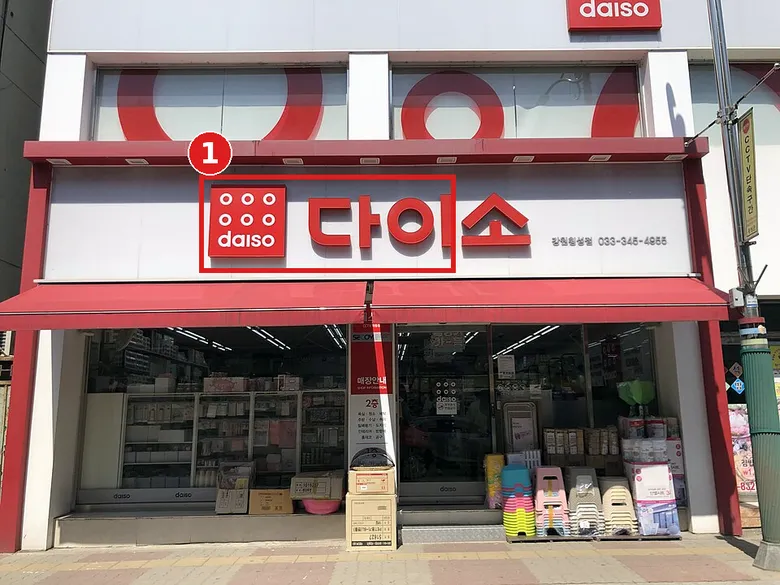
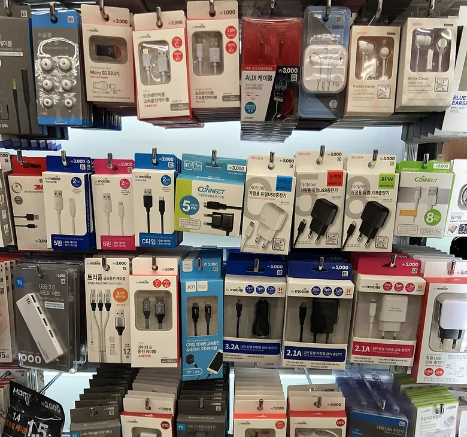
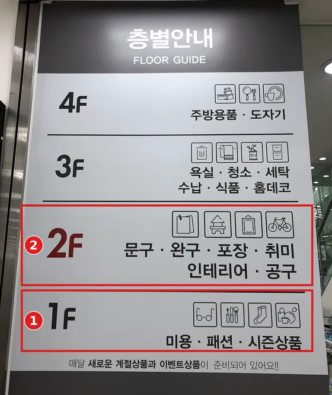
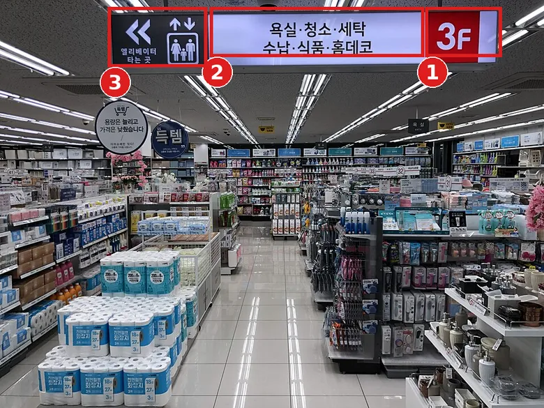
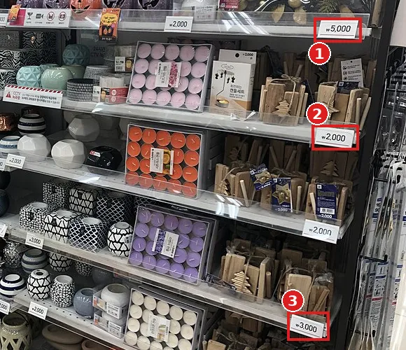

<a class="tr-btn go" href="#find"><i class="ic ic-map-pin" aria-hidden="true"></i>找附近的大創</a><a class="tr-btn" href="#pay"><i class="ic ic-credit-card" aria-hidden="true"></i>結帳・退稅</a>

<figure class="tr-hero acc-hero"><figcaption><b>找這個招牌。</b> <b>1</b> 紅色方形「daiso」標誌和韓文「다이소」。韓國全國約有 1,500 家店。照片:Choi Kwang-mo(大創江原橫城店,2020 年),<a href="https://creativecommons.org/publicdomain/zero/1.0/deed.zh_TW" rel="noopener" target="_blank">CC0</a>,<a href="https://commons.wikimedia.org/wiki/File:2020-04-06_12.55.48_%EB%8B%A4%EC%9D%B4%EC%86%8C_%EA%B0%95%EC%9B%90%ED%9A%A1%EC%84%B1%EC%A0%90_%EC%99%B8%EB%B6%80_%EC%A0%84%EA%B2%BD.jpg" rel="noopener" target="_blank">維基共享資源</a>(自動調整亮度,加上框與編號)</figcaption></figure>

<ul class="tr-facts"><li><i class="ic ic-tag" aria-hidden="true"></i>500~5,000 韓元<small>只有 6 種價格</small></li><li><i class="ic ic-clock" aria-hidden="true"></i>10:00~22:00<small>明洞站店,各店不同</small></li><li><i class="ic ic-id-card" aria-hidden="true"></i>護照 + 15,000 韓元<small>退稅店,一張收據</small></li><li><i class="ic ic-receipt" aria-hidden="true"></i>收據留兩週<small>換貨・退貨期限</small></li></ul>

## 在大創買什麼划算

<ul class="tr-choose"><li><i class="ic ic-luggage" aria-hidden="true"></i><b>旅途臨時要用的</b>弄丟或忘了帶的萬用轉接頭、行李秤、手機充電器。</li><li><i class="ic ic-shopping-basket" aria-hidden="true"></i><b>零食和小伴手禮</b>零食大多 1,000~2,000 韓元。角色周邊、小卡用品、手機配件、韓國零食。</li><li><i class="ic ic-sparkles" aria-hidden="true"></i><b>便宜試用保養品</b>小容量和大創專屬系列很多。買之前先<a href="/zh-tw/kbeauty-how-to-choose/">看盒子背面 30 秒</a>。</li></ul>

<figure class="tr-photo"><figcaption>充電器・充電線・耳機的貨架(橫城店)。大型店先用樓層指南找樓層。照片:Choi Kwang-mo(大創江原橫城店,2020 年),<a href="https://creativecommons.org/publicdomain/zero/1.0/deed.zh_TW" rel="noopener" target="_blank">CC0</a>,<a href="https://commons.wikimedia.org/wiki/File:2020-04-06_12.54.12_%EB%8B%A4%EC%9D%B4%EC%86%8C_%EA%B0%95%EC%9B%90%ED%9A%A1%EC%84%B1%EC%A0%90_%EC%B6%A9%EC%A0%84%EA%B8%B0.jpg" rel="noopener" target="_blank">維基共享資源</a>(裁切,自動調整亮度)</figcaption></figure>

<ul class="tr-choose"><li><i class="ic ic-user-x" aria-hidden="true"></i><b>不需要大創的人</b>只買單一品牌的正裝,或在等大特價,去 <a href="/zh-tw/olive-young/">Olive Young</a> 比較好。現在的特價看<a href="/zh-tw/deals/">優惠看板</a>。</li></ul>

<h2 id="find">1. 找附近的大創</h2>

<h3 class="tr-step">1<i class="ic ic-globe" aria-hidden="true"></i>打開大創門市搜尋</h3>

1. 打開[大創門市搜尋](https://www.daiso.co.kr/cs/shop)(韓文網站)。
2. 在「매장명 검색」(店名搜尋)用韓文輸入地名(例:명동 明洞、홍대 弘大),或在「지역 검색」(地區搜尋)選擇,再按「검색」(搜尋)。
3. 點店名會顯示**地址、營業時間、服務**。服務裡有「택스리펀드」,就是能用護照退稅的店。在「매장옵션」(門市選項)也能只篩選택스리펀드。
4. 複製地址貼到地圖 App 找路。

<aside class="tr-note tip"><i class="ic ic-lightbulb" aria-hidden="true"></i>各店營業時間不同(例:明洞站店 10:00~22:00,新村本店 09:30~22:00)。韓國觀光公社資料寫明洞站店在春節・中秋連假休息;大創會另外公告節日當天有營業的店。</aside>

<h3 class="tr-step">2<i class="ic ic-signpost" aria-hidden="true"></i>想在首爾市中心逛大店</h3>

<ul class="tr-choose"><li><i class="ic ic-map-pin" aria-hidden="true"></i><b>明洞站店:地下 1 樓~12 樓</b>在明洞站 1 號和 4 號出口之間的路旁。地址 서울 중구 퇴계로 134-1(首爾中區退溪路 134-1)。10:00~22:00,退稅店。有英・日・中文樓層指南和自助結帳機。大創說是僅次於江南高速巴士客運站店、首爾第二大的店(2023 年 3 月 1 日重新開幕時為 1~12 樓,約 500 坪・1,650㎡)。</li><li><i class="ic ic-bus" aria-hidden="true"></i><b>江南高速巴士客運站店:最大的店</b>在客運站大樓內,서울 서초구 신반포로 194。08:30~22:00。多語自助結帳、可退稅。等車時可以逛,但走道像迷宮,注意時間。</li></ul>

附近的購物街看[首爾購物去哪裡](/zh-tw/shopping-streets/)。

## 2. 在店裡不迷路

大型店每層賣的東西不同。一進門先看**樓層指南**,只選兩三層去。

<figure class="tr-photo"><figcaption>店內的<b>층별안내(FLOOR GUIDE)</b>看板。<b>1</b> 1F 미용・패션・시즌상품(美容・服飾・季節商品),<b>2</b> 2F 문구・완구・포장・취미(文具・玩具・包裝・興趣)。各店樓層配置不同。照片:MatthieuRicard(大創原州丹邱店,2020 年),<a href="https://creativecommons.org/publicdomain/zero/1.0/deed.zh_TW" rel="noopener" target="_blank">CC0</a>,<a href="https://commons.wikimedia.org/wiki/File:2020-03-17_21.40.56_%EB%8B%A4%EC%9D%B4%EC%86%8C_%EC%9B%90%EC%A3%BC%EB%8B%A8%EA%B5%AC%EC%A0%90.jpg" rel="noopener" target="_blank">維基共享資源</a>(裁切,自動調整亮度,加上框與編號)</figcaption></figure>

<figure class="tr-photo"><figcaption>每層天花板都有這樣的指示牌(原州丹邱店)。<b>1</b> 現在的樓層,<b>2</b> 這層賣的東西,<b>3</b> 往電梯(엘리베이터 타는 곳)的方向。照片:MatthieuRicard(大創原州丹邱店,2020 年),<a href="https://creativecommons.org/publicdomain/zero/1.0/deed.zh_TW" rel="noopener" target="_blank">CC0</a>,<a href="https://commons.wikimedia.org/wiki/File:2020-03-17_21.39.49_%EB%8B%A4%EC%9D%B4%EC%86%8C_%EC%9B%90%EC%A3%BC%EB%8B%A8%EA%B5%AC%EC%A0%90.jpg" rel="noopener" target="_blank">維基共享資源</a>(自動調整亮度,加上框與編號)</figcaption></figure>

**指示牌上要找的字:** 미용 美容(保養品)・식품 食品(零食)・문구 文具・완구 玩具・주방 廚房・욕실 浴室・시즌상품 季節商品。

<i class="ic ic-layers" aria-hidden="true"></i>明洞站店樓層配置(2023 年重新開幕時)

這是大創 2023 年重新開幕時公布的配置。現在可能已改變,請以入口的樓層指南為準。

- **1 樓:** 結帳櫃台、季節用品
- **2 樓:** 美容用品(美妝)。2026 年 9 月仍有外國客人擠滿的報導。
- **3~4 樓:** 文具・精品雜貨
- **5 樓:** 食品、廚房用品
- **6~7 樓:** 廚房用品
- **8 樓:** 浴室用品
- **9 樓:** 家飾
- **10 樓:** 園藝
- **11~12 樓:** 興趣用品

結帳櫃台在 1 樓,在樓上選好的東西要拿到 1 樓結帳。

## 3. 看價格標籤

<figure class="tr-photo"><figcaption>價格大大地印在貨架邊緣的標籤上。<b>1</b> ₩5,000,<b>2</b> ₩2,000,<b>3</b> ₩3,000。同一個貨架,每格價格也可能不同。照片:Choi Kwang-mo(大創原州丹邱店,2020 年),<a href="https://creativecommons.org/publicdomain/zero/1.0/deed.zh_TW" rel="noopener" target="_blank">CC0</a>,<a href="https://commons.wikimedia.org/wiki/File:2020-04-02_20.18.01_%EB%8B%A4%EC%9D%B4%EC%86%8C_%EC%9B%90%EC%A3%BC%EB%8B%A8%EA%B5%AC%EC%A0%90.jpg" rel="noopener" target="_blank">維基共享資源</a>(裁切,自動調整亮度,加上框與編號)</figcaption></figure>

- 價格是 **500 到 5,000 韓元共 6 種**。大創表示從 1997 年第一家店起就維持這個體系。很多商品是 1,000~3,000 韓元。
- 不是全部 1,000 韓元。結帳前看清每格的標籤。
- 為了壓在 5,000 韓元內,保養品常是小容量(韓國觀光公社:「容量可能不足」),或另訂價格・成分的大創專屬系列。

<h2 id="pay">4. 結帳</h2>

<ul class="tr-choose"><li><i class="ic ic-credit-card" aria-hidden="true"></i><b>可以刷卡</b>海外卡付款也很多。門市搜尋的服務裡有「현금없는매장」(無現金門市)就是不收現金。刷卡・現金・WOWPASS 看<a href="/zh-tw/money/">花錢頁面</a>。</li></ul>

<h3 class="tr-step">1<i class="ic ic-id-card" aria-hidden="true"></i>要退稅:去有店員的櫃台</h3>

1. 確認店裡有「Tax Free」或「Tax Refund」標示,或門市搜尋的服務有「택스리펀드」。例:明洞站店、明洞本店、新村本店、首爾站店、首爾市廳廣場店、鍾路本店。
2. 要退稅的東西**放同一個籃子一次結帳**。一張收據要滿 15,000 韓元。最貴 5,000 韓元,所以至少買三件。
3. 結帳時把**護照正本**給店員看,當場扣掉稅額。

我們無法確認自助結帳機能不能退稅,要退稅就去有店員的櫃台。資格、上限、實際退多少,看[退稅頁面](/zh-tw/tax-refund/)。依那頁的估算,50,000 韓元的收據約退 2,500 韓元,不必為了大創退稅改行程。

<h3 class="tr-step">2<i class="ic ic-scan-line" aria-hidden="true"></i>自助結帳:掃 QR 碼,不是條碼</h3>

1. 每件商品把 **QR 碼**對準掃描器(不是條碼)。
2. 沒有 QR 碼的商品才掃條碼,還是不行就叫店員。
3. 在螢幕上付款,拿好收據。

<h3 class="tr-step">3<i class="ic ic-receipt" aria-hidden="true"></i>收據留兩週</h3>

- **換貨:** 購買日起兩週內,帶收據到購買門市或附近的直營店。
- **退貨(退款):** 購買日起兩週內,帶收據**只能在購買門市**。
- 刷卡買的要帶那張卡。自己弄壞或包裝破損不能換退。瑕疵品給購買門市的店員確認後換貨或退款。

## 找不到想要的東西時

各店庫存不同,不是每家店都有全部商品。

1. 在大創的[各門市庫存查詢](https://prdm.daisomall.co.kr/ms/msb/SCR_MSB_0011?tab=tab2)搜尋商品(韓文)。
2. 或打大創客服 **1522-4400**(平日 09:00~18:00),告訴商品編號和名稱,會告訴你附近有庫存的店。我們無法確認提供哪些語言。
3. 韓文有困難,可以打觀光翻譯諮詢 **1330**(+82-2-1330,英・日・中文等)求助。

## 常見失誤

<ul class="tr-oops"><li><i class="ic ic-triangle-alert" aria-hidden="true"></i>以為全部 1,000 韓元。是 500 到 5,000 韓元。</li><li><i class="ic ic-triangle-alert" aria-hidden="true"></i>分三家店各買一點。退稅要每張收據滿 15,000 韓元。</li><li><i class="ic ic-triangle-alert" aria-hidden="true"></i>自助結帳只掃條碼。要掃 QR 碼。</li><li><i class="ic ic-triangle-alert" aria-hidden="true"></i>把收據丟掉。換退貨要在兩週內、要有收據。</li><li><i class="ic ic-triangle-alert" aria-hidden="true"></i>以為每家店都一樣。營業時間、樓層配置、退稅、庫存各店不同。</li></ul>

<i class="ic ic-list-checks" aria-hidden="true"></i>一句話判斷,表格版

| 情況 | 這樣做 | 理由 |
|---|---|---|
| 要便宜的伴手禮・零食,或旅途臨時要用的(萬用轉接頭、行李秤、充電器) | 大創 | 價格 500~5,000 韓元,韓國觀光公社的大創介紹也列了這些旅行用品 |
| 想試平價保養品 | 先去美妝區 | 2026 年美妝品牌約 170 個,大創專屬系列多,爆紅商品會缺貨 |
| 想在首爾市中心逛最多商品 | 明洞站店(12 層) | 大創說是首爾第二大,有英・日・中文樓層指南 |
| 要正裝 K-beauty 或大特價 | [Olive Young](/zh-tw/olive-young/) | 大創保養品多是專屬系列或小容量。現在的特價看[優惠看板](/zh-tw/deals/) |

<i class="ic ic-sparkles" aria-hidden="true"></i>大創保養品,多一點

- 據韓國先驅報,大創的美妝品牌從 2022 年 7 個增加到 2026 年約 170 個,商品從約 120 個增加到 1,900 個以上。
- 愛茉莉太平洋、LG 生活健康、愛敬用副品牌推出大創專屬系列。很多大創專屬系列一開始就另訂價格・成分・客群。
- 韓國觀光公社 2024 年 3 月把 VT 的 Reedle Shot 列為大創最熱賣商品;韓國先驅報(2026 年 9 月)報導大創保養品爆紅後多次缺貨。現在的價格和內容我們沒在官方頁面確認到,請看店內價格標籤。
- 買之前先用[看盒子背面 30 秒](/zh-tw/kbeauty-how-to-choose/)確認機能性化妝品標示和使用期限。

<i class="ic ic-pencil" aria-hidden="true"></i>出發前:按人寫清單

寫清單是逛大創的一半功夫,也有助於把收據集中成一張。

1. **按要送的人各寫一行。** 也包括自己。保養品給自己、零食用來分送、小卡用品給 K-pop 粉絲、旅途要用的東西給旅途中的自己(我們的判斷)。
2. **要退稅就帶護照正本**,規劃一張收據滿 15,000 韓元。

我們選的結尾不是走出店門時塞滿的袋子,而是一週後:旅途中幫你解決問題的東西(行李秤或萬用轉接頭),和回家後分送出去的零食。

<i class="ic ic-info" aria-hidden="true"></i>大創是什麼公司,以及資料來源

韓國大創由韓國公司亞城大創經營,2023 年買下日方持股,成為完全的韓國企業。從 2014 年起自行設計・生產商品。

2026 年 11 月 26 日開啟確認:大創<a href="https://www.daiso.co.kr/cs/shop" rel="noopener" target="_blank">門市搜尋</a>(明洞站店地址・B1~12 樓・10:00~22:00・退稅,服務選項的退稅・無現金門市,明洞本店・首爾市廳廣場店・鍾路本店・首爾站店的退稅標示)・<a href="https://www.daiso.co.kr/cs/faq" rel="noopener" target="_blank">常見問題</a>(找門市、各店庫存、1522-4400 平日 9~18 時、換退貨兩週與收據・付款卡、瑕疵品、節日當天營業門市公告);亞城大創新聞稿<a href="https://www.daiso.co.kr/brand/daiso_news/26502?btype=company" rel="noopener" target="_blank">明洞站店重新開幕</a>(2023 年 3 月 14 日:1 日重新開幕,1~12 樓約 500 坪,首爾第二大,樓層配置)・<a href="https://www.daiso.co.kr/brand/daiso_news/125585?btype=company" rel="noopener" target="_blank">500~5,000 韓元 6 種價格體系</a>(2026 年 11 月 11 日);韓國觀光公社 VISITKOREA <a href="https://english.visitkorea.or.kr/svc/contents/contentsView.do?menuSn=&amp;vcontsId=194390" rel="noopener" target="_blank">"Find Everything at Daiso Korea!"</a>(約 1,500 家店、旅行用品、零食 1,000~2,000 韓元、多數 1,000~3,000 韓元、Reedle Shot、自助結帳掃 QR、明洞站店在 1・4 號出口之間與多語樓層指南、江南高速巴士客運站店 08:30~22:00・最大、1330)及退稅店資訊<a href="https://english.visitkorea.or.kr/svc/contents/contentsView.do?menuSn=459&amp;vcontsId=146975" rel="noopener" target="_blank">明洞站店</a>(10:00~22:00、春節・中秋連假休息、可刷卡)・<a href="https://english.visitkorea.or.kr/svc/contents/contentsView.do?menuSn=459&amp;vcontsId=146952" rel="noopener" target="_blank">明洞本店</a>・<a href="https://english.visitkorea.or.kr/svc/contents/contentsView.do?menuSn=459&amp;vcontsId=146026" rel="noopener" target="_blank">新村本店</a>(09:30~22:00)・<a href="https://english.visitkorea.or.kr/svc/contents/contentsView.do?menuSn=459&amp;vcontsId=1573799" rel="noopener" target="_blank">首爾站店</a>;韓國先驅報<a href="https://www.koreaherald.com/article/3281373" rel="noopener" target="_blank">大創成為完全韓國企業</a>(2023 年 12 月 13 日)、<a href="https://www.koreaherald.com/article/10589279" rel="noopener" target="_blank">美妝品牌與副品牌</a>(2025 年 10 月 3 日)、<a href="https://www.koreaherald.com/article/10649917" rel="noopener" target="_blank">大創專屬美妝系列</a>(2026 年 1 月 6 日)、<a href="https://www.koreaherald.com/article/10872741" rel="noopener" target="_blank">爆紅缺貨與 Reedle Shot</a>(2026 年 9 月 14 日)、<a href="https://www.koreaherald.com/article/10877187" rel="noopener" target="_blank">500~5,000 韓元、美妝 170 品牌・1,900 商品、明洞站店 2 樓美妝、海外卡消費</a>(2026 年 9 月 17 日)。退稅規定:<a href="/zh-tw/tax-refund/">退稅頁面</a>。

## 下一步

<ul class="tr-next"><li><a href="/zh-tw/kbeauty-how-to-choose/"><i class="ic ic-scan-line" aria-hidden="true"></i>挑保養品:看盒子背面 30 秒<i class="ic ic-arrow-right" aria-hidden="true"></i></a></li><li><a href="/zh-tw/tax-refund/"><i class="ic ic-receipt" aria-hidden="true"></i>退稅:出示護照就好<i class="ic ic-arrow-right" aria-hidden="true"></i></a></li><li><a href="/zh-tw/olive-young/"><i class="ic ic-shopping-basket" aria-hidden="true"></i>Olive Young:特價時間與基本款<i class="ic ic-arrow-right" aria-hidden="true"></i></a></li></ul>
