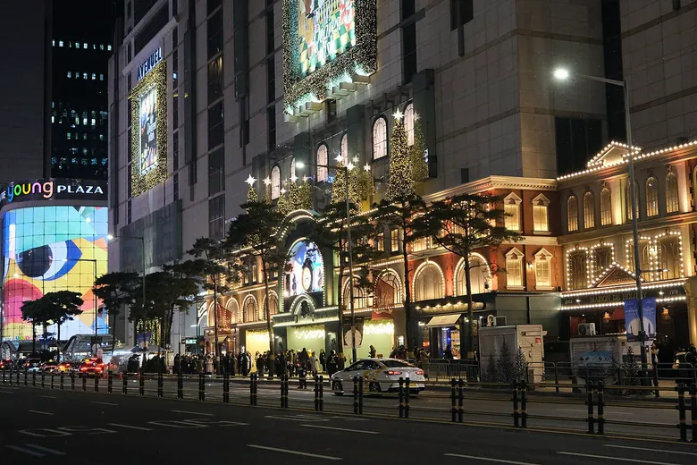
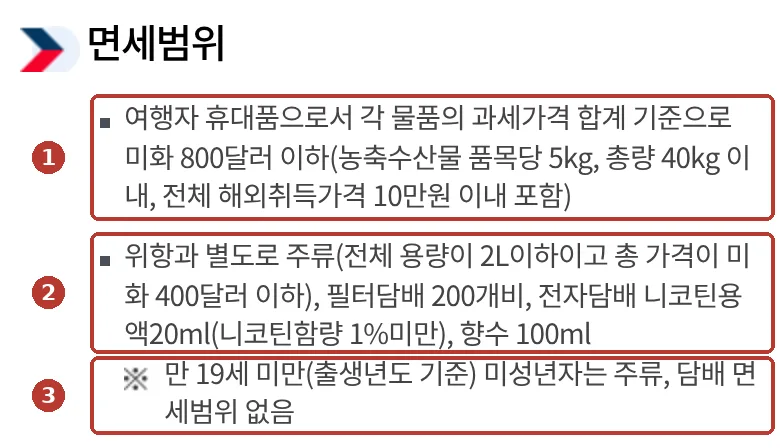

<a class="tr-btn go" href="#pickup"><i class="ic ic-map-pin" aria-hidden="true"></i>走到提貨處</a><a class="tr-btn" href="#limit"><i class="ic ic-luggage" aria-hidden="true"></i>免稅額多少?</a>

<figure class="tr-hero acc-hero"><figcaption><b>免稅品在這道門的裡面領取。</b> 仁川機場第1航廈出境大廳入口。<b>1</b> 出境大廳編號,<b>2</b> 登機門地圖。通過安檢和出境審查就是免稅區,提貨處也在裡面。照片: Sgroey(2024),<a href="https://creativecommons.org/licenses/by-sa/4.0/deed.zh_TW" rel="noopener" target="_blank">CC BY-SA 4.0</a>,<a href="https://commons.wikimedia.org/wiki/File:Incheon_airport_departure_gate_access.jpg" rel="noopener" target="_blank">維基共享資源</a>(裁切、自動調亮、加上框與編號)</figcaption></figure>

<ul class="tr-facts"><li><i class="ic ic-id-card" aria-hidden="true"></i>護照正本+航班<small>影本、照片不能買</small></li><li><i class="ic ic-clock" aria-hidden="true"></i>線上: 多半前一天19:30截止<small>依起飛時間、提貨處而不同</small></li><li><i class="ic ic-map-pin" aria-hidden="true"></i>提貨: 出境審查之後<small>入境時不能領</small></li><li><i class="ic ic-luggage" aria-hidden="true"></i>入境韓國每人800美元<small>酒2公升・400美元另計</small></li></ul>

## 在哪裡買?

三種都是一樣的免稅品。決定的只有一件事: **要買的東西有多確定**。

<ul class="tr-choose"><li><i class="ic ic-smartphone" aria-hidden="true"></i><b>已經知道要買什麼: 線上免稅店(App)</b>香水、進口化妝品、酒等已經熟悉的東西。不用去店裡,出境前一天傍晚前下單,在機場領。<a href="#online">購買步驟</a></li><li><i class="ic ic-store" aria-hidden="true"></i><b>想看實品比較: 市區免稅店</b>帶護照和航班資料去首爾的店。在市區付款,東西在機場提貨處等你。<a href="#downtown">店家與交通</a></li><li><i class="ic ic-plane" aria-hidden="true"></i><b>臨時買一點: 機場免稅店</b>過了安檢和出境審查後在店裡買,直接帶上飛機。不用找提貨處。</li></ul>

<aside class="tr-note tip"><i class="ic ic-lightbulb" aria-hidden="true"></i>如果主要買韓國保養品,比起免稅店,到<a href="/zh-tw/olive-young/">Olive Young</a>用<a href="/zh-tw/tax-refund/">結帳即時退稅</a>(訪韓旅客適用)更簡單。</aside>

<i class="ic ic-info" aria-hidden="true"></i>免稅店和退稅不一樣

付款前先弄清楚是哪一種。領東西的地方不同。

{{fig:duty-free-4|免稅店和退稅商店,領東西的地方不同}}

- **免稅店(면세점):** 只賣給出境旅客的保稅商店。市區、線上買的東西不能當場帶走,出境當天過了出境審查才領。
- **退稅(Tax Free / Tax Refund):** 一般商店(Olive Young、百貨公司)退還部分10%加值稅,很多在結帳時就扣掉。這是另一套制度,看[韓國退稅](/zh-tw/tax-refund/)。

同一筆購買只能用其中一種。

<h2 id="online">在線上免稅店買</h2>

{{fig:duty-free-1|從下單到出境當天提貨}}

這是現代免稅店說明的步驟,其他免稅店也一樣。

<h3 class="tr-step">1<i class="ic ic-log-in" aria-hidden="true"></i>打開免稅店網站或App</h3>

確定要出境的人,不分韓國人或外國人都能買。會員、非會員都能買,會員有額外折扣。出境日90天前開始可以下單。

<ul class="tr-next"><li><a href="https://en.hddfs.com/" rel="noopener" target="_blank"><i class="ic ic-globe" aria-hidden="true"></i>現代免稅店線上(英文)<i class="ic ic-external-link" aria-hidden="true"></i></a></li><li><a href="https://www.shilladfs.com/estore/kr/en/" rel="noopener" target="_blank"><i class="ic ic-globe" aria-hidden="true"></i>新羅免稅店線上(英文)<i class="ic ic-external-link" aria-hidden="true"></i></a></li></ul>

樂天、新世界的網站可從Visit Seoul店家介紹的「View Website」打開([樂天](https://english.visitseoul.net/shopping/Lotte-Duty-Free-Shop-Main-Store/ENP009641)、[新世界](https://english.visitseoul.net/area/Shinsegae-Duty-Free-en/ENP024463))。

<h3 class="tr-step">2<i class="ic ic-shopping-basket" aria-hidden="true"></i>把商品放進購物車</h3>

依商品或品牌搜尋,選數量和選項,放進購物車。

<h3 class="tr-step">3<i class="ic ic-id-card" aria-hidden="true"></i>輸入出境資料並付款</h3>

1. **護照號碼和英文姓名**: 跟你實際帶的護照完全一樣。不一致的話在機場領不到。
2. **出境日、機場、航班號碼、起飛時間**: 照機票(e-ticket)填。
3. **付款**: 以付款當天匯率換算韓元。現代接受信用卡、銀行轉帳、Kakao Pay・Naver Pay・Toss Pay、Alipay+・微信支付・銀聯等。

<aside class="tr-note"><i class="ic ic-triangle-alert" aria-hidden="true"></i><b>在截止前下單。</b> 一般是出境前一天傍晚,但午夜剛過就起飛的班機,截止是前一天14:30。看下面的表。</aside>

<h3 class="tr-step">4<i class="ic ic-ticket" aria-hidden="true"></i>保存兌換券</h3>

付款後從訂單紀錄列印兌換券。不能列印的話,記下兌換券號碼或用簡訊(SMS)收,在機場跟護照、機票一起出示。**確認兌換券上寫的提貨處名稱**(例如 T1 西側),那是出境當天要去的地方。

<i class="ic ic-clock" aria-hidden="true"></i>訂購截止時間表(現代免稅店,仁川)

依免稅店、提貨處和起飛時間而不同。現代免稅店目前公布的仁川第1航廈西側提貨處:

| 起飛時間 | 訂購截止 |
|---|---|
| 00:00〜02:59 | 前一天14:30 |
| 03:00〜16:59 | 前一天19:30 |
| 17:00〜19:59 | 當天11:30 |
| 20:00〜23:59 | 當天14:30 |

第1航廈搭乘棟和第2航廈的提貨處,區間各晚1小時(03:00〜17:59、18:00〜20:59、21:00〜23:59)。登錄航班後會顯示實際截止時間。起飛時間很近的話,現代請你聯絡客服。

<h2 id="downtown">在市區免稅店買</h2>

<figure class="tr-photo"><figcaption><b>樂天免稅店總店(明洞)</b>,在樂天百貨9〜12樓。照片: Leeinm(2023),<a href="https://creativecommons.org/licenses/by/4.0/deed.zh_TW" rel="noopener" target="_blank">CC BY 4.0</a>,<a href="https://commons.wikimedia.org/wiki/File:Night_view_of_Lotte_Duty_Free_Shop.jpg" rel="noopener" target="_blank">維基共享資源</a>(縮小、自動調亮)</figcaption></figure>

<h3 class="tr-step">1<i class="ic ic-id-card" aria-hidden="true"></i>帶護照正本和機票</h3>

需要看得到出境日期、時間和航班號碼的機票(e-ticket,手機畫面也可以)。護照影本或照片不能買。

<h3 class="tr-step">2<i class="ic ic-map-pin" aria-hidden="true"></i>去店裡</h3>

<ul class="tr-choose"><li><i class="ic ic-store" aria-hidden="true"></i><b>樂天免稅店總店(明洞)</b>樂天百貨9〜12樓。2號線乙支路入口站7・8號出口50公尺。每天09:30〜20:00。</li><li><i class="ic ic-store" aria-hidden="true"></i><b>新世界免稅店明洞店</b>新世界百貨總店8〜12樓。4號線會賢站5號出口145公尺。週一〜四10:30〜20:00,週五〜日10:30〜20:30。</li><li><i class="ic ic-store" aria-hidden="true"></i><b>新羅免稅店首爾店</b>新羅飯店旁。3號線東大入口站5號出口278公尺。每天09:00〜20:00。有連接首爾主要購物區的免費接駁車。</li><li><i class="ic ic-store" aria-hidden="true"></i><b>現代免稅店貿易中心店</b>週一〜四10:30〜20:00,週五〜日10:30〜20:30。</li></ul>

怎麼找出口看[首爾地鐵](/zh-tw/seoul-subway/)。營業時間會變,出發前用上面的連結再確認。

<h3 class="tr-step">3<i class="ic ic-credit-card" aria-hidden="true"></i>選好後,在收銀台出示護照和機票</h3>

付款後東西留在店裡,出境當天在機場提貨處領。確認收據或兌換券上寫的提貨處。

<aside class="tr-note ok"><i class="ic ic-circle-check" aria-hidden="true"></i><b>韓國商品有時可以當場帶走。</b> 現代免稅店說明,外國人從出境日60天前起,可以在店裡買韓國商品當場領取。2026年7月起,外國旅客在線上免稅店買的K-beauty、K-food商品也能到市區免稅店領(世界日報報導)。</aside>

<h2 id="pickup">出境當天: 走到提貨處</h2>

不論在哪裡買,都**只能在出境區內的提貨處**領。提貨處在安檢和出境審查之後,入境時不能領。提前3小時到機場就很從容([出境當天](/zh-tw/departure-day/))。現代說提貨處可能很擠,請**至少在起飛前1小時**到。

<h3 class="tr-step">1<i class="ic ic-ticket" aria-hidden="true"></i>看兌換券上的提貨處名稱</h3>

{{fig:duty-free-2|仁川機場的4個提貨處}}

<h3 class="tr-step">2<i class="ic ic-door-open" aria-hidden="true"></i>報到後進入出境區</h3>

在航空公司櫃台報到、託運行李後,像上面照片一樣,從寫著「出境大廳 Departure Hall」和編號的入口進去,接受安檢和出境審查。機場的步驟在[出境當天](/zh-tw/departure-day/)。

<h3 class="tr-step">3<i class="ic ic-signpost" aria-hidden="true"></i>跟著登機門號碼指標走到提貨處</h3>

{{fig:duty-free-t1map|第1航廈: 從出境審查後的3樓免稅區到4樓提貨處(43號登機門對面)。依現代・新羅免稅店提貨說明與仁川國際機場設施資料(2026年11月26日確認)的位置,由Nadri重新繪製}}

<ul class="tr-choose"><li><i class="ic ic-map-pin" aria-hidden="true"></i><b>第1航廈西側(4樓)</b>過了出境審查是3樓免稅區。往登機門號碼變大的方向(西側)走。途中29號登機門附近有<strong>24小時服務台</strong>和韓國傳統文化中心西館。走到43號登機門,<strong>對面的樓上(4樓)</strong>就是提貨處。4樓43號登機門附近有Matina貴賓室(西側)。04:00到最後一班飛機,☎ +82-32-743-2711。</li><li><i class="ic ic-train-front" aria-hidden="true"></i><b>第1航廈搭乘棟(4樓)</b>登機門是101〜132號的話,搭接駁列車到搭乘棟。下車後搭<strong>119號登機門旁的電扶梯</strong>上4樓就是提貨處。03:00起,☎ +82-32-743-2715。</li><li><i class="ic ic-map-pin" aria-hidden="true"></i><b>第2航廈西側(2樓)</b>225號登機門附近,韓國傳統文化中心(西館)對面的電扶梯下到2樓。05:00起,☎ +82-32-743-6503。</li><li><i class="ic ic-map-pin" aria-hidden="true"></i><b>第2航廈東側(2樓)</b>往274號登機門方向,韓國傳統文化中心(東館)對面的電扶梯下到樓下(2樓)。05:00起。</li></ul>

<i class="ic ic-map" aria-hidden="true"></i>第2航廈的圖

{{fig:duty-free-t2map|第2航廈: 從3樓免稅區下到2樓提貨處。依現代・新羅免稅店提貨說明,由Nadri重新繪製}}

營業時間和電話依新羅免稅店提貨說明(都開到最後一班飛機出發)。

<i class="ic ic-plane" aria-hidden="true"></i>從其他機場出境(金浦、金海、濟州、清州、大邱)

順序一樣: 過了出境審查就有提貨處。位置看兌換券上的提貨處名稱(現代・新羅說明)。

- **金浦:** 34號登機門對面的電扶梯或電梯上4樓。☎ +82-2-2666-2730
- **金海:** 2樓出境審查後,13號登機門對面。☎ +82-51-941-9356
- **濟州:** 過3樓出境審查後左邊,19、20號登機門對面。☎ +82-64-747-0163
- **清州:** 過出境審查台後正前方(2樓)。☎ +82-43-212-8270
- **大邱:** 2樓出境審查台左邊。☎ +82-53-981-8277

<aside class="tr-note tip"><i class="ic ic-circle-help" aria-hidden="true"></i>迷路的話,到免稅區服務台(第1航廈3樓25號、29號登機門附近,24小時)出示兌換券。</aside>

<h3 class="tr-step">4<i class="ic ic-scan-line" aria-hidden="true"></i>交出兌換券、護照、登機證,確認後簽名</h3>

1. 購買者本人出示兌換券、護照、登機證。
2. 確認品名、數量和商品狀態後在簽收欄簽名。有問題當場告訴人員,出境後的商品免稅店不負責。
3. 液體類會裝在密封袋裡交給你。到最終目的地前不要打開([下面](#liquids))。

<aside class="tr-note ok"><i class="ic ic-circle-check" aria-hidden="true"></i>這樣就完成了。買的東西在入境國家的免稅額內,到了也沒有要申報的。</aside>

<i class="ic ic-triangle-alert" aria-hidden="true"></i>領不到的情況和該怎麼辦

- **領不到的情況:** 下單的人和出境的人不同;訂單上的護照號碼和出示的護照號碼不同;登錄的出境資料(機場、日期時間、航班)和實際不同。
- **提早修正:** 新羅請你至少在出境3天前聯絡客服修改護照號碼。
- **沒領到的話:** 聯絡免稅店。現代可以在下單日起180天內變更出境資料,超過就要取消重買。現代客服1811-6688(09:30〜18:30,韓語),英語提貨洽詢+82-2-2163-6215(每天10:00〜19:00)。樂天+82-1688-3000、新羅+82-1688-1110、新世界+82-2-1661-8778(依Visit Seoul店家介紹)。
- 免稅品不會寄到住家地址。

<h2 id="limit">可以買多少?</h2>

離開韓國時在免稅店購物**沒有上限**。現代免稅店說明,要出境的顧客不分本國人或外國人都可以無限額購買。真正有關的是**下一個入境國家的免稅額**,免稅店買的東西也算在裡面。

### 入境韓國時(關稅廳)

<figure class="tr-photo"><figcaption><b>1</b> 物品合計800美元以下,<b>2</b> 另外酒2公升・400美元以下、捲菸200支、電子菸尼古丁液20ml、香水100ml,<b>3</b> 未滿19歲沒有酒、菸免稅。畫面: 韓國關稅廳<a href="https://www.customs.go.kr/kcs/cm/cntnts/cntntsView.do?mi=2837&amp;cntntsId=829" rel="noopener" target="_blank">旅客攜帶品通關</a>(韓文),2026年11月26日擷取(只裁切一部分,加上框與編號)</figcaption></figure>

| | 免稅範圍(每人) |
|---|---|
| 物品 | **800美元**以下。農畜水產品每項5公斤、合計40公斤、海外取得價格合計10萬韓元以內,包含在這裡面 |
| 酒 | 另計合計**2公升以下、400美元以下** |
| 菸 | 另計捲菸**200支**、電子菸尼古丁液20ml |
| 香水 | 另計**100ml** |

<ul class="tr-choose"><li><i class="ic ic-circle-check" aria-hidden="true"></i><b>沒有要申報的</b>不用交申報單,走「無申報」通道。有時仍會接受海關檢查。</li><li><i class="ic ic-pencil" aria-hidden="true"></i><b>超過免稅額時</b>領行李後、出海關前,用紙本或手機提交申報單(<a href="https://www.customs.go.kr/kcs/cm/cntnts/cntntsView.do?mi=2837&amp;cntntsId=829" rel="noopener" target="_blank">關稅廳說明</a>,韓文)。用手機自行申報,繳稅通知和繳費也能在手機完成。自行申報可減免30%關稅;沒申報被查到,要多付應繳稅額的40%(2年內2次以上為60%)作為加算稅。</li></ul>

2026年7月起,免稅範圍內的物品回國後,限同型號換顏色、尺寸,可以用郵寄、宅配換貨(世界日報報導)。

### 入境其他國家時

以那個國家的海關規定為上限。常被問到的三個:

<i class="ic ic-globe" aria-hidden="true"></i>日本、台灣、美國的免稅範圍

| 國家 | 物品 | 酒 | 菸等 |
|---|---|---|---|
| 日本 | 海外市價合計**20萬日圓**。單件超過20萬日圓全額課稅。同一品項合計1萬日圓以下原則上免稅 | **3瓶**(每瓶760ml) | 只有捲菸200支、只有加熱菸10包、只有雪茄50支。香水另計2盎司(1盎司約28ml,不含古龍水、淡香水) |
| 台灣 | 完稅價格合計**NT$35,000**。明顯營利者、經常出入境(30天內2次以上或6個月內6次以上)且有違規紀錄者不適用 | 關務署旅客須知寫1公升(年滿20歲);2026年2月1日施行的修正規定寫1.5公升、年滿18歲,兩者不一致。建議以較嚴的1公升準備,出發前再確認 | 捲菸200支或雪茄25支或菸絲1磅(年滿20歲) |
| 美國 | **800美元**(出國48小時以上,31天內未使用) | **1公升**(年滿21歲,自用) | 捲菸200支和雪茄100支(年滿21歲) |

- 日本未滿20歲沒有酒、菸免稅。
- 美國海關寫明,在免稅店買的東西回國時不會自動免稅;各州的酒類規定可能更嚴。

<h2 id="liquids">酒和液體</h2>

{{fig:duty-free-5|免稅密封袋,什麼時候不能打開}}

- **直飛:** 裝在免稅店共用的透明密封袋(貼有收據)裡,不論容量、數量都可以帶上機。市區、線上買的酒也是過了安檢才領,所以在韓國登機時不受液體限制。
- **到最終目的地前不要打開。** 在那之前打開或破損就不能帶上機。
- **要轉機:** 可能依轉機國家的安檢規定被沒收。經美國轉機時,不透明或金屬容器的液體受限制;轉機後的目的地是美國屬地、澳洲屬地、加拿大、維京群島的話,不能買液體類。請先問航空公司。詳見[出境當天](/zh-tw/departure-day/)。

## 常見錯誤

<ul class="tr-oops"><li><i class="ic ic-triangle-alert" aria-hidden="true"></i>護照號碼或航班輸入錯誤。在提貨處領不到。</li><li><i class="ic ic-triangle-alert" aria-hidden="true"></i>午夜剛過就起飛,卻在前一天傍晚才下單。截止是前一天14:30。</li><li><i class="ic ic-triangle-alert" aria-hidden="true"></i>登機前才找提貨處。至少提前1小時去。</li><li><i class="ic ic-triangle-alert" aria-hidden="true"></i>到轉機機場前就打開密封袋。</li><li><i class="ic ic-triangle-alert" aria-hidden="true"></i>以為「在免稅店買的,回國也免稅」。要算進入境國家的免稅額。</li></ul>

<i class="ic ic-list-checks" aria-hidden="true"></i>一句話判斷,用表格看

| 情況 | 怎麼做 | 理由 |
|---|---|---|
| 要買的東西已確定(香水、進口化妝品、酒) | 前一天前用線上或App下單,在機場提貨處領 | 一樣的東西,不用跑店。過了出境審查後領 |
| 想試用比較 | 帶護照和航班資料去市區免稅店 | 在市區付款,東西在機場等 |
| 臨時買一點 | 安檢後在機場免稅店 | 不用找提貨處。仁川的化妝品、酒、菸主要區域從2026年起由樂天和現代經營 |

省略: 各品牌價格比較、會員等級技巧,因為價格每天變。

<i class="ic ic-store" aria-hidden="true"></i>2026年的免稅店版圖

- **仁川機場:** 新羅、新世界在業績不佳下交回以化妝品、香水、酒、菸為主的核心區(DF1、DF2),2026年由樂天(DF1)和現代(DF2)接手,合約到2033年6月。新世界繼續經營DF4,新羅、新世界也繼續經營時尚、精品區。
- **市區:** 四家在首爾都有店。2026年6月的報導指出,現代縮減東大門店、貿易中心店,新羅、新世界則加強市區店和線上。出發前確認營業時間。
- **特賣:** 新羅免稅店的黑色星期五,附結束日期和出處放在[特價看板](/zh-tw/deals/)。

<i class="ic ic-calendar-check" aria-hidden="true"></i>免稅購物的出境日,從頭到尾

先下單的話,旅程最後是這樣: 報到,過安檢和出境審查,走到兌換券上寫的提貨處。出示護照和登機證,確認品名和數量後簽名。液體類裝在密封袋裡,到家前都不要動。我們建議把最後一幕定在抵達當天的海關前: 買的東西在免稅額內,沒有要申報的那一刻。

<i class="ic ic-info" aria-hidden="true"></i>出處

2026年11月26日確認: 現代免稅店<a href="https://www.hddfs.com/shop/om/consmGuide/useNotice.do" rel="noopener" target="_blank">使用說明</a>(各提貨處的訂購截止、出境時購買無上限、90天前可下單、護照正本・e-ticket)、<a href="https://www.hddfs.com/shop/om/consmCont/bcaInfo.do" rel="noopener" target="_blank">提貨處與領取說明</a>(位置、要帶的東西、至少1小時前、領不到的情況、180天變更、客服)、<a href="https://www.hddfs.com/shop/om/consmCont/shopProc.do" rel="noopener" target="_blank">購物步驟</a>(會員・非會員、付款方式、兌換券)、<a href="https://www.hddfs.com/shop/om/consmCont/cariProhInfo.do" rel="noopener" target="_blank">登機攜帶限制</a>(密封袋、轉機限制)、<a href="https://www.hddfs.com/store/en/dm/stShop/shoppingGuide.do" rel="noopener" target="_blank">英文購物指南</a>(貿易中心店營業時間、外國人60天前起店內領取韓國商品、英語洽詢電話); 新羅免稅店<a href="https://www.shilladfs.com/estore/kr/en/shilladfscustomercenter/deliverypointinfo" rel="noopener" target="_blank">提貨說明</a>(各提貨處營業時間・電話、金浦・金海・濟州・清州・大邱提貨處、仁川4個提貨處、119號登機門旁電扶梯、護照號碼修改需3天前、入境時不能領); 仁川國際機場<a href="https://www.airport.kr/ap_ko/1008/subview.do" rel="noopener" target="_blank">設施資料</a>(韓文。第1航廈3樓免稅區25、29號登機門附近24小時服務台、中央28號登機門、韓國傳統文化中心西館、4樓43號登機門附近Matina貴賓室(西側)); Visit Seoul<a href="https://english.visitseoul.net/shopping/Lotte-Duty-Free-Shop-Main-Store/ENP009641" rel="noopener" target="_blank">樂天免稅店總店</a>(2026年11月23日更新)、<a href="https://english.visitseoul.net/area/Shinsegae-Duty-Free-en/ENP024463" rel="noopener" target="_blank">新世界免稅店</a>(11月25日更新)、<a href="https://english.visitseoul.net/area/Shilla-Duty-Free-Shop/ENP000521" rel="noopener" target="_blank">新羅免稅店</a>(8月6日更新); 韓國關稅廳<a href="https://www.customs.go.kr/kcs/cm/cntnts/cntntsView.do?mi=2837&amp;cntntsId=829" rel="noopener" target="_blank">旅客攜帶品通關</a>(免稅範圍、申報流程、自行申報減免與加算稅); 日本海關<a href="https://www.customs.go.jp/kaigairyoko/menzei.htm" rel="noopener" target="_blank">海外旅客免稅範圍</a>; 韓國時報・韓聯社<a href="https://www.koreatimes.co.kr/business/companies/20260226/lotte-hyundai-win-approval-to-operate-new-duty-free-zones-at-incheon-airport" rel="noopener" target="_blank">樂天、現代獲准經營仁川機場免稅區</a>、韓國先驅報<a href="https://www.koreaherald.com/article/10683421" rel="noopener" target="_blank">同一報導</a>(2026年2月26日)。今天無法打開: 樂天、新世界免稅店網站(連線被擋)、美國CBP(拒絕查核工具;11月25日確認: Customs Duty Information 2024年5月14日修訂、19 CFR 148.33)、財政部關務署《入境旅客攜帶行李物品報驗稅放辦法》第11條(2026年1月30日修正、2月1日施行;連線被擋,11月25日確認)。媒體(11月25日確認): 紐西斯(開幕日,2026年4月8日);The Fact(2026年6月10日);BizWatch(2026年11月18日);世界日報(線上免稅品市區店領取、回國後換貨,2026年7月1日);TaxWatch(旅客免稅範圍,2026年9月1日)。

## 下一步

<ul class="tr-next"><li><a href="/zh-tw/departure-day/"><i class="ic ic-plane" aria-hidden="true"></i>出境當天: 機場步驟<i class="ic ic-arrow-right" aria-hidden="true"></i></a></li><li><a href="/zh-tw/tax-refund/"><i class="ic ic-receipt" aria-hidden="true"></i>退稅: 一般商店退加值稅<i class="ic ic-arrow-right" aria-hidden="true"></i></a></li><li><a href="/zh-tw/olive-young/"><i class="ic ic-shopping-basket" aria-hidden="true"></i>Olive Young: 特賣時期和基本款<i class="ic ic-arrow-right" aria-hidden="true"></i></a></li></ul>
