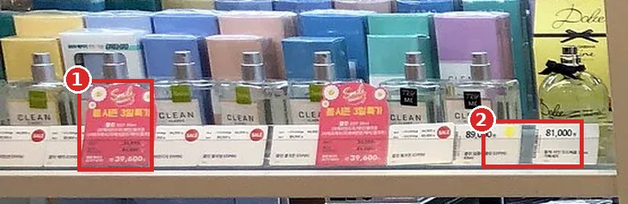

<a class="tr-btn go" href="#label"><i class="ic ic-scan-line" aria-hidden="true"></i>30 秒看懂標籤</a><a class="tr-btn" href="#sun"><i class="ic ic-sun" aria-hidden="true"></i>防曬數字怎麼選</a>

<figure class="tr-hero acc-hero"><figcaption><b>重點是兩個數字。</b> <b>1</b> SPF 擋紫外線 B,<b>2</b> PA 擋紫外線 A。韓國產品也是同樣寫法。照片:Yiting,<a href="https://creativecommons.org/licenses/by-sa/4.0/deed.zh_TW" rel="noopener" target="_blank">CC BY-SA 4.0</a>,<a href="https://commons.wikimedia.org/wiki/File:Japanese_sunscreen.jpg" rel="noopener" target="_blank">維基共享資源</a>(裁切、加上框與編號。是日本產品,並非推薦)</figcaption></figure>

<ul class="tr-facts"><li><i class="ic ic-shield-check" aria-hidden="true"></i>기능성화장품<small>「機能性化妝品」:美白・抗皺・防曬要有這個標示</small></li><li><i class="ic ic-sun" aria-hidden="true"></i>SPF・PA<small>依行程選,不必選最高</small></li><li><i class="ic ic-list-checks" aria-hidden="true"></i>전성분<small>全成分:對香料敏感就看名稱</small></li><li><i class="ic ic-luggage" aria-hidden="true"></i>登機 100mL<small>每個容器,1L 夾鏈袋一個</small></li></ul>

<h2 id="label">30 秒看懂標籤:盒子背面四個地方</h2>

韓國法律規定,化妝品盒上要用韓文寫同樣的項目(可以加註外文)。學一次,在 Olive Young、大創、便利商店都能用同樣方法看。

{{fig:kbeauty-how-to-choose-1|盒子背面要看的地方(示意圖,非真實品牌)}}

<h3 class="tr-step">1<i class="ic ic-shield-check" aria-hidden="true"></i>找「기능성화장품」字樣或圖案</h3>

美白(미백)、抗皺(주름개선)、防曬(자외선 차단)產品一定要有這個標示,代表經過韓國食品醫藥品安全處(食藥處)審查或已申報。旁邊會有一行**효능・효과**(功效),寫著審查過的功能(美白、抗皺、防曬等)。

<aside class="tr-note"><i class="ic ic-triangle-alert" aria-hidden="true"></i>沒有這個標示,正面卻大大寫著「美白」「抗皺」,那是廣告,不是審查過的功能。</aside>

<h3 class="tr-step">2<i class="ic ic-sun" aria-hidden="true"></i>防曬就看 SPF 和 PA</h3>

SPF 是數字(50 以上一律寫 **SPF50+**),PA 是 + 的數量(PA+ 到 PA++++)。要選哪個,看下面的[防曬數字怎麼選](#sun)。

<h3 class="tr-step">3<i class="ic ic-list-checks" aria-hidden="true"></i>對香料敏感,就看「전성분」那一行</h3>

「전성분」後面列出全部成分。看有沒有「향료」(香料),以及下面的[致敏成分名稱](#scent)。不敏感可以跳過。

<h3 class="tr-step">4<i class="ic ic-calendar-check" aria-hidden="true"></i>確認使用期限</h3>

一定會有 **사용기한**(用到這天),或 **개봉 후 사용기간**(開封後幾個月)加上製造日期,兩者之一。一次買好幾組特價組合時特別要看。

<i class="ic ic-info" aria-hidden="true"></i>盒上一定有的資訊,小樣為什麼不一樣

依《化妝品法》第 10 條,外盒要寫:產品名稱、公司名稱與地址、全成分、容量、製造批號、使用期限或開封後使用期間、價格、機能性化妝品要有「기능성화장품」字樣或圖案以及審查・申報的功效與用法、使用注意事項。

**10mL・10g 以下的小容量和試用品**可以只寫名稱、公司、價格、製造批號、使用期限。省略的成分要能透過包裝上的電話・網站,或店內放置的手冊查到。一定要看全成分的話,就看大容量的盒子。

**出發前想先查:** 到食藥處的[醫藥品安全國度](https://nedrug.mfds.go.kr),依序點 의약품 등 정보 → 의약품 및 화장품 품목정보 → 기능성화장품제품정보(심사 或 보고)搜尋產品(韓文網站)。

<h2 id="sun">防曬數字怎麼選</h2>

最高的數字不一定對。食藥處建議依一天的行程挑選。

<ul class="tr-choose"><li><i class="ic ic-store" aria-hidden="true"></i><b>室內、短時間散步:SPF15 / PA+ 以上</b>市區觀光、逛街、咖啡廳為主的日子。</li><li><i class="ic ic-sun" aria-hidden="true"></i><b>運動等長時間曬太陽:SPF50+ / PA+++ 或 PA++++</b>登山、海邊、整天在戶外。</li><li><i class="ic ic-droplets" aria-hidden="true"></i><b>玩水:找「내수성」「지속내수성」(防水)標示</b>還是要每 1~2 小時補擦。</li></ul>

{{fig:kbeauty-how-to-choose-3|SPF 擋紫外線 B,PA 擋紫外線 A。依一天的行程挑選}}

- SPF 寫整數,50 以上都寫 **SPF50+**。超過 50 的數字不另外標(食藥處告示)。
- PA 分 PA+、PA++、PA+++、PA++++,+ 越多越能擋紫外線 A。
- 擦法:出門前 15 分鐘擦足量,流很多汗就補擦。

12 月逛古宮和盛夏的海雲台是不同的購物。照實際行程買就好。

<h2 id="scent">對香料敏感的話</h2>

香味可以只寫「향료」一個詞,但可能引起過敏的 25 種香料成分超過一定量就要另外寫出名稱(沖洗型產品超過 0.01%,免沖洗產品超過 0.001%)。全成分中常見的名稱:

<ul class="tr-choose"><li><i class="ic ic-list-checks" aria-hidden="true"></i><b>리모넨 檸檬烯・리날룰 芳樟醇・시트로넬올 香茅醇・제라니올 香葉醇</b>유제놀 丁香酚・벤질알코올 苯甲醇・시트랄 檸檬醛・쿠마린 香豆素也在同一份清單。</li></ul>

<i class="ic ic-list-checks" aria-hidden="true"></i>25 種致敏成分完整清單

아밀신남알 戊基肉桂醛、벤질알코올 苯甲醇、신나밀알코올 肉桂醇、시트랄 檸檬醛、유제놀 丁香酚、하이드록시시트로넬알 羥基香茅醛、아이소유제놀 異丁香酚、아밀신나밀알코올 戊基肉桂醇、벤질살리실레이트 水楊酸苄酯、신남알 肉桂醛、쿠마린 香豆素、제라니올 香葉醇、아니스알코올 茴香醇、벤질신나메이트 肉桂酸苄酯、파네솔 金合歡醇、부틸페닐메틸프로피오날 丁苯基甲基丙醛、리날룰 芳樟醇、벤질벤조에이트 苯甲酸苄酯、시트로넬올 香茅醇、헥실신남알 己基肉桂醛、리모넨 檸檬烯、메틸 2-옥티노에이트 2-辛炔酸甲酯、알파-아이소메틸아이오논 α-異甲基紫羅蘭酮、참나무이끼추출물 橡苔萃取物、나무이끼추출물 樹苔萃取物。

<aside class="tr-note tip"><i class="ic ic-info" aria-hidden="true"></i>有皮膚疾病或正在接受治療,用新產品前先問醫師或藥師。這頁教的是看標籤,不是產品效果。怎麼找藥局、晚上哪裡有開:<a href="/zh-tw/health/">旅途中生病時</a></aside>

## 這種廣告就放回去

「세포재생」(細胞再生)、「항염」(抗發炎)、「줄기세포」(幹細胞)、「擦的肉毒」「填充效果」這類聽起來像藥品或醫美療程的字眼,用在化妝品上是違法的。食藥處 2025 年 3 月檢查 200 則網路銷售貼文,查到 144 則這類不實・誇大廣告;2024 年 8 月檢查 100 則標榜微針的貼文,查到「肌膚再生」、號稱能到達真皮層等 82 則違規。

## 在哪買、怎麼結帳

<ul class="tr-choose"><li><i class="ic ic-shopping-basket" aria-hidden="true"></i><b>正裝・特價:Olive Young</b>一年四次大特價。什麼時候去、店內價格標籤怎麼看:<a href="/zh-tw/olive-young/">Olive Young 頁面</a></li><li><i class="ic ic-coins" aria-hidden="true"></i><b>便宜的小容量試用:大創</b>全部商品 5,000 韓元以下,大創專屬系列很多:<a href="/zh-tw/daiso/">大創頁面</a></li><li><i class="ic ic-id-card" aria-hidden="true"></i><b>結帳時:符合退稅資格就帶護照正本</b>同一家店一張收據滿 15,000 韓元,結帳時直接扣稅:<a href="/zh-tw/tax-refund/">退稅怎麼辦</a></li></ul>

<figure class="tr-photo"><figcaption>價格標籤就在商品正下方的貨架上。<b>1</b> 粉紅特價標籤,<b>2</b> 一般標籤。只比較通過標籤檢查的產品價格。照片:崔光模(Olive Young 原州丹邱店,2020 年),<a href="https://creativecommons.org/publicdomain/zero/1.0/deed.zh_TW" rel="noopener" target="_blank">CC0</a>,<a href="https://commons.wikimedia.org/wiki/File:2020-04-17_22.18.09_%EC%98%AC%EB%A6%AC%EB%B8%8C%EC%98%81_%EC%9B%90%EC%A3%BC%EB%8B%A8%EA%B5%AC%EC%A0%90.jpg" rel="noopener" target="_blank">維基共享資源</a>(裁切、加上框與編號)</figcaption></figure>

**排行榜和試用品只當起點。** 排行榜是賣得好的產品,不是適合你的產品(我們找不到 Olive Young 排行方式的官方說明)。

1. 從排行榜挑 2~3 個想要的種類。
2. 逐一做上面的四個標籤檢查。
3. 有試用品的話,買正品前先試質地和香味。
4. 就算排名低,也選通過標籤檢查、符合行程的那個。

## 帶回家:登機與托運

化妝水、凝膠、噴霧、防曬都算液體。結帳前先決定放哪個包。

{{fig:kbeauty-how-to-choose-4|登機行李和托運行李各放什麼(仁川機場規定)}}

1. **登機行李:** 每個容器 100mL 以下,每人一個 1L 透明夾鏈袋(仁川機場國際線)。
2. **大容量:** 放托運行李。不可燃噴霧每個容器 500mL、合計 2L 以內。
3. **免稅店買的液體:** 免稅液體袋保持密封,搭上前往最終目的地的班機前不要打開。在國外機場轉機,規定可能不同。

出發前也要確認航空公司規定。出國當天什麼放哪個包,整理在[出國當天](/zh-tw/departure-day/)。

## 常見失誤

<ul class="tr-oops"><li><i class="ic ic-triangle-alert" aria-hidden="true"></i>只看正面的「美白」「光澤」就買。看背面有沒有「기능성화장품」。</li><li><i class="ic ic-triangle-alert" aria-hidden="true"></i>城市旅行硬找最高的 SPF。符合行程就夠了。</li><li><i class="ic ic-triangle-alert" aria-hidden="true"></i>把超過 100mL 的化妝水放登機行李。安檢時得丟掉。</li><li><i class="ic ic-triangle-alert" aria-hidden="true"></i>相信「擦的肉毒」這類廣告。化妝品用這種說法是違法的。</li></ul>

<i class="ic ic-list-checks" aria-hidden="true"></i>一句話判斷,表格版

| 情況 | 這樣做 | 理由 |
|---|---|---|
| 買防曬 | 選符合行程的 SPF・PA,不必最高 | 食藥處說室內・短時間戶外用 SPF15/PA+ 以上就夠 |
| 買美白・抗皺產品 | 盒上有**기능성화장품**和該功能才買 | 是食藥處審查或已申報的功能;正面的「光澤」不是 |
| 皮膚對香料敏感 | 在全成分找「향료」和致敏成分名稱 | 超過一定量必須另外寫出名稱 |
| 廣告寫「細胞再生」「抗發炎」「擦的肉毒」 | 放回去 | 食藥處說這些用在化妝品上是違法的 |

<i class="ic ic-pencil" aria-hidden="true"></i>出發前:每個人寫一行,買禮物的話

清單是出發前在家就能享受的部分。替每個要買的人寫一行,也包括自己。

1. **想要什麼:** 防曬、美白・抗皺,還是避開香料。決定要看哪個標籤。
2. **那個人的一天:** 城市散步,還是長時間曬太陽。那就是要找的 SPF・PA。
3. **何時、何地:** 特價時間看 [Olive Young 頁面](/zh-tw/olive-young/),便宜小容量看[大創](/zh-tw/daiso/),選區域看[明洞・聖水・弘大怎麼選](/zh-tw/shopping-streets/),現在的特價看[優惠看板](/zh-tw/deals/)。

{{fig:kbeauty-how-to-choose-2|依目的挑選:每個目標要看的標籤}}

**買禮物的話**,依對方的一天和膚質挑,不是依自己的。不確定對方是否對香料敏感,就在全成分找「향료」和另外列出的致敏成分,並挑適合行李的容量。

**不要只因為流行就買:** 像治療一樣賣的產品、承諾醫美效果的產品、剛爆紅的第四瓶防曬。

<i class="ic ic-info" aria-hidden="true"></i>沒寫的內容與資料來源

沒寫:產品名稱和「推薦排行」(我們沒有親自用過確認)、膚質測驗、醫美療程。

2026 年 11 月 26 日開啟確認:<a href="https://www.law.go.kr/%EB%B2%95%EB%A0%B9/%ED%99%94%EC%9E%A5%ED%92%88%EB%B2%95" rel="noopener" target="_blank">化妝品法</a>第 2、4、10 條(國家法令資訊中心,2026 年 10 月 20 日施行);<a href="https://www.law.go.kr/%EB%B2%95%EB%A0%B9/%ED%99%94%EC%9E%A5%ED%92%88%EB%B2%95%EC%8B%9C%ED%96%89%EA%B7%9C%EC%B9%99" rel="noopener" target="_blank">化妝品法施行規則</a>第 19 條(小容量、省略成分的查詢方式、機能性功效標示)・第 21 條(韓文標示)(2026 年 11 月 26 日施行);食藥處告示<a href="https://www.law.go.kr/%ED%96%89%EC%A0%95%EA%B7%9C%EC%B9%99/%ED%99%94%EC%9E%A5%ED%92%88%EC%82%AC%EC%9A%A9%ED%95%A0%EB%95%8C%EC%9D%98%EC%A3%BC%EC%9D%98%EC%82%AC%ED%95%AD%EB%B0%8F%EC%95%8C%EB%A0%88%EB%A5%B4%EA%B8%B0%EC%9C%A0%EB%B0%9C%EC%84%B1%EB%B6%84%ED%91%9C%EC%8B%9C%EC%97%90%EA%B4%80%ED%95%9C%EA%B7%9C%EC%A0%95" rel="noopener" target="_blank">使用注意事項與致敏成分標示規定</a>附表 2(第 2026-56 號:25 種成分、0.01%・0.001%);食藥處告示<a href="https://www.law.go.kr/%ED%96%89%EC%A0%95%EA%B7%9C%EC%B9%99/%EA%B8%B0%EB%8A%A5%EC%84%B1%ED%99%94%EC%9E%A5%ED%92%88%EC%8B%AC%EC%82%AC%EC%97%90%EA%B4%80%ED%95%9C%EA%B7%9C%EC%A0%95" rel="noopener" target="_blank">機能性化妝品審查規定</a>第 13 條(SPF50+);政策簡報(korea.kr)食藥處<a href="https://www.korea.kr/news/policyNewsView.do?newsId=148965990" rel="noopener" target="_blank">防曬說明</a>(2026 年 6 月 5 日:SPF・PA 意義與標示、出門前 15 分鐘、玩水每 1~2 小時、在醫藥品安全國度查詢的路徑)・<a href="https://www.korea.kr/news/policyNewsView.do?newsId=148929116" rel="noopener" target="_blank">2024 年 5 月 13 日報導</a>(室內・短時間戶外 SPF15/PA+ 以上,長時間 SPF50+/PA+++ 或 PA++++)・<a href="https://www.korea.kr/multi/mediaNewsView.do?newsId=148961262" rel="noopener" target="_blank">「確認是已申報的機能性化妝品再買」</a>(2026 年 3 月 23 日);食藥處新聞稿(korea.kr 附件原文)<a href="https://www.korea.kr/briefing/pressReleaseView.do?newsId=156678582" rel="noopener" target="_blank">2025 年 3 月 13 日</a>(200 則中 144 則)・<a href="https://www.korea.kr/briefing/pressReleaseView.do?newsId=156644929" rel="noopener" target="_blank">2024 年 8 月 8 日</a>(100 則中 82 則);仁川國際機場<a href="https://www.airport.kr/" rel="noopener" target="_blank">限制攜帶物品</a> (airport.kr: ap_en/1433/subview.do)・<a href="https://www.airport.kr/" rel="noopener" target="_blank">轉機安檢</a> (airport.kr: ap_en/1468/subview.do)。前一版把「室內 SPF15/PA+」的出處寫成 2026 年 6 月報導,已更正為 2024 年 5 月報導。

## 下一步

<ul class="tr-next"><li><a href="/zh-tw/olive-young/"><i class="ic ic-shopping-basket" aria-hidden="true"></i>Olive Young:特價時間與三樣基本款<i class="ic ic-arrow-right" aria-hidden="true"></i></a></li><li><a href="/zh-tw/daiso/"><i class="ic ic-coins" aria-hidden="true"></i>大創:5,000 韓元以下怎麼買<i class="ic ic-arrow-right" aria-hidden="true"></i></a></li><li><a href="/zh-tw/tax-refund/"><i class="ic ic-receipt" aria-hidden="true"></i>退稅:出示護照就好<i class="ic ic-arrow-right" aria-hidden="true"></i></a></li></ul>
