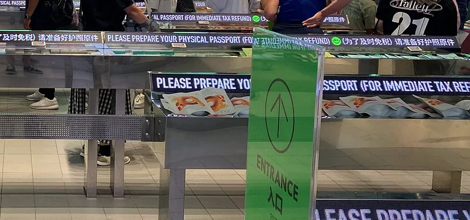
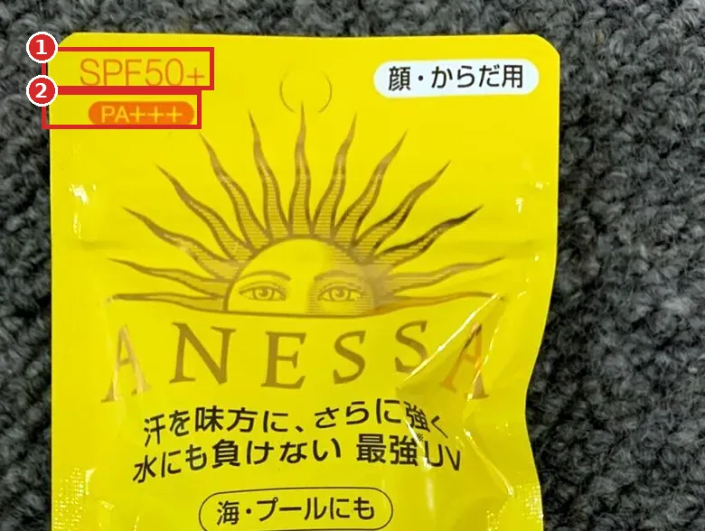

<a class="tr-btn" href="/zh-tw/deals/"><i class="ic ic-calendar-days" aria-hidden="true"></i>下次特賣</a><a class="tr-btn go" href="#買什麼-三樣基本款"><i class="ic ic-shopping-basket" aria-hidden="true"></i>買什麼</a>

<figure class="tr-hero acc-hero"><figcaption><b>Olive Young</b>,韓國最大的美妝藥妝連鎖。照片:Pkccccj,<a href="https://creativecommons.org/licenses/by-sa/4.0/deed.zh-hant" rel="noopener" target="_blank">CC BY-SA 4.0</a>,來自<a href="https://commons.wikimedia.org/wiki/File:OliveYoung_store.png" rel="noopener" target="_blank">維基共享資源</a>(自動調整亮度)</figcaption></figure>

<ul class="tr-facts"><li><i class="ic ic-calendar-check" aria-hidden="true"></i>下次特賣:12 月第一週<small>日期尚未公布,公布後更新在優惠看板</small></li><li><i class="ic ic-id-card" aria-hidden="true"></i>護照<small>符合資格就在結帳時扣稅</small></li><li><i class="ic ic-receipt" aria-hidden="true"></i>15,000 韓元以上<small>同一家店、單張收據</small></li><li><i class="ic ic-shopping-basket" aria-hidden="true"></i>三樣基本款<small>防曬、化妝水棉片、面膜</small></li></ul>

## 什麼時候去

Olive Young 的折扣分兩種,真正值得配合行程的只有一種。

{{fig:olive-young-1|Olive Young 的一年:四次大特賣,每月一次小活動}}

<ul class="tr-choose"><li><i class="ic ic-calendar-check" aria-hidden="true"></i><b>Olive Young Sale:配合這個</b>一年四次,在 3、6、9、12 月,每次約 7 天。全年折扣範圍最廣,門市與線上同步。2026 年分別在 3 月 1–7 日、5 月 31 日–6 月 6 日、8 月 30 日–9 月 5 日。12 月場在第一週,官方公布後會更新在<a href="/zh-tw/deals/">優惠看板</a>。</li><li><i class="ic ic-tag" aria-hidden="true"></i><b>Olive Young Day:碰上算賺到</b>每月 25–27 日。門市的小型折扣,額外折價券主要給韓國 App 會員。</li></ul>

<aside class="tr-note tip"><i class="ic ic-lightbulb" aria-hidden="true"></i>等待也是樂趣:把特賣週寫進行事曆,出發前先寫下三樣要買的。</aside>

## 在門市

<h3 class="tr-step">1<i class="ic ic-id-card" aria-hidden="true"></i>帶護照正本</h3>

<figure class="tr-photo"><figcaption>明洞收銀台上方的告示:「為了及時免稅,請準備好護照原件」。照片:Sgroey,<a href="https://creativecommons.org/licenses/by-sa/4.0/deed.zh-hant" rel="noopener" target="_blank">CC BY-SA 4.0</a>,來自<a href="https://commons.wikimedia.org/wiki/File:Olive_Young_Myeongdong.jpg" rel="noopener" target="_blank">維基共享資源</a>(裁切、自動調整亮度)</figcaption></figure>

店家會掃描,照片不行。結帳時唯一能改變價格的是護照,要像錢包一樣帶好。

<h3 class="tr-step">2<i class="ic ic-tag" aria-hidden="true"></i>看清楚價籤</h3>

<figure class="tr-photo"><figcaption><b>1</b> 粉紅色促銷價籤,<b>2</b> 一般價籤。價籤就在商品正下方。特賣期間到處都是 1+1(買一送一)、2+1(買二送一),確認適用的是哪一件、哪一組。照片:Choi Kwang-mo(Olive Young 原州丹邱店,2020 年),<a href="https://creativecommons.org/publicdomain/zero/1.0/deed.zh-hant" rel="noopener" target="_blank">CC0</a>,來自<a href="https://commons.wikimedia.org/wiki/File:2020-04-17_22.18.09_%EC%98%AC%EB%A6%AC%EB%B8%8C%EC%98%81_%EC%9B%90%EC%A3%BC%EB%8B%A8%EA%B5%AC%EC%A0%90.jpg" rel="noopener" target="_blank">維基共享資源</a>(裁切、加上框線與編號)</figcaption></figure>

{{fig:olive-young-3|1+1 價籤要看什麼}}

<h3 class="tr-step">3<i class="ic ic-credit-card" aria-hidden="true"></i>出示護照結帳</h3>

<figure class="tr-photo"><figcaption><b>1</b> 收銀台:刷卡時一起遞上護照。<b>2</b> 圓形特價貼紙:看旁邊的價籤,確認是哪件商品。照片:Choi Kwang-mo(Olive Young 原州丹邱店,2020 年),<a href="https://creativecommons.org/publicdomain/zero/1.0/deed.zh-hant" rel="noopener" target="_blank">CC0</a>,來自<a href="https://commons.wikimedia.org/wiki/File:2020-04-17_22.17.43_%EC%98%AC%EB%A6%AC%EB%B8%8C%EC%98%81_%EC%9B%90%EC%A3%BC%EB%8B%A8%EA%B5%AC%EC%A0%90.jpg" rel="noopener" target="_blank">維基共享資源</a>(加上框線與編號)</figcaption></figure>

1. 把購物籃放上收銀台,**先把護照交給店員**(符合退稅資格的人)。
2. 店員掃描護照後,付款前就會顯示扣掉稅金的金額。
3. 付這個金額,拿收據。

單張收據 15,000 至未滿 1,000,000 韓元,特價品也一樣當場扣稅。誰符合資格:[看這裡](/zh-tw/tax-refund/#我可以退稅嗎)。

{{fig:olive-young-2|收銀台現場退稅,以單張收據計}}

<h3 class="tr-step">4<i class="ic ic-receipt" aria-hidden="true"></i>單張收據 1,000,000 韓元以上?</h3>

先付全額,再到退稅機或機場辦退稅。[退稅怎麼算](/zh-tw/tax-refund/)

<aside class="tr-note"><i class="ic ic-triangle-alert" aria-hidden="true"></i>不同門市的收據不能合併。每張都要滿 15,000 韓元,與其三家店各買一點,不如在一家店一次買齊。</aside>

<ul class="tr-choose"><li><i class="ic ic-map-pin" aria-hidden="true"></i><b>去哪一家?</b>明洞、聖水的大型店品項最齊全,也習慣接待旅客。特賣週時,小分店反而比較好逛。 **找最近的門市:** 在 NAVER 地圖或 KakaoMap 搜尋「올리브영」(Olive Young),附近門市就會出現在地圖上。地圖 App 怎麼用:[首爾地鐵 第1步](/zh-tw/seoul-subway/)。</li></ul>

## 買什麼:三樣基本款

清單短才用得完,所以只挑三樣。這不是品牌清單,而是品項:挑的是回國一週後你還在用的東西。

{{fig:olive-young-4|第一次的購物籃:三樣,以及為什麼}}

<i class="ic ic-droplets" aria-hidden="true"></i><b>化妝水棉片:</b>一個容器,好帶又用得快。

其中兩樣長這樣(範例,不是推薦):

<ul class="acc-picks">
<li><b><i class="ic ic-sun" aria-hidden="true"></i>防曬</b>每天擦,一定用得完。看標籤上的 <strong>1</strong> SPF 和 <strong>2</strong> PA,依你實際的行程選。(只是看標籤的範例:照片是日本品牌,不是推薦。)照片:Yiting,<a href="https://creativecommons.org/licenses/by-sa/4.0/deed.zh-hant" rel="noopener" target="_blank">CC BY-SA 4.0</a>,來自<a href="https://commons.wikimedia.org/wiki/File:Japanese_sunscreen.jpg" rel="noopener" target="_blank">維基共享資源</a>(裁切、加上框線與編號)</li>
<li><b><i class="ic ic-package" aria-hidden="true"></i>面膜</b>便宜、扁平、一次一片。一片裝在一個像這樣的扁平袋裡。範例,不是推薦。照片:김인겸(Kim In-gyeom),<a href="https://creativecommons.org/licenses/by-sa/4.0/deed.zh-hant" rel="noopener" target="_blank">CC BY-SA 4.0</a>,來自<a href="https://commons.wikimedia.org/wiki/File:PX%EB%A7%88%EC%8A%A4%ED%81%AC%ED%8C%A9.jpg" rel="noopener" target="_blank">維基共享資源</a>(自動調整亮度)</li>
</ul>

<ul class="tr-choose"><li><i class="ic ic-sparkles" aria-hidden="true"></i><b>12 月去的話</b>12 月場以當年度熱銷商品為主,所以 Olive Young Awards 得獎商品和特賣限定組合通常最划算。</li><li><i class="ic ic-user-x" aria-hidden="true"></i><b>不需要這份清單的人</b>已經有固定保養品的話,趁特賣補貨就好。</li></ul>

我們沒列的:爆紅商品和排行榜。排行榜告訴你什麼賣得好,不會告訴你什麼適合你。

## 常見錯誤

<ul class="tr-oops"><li><i class="ic ic-triangle-alert" aria-hidden="true"></i>只帶護照照片。店家要掃描正本。</li><li><i class="ic ic-triangle-alert" aria-hidden="true"></i>分三家店買。收據不能合併。</li><li><i class="ic ic-triangle-alert" aria-hidden="true"></i>沒看價籤適用哪件、哪組就拿 1+1。</li><li><i class="ic ic-triangle-alert" aria-hidden="true"></i>把行程配合 Olive Young Day。規模小,額外折價券主要給韓國 App 會員。</li></ul>

## 回國後想買

<ul class="tr-choose"><li><i class="ic ic-globe" aria-hidden="true"></i><b>Olive Young Global</b>有配送到台灣,新客常有首購優惠。運費和條件請在結帳時確認。</li></ul>

<ul class="tr-next"><li><a href="https://global.oliveyoung.com" rel="noopener" target="_blank"><i class="ic ic-globe" aria-hidden="true"></i>Olive Young Global<i class="ic ic-external-link" aria-hidden="true"></i></a></li><li><a href="https://us.oliveyoung.com" rel="noopener" target="_blank"><i class="ic ic-truck" aria-hidden="true"></i>住在美國:Olive Young US<i class="ic ic-external-link" aria-hidden="true"></i></a></li></ul>

{{fig:olive-young-5|回國後要回購,去哪裡買}}

<i class="ic ic-list-checks" aria-hidden="true"></i>先說結論:看表格

| 情況 | 怎麼做 | 原因 |
|---|---|---|
| 行程碰上 3、6、9、12 月第一週 | 在 Olive Young Sale 期間買 | 全年折扣範圍最廣,門市與線上同步 |
| 其他時間 | 帶護照照樣買 | 單張收據 15,000 至未滿 1,000,000 韓元,結帳時直接扣稅 |
| 第一次買韓國美妝 | 先買三樣基本款 | 防曬、化妝水棉片、面膜:便宜、好帶、用得完 |
| 已經回台灣 | Olive Young Global | 有配送到台灣 |

<i class="ic ic-calendar-check" aria-hidden="true"></i>特賣週逛 Olive Young,從頭到尾

真正省錢的地方在收銀台:放下購物籃、交出護照,店員掃描後,付款前收據上的稅就先扣掉了。在 Olive Young Sale 期間,等於是在特價上再扣一次。我們建議的結尾不是滿滿的購物袋,而是一週後:每天在用的防曬,一片片在用的面膜。所以第一次的清單很短。

<i class="ic ic-info" aria-hidden="true"></i>資料來源

2026 年 11 月 26 日查閱:CJ 新聞室 <a href="https://cjnews.cj.net/cj올리브영-올해-첫-올영세일-봄맞이-뷰티·웰니/" rel="noopener" target="_blank">3 月特賣 3 月 1–7 日</a>(2026 年 2 月 27 日)、<a href="https://cjnews.cj.net/선파우더·픽서·데오드란트-산다6월-올영세일-대/" rel="noopener" target="_blank">6 月特賣 5 月 31 日–6 月 6 日</a>(2026 年 6 月 4 日)、<a href="https://cjnews.cj.net/cj올리브영-9월-올영세일서-취향-소비-두드러져/" rel="noopener" target="_blank">9 月特賣 8 月 30 日–9 月 5 日</a>(2026 年 9 月 6 日)、<a href="https://cjnews.cj.net/cj올리브영-올영세일-외국인-재방문-3년-새-11배-증가/" rel="noopener" target="_blank">一年四次(3、6、9、12 月)</a>(2026 年 6 月 22 日);The Korea Times <a href="https://www.koreatimes.co.kr/business/companies/20260622/foreign-repeat-visits-to-olive-young-sale-surge-11-fold-in-3-years" rel="noopener" target="_blank">同一內容英文報導</a>(2026 年 6 月 22 日);本站<a href="/zh-tw/tax-refund/">退稅頁</a>(退稅上限、護照正本、退稅對象)。截至 11 月 26 日,CJ 新聞室尚無 2026 年 12 月特賣公告。未能重新開啟的(Olive Young Global 網站拒絕查證工具):台灣配送條件;Olive Young Day 折價券(優惠看板來源,2026 年 11 月 18 日)。

## 接著看

<ul class="tr-next"><li><a href="/zh-tw/tax-refund/"><i class="ic ic-receipt" aria-hidden="true"></i>退稅:誰能退、大筆消費怎麼辦<i class="ic ic-arrow-right" aria-hidden="true"></i></a></li><li><a href="/zh-tw/deals/"><i class="ic ic-tag" aria-hidden="true"></i>優惠看板:特賣日期公布就更新<i class="ic ic-arrow-right" aria-hidden="true"></i></a></li></ul>
