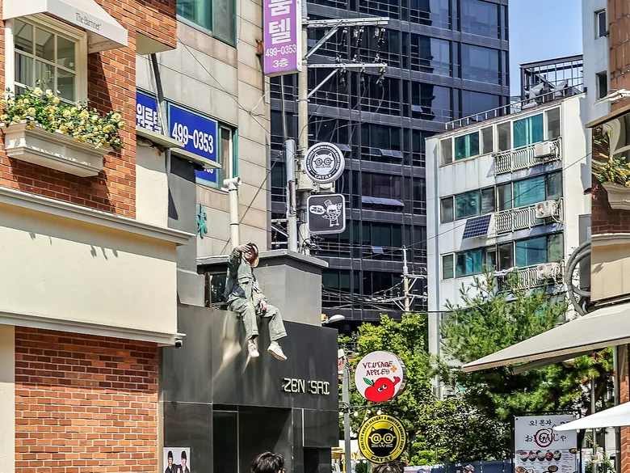
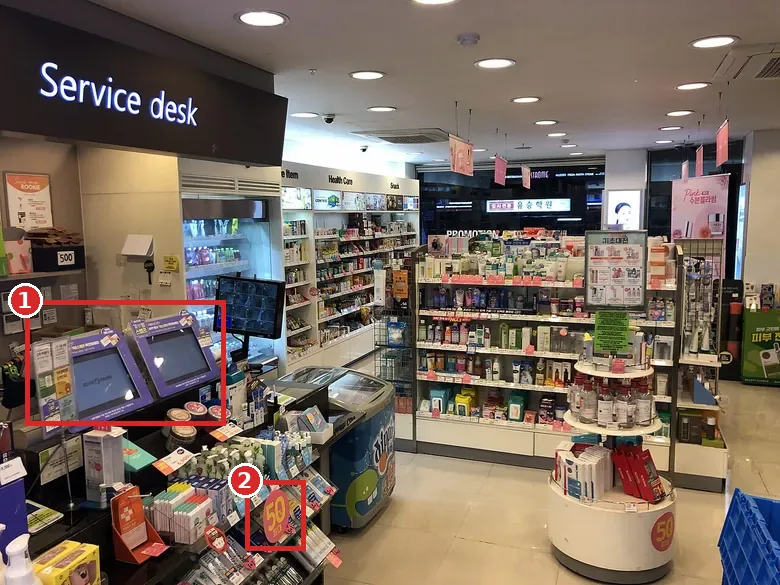
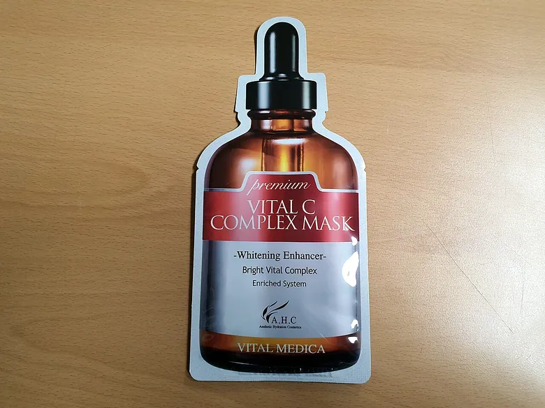

<a class="tr-btn go" href="#pay"><i class="ic ic-credit-card" aria-hidden="true"></i>怎麼結帳</a><a class="tr-btn" href="#find"><i class="ic ic-map-pin" aria-hidden="true"></i>找最近的門市</a><a class="tr-btn" href="/zh-tw/deals/"><i class="ic ic-calendar-days" aria-hidden="true"></i>下次特賣</a>

<figure class="tr-hero acc-hero"><figcaption><b>Olive Young</b>,韓國最大的美妝藥妝連鎖。看到這個招牌,照這頁的順序走就好。照片:Pkccccj,<a href="https://creativecommons.org/licenses/by-sa/4.0/deed.zh-hant" rel="noopener" target="_blank">CC BY-SA 4.0</a>,來自<a href="https://commons.wikimedia.org/wiki/File:OliveYoung_store.png" rel="noopener" target="_blank">維基共享資源</a>(自動調整亮度)。照片說明沒有寫是哪家分店。</figcaption></figure>

<ul class="tr-facts"><li><i class="ic ic-id-card" aria-hidden="true"></i>護照正本<small>符合資格就在結帳時扣稅</small></li><li><i class="ic ic-receipt" aria-hidden="true"></i>15,000 韓元以上<small>同一家店、單張收據</small></li><li><i class="ic ic-shopping-basket" aria-hidden="true"></i>袋子要付費<small>紙袋 100 韓元(明洞 Town)</small></li><li><i class="ic ic-calendar-check" aria-hidden="true"></i>下次特賣:預估 11/29(日)–12/5(六)前後<small>尚未正式公布,依最近三次的日期預估</small></li></ul>

<aside class="tr-note"><i class="ic ic-user-check" aria-hidden="true"></i><b>可以退稅的人</b>:在韓國停留未滿 6 個月的外國旅客,以及旅居海外超過 2 年、這次回韓停留 3 個月以內的韓國國民(Visit Seoul、VISITKOREA)。這頁說的「符合資格」就是指這些人。詳細:<a href="/zh-tw/tax-refund/#我可以退稅嗎">我可以退稅嗎?</a></aside>

<h2 id="stores">門市有四種</h2>

不管哪家店,挑商品和結帳的順序都一樣。不同的是大小,以及有沒有外語協助。

<ul class="tr-choose"><li><i class="ic ic-store" aria-hidden="true"></i><b>社區門市:大部分的店</b>只想快速買需要的東西時。品項較少,也有店不能在收銀台現場退稅。先問收銀台(看下面的<a href="#pay">結帳</a>)。</li><li><i class="ic ic-globe" aria-hidden="true"></i><b>全球觀光商圈門市:全國 151 家(2026 年 8 月)</b>明洞、弘大、江南、釜山、濟州等旅客多的地方。優先安排會外語的店員,備有多語告示,商品名稱和活動資訊也加註英文。旅客常買的商品集中放在入口附近。</li><li><i class="ic ic-layers" aria-hidden="true"></i><b>Town:大型店</b>平均超過 200 坪的大型店。例如明洞 Town(1–2 樓)、Central 明洞 Town(3 層約 950 坪,22 個收銀台)、Central 江南 Town(給旅客的 45 分鐘個人購物顧問,需在旅遊預訂平台預約)。</li><li><i class="ic ic-sparkles" aria-hidden="true"></i><b>特色門市:本身就值得去</b>Olive Young N 聖水(約 1,400 坪,規模最大,有體驗和預約服務)、慶州皇南店(韓屋設計)等,有只有那裡才有的體驗。</li></ul>

<h2 id="find">找最近的門市</h2>

<h3 class="tr-step">1<i class="ic ic-smartphone" aria-hidden="true"></i>在地圖 App 搜尋「올리브영」</h3>

<ol class="steps"><li>打開 NAVER 地圖或 KakaoMap。NAVER 地圖有英文、日文、中文,KakaoMap 有英文。第一次用的話先看<a href="/zh-tw/seoul-subway/#map-app">首爾地鐵 第1步:地圖 App 怎麼用</a>。</li><li>在搜尋欄輸入<b>올리브영</b>(或 Olive Young)。你附近的門市會以圖釘顯示在地圖上。</li><li>看店名最後面。名字有 <b>Town(타운)</b>的(例如明洞 Town、弘大 Town)就是大型店。</li></ol>

<h3 class="tr-step">2<i class="ic ic-clock" aria-hidden="true"></i>確認營業時間</h3>

<ol class="steps"><li>點圖釘或清單上的店名,打開門市資訊。</li><li>看營業時間,每家店不同。例如明洞 Town 每天 10:00–22:30,Olive Young N 聖水每天 10:00–22:00。明洞 Town 註明「營業時間可能依門市狀況變動」。</li><li>要晚一點去的話,至少在打烊前 30 分鐘到(我們的判斷:結帳隊伍可能很長)。</li></ol>

<h3 class="tr-step">3<i class="ic ic-route" aria-hidden="true"></i>開始導航</h3>

<ol class="steps"><li>在門市資訊按路線(길찾기),設為目的地。出發地是你的位置。</li><li>搭地鐵的話,App 會顯示要下車的站和<b>出口號碼</b>。從那個出口出去,路就走對一半了。出口號碼怎麼看:<a href="/zh-tw/seoul-subway/">首爾地鐵 第6步</a>。</li><li>出站後切換成步行,跟著箭頭走。</li></ol>

<h2 id="go">大型店怎麼走:明洞和聖水</h2>

<ul class="tr-choose"><li><i class="ic ic-map-pin" aria-hidden="true"></i><b>Olive Young 明洞 Town</b><strong>4 號線 明洞站 8 號出口</strong>(356 公尺)或<strong>2 號線 乙支路入口站 5 號出口</strong>。地址<strong>서울 중구 명동길 53</strong>(首爾中區明洞街 53,1–2 樓),每天 10:00–22:30。 走對路的話附近會看到:<strong>明洞觀光諮詢中心</strong>(乙支路 66 韓亞金融集團明洞大樓別館 1 樓,距乙支路入口站 5 號出口 211 公尺,距門市 70 公尺)、牛骨湯老店<strong>河東館(하동관)</strong>(距門市 50 公尺)、<strong>Royal Hotel Seoul</strong>(70 公尺)。迷路就走進觀光諮詢中心問。</li><li><i class="ic ic-map-pin" aria-hidden="true"></i><b>Olive Young N 聖水</b><strong>2 號線 聖水站 4 號出口</strong>走 118 公尺(步行約 1 分鐘)。地址<strong>서울 성동구 연무장7길 13</strong>(首爾城東區練武場 7 街 13,Factoryal 聖水大樓),每天 10:00–22:00。 出口走對的話:<strong>練武場街(연무장길)</strong>從 4 號出口開始,出口前常有快閃店的排隊人潮(Visit Seoul)。</li><li><i class="ic ic-store" aria-hidden="true"></i><b>Central 明洞 Town</b>2026 年 3 月 26 日在明洞開幕的 3 層門市,是 Olive Young 商品數最多的店(約 1,000 個品牌、1 萬 5 千件商品)。今天沒能在官方資料確認地址,請在地圖 App 搜尋「올리브영 센트럴 명동 타운」。</li></ul>

<figure class="tr-photo"><figcaption><b>練武場街</b>,從聖水站 4 號出口開始。Olive Young N 聖水往這個方向 118 公尺。照片:Dr. Thomas Liptak,<a href="https://creativecommons.org/licenses/by-sa/4.0/deed.zh-hant" rel="noopener" target="_blank">CC BY-SA 4.0</a>,來自<a href="https://commons.wikimedia.org/wiki/File:Seoul,_Seongdong_District,_Seongsu_(Yeonmujang-gil).jpg" rel="noopener" target="_blank">維基共享資源</a>(裁切、自動調整亮度)</figcaption></figure>

<aside class="tr-note tip"><i class="ic ic-lightbulb" aria-hidden="true"></i>大型店品項最齊全,也有會外語的店員。</aside>

<h2 id="inside">店內:入口 → 區域 → 試用 → 收銀台</h2>

<h3 class="tr-step">1<i class="ic ic-door-open" aria-hidden="true"></i>入口:拿購物籃,大件行李自己帶著</h3>

全球觀光商圈門市會把旅客常買的商品集中在入口附近。行李箱、雨傘等個人物品店家不代為保管(明洞 Town)。有些店沒有廁所,明洞 Town 請客人使用附近地鐵站的廁所。

<h3 class="tr-step">2<i class="ic ic-layers" aria-hidden="true"></i>區域:商品依種類集中</h3>

以明洞 Town 的樓層介紹為例。其他門市也一樣依種類陳列,只是大小不同。

<ul class="tr-choose"><li><i class="ic ic-droplets" aria-hidden="true"></i><b>1 樓</b>保養(乳霜、精華、卸妝洗臉)、防曬與痘痘貼、面膜(片狀、棉片、沖洗式)、季節企劃區、<strong>收銀台</strong></li><li><i class="ic ic-sparkles" aria-hidden="true"></i><b>2 樓</b>彩妝、Luxe Edit(高價品牌)、香水、頭髮、身體、男士、保健、食品飲料、化妝棉與刷具、<strong>收銀台</strong>、<strong>Global Service Lounge</strong>(免費 Wi-Fi、休息區、會員禮)、<strong>GTF 退稅櫃台</strong></li></ul>

<h3 class="tr-step">3<i class="ic ic-tag" aria-hidden="true"></i>看價籤、試用後再選</h3>

<figure class="tr-photo"><figcaption><b>1</b> 粉紅色促銷價籤,<b>2</b> 一般價籤。價籤就在商品正下方。特賣期間到處都是 1+1(買一送一)、2+1(買二送一),確認適用的是哪一件、哪一組。照片:Choi Kwang-mo(Olive Young 原州丹邱店,2020 年,其他分店的照片),<a href="https://creativecommons.org/publicdomain/zero/1.0/deed.zh-hant" rel="noopener" target="_blank">CC0</a>,來自<a href="https://commons.wikimedia.org/wiki/File:2020-04-17_22.18.09_%EC%98%AC%EB%A6%AC%EB%B8%8C%EC%98%81_%EC%9B%90%EC%A3%BC%EB%8B%A8%EA%B5%AC%EC%A0%90.jpg" rel="noopener" target="_blank">維基共享資源</a>(裁切、加上框線與編號)</figcaption></figure>

{{fig:olive-young-3|1+1 價籤要看什麼}}

在門市可以先試用再選(Visit Seoul)。先確認質地和香味,再買未拆封的。試用品怎麼用、標籤怎麼看:[韓國美妝怎麼挑](/zh-tw/kbeauty-how-to-choose/)。

<h3 class="tr-step">4<i class="ic ic-circle-help" aria-hidden="true"></i>找不到就問</h3>

全球觀光商圈門市有會外語的店員。在 Central 明洞 Town,會說英文、中文、日文的店員別著**國旗徽章**。首爾部分門市還有可用 8 種語言對話的 AI 購物助理(2026 年 6 月導入)。用手機給店員看商品照片最快。

<h2 id="pay">結帳</h2>

<figure class="tr-photo"><figcaption>明洞一家 Olive Young 收銀台上方的告示:「為了現場退稅,請準備好護照正本」。照片:Sgroey,<a href="https://creativecommons.org/licenses/by-sa/4.0/deed.zh-hant" rel="noopener" target="_blank">CC BY-SA 4.0</a>,來自<a href="https://commons.wikimedia.org/wiki/File:Olive_Young_Myeongdong.jpg" rel="noopener" target="_blank">維基共享資源</a>(裁切、自動調整亮度)。照片說明沒有寫是明洞哪家分店。</figcaption></figure>

<h3 class="tr-step">1<i class="ic ic-id-card" aria-hidden="true"></i>在收銀台先遞上護照正本</h3>

把購物籃放上收銀台,連同付款方式一起遞上**護照正本**(符合資格的話)。照片或影本不行。是否符合資格是用護照確認的。主要門市可以在收銀台現場退稅,問一句「Tax refund?」就可以。

<h3 class="tr-step">2<i class="ic ic-receipt" aria-hidden="true"></i>付扣掉稅金的金額</h3>

<figure class="tr-photo"><figcaption><b>1</b> 收銀台:符合資格的話,付款時一起遞上護照。<b>2</b> 圓形特價貼紙:看旁邊的價籤,確認是哪件商品。照片:Choi Kwang-mo(Olive Young 原州丹邱店,2020 年,其他分店的照片),<a href="https://creativecommons.org/publicdomain/zero/1.0/deed.zh-hant" rel="noopener" target="_blank">CC0</a>,來自<a href="https://commons.wikimedia.org/wiki/File:2020-04-17_22.17.43_%EC%98%AC%EB%A6%AC%EB%B8%8C%EC%98%81_%EC%9B%90%EC%A3%BC%EB%8B%A8%EA%B5%AC%EC%A0%90.jpg" rel="noopener" target="_blank">維基共享資源</a>(加上框線與編號)</figcaption></figure>

單張收據 15,000 至未滿 1,000,000 韓元,就以扣掉稅金的金額付款,特價品也一樣。扣掉的是消費金額的 5–8%,以 1,000 韓元為單位計算。

{{fig:olive-young-2|收銀台現場退稅,以單張收據計}}

<h3 class="tr-step">3<i class="ic ic-circle-check" aria-hidden="true"></i>拿收據並確認</h3>

付的金額比價籤加總還少,就表示稅扣掉了。收據留到出境為止,退換貨也要用。

<aside class="tr-note"><i class="ic ic-triangle-alert" aria-hidden="true"></i>不同門市的收據不能合併。每張都要滿 15,000 韓元,與其三家店各買一點,不如在一家店一次買齊。</aside>

<ul class="tr-choose"><li><i class="ic ic-credit-card" aria-hidden="true"></i><b>卡刷不過時</b>改用別張卡或現金。明洞 Town 也收微信支付、支付寶等行動支付。Olive Young 也辦過銀聯、支付寶、微信支付、WOWPASS 付款折扣。卡片和現金準備:<a href="/zh-tw/money/">換錢與付款</a>。</li><li><i class="ic ic-receipt" aria-hidden="true"></i><b>單張收據 1,000,000 韓元以上</b>收銀台不會現場扣稅。先付全額、拿<strong>退稅單</strong>,到市區退稅櫃台或機場領回。<a href="/zh-tw/tax-refund/">退稅怎麼辦</a></li><li><i class="ic ic-ban" aria-hidden="true"></i><b>這趟累計超過 5,000,000 韓元</b>現場退稅每次入境累計上限 5,000,000 韓元。之後就拿退稅單,到機場領回。</li><li><i class="ic ic-id-card" aria-hidden="true"></i><b>沒帶護照時</b>不能現場退稅。照明洞 Town 的說明,拿退稅單到機場退稅櫃台領即可。未在韓國關稅廳登錄、或停留超過 6 個月的人也一樣(明洞 Town FAQ)。</li><li><i class="ic ic-circle-x" aria-hidden="true"></i><b>不扣稅的商品</b>衛生用品、購物袋、果乾類商品不在免稅範圍(明洞 Town)。</li></ul>

<h3 class="tr-step">4<i class="ic ic-shopping-basket" aria-hidden="true"></i>購物袋和禮品包裝</h3>

袋子要付費。明洞 Town 紙袋 100 韓元、環保袋 500 韓元。禮品包裝用禮盒,依大小 1,000–2,500 韓元。自備購物袋就不用付袋子錢。

<h3 class="tr-step">5<i class="ic ic-hand-coins" aria-hidden="true"></i>其他店的 GTF 退稅單也能在這裡退</h3>

如果在其他店拿到和 Olive Young 同一家退稅公司(GTF)的退稅單,帶著護照正本到明洞 Town 2 樓 Global Service Lounge 的 **GTF 櫃台**就能退稅。

<h2 id="exchange">退換貨</h2>

<ul class="tr-facts"><li><i class="ic ic-calendar-days" aria-hidden="true"></i>15 天內<small>從付款日算起</small></li><li><i class="ic ic-package" aria-hidden="true"></i>未拆封的正常品<small>可再販售的狀態</small></li><li><i class="ic ic-receipt" aria-hidden="true"></i>收據+付款的卡<small>兩樣都帶去門市</small></li><li><i class="ic ic-store" aria-hidden="true"></i>退貨:只限購買門市<small>換貨:同額以上全國門市都可</small></li></ul>

來源是 Olive Young 明洞 Town 的 FAQ。其他門市是否相同,請在該門市確認。

<h2 id="sale">什麼時候去:特賣</h2>

Olive Young 的折扣分兩種,真正值得配合行程的只有一種。

{{fig:olive-young-1|Olive Young 的一年:四次大特賣,每月一次小活動}}

<ul class="tr-choose"><li><i class="ic ic-calendar-check" aria-hidden="true"></i><b>Olive Young Sale:配合這個</b>一年四次,在 3、6、9、12 月,每次約 7 天。全年折扣範圍最廣,門市與線上同步。2026 年分別在 3 月 1–7 日、5 月 31 日–6 月 6 日、8 月 30 日–9 月 5 日。12 月場尚未正式公布,日期是預估:11/29(日)–12/5(六)前後。根據:最近三次(<a href="https://cjnews.cj.net/올영세일로-본-k뷰티-트렌드-집에서도-전문가처럼/" rel="noopener" target="_blank">2025 年 12 月 11/30–12/6</a>、2026 年 6 月 5/31–6/6、9 月 8/30–9/5,皆為 CJ 新聞室)都是週日開始、連續 7 天。公布後會把確定日期更新在<a href="/zh-tw/deals/">優惠看板</a>。</li><li><i class="ic ic-tag" aria-hidden="true"></i><b>Olive Young Day(Olive Day):碰上算賺到</b>每月 25–27 日。額外折價券發給 Olive Young 會員(Olive Members)帳號。加入會員需要住在韓國、有本人名義的韓國聯絡電話。</li></ul>

<aside class="tr-note tip"><i class="ic ic-lightbulb" aria-hidden="true"></i>等待也是樂趣:把特賣週寫進行事曆,出發前先寫下三樣要買的。</aside>

<h2 id="buy">買什麼:第一次先買三樣</h2>

清單短才用得完,所以只挑三樣。這不是品牌清單,而是品項:挑的是回國一週後你還在用的東西。

{{fig:olive-young-4|第一次的購物籃:三樣,以及為什麼}}

<i class="ic ic-droplets" aria-hidden="true"></i><b>化妝水棉片:</b>一個容器,好帶又用得快。

其中兩樣長這樣(範例,不是推薦):

<ul class="acc-picks">
<li><b><i class="ic ic-sun" aria-hidden="true"></i>防曬</b>每天擦,一定用得完。看標籤上的 <strong>1</strong> SPF 和 <strong>2</strong> PA,依你實際的行程選。(只是看標籤的範例:照片是日本品牌,不是推薦。)照片:Yiting,<a href="https://creativecommons.org/licenses/by-sa/4.0/deed.zh-hant" rel="noopener" target="_blank">CC BY-SA 4.0</a>,來自<a href="https://commons.wikimedia.org/wiki/File:Japanese_sunscreen.jpg" rel="noopener" target="_blank">維基共享資源</a>(裁切、加上框線與編號)</li>
<li><b><i class="ic ic-package" aria-hidden="true"></i>面膜</b>便宜、扁平、一次一片。一片裝在一個像這樣的扁平袋裡。範例,不是推薦。照片:김인겸(Kim In-gyeom),<a href="https://creativecommons.org/licenses/by-sa/4.0/deed.zh-hant" rel="noopener" target="_blank">CC BY-SA 4.0</a>,來自<a href="https://commons.wikimedia.org/wiki/File:PX%EB%A7%88%EC%8A%A4%ED%81%AC%ED%8C%A9.jpg" rel="noopener" target="_blank">維基共享資源</a>(自動調整亮度)</li>
</ul>

<ul class="tr-choose"><li><i class="ic ic-sparkles" aria-hidden="true"></i><b>12 月去的話</b>去年(2025 年)12 月特賣和選出年度熱銷商品的「Olive Young Awards」一起舉行,得獎商品以大容量、1+1、加贈小禮的限定版推出,同樣的錢常能買到更多(<a href="https://cjnews.cj.net/모두가-사랑한-제품을-모두가-사랑할-혜택으로-cj/" rel="noopener" target="_blank">CJ 新聞室 2025-11-28</a>)。預估今年也一樣,但尚未正式公布。</li><li><i class="ic ic-user-x" aria-hidden="true"></i><b>不需要這份清單的人</b>已經有固定保養品的話,趁特賣補貨就好。</li></ul>

我們沒列的:正在流行的商品和排行榜。排行榜告訴你什麼賣得好,不會告訴你什麼適合你。

<h2 id="members">會員和折價券</h2>

<ul class="tr-choose"><li><i class="ic ic-user-check" aria-hidden="true"></i><b>韓國會員(Olive Members)</b>要住在韓國、有本人名義的聯絡電話,才能加入並使用點數。會員特價也只限韓國帳號會員。</li><li><i class="ic ic-globe" aria-hidden="true"></i><b>旅客:Global Mall 會員</b>外國籍顧客請加入 Olive Young Global Mall 會員。明洞 Town 2 樓 Global Service Lounge 有新會員禮。</li><li><i class="ic ic-tag" aria-hidden="true"></i><b>給旅客的優惠:期間限定</b>例如 2026 年 2–3 月的銀聯、支付寶、微信支付付款折扣,WOWPASS 付款 9.5 折(2 月 15–22 日)。現在的活動請看<a href="/zh-tw/deals/">優惠看板</a>。在韓國使用的 Olive Young 電子禮券,2025 年起也在 Klook 等旅遊平台販售。</li></ul>

## 常見錯誤

<ul class="tr-oops"><li><i class="ic ic-triangle-alert" aria-hidden="true"></i>只帶護照照片。要護照正本才能扣稅。</li><li><i class="ic ic-triangle-alert" aria-hidden="true"></i>分三家店買。收據不能合併。</li><li><i class="ic ic-triangle-alert" aria-hidden="true"></i>沒看價籤適用哪件、哪組就拿 1+1。</li><li><i class="ic ic-triangle-alert" aria-hidden="true"></i>把行程配合 Olive Young Day。規模小,額外折價券是給韓國會員的。</li><li><i class="ic ic-triangle-alert" aria-hidden="true"></i>拿去別家分店退貨。退貨只限購買門市,15 天內。</li><li><i class="ic ic-triangle-alert" aria-hidden="true"></i>想把行李箱寄放在店裡。門市不代為保管個人物品。</li></ul>

<h2 id="home">回國後想買</h2>

<ul class="tr-choose"><li><i class="ic ic-globe" aria-hidden="true"></i><b>大部分國家:Olive Young Global</b>有配送到台灣,新客常有首購優惠。運費和條件請在結帳時確認。</li><li><i class="ic ic-truck" aria-hidden="true"></i><b>美國:Olive Young US</b>2026 年 5 月 29 日美國專屬網路商店上線,從這天起 Olive Young Global 不再服務美國顧客。</li></ul>

<ul class="tr-next"><li><a href="https://global.oliveyoung.com" rel="noopener" target="_blank"><i class="ic ic-globe" aria-hidden="true"></i>Olive Young Global<i class="ic ic-external-link" aria-hidden="true"></i></a></li><li><a href="https://us.oliveyoung.com" rel="noopener" target="_blank"><i class="ic ic-truck" aria-hidden="true"></i>住在美國:Olive Young US<i class="ic ic-external-link" aria-hidden="true"></i></a></li></ul>

{{fig:olive-young-5|回國後要回購,去哪裡買}}

<i class="ic ic-list-checks" aria-hidden="true"></i>先說結論:看表格

| 情況 | 怎麼做 | 原因 |
|---|---|---|
| 行程碰上 Olive Young Sale 期間(3、6、9、12 月,約 7 天) | 在 Olive Young Sale 期間買 | 全年折扣範圍最廣,門市與線上同步 |
| 其他時間 | 符合資格就帶護照照樣買 | 單張收據 15,000 至未滿 1,000,000 韓元,結帳時直接扣稅 |
| 第一次買韓國美妝 | 先買三樣 | 防曬、化妝水棉片、面膜:便宜、好帶、用得完 |
| 已經回台灣 | Olive Young Global(美國是 Olive Young US) | 有配送到台灣;2026 年 5 月 29 日起 Global 不服務美國顧客 |

<i class="ic ic-info" aria-hidden="true"></i>資料來源

2026 年 11 月 26 日(韓國時間)開啟查證。Olive Young <a href="https://myeongdongtown.oliveyoung.com/zh/" rel="noopener" target="_blank">明洞 Town 網站</a>(韓、英、日、中文版:樓層介紹;FAQ 的現場與事後退稅、不適用商品、單張 1 萬 5 千–100 萬韓元、上限 500 萬、5–8%、千元單位、GTF 櫃台;退換貨 15 天;袋子 100、500 韓元;禮品包裝 1,000–2,500 韓元;不保管個人物品;會員;沒有廁所;地址、營業時間、出口、行動支付)。Visit Seoul:<a href="https://english.visitseoul.net/shopping/Olive-Young-Lifestyle-Experience-Center/ENP012015" rel="noopener" target="_blank">Olive Young (Myeongdong Flagship Store)</a>(8 號出口 356 公尺;周邊河東館 50 公尺、明洞觀光諮詢中心 70 公尺、Royal Hotel Seoul 70 公尺;可試用再選;2026 年 11 月 24 日更新)、<a href="https://english.visitseoul.net/attractions/Myeong-dong-Tourist-Information-Center/ENP011469" rel="noopener" target="_blank">明洞觀光諮詢中心</a>(乙支路 66,乙支路入口站 5 號出口 211 公尺)、<a href="https://english.visitseoul.net/editorspicks/2025SeoulTrendReportSeongsu-dong/ENNvepwqx" rel="noopener" target="_blank">聖水洞趨勢報告</a>(Olive Young N 聖水地址、營業時間、4 號出口 118 公尺、1,400 坪、樓層、預約;練武場街與 4 號出口)、<a href="https://english.visitseoul.net/Tax-Refund" rel="noopener" target="_blank">Tax Refund</a>(退稅對象)。CJ 新聞室:<a href="https://cjnews.cj.net/cj올리브영-글로벌관광상권-전략-성과오프라인/" rel="noopener" target="_blank">全球觀光商圈 110 多家門市的經營方式、主要門市現場退稅、Central 江南 Town 個人購物顧問、慶州皇南店</a>(2025 年 7 月 22 日)、<a href="https://cjnews.cj.net/?p=79498" rel="noopener" target="_blank">全球觀光商圈 151 家、Town 平均 200 坪、AI 購物助理 8 種語言</a>(2026 年 8 月 31 日)、<a href="https://cjnews.cj.net/cj올리브영-k뷰티-쇼핑-심장부에-글로벌-고객-겨냥-센/" rel="noopener" target="_blank">Central 明洞 Town 開幕</a>(2026 年 3 月 26 日)、<a href="https://cjnews.cj.net/cj올리브영-외국인-관광객-대상-제휴·할인-혜택-확대/" rel="noopener" target="_blank">旅客合作優惠、Klook 電子禮券</a>(2026 年 2 月 2 日)、<a href="https://cjnews.cj.net/cj올리브영-25일부터-3일간-멤버십-회원-위한-올리브/" rel="noopener" target="_blank">Olive Day 每月 25–27 日、會員限定</a>(2025 年 3 月 24 日)、<a href="https://cjnews.cj.net/?p=71722" rel="noopener" target="_blank">Olive Young Awards 與 12 月特賣,大容量、1+1、加贈限定版</a>(2025 年 11 月 28 日)、<a href="https://cjnews.cj.net/cj올리브영-올해-첫-올영세일-봄맞이-뷰티·웰니/" rel="noopener" target="_blank">3 月特賣 3 月 1–7 日</a>(2026 年 2 月 27 日)、<a href="https://cjnews.cj.net/선파우더·픽서·데오드란트-산다6월-올영세일-대/" rel="noopener" target="_blank">6 月特賣 5 月 31 日–6 月 6 日</a>(2026 年 6 月 4 日)、<a href="https://cjnews.cj.net/cj올리브영-9월-올영세일서-취향-소비-두드러져/" rel="noopener" target="_blank">9 月特賣 8 月 30 日–9 月 5 日</a>(2026 年 9 月 6 日)、<a href="https://cjnews.cj.net/cj올리브영-올영세일-외국인-재방문-3년-새-11배-증가/" rel="noopener" target="_blank">一年四次(3、6、9、12 月)</a>(2026 年 6 月 22 日)。The Korea Times <a href="https://www.koreatimes.co.kr/business/companies/20260622/foreign-repeat-visits-to-olive-young-sale-surge-11-fold-in-3-years" rel="noopener" target="_blank">同一內容英文報導</a>(2026 年 6 月 22 日)。The Korea Herald <a href="https://www.koreaherald.com/article/10742777" rel="noopener" target="_blank">5 月 29 日美國專屬網路商店</a>(2026 年 5 月 21 日)。VISITKOREA <a href="https://english.visitkorea.or.kr/svc/contents/infoHtmlView.do?vcontsId=248765" rel="noopener" target="_blank">退稅指南</a>(以護照確認資格→付扣稅後金額,累計 500 萬韓元)。截至 11 月 26 日,CJ 新聞室尚無 2026 年 12 月特賣公告。今天未能重新開啟的(查證工具被拒):Olive Young Global 說明中心的美國平台變更公告(2026 年 5 月,前一版已查證)、台灣配送條件與首購優惠(前一版內容)、Olive Young 官方購物網與門市查詢。打烊前 30 分鐘的餘裕是我們的判斷。

## 接著看

<ul class="tr-next"><li><a href="/zh-tw/tax-refund/"><i class="ic ic-receipt" aria-hidden="true"></i>退稅:誰能退、大筆消費、機場<i class="ic ic-arrow-right" aria-hidden="true"></i></a></li><li><a href="/zh-tw/kbeauty-how-to-choose/"><i class="ic ic-droplets" aria-hidden="true"></i>韓國美妝標籤怎麼看、怎麼挑<i class="ic ic-arrow-right" aria-hidden="true"></i></a></li><li><a href="/zh-tw/deals/"><i class="ic ic-tag" aria-hidden="true"></i>優惠看板:特賣日期公布就更新<i class="ic ic-arrow-right" aria-hidden="true"></i></a></li></ul>
