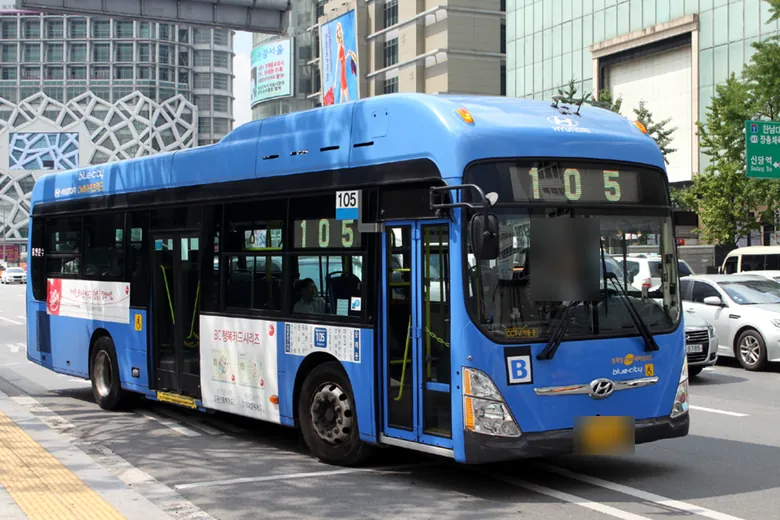
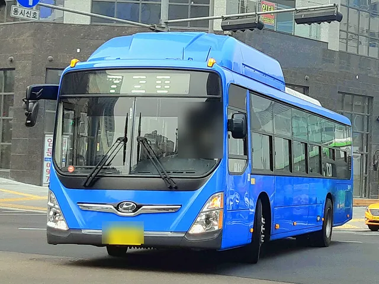
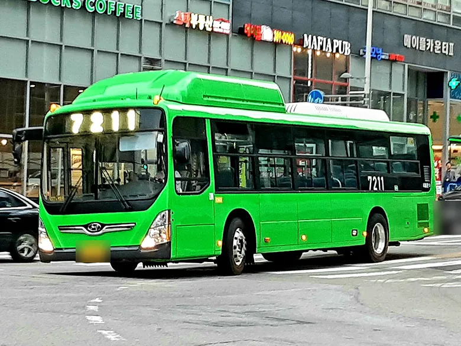
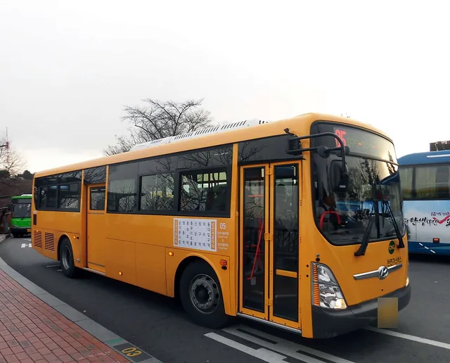
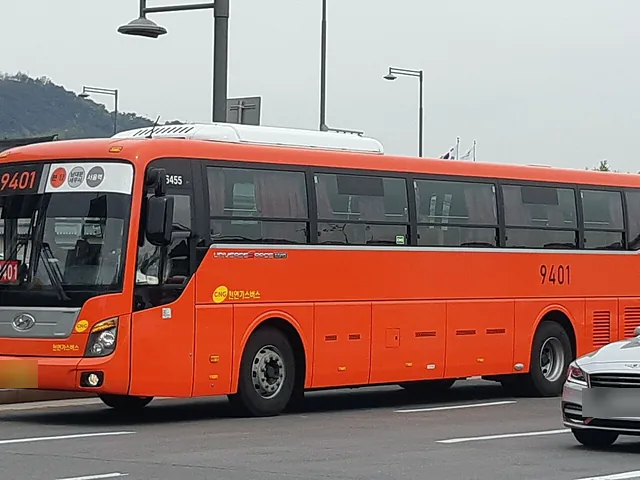
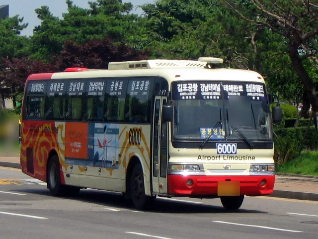

<a class="tr-btn go" href="#跟著做"><i class="ic ic-bus" aria-hidden="true"></i>看5個步驟</a><a class="tr-btn" href="#先看顏色"><i class="ic ic-info" aria-hidden="true"></i>顏色代表什麼</a>

<figure class="tr-hero"><figcaption>藍色幹線公車。路線號碼在車頭和車身側面。 照片:Ki hoon,<a href="https://creativecommons.org/licenses/by-sa/4.0/" rel="noopener" target="_blank">CC BY-SA 4.0</a>,<a href="https://commons.wikimedia.org/wiki/File:Seoul_105_Blue_City_Front_side.png" rel="noopener" target="_blank">維基共享資源</a>(自動對比校正、司機與車牌模糊)</figcaption></figure>

<ul class="tr-facts"><li><i class="ic ic-coins" aria-hidden="true"></i>1,500韓元<small>藍色、綠色,交通卡</small></li><li><i class="ic ic-credit-card" aria-hidden="true"></i>刷兩次<small>上車、下車</small></li><li><i class="ic ic-timer" aria-hidden="true"></i>30分鐘<small>轉乘(夜間60分鐘)</small></li><li><i class="ic ic-banknote" aria-hidden="true"></i>不收現金<small>183條路線</small></li></ul>

## 跟著做

<h3 class="tr-step">1<i class="ic ic-credit-card" aria-hidden="true"></i>出門前先儲值</h3>

首爾市2026年1月的清單列出183條「無現金公車」路線(市區公車共396條)。這些路線完全不收現金。我們建議:與其一條條查清單,不管搭哪班公車,都先把T-money等韓國交通卡儲值好。買哪張、在哪買、怎麼儲值,見[首爾地鐵](/zh-tw/seoul-subway/#用哪張卡)和[行前準備](/zh-tw/essentials/)。

<h3 class="tr-step">2<i class="ic ic-map-pin" aria-hidden="true"></i>找到要搭的公車</h3>

在**NAVER 地圖**打開路線(可切換成中文介面),存好路線號碼和站名。很多站牌有即時顯示公車資訊的螢幕:

{{fig:seoul-bus-stop-display|首爾公車站牌的資訊螢幕。照片:Wikiwater2020,[CC BY-SA 3.0](https://creativecommons.org/licenses/by-sa/3.0/),[維基共享資源](https://commons.wikimedia.org/wiki/File:Bus_Info_in_the_Bus_Stop.jpg)(裁切、加上編號)}}

1. **7025**號**3分鐘**後到(분=分鐘)。

{{fig:seoul-bus-front|對照號碼。照片:Ki hoon,[CC BY-SA 4.0](https://creativecommons.org/licenses/by-sa/4.0/),[維基共享資源](https://commons.wikimedia.org/wiki/File:Seoul_105_Blue_City_Front_side.png)(自動對比校正、司機與車牌模糊、加上編號)}}

1. 車頭的路線號碼,和地圖App對照。
2. 前門,從這裡上車。

<h3 class="tr-step">3<i class="ic ic-log-in" aria-hidden="true"></i>前門上車刷卡</h3>

{{fig:seoul-bus-reader-front|前門刷卡機:2012年cashbee刷卡機照片,未註明拍攝城市,很可能不是首爾。首爾的刷卡機外觀不同,但刷法一樣。照片:Wnstlr93,[CC BY 3.0](https://creativecommons.org/licenses/by/3.0/),[維基共享資源](https://commons.wikimedia.org/wiki/File:%EC%8A%B9%EC%B0%A8%EC%9A%A9_%EB%8B%A8%EB%A7%90%EA%B8%B0.jpg)(裁切、調亮、加上編號)}}

1. 上車時把卡靠在這裡。

<h3 class="tr-step">4<i class="ic ic-bell" aria-hidden="true"></i>看站名、按下車鈴</h3>

有空位就坐窗邊:韓國觀光公社也把窗外流過的街景算作搭市區公車的樂趣之一。看地圖確認站名,下一站就是目的地時,按窗邊的下車鈴。

<h3 class="tr-step">5<i class="ic ic-log-out" aria-hidden="true"></i>在後門旁再刷一次,再下車</h3>

{{fig:seoul-bus-reader-rear|後門刷卡機:2012年cashbee刷卡機照片,未註明拍攝城市,很可能不是首爾。首爾的刷卡機外觀不同,但刷法一樣。照片:Wnstlr93,[CC BY 3.0](https://creativecommons.org/licenses/by/3.0/),[維基共享資源](https://commons.wikimedia.org/wiki/File:%ED%99%98%EC%8A%B9_%EB%8B%A8%EB%A7%90%EA%B8%B0.jpg)(裁切、加上編號)}}

1. 貼紙寫著:「下車時請務必刷卡」。
2. 卡靠在這裡。
3. 剩餘金額(잔액)。

<aside class="tr-note"><i class="ic ic-triangle-alert" aria-hidden="true"></i>依首爾市說明,下車沒刷卡,轉乘就從那一趟斷掉,搭下一班公車或地鐵時會補收少付的基本票價。</aside>

<aside class="tr-note ok"><i class="ic ic-circle-check" aria-hidden="true"></i><b>完成。</b>我們選的結尾畫面:在地鐵到不了的地方,刷了兩次卡下車;30分鐘內搭下一趟,就不用再付一次基本票價。</aside>

## 先看顏色

首爾公車的顏色就是路線用途,一眼就知道是不是你要的那種車。以下都是成人用交通卡付款的票價。

<ul class="tr-colours"><li><b><i class="sw" style="background:#1f6fd1"></i>藍色・1,500韓元</b>幹線:連接外圍與市中心的長程路線。<a href="https://commons.wikimedia.org/wiki/File:Seoul_Blue_Bus.jpg" rel="noopener" target="_blank">Wikiwater2020</a>,<a href="https://creativecommons.org/licenses/by-sa/3.0/" rel="noopener" target="_blank">CC BY-SA 3.0</a></li><li><b><i class="sw" style="background:#3cb043"></i>綠色・1,500韓元</b>支線:連接社區與幹線公車、地鐵。綠色社區公車(마을버스)1,200韓元。<a href="https://commons.wikimedia.org/wiki/File:Seoul_Bus_7211.jpg" rel="noopener" target="_blank">Wikiwater2020</a>,<a href="https://creativecommons.org/licenses/by-sa/3.0/" rel="noopener" target="_blank">CC BY-SA 3.0</a></li><li><b><i class="sw" style="background:#f2b21b"></i>黃色・1,400韓元</b>循環:在市中心繞行。<a href="https://commons.wikimedia.org/wiki/File:Seoul_Bus_05.JPG" rel="noopener" target="_blank">hyolee2</a>,<a href="https://creativecommons.org/licenses/by-sa/4.0/" rel="noopener" target="_blank">CC BY-SA 4.0</a>(車牌模糊)</li><li><b><i class="sw" style="background:#e2462b"></i>紅色・3,000韓元</b>廣域:連接首都圈與市區。氣候同行卡短期券<b>不能搭</b>。<a href="https://commons.wikimedia.org/wiki/File:Seoul_Bus_9401.jpg" rel="noopener" target="_blank">Wikiwater2020</a>,<a href="https://creativecommons.org/licenses/by-sa/3.0/" rel="noopener" target="_blank">CC BY-SA 3.0</a>(車牌模糊)</li></ul>

<aside class="tr-note tip"><i class="ic ic-moon" aria-hidden="true"></i><b>路線號碼N開頭</b>的是深夜公車,2,500韓元。</aside>

## 轉乘:下車後30分鐘

有刷下車、又在時限內搭下一班,就算轉乘,不重新收基本票價。

{{fig:seoul-bus-3|下車刷卡後的轉乘時限(Nadri繪製:時間規則照片拍不出來)}}

1. **下第一班公車時刷卡。**
2. **30分鐘內搭下一班公車或地鐵**(下一班在21:00~隔天07:00之間上車,則為60分鐘)。
3. **前10公里只付一次基本票價**(以搭乘工具中較高的基本票價計),之後每5公里加100韓元。最多轉乘4次(共搭5趟)。

## 常見錯誤

<ul class="tr-oops"><li><i class="ic ic-triangle-alert" aria-hidden="true"></i><b>下車沒刷卡。</b>轉乘斷掉,下一趟要再付基本票價。</li><li><i class="ic ic-triangle-alert" aria-hidden="true"></i><b>沒卡或餘額不足就上車。</b>有些路線不收現金。</li><li><i class="ic ic-triangle-alert" aria-hidden="true"></i><b>拿氣候同行卡短期券搭紅色公車。</b>不適用。</li><li><i class="ic ic-triangle-alert" aria-hidden="true"></i><b>轉乘中間拖太久。</b>超過30分鐘(夜間60分鐘)就不算轉乘。</li><li><i class="ic ic-triangle-alert" aria-hidden="true"></i><b>把機場N字頭巴士當成市區N字頭公車。</b>票價差將近7倍。</li></ul>

## 機場巴士是另一回事

<figure class="tr-photo"><figcaption>機場利木津:要另外買票的不同服務。 6000號,2009年照片。照片:Baek Seung Woon,<a href="https://creativecommons.org/licenses/by-sa/2.0/kr/" rel="noopener" target="_blank">CC BY-SA 2.0 KR</a>,<a href="https://commons.wikimedia.org/wiki/File:Seoul_Airport_Bus_6000.jpg" rel="noopener" target="_blank">維基共享資源</a>(自動對比校正、人物與車牌模糊)</figcaption></figure>

市區公車和機場利木津巴士都叫「巴士」,但其實是不同的服務。

<ul class="tr-choose tr-compare"><li><i class="ic ic-bus" aria-hidden="true"></i><b>市區公車</b><ul class="tr-kv"><li><b>票價(成人)</b> 1,200~3,000韓元</li><li><b>怎麼付</b> 刷卡</li><li><b>氣候同行卡短期券</b> 可用(紅色公車除外)</li><li><b>大件行李</b> 不適合</li></ul></li><li><i class="ic ic-plane" aria-hidden="true"></i><b>機場利木津巴士</b><ul class="tr-kv"><li><b>票價(成人)</b> 到首爾16,000~18,000韓元</li><li><b>怎麼付</b> 在機場自動售票機或售票櫃台買票;也可用 T-money,但持票者優先上車</li><li><b>氣候同行卡短期券</b> 不能用</li><li><b>大件行李</b> 由工作人員裝載(每人2件,28吋以下)</li></ul></li></ul>

<aside class="tr-note"><i class="ic ic-triangle-alert" aria-hidden="true"></i>號碼要看清楚:深夜機場巴士(N6000、N6002、N6701、N6703)也是N開頭,但票價17,000~18,000韓元,要買票搭乘,不是2,500韓元的市區深夜公車。</aside>

詳見[仁川機場到首爾](/zh-tw/airport-to-seoul/)。

## 深夜公車

地鐵收班後,首爾有14條路線號碼N開頭的深夜公車,晚上11點到早上6點行駛,成人用交通卡2,500韓元([首爾市,2026年3月20日更新](https://news.seoul.go.kr/traffic/archives/27974))。各路線首末班和班距不同,走到站牌前,先在 NAVER 地圖查好路線和下一班車。

<i class="ic ic-moon" aria-hidden="true"></i>兩種N字頭公車,一張圖看懂

{{fig:seoul-bus-5|兩種N字頭公車:市區深夜公車與機場深夜巴士(Nadri繪製)}}

## 接著看

<ul class="tr-next"><li><a href="/zh-tw/seoul-subway/"><i class="ic ic-train-front" aria-hidden="true"></i>首爾地鐵7步驟<i class="ic ic-arrow-right" aria-hidden="true"></i></a></li><li><a href="/zh-tw/airport-to-seoul/"><i class="ic ic-plane" aria-hidden="true"></i>仁川機場到首爾<i class="ic ic-arrow-right" aria-hidden="true"></i></a></li><li><a href="/zh-tw/getting-around/"><i class="ic ic-route" aria-hidden="true"></i>首爾地鐵、公車、計程車<i class="ic ic-arrow-right" aria-hidden="true"></i></a></li><li><a href="/zh-tw/emergency/"><i class="ic ic-triangle-alert" aria-hidden="true"></i>東西忘在公車上?<i class="ic ic-arrow-right" aria-hidden="true"></i></a></li></ul>

遇到這裡沒寫的錯誤,請用本頁最後的回報更新框告訴我們。

## 更多細節

<i class="ic ic-list-checks" aria-hidden="true"></i>先說結論:一覽表

| 情況 | 怎麼做 | 原因 |
|---|---|---|
| 目的地離地鐵站遠 | 用有儲值的卡搭公車 | 首爾市清單上有183條路線不收現金 |
| 下公車時 | 在刷卡機再刷一次 | 沒刷,轉乘就在這裡斷掉 |
| 不確定在哪站下 | 用 NAVER 地圖跟著路線走 | 可切換成中文介面 |
| 錯過末班地鐵 | N字頭深夜公車,2,500韓元 | 14條路線,晚上11點~早上6點 |

這頁只講首爾市區公車。地鐵請看[首爾地鐵攻略](/zh-tw/seoul-subway/);計程車、末班車和該買哪張卡,請看[首爾地鐵、公車、計程車](/zh-tw/getting-around/);機場到飯店請看[仁川機場到首爾](/zh-tw/airport-to-seoul/)。如果飯店和景點都在地鐵站旁,只搭地鐵更簡單。

怎麼選的:搭公車還是地鐵,只看一個問題——目的地離地鐵站遠不遠。刻意沒寫的:公車專用App和不收現金路線的完整清單;一個地圖App加一張有儲值的卡就都解決了。

<i class="ic ic-route" aria-hidden="true"></i>搭車前先做好

我們的判斷:在飯店做好,別等到站牌前。

1. **卡先儲值。** 首爾有183條市區公車路線不收現金。
2. **安裝NAVER 地圖**,切換成中文介面。
3. **存好第一趟的路線號碼和站名**,在地圖上先看一次路線。
4. **會玩到很晚的話**,先找好經過飯店附近的N字頭公車。

韓國觀光公社的說明只有一句:前門上車,後門下車。大城市很多站牌有即時顯示公車資訊的螢幕。上車前先在NAVER 地圖打開路線,搭車時會顯示你在路線上的位置。

<i class="ic ic-coins" aria-hidden="true"></i>公車種類與票價一覽

{{fig:seoul-bus-1|首爾公車種類與成人交通卡票價(Nadri繪製)}}

- **藍色(幹線)**:連接外圍與市中心的長程路線,1,500韓元。
- **綠色(支線)**:連接社區與幹線公車、地鐵,1,500韓元。社區公車(마을버스)也是綠色,1,200韓元。
- **黃色(循環)**:在市中心繞行,1,400韓元。
- **紅色(廣域)**:連接首都圈與市區,3,000韓元。氣候同行卡短期券**不能搭**。
- **路線號碼N開頭**的是深夜公車,2,500韓元。

<i class="ic ic-arrow-right-left" aria-hidden="true"></i>轉乘規則全文

規則只有一條:上車刷,下車再刷。第二次最容易忘。同一路線或同一輛車再上車不算轉乘。行程中有紅色廣域公車時,基本距離是30公里而不是10公里。票價整體說明見[首爾地鐵、公車、計程車](/zh-tw/getting-around/)。

<i class="ic ic-info" aria-hidden="true"></i>資料來源與照片

首爾市:<a href="https://news.seoul.go.kr/traffic/archives/1706" rel="noopener" target="_blank">首爾市區公車體系與搭乘方式</a>(2026年3月9日更新,票價、顏色、轉乘規則)、<a href="https://news.seoul.go.kr/traffic/transfer_discount" rel="noopener" target="_blank">整合轉乘優惠制度</a>(2026年2月2日更新)、<a href="https://news.seoul.go.kr/traffic/traffic_price" rel="noopener" target="_blank">交通票價說明</a>(2025年7月11日更新)、<a href="https://news.seoul.go.kr/traffic/archives/508898" rel="noopener" target="_blank">無現金公車路線清單(2026年1月)</a>(2026年3月6日更新)、<a href="https://news.seoul.go.kr/traffic/archives/category/public-news_c1/climate-accompany-card_c1/card-climate_accompany_card" rel="noopener" target="_blank">氣候同行卡(短期券)介紹</a>(2026年10月12日更新);仁川機場:<a href="https://www.airport.kr/" rel="noopener" target="_blank">巴士查詢</a> (airport.kr: ap_ko/976/subview.do)、<a href="https://www.airport.kr/" rel="noopener" target="_blank">首爾深夜巴士</a> (airport.kr: ap_ko/979/subview.do);Visit Seoul:<a href="https://english.visitseoul.net/airport-to-seoul/1078" rel="noopener" target="_blank">Airport to Seoul</a>(2026年6月票價);The Korea Herald〈<a href="https://www.koreaherald.com/article/10608612" rel="noopener" target="_blank">Tips on using public transportation in Korea</a>〉(2025年11月6日)。皆於2026年11月26日查閱。 2026年11月26日另外查閱:首爾市 <a href="https://news.seoul.go.kr/traffic/archives/27974" rel="noopener" target="_blank">深夜專用市區公車</a>(2026年3月20日更新)、韓國觀光公社 <a href="https://english.visitkorea.or.kr/svc/contents/contentsView.do?vcontsId=140659" rel="noopener" target="_blank">City Bus(英文)</a>(2026年10月8日更新,前後門、下車鈴、即時站牌)。

照片:來自維基共享資源,授權寫在每張照片的說明裡。轉乘時限、N字頭公車、公車種類的圖由Nadri繪製。

