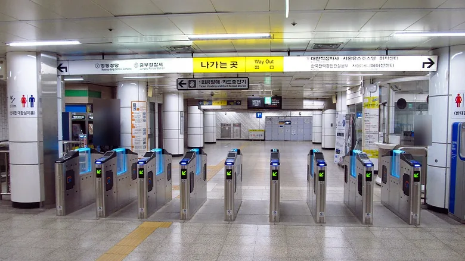
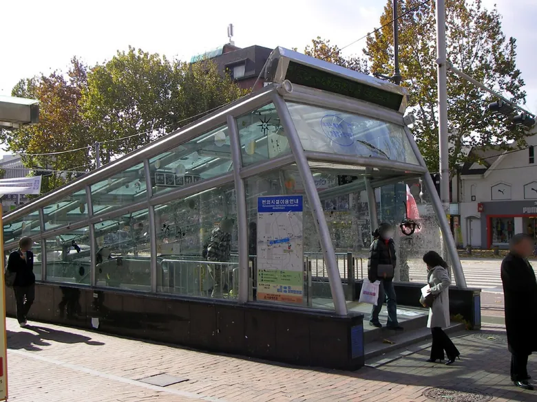
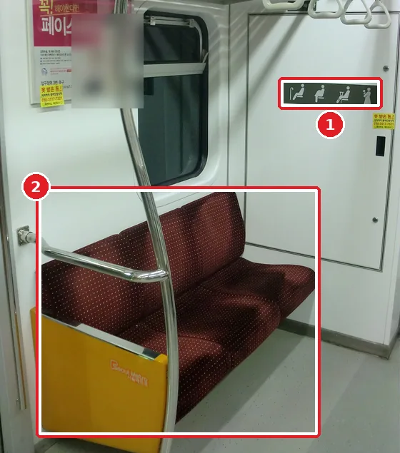
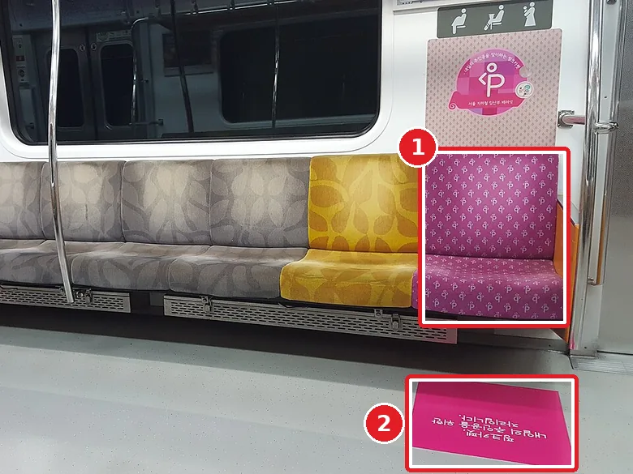

<a class="tr-btn go" href="#跟著做"><i class="ic ic-train-front" aria-hidden="true"></i>看7個步驟</a><a class="tr-btn" href="#用哪張卡"><i class="ic ic-credit-card" aria-hidden="true"></i>用哪張卡?</a>

<figure class="tr-hero"><figcaption>進站會看到的樣子:有感應器的閘門,和黃色的<b>나가는 곳(出口)</b>指標。 明洞站。照片:LERK,<a href="https://creativecommons.org/licenses/by-sa/4.0/" rel="noopener" target="_blank">CC BY-SA 4.0</a>,<a href="https://commons.wikimedia.org/wiki/File:Seoul-metro-424-Myeongdong-station-gate-20181124-081950.jpg" rel="noopener" target="_blank">維基共享資源</a>(自動對比校正、人物模糊)</figcaption></figure>

<ul class="tr-facts"><li><i class="ic ic-coins" aria-hidden="true"></i>1,550韓元<small>交通卡一趟(10公里內)</small></li><li><i class="ic ic-banknote" aria-hidden="true"></i>現金<small>T-money儲值</small></li><li><i class="ic ic-arrow-right-left" aria-hidden="true"></i>站內轉乘<small>不用再出閘門</small></li><li><i class="ic ic-moon" aria-hidden="true"></i>末班車<small>晚餐前先查</small></li></ul>

## 跟著做

<h3 class="tr-step" id="map-app">1<i class="ic ic-map" aria-hidden="true"></i>前一晚:先打開路線</h3>

<ul class="tr-facts"><li><i class="ic ic-smartphone" aria-hidden="true"></i>NAVER 地圖或Kakao Map<small>NAVER可切換中文,Kakao有英文</small></li><li><i class="ic ic-map-pin" aria-hidden="true"></i>存好車站和出口號碼<small>像「明洞站8號出口」</small></li></ul>

先打開明天第一段路線看看:路線號碼、轉乘、要走的出口。搭車時地圖App還會顯示你現在在哪裡。我們的判斷:在飯店做好,別等到閘門前。上車前就先在腦中搭過一次。

<h3 class="tr-step">2<i class="ic ic-credit-card" aria-hidden="true"></i>在機器上儲值</h3>

{{fig:seoul-subway-machine-yongsan|首爾龍山站(1號線,KORAIL)的售票・儲值機。各站機台不同。照片:YKJJ,[CC BY-SA 4.0](https://creativecommons.org/licenses/by-sa/4.0/),[維基共享資源](https://commons.wikimedia.org/wiki/File:Ticket_vending_machines.jpg)(裁切、加上編號)}}

1. 找這個藍色指標(Tickets / 自动售票机)。
2. 在機台螢幕上選儲值和金額。

{{fig:seoul-subway-machine-closeup|同類機台的近照:仁川蘇萊浦口站(KORAIL)。首爾交通公社的機台外觀不同。照片:LandAndTree,[CC BY 4.0](https://creativecommons.org/licenses/by/4.0/),[維基共享資源](https://commons.wikimedia.org/wiki/File:Ticket_Vending_and_Card_Reload_Machine_-_Seoul_Metropolitan_Subway_20240713.jpg)(裁切、加上編號)}}

1. 「Transit card here」:卡放在這裡。
2. 「Insert bills here」:投紙鈔。**T-money儲值只收現金。**
3. 單程票從這裡出來。

<aside class="tr-note"><i class="ic ic-banknote" aria-hidden="true"></i>就算其他都刷卡,T-money還是要準備1萬~2萬韓元紙鈔。確認螢幕上的新餘額再拿走卡片。</aside>

<h3 class="tr-step">3<i class="ic ic-log-in" aria-hidden="true"></i>閘門嗶卡進站</h3>

{{fig:seoul-subway-gate|建大入口站的閘門。照片:revi,[CC BY 2.0 KR](https://creativecommons.org/licenses/by/2.0/kr/),[維基共享資源](https://commons.wikimedia.org/wiki/File:%EA%B1%B4%EB%8C%80%EC%9E%85%EA%B5%AC_%EA%B0%9C%EC%B0%B0%EA%B5%AC.jpeg)(裁切、人物模糊、加上編號)}}

1. 卡靠上方的感應器,會顯示餘額。
2. 綠色箭頭:從箭頭指的通道進去。紅色✕表示這一側不能進(依照片判讀)。

<aside class="tr-note"><i class="ic ic-users" aria-hidden="true"></i>一人一卡。轉乘規定是「一人一張卡」,兩個人共用一張卡就沒有轉乘優惠。</aside>

<h3 class="tr-step">4<i class="ic ic-signpost" aria-hidden="true"></i>用路線號碼找月台</h3>

{{fig:seoul-subway-platform-sign|蠶室站2號線月台站名牌。照片:阿貴,[CC BY-SA 3.0](https://creativecommons.org/licenses/by-sa/3.0/),[維基共享資源](https://commons.wikimedia.org/wiki/File:Seoul_Subway_Jamsil_Station_Line_2_Platform_Direction_Info.jpg)(裁切、加上編號)}}

1. 你所在的車站。路線顏色圓圈裡是車站編號。
2. 下一站。如果是你要去的方向,就是這個月台。2號線是環狀線,所以站牌標的是下一站;其他路線也會標出終點站(依照片判讀)。

我們的判斷:不只看顏色,更要看**路線號碼**和方向(往哪個終點站)。下月台前先確認往哪個終點站。

<aside class="tr-note tip"><i class="ic ic-lightbulb" aria-hidden="true"></i><b>9號線有急行列車。</b>急行只停指定車站。要去的站急行不停,就在前一個急行停靠站換普通車。</aside>

<h3 class="tr-step">5<i class="ic ic-arrow-right-left" aria-hidden="true"></i>站內轉乘</h3>

不用再出閘門,跟著要換的路線號碼指標走。一張卡最多轉乘4次(搭5趟)。

<h3 class="tr-step">6<i class="ic ic-log-out" aria-hidden="true"></i>出站嗶卡,走存好的出口</h3>

{{fig:seoul-subway-exit-sign|明洞站閘門前的指標。照片:LERK,[CC BY-SA 4.0](https://creativecommons.org/licenses/by-sa/4.0/),[維基共享資源](https://commons.wikimedia.org/wiki/File:Seoul-metro-424-Myeongdong-station-gate-20181124-081950.jpg)(裁切、加上編號)}}

1. 跟著黃色的**나가는 곳 / Way Out / 出口**指標走。
2. 圓圈裡的數字是出口號碼,箭頭是方向。走你存好的那個。
3. 這個箭頭指向單程票・儲值機。

{{fig:seoul-subway-exit-zoom|放大:⑨號出口明洞聖堂、⑩號出口中部警察署,往這邊←。照片:LERK,[CC BY-SA 4.0](https://creativecommons.org/licenses/by-sa/4.0/),[維基共享資源](https://commons.wikimedia.org/wiki/File:Seoul-metro-424-Myeongdong-station-gate-20181124-081950.jpg)(裁切、放大)}}

<aside class="tr-note"><i class="ic ic-triangle-alert" aria-hidden="true"></i><b>出站一定要嗶卡。</b>票價按距離計算,沒嗶卡出站,轉乘會斷掉、還會被多收錢。</aside>

<figure class="tr-photo"><figcaption>從地面看出口的樣子(惠化站1號出口)。我們選的結尾畫面:就從那個出口上到地面,第一步就朝著要去的方向。 惠化站1號出口,2006年照片。照片:Jolly6656(韓文維基百科),公有領域,<a href="https://commons.wikimedia.org/wiki/File:Seoul_subway_Hyehwa_Station_Exit_01.jpg" rel="noopener" target="_blank">維基共享資源</a></figcaption></figure>

<h3 class="tr-step">7<i class="ic ic-ticket" aria-hidden="true"></i>用單程票?拿回500韓元</h3>

{{fig:seoul-subway-refund|押金退還機。照片:Sgroey,[CC BY-SA 4.0](https://creativecommons.org/licenses/by-sa/4.0/),[維基共享資源](https://commons.wikimedia.org/wiki/File:Seoul_subway_single_use_card_deposit_refund_machine.jpg)(裁切、加上編號)}}

1. 閘門附近的**押金退還機**(機身上有中文)。
2. 把單程票放進這裡。
3. 500韓元押金從這裡出來。

<aside class="tr-note ok"><i class="ic ic-circle-check" aria-hidden="true"></i><b>要接公車的話</b>,用同一張卡在出站後30分鐘內(晚上9點~隔天早上7點為60分鐘內)上車,才有轉乘優惠。公車怎麼搭:<a href="/zh-tw/seoul-bus/">首爾公車</a>。</aside>

<h2 id="用哪張卡">T-money還是WOWPASS?該用哪張卡?</h2>

**我們的判斷:只搭車,選T-money;想用一張卡也換錢、在店裡刷卡,選WOWPASS。** 地鐵和公車車資,兩張卡都一樣從T-money餘額扣。WOWPASS的這個餘額和消費餘額是分開的。

| | T-money | WOWPASS |
|---|---|---|
| 卡片費用 | 機場鐵路站售卡機:15,000韓元(卡片5,000韓元+車資10,000韓元)。市區:以店家標示為準 | 5,500韓元(在機台事先預約,原價6,000韓元) |
| 在哪買 | 便利商店櫃台、車站機器([怎麼買](/zh-tw/convenience-store/#tmoney)) | 地鐵站、飯店、便利商店等處的WOWPASS機台 |
| 儲值 | 車站售票機、便利商店,用韓元現金 | 消費餘額:WOWPASS機台(16種外幣現金或信用卡)或App |
| 交通餘額分開嗎? | 不分開,只有一個餘額 | 分開。T-money餘額用韓元現金儲值,或在App(NFC)把WOWPASS餘額轉進去 |
| 剩下的錢拿回來 | 依剩餘金額到不同地方退:2萬韓元以下,GS25、7-ELEVEN等便利商店;3萬韓元以下,CU、emart24等便利商店;再多就到首爾地鐵站務室;50,000韓元以上只能到T-money總公司(首爾站10號出口,平日9〜18點)。手續費500韓元 | 消費餘額:在WOWPASS機台領韓元現金(手續費1,000韓元,一次最多10萬韓元)。T-money餘額:同T-money |
| 在機場拿 | 第1、第2航廈機場鐵路站的T-money售卡機賣15,000韓元的卡,可用海外信用卡 | 機場SK電訊漫遊中心:WOWPASS+T-money+SIM組合 |

**三種付款方式總覽。** 我們的判斷:幾乎所有人用儲值卡就對了,單程票只是備案。三種方式用一個問題分開:一天搭幾趟、會不會離開首爾。

<ul class="tr-choose"><li><i class="ic ic-credit-card" aria-hidden="true"></i><b>T-money,或內建T-money的WOWPASS</b>一般3~7天首爾行程T-money是韓國的標準交通卡,用法就像悠遊卡。每趟比單程票便宜100韓元,轉乘公車也有優惠。WOWPASS的T-money餘額要和WOWPASS餘額分開儲值(WOWPASS官方說明)。</li><li><i class="ic ic-calendar-days" aria-hidden="true"></i><b>氣候同行卡短期券</b>只在首爾市內、一天3趟以上、連續3天以上3日券10,000韓元+卡片3,000韓元,約等於8趟交通卡票價。一天只搭1~2趟,或同一天要去水原、板橋的人不需要。</li><li><i class="ic ic-ticket" aria-hidden="true"></i><b>單程票</b>還沒有卡時票價加100韓元,另付押金500韓元。只能搭首都圈鐵路,公車不能用。</li></ul>

<aside class="tr-note tip"><i class="ic ic-info" aria-hidden="true"></i>剛落地,沒卡也沒現金?用新售票機買氣候同行卡或單程票。2026年3月17日起接受海外發行的信用卡、簽帳卡。</aside>

**第一次買卡:** 在市區,便利商店櫃台或車站機器就買得到([在便利商店怎麼買](/zh-tw/convenience-store/#tmoney))。儲值像上面第2步一樣,在售票機用現金。沒有現金的話,仁川機場第1、第2航廈機場鐵路站的T-money自動販賣機,可以用海外信用卡買已內含交通費的T-money(15,000韓元)。

不是必要:機場也買得到交通卡,不一定要先訂。想一落地就拿到:

<b>T-money卡</b>,機場取卡。儲值還是在車站用現金。 照片: <a href="https://commons.wikimedia.org/wiki/File:T-money_card.jpg" rel="noopener" target="_blank">zisk</a>, Public domain (PD-self: released by the author), 維基共享資源

{{aff:klook_tmoney|預訂T-money卡,機場取卡}}

<i class="ic ic-wallet" aria-hidden="true"></i>
<b>WOWPASS</b>:換錢、刷卡、T-money三合一。交通用的T-money餘額要另外儲值(車站、便利商店用現金,或在App把WOWPASS餘額轉進去)。

{{aff:klook_wowpass|或是換錢、刷卡、T-money三合一的WOWPASS}}

預訂的卡在哪裡領、WOWPASS怎麼儲值、剩下的錢怎麼拿回:[機場頁面「落地前先準備」](/zh-tw/airport-to-seoul/#prep)。

## 第一天常見錯誤

<ul class="tr-oops"><li><i class="ic ic-triangle-alert" aria-hidden="true"></i><b>出站沒嗶卡。</b>轉乘會斷掉,還會被多收錢。</li><li><i class="ic ic-triangle-alert" aria-hidden="true"></i><b>把單程票丟掉。</b>500韓元押金就沒了。</li><li><i class="ic ic-triangle-alert" aria-hidden="true"></i><b>想用信用卡幫T-money儲值。</b>車站儲值只收現金。</li><li><i class="ic ic-triangle-alert" aria-hidden="true"></i><b>拿氣候同行卡去首爾以外或搭新盆唐線。</b>下車時要另外付錢。</li><li><i class="ic ic-triangle-alert" aria-hidden="true"></i><b>搭上不停你那站的9號線急行。</b></li><li><i class="ic ic-triangle-alert" aria-hidden="true"></i><b>以為末班車時間是固定的。</b>每天出門前再查一次。</li></ul>

## 機場鐵路:普通車與直達車

<figure class="tr-photo"><figcaption>仁川機場第1航廈站橘色的<b>直達車(Express Train)</b>區,是要另外買票的直達車用的。 照片:MNXANL,<a href="https://creativecommons.org/licenses/by-sa/4.0/" rel="noopener" target="_blank">CC BY-SA 4.0</a>,<a href="https://commons.wikimedia.org/wiki/File:202403_AREX_Express_Train_Concourse_at_Incheon_International_Airport_Terminal_1_Station.jpg" rel="noopener" target="_blank">維基共享資源</a>(自動對比校正)</figcaption></figure>

我們的判斷:機場鐵路**普通車**就當作一條用交通卡搭的地鐵線;**直達車**要另外買票。

- **普通車:** 每站都停(含弘大入口、孔德),嗶交通卡進站,適用首都圈轉乘優惠。
- **直達車:** 首爾站~仁川機場中途不停,對號座,上車前另外買票,成人13,000韓元。

不是必要,但想在落地前先預訂直達車票:

{{aff:klook_airport|事先預訂機場鐵路直達車}}

買了之後:機場鐵路官方車票,把QR碼對準直達車閘門的QR掃描器,門就會開。在Klook買的票請照確認單的使用方式。搭車處和變更、退票:[機場頁面「落地前先準備」](/zh-tw/airport-to-seoul/#prep)。

完整比較在[仁川機場到首爾](/zh-tw/airport-to-seoul/)。

<i class="ic ic-route" aria-hidden="true"></i>普通車與直達車,一張圖看懂

{{fig:seoul-subway-8|同一條路線兩種車:普通車與直達車(Nadri繪製:跳過哪些站,照片拍不出來)}}

## 接著看

<ul class="tr-next"><li><a href="/zh-tw/seoul-bus/"><i class="ic ic-bus" aria-hidden="true"></i>首爾公車:上車嗶、下車嗶<i class="ic ic-arrow-right" aria-hidden="true"></i></a></li><li><a href="/zh-tw/airport-to-seoul/"><i class="ic ic-plane" aria-hidden="true"></i>仁川機場到首爾<i class="ic ic-arrow-right" aria-hidden="true"></i></a></li><li><a href="/zh-tw/getting-around/"><i class="ic ic-route" aria-hidden="true"></i>首爾交通:計程車、錯過末班車<i class="ic ic-arrow-right" aria-hidden="true"></i></a></li><li><a href="/zh-tw/emergency/"><i class="ic ic-triangle-alert" aria-hidden="true"></i>東西忘在車上?首爾失物招領中心<i class="ic ic-arrow-right" aria-hidden="true"></i></a></li></ul>

遇到這裡沒寫的錯誤,請用本頁最後的回報更新框告訴我們。

## 更多細節

<i class="ic ic-list-checks" aria-hidden="true"></i>一句話結論表

| 情況 | 這樣做 | 原因 |
|---|---|---|
| 一般3~7天首爾行程 | T-money,或內建T-money的WOWPASS | 每趟比單程票便宜100韓元,轉乘公車也有優惠 |
| 只在首爾市內、一天分開搭3趟以上,連續3天以上 | 氣候同行卡短期券 | 3日券10,000韓元+卡片3,000韓元,約等於8趟交通卡票價 |
| 剛落地,沒卡也沒現金 | 用新售票機買氣候同行卡或單程票 | 2026年3月17日起接受海外發行的信用卡、簽帳卡 |
| 晚上比較晚才回住處 | 立刻查你那一站的末班車 | 以2022年為準,週末比平日早收班。若2025年宣布的調整(未確認實施)已上路,預計末班車再早約30分鐘 |

這頁只講地鐵。市區公車請看[首爾公車](/zh-tw/seoul-bus/),計程車請看[首爾交通](/zh-tw/getting-around/),機場進市區請看[仁川機場到首爾](/zh-tw/airport-to-seoul/)。

怎麼選的:三種付款方式,用一個問題分開——一天搭幾趟、會不會離開首爾。刻意沒寫的:同一台機器賣的定期票(給每天通勤用,不適合短期旅行),以及去水原、仁川等首爾以外的移動。

<i class="ic ic-calendar-days" aria-hidden="true"></i>氣候同行卡短期券:價格與範圍

- **氣候同行卡短期券**:1、2、3、5、7日券分別是5,000/8,000/10,000/15,000/20,000韓元,實體卡另付3,000韓元。可搭首爾境內地鐵和首爾市公車,從開始日首班車用到結束日末班車。1日券不是24小時,而是用到當天末班車。
- 儲值當天就是開始使用日,不能提前儲值(首爾市氣候同行卡說明)。
- 新盆唐線、GTX、廣域公車、機場巴士、首爾以外的地鐵站**都不能用**。在首爾上車、到首爾以外的站下車,站務員會另外收費;首爾市舉的例子是鍾路3街上車、仁德院下車。例外:可以在仁川機場第1、第2航廈站下車(不能從那裡上車)。
- 不需要的人:一天只搭1~2趟,或同一天要去水原、板橋等首爾以外地區。

<i class="ic ic-coins" aria-hidden="true"></i>票價:交通卡與單程票

{{fig:seoul-subway-3|交通卡與單程票比較(成人,Nadri依首爾市票價表繪製)}}

我們的判斷:票價交給地圖App算,只要知道為什麼交通卡比較便宜。

- 成人基本票價(10公里內,2025年6月28日起):交通卡**1,550韓元**,單程票**1,650韓元**。50公里內每5公里加100韓元,超過50公里每8公里加100韓元。
- 一張卡最多轉乘4次(搭5趟)。重搭同一條路線不算轉乘。

<i class="ic ic-banknote" aria-hidden="true"></i>售票機與海外卡

- 首爾交通公社的新型機台買單程票、定期票、氣候同行卡可以刷信用卡,但T-money這類預付卡儲值仍只收現金。
- 1~8號線273個站的440台新售票機接受海外發行的卡(手續費平均約3.7%),但只能買氣候同行卡和單程票。
- WOWPASS則可以在App裡用WOWPASS餘額幫T-money儲值。

<i class="ic ic-armchair" aria-hidden="true"></i>尖峰時段與請空著的座位

我們的判斷:帶行李箱的話,避開平日早上7~9點。

<figure class="tr-photo"><figcaption><b>1</b> 圖示,<b>2</b> 車廂一端的博愛座。 照片:hyolee2,<a href="https://creativecommons.org/licenses/by-sa/3.0/" rel="noopener" target="_blank">CC BY-SA 3.0</a>,<a href="https://commons.wikimedia.org/wiki/File:Priority_seats_Seoul_Metro_3000.JPG" rel="noopener" target="_blank">維基共享資源</a>(裁切、廣告模糊、加上編號)</figcaption></figure>

<figure class="tr-photo"><figcaption><b>1</b> 粉紅色座位,<b>2</b> 地面的粉紅標示。 首爾地鐵,2018年。照片:Garam。Attribution licence: “allows anyone to use it for any purpose, provided that the copyright holder is properly attributed”,<a href="https://commons.wikimedia.org/wiki/File:Designated_seats_for_pregnant_women_of_Seoul_Metro_Line_1_in_2018.jpg" rel="noopener" target="_blank">維基共享資源</a>(裁切、加上編號)</figcaption></figure>

- **博愛座**(車廂兩端)留給長者、身障者、受傷的人和孕婦。我們的建議:不要坐。
- **粉紅色座位**(每節2個)是孕婦優先座,請空著。懷孕初期看不出來,有些孕婦會別粉紅色徽章。
- 首爾市2014年交通卡分析:早上7~9點集中了全天20.2%的乘客,最擠的10分鐘是8點10分~19分。
- 9號線早上的急行最高擁擠度達192.5%。首爾市從2026年11月16日起增開早上急行,9號線營運公司也呼籲通勤時段改搭普通車。

<i class="ic ic-moon" aria-hidden="true"></i>末班車

我們的判斷:晚餐前就想好怎麼回去。

- 首爾市2022年把平日末班車延長到約**凌晨1點抵達終點站**,週六、週日、國定假日不在延長範圍內(2025年宣布調整前的標準)。
- 2025年5月首爾市宣布,1~8號線首班車和末班車各提前30分鐘(最快2025年8月起)(首爾市2025年5月27日、Korea Herald 2025年5月22日,見下方出處)。是否已經實施,我們沒能確認。如果已照宣布實施,預計末班車會比凌晨1點左右早約30分鐘。
- 所以不要死記時間,用NAVER 地圖或Kakao Map查你那一站的末班車。KORAIL營運的區段(1、3、4號線部分)可能不同。

錯過末班車的話,請看[首爾交通](/zh-tw/getting-around/)。

<i class="ic ic-info" aria-hidden="true"></i>資料來源與照片

2026年11月26日(韓國時間)實際開啟確認。首爾市交通網站:<a href="https://news.seoul.go.kr/traffic/traffic_price" rel="noopener" target="_blank">交通票價</a>(2025年6月28日調整)、<a href="https://news.seoul.go.kr/traffic/transfer_discount" rel="noopener" target="_blank">整合轉乘優惠</a>(2026年2月2日更新)、<a href="https://news.seoul.go.kr/traffic/archives/1763" rel="noopener" target="_blank">單程交通卡</a>、<a href="https://news.seoul.go.kr/traffic/archives/510651" rel="noopener" target="_blank">氣候同行卡短期券介紹</a>(2026年10月12日更新)與<a href="https://news.seoul.go.kr/traffic/public/climatecard-faq/faq-short" rel="noopener" target="_blank">FAQ</a>、<a href="https://news.seoul.go.kr/traffic/archives/516544" rel="noopener" target="_blank">海外信用卡購買新聞稿</a>(2026年3月16日)、<a href="https://news.seoul.go.kr/traffic/archives/27958" rel="noopener" target="_blank">孕婦優先座說明</a>。首爾市 Media Hub:<a href="https://mediahub.seoul.go.kr/archives/2015499" rel="noopener" target="_blank">新型售票機與預付卡現金儲值</a>(2025年9月2日)、<a href="https://mediahub.seoul.go.kr/archives/2016718" rel="noopener" target="_blank">海外卡事實說明</a>(2026年1月7日)、<a href="https://mediahub.seoul.go.kr/archives/2004711" rel="noopener" target="_blank">深夜營運恢復</a>(2022年5月30日)、<a href="https://mediahub.seoul.go.kr/archives/864021" rel="noopener" target="_blank">2014年交通卡分析</a>(2015年4月29日)、<a href="https://mediahub.seoul.go.kr/archives/2019693" rel="noopener" target="_blank">9號線急行擴大</a>(2026年10月14日)。首爾市英文網站:<a href="https://english.seoul.go.kr/climate-cards-and-single-journey-transit-tickets-now-accepting-international-credit-cards-no-cash-needed/" rel="noopener" target="_blank">海外卡</a>(2026年3月17日)、<a href="https://english.seoul.go.kr/autonomous-bus-and-earlier-subway-service-for-early-morning-commuters/" rel="noopener" target="_blank">首末班車提前30分鐘計畫</a>(2025年5月27日)。<a href="https://www.metro9.co.kr/kor/sub01_03.do" rel="noopener" target="_blank">首爾市地鐵9號線早晨列車搭乘說明</a>。機場鐵路<a href="https://www.airportrailroad.com/train/normal/introduce" rel="noopener" target="_blank">普通車</a>、<a href="https://www.airportrailroad.com/train/express/introduce" rel="noopener" target="_blank">直達車</a>說明。<a href="https://wowpass.io/en/guide" rel="noopener" target="_blank">WOWPASS官方說明</a>。Korea Herald:<a href="https://www.koreaherald.com/article/10493311" rel="noopener" target="_blank">首末班車提前</a>(2025年5月22日)、<a href="https://www.koreaherald.com/article/3154442" rel="noopener" target="_blank">孕婦座與徽章</a>(2023年6月27日)。Korea Times:<a href="https://www.koreatimes.co.kr/southkorea/health/20171206/priority-seats-for-pregnant-women-complaint-rich-territory-on-subway" rel="noopener" target="_blank">孕婦優先座</a>(2017年12月6日)。 2026年11月26日另外查閱:Korea Herald <a href="https://www.koreaherald.com/article/10694586" rel="noopener" target="_blank">地鐵售票機接受海外發行卡</a>(2026年3月16日)、<a href="https://www.koreaherald.com/article/10608612" rel="noopener" target="_blank">大眾運輸使用訣竅</a>(2025年11月6日,地圖App)。

2026年11月27日確認:機場鐵路 <a href="https://www.airportrailroad.com/train/express/guide" rel="noopener" target="_blank">直達車使用說明</a>(QR閘門);WOWPASS <a href="https://www.wowpass.io/zh-TW/guide" rel="noopener" target="_blank">使用說明</a>(T-money餘額用車站、便利商店現金或App的NFC另外儲值);韓國先驅報 <a href="https://www.koreaherald.com/article/10947683" rel="noopener" target="_blank">機場鐵路T-money卡</a>(內含交通費,15,000韓元、海外信用卡)。未能確認:Klook商品頁(擋下自動連線)。

2026年11月27日22:25〜22:28(韓國時間)開啟確認(T-money和WOWPASS比較表):WOWPASS <a href="https://www.wowpass.io/zh-TW/guide" rel="noopener" target="_blank">使用說明</a>(T-money餘額在地鐵站、便利商店用韓元現金或App的NFC儲值;WOWPASS餘額在機台提領,一次最多10萬韓元、每次手續費1,000韓元;T-money退款在便利商店、首爾地鐵站務室、T-money總公司,手續費500韓元,5萬韓元以上只能到T-money總公司,首爾站10號出口、平日9〜18點;可用16種外幣現金或信用卡儲值)與<a href="https://www.wowpass.io/zh-TW/product" rel="noopener" target="_blank">如何領取</a>(6,000韓元,地鐵站、飯店、便利商店機台預約5,500韓元;SKT行動漫遊中心的WOWPASS+Tmoney+SIM組合)。機場鐵路T-money 15,000韓元見上方韓國先驅報。未採用:T-money網站(www.tmoney.co.kr打得開,但找不到卡片價格與退款規定的頁面;eng.tmoney.co.kr連不上)。 依金額的退款地點(2萬、3萬、5萬韓元)來自同一個WOWPASS指南畫面文字(網頁程式,2026年11月27日確認)。

照片:來自維基共享資源,授權寫在每張照片的說明裡。票價比較與普通車・直達車的圖由Nadri繪製。

