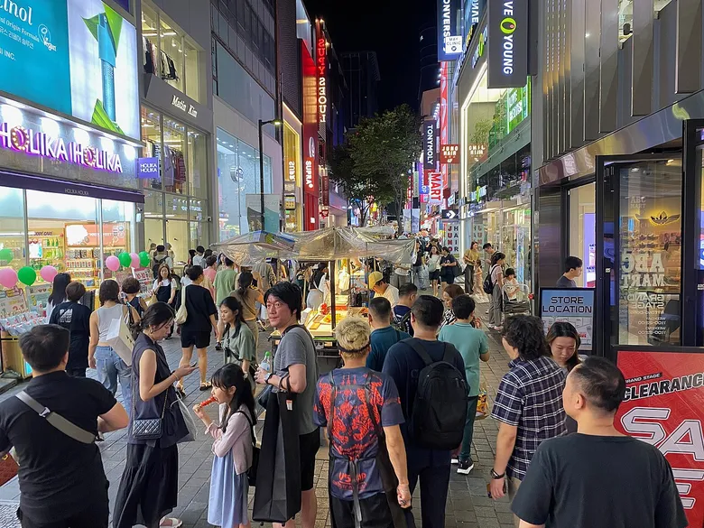
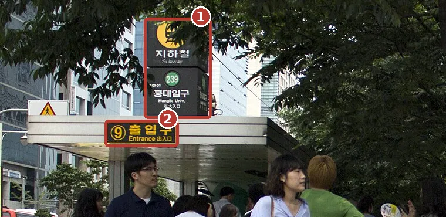
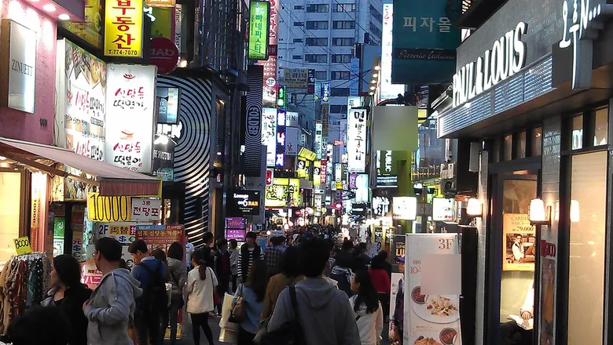
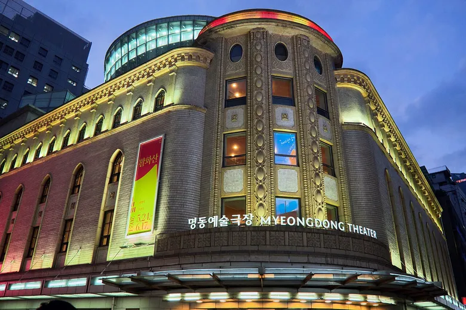
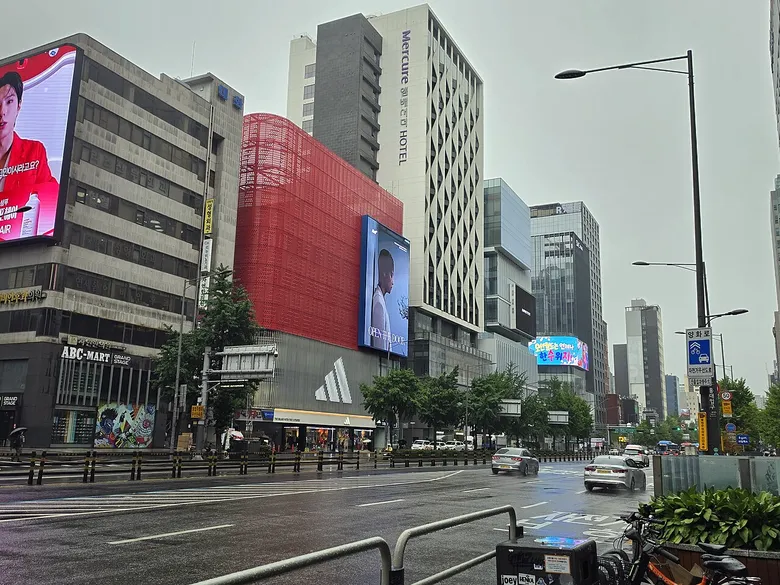

<a class="tr-btn go" href="#pick"><i class="ic ic-map-pin" aria-hidden="true"></i>去哪一區</a><a class="tr-btn" href="#pay"><i class="ic ic-receipt" aria-hidden="true"></i>付款・退稅</a>

<figure class="tr-hero acc-hero"><figcaption><b>明洞的夜晚。</b> 大街兩側是美妝店,中間排著小吃攤。照片: Sgroey(2024),<a href="https://creativecommons.org/licenses/by-sa/4.0/deed.zh_TW" rel="noopener" target="_blank">CC BY-SA 4.0</a>,<a href="https://commons.wikimedia.org/wiki/File:Myeongdong_night_market_seoul_1.jpg" rel="noopener" target="_blank">維基共享資源</a>(縮小、自動調亮)</figcaption></figure>

<ul class="tr-facts"><li><i class="ic ic-train-front" aria-hidden="true"></i>三區都在2號線<small>乙支路入口、聖水、弘大入口站</small></li><li><i class="ic ic-signpost" aria-hidden="true"></i>出口號碼帶路<small>明洞5號、聖水4號、弘大9號</small></li><li><i class="ic ic-id-card" aria-hidden="true"></i>護照正本<small>結帳時扣稅(退稅商店)</small></li><li><i class="ic ic-receipt" aria-hidden="true"></i>單張收據1.5萬〜100萬韓元<small>當場即時退稅</small></li></ul>

<h2 id="pick">去哪一區</h2>

這頁講的是在哪裡**買**。在哪裡**住**請看[首爾住宿區域怎麼選](/zh-tw/seoul-areas/)。

<ul class="tr-choose"><li><i class="ic ic-sparkles" aria-hidden="true"></i><b>K-beauty、第一次來首爾: 明洞</b>2號線乙支路入口站5號或4號線明洞站8號出口。Visit Seoul稱它是「購物第一站」。我們認為剛開門時最好。<a href="#myeongdong">看明洞</a></li><li><i class="ic ic-store" aria-hidden="true"></i><b>韓國新品牌、快閃店: 聖水</b>2號線聖水站4號出口。練武場街有Olive Young N 聖水、MUSINSA Mega Store。週末很擠,我們建議平日。<a href="#seongsu">看聖水</a></li><li><i class="ic ic-shopping-basket" aria-hidden="true"></i><b>年輕服飾、K-pop周邊: 弘大</b>2號線弘大入口站9號出口走350公尺的R3時尚街。我們建議傍晚到晚上。<a href="#hongdae">看弘大</a></li></ul>

{{fig:shopping-streets-1|我們的判斷: 各區適合買什麼、什麼時候去}}

## 用出口號碼找路

在首爾找逛街區域只要一個技巧: **站名+出口號碼**。學會一次,哪一區都一樣。

<figure class="tr-photo"><figcaption><b>1</b> 地鐵標示: 站名(弘大入口)和站號(239)。<b>2</b> 出口號碼(9號出入口)。到了地面,用這個標示確認出口對不對。照片: Jonathan Kramer(弘大入口站9號出口),<a href="https://creativecommons.org/licenses/by-sa/3.0/deed.zh_TW" rel="noopener" target="_blank">CC BY-SA 3.0</a>,<a href="https://commons.wikimedia.org/wiki/File:Hongik_University_Station_exit_9.jpg" rel="noopener" target="_blank">維基共享資源</a>(裁切、自動調亮、加上框與編號)</figcaption></figure>

1. **在地圖App找店。** 在NAVER 地圖或Kakao Map輸入店名,會出現最近的車站和出口號碼。也可以直接用這頁寫的出口號碼。
2. **刷卡出站後,跟著出口號碼指標走。** 圓圈裡的數字是出口號碼,箭頭是方向([首爾地鐵第6步](/zh-tw/seoul-subway/)有實際指標照片)。
3. **到地面後像上面照片一樣確認出口號碼。** 大站出錯出口要走很遠。
4. **從出口到店家,在地圖App的路線規劃選「步行」跟著走。** 下面每一區都寫了出口看得到的地標(建築、街名)。還是不確定的話,到觀光服務中心(弘大是7號出口附近的麻浦觀光服務中心)或向店員出示這頁上的店名。

怎麼搭地鐵、看路線圖、儲值交通卡,在[首爾地鐵](/zh-tw/seoul-subway/)用照片整理好了。

{{fig:shopping-streets-2|示意圖: 漢江北邊的逛街區域(距離、比例非實際)}}

2號線是繞首爾一圈的環狀線(韓國先驅報),三區都有2號線車站。

<h2 id="myeongdong">明洞: 美妝,也是第一次來首爾</h2>

<figure class="tr-photo"><figcaption><b>明洞購物街</b>(2012年照片)。照片: Christian Bolz,<a href="https://creativecommons.org/licenses/by-sa/4.0/deed.zh_TW" rel="noopener" target="_blank">CC BY-SA 4.0</a>,維基共享資源</figcaption></figure>

{{fig:shopping-streets-4|明洞: 哪個出口到哪家店}}

- **怎麼去:** 2號線乙支路入口站5號出口或4號線明洞站8號出口,是Olive Young明洞全球旗艦店指引的出口。
- **有什麼:** 兩家大型百貨公司、購物中心、品牌店、攤販,大街兩側有小吃攤。明洞地下購物中心有K-pop商品和紀念品。Visit Seoul寫道,最近特別多外國遊客。
- **地標:** 明洞正中央的**明洞藝術劇場十字路口**,順著小巷走就會到。明洞聖堂在UNESCO路的盡頭(Visit Seoul)。

<figure class="tr-photo"><figcaption><b>明洞藝術劇場。</b> 看到這棟建築就是明洞正中央的十字路口。照片: lumoplank,<a href="https://creativecommons.org/publicdomain/zero/1.0/deed.zh_TW" rel="noopener" target="_blank">CC0</a>,<a href="https://commons.wikimedia.org/wiki/File:Myeongdong,_Seoul_-_Myeongdong3165.jpg" rel="noopener" target="_blank">維基共享資源</a>(縮小、自動調亮)</figcaption></figure>

- **Olive Young明洞全球旗艦店:** 明洞街53。每天10:00〜22:30(依店家狀況可能變動)。1〜2樓,結帳即時退稅,微信支付、支付寶等行動支付,禮品包裝,外語服務。店裡沒有廁所,請你使用附近地鐵站的廁所。
- **適合的時間:** 剛開門。這是我們的推測,不是人潮資料。
- **附近:** 明洞站旁12層樓的[DAISO](/zh-tw/daiso/)。免稅店有樂天免稅店總店(乙支路入口站7・8號出口)、新世界免稅店(會賢站5號出口)([免稅店](/zh-tw/duty-free/))。
- **可以跳過的人:** 想走當地人逛的街的人。

<h2 id="seongsu">聖水: 新品牌和快閃店</h2>

<figure class="tr-photo"><figcaption><b>練武場街</b>,從聖水站4號出口開始。照片: Dr. Thomas Liptak,<a href="https://creativecommons.org/licenses/by-sa/4.0/deed.zh_TW" rel="noopener" target="_blank">CC BY-SA 4.0</a>,<a href="https://commons.wikimedia.org/wiki/File:Seoul,_Seongdong_District,_Seongsu_(Yeonmujang-gil).jpg" rel="noopener" target="_blank">維基共享資源</a>(裁切、自動調亮)</figcaption></figure>

{{fig:shopping-streets-5|聖水站: 4號出口或3號出口}}

- **怎麼去:** 2號線聖水站4號出口,練武場街從這裡開始。MUSINSA Mega Store距3號出口475公尺。
- **是什麼地方:** 1950年代末開始有小工廠,1967年後手工鞋業者聚集成為手工鞋街,現在是時尚、美妝、快閃店、旗艦店聚集的地方(Visit Seoul)。
- **Olive Young N 聖水:** 練武場7街13的Factoryal聖水大樓,距4號出口118公尺(步行約1分鐘)。2024年11月底開幕。1樓是品牌快閃輪替的廣場,每天前300名免費四格照;2樓美妝與文化,3樓保養與健康,4樓VIP休息室。化妝等免費服務需預約,每週五中午開放下週的預約。
- **MUSINSA Mega Store 聖水:** 2026年4月24日開幕,地上4層加地下層,約6,600平方公尺。2樓是MUSINSA第一個實體美妝樓層。每天11:00〜22:00。
- **適合的時間:** 平日。韓國先驅報的聖水購物指南(2026年7月)寫道,MUSINSA Mega Store週末很擠,有些店週末通常要排隊。
- **退稅:** 各店規則我們沒能確認。帶著護照,結帳前先問。
- **可以跳過的人:** 不想排隊的人、只為看網路上某個快閃店的人。快閃店有固定期間(例: MUSINSA Store聖水的Jojotown快閃店是2026年10月16〜31日)。先確認還有沒有。

<h2 id="hongdae">弘大: 年輕服飾和K-pop周邊</h2>

<figure class="tr-photo"><figcaption><b>弘大街頭</b>(2026年)。照片: Qhairy,<a href="https://creativecommons.org/licenses/by/4.0/deed.zh_TW" rel="noopener" target="_blank">CC BY 4.0</a>,<a href="https://commons.wikimedia.org/wiki/File:Hongdae_Street_02.jpg" rel="noopener" target="_blank">維基共享資源</a>(縮小、自動調亮)</figcaption></figure>

{{fig:shopping-streets-6|弘大入口站: 9號出口或1號出口}}

- **怎麼去:** 弘大入口站(2號線、機場鐵路、京義・中央線)9號出口走350公尺就是R3時尚街。因為是機場鐵路站,往返機場那天也好順路。
- **有什麼:** 弘益大學周邊。R3一帶服飾店和美妝店很密集。1號出口那邊原本的LINE FRIENDS旗艦店改成K-Pop Square(每天11:00〜22:00)。Kakao Friends旗艦店在8號出口。
- **COVERNAT弘大旗艦店:** 9號出口步行約10分鐘(Jandari-ro 24),附近有複合文化空間KT&G想像庭院。每天12:00〜21:00,外國旅客可在櫃台退稅,可用支付寶。
- **需要幫忙:** 麻浦觀光服務中心,7號出口步行3分鐘。
- **適合的時間:** 傍晚到晚上。這是看營業時間做的判斷,不是人潮資料;有些旗艦店中午才開。
- **可以跳過的人:** 想安靜逛的人。

<h2 id="pay">付款: 刷卡和退稅</h2>

大型商店可以刷卡,Olive Young明洞全球旗艦店和COVERNAT弘大等也收支付寶、微信支付。現金和卡片準備看[換錢與付款](/zh-tw/money/)。

{{fig:shopping-streets-7|單張收據的即時退稅範圍}}

<h3 class="tr-step">1<i class="ic ic-id-card" aria-hidden="true"></i>帶護照正本</h3>

<figure class="tr-photo"><figcaption>收銀台上方有這類標示(「Tax Free」「Tax Refund」、準備護照的告示)的店就可以。沒有的話結帳前先問。照片: Sgroey,<a href="https://creativecommons.org/licenses/by-sa/4.0/deed.zh_TW" rel="noopener" target="_blank">CC BY-SA 4.0</a>,<a href="https://commons.wikimedia.org/wiki/File:Olive_Young_Myeongdong.jpg" rel="noopener" target="_blank">維基共享資源</a>(裁切、自動調亮)</figcaption></figure>

結帳即時退稅要有護照正本,照片不行。適用於訪韓旅客([誰適用](/zh-tw/tax-refund/))。

<h3 class="tr-step">2<i class="ic ic-receipt" aria-hidden="true"></i>在同一家店讓一張收據落在1萬5千〜100萬韓元</h3>

不同店的收據不能合併。每次入境即時退稅合計上限500萬韓元。

<h3 class="tr-step">3<i class="ic ic-credit-card" aria-hidden="true"></i>付款時一起出示護照</h3>

當場扣掉稅金。依Olive Young明洞全球旗艦店FAQ,退稅約為購買金額的5〜8%,以1,000韓元為單位計算。衛生用品、購物袋、果乾等不適用。

<h3 class="tr-step">4<i class="ic ic-plane" aria-hidden="true"></i>超過100萬韓元或沒帶護照</h3>

結帳時不能即時退稅。拿退稅單到機場退稅櫃台辦理,步驟看[退稅](/zh-tw/tax-refund/)。同一家GTF業者的其他店退稅單,也可以到Olive Young明洞全球旗艦店2樓全球服務休息室的GTF櫃台辦(要護照正本)。

## 常見錯誤

<ul class="tr-oops"><li><i class="ic ic-triangle-alert" aria-hidden="true"></i>在大站沒看出口號碼就出站。走到反方向要走很遠。</li><li><i class="ic ic-triangle-alert" aria-hidden="true"></i>只帶護照照片。結帳退稅要正本。</li><li><i class="ic ic-triangle-alert" aria-hidden="true"></i>分三家店買。每張收據都要超過1萬5千韓元。</li><li><i class="ic ic-triangle-alert" aria-hidden="true"></i>去聖水看已經結束的快閃店。先確認日期。</li></ul>

<i class="ic ic-route" aria-hidden="true"></i>2號線半天路線範例

{{fig:shopping-streets-3|2號線半天逛街路線}}

1. 聖水站4號出口 → 練武場街、Olive Young N 聖水(118公尺)。
2. 從聖水站搭2號線 → 弘大入口站。
3. 弘大入口站9號出口 → R3時尚街(350公尺)。COVERNAT開到21:00,可以排最後。

美妝優先的話,把聖水換成明洞(乙支路入口站,2號線)。快閃店是選項。

<i class="ic ic-list-checks" aria-hidden="true"></i>出發前的短清單、挑禮物

1. **依種類寫下想買的:** 美妝、衣服、K-pop周邊。上面的「去哪一區」幫你換成地點。
2. **網路上看到的快閃店要確認日期。** 快閃店有固定期間。
3. **在地圖App存好出口**,為了結帳退稅帶護照正本。

**要送人嗎?** 這是依本頁事實做的判斷:

- **K-pop粉絲:** 弘大,1號出口那邊的K-Pop Square。
- **有在保養的人:** 明洞或Olive Young N 聖水。先看[怎麼看標籤](/zh-tw/kbeauty-how-to-choose/)。

<i class="ic ic-info" aria-hidden="true"></i>省略的內容、不需要這頁的人

省略了東大門。事實是: 依Visit Seoul,斗山塔(DOOTA MALL)營業10:30〜午夜,距1・4號線東大門站8號出口207公尺。其餘是我們的判斷: 深夜買衣服是東大門的強項,短程旅行的話,服飾在聖水和弘大就夠了。MUSINSA Mega Store 22:00打烊後還想逛衣服,就加上東大門。新沙洞林蔭道、漢南洞、江南百貨公司也省略了,因為還沒逐項確認。店家排名和價格會變,所以不寫。

只買化妝品的話直接看[Olive Young指南](/zh-tw/olive-young/),要買貴的東西先看[免稅店](/zh-tw/duty-free/)。目前的特價在[特價看板](/zh-tw/deals/)。

<i class="ic ic-info" aria-hidden="true"></i>出處

2026年11月26日(韓國時間)確認。Visit Seoul(英文): <a href="https://english.visitseoul.net/editorspicks/myeongdong-dasi-seoul-yeohaengyi-jungsimi-doeda/ENNlwcnrh" rel="noopener" target="_blank">明洞特輯</a>(購物第一站、百貨與攤販、地下購物中心、明洞藝術劇場十字路口、UNESCO路盡頭的明洞聖堂,2025年11月18日修訂)、<a href="https://english.visitseoul.net/editorspicks/2025SeoulTrendReportSeongsu-dong/ENNvepwqx" rel="noopener" target="_blank">「2025 Seoul Trend Dispatch: Seongsu-dong」</a>(練武場街與4號出口、手工鞋街歷史、Olive Young N 聖水各樓層・預約・118公尺,2026年6月15日修訂)、<a href="https://english.visitseoul.net/shopping/MUSINSA-MEGA-STORE-SEONGSU/ENPxwxy2m" rel="noopener" target="_blank">MUSINSA Mega Store 聖水</a>(6,600平方公尺、3號出口475公尺、11:00〜22:00,2026年7月20日修訂)、<a href="https://english.visitseoul.net/attractions/HONGDAE-R3/ENPc8w958" rel="noopener" target="_blank">HONGDAE R3</a>(9號出口350公尺、麻浦觀光服務中心距7號出口3分鐘,2026年8月31日修訂)、<a href="https://english.visitseoul.net/shopping/COVERNAT/ENP77xns8" rel="noopener" target="_blank">COVERNAT</a>(12:00〜21:00、退稅、支付寶、9號出口10分鐘、Jandari-ro 24、KT&G想像庭院附近,2026年8月8日修訂)、<a href="https://english.visitseoul.net/editorspicks/Fan-life-starts-in-Hongdae/ENN033076" rel="noopener" target="_blank">「Fan life starts in Hongdae」</a>(K-Pop Square 1號出口 11:00〜22:00、Kakao Friends 8號出口,2026年10月24日修訂)、<a href="https://english.visitseoul.net/shopping/Doota-Dongdaemun/ENP000416" rel="noopener" target="_blank">DOOTA MALL</a>(10:30〜24:00、東大門站8號出口,2026年11月20日修訂)。Olive Young<a href="https://myeongdongtown.oliveyoung.com/en/" rel="noopener" target="_blank">明洞全球城網站</a>(地址、營業時間、出口、服務、退稅FAQ、沒有廁所)。韓國先驅報: <a href="https://www.koreaherald.com/article/10011387" rel="noopener" target="_blank">Olive Young N 聖水</a>(2024年11月21日)、<a href="https://www.koreaherald.com/article/10654319" rel="noopener" target="_blank">首爾公車罷工與2號線</a>(2026年1月13日)、<a href="https://www.koreaherald.com/article/10725111" rel="noopener" target="_blank">MUSINSA Mega Store 聖水開幕</a>(2026年4月25日)、<a href="https://www.koreaherald.com/article/10795872" rel="noopener" target="_blank">聖水購物指南</a>(2026年7月4日)、<a href="https://www.koreaherald.com/article/10894150" rel="noopener" target="_blank">MUSINSA Jojotown快閃店</a>(2026年10月6日);韓國先驅報的文章在前一版(2026年11月26日上午)確認,這次沒有重新打開;MUSINSA Mega Store開幕報導(地上4層・地下層)於11月26日下午重新打開確認。

## 下一步

<ul class="tr-next"><li><a href="/zh-tw/olive-young/"><i class="ic ic-shopping-basket" aria-hidden="true"></i>Olive Young: 特賣時期和基本款<i class="ic ic-arrow-right" aria-hidden="true"></i></a></li><li><a href="/zh-tw/tax-refund/"><i class="ic ic-receipt" aria-hidden="true"></i>退稅: 誰適用、大額購物<i class="ic ic-arrow-right" aria-hidden="true"></i></a></li><li><a href="/zh-tw/seoul-subway/"><i class="ic ic-train-front" aria-hidden="true"></i>怎麼搭首爾地鐵<i class="ic ic-arrow-right" aria-hidden="true"></i></a></li></ul>
