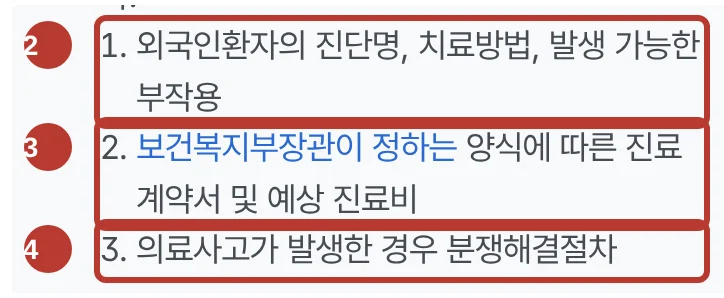
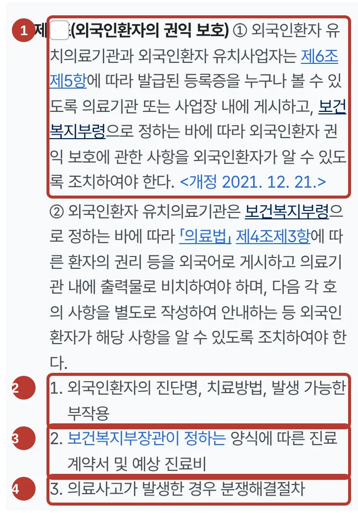

<a class="tr-btn go" href="#check"><i class="ic ic-shield-check" aria-hidden="true"></i>預約前確認4件事</a><a class="tr-btn" href="#help"><i class="ic ic-circle-help" aria-hidden="true"></i>出問題時</a>

<aside class="tr-note"><i class="ic ic-info" aria-hidden="true"></i><b>這是流程說明,不是醫療資訊。</b> 不寫診所名稱和價格,也不保證效果或安全。要不要做療程,請和為你看診的醫師討論決定。</aside>

<figure class="tr-hero acc-hero"><figcaption><b>接待外國患者的醫院,依法必須另外寫給你的東西。</b> <b>2</b> 診斷名、治療方法、可能的副作用,<b>3</b> 診療契約書與預估診療費,<b>4</b> 發生醫療事故時的糾紛解決程序。付款前把這三項拿到書面。畫面: 國家法令資訊中心<a href="https://www.law.go.kr/%EB%B2%95%EB%A0%B9/%EC%9D%98%EB%A3%8C%ED%95%B4%EC%99%B8%EC%A7%84%EC%B6%9C%EB%B0%8F%EC%99%B8%EA%B5%AD%EC%9D%B8%ED%99%98%EC%9E%90%EC%9C%A0%EC%B9%98%EC%A7%80%EC%9B%90%EC%97%90%EA%B4%80%ED%95%9C%EB%B2%95%EB%A5%A0" rel="noopener" target="_blank">醫療海外進出及外國患者招攬支援法 第8條</a>(韓文,法制處),2026年11月26日擷取(只裁切一部分,加上框與編號)</figcaption></figure>

<ul class="tr-facts"><li><i class="ic ic-shield-check" aria-hidden="true"></i>先查政府登錄<small>醫院和仲介都必須登錄</small></li><li><i class="ic ic-receipt" aria-hidden="true"></i>預估費用拿書面<small>不能收超過公告的價格</small></li><li><i class="ic ic-ban" aria-hidden="true"></i>沒有加值稅退稅<small>2025年12月31日結束</small></li><li><i class="ic ic-smartphone" aria-hidden="true"></i>1577-7129<small>24小時,6種語言</small></li></ul>

## 你的情況是?

<ul class="tr-choose"><li><i class="ic ic-scan-line" aria-hidden="true"></i><b>在社群或廣告上找到診所</b>聯絡前先在政府登錄名單查詢。招攬外國患者的醫療機構和仲介業者都必須登錄。<a href="#check-1">怎麼查</a></li><li><i class="ic ic-users" aria-hidden="true"></i><b>透過仲介或預約App預約</b>不只醫院,仲介也用同樣方法查。登錄制度也適用於仲介業者。</li><li><i class="ic ic-receipt" aria-hidden="true"></i><b>報價裡含加值稅退稅</b>扣掉退稅重新計算。外國旅客美容療程加值稅退稅特例在2025年12月31日結束了。<a href="#vat">詳細</a></li><li><i class="ic ic-plane" aria-hidden="true"></i><b>療程後馬上要搭機回國</b>付款前問醫師回診日和何時可以搭機,並拿到書面。只有為你看診的醫師能回答。</li><li><i class="ic ic-triangle-alert" aria-hidden="true"></i><b>出了問題</b>1577-7129(24小時,外語諮詢),也受理外國患者申訴和醫療糾紛的公家窗口。緊急情況打119。<a href="#help">求助窗口</a></li></ul>

只買化妝品的話看[Olive Young頁面](/zh-tw/olive-young/)。這頁是關於在醫療機構做的療程。

<h2 id="check">預約前確認4件事</h2>

<h3 class="tr-step" id="check-1">1<i class="ic ic-scan-line" aria-hidden="true"></i>在政府登錄名單查詢醫院、仲介</h3>

在韓國想招攬外國患者的醫療機構,必須向市、道登錄,每個診療科至少有1名專科醫師,並加入涵蓋外國患者的醫療事故賠償責任保險(診所、醫院1億韓元以上,綜合醫院2億韓元以上)等。仲介(招攬業者)的條件是保證保險1億韓元以上、資本額1億韓元以上、在韓國設有辦公室。登錄每3年更新。未登錄就招攬外國患者,可處3年以下徒刑或3千萬韓元以下罰金。

**怎麼查**(外國患者招攬資訊系統,韓文網站;2026年11月26日招攬醫療機構4,577家、招攬業者3,002家):

1. 打開[medicalkorea.or.kr/korp](https://www.medicalkorea.or.kr/korp/main.do)。手機瀏覽器的翻譯功能(韓文→中文)也可以用。
2. 在下方**「유치기관 조회」**(招攬機構查詢)欄位輸入醫院或仲介的**韓文名稱**(或登錄號碼),按**「조회하기」**(查詢)。韓文名稱從醫院網站、收據或招牌複製。空白查詢會列出全部名單。
3. 結果表格這樣看:

| 欄位 | 看什麼 |
|---|---|
| 상태(狀態) | **유지**(維持)表示登錄有效 |
| 상호(名稱) | 和你預約的地方名稱一樣嗎(含分店名) |
| 대표자명·연락처(負責人、電話) | 和醫院給你的電話一樣嗎 |
| 기관구분·지역(類別、地區) | 診所、醫院等類別,市、道 |

<aside class="tr-note"><i class="ic ic-triangle-alert" aria-hidden="true"></i><b>查不到,或狀態不是「유지」時,</b>預約前請那家醫院或仲介出示登錄證,或打1577-7129問。</aside>

<aside class="tr-note tip"><i class="ic ic-lightbulb" aria-hidden="true"></i><b>到了醫院也能確認。</b> 登錄的醫療機構和仲介必須把登錄證張貼在人人看得到的地方(第8條,下方第3步照片1)。看看櫃台周圍。</aside>

<i class="ic ic-info" aria-hidden="true"></i>登錄、認證、法務部指定,意思不一樣

- **登錄:** 不是品質評價或推薦,而是符合招攬外國患者的法定條件。
- **評價認證(保健福祉部):** 登錄機構中申請者,由醫療機構評價認證院實地調查後認證。看外國患者接待體系、專科醫師、尊重患者權利與預防醫療糾紛、患者安全、診療、藥品、感染、設施管理。效期4年。未經認證使用認證標章會受罰。認證現況可在同一網站的「평가인증기관현황」查詢。
- **法務部「優秀招攬機構」指定:** 和簽證手續支援有關。2026年10月1日起112家(醫療機構89、仲介23),到2027年9月30日。不代表政府推薦特定治療或醫師。
- **外語廣告:** 外國患者招攬醫療機構的外語醫療廣告,禁止像治療前後對比照片、影片這類可能欺騙或誤導外國患者的內容(第15條)。
- 想多看一步,健康保險審查評價院的[醫院・藥局查詢](https://www.hira.or.kr/ra/hosp/getHealthMap.do?pgmid=HIRAA030002010000)(韓文)可以看到診療科和醫師、專科醫師人數。

<h3 class="tr-step">2<i class="ic ic-receipt" aria-hidden="true"></i>確認價格</h3>

1. **報價拿書面。** 登錄醫療機構必須另外提供保健福祉部格式的診療契約書和預估診療費(第8條,最上方照片3)。
2. **和公告價格比較。** 醫療機構必須讓患者容易看到健保不給付項目(非給付)的費用,而且不能收超過公告的金額(醫療法第45條)。
3. **查公開價格。** 健康保險審查評價院的[非給付診療費用資訊](https://www.hira.or.kr/npay/index.do?pgmid=HIRAA030009000000)(韓文)可用醫院名稱或地址、地區、項目查詢。美容療程項目是否全都有列,我們沒能確認。
4. **扣掉加值稅退稅計算**([下面](#vat))。

<h3 class="tr-step">3<i class="ic ic-pencil" aria-hidden="true"></i>諮詢時拿到書面說明</h3>

<figure class="tr-photo"><figcaption><b>第8條全文</b>(韓文)。<b>1</b> 登錄證張貼在人人看得到的地方,第2項 用外語公告患者權利,<b>2〜4</b> 另外書寫告知的事項。畫面: 國家法令資訊中心<a href="https://www.law.go.kr/%EB%B2%95%EB%A0%B9/%EC%9D%98%EB%A3%8C%ED%95%B4%EC%99%B8%EC%A7%84%EC%B6%9C%EB%B0%8F%EC%99%B8%EA%B5%AD%EC%9D%B8%ED%99%98%EC%9E%90%EC%9C%A0%EC%B9%98%EC%A7%80%EC%9B%90%EC%97%90%EA%B4%80%ED%95%9C%EB%B2%95%EB%A5%A0" rel="noopener" target="_blank">第8條</a>,2026年11月26日擷取(裁切,加上框與編號)</figcaption></figure>

登錄醫療機構必須另外書寫並告知外國患者: 診斷名、治療方法與可能的副作用、診療契約書與預估診療費、醫療事故時的糾紛解決程序。患者權利也要用外語公告並備有印刷本(第8條)。簽名前,要求**用你看得懂的語言**提供。

像手術、輸血、全身麻醉這類可能對生命或身體造成重大傷害的情況,醫師必須說明診斷名、必要性・方法・內容、**說明醫師和參與的主要醫師姓名**、預期的後遺症・副作用、前後應遵守的事項,並取得書面同意。患者可以要求**同意書影本**,方法或主要醫師變更時必須以書面告知(醫療法第24條之2)。

**要問醫師、不是問協調員的事:**

1. 療程由誰執行?
2. 預估總額多少,哪些不包含?
3. 回診是什麼時候,需要親自來嗎?
4. 什麼時候可以搭機?回國後出問題怎麼辦?

<h3 class="tr-step">4<i class="ic ic-file-down" aria-hidden="true"></i>預付套餐要先看退費條件</h3>

2026年7月公平交易委員會讓15家皮膚・美容診所修正了契約條款。預付診療費一律不退的條款被刪除,中途解約違約金從20〜30%改為10%,醫院也不能任意更換醫師。付款前讀一下退費・解約條款,並拍照留存。

<aside class="tr-note ok"><i class="ic ic-circle-check" aria-hidden="true"></i><b>最後一幕:</b> 拿到書面說明、診療契約書、預估診療費,帶著存了1577-7129的手機離開。要不要進行之後再決定。</aside>

<h2 id="vat">2026年的變化: 沒有加值稅退稅</h2>

外國旅客在登錄醫療機構接受美容・整形醫療服務的加值稅(稅率10%,附加價值稅法第30條)退稅特例(2016年4月開始),只適用於**2025年12月31日以前**接受的療程(租稅特例限制法第107條之3)。2026年1月1日起,皮膚科・美容療程不在退稅範圍(購物退稅看[退稅](/zh-tw/tax-refund/))。

會恢復嗎?國會有2個恢復退稅的法案: 2026年4月提出、延長到2027年底的案子,以及2026年8月13日提出、到2029年底重新實施的案子(對象是外國患者招攬登錄醫療機構)。截至2026年11月20日兩案都沒通過。2026年11月24日[韓國先驅報](https://www.koreaherald.com/article/10947687)也報導退稅已結束、整形外科醫師要求國會恢復。法案真正通過前,預算請以沒有退稅來抓。有變化我們會更新這頁。

<h2 id="help">出問題時: 可以用外語求助的地方</h2>

<aside class="tr-note"><i class="ic ic-triangle-alert" aria-hidden="true"></i><b>緊急情況打119。</b> 怎麼處理看<a href="/zh-tw/emergency/">緊急狀況頁面</a>。</aside>

<ul class="tr-choose"><li><i class="ic ic-smartphone" aria-hidden="true"></i><b>Medical Korea 諮詢中心 1577-7129</b>從國外撥+82-1577-7129。韓國保健產業振興院營運,24小時,韓語、英語、日語、中文、俄語、阿拉伯語。醫療機構與診療資訊、外國患者申訴受理與醫療事故基本諮詢、醫療糾紛受理、災害等緊急狀況支援。</li><li><i class="ic ic-map-pin" aria-hidden="true"></i><b>醫療觀光商務中心(韓國觀光公社)</b>首爾中區清溪川路40,HiKR Ground東館1樓。平日9:00〜18:00(週末、國定假日休息)。英語、中文、日語、俄語(線上、臨櫃),提供醫療觀光資訊並連結經驗證的醫院、仲介。Email k-medi@knto.or.kr。在地圖App搜尋「HiKR Ground」用步行路線前往。</li><li><i class="ic ic-stamp" aria-hidden="true"></i><b>韓國醫療糾紛調解仲裁院(K-medi)</b>免費諮詢+82-2-1670-2545(平日9:00〜12:00、13:00〜18:00)。線上諮詢24小時可申請,下一個工作日前回覆。臨櫃諮詢在首爾中區素月路2街30 T Tower 8樓(先聯絡會比較快)。有英文網站,但沒寫諮詢語言;需要外語的話,請1577-7129協助受理比較確實。</li></ul>

{{fig:skin-clinic-3|外語諮詢窗口,時間與語言}}

<i class="ic ic-file-down" aria-hidden="true"></i>用Email申請醫療糾紛調解的步驟(K-medi)

1. 從K-medi的[Email申請說明](https://www.k-medi.or.kr/eng/lay1/S239T385C455/contents.do)下載申請文件。
2. 必備文件: 調解申請書、申請書附件、敏感資訊・個人資料蒐集同意書、身分證件影本。由本人填寫並簽名。非患者本人申請時,需附委任書和關係證明。
3. 文件用韓文寫。用英文寫的話要附韓文翻譯。
4. 轉成PDF寄到forcc@k-medi.or.kr(不行的話傳真+82-2-6210-0099)。
5. 承辦人審核後,會用簡訊告知申請費匯款帳戶。退款建議用韓國銀行帳戶(跨國匯款・匯率損失不補償)。

<i class="ic ic-info" aria-hidden="true"></i>1330觀光翻譯服務專線呢?

1330是一般旅遊口譯與諮詢。說明頁沒有寫醫療支援,所以醫療問題打1577-7129才對。

## 恢復期與回程班機

療程後幾天可以搭機,我們找不到官方標準,所以不寫天數;依療程和個人而不同。出境日期是諮詢時要先告訴醫師的資訊。答案和行程不合的話,就改行程或計畫。機場流程看[出境當天](/zh-tw/departure-day/)。

## 簽證

依韓國觀光公社說明,90天以下的治療有時可以用觀光等訪問簽證。但即使有診療行程,也不能超過許可的停留期間。更長的治療需要醫療簽證: 90天以下治療・療養用C-3-3,91天以上(最長1年)用G-1-10(2026年11月7日韓國先驅報報導)。申請前向你國籍的韓國大使館・領事館或韓國簽證入口網(www.visa.go.kr)確認;在韓國境內可以問出入境客服中心1345。

## 常見錯誤

<ul class="tr-oops"><li><i class="ic ic-triangle-alert" aria-hidden="true"></i>只看社群評價就預約。先查登錄。</li><li><i class="ic ic-triangle-alert" aria-hidden="true"></i>把加值稅退稅算進預算。2026年起沒有了。</li><li><i class="ic ic-triangle-alert" aria-hidden="true"></i>只聽口頭說明就簽名。診斷、副作用、費用要書面,用看得懂的語言。</li><li><i class="ic ic-triangle-alert" aria-hidden="true"></i>沒告訴醫師回程日期就做療程。</li></ul>

<i class="ic ic-list-checks" aria-hidden="true"></i>一句話判斷,用表格看

| 情況 | 怎麼做 | 理由 |
|---|---|---|
| 在社群上找到診所 | 聯絡前先查官方登錄名單 | 招攬外國患者的醫療機構和業者有義務向政府登錄 |
| 透過仲介或App預約 | 不只醫院,也確認仲介的登錄 | 登錄制度也適用於仲介 |
| 報價含加值稅退稅 | 扣掉退稅重新計算 | 外國旅客美容療程退稅特例2025年12月31日結束 |
| 療程後馬上搭機 | 付款前問醫師回診日和可搭機時間,拿書面 | 只有看診的醫師能回答 |
| 出了問題 | 1577-7129(24小時,外語) | 也受理外國患者申訴的公家窗口 |

<i class="ic ic-calendar-check" aria-hidden="true"></i>從預約到諮詢,是這樣的順序

這是流程說明,不保證結果。

**幾週前,在家。** 把想預約的醫療機構韓文名稱輸入官方登錄名單,確認是「유지」。費用扣掉退稅重新算,也記下班機日期。

**在櫃台。** 登錄醫療機構必須把登錄證張貼在人人看得到的地方。

**諮詢時。** 診斷名、治療方法、可能的副作用、診療契約書與預估診療費、糾紛解決程序,用看得懂的語言拿到書面。付款前告訴醫師班機日期。

**最後一幕:** 帶著那些文件和存了1577-7129的手機離開。之後再決定要不要進行。

<i class="ic ic-ban" aria-hidden="true"></i>沒寫的內容

診所名稱、價格、前後對比照、療程比較。這些不是我們能確認的,而且選療程是醫療判斷。韓國保健產業振興院也以公共資料公開登錄機構名單(2026年7月資料6,921筆,每年更新)。

<i class="ic ic-info" aria-hidden="true"></i>出處

2026年11月26日確認(官方): 國家法令資訊中心<a href="https://www.law.go.kr/%EB%B2%95%EB%A0%B9/%EC%9D%98%EB%A3%8C%ED%95%B4%EC%99%B8%EC%A7%84%EC%B6%9C%EB%B0%8F%EC%99%B8%EA%B5%AD%EC%9D%B8%ED%99%98%EC%9E%90%EC%9C%A0%EC%B9%98%EC%A7%80%EC%9B%90%EC%97%90%EA%B4%80%ED%95%9C%EB%B2%95%EB%A5%A0" rel="noopener" target="_blank">醫療海外進出及外國患者招攬支援法</a>(2026年5月12日施行: 第6條登錄條件・3年、第7條、第8條張貼登錄證・書面告知、第14條評價認證4年、第15條外語廣告、第28條罰則)、<a href="https://www.law.go.kr/%EB%B2%95%EB%A0%B9/%EC%9D%98%EB%A3%8C%EB%B2%95" rel="noopener" target="_blank">醫療法</a>(2026年11月12日施行: 第24條之2說明與書面同意、第45條非給付費用告知)、<a href="https://www.law.go.kr/%EB%B2%95%EB%A0%B9/%EC%A1%B0%EC%84%B8%ED%8A%B9%EB%A1%80%EC%A0%9C%ED%95%9C%EB%B2%95" rel="noopener" target="_blank">租稅特例限制法</a>第107條之3(美容整形醫療服務加值稅退稅,到2025年12月31日)、<a href="https://www.law.go.kr/%EB%B2%95%EB%A0%B9/%EB%B6%80%EA%B0%80%EA%B0%80%EC%B9%98%EC%84%B8%EB%B2%95" rel="noopener" target="_blank">附加價值稅法</a>第30條(稅率10%); 韓國保健產業振興院<a href="https://www.medicalkorea.or.kr/korp/main.do" rel="noopener" target="_blank">外國患者招攬資訊系統</a>(招攬機構查詢、機構數、結果欄位)、<a href="https://www.medicalkorea.or.kr/korp/intro/registration.do" rel="noopener" target="_blank">登錄制度</a>(賠償保險額度、業者條件、3年)、<a href="https://www.medicalkorea.or.kr/korp/intro/evaluation.do" rel="noopener" target="_blank">評價認證制度</a>(評價項目、4年)、<a href="https://www.khidi.or.kr/board?menuId=MENU00807" rel="noopener" target="_blank">Medical Korea諮詢中心</a>(1577-7129、24小時、6種語言、業務); 首爾市<a href="https://news.seoul.go.kr/welfare/archives/541972" rel="noopener" target="_blank">外國患者招攬機構登錄現況</a>(2026年3月13日修訂); 健康保險審查評價院<a href="https://www.hira.or.kr/main.do" rel="noopener" target="_blank">首頁</a>、<a href="https://www.hira.or.kr/npay/index.do?pgmid=HIRAA030009000000" rel="noopener" target="_blank">非給付診療費用資訊</a>、醫院查詢; 韓國醫療糾紛調解仲裁院<a href="https://www.k-medi.or.kr/eng/" rel="noopener" target="_blank">英文首頁</a>(免費諮詢電話)、<a href="https://www.k-medi.or.kr/eng/lay1/S239T269C270/contents.do" rel="noopener" target="_blank">諮詢方式</a>(電話時間、線上24小時、臨櫃)、<a href="https://www.k-medi.or.kr/eng/lay1/S239T385C455/contents.do" rel="noopener" target="_blank">Email調解申請</a>; 韓國觀光公社<a href="https://english.visitkorea.or.kr/svc/contents/contentsView.do?vcontsId=247707" rel="noopener" target="_blank">醫療觀光商務中心</a>(地址、時間、語言、Email,2025年9月24日刊登)。媒體(11月26日確認): 韓國先驅報<a href="https://www.koreaherald.com/article/10926943" rel="noopener" target="_blank">Planning a medical trip to Korea</a>(2026年11月7日: 韓國觀光公社90天說明、C-3-3・G-1-10、法務部指定112家、1345、簽證入口網)、<a href="https://www.koreaherald.com/article/10947687" rel="noopener" target="_blank">要求恢復退稅</a>(2026年11月24日)、<a href="https://www.koreaherald.com/article/10633779" rel="noopener" target="_blank">美容療程加值稅退稅結束</a>(2025年12月10日)。前一版確認、今天無法重新打開的: 公平交易委員會皮膚・美容診所條款修正(News Tomato 2026年7月19日;ftc.go.kr連線被擋);紐西斯2025稅制改革案(2016年4月開始,2025年7月31日);韓國經濟延長法案(2026年7月31日);MTN・Dailymedi重新實施法案(2026年8月14・16日);IB Tomato法案未通過(2026年11月20日);公共資料入口網招攬機構資料(2026年7月,連線被擋);大韓民國角角落落1330;政策簡報健康保險審查評價院醫院查詢(2023年9月26日: 診療科・醫師・專科醫師人數)。

## 下一步

<ul class="tr-next"><li><a href="/zh-tw/health/"><i class="ic ic-shield-check" aria-hidden="true"></i>旅行中生病: 醫院・藥局<i class="ic ic-arrow-right" aria-hidden="true"></i></a></li><li><a href="/zh-tw/emergency/"><i class="ic ic-triangle-alert" aria-hidden="true"></i>緊急狀況怎麼辦<i class="ic ic-arrow-right" aria-hidden="true"></i></a></li><li><a href="/zh-tw/tax-refund/"><i class="ic ic-receipt" aria-hidden="true"></i>退稅: 購物退稅<i class="ic ic-arrow-right" aria-hidden="true"></i></a></li></ul>
