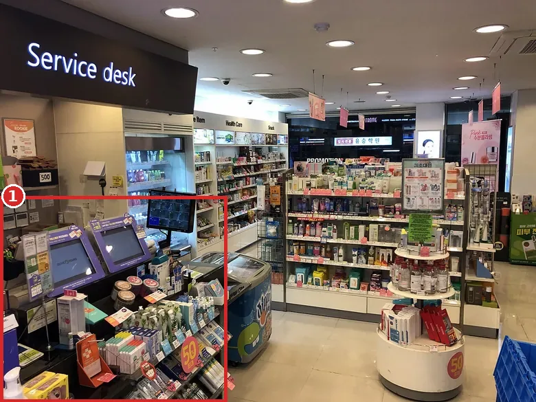

<a class="tr-btn" href="#我可以退稅嗎"><i class="ic ic-circle-help" aria-hidden="true"></i>我可以退稅嗎?</a><a class="tr-btn go" href="#在收銀台退稅"><i class="ic ic-receipt" aria-hidden="true"></i>怎麼退</a>

<figure class="tr-hero acc-hero"><figcaption><b>重點就這一個。</b>明洞 Olive Young 收銀台的告示:「為了及時免稅,請準備好護照原件」。照片:Sgroey,<a href="https://creativecommons.org/licenses/by-sa/4.0/deed.zh-hant" rel="noopener" target="_blank">CC BY-SA 4.0</a>,來自<a href="https://commons.wikimedia.org/wiki/File:Olive_Young_Myeongdong.jpg" rel="noopener" target="_blank">維基共享資源</a>(裁切、自動調整亮度)</figcaption></figure>

<ul class="tr-facts"><li><i class="ic ic-id-card" aria-hidden="true"></i>護照正本<small>照片不行</small></li><li><i class="ic ic-receipt" aria-hidden="true"></i>15,000 韓元以上<small>同一家店、單張收據</small></li><li><i class="ic ic-percent" aria-hidden="true"></i>約拿回 5–8%<small>扣掉退稅公司手續費後</small></li><li><i class="ic ic-clock" aria-hidden="true"></i>結帳時當場扣<small>未滿 1,000,000 韓元</small></li></ul>

## 我可以退稅嗎?

<ul class="tr-choose"><li><i class="ic ic-user-check" aria-hidden="true"></i><b>可以:在韓國停留未滿 6 個月的旅客</b>不住在韓國的外國旅客(非居住者)。</li><li><i class="ic ic-user-check" aria-hidden="true"></i><b>可以:在海外住超過 2 年的韓國國民</b>回韓國停留不超過 3 個月時(依 Global Blue 韓國說明)。</li><li><i class="ic ic-user-x" aria-hidden="true"></i><b>不行:在韓國工作或居住的人</b>駐韓外交官、駐韓聯合國軍與美軍官兵及文職人員、以公司名義購買也不適用。</li><li><i class="ic ic-ban" aria-hidden="true"></i><b>不行:皮膚科、醫美療程</b>外國觀光客醫美療程退稅已在 2025 年 12 月 31 日結束。</li></ul>

## 我的收據走哪條路?

以同一家店、單張收據計算。不同店家的收據不能合併。

<ul class="tr-choose"><li><i class="ic ic-circle-x" aria-hidden="true"></i><b>未滿 15,000 韓元</b>不能退稅。在同一家店多買一點,讓單張收據滿 15,000 韓元。</li><li><i class="ic ic-circle-check" aria-hidden="true"></i><b>15,000 至未滿 1,000,000 韓元</b>大部分購物都是這種。結帳時出示護照就完成。同一次入境總額上限 5,000,000 韓元。</li><li><i class="ic ic-plane" aria-hidden="true"></i><b>1,000,000 韓元以上</b>付全額、拿退稅單,到機場做海關驗證。</li><li><i class="ic ic-store" aria-hidden="true"></i><b>收銀台沒有「Tax Free」標示</b>和大筆消費一樣:拿退稅單,到機場或市區退稅機辦理。</li></ul>

## 在收銀台退稅

<h3 class="tr-step">1<i class="ic ic-store" aria-hidden="true"></i>找「Tax Free」或「Tax Refund」標示</h3>

<figure class="tr-photo"><figcaption>Olive Young、百貨公司等大型連鎖店多半都有。在櫃檯確認標示。照片:Pkccccj,<a href="https://creativecommons.org/licenses/by-sa/4.0/deed.zh-hant" rel="noopener" target="_blank">CC BY-SA 4.0</a>,來自<a href="https://commons.wikimedia.org/wiki/File:OliveYoung_store.png" rel="noopener" target="_blank">維基共享資源</a>(自動調整亮度)</figcaption></figure>

<h3 class="tr-step">2<i class="ic ic-id-card" aria-hidden="true"></i>結帳時遞上護照</h3>

<figure class="tr-photo"><figcaption><b>1</b> 收銀台。刷卡時一起遞上護照正本,店家掃描後,價格當場少掉稅金,特價品也一樣。照片:Choi Kwang-mo(Olive Young 原州丹邱店,2020 年),<a href="https://creativecommons.org/publicdomain/zero/1.0/deed.zh-hant" rel="noopener" target="_blank">CC0</a>,來自<a href="https://commons.wikimedia.org/wiki/File:2020-04-17_22.17.43_%EC%98%AC%EB%A6%AC%EB%B8%8C%EC%98%81_%EC%9B%90%EC%A3%BC%EB%8B%A8%EA%B5%AC%EC%A0%90.jpg" rel="noopener" target="_blank">維基共享資源</a>(加上框線與編號)</figcaption></figure>

<h3 class="tr-step">3<i class="ic ic-receipt" aria-hidden="true"></i>確認收據</h3>

{{fig:tax-refund-1|一張收據看懂三個數字}}

<h3 class="tr-step">4<i class="ic ic-circle-check" aria-hidden="true"></i>完成</h3>

<aside class="tr-note ok"><i class="ic ic-circle-check" aria-hidden="true"></i>機場不用再辦。只要商品在購買後 3 個月內帶出韓國。</aside>

## 大筆消費:單張收據 1,000,000 韓元以上

店家沒有現場退稅系統時,也是這個順序。

{{fig:tax-refund-4|在機場,順序很重要}}

<h3 class="tr-step">1<i class="ic ic-receipt" aria-hidden="true"></i>付全額,索取退稅單</h3>

也就是 Tax Free Form。必填欄位漏填或填錯,海關會退件,請先核對。

<h3 class="tr-step">2<i class="ic ic-banknote" aria-hidden="true"></i>想先拿錢:市區先領現金</h3>

可在市區退稅櫃檯或退稅機先領。但出境時仍要海關驗證,而且要在退稅後 21 天內(銀聯 15 天)。

<h3 class="tr-step">3<i class="ic ic-stamp" aria-hidden="true"></i>機場:先海關驗證,再托運行李</h3>

到海關櫃檯或自助驗證機辦理,海關可能要求查看商品。如果是 Global Blue 的退稅單,也可以連上機場 Wi-Fi,在 korea.mobilevalidation.globalblue.com 用手機驗證。

<aside class="tr-note"><i class="ic ic-luggage" aria-hidden="true"></i>大件商品在海關驗證前放隨身行李。放進托運行李就拿不出來給海關看了。</aside>

<h3 class="tr-step">4<i class="ic ic-hand-coins" aria-hidden="true"></i>領錢</h3>

到退稅櫃檯、退稅機領取,或退到你選的卡。沒有海關驗證就沒有退稅。

<ul class="tr-next"><li><a href="https://www.globalblue.com/en/refund-points-map?country=South-Korea" rel="noopener" target="_blank"><i class="ic ic-map-pin" aria-hidden="true"></i>Global Blue 退稅單:海關與退稅點地圖(英文)<i class="ic ic-external-link" aria-hidden="true"></i></a></li></ul>

## 實際能拿回多少

大約是售價的 **5–8%**。稅率 10% 已經含在標價裡,退稅公司會收法規允許的手續費。消費越多比例越高。確切金額以退稅單或收據為準。

{{fig:tax-refund-3|扣掉手續費後大約拿回的金額}}

<i class="ic ic-coins" aria-hidden="true"></i>誰收手續費,看表格

Global Blue、Global Tax Free、Easy Tax Refund、CubeRefund 等退稅公司會收法規允許的手續費,所以實際約拿回售價的 5–8%,消費越多比例越高。

| 消費金額 | 退稅金額(約) |
|---|---|
| 50,000 韓元 | 2,500 韓元 |
| 300,000 韓元 | 15,000–24,000 韓元 |
| 1,000,000 韓元 | 60,000–80,000 韓元 |

## 常見錯誤

<ul class="tr-oops"><li><i class="ic ic-triangle-alert" aria-hidden="true"></i>只帶護照照片。店家要掃描正本。</li><li><i class="ic ic-triangle-alert" aria-hidden="true"></i>三家店各買一點。收據不能合併,每張都要自己滿 15,000 韓元。</li><li><i class="ic ic-triangle-alert" aria-hidden="true"></i>海關驗證前就把大件商品放進托運行李。</li><li><i class="ic ic-triangle-alert" aria-hidden="true"></i>把退稅算進皮膚科療程費用。2025 年 12 月 31 日已經結束。</li></ul>

<i class="ic ic-list-checks" aria-hidden="true"></i>三個數字,以及 2024 年的變化

- **15,000 韓元:** 同一家店單筆(含稅)的最低門檻。
- **未滿 1,000,000 韓元:** 單筆低於這個金額,結帳時就能現場退稅。
- **5,000,000 韓元:** 同一次入境用現場退稅能買的總額上限。

100 萬與 500 萬韓元上限在 2024 年 1 月 1 日提高為兩倍,2026 年法規仍是如此。15,000 韓元門檻也是 2024 年起從 30,000 韓元調降的。

<i class="ic ic-ban" aria-hidden="true"></i>不能退稅的項目

- 菸品、槍砲刀劍、指定文化遺產、成癮性藥品,以及其他法律限制交易的物品。
- 書籍、生鮮食品等加值稅 0% 的商品,以及用過的東西(可退稅商品必須未使用)。
- 2026 年 1 月 1 日起的整形與醫美療程。

> 恢復醫美退稅的法案在 2026 年 4 月提出,但到 2026 年 11 月 24 日仍未恢復。療程費用請以沒有退稅來計算。

<i class="ic ic-calendar-check" aria-hidden="true"></i>逛街的一天,從頭到尾

依這頁的規定拼出的畫面,不是編出來的心得。

**出發前。** 把護照正本(不是照片)放在逛街時好拿的地方。大筆採購(Olive Young、百貨公司)先規劃好,讓每張收據各自超過 15,000 韓元。

**結帳時。** 看到「Tax Free」標示,刷卡時一起遞上護照,價格當場少掉稅金。特價商品一樣能退稅,Olive Young 大特賣期間也能現場退稅。

**回國那天。** 現場退稅買的東西,在機場什麼都不用辦。這就是要規劃的結局。

<i class="ic ic-info" aria-hidden="true"></i>這頁沒寫的,以及資料來源

這頁沒寫的:各退稅公司的手續費表(Global Blue 韓國頁面沒有公布,其他業者我們無法確認)、機場與市區的免稅店(和退稅是不同制度)。

韓國國家法令資訊中心(2026 年 11 月 26 日查看):<a href="https://www.law.go.kr/%EB%B2%95%EB%A0%B9/%EC%99%B8%EA%B5%AD%EC%9D%B8%EA%B4%80%EA%B4%91%EA%B0%9D%EB%93%B1%EC%97%90%EB%8C%80%ED%95%9C%EB%B6%80%EA%B0%80%EA%B0%80%EC%B9%98%EC%84%B8%EB%B0%8F%EA%B0%9C%EB%B3%84%EC%86%8C%EB%B9%84%EC%84%B8%ED%8A%B9%EB%A1%80%EA%B7%9C%EC%A0%95" rel="noopener" target="_blank">外國觀光客等附加價值稅及個別消費稅特例規定</a>(2026 年 1 月 2 日施行:退稅對象、不適用物品、單筆未滿 100 萬與入境後總額 500 萬韓元以下現場退稅、3 個月帶出、退稅手續費)及其<a href="https://www.law.go.kr/%EB%B2%95%EB%A0%B9/%EC%99%B8%EA%B5%AD%EC%9D%B8%EA%B4%80%EA%B4%91%EA%B0%9D%EB%93%B1%EC%97%90%EB%8C%80%ED%95%9C%EB%B6%80%EA%B0%80%EA%B0%80%EC%B9%98%EC%84%B8%EB%B0%8F%EA%B0%9C%EB%B3%84%EC%86%8C%EB%B9%84%EC%84%B8%ED%8A%B9%EB%A1%80%EA%B7%9C%EC%A0%95%EC%8B%9C%ED%96%89%EA%B7%9C%EC%B9%99" rel="noopener" target="_blank">施行規則</a>(最低 15,000 韓元、菸品);Korea.net〈<a href="https://www.korea.net/NewsFocus/policies/view?articleId=242726" rel="noopener" target="_blank">2024 年現場退稅上限加倍</a>〉(2023 年 11 月 28 日);Global Blue <a href="https://www.globalblue.com/en/shoppers/how-to-shop-tax-free/destinations/south-korea" rel="noopener" target="_blank">Tax Free Shopping in South Korea</a>(2026 年 11 月 26 日查看:退稅對象(含在海外住超過 2 年、回韓停留不超過 3 個月的韓國國民)、未使用商品、0% 稅率商品、海關驗證、機場 Wi-Fi 手機自助驗證、市區退稅後 21 天、3 個月內驗證);仁川國際機場退稅資訊(前一版查證,這次未重新打開);The Korea Herald 醫美退稅結束報導(<a href="https://www.koreaherald.com/article/10633779" rel="noopener" target="_blank">2025 年 12 月 10 日</a>、<a href="https://www.koreaherald.com/article/10947687" rel="noopener" target="_blank">2026 年 11 月 24 日</a>),2026 年 11 月 26 日查看。退稅比例與金額表來自 2026 年退稅業者說明,於前一版查證;2026 年 11 月 26 日打開的 Global Blue 韓國頁面沒有退稅率表,所以仍標為估計值。

## 接著看

<ul class="tr-next"><li><a href="/zh-tw/olive-young/"><i class="ic ic-shopping-basket" aria-hidden="true"></i>Olive Young:特賣時間與三樣基本款<i class="ic ic-arrow-right" aria-hidden="true"></i></a></li><li><a href="/zh-tw/deals/"><i class="ic ic-tag" aria-hidden="true"></i>本週優惠看板<i class="ic ic-arrow-right" aria-hidden="true"></i></a></li></ul>
