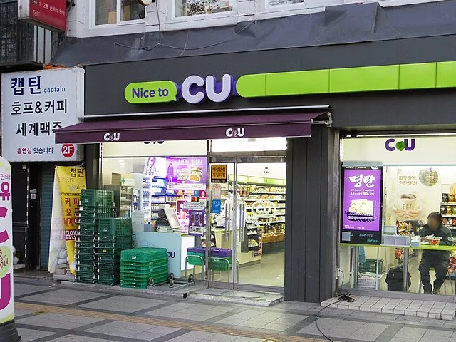

<a class="tr-btn go" href="#battery"><i class="ic ic-smartphone" aria-hidden="true"></i>배터리가 없어요</a><a class="tr-btn" href="#luggage"><i class="ic ic-luggage" aria-hidden="true"></i>짐을 맡기고 싶어요</a>

<ul class="tr-facts"><li><i class="ic ic-smartphone" aria-hidden="true"></i>30분 800원<small>CU 보조배터리 대여('완충이' 앱)</small></li><li><i class="ic ic-package" aria-hidden="true"></i>4시간 2,200원부터<small>지하철역 무인 보관함(소형, 주중)</small></li><li><i class="ic ic-users" aria-hidden="true"></i>4시간 3,000원부터<small>서울역·명동 등 직원 보관소(주중)</small></li><li><i class="ic ic-plane" aria-hidden="true"></i>공항은 24시간<small>1터미널 3층 N, 2터미널 3층 서편</small></li></ul>

<h2 id="battery">배터리가 없을 때</h2>

<aside class="tr-note ok"><i class="ic ic-circle-check" aria-hidden="true"></i><b>CU 편의점 대여기에서 빌리고, 대여기가 있는 곳 아무 데나 반납.</b> '완충이' 앱이 필요하고 30분에 800원이에요(CU 안내, 제휴사 정책에 따라 바뀔 수 있음).</aside>

<h3 class="tr-step">1<i class="ic ic-map-pin" aria-hidden="true"></i>대여기가 있는 CU 찾기</h3>

<figure class="tr-photo"><figcaption><b>이 간판이 CU예요.</b> 모든 CU에 대여기가 있는 건 아니라서 먼저 찾아요. 사진: <a href="https://commons.wikimedia.org/wiki/File:CU_Namdaemun-ro-5ga_branch_20181122_072838.jpg" rel="noopener" target="_blank">LERK</a>, <a href="https://creativecommons.org/licenses/by-sa/4.0" rel="noopener" target="_blank">CC BY-SA 4.0</a>, 위키미디어 공용</figcaption></figure>

1. [CU 매장찾기](https://cu.bgfretail.com/store/list.do?category=store)를 열어요.
2. 시·도와 구·군을 골라요(예: 서울 → 중구).
3. '매장 유형 및 서비스'에서 **공유보조 배터리** 버튼을 눌러요. 대여기가 있는 매장만 남아요.

<h3 class="tr-step">2<i class="ic ic-smartphone" aria-hidden="true"></i>'완충이' 앱 설치하고 가입</h3>

<ul class="tr-kv"><li><b>아이폰</b> 앱스토어 이름은 <a href="https://apps.apple.com/kr/app/%EC%99%84%EC%B6%A9e/id1531816431" rel="noopener" target="_blank">완충e</a>(개발사 에브리포터블, 무료)</li><li><b>안드로이드</b> 구글 플레이에서 '완충이' 검색(CU 안내)</li><li><b>언어</b> 앱스토어 표시: 영어 지원</li></ul>

<aside class="tr-note"><i class="ic ic-triangle-alert" aria-hidden="true"></i><b>확인하지 못한 것:</b> 해외 카드·해외 전화번호로 가입·결제가 되는지. 가입이 막히면 숙소나 카페에서 충전하고, 충전기·케이블은 <a href="/ko/daiso/">다이소</a>에서 살 수 있어요.</aside>

<h3 class="tr-step">3<i class="ic ic-scan-line" aria-hidden="true"></i>대여기의 QR을 앱으로 찍기</h3>

1. 앱에서 대여를 누르고, 대여기에 붙은 QR 코드를 찍어요(앱 설명: "QR코드로 쉽게 대여").
2. 보조배터리가 나오면 빼서 바로 충전해요.

<h3 class="tr-step">4<i class="ic ic-log-out" aria-hidden="true"></i>다 쓰면 아무 대여기에 꽂아 반납</h3>

1. 대여기가 있는 곳이면 빌린 곳이 아니어도 돼요(CU 안내: "스테이션이 설치된 장소 어디서든 자유롭게 반납").
2. 빈 칸에 꽂기만 하면 끝. 반납할 때는 앱을 따로 안 써도 된다고 앱 설명에 적혀 있어요.

<aside class="tr-note tip"><i class="ic ic-lightbulb" aria-hidden="true"></i><b>버스·비행기 타기 전에 반납해요.</b> 대여기에서만 반납할 수 있어서, 탄 뒤에는 돌려줄 곳이 없어요.</aside>

<i class="ic ic-info" aria-hidden="true"></i>다른 대여기, 무료로 잠깐 충전하기

- **다른 대여기:** '충전돼지(Piggycell)'도 QR로 빌리고 다른 곳에 반납하는 방식이에요. 결제는 카카오페이·네이버페이 등(앱스토어 설명). 요금은 공식 누리집을 열지 못해 확인하지 못했어요.
- **무료, 무선 충전 폰만:** 서울 지하철 일부 역의 디지털 종합안내도에 무선 충전기가 달려 있어요(서울시 '내 손안에 서울' 시민기자 기사, 2025년 7월). 무선 충전이 안 되는 폰은 못 써요.
- **비행기에 탈 때:** 보조배터리는 부치는 짐에 못 넣어요. 규정은 [출국하는 날](/ko/departure-day/)에.

<h2 id="luggage">짐을 맡기고 싶을 때</h2>

<ul class="tr-choose tr-compare"><li><i class="ic ic-package" aria-hidden="true"></i><b>몇 시간, 아무 역에서나</b><ul class="tr-kv"><li><b>어디</b> 지하철역 무인 보관함 '또타라커'</li><li><b>요금</b> 4시간 2,200~4,400원(주중)</li><li><b>필요</b> 또타라커 앱</li><li><b>바로 가기</b> <a href="#locker">보관함 쓰는 법</a></li></ul></li><li><i class="ic ic-users" aria-hidden="true"></i><b>큰 캐리어, 직원에게</b><ul class="tr-kv"><li><b>어디</b> '또타러기지' 7개 역(서울역·명동·홍대입구 등)</li><li><b>요금</b> 4시간 3,000~9,000원(주중)</li><li><b>덤</b> 인천공항까지 당일 배송도</li><li><b>바로 가기</b> <a href="#tluggage">서울역에서 찾기</a></li></ul></li><li><i class="ic ic-plane" aria-hidden="true"></i><b>공항에서</b><ul class="tr-kv"><li><b>1터미널</b> 3층 B·N 체크인 카운터 근처</li><li><b>2터미널</b> 3층 서편 1번 게이트 근처</li><li><b>요금</b> 확인하지 못했어요</li><li><b>바로 가기</b> <a href="#airport">공항에서 찾기</a></li></ul></li><li><i class="ic ic-hotel" aria-hidden="true"></i><b>체크아웃 뒤 저녁 비행기</b><ul class="tr-kv"><li><b>먼저</b> 숙소 프런트에 맡아 주는지 물어봐요</li><li><b>안 되면</b> 위 셋 중 동선에 맞는 곳</li></ul></li></ul>

<h3 class="tr-step" id="locker">1<i class="ic ic-package" aria-hidden="true"></i>지하철역 무인 보관함(또타라커)</h3>

<ul class="tr-kv"><li><b>있는 곳</b> 서울교통공사 역(1~8호선, 1호선은 서울역~청량리, 9호선은 삼전~중앙보훈병원)</li><li><b>크기·요금(주중 4시간)</b> 소 2,200원 · 중 3,300원 · 대 4,400원</li><li><b>넘으면(1시간마다)</b> 소 500원 · 중 800원 · 대 1,000원</li><li><b>대형 칸</b> 50×90×60cm</li><li><b>못 넣는 것</b> 귀중품, 음식, 동식물, 위험물</li></ul>

1. **앱 설치:** [T locker 또타라커(앱스토어)](https://apps.apple.com/kr/app/t-locker-%EB%98%90%ED%83%80%EB%9D%BC%EC%BB%A4-%EC%A7%80%ED%95%98%EC%B2%A0-%EB%AC%BC%ED%92%88-%EB%B3%B4%EA%B4%80-%EC%A0%84%EB%8B%AC%ED%95%A8/id1503291383), 안드로이드는 플레이 스토어에서 '또타라커'. 한국어·영어·일본어·중국어(간체).
2. **찾기:** 앱 지도에서 가까운 역 보관함과 빈 칸을 봐요. 가서 빈 칸이 없으면 헛걸음이니 꼭 먼저 확인해요.
3. **고르고 결제:** 짐 크기에 맞는 칸을 골라 앱에서 예약·결제해요.
4. **넣기:** 앱이 문을 열어요. 비밀번호는 30초마다 새로 만들어져요.
5. **찾기:** 다시 앱으로 열어요. 4시간이 넘었으면 추가 요금이 붙어요.

<aside class="tr-note"><i class="ic ic-circle-help" aria-hidden="true"></i><b>안 열리면:</b> 앱 안의 1:1 상담, 또는 역의 고객안전실(역무실)에 가요. 서울교통공사 고객센터 1577-1234.</aside>

<i class="ic ic-coins" aria-hidden="true"></i>요금 계산 예시, 크기

- 소형 6시간: 2,200원 + 500원 × 2시간 = 3,200원(주중 요금 기준 계산).
- 크기: 소 50×30×60cm, 중 50×45×60cm, 대 50×90×60cm.
- 주말·공휴일 요금, 앱 결제 수단(해외 카드 여부)은 공식 누리집을 열지 못해 확인하지 못했어요.

<h3 class="tr-step" id="tluggage">2<i class="ic ic-users" aria-hidden="true"></i>직원 짐 보관소(또타러기지): 서울역에서 찾기</h3>

<ul class="tr-kv"><li><b>있는 역</b> 서울역, 명동, 홍대입구, 잠실, 종로3가, 수서, 김포공항</li><li><b>보관(주중 4시간)</b> S(~20인치) 3,000원 · M(20~23인치) 4,000원 · L(23~27인치) 6,000원 · XL(27인치~) 9,000원</li><li><b>넘으면</b> 1시간마다 1,000원</li><li><b>배송</b> 역 → 인천공항 당일 20,000~31,000원</li><li><b>언어</b> 영어·중국어·일본어 안내</li></ul>

1. **지금 내가 있는 곳:** 1호선 또는 4호선 서울역 개찰구 안팎.
2. **갈 방향:** '공항철도·KTX' 갈아타는 통로 표지를 따라가요. 지하 1층이에요.
3. **맞게 왔다면 보이는 것:** 통로 한쪽의 파란 간판 **T-Luggage**, 그 아래 **METRO Carrier Service**와 배송(Delivery)·보관(Storage)·픽업(Pick-up) 아이콘.
4. **바로 옆:** 무인 자동 보관소 **T-Luggage Auto**. 붙어 있는 QR로 예약·결제하고 키오스크에 짐을 넣어요(안내 문구 "Wheels to the left": 바퀴를 왼쪽으로).
5. **운영:** 서울역 매장 09:00~22:00(2026년 11월 기사). 직접 가서 맡기거나 [또타러기지 누리집](https://tluggage.co.kr/)에서 예약해요.

<aside class="tr-note tip"><i class="ic ic-lightbulb" aria-hidden="true"></i><b>마지막 날 동선:</b> 서울역에서 캐리어를 인천공항으로 당일 배송 보내고 빈손으로 다녀요. 공항에서 찾는 곳·마감 시각은 이 작업에서 확인하지 못했어요. 맡길 때 받는 안내에서 꼭 확인해요.</aside>

<i class="ic ic-info" aria-hidden="true"></i>요금·시간의 출처와 차이

- 요금과 7개 역은 서울시 '내 손안에 서울' 시민기자 기사(2025년 3월 11일)에 실린 숫자예요. 운영사 누리집(tluggage.co.kr)은 이 작업에서 열지 못했어요.
- 운영 시간: 2025년 3월 기사는 10:00~22:00, 2026년 11월 서울역 기사는 09:00~22:00. 역마다 다를 수 있어요.
- 서울 시내 역끼리 당일 배송은 17,000~31,000원(같은 2025년 기사).

<h3 class="tr-step" id="airport">3<i class="ic ic-plane" aria-hidden="true"></i>인천공항에서 맡기기</h3>

<figure class="tr-photo"><figcaption><b>1터미널 3층 출국장.</b> ① 기둥 위 큰 노란 알파벳이 체크인 카운터 이름이에요(사진은 H). ② 멀리 다음 글자가 보여요. 이 글자로 B와 N을 찾아요. 사진: <a href="https://commons.wikimedia.org/wiki/File:Incheon_airport_departure_gate_access.jpg" rel="noopener" target="_blank">Sgroey</a>, <a href="https://creativecommons.org/licenses/by-sa/4.0" rel="noopener" target="_blank">CC BY-SA 4.0</a>, 위키미디어 공용; 잘라 냄, 번호 표시는 Nadri</figcaption></figure>

**1터미널** — 비행기에서 내리면 1층 입국장이에요. 짐 보관은 **3층**(출국장)이에요.

1. 1층 입국장에서 엘리베이터나 에스컬레이터로 3층(출국장)에 올라가요.
2. 3층에서 기둥 위 노란 알파벳을 봐요.
3. **B 카운터 근처: 짐캐리** 07:00~21:00 (010-8040-8215)
4. **N 카운터 근처: 짐캐리(24시간)** (010-8168-8215). 밤늦게 도착했으면 이쪽.

**2터미널** — 같은 층 또는 3층.

1. 1층 입국장 **서편 끝 1번 게이트 근처: 한진택배** 07:00~21:00 (032-743-5834). 코트룸(외투 보관) 출고는 24시간.
2. 21시가 넘었으면 3층 **서편 1번 게이트 근처 '택배·보관·포장존': 한진택배(24시간)** (032-743-5835).

<aside class="tr-note"><i class="ic ic-triangle-alert" aria-hidden="true"></i><b>요금은 공항 공식 안내에 없어요.</b> 맡기기 전에 창구에서 1일 요금을 물어보거나 위 번호로 전화해요.</aside>

## 자주 하는 실수

<ul class="tr-oops"><li><i class="ic ic-triangle-alert" aria-hidden="true"></i><b>빌린 보조배터리를 들고 버스·비행기 타기.</b> 반납은 대여기에서만 돼요. 타기 전에 꽂아요.</li><li><i class="ic ic-triangle-alert" aria-hidden="true"></i><b>보관함에 빈 칸이 있는지 안 보고 가기.</b> 앱 지도에서 빈 칸을 먼저 봐요.</li><li><i class="ic ic-triangle-alert" aria-hidden="true"></i><b>4시간이 기본인 줄 모르고 오래 두기.</b> 넘으면 1시간마다 500~1,000원(무인 보관함), 1,000원(직원 보관소)이 붙어요.</li><li><i class="ic ic-triangle-alert" aria-hidden="true"></i><b>음식·귀중품 맡기기.</b> 무인 보관함은 귀중품·음식·동식물·위험물을 못 넣어요.</li></ul>

<ul class="tr-next"><li><a href="/ko/convenience-store/"><i class="ic ic-store" aria-hidden="true"></i>편의점에서 할 수 있는 것<i class="ic ic-arrow-right" aria-hidden="true"></i></a></li><li><a href="/ko/seoul-subway/"><i class="ic ic-train-front" aria-hidden="true"></i>서울 지하철 타기<i class="ic ic-arrow-right" aria-hidden="true"></i></a></li><li><a href="/ko/departure-day/"><i class="ic ic-plane" aria-hidden="true"></i>출국하는 날: 보조배터리 규정<i class="ic ic-arrow-right" aria-hidden="true"></i></a></li></ul>

<i class="ic ic-list-checks" aria-hidden="true"></i>출처와 사진 정보

2026년 11월 27일 열어 확인: CU <a href="https://cu.bgfretail.com/service/frugal_info.do?category=service&amp;depth3=9" rel="noopener" target="_blank">공유보조배터리 대여</a>(완충이, 30분 800원, 어디서든 반납)·<a href="https://cu.bgfretail.com/store/list.do?category=store" rel="noopener" target="_blank">매장찾기</a>('공유보조 배터리' 버튼); 앱스토어 <a href="https://apps.apple.com/kr/app/%EC%99%84%EC%B6%A9e/id1531816431" rel="noopener" target="_blank">완충e</a>(QR 대여, 반납 때 앱 불필요)·<a href="https://apps.apple.com/us/app/cungjeondwaeji/id1493471671" rel="noopener" target="_blank">충전돼지</a>·<a href="https://apps.apple.com/kr/app/t-locker-%EB%98%90%ED%83%80%EB%9D%BC%EC%BB%A4-%EC%A7%80%ED%95%98%EC%B2%A0-%EB%AC%BC%ED%92%88-%EB%B3%B4%EA%B4%80-%EC%A0%84%EB%8B%AC%ED%95%A8/id1503291383" rel="noopener" target="_blank">T locker 또타라커</a>(운영 역, 지도 검색, 앱으로 잠금 제어, 지원 언어); 인천국제공항공사 <a href="https://www.airport.kr/ap_ko/1008/subview.do" rel="noopener" target="_blank">편의 · 공공시설</a>(1터미널 짐캐리, 2터미널 한진택배 위치·시간·전화); 서울시 내 손안에 서울 <a href="https://mediahub.seoul.go.kr/archives/1277874" rel="noopener" target="_blank">또타라커 앱 출시</a>(2020년 4월 21일), 시민기자 기사 <a href="https://mediahub.seoul.go.kr/archives/2013639" rel="noopener" target="_blank">또타라커·또타러기지</a>(2025년 3월 11일: 크기·요금·7개 역·배송 요금), <a href="https://mediahub.seoul.go.kr/archives/2019938" rel="noopener" target="_blank">서울역 또타러기지</a>(2026년 11월 10일: 지하 1층 위치·운영 시간·무인 보관소), <a href="https://mediahub.seoul.go.kr/archives/2015132" rel="noopener" target="_blank">지하철 이용 팁</a>(2025년 7월 23일: 30초 비밀번호, 무선 충전), <a href="https://mediahub.seoul.go.kr/archives/2018791" rel="noopener" target="_blank">유실물 집앞배송</a>(고객센터 1577-1234). 이번에 열지 못한 것: 서울교통공사·또타라커·또타러기지·충전돼지·짐캐리·한진 공식 누리집, 2026년 9월 '보관함 QR로 앱 없이' 보도(아시아경제·헤럴드경제).

<b>이 페이지의 사진</b>
<ul class="ap-credits"><li><a href="https://commons.wikimedia.org/wiki/File:CU_Namdaemun-ro-5ga_branch_20181122_072838.jpg" rel="noopener" target="_blank">File:CU Namdaemun-ro-5ga branch 20181122 072838.jpg</a>: LERK, <a href="https://creativecommons.org/licenses/by-sa/4.0" rel="noopener" target="_blank">CC BY-SA 4.0</a>. 기존 static/photo/cvs-cu-front.webp 그대로.</li><li><a href="https://commons.wikimedia.org/wiki/File:Incheon_airport_departure_gate_access.jpg" rel="noopener" target="_blank">File:Incheon airport departure gate access.jpg</a>: Sgroey, <a href="https://creativecommons.org/licenses/by-sa/4.0" rel="noopener" target="_blank">CC BY-SA 4.0</a>. 수정: 960px 판에서 왼쪽 위 카운터 표지 부분만 잘라 냄(사람 없는 부분), 1.5배 확대, 번호 표시 ①② 추가.</li></ul>

