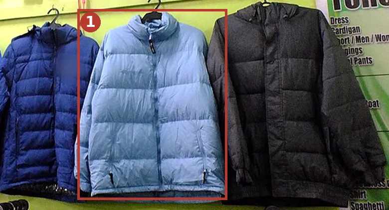

<a class="tr-btn go" href="#sale"><i class="ic ic-timer" aria-hidden="true"></i>지금 하는 세일·마감일</a><a class="tr-btn" href="#buy"><i class="ic ic-map-pin" aria-hidden="true"></i>어디서 살까</a>

<ul class="tr-facts"><li><i class="ic ic-list-checks" aria-hidden="true"></i>기사 2건<small>코리아헤럴드 10/20·11/23. 숫자는 10/20 기사에만</small></li><li><i class="ic ic-percent" aria-hidden="true"></i>+718%<small>무신사 8월 경량 패딩 매출, 1년 전 같은 달보다</small></li><li><i class="ic ic-package" aria-hidden="true"></i>첫 물량 품절 4건<small>기사에 숫자로 나온 제품 네 개</small></li><li><i class="ic ic-timer" aria-hidden="true"></i>12월 2일까지<small>무신사 겨울 블랙프라이데이(온라인)</small></li></ul>

<figure class="tr-hero acc-hero"><figcaption><b>칸칸이 누빈 짧은 패딩(1).</b> 필리핀 세부의 옷가게 사진(2022)이에요. 모양을 보여 주는 예시일 뿐, 경량 패딩인지는 알 수 없고 추천 상품도 아니에요.사진: PaulGorduiz106(필리핀 세부의 옷가게, 2022), <a href="https://creativecommons.org/licenses/by-sa/4.0/deed.ko" rel="noopener" target="_blank">CC BY-SA 4.0</a>, <a href="https://commons.wikimedia.org/wiki/File:Down_jackets_(09-09-2022).jpg" rel="noopener" target="_blank">위키미디어 공용</a> (잘라 냄, 상표 흐리게, 밝기 자동 보정, 상자·번호 추가)</figcaption></figure>

<h2 id="why">왜 올겨울 경량 패딩일까: 숫자로 판독하기</h2>

품절 소식이 많은 옷일수록 실제 숫자로 확인해 볼 만해요. 근거는 코리아헤럴드 기사 두 건이고, 숫자는 10월 기사에만 있어요.

<ul class="tr-choose"><li><i class="ic ic-percent" aria-hidden="true"></i><b>무신사 8월 경량 패딩 매출 +718%</b>1년 전 같은 달과 비교한 무신사 자료예요. 무신사 관계자는 거래량이 8배 넘게 늘었다고 했어요. (코리아헤럴드, 2026년 10월 20일) <em>Nadri 해석: 추워지기 전인 8월에 이미 많이 샀다는 뜻으로 읽혀요.</em></li><li><i class="ic ic-layers" aria-hidden="true"></i><b>보조 외투에서 가을·겨울 주인공으로</b>업계 관계자: 간절기나 등산용 보조 외투였던 경량 패딩이 가을·겨울 핵심 상품이 됐다. 가을엔 단독으로, 한겨울엔 안에 받쳐 입는 옷이라 디자인과 코디가 쉬운지가 사는 이유가 됐다고 해요. (같은 기사)</li><li><i class="ic ic-sparkles" aria-hidden="true"></i><b>“패딩은 가벼워지는 중”, 색은 옅게</b>11월 기사는 올겨울 경량 패딩이 짙은 원색이나 검정·회색보다 옅은 파스텔 색에 관심이 더 쏠린다고 전했어요. (코리아헤럴드, 2026년 11월 23일)</li></ul>

<aside class="tr-note tip"><i class="ic ic-info" aria-hidden="true"></i>근거는 코리아헤럴드 기사 두 건이에요. +718%와 품절 숫자는 10월 20일 기사(무신사 자료 인용)에만 있고, 11월 23일 기사는 숫자 없이 흐름(가벼워지는 패딩, 옅은 색)만 전해요. 무신사 앱의 실시간 랭킹은 확인하지 못했어요.</aside>

<i class="ic ic-package" aria-hidden="true"></i>‘첫 물량 품절’ 네 건, 기사 그대로

- **무신사 스탠다드 시티 레저 후디드 라이트 다운 재킷:** 10만 원대. 클라우디 블루 색은 남녀 전 사이즈 품절, 판매 1위(어느 순위표의 1위인지는 기사에 없어요).
- **뉴발란스 플라잉 77 슈퍼라이트 후디드 경량 구스 다운:** 10월 9일 공식 온라인몰에 나온 지 하루 만에 첫 물량 품절.
- **노스페이스 벤투스 온 재킷:** 2025년에는 1인 1개 제한에도 약 40분 만에 첫 물량 품절. 2026년에는 리얼블랙·블랙 색이 전 사이즈 품절.
- **MLB 커브 에어 쉘 후디드 재킷(라벤더, LA 다저스):** 첫 물량이 품절된 뒤 일부 사이즈만 다시 들어왔어요.

모두 코리아헤럴드 2026년 10월 20일 기사 기준이에요. 지금 재고는 판매처에서 다시 확인하세요.

<h2 id="look">어떤 모양이고, 어떻게 입을까</h2>

{{fig:winter-light-puffer-1|가을엔 겉옷 하나로, 한겨울엔 코트 안에. 올해 많이 보이는 모양 세 가지(코리아헤럴드 2026년 10월 20일·11월 23일 기사)}}

<h3 class="tr-step">1<i class="ic ic-sparkles" aria-hidden="true"></i>모양: 허리선, 넉넉한 어깨</h3>

올해는 허리선이 들어간 입체적인 실루엣과 넉넉한 어깨가 늘었고, 기본 검정·남색 말고 오트밀·포그 그레이 같은 뉴트럴 색이 많아졌다고 해요.

<h3 class="tr-step">2<i class="ic ic-layers" aria-hidden="true"></i>입는 법: 날씨에 따라 두 가지</h3>

- **가을·초겨울, 낮 기온이 오르내릴 때:** 겉옷 하나로. 움직이기 편하고, 더우면 벗어서 들고 다니기 쉬워요.
- **한겨울:** 코트나 두꺼운 파카 안에 받쳐 입어요. 실내에 들어가면 겉옷만 벗으면 돼요.

12월 고궁 산책처럼 밖에 오래 있는 날은 코트 안에, 카페와 매장을 오가는 날은 경량 패딩 하나로. 같은 옷 하나로 두 가지 날을 입는 게 이 옷을 사고 나서도 계속 좋아할 이유예요.

<h3 class="tr-step">3<i class="ic ic-users" aria-hidden="true"></i>코디 예: 운동복에도, 로퍼에도</h3>

11월 기사는 파스텔 경량 패딩에 트레이닝 바지를 입으면 따뜻하고 편한 일상복이 되고, 발목 양말에 플랫이나 로퍼를 신으면 한결 갖춰 입은 느낌이 난다고 소개했어요. 10월 기사도 패딩이 꼭 운동복처럼 보일 필요는 없다며 로퍼와 함께 입은 예를 들었어요.

<h2 id="brands">대표 제품과 브랜드: 알려진 이유와 출처</h2>

기사에 품절이나 판매 1위가 숫자로 나온 제품만 골랐어요. 연예인이 입었다는 이유로만 언급된 제품은 뺐어요.

<ul class="tr-choose"><li><i class="ic ic-tag" aria-hidden="true"></i><b>무신사 스탠다드: 가격</b>시티 레저 후디드 라이트 다운 재킷이 10만 원대. 무신사 자체 브랜드가 가격으로 경쟁한다고 보도됐고, 클라우디 블루는 판매 1위·전 사이즈 품절. 파는 곳: 무신사(무신사 자체 브랜드). (코리아헤럴드 2026-10-20)</li><li><i class="ic ic-sparkles" aria-hidden="true"></i><b>뉴발란스: 빠른 품절</b>플라잉 77 슈퍼라이트 후디드 경량 구스 다운. 10월 9일 공식 온라인몰 출시 하루 만에 첫 물량 품절. 색은 애쉬 블루, 버터 옐로, 차콜. 파는 곳: 뉴발란스 공식 온라인몰(기사 기준). (코리아헤럴드 2026-10-20)</li><li><i class="ic ic-package" aria-hidden="true"></i><b>노스페이스: 2년 연속 품절</b>벤투스 온 재킷. 작년엔 1인 1개 제한에도 약 40분 만에 첫 물량 품절, 올해 리얼블랙·블랙 전 사이즈 품절. 파는 곳: 기사에 없어 아직 확인 못 했어요. (코리아헤럴드 2026-10-20)</li><li><i class="ic ic-circle-help" aria-hidden="true"></i><b>MLB: 색으로 화제</b>커브 에어 쉘 후디드 재킷 라벤더(LA 다저스) 첫 물량 품절 후 일부 사이즈만 재입고. 파는 곳: 기사에 없어 아직 확인 못 했어요. (코리아헤럴드 2026-10-20)</li></ul>

<aside class="tr-note"><i class="ic ic-user-x" aria-hidden="true"></i><b>이미 경량 패딩이 있다면</b> 이번 겨울에 새로 살 이유는 색(옅은 색)과 모양(허리선, 넉넉한 어깨) 정도예요. 가진 옷이 코트 안에 잘 들어간다면 그대로 입어도 충분하다고 봐요.</aside>

<h2 id="sale">지금 하는 세일: 마감일 순서</h2>

남은 날은 서울 날짜로 매일 바뀌고, 끝난 세일은 저절로 사라져요. **확인**은 경량 패딩을 판다는 출처가 있는 곳, **추론**은 같은 시기에 옷을 세일하지만 경량 패딩이 할인 대상인지 아직 확인 못 한 곳이에요.

<table class="codes"><thead><tr><th>세일 · 경량 패딩과의 연결</th><th>남은 날</th></tr></thead><tbody>
<tr data-start="2026-11-20" data-end="2026-11-27"><td>유니클로 블랙프라이데이 <small>11월 20~27일, 할인율 미공개</small> <small>추론: 할인 품목 미확인</small></td><td>D-1</td></tr>
<tr data-start="2026-11-12" data-end="2026-11-29"><td>백화점 겨울 세일(신세계 370여·롯데 400여 브랜드 최대 50%, 현대 200여 브랜드 최대 60%) <small>11월 29일까지</small> <small>추론: 할인 품목 미확인</small></td><td>D-3</td></tr>
<tr data-start="2026-11-23" data-end="2026-11-29"><td>스파오 블랙프라이데이 <small>11월 23~29일, 할인율 미공개</small> <small>추론: 할인 품목 미확인</small></td><td>D-3</td></tr>
<tr data-start="2026-11-18" data-end="2026-11-30"><td>탑텐 블프(텐텐데이) <small>11월 18~30일, 할인율 미공개</small> <small>추론: 할인 품목 미확인</small></td><td>D-4</td></tr>
<tr data-start="2026-11-22" data-end="2026-12-02"><td><b>무신사 무진장 26 겨울 블프(온라인)</b> <small>11월 22일~12월 2일, 4,781개 브랜드</small> <small><b>확인:</b> 무신사가 판매 1위로 보도된 경량 패딩을 팔아요. 그 제품이 할인 대상인지는 앱에서 확인</small></td><td>D-6</td></tr>
</tbody></table>

**고르는 순서:** 마감이 가까운 추론 세일(유니클로·스파오·탑텐·백화점)은 매장이나 앱에서 경량 패딩이 할인 대상인지 먼저 보고, 아니면 12월 2일까지인 무신사 쪽으로 가요.

<h2 id="codes">코드와 혜택: 조건까지</h2>

<h3 class="tr-step">1<i class="ic ic-smartphone" aria-hidden="true"></i>무신사 온라인 블프 쿠폰</h3>

카운트다운 쿠폰 최대 30%(선착순, 6번), 하루 두 번 열리는 ‘오픈런 뽑기’ 쿠폰 최대 80%. 12월 2일까지. 선착순이라 앱에서 쿠폰 시간 알림을 켜 두는 게 사실상 필수예요.

<h3 class="tr-step">2<i class="ic ic-ticket" aria-hidden="true"></i>무신사 매장 쿠폰·코드</h3>

매장 전용 쿠폰과 코드, 적용 상품은 [무신사 공식 공지](https://www.musinsa.com/content/1566699932019111639)에서 확인하세요. 계산대에서는 휴대폰에 이 문장을 띄워 보여 주거나 그대로 말하면 돼요.

<aside class="tr-note tip"><i class="ic ic-circle-help" aria-hidden="true"></i><b>“이 상품에 쓸 수 있는 쿠폰이 있나요? 앱 쿠폰 적용해 주세요.”</b> (이 상품에 쓸 수 있는 쿠폰이 있는지 묻고, 앱에 받아 둔 쿠폰을 써 달라는 말이에요.)</aside>

<h3 class="tr-step">3<i class="ic ic-id-card" aria-hidden="true"></i>한국 방문 중이면: 계산대에서 세금 빼기</h3>

계산대에 ‘Tax Free’ 표시가 있는 매장에서 한 영수증이 1만 5천~100만 원이면, 여권 실물을 내고 그 자리에서 세금을 뺄 수 있어요. 무신사 매장이 해당하는지는 매장마다 계산 전에 물어보세요. 자세한 조건: [택스리펀드 받는 법](/ko/tax-refund/)

<aside class="tr-note tip"><i class="ic ic-id-card" aria-hidden="true"></i><b>“택스프리 되나요? 여권 여기 있어요.”</b> (세금을 빼 주는지 묻고, 여권 실물을 함께 내는 말이에요.)</aside>

<h2 id="buy">어디서 살까</h2>

<h3 class="tr-step">1<i class="ic ic-store" aria-hidden="true"></i>입어 보고 사기: 무신사 메가스토어 성수</h3>

코트 안에 입을 옷이라면 직접 입어 보는 게 제일 확실하다고 봐요.

{{fig:shopping-streets-5|성수역에서 나가는 곳: 무신사 메가스토어는 3번 출구에서 475m}}

1. **2호선 성수역에서 내려 3번 출구로 나가요.** 출구 번호 찾는 법은 [서울 지하철](/ko/seoul-subway/)에 실제 표지판 사진이 있어요.
2. **지도 앱에서 ‘무신사 메가스토어 성수’를 검색해 ‘도보’ 길찾기를 따라가요.** 475m예요.
3. **매일 11:00~22:00.** 2026년 4월에 문을 연 지상 4층·지하층 매장이고, 주말엔 붐빈다는 보도가 있어 평일이 좋다고 봐요.
4. **매장에서 경량 패딩을 입어 보고**, 위의 쿠폰 문장을 보여 주며 쓸 수 있는 쿠폰이 있는지 물은 뒤 계산해요.

<figure class="tr-photo"><figcaption><b>성수 연무장길.</b> 성수역 4번 출구에서 시작하는 쇼핑 거리예요. 무신사 매장은 3번 출구 쪽이라 두 곳을 묶어 걸어도 돼요.사진: Dr. Thomas Liptak, <a href="https://creativecommons.org/licenses/by-sa/4.0/deed.ko" rel="noopener" target="_blank">CC BY-SA 4.0</a>, <a href="https://commons.wikimedia.org/wiki/File:Seoul,_Seongdong_District,_Seongsu_(Yeonmujang-gil).jpg" rel="noopener" target="_blank">위키미디어 공용</a> (잘라 냄, 밝기 자동 보정)</figcaption></figure>

**다른 무신사 매장:** 행사하는 매장 목록은 [무신사 공식 공지](https://www.musinsa.com/content/1566699932019111639)에서 확인하세요. 출구는 지도 앱에 매장 이름을 넣으면 나와요. 홍대·명동 가는 길은 [명동·성수·홍대 고르는 법](/ko/shopping-streets/)에 있어요.

<h3 class="tr-step">2<i class="ic ic-smartphone" aria-hidden="true"></i>온라인으로 사기</h3>

<ul class="tr-choose"><li><i class="ic ic-shopping-basket" aria-hidden="true"></i><b>무신사(앱·웹)</b>무신사 스탠다드는 무신사 자체 브랜드라 무신사에서 팔아요(코리아헤럴드 2026-10-20). 무신사 사이트는 자동 접속을 막고 있어서, 지금 재고와 가격은 Nadri가 열어 보지 못했어요. 앱이나 <a href="https://www.musinsa.com/" rel="noopener" target="_blank">musinsa.com</a>에서 상품 이름으로 검색하세요.</li><li><i class="ic ic-tag" aria-hidden="true"></i><b>뉴발란스 공식 온라인몰</b>플라잉 77이 처음 나온 곳(코리아헤럴드 2026-10-20). 공식몰 주소를 오늘 확인하지 못해 링크를 달지 않았어요. 검색할 때 ‘뉴발란스 공식 온라인’으로 찾고, 주소가 브랜드 공식 사이트인지 확인하세요.</li><li><i class="ic ic-globe" aria-hidden="true"></i><b>해외 주소로 받으려면: 무신사 글로벌</b>무신사의 해외 배송 사이트 <a href="https://global.musinsa.com/" rel="noopener" target="_blank">global.musinsa.com</a>. 위 제품이 있는지는 확인하지 못했어요.</li></ul>

<h2 id="size">사기 전에: 코트 안에 들어갈까, 사이즈 맞추기</h2>

경량 패딩을 코트 안에 입을 생각이라면, 패딩만 맞으면 끝이 아니에요. 코트 안에 들어가야 해요.

1. **집에 있는 잘 맞는 패딩이나 재킷을 바닥에 평평하게 펴요.** 어깨 끝에서 끝, 겨드랑이 아래 가슴 너비, 목 뒤에서 밑단까지 길이를 줄자로 재요.
2. **판매 페이지의 치수 표(실제로 잰 치수, ‘실측’)와 비교해요.** 같은 부위끼리 비교하고, 재는 법은 판매 페이지의 설명을 따라요.
3. **코트 안에 입을 거면 코트도 똑같이 재요.** 패딩의 가슴 너비와 길이가 코트보다 넉넉하면 안에서 끼거나 밑단이 삐져나와요.

<h2>자주 하는 실수</h2>

<ul class="tr-oops"><li><i class="ic ic-triangle-alert" aria-hidden="true"></i>품절 기사 속 그 제품만 찾기. 10월 기사 기준이라 지금 재고는 달라요. 모양(허리선, 넉넉한 어깨)과 색으로 고르면 선택지가 넓어요.</li><li><i class="ic ic-triangle-alert" aria-hidden="true"></i>‘추론’ 세일을 확실한 할인으로 믿고 가기. 경량 패딩이 할인 대상인지 매장이나 앱에서 먼저 확인해요.</li><li><i class="ic ic-triangle-alert" aria-hidden="true"></i>쿠폰이 이 상품에 되는지 묻지 않고 계산하기. 계산 전에 위 문장을 보여 주세요.</li><li><i class="ic ic-triangle-alert" aria-hidden="true"></i>코트 안에 입을 건데 코트 치수를 안 재고 사기.</li></ul>

<i class="ic ic-info" aria-hidden="true"></i>뺀 것과 출처

뺀 것: 연예인이 입었다는 이유로만 언급된 제품, 출처 없는 ‘인기 순위’, 브랜드·쇼핑몰 상품 사진(쓰지 않아요). 제휴 링크는 아직 없어요.

2026년 11월 26일 직접 열어 확인: 코리아헤럴드 <a href="https://www.koreaherald.com/article/10908829" rel="noopener" target="_blank">「More sculptural, colorful: Puffers get a style upgrade」</a>(2026년 10월 20일: 무신사 8월 경량 패딩 매출 +718%·거래량 8배 이상(무신사 자료), 보조 외투에서 핵심 상품으로, 허리선·넉넉한 어깨·오트밀·포그 그레이, 네 제품의 품절·1위·가격, 뉴발란스 색, 로퍼 코디)·<a href="https://www.koreaherald.com/article/10946254" rel="noopener" target="_blank">「Fur is back, coat collars are higher and puffers are lighter this winter」</a>(2026년 11월 23일: 가벼워지는 패딩, 파스텔 관심, 트레이닝 바지·로퍼 코디. 숫자 없음). 세일 기간·할인율·온라인 쿠폰은 Nadri <a href="/ko/deals/">할인 상황판</a> 기록(출처: 전자신문 2026년 11월 20일 무신사 블프, 에스콰이어 코리아 2026년 11월 18일 유니클로·스파오·탑텐, 지디넷코리아 2026년 11월 10일 백화점 3사). 무신사 메가스토어 성수 출구·거리·영업시간·개점·주말 혼잡은 <a href="/ko/shopping-streets/#seongsu">명동·성수·홍대</a> 페이지의 출처 그대로예요. 택스프리 범위는 <a href="/ko/tax-refund/">택스리펀드</a> 페이지 기준. 무신사 공식 공지는 링크만 걸었어요.

## 다음

<ul class="tr-next"><li><a href="/ko/deals/"><i class="ic ic-timer" aria-hidden="true"></i>할인 상황판: 지금 하는 세일 전체<i class="ic ic-arrow-right" aria-hidden="true"></i></a></li><li><a href="/ko/shopping-streets/"><i class="ic ic-map-pin" aria-hidden="true"></i>명동·성수·홍대 고르는 법<i class="ic ic-arrow-right" aria-hidden="true"></i></a></li><li><a href="/ko/tax-refund/"><i class="ic ic-receipt" aria-hidden="true"></i>택스리펀드: 여권만 보여 주세요<i class="ic ic-arrow-right" aria-hidden="true"></i></a></li></ul>
