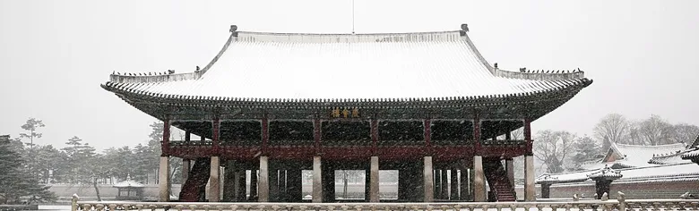

<link rel="stylesheet" href="/static/proto.css">

<table class="codes strip" role="presentation"><tbody>
<tr data-start="2026-11-20" data-end="2026-11-27"><td><a href="/ko/deals/">유니클로 블프 D-1</a></td></tr>
<tr data-start="2026-11-12" data-end="2026-11-29"><td><a href="/ko/deals/">백화점 3사 <b>최대 50~60%</b> D-3</a></td></tr>
<tr data-start="2026-11-23" data-end="2026-11-29"><td><a href="/ko/deals/">스파오 블프 D-3</a></td></tr>
<tr data-start="2026-11-18" data-end="2026-11-30"><td><a href="/ko/deals/">탑텐 블프 D-4</a></td></tr>
<tr data-start="2026-11-22" data-end="2026-12-02"><td><a href="/ko/deals/">무신사 블프 <b>쿠폰 최대 80%</b> D-6</a></td></tr>
</tbody></table>

<strong>+718%</strong>무신사 8월 경량 패딩 매출(전년 대비) · 코리아헤럴드 10/20<small>사진 Korea.net(전한) CC BY-SA 2.0</small>

<strong>104.7억</strong>블프 1위 무신사 스탠다드무신사 집계 11/26 16:25

<strong>1,811억</strong>무신사 블프 누적 판매4,781개 브랜드

<h3><i class="ic ic-tag" aria-hidden="true"></i>공식몰에서 비교 각 공식 상품 페이지, 11/26 확인</h3>
<table class="cmp"><thead><tr><th>제품 → 공식 페이지</th><th>가격</th><th>충전재</th><th>핏</th><th>평점</th><th>지금</th></tr></thead><tbody>
<tr><td><a href="https://www.uniqlo.com/kr/ko/products/E492179-000/00" rel="noopener" target="_blank">유니클로 라이트다운볼륨 →</a></td><td class="n">129,000원</td><td>솜털 85%</td><td>오버사이즈</td><td class="n">4.9 (20)</td><td>판매 중</td></tr>
<tr><td><a href="https://www.uniqlo.com/kr/ko/products/E486819-000/00" rel="noopener" target="_blank">유니클로 PUFFTECH컴팩트(남) →</a></td><td class="n">79,900원</td><td>합성 솜</td><td>슬림</td><td class="n">4.9 (37)</td><td>판매 중</td></tr>
<tr><td><a href="https://www.uniqlo.com/kr/ko/products/E470067-000/00" rel="noopener" target="_blank">유니클로 울트라라이트다운(남) →</a></td><td class="n">99,900원</td><td>솜털 90%</td><td>레귤러</td><td class="n">4.4 (119)</td><td>12월 중순</td></tr>
<tr><td><a href="https://www.musinsa.com/" rel="noopener" target="_blank">무신사 스탠다드 라이트 다운 →</a></td><td class="n">10만 원대</td><td>–</td><td>–</td><td class="n">–</td><td>품절 보도(10/20)</td></tr>
<tr><td><a href="https://arcteryx.com/us/en/shop/mens/cerium-hoody-0521" rel="noopener" target="_blank">아크테릭스 세륨 후디(미국) →</a></td><td class="n">$400</td><td>850필 · 338g</td><td>피티드</td><td class="n">3.9 (278)</td><td>미국 블프 ~12/1</td></tr>
</tbody></table>
<h3><i class="ic ic-scan-line" aria-hidden="true"></i>가슴둘레(cm)로 사이즈 고르기 유니클로 신체 치수표</h3>

<b>S</b>80–88

<b>M</b>88–96

<b>L</b>96–104

<b>XL</b>104–112

<b>XXL</b>112–120

<b>3XL</b>120–128

<b>4XL</b>128–136

<h3><i class="ic ic-list-checks" aria-hidden="true"></i>무신사 블프 브랜드 판매 순위 11/26 16:25 실시간 · 2–4위 미확인 · 빨강 = 경량 패딩 품절 보도</h3>
<ol class="bars"><li class="lp"><b>1</b>무신사 스탠다드<i style="width:100%"></i><em>104.7억</em></li><li><b>5</b>아디다스<i style="width:38%"></i><em>40.1억</em></li><li class="lp"><b>6</b>노스페이스<i style="width:36%"></i><em>38.0억</em></li><li><b>7</b>디미트리블랙<i style="width:29%"></i><em>30.3억</em></li><li><b>8</b>아웃스탠딩<i style="width:23%"></i><em>24.5억</em></li><li><b>9</b>드로우핏<i style="width:23%"></i><em>24.5억</em></li><li><b>10</b>수아레<i style="width:21%"></i><em>22.2억</em></li></ol>

<h3><i class="ic ic-sparkles" aria-hidden="true"></i>기사에 나온 색 조합 코리아헤럴드 10/20·11/23</h3>

라벤더 패딩브라운 톤
로맨틱하게 (10/20)

그레이 패딩트랙 팬츠 · 로퍼
운동복 같지 않게 (10/20)

파스텔 패딩트레이닝 바지
따뜻하고 편하게 (11/23)

<i class="ic ic-percent" aria-hidden="true"></i>왜 뜨나요?

- **+718%:** 무신사 '경량 패딩' 카테고리의 2026년 8월 매출이 1년 전 같은 달보다 718% 늘었어요(무신사 자료). 무신사 관계자는 거래량이 8배 넘게 늘었다고 했어요. (코리아헤럴드 2026-10-20) *Nadri 해석: 추워지기 전인 8월에 이미 많이 샀다는 뜻으로 읽혀요.*
- **보조 외투 → 핵심 상품:** 업계 관계자는 경량 패딩이 간절기·아웃도어 보조 외투에서 가을·겨울 핵심 상품이 됐다고 했어요. 올해는 허리선 있는 입체 실루엣, 넉넉한 어깨, 오트밀·포그 그레이 같은 뉴트럴 색이 늘었어요. (같은 기사)
- **옅은 색:** 11월 기사는 짙은 원색이나 검정·회색보다 옅은 파스텔 경량 패딩에 관심이 더 쏠린다고 전했어요. 이 기사에는 수치가 없어요. (코리아헤럴드 2026-11-23)
- **첫 물량 품절(10/20 기사):** 무신사 스탠다드 시티 레저 후디드 라이트 다운(클라우디 블루 남녀 전 사이즈 품절, 판매 1위. 어느 순위표인지는 기사에 없음) · 뉴발란스 플라잉 77(10/9 공식몰 출시 하루 만에) · 노스페이스 벤투스 온(2025년 약 40분, 2026년 리얼블랙·블랙 전 사이즈) · MLB 커브 에어 쉘 라벤더(품절 후 일부 재입고).
- **무신사 블프 숫자:** 4,781개 브랜드, 약 79만 8,610개 상품, 누적 판매 181,108,251,218원. 브랜드 1위 무신사 스탠다드 10,467,458,440원, 5위 아디다스 4,007,885,740원, 6위 노스페이스 3,801,693,790원, 7위 디미트리블랙 3,027,552,450원, 8위 아웃스탠딩 2,452,893,360원, 9위 드로우핏 2,448,870,380원, 10위 수아레 2,215,033,070원. 2~4위는 받은 화면에 없어요. 실시간 집계라 시간이 지나면 바뀌어요. 같은 집계 화면에 상의데이·하의데이 "단 3일, 최대 1만원 즉시 할인"도 있었어요(날짜는 화면에 없음).
- **이미 경량 패딩이 있다면** 새로 살 이유는 색(옅은 색)과 모양 정도라고 봐요.

<i class="ic ic-scan-line" aria-hidden="true"></i>사이즈 자세히

1. **줄자로 가슴둘레를 재요.** 겨드랑이 바로 아래, 가장 넓은 곳을 한 바퀴. 위 표에서 그 숫자가 들어가는 칸이 유니클로 사이즈예요(신체 치수 기준, 유니클로 '젠더리스 라이트다운볼륨재킷' 사이즈표).
2. **가진 패딩과 비교해요.** 잘 맞는 패딩을 바닥에 펴고 가슴너비(겨드랑이 아래 가로)와 전체 길이를 재서 아래 제품 치수와 비교해요.
3. **코트 안에 입을 거면** 코트도 똑같이 재서, 패딩이 코트보다 크지 않은지 봐요. 코트 안에 입을 거면 핏을 보세요. 유니클로는 울트라라이트다운을 “이너로도 착용 가능한 레귤러 핏”이라고 적어요. 브랜드마다 치수가 달라서, 다른 브랜드는 그 브랜드 표로 다시 보세요.

유니클로 남성 울트라라이트다운재킷 **제품 치수**(옷을 펴 놓고 잰 cm):

| 사이즈 | 전체 길이 | 어깨너비 | 가슴너비 | 등 중심~소매 |
|---|---|---|---|---|
| XS | 60 | 42.5 | 51 | 82.5 |
| S | 62 | 44 | 54 | 84 |
| M | 64 | 45.5 | 57 | 86.5 |
| L | 66 | 47 | 60 | 89 |
| XL | 69 | 49 | 64 | 91.5 |
| XXL | 70 | 51 | 68 | 92.5 |
| 3XL | 71 | 53 | 72 | 93.5 |
| 4XL | 72 | 55 | 76 | 94.5 |

XXL~4XL은 온라인에서만 팔아요. 세탁은 손세탁만, 드라이클리닝·건조기는 안 돼요(유니클로 상품 페이지).

<i class="ic ic-sparkles" aria-hidden="true"></i>어떻게 입나요?

- **두 가지로:** 가을엔 겉옷 하나로, 한겨울엔 안에 받쳐 입는 옷이에요(코리아헤럴드 2026-10-20). 유니클로도 울트라라이트다운을 "아우터로는 물론 다른 아우터의 이너로도 착용 가능"이라고 적어요.
- **기사 속 조합:** 라벤더 경량 패딩 + 브라운 톤 아이템(로맨틱), 그레이 경량 패딩 + 트랙 팬츠 + 로퍼(운동복처럼 안 보이게) — 10/20. 파스텔 경량 패딩 + 트레이닝 바지(따뜻하고 편한 일상), 발목 양말 + 플랫이나 로퍼(한결 갖춘 느낌) — 11/23. 트랙 팬츠·트레이닝 바지 색은 기사에 없어 빗금으로 표시했어요.

<i class="ic ic-map-pin" aria-hidden="true"></i>성수 매장 가는 길

입어 보고 사고 싶다면: **무신사 메가스토어 성수**, 2호선 성수역 **3번 출구에서 475m**, 매일 11:00~22:00. 주말엔 붐빈다는 보도가 있어 평일이 좋다고 봐요.

1. 성수역 3번 출구로 나가요(출구 표지 사진: [서울 지하철](/ko/seoul-subway/)).
2. 지도 앱에 '무신사 메가스토어 성수'를 넣고 '도보' 길찾기를 따라가요.
3. 계산대에서 이 문장을 보여 주세요: **“이 상품에 쓸 수 있는 쿠폰이 있나요? 앱 쿠폰 적용해 주세요.”** 매장 쿠폰·코드는 [무신사 공식 공지](https://www.musinsa.com/content/1566699932019111639)에서 확인하세요.
4. 한국 방문 중이고 계산대에 'Tax Free' 표시가 있으면: **“택스프리 되나요? 여권 여기 있어요.”** 영수증 한 장 1만 5천~100만 원, 여권 실물([택스리펀드](/ko/tax-refund/)).

유니클로는 각 상품 페이지의 '매장 재고 현황'에서 매장별 재고를 볼 수 있어요([유니클로 온라인스토어](https://www.uniqlo.com/kr/ko/)). 홍대·명동 가는 길: [명동·성수·홍대 고르는 법](/ko/shopping-streets/).

<i class="ic ic-info" aria-hidden="true"></i>출처

2026년 11월 26일 직접 열어 확인: 코리아헤럴드 <a href="https://www.koreaherald.com/article/10908829" rel="noopener" target="_blank">「More sculptural, colorful: Puffers get a style upgrade」</a>(2026-10-20: +718%, 핵심 상품, 실루엣·색, 품절 네 건, 무신사 스탠다드 10만 원대, 코디)·<a href="https://www.koreaherald.com/article/10946254" rel="noopener" target="_blank">「Fur is back, coat collars are higher and puffers are lighter this winter」</a>(2026-11-23: 가벼워지는 패딩, 파스텔, 코디. 수치 없음); 유니클로 공식 상품 페이지 <a href="https://www.uniqlo.com/kr/ko/products/E470067-000/00" rel="noopener" target="_blank">남성 울트라라이트다운재킷</a>·<a href="https://www.uniqlo.com/kr/ko/products/E492179-000/00" rel="noopener" target="_blank">젠더리스 라이트다운볼륨재킷</a>·<a href="https://www.uniqlo.com/kr/ko/products/E486819-000/00" rel="noopener" target="_blank">남성 PUFFTECH컴팩트재킷</a>(가격, 평점·리뷰 수, 충전재, 핏, 판매 상태, 사이즈표, 세탁); 아크테릭스 미국 공식 상품 페이지 <a href="https://arcteryx.com/us/en/shop/mens/cerium-hoody-0521" rel="noopener" target="_blank">Cerium Hoody Men's</a>(가격, 850필, 338g, Fitted, 평점 3.86·278개, 사이트 블프 배너 12/1까지 최대 40%). 무신사 무진장 26 겨울 블프 집계: 2026-11-26 16:25 기준(원두 확인, 실시간 집계라 바뀜). 세일 기간·할인율: Nadri <a href="/ko/deals/">할인 상황판</a>(전자신문 2026-11-20 무신사, 에스콰이어 코리아 2026-11-18 유니클로·스파오·탑텐, 지디넷코리아 2026-11-10 백화점 3사). 성수 매장 정보: <a href="/ko/shopping-streets/#seongsu">명동·성수·홍대</a> 페이지 출처 그대로. 사진: <a href="https://commons.wikimedia.org/wiki/File:Korea_Seoul_Snow_09.jpg" rel="noopener" target="_blank">Korea.net / 해외문화홍보원(전한), CC BY-SA 2.0, 위키미디어 공용</a>(잘라 냄, 밝기 자동 보정). 제휴 링크 없음.

